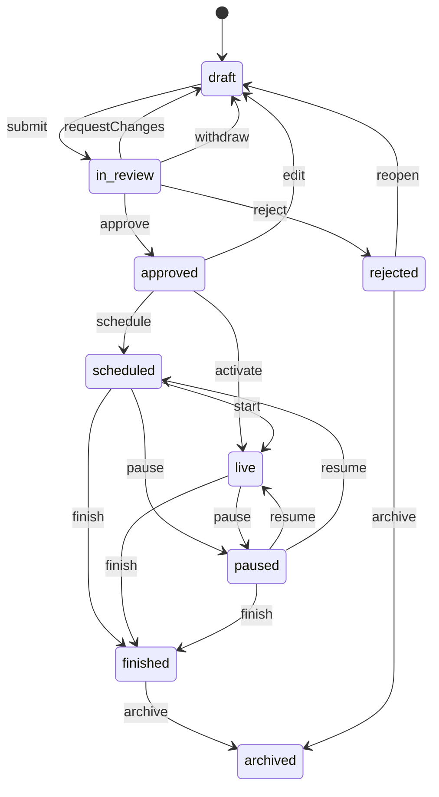
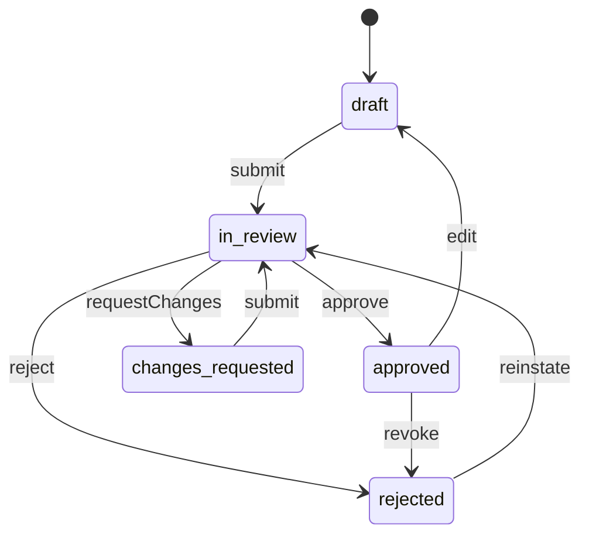
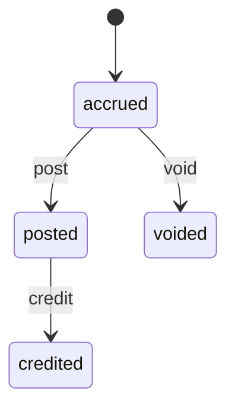

<!-- GENERATED by `npm run gen` from docs/api/modules/advertising.md. Do not edit: change the spec and regenerate. -->

# Advertising (`advertising`)

Ad placements and their rules, ad campaigns through the full lifecycle, creatives and their review, audiences, schedules, frequency caps and dismissal suppression, rotation and priority, the serving decision for each page view, display/click/dismissal tracking with attribution, and seller sponsored campaigns with spending limits and ad charges kept separate from commission.

- **Group:** Growth · **Launch phase:** 1 · **Plan chapters:** 16, 3, 4, 15
- **Depends on:** [media](../media/README.md), [access](../access/README.md) · **Optional:** [promotions](../promotions/README.md), [offers](../offers/README.md), [catalog](../catalog/README.md), [inventory](../inventory/README.md), [sellers](../sellers/README.md), [orders](../orders/README.md), [content](../content/README.md), [finance](../finance/README.md), [search](../search/README.md), [reports](../reports/README.md), [notifications](../notifications/README.md), [audit](../audit/README.md), [customers](../customers/README.md), [settings](../settings/README.md)

## Owns
- Placements: opening full-screen, home and category banners, promotional pop-up, sponsored product, sponsored store or brand, floating/sticky panel, interstitial; video later
- Global rules: never cover checkout, payment results, tracking or returns; one overlay at a time; required Ad/Sponsored labels; visible close control; remove unavailable or expired ads; seller behind promoted offers named
- Per-placement page eligibility, formats, frequency caps, rotation or priority rule and dismissal suppression
- Ad campaigns: advertiser (own promotion, Official Store product, seller, brand), goal, linked promotion, placement, pages, audience, destination, schedule with publication time zone, frequency, priority, delivery cap, budget
- Campaign lifecycle: Draft, In review, Approved, Scheduled, Live, Paused, Finished, Archived (plus Rejected)
- Approvals: Advertising plus Content or Marketing for own promotions; Advertising review for seller and brand ads
- Creative library: desktop and phone images, ad text, optional video, link checks, automatic checks and reviewer notes
- Serving: deciding which ads to show on a page view now, honouring rules, audience, caps, suppression and overlay exclusivity
- Tracking of displays, clicks and dismissals; attribution of purchases within a stated attribution period; reports
- Seller sponsored campaign requests, spending limits (daily and total), billing model and ad charges posted to finance as a separate line

**Not here:**
- Discounts and coupons a campaign links to: promotions (the ad brings attention; the promotion changes the price)
- Homepage section order and campaign pages: content (ad positions appear there as locked markers)
- Image and video storage: media
- Seller statements and balances: finance (consumes advertising.charge.posted)
- Approval limits and second reviewers: access

## Store API

| Method | Path | Purpose | Auth | Body → Response |
|---|---|---|---|---|
| POST | `/api/store/advertising/decisions` | Decide which ads to show on this page view now | shopper | `ServeRequest` → `ServeDecision` |
| POST | `/api/store/advertising/events` | Record displays, clicks and dismissals (batched) | shopper | `{ events: TrackEvent[] }` → `{ accepted: int, ignored: int }` |

## Seller API

| Method | Path | Purpose | Auth | Body → Response |
|---|---|---|---|---|
| GET | `/api/seller/advertising/summary` | Ad spend, clicks and attributed orders for a period _(phase 3)_ | seller | `SellerAdsSummary` |
| GET | `/api/seller/advertising/campaigns` | Own sponsored campaigns with status and spend vs limit _(phase 3)_ | seller | Page<SellerAdCampaign> |
| GET | `/api/seller/advertising/pricing` | Billing models and rates (example until confirmed in the advertising terms) _(phase 3)_ | seller | `PricingOption[]` |
| GET | `/api/seller/advertising/promotable-offers` | Own active offers with stock that can be promoted _(phase 3)_ | seller | Page<item> |
| POST | `/api/seller/advertising/creatives` | Add a desktop or mobile creative for a request _(phase 3)_ | seller<br>`advertising.requests.manage` | `CreativeInput` → `Creative` |
| POST | `/api/seller/advertising/campaigns` | Create a sponsored campaign request (draft) _(phase 3)_ | seller<br>`advertising.requests.manage` | `SellerAdRequestInput` → `SellerAdCampaign` |
| GET | `/api/seller/advertising/campaigns/{id}` | Request with review checks, previews, activity and results _(phase 3)_ | seller | `SellerAdCampaign` |
| PATCH | `/api/seller/advertising/campaigns/{id}` | Edit a request (sends a request in review back to the start of review) _(phase 3)_ | seller<br>`advertising.requests.manage` | `SellerAdRequestInput` → `SellerAdCampaign` |
| POST | `/api/seller/advertising/campaigns/{id}/submit` | Submit for Marketly review _(phase 3)_ | seller<br>`advertising.requests.manage` | `SellerAdCampaign` |
| POST | `/api/seller/advertising/campaigns/{id}/withdraw` | Withdraw a request in review _(phase 3)_ | seller<br>`advertising.requests.manage` | `SellerAdCampaign` |
| POST | `/api/seller/advertising/campaigns/{id}/pause` | Pause an own live campaign _(phase 3)_ | seller<br>`advertising.requests.manage` | `SellerAdCampaign` |
| POST | `/api/seller/advertising/campaigns/{id}/resume` | Resume an own campaign paused by the seller _(phase 3)_ | seller<br>`advertising.requests.manage` | `SellerAdCampaign` |
| GET | `/api/seller/advertising/charges` | Own ad charges by day (they appear on statements as a separate line) _(phase 3)_ | seller<br>`advertising.billing.view` | Page<AdCharge> |

## Admin API

| Method | Path | Purpose | Auth | Body → Response |
|---|---|---|---|---|
| GET | `/api/admin/advertising/dashboard` | Live now, upcoming starts, ending soon, waiting approvals, spending and performance | staff<br>`advertising.campaigns.view` | `AdsDashboard` |
| GET | `/api/admin/advertising/campaigns` | Own promotions and paid ads in every lifecycle status | staff<br>`advertising.campaigns.view` | Page<AdCampaignSummary> |
| POST | `/api/admin/advertising/campaigns` | Create an ad campaign draft _(audited)_ | staff<br>`advertising.campaigns.manage` | `AdCampaignInput` → `AdCampaign` |
| GET | `/api/admin/advertising/campaigns/{id}` | Campaign with approvals, checks, conflicts, creatives and metrics | staff<br>`advertising.campaigns.view` | `AdCampaign` |
| PATCH | `/api/admin/advertising/campaigns/{id}` | Edit a draft (or an approved campaign, which returns it to draft) _(audited)_ | staff<br>`advertising.campaigns.manage` | `{ changes: AdCampaignInput, version: int }` → `AdCampaign` |
| POST | `/api/admin/advertising/campaigns/{id}/check` | Run checks: blocked pages, overlaps, labels, claims vs promotion, availability, links, reach estimate | staff<br>`advertising.campaigns.view` | `CampaignCheckResult` |
| GET | `/api/admin/advertising/campaigns/{id}/preview` | Desktop and phone preview exactly as visitors see it, with label and close control | staff<br>`advertising.campaigns.view` | `AdPreview` |
| POST | `/api/admin/advertising/campaigns/{id}/submit` | Submit for approval _(audited)_ | staff<br>`advertising.campaigns.manage` | `{ noteToReviewers: text? }` → `AdCampaign` |
| POST | `/api/admin/advertising/campaigns/{id}/approve` | Approve one review step (the campaign is approved when all steps are) _(audited)_ | staff<br>`advertising.campaigns.review` | `{ role: enum(advertising|content|marketing)?, note: text? }` → `AdCampaign` |
| POST | `/api/admin/advertising/campaigns/{id}/request-changes` | Send back to the owner with a reason _(audited)_ | staff<br>`advertising.campaigns.review` | `{ role: enum(advertising|content|marketing)?, reason: text }` → `AdCampaign` |
| POST | `/api/admin/advertising/campaigns/{id}/reject` | Reject a request (e.g. promoted offer suspended) _(audited)_ | staff<br>`advertising.campaigns.review` | `{ reason: text }` → `AdCampaign` |
| POST | `/api/admin/advertising/campaigns/{id}/schedule` | Schedule an approved campaign for its start time _(audited)_ | staff<br>`advertising.campaigns.publish` | `AdCampaign` |
| POST | `/api/admin/advertising/campaigns/{id}/activate` | Activate an approved campaign now _(audited)_ | staff<br>`advertising.campaigns.publish` | `AdCampaign` |
| POST | `/api/admin/advertising/campaigns/{id}/pause` | Pause immediately (off the site within 1 minute) _(audited)_ | staff<br>`advertising.campaigns.publish` | `{ reason: text? }` → `AdCampaign` |
| POST | `/api/admin/advertising/campaigns/{id}/resume` | Resume a paused campaign _(audited)_ | staff<br>`advertising.campaigns.publish` | `{ reason: text? }` → `AdCampaign` |
| POST | `/api/admin/advertising/campaigns/{id}/finish` | Finish a scheduled, live or paused campaign early _(audited)_ | staff<br>`advertising.campaigns.publish` | `{ reason: text? }` → `AdCampaign` |
| POST | `/api/admin/advertising/campaigns/{id}/archive` | Archive a finished or rejected campaign | staff<br>`advertising.campaigns.manage` | `AdCampaign` |
| POST | `/api/admin/advertising/campaigns/{id}/renew` | Create a new draft from a finished or ending campaign (renew deliberately) _(audited)_ | staff<br>`advertising.campaigns.manage` | `{ startsAt: datetime, endsAt: datetime }` → `AdCampaign` |
| GET | `/api/admin/advertising/campaigns/{id}/report` | Displays, clicks, dismissals, spend and attributed purchases by day | staff<br>`advertising.reports.view` | `PerformanceReport` |
| GET | `/api/admin/advertising/reports/performance` | Performance across campaigns by placement, with the attribution period stated | staff<br>`advertising.reports.view` | `PerformanceReport` |
| GET | `/api/admin/advertising/placements` | Placements with pages, formats, caps, rotation and dismissal rules | staff<br>`advertising.campaigns.view` | `Placement[]` |
| PATCH | `/api/admin/advertising/placements/{id}` | Edit a placement's rules or turn it on/off _(audited)_ | staff<br>`advertising.placements.manage` | `PlacementPatch` → `Placement` |
| GET | `/api/admin/advertising/rules` | Global advertising rules | staff<br>`advertising.campaigns.view` | `GlobalRules` |
| PUT | `/api/admin/advertising/rules` | Change global rules (Business Owner approval) _(audited)_ | staff<br>`advertising.rules.manage` | `GlobalRulesInput` → `GlobalRules` |
| GET | `/api/admin/advertising/creatives` | Creative library grouped by campaign | staff<br>`advertising.campaigns.view` | Page<Creative> |
| GET | `/api/admin/advertising/creatives/summary` | Creative counts by review status for the library tabs | staff<br>`advertising.campaigns.view` | `CreativeSummary` |
| POST | `/api/admin/advertising/creatives` | Add a creative (image or video uploaded through media first, or ad text) | staff<br>`advertising.campaigns.manage` | `CreativeInput` → `Creative` |
| GET | `/api/admin/advertising/creatives/{id}` | Creative with checks, reviews and where it is used | staff<br>`advertising.campaigns.view` | `Creative` |
| PATCH | `/api/admin/advertising/creatives/{id}` | Edit ad text or link (approved creatives return to draft) _(audited)_ | staff<br>`advertising.campaigns.manage` | `{ headline: string?, body: string?, buttonText: string?, link: string?, mediaId: uuid? }` → `Creative` |
| POST | `/api/admin/advertising/creatives/{id}/review` | Approve, request changes or reject a creative with a reason _(audited)_ | staff<br>`advertising.campaigns.review` | `{ role: enum(advertising|content|marketing)?, decision: enum(approved|changes_requested|rejected|note), reasonCode: enum(no_changes|unsupported_claim|broken_link|product_unavailable|label_missing|image_quality|policy)?, comment: text? }` → `Creative` |
| POST | `/api/admin/advertising/creatives/{id}/check` | Re-run the link, availability and label checks | staff<br>`advertising.campaigns.view` | `Creative` |
| GET | `/api/admin/advertising/charges` | Seller ad charges (separate from commission) _(phase 3)_ | staff<br>`advertising.billing.manage` | Page<AdCharge> |
| POST | `/api/admin/advertising/charges/{id}/void` | Void an accrued charge or credit a posted one (invalid traffic, cancelled delivery) _(idempotent, audited, phase 3)_ | staff<br>`advertising.billing.manage` | `{ reason: text }` → `AdCharge` |

## Types

### CreativeFormat

| Field | Type |
|---|---|
| device | `enum(desktop|phone|any)` |
| width | `int` |
| height | `int` |
| maxBytes | `int` |
| mimeTypes | `string[]` |
| label | `string` e.g. Desktop 1600 × 900 |

### FrequencyCap

| Field | Type |
|---|---|
| perSession | `int?` |
| perDay | `int?` |
| perWindow | `FrequencyWindow?` |
| perCampaign | `int?` |
| label | `string` e.g. Once per session · max 3 per visitor per 7 days |

### FrequencyCapInput

| Field | Type |
|---|---|
| perSession | `int?` |
| perDay | `int?` |
| perWindow | `FrequencyWindow?` |
| perCampaign | `int?` |

### FrequencyWindow

| Field | Type |
|---|---|
| count | `int` |
| days | `int` |

### DismissalRule

| Field | Type |
|---|---|
| mode | `enum(not_dismissible|session|days|campaign)` |
| days | `int?` |
| label | `string` e.g. Closing hides that campaign for 7 days |

### DismissalRuleInput

| Field | Type |
|---|---|
| mode | `enum(not_dismissible|session|days|campaign)` |
| days | `int?` |

### RotationRule

| Field | Type |
|---|---|
| mode | `enum(priority_then_even|relevance_then_priority|category_match_then_priority|carousel)` |
| carouselSeconds | `int?` |
| maxInRotation | `int?` |
| pauseOnHoverAndFocus | `bool` |
| label | `string` |

### RotationRuleInput

| Field | Type |
|---|---|
| mode | `enum(priority_then_even|relevance_then_priority|category_match_then_priority|carousel)` |
| carouselSeconds | `int?` |
| maxInRotation | `int?` |
| pauseOnHoverAndFocus | `bool` |

### PopupTrigger

| Field | Type |
|---|---|
| afterSeconds | `int?` |
| scrollPct | `int?` |
| skipIfOverlayShownThisSession | `bool` |

### Placement

| Field | Type |
|---|---|
| id | `uuid` |
| key | `enum(opening_fullscreen|home_banner|category_banner|campaign_banner|popup|sponsored_product|sponsored_store|floating|interstitial|video)` |
| name | `string` |
| description | `string` Shown on the ad type card when choosing a placement, e.g. Appears when a visitor opens the site. Close or skip always visible. |
| kind | `enum(overlay|inline|card|strip)` |
| enabled | `bool` |
| availability | `enum(launch|pilot|later)` Plan ch. 16/20: launch = full-screen, banners, pop-ups |
| eligiblePages | `string[]` Page types (see notes), e.g. home, category, campaign |
| pagesLabel | `string` |
| formats | `CreativeFormat[]` |
| frequencyCap | `FrequencyCap?` |
| trigger | `PopupTrigger?` |
| rotation | `RotationRule` |
| dismissal | `DismissalRule` |
| maxPerPage | `int?` |
| positions | `int[]?` Fixed positions in results lists, e.g. [3, 8] |
| label | `enum(Ad|Sponsored)` |
| liveCampaigns | `int` |
| version | `int` Increments on every change; PATCH must send the version it read (PlacementPatch.version), otherwise CONFLICT |
| updatedAt | `datetime` |
| updatedBy | `Actor?` |

### PlacementPatch

| Field | Type |
|---|---|
| enabled | `bool?` |
| eligiblePages | `string[]?` |
| formats | `CreativeFormat[]?` |
| frequencyCap | `FrequencyCapInput?` The label is written by the server |
| trigger | `PopupTrigger?` |
| rotation | `RotationRuleInput?` The label is written by the server |
| dismissal | `DismissalRuleInput?` The label is written by the server |
| maxPerPage | `int?` |
| positions | `int[]?` |
| reason | `text` |
| version | `int` |

### GlobalRules

| Field | Type |
|---|---|
| blockedPages | `string[]` Always includes checkout, payment_result, order_tracking, returns; cannot be reduced below that |
| overlaysPerPageView | `int` |
| labelRequired | `bool` |
| closeControlMinPx | `int` |
| removeUnavailable | `bool` |
| sellerNamedOnPromotedOffers | `bool` |
| dismissStopsForSession | `bool` |
| paidSellerAdsEnabled | `bool` |
| attributionDays | `int` A purchase counts when it happens within this many days of a click |
| attributionBasis | `enum(click)` |
| version | `int` |
| effectiveAt | `datetime` |
| updatedBy | `Actor?` |
| approval | `ApprovalInfo?` |

### GlobalRulesInput

| Field | Type |
|---|---|
| overlaysPerPageView | `int?` |
| closeControlMinPx | `int?` |
| dismissStopsForSession | `bool?` |
| paidSellerAdsEnabled | `bool?` |
| attributionDays | `int?` |
| extraBlockedPages | `string[]?` |
| effectiveAt | `datetime?` |
| reason | `text` |

### Audience

| Field | Type |
|---|---|
| mode | `enum(all|selected)` |
| regions | `string[]` Service regions, e.g. CA, OR, WA |
| visitors | `enum(all|new|returning)` |
| signIn | `enum(everyone|signed_in)` |
| categoryIds | `uuid[]` Interest from browsing in this store only, when privacy choices allow |
| estimatedWeeklyReach | `int?` |

### Destination

| Field | Type |
|---|---|
| kind | `enum(url|product|offer|seller_store|brand|collection|campaign_page)` |
| targetId | `uuid?` |
| url | `string` |

### PromotedItem

| Field | Type |
|---|---|
| kind | `enum(offer|product|seller_store|brand)` |
| id | `uuid` |
| label | `string?` |

### AdBudget

| Field | Type |
|---|---|
| billing | `enum(none|cpc|cpm|fixed_daily)` |
| rate | `Money?` |
| dailyLimit | `Money?` Spending limit per market day: midnight to midnight in the market time zone (kernel config), whatever the campaign's publication timeZone; charges accrue per market day (ad_charges.day) |
| totalLimit | `Money?` |
| deliveryCap | `int?` Maximum displays (own promotions have no budget charge) |
| spent | `Money` |
| remaining | `Money?` |

### AdBudgetInput

| Field | Type |
|---|---|
| billing | `enum(none|cpc|cpm|fixed_daily)` |
| rate | `Money?` |
| dailyLimit | `Money?` Spending limit per market day (see AdBudget.dailyLimit) |
| totalLimit | `Money?` |
| deliveryCap | `int?` Maximum displays (own promotions have no budget charge) |

### AdvertiserRef

| Field | Type |
|---|---|
| kind | `enum(platform|official_store|seller|brand)` |
| sellerId | `uuid?` |
| brandId | `uuid?` |
| name | `string` |
| paid | `bool` |

### AdCampaignInput

| Field | Type |
|---|---|
| name | `string` |
| advertiser | `{"kind":"enum(platform|official_store|seller|brand)","sellerId":"uuid?","brandId":"uuid?"}` |
| goal | `enum(company_promotion|platform_event|seller_offer|brand_campaign)` |
| ownerStaffId | `uuid?` |
| linkedPromotionId | `uuid?` |
| placementKey | `string` |
| pages | `string[]` Page types (see notes) within the placement's eligible pages |
| pageCategoryIds | `uuid[]?` Limit category pages, e.g. Home & Kitchen |
| audience | `Audience` |
| destination | `Destination` |
| promoted | `PromotedItem[]?` |
| startsAt | `datetime` |
| endsAt | `datetime` |
| timeZone | `string` |
| frequencyCap | `FrequencyCapInput?` Defaults to the placement cap; the label is written by the server |
| dismissal | `DismissalRuleInput?` Defaults to the placement rule; the label is written by the server |
| priority | `int` 1 low, 2 normal, 3 high; equal priority rotates evenly |
| budget | `AdBudgetInput?` Spent and remaining are kept by the server (AdCampaign.budget) |
| stopWithPromotion | `bool?` Stop when the linked promotion ends or its budget runs out. Default false; true needs linkedPromotionId |
| creativeIds | `uuid[]` |
| afterApproval | `enum(schedule|activate)?` What happens when the last approval step lands: schedule for startsAt (default) or go live at once. activate is refused at submit (PROMOTION_NOT_STARTED) when AdCampaign.activateBlockedReason is set. |
| noteToReviewers | `text?` |

### ApprovalStep

| Field | Type |
|---|---|
| role | `enum(advertising|content|marketing)` |
| reviewer | `Actor?` |
| state | `enum(waiting|approved|changes_requested|rejected)` |
| decidedAt | `datetime?` |
| note | `text?` |
| scope | `string` e.g. Placement, schedule and limits; Creative, claims and links |

### ReviewCheck

| Field | Type |
|---|---|
| state | `enum(ok|warn|fail|info)` |
| label | `string` |
| detail | `string?` |

### Conflict

| Field | Type |
|---|---|
| campaignId | `uuid` |
| name | `string` |
| from | `datetime` |
| to | `datetime` |
| pages | `string[]` |
| resolution | `string` e.g. Only one overlay shows at a time; the higher priority shows first |

### CampaignMetrics

| Field | Type |
|---|---|
| displays | `int` |
| clicks | `int` |
| ctrPct | `number` |
| dismissals | `int` |
| dismissRatePct | `number` |
| spend | `Money` |
| attributedOrders | `int` |
| attributedSales | `Money` |
| attributionDays | `int` |

### AdCampaignSummary

| Field | Type |
|---|---|
| id | `uuid` |
| ref | `string` AD-YYMMDD-NNNN |
| name | `string` |
| advertiser | `AdvertiserRef` |
| placementKey | `string` |
| placementName | `string` |
| pagesLabel | `string` |
| startsAt | `datetime?` |
| endsAt | `datetime?` |
| periodLabel | `string` |
| budgetLabel | `string` e.g. Internal, $1,240 of $3,000, $500 limit |
| deliveryLabel | `string` Frequency cap and audience in one line, e.g. once per session · new visitors |
| displays | `int` |
| clicks | `int` |
| status | `enum(draft|in_review|approved|scheduled|live|paused|finished|archived|rejected)` |
| statusNote | `string?` e.g. Paused by you Oct 3, needs Content review |
| allowedActions | `string[]` e.g. pause, finish, resume, schedule, review, archive, renew |

### AdCampaign

| Field | Type |
|---|---|
| id | `uuid` |
| ref | `string` |
| name | `string` |
| origin | `enum(staff|seller_request)` |
| advertiser | `AdvertiserRef` |
| goal | `string` |
| owner | `Actor?` |
| linkedPromotion | `LinkedPromotion?` |
| placement | `Placement` |
| pages | `string[]` |
| pageCategoryIds | `uuid[]` |
| audience | `Audience` |
| destination | `Destination` |
| promoted | `PromotedItem[]` |
| startsAt | `datetime?` |
| endsAt | `datetime?` |
| timeZone | `string` |
| frequencyCap | `FrequencyCap` |
| dismissal | `DismissalRule` |
| priority | `int` |
| budget | `AdBudget` |
| stopWithPromotion | `bool` |
| afterApproval | `enum(schedule|activate)` Chosen before approval and applied automatically by the final approve (schedule or activate transition, recorded in the timeline as the system acting on the submitter's choice) |
| activateAllowed | `bool` Whether Activate as soon as approved can be chosen now |
| activateBlockedReason | `string?` e.g. Not available: the linked promotion starts Oct 16 |
| creatives | `Creative[]` |
| status | `enum(draft|in_review|approved|scheduled|live|paused|finished|archived|rejected)` |
| pausedReason | `text?` |
| pausedBy | `Actor?` |
| pauseCause | `enum(promotion|offer|stock|product|availability|seller|trust)?` Set when the system paused the campaign automatically (the matching event or sweep resumes promotion, offer, stock, product and availability pauses; seller and trust pauses stay for staff); null for a staff or seller pause |
| rejectedReason | `text?` Why the campaign was rejected (status rejected) |
| finishedReason | `enum(ended|budget_reached|delivery_cap_reached|promotion_ended|offer_unavailable|stopped_early|seller_restricted)?` |
| approvals | `ApprovalStep[]` |
| checks | `ReviewCheck[]` |
| conflicts | `Conflict[]` |
| metrics | `CampaignMetrics` |
| noteToReviewers | `text?` |
| timeline | `TimelineEvent[]` |
| createdBy | `Actor` |
| createdAt | `datetime` |
| updatedAt | `datetime` |
| version | `int` |

### LinkedPromotion

| Field | Type |
|---|---|
| id | `uuid` |
| name | `string` |
| code | `string?` |
| status | `string` |
| startsAt | `datetime` |
| endsAt | `datetime` |

### CampaignCheckResult

| Field | Type |
|---|---|
| checks | `ReviewCheck[]` Label, close control, claims vs promotion, availability of promoted offers, link, contrast, blocked pages |
| conflicts | `Conflict[]` |
| estimatedWeeklyReach | `int?` |
| canSubmit | `bool` |

### AdPreview

| Field | Type |
|---|---|
| desktop | `AdImpression` |
| phone | `AdImpression` |
| frame | `{"desktop":"string","phone":"string"}` |
| theme | `enum(light|dark)` |

### Creative

| Field | Type |
|---|---|
| id | `uuid` |
| campaignId | `uuid?` |
| advertiser | `AdvertiserRef` |
| kind | `enum(image|text|video)` |
| device | `enum(desktop|phone|any)` |
| formatLabel | `string` e.g. Opening full-screen · desktop |
| media | `MediaRef?` |
| fileName | `string?` |
| width | `int?` |
| height | `int?` |
| bytes | `int?` |
| durationSeconds | `int?` |
| captions | `bool?` |
| headline | `string?` |
| body | `string?` |
| buttonText | `string?` |
| link | `string?` |
| status | `enum(draft|in_review|changes_requested|approved|rejected)` |
| linkCheck | `LinkCheck` |
| autoChecks | `ReviewCheck[]` |
| reviews | `CreativeReview[]` |
| usedIn | `CreativeUse[]` |
| createdAt | `datetime` |
| createdBy | `Actor` |

### CreativeSummary

| Field | Type |
|---|---|
| all | `int` |
| draft | `int` |
| inReview | `int` |
| changesRequested | `int` |
| approved | `int` |
| rejected | `int` |

### CreativeUse

| Field | Type |
|---|---|
| campaignId | `uuid` |
| name | `string` |
| status | `string` |

### CreativeInput

| Field | Type |
|---|---|
| campaignId | `uuid?` |
| kind | `enum(image|text|video)` |
| device | `enum(desktop|phone|any)` |
| placementKey | `string` |
| mediaId | `uuid?` Uploaded through media first |
| headline | `string?` |
| body | `string?` |
| buttonText | `string?` |
| link | `string?` |
| advertiser | `AdvertiserInput?` Staff only; seller uploads are always the seller |

### AdvertiserInput

| Field | Type |
|---|---|
| kind | `enum(platform|official_store|seller|brand)` |
| sellerId | `uuid?` |
| brandId | `uuid?` |

### LinkCheck

| Field | Type |
|---|---|
| state | `enum(ok|warn|fail|info)` |
| detail | `string` e.g. Product page works · 18 in stock; Promoted offer suspended (TR-3391) |
| checkedAt | `datetime` |

### CreativeReview

| Field | Type |
|---|---|
| reviewer | `Actor` |
| role | `enum(advertising|content|marketing)` |
| decision | `enum(approved|changes_requested|rejected|note)` |
| reasonCode | `enum(no_changes|unsupported_claim|broken_link|product_unavailable|label_missing|image_quality|policy)?` |
| comment | `text?` |
| at | `datetime` |

### AdImpression

| Field | Type |
|---|---|
| impressionToken | `string` Signed, single page view; required for tracking |
| campaignId | `uuid` |
| creativeId | `uuid` |
| placementKey | `string` |
| label | `enum(Ad|Sponsored|Announcement)` |
| advertiserName | `string` |
| sellerName | `string?` |
| advertiserLogo | `MediaRef?` Brand or seller logo for sponsored brand and store formats (from catalog brands or sellers) |
| eyebrow | `string?` |
| headline | `string` |
| body | `string?` |
| buttonText | `string` |
| secondaryText | `string?` e.g. Continue to home page, No thanks |
| image | `MediaRef?` |
| video | `MediaRef?` |
| destination | `string` |
| dismissible | `bool` |
| closeLabel | `string?` |
| footnote | `string?` e.g. Offers end Oct 19, 11:59 PM PT. Shown once per visit. |
| code | `string?` Coupon code for pop-ups that present a coupon (from promotions) |
| promotedOffer | `PromotedOfferCard?` |

### PromotedOfferCard

| Field | Type |
|---|---|
| offerId | `uuid` |
| productId | `uuid` |
| title | `string` |
| image | `MediaRef?` |
| price | `Money` |
| wasPrice | `Money?` |
| sellerName | `string` |
| deliveryNote | `string?` |

### SponsoredProductSlot

| Field | Type |
|---|---|
| position | `int` |
| impression | `AdImpression` |

### ServeRequest

| Field | Type |
|---|---|
| page | `string` Page type (see notes); an unknown or blocked page gets an empty decision |
| context | `ServeContext` |
| device | `enum(desktop|phone|app)` |
| visitorId | `string` First-party visitor id (cookie or app install id) |
| sessionId | `string` |
| isEntryPage | `bool` First page of the visit; opening ads only show on entry pages |
| slots | `string[]` Placement keys this page renders |
| overlayShownThisSession | `bool?` |
| region | `string?` |
| personalizationAllowed | `bool` From the visitor's privacy choices; false limits targeting to page context |

### ServeContext

| Field | Type |
|---|---|
| categoryId | `uuid?` |
| productId | `uuid?` |
| query | `string?` |
| campaignPageId | `uuid?` |
| brandId | `uuid?` |
| sellerId | `uuid?` |
| previousPage | `string?` |

### ServeDecision

| Field | Type |
|---|---|
| decisionId | `uuid` |
| overlay | `AdImpression?` At most one overlay (opening, pop-up or interstitial) per page view; null on blocked pages |
| popupTrigger | `PopupTrigger?` |
| slots | `map<AdImpression[]>` placementKey → ads in rotation order |
| sponsoredProducts | `SponsoredProductSlot[]` |
| rotationSeconds | `int?` |
| ttlSeconds | `int` Clients may reuse the decision this long (pausing takes effect within 1 minute) |

### TrackEvent

| Field | Type |
|---|---|
| impressionToken | `string` |
| kind | `enum(display|click|dismiss|close|video_play)` |
| at | `datetime?` Client time, informational only: the server records its own time for frequency, attribution and charges |
| visibleMs | `int?` |

### DailyAdPoint

| Field | Type |
|---|---|
| date | `date` |
| displays | `int` |
| clicks | `int` |
| dismissals | `int` |
| spend | `Money` |
| partial | `bool` |

### CampaignDayPerformance

| Field | Type |
|---|---|
| date | `date` |
| campaignId | `uuid` |
| campaignRef | `string` |
| sellerId | `uuid?` |
| displays | `int` |
| clicks | `int` |
| dismissals | `int` |
| attributedOrders | `int` |
| attributedSales | `Money` |
| spend | `Money` |
| partial | `bool` |

### PlacementStat

| Field | Type |
|---|---|
| placementKey | `string` |
| displays | `int` |
| clicks | `int` |
| dismissals | `int` |
| spend | `Money` |
| attributedOrders | `int` |

### PerformanceReport

| Field | Type |
|---|---|
| range | `DateRange` |
| timeZone | `string` |
| metrics | `CampaignMetrics` |
| openingAdClosedPct | `number?` |
| daily | `DailyAdPoint[]` |
| byPlacement | `PlacementStat[]` |
| attributionNote | `string` e.g. A purchase counts when it happens within 7 days of a click on the ad. Paid campaigns never guarantee purchases. |

### BillingSummary

| Field | Type |
|---|---|
| modelLabel | `string` |
| billedThisMonth | `Money` |
| unusedBudgetReturned | `Money` |
| cancelledCampaigns | `int` |

### AdsDashboard

| Field | Type |
|---|---|
| liveNow | `LiveCount` |
| startingIn7Days | `int` |
| nextStartAt | `datetime?` |
| endingSoon | `int` |
| waitingApproval | `int` |
| oldestWaitingDays | `int?` |
| spendThisMonth | `Money` |
| attributedOrders | `int` |
| attributedSales | `Money` |
| attributionDays | `int` |
| waitingList | `AdCampaignSummary[]` |
| upcomingStarts | `AdCampaignSummary[]` |
| endingSoonList | `AdCampaignSummary[]` |
| billing | `BillingSummary` |
| performance | `PerformanceReport` |

### LiveCount

| Field | Type |
|---|---|
| total | `int` |
| own | `int` |
| paid | `int` |

### AdCharge

| Field | Type |
|---|---|
| id | `uuid` |
| campaignId | `uuid` |
| campaignName | `string` |
| sellerId | `uuid` |
| day | `date` |
| basis | `enum(clicks|displays|fixed_day)` |
| units | `int` |
| rate | `Money` |
| amount | `Money` |
| state | `enum(accrued|posted|voided|credited)` |
| postedAt | `datetime?` |
| statementRef | `string?` |
| reason | `text?` |

### SellerAdRequestInput

| Field | Type |
|---|---|
| name | `string` |
| type | `enum(sponsored_product|sponsored_store)` |
| offerIds | `uuid[]` Only active offers with stock can be promoted |
| pages | `string[]` search, category, product (related products), home |
| categoryIds | `uuid[]?` |
| startsAt | `datetime` |
| endsAt | `datetime` |
| dailyLimit | `Money` |
| totalLimit | `Money` |
| billing | `enum(cpc|fixed_daily)` |
| creativeIds | `uuid[]` |
| headline | `string?` 40 characters max; claims must match the product page |

### SellerAdCampaign

| Field | Type |
|---|---|
| campaign | `AdCampaignSummary` |
| promotes | `string` |
| billingLabel | `string` e.g. Per click, $0.35 (example rate) |
| spend | `Money` |
| dailyLimit | `Money` |
| totalLimit | `Money` |
| audienceNote | `string` |
| reviewChecks | `ReviewCheck[]` |
| creatives | `Creative[]` |
| previews | `AdPreview?` |
| timeline | `TimelineEvent[]` |
| nextSteps | `string[]` |
| metrics | `CampaignMetrics` |

### PricingOption

| Field | Type |
|---|---|
| billing | `enum(cpc|fixed_daily|cpm)` |
| rate | `Money` |
| label | `string` |
| isExample | `bool` |

### SellerAdsSummary

| Field | Type |
|---|---|
| range | `DateRange` |
| spend | `Money` |
| clicks | `int` |
| attributedOrders | `int` |
| attributionDays | `int` |
| statementNote | `string` |

## Status flows

### Ad campaign (`AdCampaign.status`)



Plan ch. 16 lifecycle (Draft → In review/Submitted → Approved → Scheduled → Live/Active ⇄ Paused → Finished → Archived); Rejected is added for requests that fail review. approve completes only when every required ApprovalStep is approved (own promotions: Advertising plus Content or Marketing; seller and brand ads: Advertising, Content for claims). activate is allowed only if startsAt has passed and no linked promotion starts later. The final approve applies the campaign's afterApproval choice automatically (schedule, or activate when still allowed; if activation became impossible meanwhile it falls back to schedule and says so in the timeline). start/finish run from jobs at startsAt/endsAt; finish also fires on budget or delivery cap reached, linked promotion ended (stopWithPromotion), promoted offer unavailable, seller suspended. Staff pause takes the ad off the site within 1 minute (decision ttl). Renew creates a new draft copy; it is not a transition. Editing a seller request in review sends it back to draft (start of review).

### Creative review (`Creative.status`)



Creatives are submitted with their campaign. approve needs every required reviewer role. revoke is used when a promoted offer is suspended or a trust enforcement names it (reason recorded; seller can appeal through trust). reinstate only follows trust.enforcement.reversed for a creative that enforcement revoked: it goes back to review, never straight to approved.

### Ad charge (`AdCharge.state`)



Charges accrue per day from billable clicks/displays or the fixed daily fee and are capped at the daily and total limits. post sends them to finance (advertising.charge.posted) as an ad-charge line separate from commission. Invalid traffic or staff-cancelled delivery is voided (before posting) or credited (after posting) with a reason. Unused budget is never charged.

## Data (schema `advertising`)

**placements**: One row per placement type with its rules

| Column | Type |
|---|---|
| id | uuid pk |
| key | text unique |
| name | text |
| kind | text |
| enabled | bool |
| availability | text |
| eligible_pages | jsonb |
| formats | jsonb |
| frequency_cap | jsonb? |
| trigger | jsonb? |
| rotation | jsonb |
| dismissal | jsonb |
| max_per_page | int? |
| positions | jsonb? |
| label | text |
| description | text |
| version | int |
| updated_by | text? |
| updated_at | timestamptz |

**global_rules**: Versioned global rules; current = highest effective version

| Column | Type |
|---|---|
| version | int pk |
| rules | jsonb |
| effective_at | timestamptz |
| approval_request_id | uuid? |
| created_by | text |
| created_at | timestamptz |

**campaigns**

| Column | Type |
|---|---|
| id | uuid pk |
| ref | text unique |
| name | text |
| origin | text (staff|seller_request) |
| advertiser_kind | text |
| seller_id | uuid? |
| brand_id | uuid? |
| goal | text |
| owner_staff_id | uuid? |
| linked_promotion_id | uuid? |
| placement_id | uuid → placements |
| pages | jsonb |
| page_category_ids | jsonb |
| audience | jsonb |
| destination | jsonb |
| starts_at | timestamptz? |
| ends_at | timestamptz? |
| time_zone | text |
| frequency_cap | jsonb |
| dismissal | jsonb |
| priority | int |
| billing | text |
| rate | bigint? |
| daily_limit | bigint? |
| total_limit | bigint? |
| delivery_cap | int? |
| spent | bigint |
| currency | text |
| stop_with_promotion | bool |
| after_approval | text (schedule|activate) |
| status | text |
| paused_reason | text? |
| paused_by | text? (Actor kind:id of the last pause) |
| paused_at | timestamptz? |
| pause_cause | text? (promotion|offer|stock|product|availability|seller|trust) (automatic pauses only) |
| rejected_reason | text? |
| finished_reason | text? |
| note_to_reviewers | text? |
| created_by | text |
| created_at | timestamptz |
| updated_at | timestamptz |
| version | int |

Indexes: `(status, starts_at)`, `(status, ends_at)`, `(placement_id, status)`, `(seller_id, status)`, `(linked_promotion_id)`

**campaign_items**: Promoted offers, products, stores or brands

| Column | Type |
|---|---|
| campaign_id | uuid → campaigns |
| kind | text (offer|product|seller_store|brand) |
| target_id | uuid |
| label | text? |
| product_id | uuid? (the product: target_id for kind product, the offer's product for kind offer; null for stores and brands) |

Indexes: `(kind, target_id)`, `(product_id)`, `(campaign_id)`

**campaign_creatives**

| Column | Type |
|---|---|
| campaign_id | uuid → campaigns |
| creative_id | uuid → creatives |
| device | text |

Indexes: `unique (campaign_id, creative_id)`

**approval_steps**: Required reviewers per campaign submission

| Column | Type |
|---|---|
| id | uuid pk |
| campaign_id | uuid → campaigns |
| submission | int |
| role | text |
| reviewer_id | text? |
| state | text |
| note | text? |
| decided_at | timestamptz? |

**creatives**: Creative library

| Column | Type |
|---|---|
| id | uuid pk |
| advertiser_kind | text |
| seller_id | uuid? |
| brand_id | uuid? |
| kind | text |
| device | text |
| placement_key | text |
| media_id | uuid? |
| file_name | text? |
| width | int? |
| height | int? |
| bytes | int? |
| duration_seconds | int? |
| headline | text? |
| body | text? |
| button_text | text? |
| link | text? |
| status | text |
| link_check | jsonb |
| auto_checks | jsonb |
| created_by | text |
| created_at | timestamptz |

Indexes: `(status, created_at)`, `(seller_id)`

**creative_reviews**

| Column | Type |
|---|---|
| id | uuid pk |
| creative_id | uuid → creatives |
| reviewer_id | text |
| role | text |
| decision | text |
| reason_code | text? |
| comment | text? |
| at | timestamptz |

**campaign_log**: Lifecycle timeline with actor and reason

| Column | Type |
|---|---|
| id | uuid pk |
| campaign_id | uuid → campaigns |
| action | text |
| from_status | text? |
| to_status | text? |
| reason | text? |
| actor_kind | text |
| actor_id | text? |
| at | timestamptz |

**ad_events**: Displays, clicks, dismissals (append-only, partitioned by day; retained 13 months)

| Column | Type |
|---|---|
| id | uuid pk |
| impression_id | uuid |
| campaign_id | uuid |
| creative_id | uuid |
| placement_key | text |
| kind | text |
| visitor_key | text (hashed) |
| session_id | text |
| customer_id | uuid? |
| page | text |
| device | text |
| at | timestamptz |
| cost | bigint? |

Indexes: `(campaign_id, at)`, `(visitor_key, campaign_id, kind, at)`

**frequency_state**: Per visitor and campaign counters and suppression (TTL-cleaned)

| Column | Type |
|---|---|
| visitor_key | text |
| campaign_id | uuid |
| session_id | text? |
| session_displays | int |
| window_displays | int |
| window_started_at | timestamptz |
| display_day | date? (market day day_displays counts; null for rows written before it was kept) |
| day_displays | int |
| total_displays | int |
| last_display_at | timestamptz? |
| suppressed_until | timestamptz? |

Indexes: `unique (visitor_key, campaign_id)`

**attributions**: Orders attributed to a click within the attribution period

| Column | Type |
|---|---|
| id | uuid pk |
| order_id | uuid |
| campaign_id | uuid |
| click_event_id | uuid |
| amount | bigint |
| currency | text |
| attributed_at | timestamptz |
| reversed | bool |

Indexes: `unique (order_id, campaign_id)`

**daily_stats**: Read model per campaign and day

| Column | Type |
|---|---|
| campaign_id | uuid |
| day | date |
| displays | int |
| clicks | int |
| dismissals | int |
| spend | bigint |
| attributed_orders | int |
| attributed_sales | bigint |

Indexes: `unique (campaign_id, day)`

**ad_charges**: Seller ad charges per campaign and day, posted to finance as a separate statement line

| Column | Type |
|---|---|
| id | uuid pk |
| campaign_id | uuid → campaigns |
| seller_id | uuid |
| day | date |
| basis | text |
| units | int |
| rate | bigint |
| amount | bigint |
| currency | text |
| state | text |
| posted_at | timestamptz? |
| ledger_entry_id | uuid? |
| statement_ref | text? |
| reason | text? |

Indexes: `unique (campaign_id, day)`, `(seller_id, state)`

## Events

| Publishes | When | Payload | Consumed by |
|---|---|---|---|
| `advertising.campaign.status_changed` | Any lifecycle transition (submitted, approved, scheduled, live, paused, finished, archived, rejected) | `{ campaignId: uuid, from: string, to: string, reason: text?, advertiserKind: string, sellerId: uuid?, linkedPromotionId: uuid? }` | notifications |
| `advertising.creative.reviewed` | A reviewer decides on a creative | `{ creativeId: uuid, campaignId: uuid?, decision: string, reasonCode: string? }` | - |
| `advertising.placement.updated` | A placement's rules or on/off change | `{ placementKey: string, enabled: bool, version: int }` | - |
| `advertising.charge.posted` | Daily seller ad charges are posted for seller statements | `{ chargeId: uuid, sellerId: uuid, campaignId: uuid, day: date, amount: Money }` | reports |
| `advertising.charge.credited` | A posted charge is credited or an accrued one voided | `{ chargeId: uuid, sellerId: uuid, amount: Money, reason: text }` | reports |
| `advertising.budget.reached` | A paid campaign reaches its daily or total spending limit | `{ campaignId: uuid, sellerId: uuid?, limit: enum(daily|total) }` | - |
| `advertising.campaign.ending_soon` | A live or scheduled campaign ends within endingSoonDays (daily, once per campaign) | `{ campaignId: uuid, ref: string, name: string, advertiserKind: string, sellerId: uuid?, ownerStaffId: uuid?, endsAt: datetime, daysLeft: int }` | notifications |

| Consumes | From | Does |
|---|---|---|
| `promotions.campaign.ended` | promotions | Finish linked ads with stopWithPromotion (reason promotion_ended) |
| `promotions.campaign.paused` | promotions | Pause linked ads until the promotion resumes |
| `promotions.campaign.resumed` | promotions | Resume ads paused because of the promotion |
| `offers.offer.status_changed` | offers | Pause ads whose promoted offer is no longer active (offer_unavailable) |
| `inventory.stock.low` | inventory | Pause sponsored ads below the minimum stock threshold |
| `inventory.stock.changed` | inventory | Resume system-paused ads when stock returns above the threshold |
| `catalog.product.publication_changed` | catalog | Pause ads promoting hidden or suspended products |
| `sellers.seller.restricted` | sellers | Pause the seller's ads when the restriction covers new sales or advertising |
| `sellers.seller.suspended` | sellers | Finish the seller's ads (seller_restricted); charges only for delivery so far |
| `trust.enforcement.recorded` | trust | Revoke creatives and reject requests that promote the enforced offer or product; the enforcementId is stored with the revoke or reject reason so a reversal can find them |
| `trust.enforcement.reversed` | trust | Inbox-claimed per event. Creatives revoked by that enforcementId go back to in_review (reinstate) and seller requests it rejected reopen as drafts (reopen) the seller may resubmit; ads finished because of it are not restarted. The seller (or staff owner) is told; the campaign log records the reversal |
| `orders.order.placed` | orders | Attribute the order to the last ad click within attributionDays: by customerId for signed-in shoppers, and for guests by the payload visitorId (present only when the shopper allowed personalization; hashed like ad_events.visitor_key). Orders with neither are not attributed. unique (order_id, campaign_id) keeps redelivery idempotent |
| `orders.item.cancelled` | orders | Reduce attributed sales for cancelled items |
| `content.page.published` | content | Re-run link checks for creatives pointing at the page |
| `access.approval.decided` | access | Apply an approved global rules change at its effective time (and finish non-draft fee schedule approvals). Inbox-claimed per event (ctx.mongo.claim) before acting, so a redelivered decision applies once and writes one audit entry |
| `catalog.product.merged` | catalog | Repoint ads, ad requests and creatives that promote the duplicate product (or its variants, mapped through newVariantId / intoVariantId) to the kept product; delivery, spend and attribution history stay on the ad |

## In-process API (for other modules)

| Function | Signature | Used by |
|---|---|---|
| sponsoredForResults | `(ctx: { page: 'home' | 'category' | 'search' | 'product' | 'campaign' | 'collection' | 'deals' | 'brand' | 'seller_store' | 'official_store' | 'cart' | 'checkout' | 'payment_result' | 'order_tracking' | 'returns' | 'account' | 'help', query?: string, categoryId?: uuid, productId?: uuid, visitorId: string, sessionId: string, device: string, organicOfferIds: uuid[], personalizationAllowed: bool, customerId?: uuid }) => SponsoredProductSlot[]`<br>Sponsored product cards and their positions for a results list (max per page from the placement; relevance first, then priority). Only eligible, in-stock offers are returned. personalizationAllowed false: only page context (query, category, product) is used, frequency state is kept per session only and clicks are not kept for attribution by visitor; customerId (signed-in shopper) lets frequency caps and attribution follow the customer across devices when personalization is allowed. | search, catalog |
| adPositionsFor | `(page: 'home' | 'category' | 'search' | 'product' | 'campaign' | 'collection' | 'deals' | 'brand' | 'seller_store' | 'official_store' | 'cart' | 'checkout' | 'payment_result' | 'order_tracking' | 'returns' | 'account' | 'help') => { placementKey: string, name: string, enabled: bool }[]`<br>Ad positions on a page, so content can show them as locked markers in homepage sections. | content |
| campaignsForPromotion | `(promotionId: uuid) => AdCampaignSummary[]`<br>Ads linked to a promotion (shown on the promotion detail). | promotions, graphql |
| isAdBlockedPage | `(page: 'home' | 'category' | 'search' | 'product' | 'campaign' | 'collection' | 'deals' | 'brand' | 'seller_store' | 'official_store' | 'cart' | 'checkout' | 'payment_result' | 'order_tracking' | 'returns' | 'account' | 'help') => bool`<br>True for checkout, payment results, order tracking and returns; used by front-end shells to skip the serve call. | content |
| dailyPerformance | `(range: DateRange, filter?: { campaignId?: uuid, sellerId?: uuid }) => CampaignDayPerformance[]`<br>Displays, clicks, dismissals, attributed purchases and spend per campaign and day, from the daily_stats read model (days still open are marked partial). | reports |
| dashboardSummary | `(opts?: { listLimit?: int }) => AdsDashboard`<br>Read-only advertising summary for the Admin dashboard tile: live now (own and paid), starting in 7 days, ending soon, waiting approval, spend this month and short campaign lists. Records nothing; ad serving stays on POST /api/store/advertising/decisions. | graphql, reports, workqueues |
| exportRows | `(dataset: string, filters: json, principal: identity.Principal, cursor?: string) => { rows: json[], nextCursor?: string }`<br>Export rows for the reports dataset advertising.admin.campaigns (G72): the admin campaign list with its filters (q, source, placementKey, status, linkedPromotionId), staff only | reports |

## Permissions

| Key | Who | Allows |
|---|---|---|
| `advertising.campaigns.view` | staff | View campaigns, placements, creatives and rules |
| `advertising.campaigns.manage` | staff | Create, edit, submit, renew and archive campaigns; manage creatives |
| `advertising.campaigns.review` | staff | Approve, request changes or reject campaigns and creatives (Advertising, Content, Marketing reviewers) |
| `advertising.campaigns.publish` | staff | Schedule, activate, pause, resume and finish campaigns |
| `advertising.placements.manage` | staff | Placement rules and on/off |
| `advertising.rules.manage` | staff | Propose global rule changes (always approved by the Business Owner) |
| `advertising.reports.view` | staff | Performance reports and attribution |
| `advertising.billing.manage` | staff | View seller ad charges; void or credit them within limits |
| `advertising.requests.manage` | seller | Create, submit, withdraw, pause and resume sponsored campaign requests |
| `advertising.billing.view` | seller | View ad charges |

## Approval actions

Checked through the access module (limits per role, second reviewer).

| Action | Limit | Second reviewer | Approvers | Meaning |
|---|---|---|---|---|
| `advertising.rules.change` | none | always | Business Owner | Change the versioned global advertising rules (frequency, overlays per page, labels, paid seller ads) |
| `advertising.charges.void` | money | above-limit | Advertising Manager within the adjustment limit; Finance Manager above it (example values) | Void or credit a seller ad charge |

## Error codes

| Code | Status | Meaning |
|---|---|---|
| `PLACEMENT_DISABLED` | 409 | The placement is off or belongs to a later phase. |
| `PAGE_NOT_ELIGIBLE` | 422 | A selected page is not eligible for the placement or is blocked by the global rules (checkout, payment results, tracking, returns). |
| `CHECKS_FAILED` | 422 | Required checks failed (missing label, broken link, promoted offer unavailable, missing phone or desktop creative). details.checks. |
| `SAME_REVIEWER` | 409 | The same person cannot approve two required review steps. |
| `PROMOTION_NOT_STARTED` | 409 | The linked promotion has not started; schedule instead of activating. |
| `AD_UNAVAILABLE` | 409 | The promoted offer is unavailable or the linked promotion is inactive. |
| `CREATIVE_FORMAT_INVALID` | 422 | Size, dimensions, file type or text length does not match the placement format. |
| `INVALID_IMPRESSION_TOKEN` | 400 | The tracking token is missing, expired or tampered with. |
| `PAID_ADS_DISABLED` | 409 | Paid seller advertising is not enabled yet. |
| `OFFER_NOT_PROMOTABLE` | 422 | The offer is not the seller's, not active or out of stock. |

## Background jobs

| Job | Schedule | Does |
|---|---|---|
| `advertising.start-due` | every 1 min | Scheduled campaigns past startsAt → live |
| `advertising.finish-due` | every 1 min | Live or paused campaigns past endsAt → finished; finish when delivery cap reached |
| `advertising.availability-sweep` | every 5 min | Pause ads for unavailable or low-stock promoted offers and inactive linked promotions; resume when available again |
| `advertising.link-check` | hourly | Re-check destination links and promoted-offer availability for approved and live creatives |
| `advertising.stats-rollup` | every 5 min | Aggregate ad_events into daily_stats |
| `advertising.accrue-charges` | every 15 min | Accrue billable clicks/displays and fixed daily fees, capped at daily and total limits; stop delivery at the limit |
| `advertising.post-charges` | daily 02:00 market time | Post the previous day's charges to finance (advertising.charge.posted) |
| `advertising.expire-frequency-state` | hourly | Delete frequency and suppression rows past their window |
| `advertising.ending-soon-notice` | daily 08:00 market time | Publish advertising.campaign.ending_soon for campaigns ending within endingSoonDays (once per campaign), so owners finish or renew deliberately |

## Settings

| Key | Default | Rules | Meaning |
|---|---|---|---|
| decisionTtlSeconds | `60` | duration, seconds, 0–3600 | How long clients may reuse a serve decision; pausing takes effect within this time |
| attributionDays | `7` | duration, days, 1–30, seller-visible | Default attribution period after a click (also in global rules) |
| minPromotedStock | `10` | int, 0–…, seller-visible | Sponsored ads pause when the promoted offer's available stock falls below this |
| endingSoonDays | `3` | duration, days, 1–30 | Window for the Ending soon list |
| maxImageBytes | `1048576` | int, bytes, 1–… | Upload limit for own-campaign images (seller uploads 5 MB) |
| eventRetentionMonths | `13` | duration, months, 1–… | Raw ad event retention |
| headlineMaxChars | `60` | int, characters, 1–… | Overlay headline limit (seller card headline 40) |

## Notes
- Page types (a plain string everywhere: public API page arguments, ServeRequest.page, placement eligiblePages, campaign pages): home, category, search, product, campaign, collection, deals, brand, seller_store, official_store, cart, checkout, payment_result, order_tracking, returns, account, help. checkout, payment_result, order_tracking and returns are always blocked; global rules may block more.
- Frequency counters live on frequency_state per visitor key and campaign: session_displays (this session), window_displays from window_started_at (perWindow, or a rolling day for perDay alone), day_displays for the market day display_day (perDay together with perWindow) and total_displays (perCampaign). Rows of a live campaign with a perCampaign cap are kept until the campaign ends, so the total never resets.
- Promotions change the offer; ads bring attention to it (plan ch. 16). An ad may link a promotion; claims in creatives are checked against it.
- Serving order per page view: drop blocked pages → candidate campaigns live now for this placement, page and audience → drop suppressed (dismissed) and frequency-capped → drop unavailable promoted offers → pick by priority, equal priority rotates evenly (sponsored products: relevance first). Overlays: at most overlaysPerPageView, and a pop-up is skipped in a session where an opening ad showed.
- Opening full-screen ads: separate desktop and phone creatives, entry pages only, default once per session and configurable per campaign; closing returns the visitor to the page they opened (acceptance scenario 8).
- Targeting uses only first-party information the visitor's privacy choices allow (region, new/returning, signed-in, browsing categories in this store). When personalizationAllowed is false only page context is used.
- Ad charges are a seller cost separate from sales commission; finance shows them as their own statement line. Unused budget is never charged; if Marketly pauses or cancels, only delivery so far is charged. Paid campaigns never imply guaranteed purchases.
- Paid seller ads, sponsored store/brand, floating, interstitial and video are later (plan ch. 20 phase 3); their seller endpoints are phase 3 and the placements ship disabled. Sponsored product runs as a pilot for selected sellers when paidSellerAdsEnabled is on.
- Dependencies follow the architecture doc (media, access). promotions, offers, inventory, catalog, sellers, orders and content are optional: without them the related checks are skipped and the matching auto-pause rules do nothing.
- Global rules changes are versioned with an effective date and always need Business Owner approval (admin/ad-placements); the four blocked page types can never be unblocked.
- Reviewer roles: approve, request-changes and creative review take the reviewing step from the caller's access roles (access.rolesOf), so a Content Manager can never act on the Advertising step by sending role advertising.
- Attribution privacy (decision: guest attribution only with personalizationAllowed): orders carry visitorId only when the shopper allowed personalization; clicks recorded without personalization keep no visitor key usable for attribution.

## GraphQL (read layer)

This module's fragment of the GraphQL schemas (see [../graphql/README.md](../graphql/README.md)). Writes stay on the REST endpoints above.

```graphql
# advertising: read-only campaign summaries for the Admin dashboard (and promotion detail).
#
# AD SERVING IS NOT IN GRAPHQL. Deciding which ad shows (opening full-screen, banners, pop-ups,
# sponsored products) is a side effect: each decision issues signed impression tokens, applies
# frequency caps and dismissal suppression, and the client then records displays, clicks and
# dismissals. That stays on REST:
#   POST /api/store/advertising/decisions   (which ads to show on this page view)
#   POST /api/store/advertising/events      (display, click, dismiss tracking)
# Homepage ad slots appear in content's HomeSection (kind AD_POSITION, adPlacementKey) only as
# markers; sponsored product cards in results are merged by search/catalog through the in-process API.
# Seller sponsored-campaign screens are single-module and also stay on REST.

enum AdCampaignStatus @areas(in: [ADMIN]) {
  DRAFT
  IN_REVIEW
  APPROVED
  SCHEDULED
  LIVE
  PAUSED
  FINISHED
  ARCHIVED
  REJECTED
}

enum AdAdvertiserKind @areas(in: [ADMIN]) {
  PLATFORM
  OFFICIAL_STORE
  SELLER
  BRAND
}

"Who the ad is for. Own promotions (platform, Official Store) are unpaid; seller and brand ads may be paid."
type AdAdvertiser @areas(in: [ADMIN]) {
  kind: AdAdvertiserKind!
  sellerId: UUID
  brandId: UUID
  name: String!
  paid: Boolean!
}

"One ad campaign as a dashboard or list row"
type AdCampaignSummary @areas(in: [ADMIN]) {
  id: UUID!
  "AD-YYMMDD-NNNN"
  ref: String!
  name: String!
  advertiser: AdAdvertiser!
  placementKey: String!
  "e.g. Full-screen, Home banner, Pop-up"
  placementName: String!
  pagesLabel: String!
  startsAt: DateTime
  endsAt: DateTime
  "e.g. ends Oct 19; starts Oct 10"
  periodLabel: String!
  "e.g. Internal, $1,240 of $3,000, $500 limit"
  budgetLabel: String!
  "Frequency cap and audience in one line, e.g. once per session · new visitors"
  deliveryLabel: String!
  displays: Int!
  clicks: Int!
  status: AdCampaignStatus!
  "e.g. Paused by you Oct 3, needs Content review"
  statusNote: String
  "REST actions the caller may take, e.g. pause, finish, resume, review"
  allowedActions: [String!]!
}

type AdLiveCount @areas(in: [ADMIN]) {
  total: Int!
  "Platform and Official Store promotions"
  own: Int!
  "Paid seller and brand ads"
  paid: Int!
}

"Advertising tile of the Admin dashboard: what is live, starting, ending and waiting for approval"
type AdDashboardSummary @areas(in: [ADMIN]) {
  liveNow: AdLiveCount!
  startingIn7Days: Int!
  nextStartAt: DateTime
  endingSoon: Int!
  waitingApproval: Int!
  oldestWaitingDays: Int
  spendThisMonth: Money!
  attributedOrders: Int!
  attributedSales: Money!
  "A purchase counts when it happens within this many days of a click"
  attributionDays: Int!
  live: [AdCampaignSummary!]!
  upcomingStarts: [AdCampaignSummary!]!
  endingSoonList: [AdCampaignSummary!]!
  waitingList: [AdCampaignSummary!]!
}

# ------------------------------------------------------------------ fields on other modules' types

extend type PromotionCampaign {
  "Ads linked to this promotion (they stop when it ends or runs out of budget)"
  adCampaigns: [AdCampaignSummary!] @areas(in: [ADMIN]) @auth(requires: STAFF, permission: "advertising.campaigns.view") @source(module: "advertising", fn: "campaignsForPromotion")
}

# ------------------------------------------------------------------ queries

extend type Query {
  "Advertising today for the Admin dashboard (read-only; records nothing)"
  adDashboard(listLimit: Int = 3): AdDashboardSummary @areas(in: [ADMIN]) @auth(requires: STAFF, permission: "advertising.campaigns.view") @cost(weight: 5) @source(module: "advertising", fn: "dashboardSummary")
}
```
