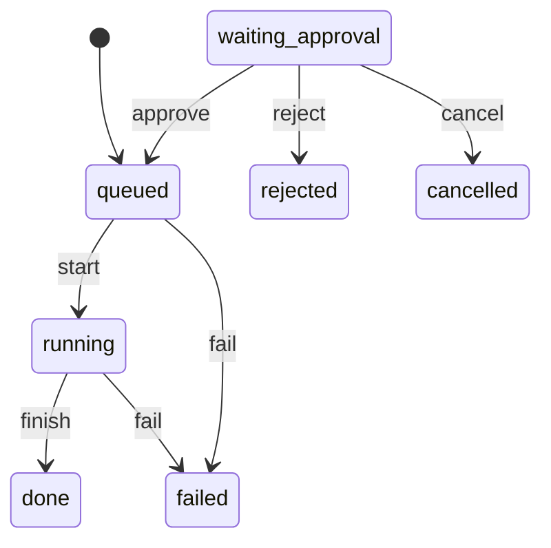

<!-- GENERATED by `npm run gen` from docs/api/modules/backups.md. Do not edit: change the spec and regenerate. -->

# Backups (`backups`)

Backups of the whole system (database, uploaded files, settings and keys) from the Admin Center: the list of backups on the server, a backup now, downloads, uploads and restores with two-person approval. The server's root backup service (deploy/linux ops.sh) does the work; this module asks it through request files and reports what it did.

- **Group:** Platform · **Launch phase:** 1 · **Plan chapters:** -
- **Depends on:** [access](../access/README.md), [identity](../identity/README.md) · **Optional:** [audit](../audit/README.md), [settings](../settings/README.md)

## Owns
- The list of backups on the server (database, uploaded files, settings and keys) and the nightly schedule
- Requests to the server's backup service: back up now, restore, apply the schedule
- Backup downloads (database and uploaded files; never the settings and keys file)
- Uploaded backups to restore from
- Restores: re-authenticated request, typed confirmation, a second staff member's approval (re-authenticated too), a safety backup first

**Not here:**
- Making and restoring backups: the root service on the server (deploy/linux/ops.sh, backup.sh, restore.sh)
- Copying backups off the server: staff download them, or copy /var/backups/marketly to a USB disk (deploy/linux/README.md)

## Admin API

| Method | Path | Purpose | Auth | Body → Response |
|---|---|---|---|---|
| GET | `/api/admin/backups/backups` | Backups on the server, the schedule and what the backup service is doing | staff `backups.view` | `BackupOverview` |
| POST | `/api/admin/backups/backups` | Back up now _(audited)_ | staff `backups.create` | `{ note: string? }` → `BackupOperation` |
| POST | `/api/admin/backups/backups/{id}/download-links` | Download a backup (database and uploaded files) _(audited, step-up: reauth)_ | staff `backups.download` | `{ reauthToken: string }` → `BackupDownloadLinks` |
| POST | `/api/admin/backups/backups/uploads` | Start uploading a backup _(audited)_ | staff `backups.restore` | `{ label: string }` → `BackupUpload` |
| PUT | `/api/admin/backups/backups/uploads/{id}/database` | Send the database file of an uploaded backup | staff `backups.restore` | raw bytes → `BackupUpload` |
| PUT | `/api/admin/backups/backups/uploads/{id}/files` | Send the uploaded-files file of an uploaded backup | staff `backups.restore` | raw bytes → `BackupUpload` |
| DELETE | `/api/admin/backups/backups/uploads/{id}` | Delete an uploaded backup _(audited)_ | staff `backups.restore` | 204 No content |
| POST | `/api/admin/backups/backups/restores` | Ask to restore a backup _(audited, step-up: reauth)_ | staff `backups.restore` | `{ backupId: string?, uploadId: uuid?, confirm: string, reason: text, reauthToken: string }` → `BackupOperation` |
| POST | `/api/admin/backups/backups/restores/{id}/cancel` | Withdraw a restore that is still waiting for approval _(audited)_ | staff `backups.restore` | `BackupOperation` |
| GET | `/api/admin/backups/backups/operations/{id}` | One backup, restore or schedule change | staff `backups.view` | `BackupOperation` |

## Types

### BackupFile

| Field | Type |
|---|---|
| name | `string` |
| sizeBytes | `int` |

### Backup

| Field | Type |
|---|---|
| id | `string` The backup's time stamp, e.g. 2026-10-15_0230 (server time); an uploaded backup ends in -uploaded |
| createdAt | `datetime` |
| kind | `enum(nightly|manual|safety|uploaded)` safety: taken automatically just before a restore |
| database | `BackupFile` |
| files | `BackupFile?` The uploaded files (media); missing in a database-only backup |
| hasSettingsAndKeys | `bool` The settings and keys file is on the server. It is never downloadable from the web: copy it by USB |
| note | `string?` |
| requestedBy | `Actor?` |

### BackupUpload

| Field | Type |
|---|---|
| id | `uuid` |
| label | `string` |
| state | `enum(receiving|ready|failed)` |
| database | `BackupFile?` |
| files | `BackupFile?` |
| uploadedBy | `Actor` |
| createdAt | `datetime` |
| error | `string?` |

### BackupOperation

| Field | Type |
|---|---|
| id | `uuid` |
| kind | `enum(backup|restore|schedule)` |
| state | `enum(waiting_approval|queued|running|done|failed|rejected|cancelled)` A restore waits for the second approval; the server's backup service then runs it (queued → running → done or failed) |
| backupId | `string?` backup: the backup made; restore: the backup restored |
| uploadId | `uuid?` restore of an uploaded backup |
| safetyBackupId | `string?` restore: the backup taken just before it |
| note | `string?` |
| reason | `text?` |
| message | `string?` What the backup service reported (the error when it failed) |
| requestedBy | `Actor` |
| requestedAt | `datetime` |
| startedAt | `datetime?` |
| finishedAt | `datetime?` |
| approval | `ApprovalInfo?` |

### BackupSchedule

| Field | Type |
|---|---|
| time | `string` HH:MM in the market time zone (setting backups.time) |
| keepDays | `int` Backups older than this are deleted (setting backups.keepDays) |
| timeZone | `string` |
| nextRunAt | `datetime?` |
| applied | `bool` The server's backup service has this schedule (a change is applied within a minute) |

### BackupOverview

| Field | Type |
|---|---|
| available | `bool` False where the server has no backup service (development machines): nothing can be backed up or restored here |
| unavailableReason | `string?` |
| backups | `Backup[]` |
| uploads | `BackupUpload[]` |
| schedule | `BackupSchedule` |
| lastBackupAt | `datetime?` |
| running | `BackupOperation?` The backup or restore the service is working on (one at a time) |
| pendingRestore | `BackupOperation?` A restore waiting for its second approval |
| recent | `BackupOperation[]` |
| warnings | `string[]` e.g. no backup in the last 26 hours; backups are on the same disk as the data |

### DownloadLink

| Field | Type |
|---|---|
| url | `url` Signed link (GET), valid for expiresAt |
| fileName | `string` |
| sizeBytes | `int` |
| expiresAt | `datetime` |

### BackupDownloadLinks

| Field | Type |
|---|---|
| database | `DownloadLink` |
| files | `DownloadLink?` |

## Status flows

### Backup operation (`BackupOperation.state`)

A restore starts in waiting_approval; a backup and a schedule change start queued. start, finish and fail come from the backup service's status file.

## Data (schema `backups`)

**operations**: Backups, restores and schedule changes asked of the server's backup service. The service's status file is the truth while it runs; after a restore (which replaces this collection) the module rebuilds its rows from the status files.

| Column | Type |
|---|---|
| id | uuid pk |
| kind | text (backup|restore|schedule) |
| state | text (waiting_approval|queued|running|done|failed|rejected|cancelled) |
| backup_id | text? |
| upload_id | uuid? |
| safety_backup_id | text? |
| note | text? |
| reason | text? |
| message | text? |
| params | jsonb? (schedule: time, keepDays) |
| requested_by | jsonb |
| requested_at | timestamptz |
| approval_request_id | uuid? |
| started_at | timestamptz? |
| finished_at | timestamptz? |
| updated_at | timestamptz |

Indexes: `(state, requested_at)`, `(requested_at)`, `(approval_request_id)`

**uploads**: Backups uploaded through the Admin Center (the files are in BACKUP_UPLOAD_DIR/<id>/)

| Column | Type |
|---|---|
| id | uuid pk |
| label | text |
| state | text (receiving|ready|failed) |
| database_bytes | bigint? |
| files_bytes | bigint? |
| uploaded_by | jsonb |
| error | text? |
| created_at | timestamptz |
| updated_at | timestamptz |

Indexes: `(created_at)`

## Events

| Publishes | When | Payload | Consumed by |
|---|---|---|---|
| `backups.operation.finished` | The backup service finished a backup or restore (done or failed) | `{ operationId: uuid, kind: string, state: string, backupId: string?, message: string? }` | - |

| Consumes | From | Does |
|---|---|---|
| `access.approval.decided` | access | A restore's approval: approved → the request goes to the backup service; rejected or returned → rejected |
| `settings.setting.changed` | settings | backups.time or backups.keepDays changed → asks the backup service to apply the schedule |

## Permissions

| Key | Who | Allows |
|---|---|---|
| `backups.view` | staff | See the backups, the schedule and what the backup service is doing. Seeded to the Business Owner and the Platform Administrator |
| `backups.create` | staff | Back up now. Seeded to the Business Owner and the Platform Administrator |
| `backups.download` | staff | Download backups (the whole database and the uploaded files: all customer, seller and staff data). Seeded to the Business Owner only |
| `backups.restore` | staff | Upload backups and ask for a restore (always approved by a second person). Seeded to the Business Owner only |

## Approval actions

Checked through the access module (limits per role, second reviewer).

| Action | Limit | Second reviewer | Approvers | Meaning |
|---|---|---|---|---|
| `backups.restore` | none | always | Platform Administrator or a Business Owner other than the requester, who confirms with their password | Restore a backup over the whole system |

## Error codes

| Code | Status | Meaning |
|---|---|---|
| `BACKUPS_UNAVAILABLE` | 503 | This server has no backup service (a development machine, or BACKUP_OPS_DIR is not set) |
| `OPERATION_IN_PROGRESS` | 409 | Another backup or restore is waiting or running; details.operationId |
| `NOT_A_BACKUP` | 422 | The uploaded file is not a gzip file made by the backup service |
| `UPLOAD_TOO_LARGE` | 413 | The file is larger than backups.maxUploadGb; details.maxBytes |

## Background jobs

| Job | Schedule | Does |
|---|---|---|
| `backups.watch-operations` | every 1 min | Reads the backup service's status files: moves operations to running, done or failed, rebuilds rows a restore replaced, and asks for the schedule again when the service hasn't applied it |

## Settings

| Key | Default | Rules | Meaning |
|---|---|---|---|
| time | `"02:30"` | time | When the nightly backup runs (market time) |
| keepDays | `14` | duration, days, 3–365, approval: business owner | Backups older than this are deleted from the server |
| maxUploadGb | `50` | int, GB, 1–1000 | Largest backup file that can be uploaded |

## Notes
- The work is done by the server's root backup service (deploy/linux/ops.sh, run by marketly-ops.path whenever a request file appears). The web process never runs mongodump, never stops the server and can't read the settings and keys file (root only, mode 600): it writes a request JSON to BACKUP_OPS_DIR/requests and reads BACKUP_OPS_DIR/status/<id>.json. ops.sh treats every request as untrusted: ids, times and numbers are checked before use.
- Backups are listed from BACKUP_DIR (/var/backups/marketly, group-readable by the service user): <id>.archive.gz (database), <id>.media.tar.gz (uploaded files), <id>.config.tar.gz (settings and keys, root only) and <id>.manifest.json (kind, note, who asked, sizes).
- Downloads are signed /files links of the bucket backups, served by this module from BACKUP_DIR; only .archive.gz and .media.tar.gz names can be signed.
- A restore: the requester re-authenticates (backup-restore) and types RESTORE; access.requestApproval (backups.restore, secondReviewer always, stepUp always) routes it to a Platform Administrator or another Business Owner, whose approval needs their password. On access.approval.decided (approved) the module writes the restore request; ops.sh checks the files, takes a safety backup, stops the server, restores the database (mongorestore --drop) and the uploaded files, runs migrate and starts the server.
- A restore replaces this module's own collections with the backup's. On boot and every minute the module reads the status files and rebuilds any operation they name that the database no longer has, so the restore and its safety backup stay on the list.
- Without BACKUP_OPS_DIR (development machines) the screen says backups are made by the production server, and every action answers BACKUPS_UNAVAILABLE.
