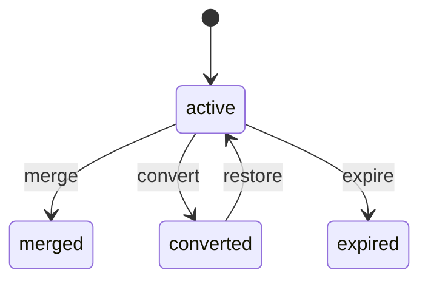
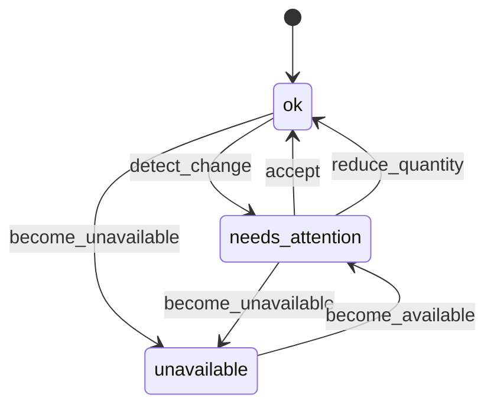

<!-- GENERATED by `npm run gen` from docs/api/modules/cart.md. Do not edit: change the spec and regenerate. -->

# Cart (`cart`)

One cart across the Official Store and marketplace sellers for customers and guests. Every line is bound to the exact offer the customer chose, lines are grouped into seller packages with delivery estimates and shipping, and every read re-checks price, stock and eligibility so changes are explained per item instead of discarding the cart.

- **Group:** Buying · **Launch phase:** 1 · **Plan chapters:** 5, 6
- **Depends on:** [offers](../offers/README.md), [inventory](../inventory/README.md) · **Optional:** [catalog](../catalog/README.md), [shipping](../shipping/README.md), [promotions](../promotions/README.md), [customers](../customers/README.md), [identity](../identity/README.md), [media](../media/README.md)
- **Required by:** [checkout](../checkout/README.md)

## Owns
- Customer carts and guest carts (guest session), one active cart per owner
- Merging a guest cart into the customer cart on sign-in, with a per-line merge report
- Cart lines bound to an explicit offer (seller, condition, variant); a seller is never switched silently
- Grouping lines into seller packages with ship-from, delivery estimate, shipping cost and return terms per package
- Quantity limits: offer purchase limit, available stock and a platform line maximum
- Change detection on every read: price increased or decreased, out of stock, reduced quantity, offer ended, seller restricted, not shippable to the chosen location, with a notice per item
- Preserving eligible items while one item is unavailable (unavailable lines stay visible and are excluded from checkout)
- Coupon preview in the cart (applied amount, covered items, rejection reason)
- Deliver-to location used for cart estimates
- Save for later (later phase)

**Not here:**
- Prices, conditions, purchase limits and offer status: offers
- Stock quantities and reservations: inventory (the cart never reserves stock; checkout does at Place order)
- Delivery estimates, shipping rates and coverage: shipping
- Coupon rules and discount allocation: promotions (the cart only previews)
- Final totals, tax, revalidation and order placement: checkout
- Back-in-stock alerts and wishlist: wishlist (phase 3)

## Store API

| Method | Path | Purpose | Auth | Body → Response |
|---|---|---|---|---|
| GET | `/api/store/cart/cart` | Cart grouped by package, with change detection | shopper | `CartView` |
| GET | `/api/store/cart/cart/badge` | Item count and attention count for the header and app tab bar | shopper | `CartBadge` |
| POST | `/api/store/cart/cart/items` | Add an offer to the cart (Add to cart) | shopper | `AddItemInput` → `AddItemResult` |
| PATCH | `/api/store/cart/cart/items/{id}` | Change a line's quantity | shopper | `{ quantity: int }` → `CartView` |
| DELETE | `/api/store/cart/cart/items/{id}` | Remove a line | shopper | `CartView` |
| POST | `/api/store/cart/cart/items/{id}/accept` | Accept a changed price or reduced quantity for a line | shopper | `{ noticeIds: uuid[] }` → `CartView` |
| POST | `/api/store/cart/cart/items/{id}/switch-offer` | Replace a line's offer with one the customer explicitly chose | shopper | `{ offerId: uuid, quantity: int? }` → `CartView` |
| POST | `/api/store/cart/cart/remove-unavailable` | Remove every unavailable line in one action | shopper | `CartView` |
| PUT | `/api/store/cart/cart/destination` | Set the deliver-to location used for estimates | shopper | `{ addressId: uuid?, postalCode: string?, country: string? }` → `CartView` |
| POST | `/api/store/cart/cart/coupons` | Apply a coupon code for preview | shopper | `{ code: string }` → `{ cart: CartView, result: CouponPreview }` |
| DELETE | `/api/store/cart/cart/coupons/{code}` | Remove a coupon code | shopper | `CartView` |
| POST | `/api/store/cart/cart/merge` | Merge the guest cart into the customer cart after sign-in | customer | `{ guestSessionId: uuid }` → `MergeResult` |
| POST | `/api/store/cart/cart/items/{id}/save-for-later` | Move a line to Saved for later _(phase 3)_ | shopper | `CartView` |
| GET | `/api/store/cart/cart/saved` | Saved for later _(phase 3)_ | shopper | Page<SavedItem> |
| POST | `/api/store/cart/cart/saved/{id}/move-to-cart` | Move a saved item back into the cart _(phase 3)_ | shopper | `{ quantity: int? }` → `AddItemResult` |
| DELETE | `/api/store/cart/cart/saved/{id}` | Delete a saved item _(phase 3)_ | shopper | 204 No content |

## Admin API

| Method | Path | Purpose | Auth | Body → Response |
|---|---|---|---|---|
| GET | `/api/admin/cart/carts` | Find a customer's or guest's cart (support) | staff<br>`cart.carts.view` | Page<CartAdminSummary> |
| GET | `/api/admin/cart/carts/{id}` | One cart with lines, notices and merge history | staff<br>`cart.carts.view` | `{ summary: CartAdminSummary, cart: CartView, merges: MergeReport[] }` |

## Types

### CartOwner

| Field | Type |
|---|---|
| kind | `enum(customer|guest)` |
| customerId | `uuid?` |
| guestSessionId | `uuid?` |

### SellerLabel

| Field | Type |
|---|---|
| ownerType | `enum(official|seller)` |
| id | `uuid?` Seller id; null for the Official Store (as in offers) |
| name | `string` |
| slug | `string` |
| official | `bool` Marketly Official Store |
| verified | `bool` |
| logo | `MediaRef?` |

### CartDestination

| Field | Type |
|---|---|
| postalCode | `string` |
| country | `string` ISO 3166-1 alpha-2 |
| region | `string?` |
| city | `string?` |
| addressId | `uuid?` Saved customer address the location came from |
| source | `enum(address|postal_code|default_region)` default_region = no location known; estimates use the market default and the summary says shipping and tax depend on the address |

### OfferAlternativesHint

| Field | Type |
|---|---|
| count | `int` |
| lowestPrice | `Money?` |
| productId | `uuid` |
| variantId | `uuid` |
| condition | `string` |

### CartNotice

| Field | Type |
|---|---|
| id | `uuid` |
| kind | `enum(price_increased|price_decreased|out_of_stock|quantity_reduced|purchase_limit_reduced|offer_ended|seller_unavailable|product_unavailable|not_shippable|delivery_estimate_changed|coupon_no_longer_applies|terms_changed)` What changed since the customer added or last accepted the line. terms_changed: the offer's return, warranty or dispatch terms changed (OfferChange kind terms: offers termsVersion above acceptedTermsVersion); a warning the customer accepts, which moves acceptedTermsVersion to the current version |
| severity | `enum(info|warning|blocking)` blocking = the line is excluded from checkout until resolved; warning = included only after the customer accepts; info = shown once |
| message | `string` Customer-facing sentence, e.g. 'Price changed since you added it: was $94.99, now $99.99. Northwind Audio updated this offer on Oct 8.' |
| previousPrice | `Money?` |
| currentPrice | `Money?` |
| previousQuantity | `int?` |
| availableQuantity | `int?` |
| changedBy | `string?` Seller name when the seller changed the offer |
| changedAt | `datetime?` |
| alternatives | `OfferAlternativesHint?` Other offers for the same variant and condition. Shown as a link; never applied automatically |
| actions | `enum(remove|accept|reduce_quantity|choose_offer|save_for_later|notify_me)[]` Actions the UI offers. notify_me needs the wishlist module (phase 3) |
| detectedAt | `datetime` |

### CartItem

| Field | Type |
|---|---|
| id | `uuid` |
| offerId | `uuid` |
| productId | `uuid` |
| variantId | `uuid` |
| seller | `SellerLabel` |
| title | `string` |
| variantLabel | `string` e.g. 'Queen · Sage' |
| options | `map<string>` |
| condition | `enum(new|used_like_new|used_good|used_acceptable|refurbished)` |
| conditionNote | `string?` |
| sku | `string?` |
| image | `MediaRef?` |
| quantity | `int` |
| maxQuantity | `int` min(offer purchase limit, available stock, platform line maximum) |
| purchaseLimit | `int?` Offer limit per customer, shown as 'Limit 3 per customer' |
| availableQuantity | `int?` Only shown when low or below the requested quantity |
| unitPrice | `Money` Current offer price |
| compareAtPrice | `Money?` Was price with its basis, from offers/promotions |
| acceptedUnitPrice | `Money` Price the customer added or last accepted; the baseline for change detection |
| acceptedTermsVersion | `int` offers termsVersion the customer last saw; a higher version triggers a re-check through offers.revalidate |
| lineTotal | `Money` |
| state | `enum(ok|needs_attention|unavailable)` Derived from the open notices |
| includedInCheckout | `bool` |
| notices | `CartNotice[]` |
| addedAt | `datetime` |

### PackageDelivery

| Field | Type |
|---|---|
| methodName | `string` Default (cheapest eligible) method, e.g. Standard |
| arrival | `DateRange` |
| arrivalLabel | `string` e.g. 'Arrives Mon, Oct 19 – Tue, Oct 20' |
| shipping | `Money` |
| free | `bool` |
| freeShippingNote | `string?` e.g. 'Free over $35' |
| amountToFreeShipping | `Money?` |
| estimateBasis | `enum(address|postal_code|default_region)` |
| serviceNotices | `string[]` Holiday or service interruption notes from shipping |

### CartPackage

| Field | Type |
|---|---|
| key | `string` Stable grouping key: owner type + seller id + ship-from (offers DispatchTerms.shipsFrom) |
| label | `string` 'Package 2 of 3' |
| seller | `SellerLabel` |
| shipsFrom | `string` e.g. 'Reno, NV warehouse' |
| items | `CartItem[]` |
| delivery | `PackageDelivery?` Null when every item in the package is unavailable or shipping is disabled |
| returnTerms | `string` Summary of the seller's return terms for these items |
| subtotal | `Money` Eligible items plus package shipping |
| notShippable | `bool` The seller does not ship to the deliver-to location |

### DiscountLine

| Field | Type |
|---|---|
| code | `string?` |
| label | `string` |
| amount | `Money` |
| fundedBy | `enum(platform|seller|shared)` |

### CouponPreview

| Field | Type |
|---|---|
| code | `string` |
| status | `enum(applied|rejected|needs_sign_in)` |
| amount | `Money?` |
| label | `string` e.g. '$20 off your first order over $100' |
| fundedBy | `enum(platform|seller|shared)?` |
| reason | `string?` Why it was rejected, in plain words |
| coverage | `CouponCoverage[]` Items that receive the discount and their share |
| notCovered | `CouponExclusion[]` |

### CouponCoverage

| Field | Type |
|---|---|
| itemId | `uuid` |
| title | `string` |
| amount | `Money` |

### CouponExclusion

| Field | Type |
|---|---|
| itemId | `uuid` |
| title | `string` |
| reason | `string` e.g. 'already on a seller markdown' |

### CartTotals

| Field | Type |
|---|---|
| itemCount | `int` |
| itemsSubtotal | `Money` Eligible items only |
| discounts | `DiscountLine[]` |
| shippingByPackage | `PackageShippingLine[]` |
| shippingTotal | `Money` |
| taxNote | `string` 'Calculated after you enter an address' (tax is computed in checkout) |
| total | `Money` Total before tax |
| excludedItemCount | `int` |

### PackageShippingLine

| Field | Type |
|---|---|
| packageKey | `string` |
| sellerName | `string` |
| amount | `Money` |
| free | `bool` |

### CartView

| Field | Type |
|---|---|
| id | `uuid` |
| owner | `enum(customer|guest)` |
| currency | `string` |
| itemCount | `int` |
| sellerCount | `int` |
| packageCount | `int` |
| destination | `CartDestination?` |
| packages | `CartPackage[]` |
| attention | `CartAttention?` Banner: '2 items need your attention' |
| coupons | `CouponPreview[]` |
| totals | `CartTotals` |
| checkoutReady | `bool` At least one eligible line and no warning notice left unaccepted |
| checkoutBlockers | `string[]` |
| retentionNote | `string` 'Items stay in your cart for 30 days. Prices and stock are checked again at checkout.' |
| savedForLaterCount | `int` |
| checkedAt | `datetime` When prices and stock were last re-read |

### CartAttention

| Field | Type |
|---|---|
| count | `int` |
| title | `string` |
| message | `string` |

### CartBadge

| Field | Type |
|---|---|
| itemCount | `int` |
| attentionCount | `int` |

### AddItemInput

| Field | Type |
|---|---|
| offerId | `uuid` |
| quantity | `int` |
| source | `enum(product_page|offers_list|deal|saved_for_later|buy_again|recommendation)?` For cart-addition reports |

### AddItemResult

| Field | Type |
|---|---|
| cart | `CartView` |
| itemId | `uuid` |
| outcome | `enum(added|quantity_increased|capped_at_limit)` capped_at_limit includes the maximum in the message |
| message | `string` |

### MergeLine

| Field | Type |
|---|---|
| itemId | `uuid?` |
| offerId | `uuid` |
| title | `string` |
| outcome | `enum(added|quantity_combined|capped_at_limit|kept_separate_offer|dropped_unavailable)` |
| note | `string` |

### MergeReport

| Field | Type |
|---|---|
| mergedFromCartId | `uuid?` |
| lines | `MergeLine[]` |
| savedItemsMoved | `int` Guest saved-for-later items moved to the customer (an offer the customer already saved is kept once) |
| message | `string?` Shown once after sign-in, e.g. 'We added 2 items from before you signed in' |

### MergeResult

| Field | Type |
|---|---|
| cart | `CartView` |
| report | `MergeReport` |

### SavedItem

| Field | Type |
|---|---|
| id | `uuid` |
| offerId | `uuid` |
| productId | `uuid` |
| variantId | `uuid` |
| seller | `SellerLabel` |
| title | `string` |
| variantLabel | `string` |
| image | `MediaRef?` |
| currentPrice | `Money?` |
| available | `bool` |
| unavailableReason | `string?` |
| savedAt | `datetime` |

### CartLineInput

| Field | Type |
|---|---|
| offerId | `uuid` |
| quantity | `int` |
| acceptedUnitPrice | `Money` |

### CheckoutCartLine

| Field | Type |
|---|---|
| itemId | `uuid` |
| offerId | `uuid` |
| ownerType | `enum(official|seller)` |
| sellerId | `uuid?` |
| stockItemId | `uuid` |
| acceptedTermsVersion | `int` |
| productId | `uuid` |
| variantId | `uuid` |
| packageKey | `string` |
| quantity | `int` |
| acceptedUnitPrice | `Money` |
| currentUnitPrice | `Money` |

### CheckoutCartSnapshot

| Field | Type |
|---|---|
| cartId | `uuid` |
| eligible | `CheckoutCartLine[]` |
| excluded | `CartItem[]` |
| couponCodes | `string[]` |
| destination | `CartDestination?` |

### CartAdminSummary

| Field | Type |
|---|---|
| id | `uuid` |
| owner | `CartOwner` |
| status | `enum(active|merged|converted|expired)` |
| itemCount | `int` |
| itemsSubtotal | `Money` |
| openNotices | `int` |
| updatedAt | `datetime` |
| expiresAt | `datetime` |

## Status flows

### Cart lifecycle (`CartAdminSummary.status`)



merge: a guest cart is folded into the customer cart on sign-in. convert: the last eligible lines became an accepted order. restore: a pending payment was declined and checkout put the lines back. A cart with unavailable lines left after an order stays active.

### Cart line availability (`CartItem.state`)



Derived on every read from open notices. needs_attention lines are included in checkout only after the customer accepts (price increase) or reduces quantity. unavailable lines (out of stock, offer ended, seller unavailable, not shippable) stay in the cart, are excluded from checkout and never replaced by another seller's offer. Price decreases are info notices and accepted automatically.

## Data (schema `cart`)

**carts**: One active cart per customer or guest session

| Column | Type |
|---|---|
| id | uuid pk |
| owner_kind | text (customer|guest) |
| customer_id | uuid? |
| guest_session_id | uuid? |
| status | text (active|merged|converted|expired) |
| currency | text |
| destination | jsonb? |
| coupon_codes | jsonb |
| merged_into_id | uuid? → carts |
| checked_at | timestamptz? |
| created_at | timestamptz |
| updated_at | timestamptz |
| expires_at | timestamptz |

Indexes: `unique (customer_id) where status = 'active'`, `unique (guest_session_id) where status = 'active'`, `(status, expires_at)`

**cart_items**: Lines bound to an offer; one line per offer per cart

| Column | Type |
|---|---|
| id | uuid pk |
| cart_id | uuid → carts |
| offer_id | uuid |
| owner_type | text (official|seller) |
| seller_id | uuid? |
| product_id | uuid |
| variant_id | uuid |
| stock_item_id | uuid |
| ships_from | text |
| quantity | int |
| price_at_add | int (minor units) |
| accepted_price | int (minor units) |
| accepted_terms_version | int |
| currency | text |
| source | text? |
| added_at | timestamptz |
| updated_at | timestamptz |
| last_checked_at | timestamptz? |

Indexes: `unique (cart_id, offer_id)`, `(offer_id)`, `(seller_id)`

**cart_item_notices**: Detected changes per line; kept until accepted, resolved or the line is removed

| Column | Type |
|---|---|
| id | uuid pk |
| item_id | uuid → cart_items |
| kind | text |
| severity | text |
| previous | jsonb |
| current | jsonb |
| detected_at | timestamptz |
| accepted_at | timestamptz? |
| resolved_at | timestamptz? |

Indexes: `(item_id) where resolved_at is null`

**saved_items**: Save for later (phase 3)

| Column | Type |
|---|---|
| id | uuid pk |
| owner_kind | text |
| customer_id | uuid? |
| guest_session_id | uuid? |
| offer_id | uuid |
| product_id | uuid |
| variant_id | uuid |
| saved_at | timestamptz |

Indexes: `unique (customer_id, offer_id)`, `unique (guest_session_id, offer_id)`, `(guest_session_id)`

**cart_merges**: Guest-to-customer merges with their report

| Column | Type |
|---|---|
| id | uuid pk |
| from_cart_id | uuid → carts |
| into_cart_id | uuid → carts |
| report | jsonb |
| at | timestamptz |

**recheck_queue**: Lines touched by offer, stock or seller events; the recheck job refreshes their notices

| Column | Type |
|---|---|
| item_id | uuid pk → cart_items |
| reason | text |
| queued_at | timestamptz |

## Events

| Publishes | When | Payload | Consumed by |
|---|---|---|---|
| `cart.item.added` | A line is added or its quantity increased by an add | `{ cartId: uuid, itemId: uuid, offerId: uuid, productId: uuid, sellerId: uuid?, quantity: int, unitPrice: Money, ownerKind: string, source: string? }` | reports |
| `cart.item.removed` | A line is removed, saved for later or removed as unavailable | `{ cartId: uuid, itemId: uuid, offerId: uuid, reason: enum(customer|unavailable|saved_for_later|purchased) }` | - |
| `cart.item.offer_switched` | The customer explicitly picked another offer for a line | `{ cartId: uuid, itemId: uuid, fromOfferId: uuid, toOfferId: uuid }` | - |
| `cart.cart.merged` | A guest cart is merged into a customer cart | `{ fromCartId: uuid, intoCartId: uuid, customerId: uuid, lines: int }` | - |
| `cart.cart.expired` | An idle cart passes its retention period | `{ cartId: uuid, ownerKind: string, itemCount: int }` | - |

| Consumes | From | Does |
|---|---|---|
| `offers.offer.price_changed` | offers | Queue lines holding the offer for a notice refresh (price increased or decreased) |
| `offers.offer.status_changed` | offers | Queue lines; an ended or hidden offer becomes an offer_ended blocking notice |
| `inventory.stock.changed` | inventory | Queue lines whose quantity may exceed availability (out_of_stock or quantity_reduced) |
| `sellers.seller.restricted` | sellers | Lines from offers the restriction hides get seller_unavailable notices; nothing is switched to another seller |
| `sellers.seller.suspended` | sellers | Same as restricted |
| `catalog.product.publication_changed` | catalog | Hidden or suspended products give their lines a product_unavailable notice |
| `identity.guest_session.claimed` | identity | Merge the claimed guest session's cart and saved-for-later items into the account's customer cart (same rules and report as POST /cart/merge; idempotent). This is how sign-in merges carts on every client; identity only publishes the event and calls nothing in cart |

## In-process API (for other modules)

| Function | Signature | Used by |
|---|---|---|
| getCartForCheckout | `(owner: CartOwner, itemIds?: uuid[]) => CheckoutCartSnapshot`<br>Eligible lines (offer, seller, variant, quantity, accepted unit price, package key) and coupon codes, after a fresh change check. Unavailable lines are returned separately so checkout can explain them. | checkout |
| removePurchasedItems | `(cartId: uuid, itemIds: uuid[], orderId: uuid) => void`<br>Remove lines that became an accepted order; other lines stay. Marks the cart converted when it becomes empty. | checkout |
| restoreItems | `(cartId: uuid, lines: CartLineInput[]) => void`<br>Put lines back after a declined payment on an order that was pending, so the customer can pay another way without rebuilding the cart. | checkout |
| addLine | `(owner: { customerId?: uuid, guestSessionId?: uuid }, line: { offerId: uuid, quantity: int }) => CartItem`<br>Add an offer to the shopper's cart, creating the cart if needed; same rules as POST /cart/items (an offer already in the cart increases its quantity, capped at the limit). Publishes cart.item.added. | wishlist |
| countOfferInCarts | `(offerId: uuid) => int`<br>How many active carts hold an offer (used to warn a seller before ending an offer). | offers, reports |
| getCartView | `(owner: CartOwner) => CartView | null`<br>The shopper's cart grouped by package, after a fresh price, stock and eligibility check (same as GET /cart) | graphql |

## Permissions

| Key | Who | Allows |
|---|---|---|
| `cart.carts.view` | staff | Read customers' and guests' carts for support |

## Error codes

| Code | Status | Meaning |
|---|---|---|
| `OFFER_UNAVAILABLE` | 409 | The offer is ended, hidden, out of stock or its seller cannot sell now. details.reason, details.alternatives (count, lowest price). |
| `QUANTITY_LIMIT_EXCEEDED` | 422 | Requested quantity is above the purchase limit or available stock. details.max, details.limitKind (purchase_limit|stock|line_maximum). |
| `CART_FULL` | 422 | The cart already has the maximum number of lines. details.max. |
| `OFFER_MISMATCH` | 422 | The chosen offer is for a different variant than the line. |

## Background jobs

| Job | Schedule | Does |
|---|---|---|
| `cart.recheck-queued` | every 2 min | Refresh notices for lines queued by offer, stock and seller events so the next read is fast; GET /cart still re-checks authoritatively |
| `cart.expire-idle` | daily 03:00 PT | Expire guest carts idle longer than guestCartRetentionDays and customer carts idle longer than customerCartRetentionDays; publishes cart.cart.expired |

## Settings

| Key | Default | Rules | Meaning |
|---|---|---|---|
| guestCartRetentionDays | `30` | duration, days, 1–… | Idle days before a guest cart expires ('Items stay in your cart for 30 days') |
| customerCartRetentionDays | `90` | duration, days, 1–… | Idle days before a customer cart expires |
| maxLines | `50` | int, 1–… | Distinct lines per cart (CART_FULL above) |
| maxQuantityPerLine | `10` | int, 1–… | Upper bound when an offer has no purchase limit |
| showPriceDecreaseNotices | `true` | bool | Show an info notice when a price drops (accepted automatically) |
| couponPreviewRateLimitPerHour | `30` | int, 1–… | Coupon attempts per owner per hour |

## Notes
- Dependencies: architecture lists offers and inventory. catalog is optional and only used for display fields that offers does not return; shipping (package estimates, coverage) and promotions (coupon preview, was-price) are optional so the cart still works with flat offer data when they are off; customers resolves saved address ids for the deliver-to location.
- Owner resolution: a customer session uses the customer's cart; otherwise the X-Guest-Session header identifies the guest cart (guest sessions are issued by identity). Requests with neither get UNAUTHORIZED.
- Never switch sellers: a line's offerId only changes through POST /cart/items/{id}/switch-offer. Alternatives are only hinted (count and lowest price), never applied.
- Change detection runs on every GET /cart and before getCartForCheckout through offers.getOffers (one batch read of every line's offer, any status) and offers.revalidate (lines with offerId, quantity, acceptedTermsVersion, acceptedUnitPrice; postal code of the deliver-to location) plus inventory.getAvailability; OfferChange kinds map to notices (price → price_increased/price_decreased, availability → out_of_stock/quantity_reduced, delivery → delivery_estimate_changed or not_shippable, removed → offer_ended, seller_restricted → seller_unavailable, terms → terms_changed). Promotion-driven price changes come from promotions.priceOffers. Baseline = acceptedUnitPrice and the quantity the customer chose. Increases create a warning notice that must be accepted; decreases are info notices accepted automatically. Out of stock, offer ended, seller unavailable, product unavailable and not shippable are blocking: the line stays visible, is excluded from checkout and the rest of the cart is unchanged.
- Packages: lines group by seller and ship-from location. Delivery estimate and shipping per package come from shipping.quoteOptions for the default (cheapest eligible) method; checkout lets the customer pick other options. Package labels ('Package 2 of 3') are computed per view, not stored.
- Quantity limits: the line maximum is min(offer purchase limit, available stock, maxQuantityPerLine). Per-customer limits that count earlier orders are enforced in checkout, which can read order history.
- Merge on sign-in: same offer combines up to the limit; different offers for the same variant are both kept (kept_separate_offer); unavailable guest lines are dropped and listed in the report; guest coupon codes are carried over when still valid; guest saved-for-later items move to the customer, deduplicated on (customer_id, offer_id).
- Promotions input: cart passes every line to promotions.evaluateCart with a non-empty sellerId (the seller id, or OFFICIAL_STORE_ID from common constants for Official Store lines; never '' or null) and categoryId when known (null otherwise). Checkout does the same. CheckoutCartLine.sellerId itself stays null for the Official Store, as in offers.
- The cart never reserves stock. Reservations start at Place order in checkout.
- Save for later is listed in the plan as a later addition (ch. 6) and belongs with saved shopping (Growth), so its endpoints are phase 3. 'Tell me when it's back' is a wishlist alert (phase 3).

## GraphQL (read layer)

This module's fragment of the GraphQL schemas (see [../graphql/README.md](../graphql/README.md)). Writes stay on the REST endpoints above.

```graphql
# cart: one cart across the Official Store and marketplace sellers, grouped into seller packages.
# Every read re-checks price, stock and eligibility and explains changes per line (notices);
# unavailable lines stay in the cart and are never swapped for another seller's offer.
# All writes (add, quantity, accept change, coupons, destination) stay on REST /api/store/cart.

"The shopper's cart (customer or guest session), as the CartPage shows it"
type Cart @areas(in: [STORE]) {
  id: UUID!
  currency: String!
  itemCount: Int!
  sellerCount: Int!
  packageCount: Int!
  "Deliver-to location used for estimates; null when none is known"
  destination: CartDestination
  "One package per seller and ship-from location"
  packages: [CartPackage!]!
  "Banner: '2 items need your attention'"
  attention: CartAttention
  "Coupon codes previewed on the cart, with coverage and reasons"
  coupons: [CartCoupon!]!
  totals: CartTotals!
  "At least one eligible line and no warning notice left unaccepted"
  checkoutReady: Boolean!
  checkoutBlockers: [String!]!
  "'Items stay in your cart for 30 days. Prices and stock are checked again at checkout.'"
  retentionNote: String!
  savedForLaterCount: Int!
  "Saved for later, newest first"
  savedForLater(limit: Int = 20): [CartSavedItem!]! @cost(weight: 5)
  "When prices and stock were last re-read"
  checkedAt: DateTime!
}

"Seller as shown on the cart and at checkout"
type CartSellerLabel @areas(in: [STORE]) {
  "Seller id; null for the Official Store"
  id: UUID
  name: String!
  slug: String!
  "Marketly Official Store"
  official: Boolean!
  verified: Boolean!
  logo: MediaRef
}

type CartDestination @areas(in: [STORE]) {
  postalCode: String!
  "ISO 3166-1 alpha-2"
  country: String!
  region: String
  city: String
  "Saved customer address the location came from"
  addressId: UUID
  "DEFAULT_REGION = no location known; estimates use the market default"
  source: CartDestinationSource!
}

"Items from one seller and ship-from location, with their own delivery estimate and shipping"
type CartPackage @areas(in: [STORE]) {
  "Stable grouping key: owner type + seller id + ship-from"
  key: String!
  "'Package 2 of 3'"
  label: String!
  seller: CartSellerLabel!
  "e.g. 'Reno, NV warehouse'"
  shipsFrom: String!
  items: [CartLine!]!
  "Null when every item in the package is unavailable or shipping is disabled"
  delivery: CartPackageDelivery
  "Summary of the seller's return terms for these items"
  returnTerms: String!
  "Eligible items plus package shipping"
  subtotal: Money!
  "The seller does not ship to the deliver-to location"
  notShippable: Boolean!
}

"One cart line, bound to the exact offer the customer chose"
type CartLine @areas(in: [STORE]) {
  id: UUID!
  offerId: UUID!
  productId: UUID!
  variantId: UUID!
  title: String!
  "e.g. 'Queen · Sage'"
  variantLabel: String!
  options: [CartLineOption!]!
  condition: CartLineCondition!
  conditionNote: String
  sku: String
  image: MediaRef
  quantity: Int!
  "min(offer purchase limit, available stock, platform line maximum)"
  maxQuantity: Int!
  "'Limit 3 per customer'"
  purchaseLimit: Int
  "Only set when low or below the requested quantity"
  availableQuantity: Int
  "Current offer price"
  unitPrice: Money!
  "Was price, from offers or promotions"
  compareAtPrice: Money
  "Price the customer added or last accepted; the baseline for change detection"
  acceptedUnitPrice: Money!
  lineTotal: Money!
  "Derived from the open notices"
  state: CartLineState!
  includedInCheckout: Boolean!
  "What changed since the customer added or last accepted the line"
  notices: [CartNotice!]!
  addedAt: DateTime!
}

type CartLineOption @areas(in: [STORE]) {
  name: String!
  value: String!
}

"A change on a line, explained in one sentence, with the actions the UI offers"
type CartNotice @areas(in: [STORE]) {
  id: UUID!
  kind: CartNoticeKind!
  "BLOCKING = excluded from checkout until resolved; WARNING = included only after the customer accepts; INFO = shown once"
  severity: CartNoticeSeverity!
  "'Price changed since you added it: was $94.99, now $99.99. Northwind Audio updated this offer on Oct 8.'"
  message: String!
  previousPrice: Money
  currentPrice: Money
  previousQuantity: Int
  availableQuantity: Int
  "Seller name when the seller changed the offer"
  changedBy: String
  changedAt: DateTime
  "Other offers for the same variant and condition; shown as a link, never applied automatically"
  alternatives: CartAlternativesHint
  actions: [CartNoticeAction!]!
  detectedAt: DateTime!
}

type CartAlternativesHint @areas(in: [STORE]) {
  count: Int!
  lowestPrice: Money
  productId: UUID!
  variantId: UUID!
  condition: CartLineCondition!
}

"Default (cheapest eligible) delivery for a package at the deliver-to location"
type CartPackageDelivery @areas(in: [STORE]) {
  "e.g. Standard"
  methodName: String!
  arrivalFrom: Date!
  arrivalTo: Date!
  "'Arrives Mon, Oct 19 – Tue, Oct 20'"
  arrivalLabel: String!
  shipping: Money!
  free: Boolean!
  "'Free over $35'"
  freeShippingNote: String
  amountToFreeShipping: Money
  estimateBasis: CartDestinationSource!
  "Holiday or service interruption notes"
  serviceNotices: [String!]!
}

type CartCoupon @areas(in: [STORE]) {
  code: String!
  status: CartCouponStatus!
  amount: Money
  "'$20 off your first order over $100'"
  label: String
  fundedBy: CartFundedBy
  "Why it was rejected, in plain words"
  reason: String
  "Items that receive the discount and their share"
  coverage: [CartCouponCoverage!]!
  notCovered: [CartCouponExclusion!]!
}

type CartCouponCoverage @areas(in: [STORE]) {
  itemId: UUID!
  title: String!
  amount: Money!
}

type CartCouponExclusion @areas(in: [STORE]) {
  itemId: UUID!
  title: String!
  "e.g. 'already on a seller markdown'"
  reason: String!
}

type CartTotals @areas(in: [STORE]) {
  itemCount: Int!
  "Eligible items only"
  itemsSubtotal: Money!
  discounts: [CartDiscount!]!
  shippingByPackage: [CartPackageShipping!]!
  shippingTotal: Money!
  "'Calculated after you enter an address' (tax is computed in checkout)"
  taxNote: String!
  "Total before tax"
  total: Money!
  excludedItemCount: Int!
}

type CartDiscount @areas(in: [STORE]) {
  code: String
  label: String!
  amount: Money!
  fundedBy: CartFundedBy!
}

type CartPackageShipping @areas(in: [STORE]) {
  packageKey: String!
  sellerName: String!
  amount: Money!
  free: Boolean!
}

type CartAttention @areas(in: [STORE]) {
  count: Int!
  title: String!
  message: String!
}

type CartSavedItem @areas(in: [STORE]) {
  id: UUID!
  offerId: UUID!
  productId: UUID!
  variantId: UUID!
  seller: CartSellerLabel!
  title: String!
  variantLabel: String!
  image: MediaRef
  currentPrice: Money
  available: Boolean!
  unavailableReason: String
  savedAt: DateTime!
}

# ------------------------------------------------------------------ enums

enum CartDestinationSource @areas(in: [STORE]) {
  ADDRESS
  POSTAL_CODE
  DEFAULT_REGION
}

enum CartLineCondition @areas(in: [STORE]) {
  NEW
  USED_LIKE_NEW
  USED_GOOD
  USED_ACCEPTABLE
  REFURBISHED
}

enum CartLineState @areas(in: [STORE]) {
  OK
  NEEDS_ATTENTION
  UNAVAILABLE
}

enum CartNoticeKind @areas(in: [STORE]) {
  PRICE_INCREASED
  PRICE_DECREASED
  OUT_OF_STOCK
  QUANTITY_REDUCED
  PURCHASE_LIMIT_REDUCED
  OFFER_ENDED
  SELLER_UNAVAILABLE
  PRODUCT_UNAVAILABLE
  NOT_SHIPPABLE
  DELIVERY_ESTIMATE_CHANGED
  COUPON_NO_LONGER_APPLIES
  "The offer's return, warranty or dispatch terms changed; accepting moves the accepted terms version"
  TERMS_CHANGED
}

enum CartNoticeSeverity @areas(in: [STORE]) {
  INFO
  WARNING
  BLOCKING
}

enum CartNoticeAction @areas(in: [STORE]) {
  REMOVE
  ACCEPT
  REDUCE_QUANTITY
  CHOOSE_OFFER
  SAVE_FOR_LATER
  "Needs the wishlist module (phase 3)"
  NOTIFY_ME
}

enum CartCouponStatus @areas(in: [STORE]) {
  APPLIED
  REJECTED
  NEEDS_SIGN_IN
}

enum CartFundedBy @areas(in: [STORE]) {
  PLATFORM
  SELLER
  SHARED
}

# ------------------------------------------------------------------ queries

extend type Query {
  "The current shopper's cart, re-checked on read (CartPage). Null when the session has no cart yet."
  cart: Cart @areas(in: [STORE]) @auth(requires: SHOPPER) @source(module: "cart", fn: "getCartView")
}
```
