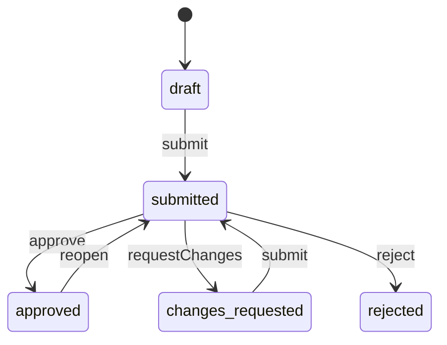
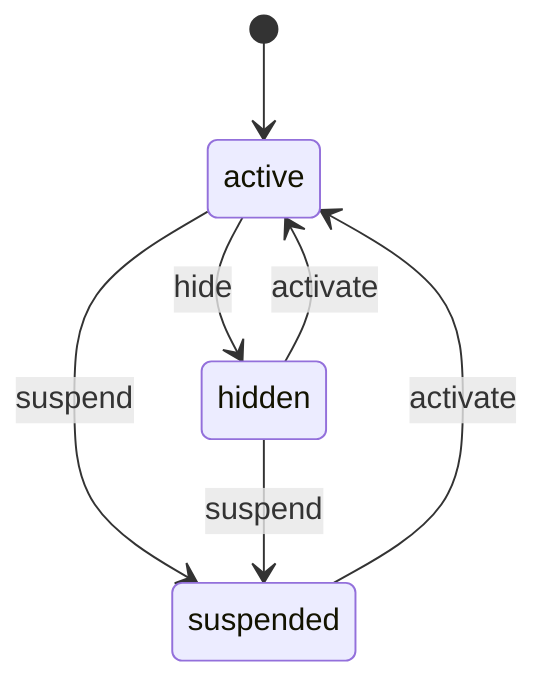
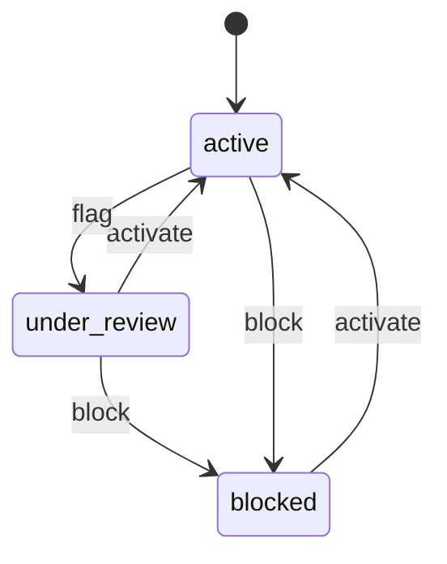

<!-- GENERATED by `npm run gen` from docs/api/modules/catalog.md. Do not edit: change the spec and regenerate. -->

# Catalog (`catalog`)

What a product is: categories, attributes, brands, products, variants, and the review workflow that decides whether a product may be sold. How a seller sells it (price, stock, condition) belongs to offers.

- **Group:** Catalog and stock · **Launch phase:** 1 · **Plan chapters:** 5, 8
- **Depends on:** [media](../media/README.md) · **Optional:** [search](../search/README.md), [sellers](../sellers/README.md), [access](../access/README.md), [audit](../audit/README.md), [offers](../offers/README.md), [cart](../cart/README.md), [reviews](../reviews/README.md), [inventory](../inventory/README.md), [reports](../reports/README.md), [orders](../orders/README.md), [returns](../returns/README.md), [support](../support/README.md)
- **Required by:** [offers](../offers/README.md), [orders](../orders/README.md), [promotions](../promotions/README.md), [reviews](../reviews/README.md), [search](../search/README.md), [wishlist](../wishlist/README.md)

## Owns
- Category tree, category attributes and image standards
- Brands
- Shared product content: title, description, key features, specs, included items, images, identifiers
- Variants (colour, size, capacity) and their identifiers
- Product review workflow: Draft, Submitted, Changes requested, Approved, Rejected
- Publication: Active, Hidden, Suspended (always with a reason)
- Correction suggestions to shared content and duplicate merges
- Frozen product snapshots for order items
- Brand status, seller authorization (who can sell) and seller brand requests
- Listing counts read model (offers, in-stock products) for admin lists, category and brand counts

**Not here:**
- Price, condition, stock, dispatch and return terms: offers and inventory
- Search ranking and suggestions: search (reads catalog events)
- Product reviews and Q&A: reviews

## Store API

| Method | Path | Purpose | Auth | Body → Response |
|---|---|---|---|---|
| GET | `/api/store/catalog/categories` | Visible category tree with in-stock counts and images | visitor | `Category[]` |
| GET | `/api/store/catalog/categories/{slug}` | Category with breadcrumb, subcategories and filterable attributes | visitor | `{ category: Category, breadcrumb: Category[], filters: Attribute[] }` |
| GET | `/api/store/catalog/brands` | Active brands, optionally the popular brands of one category | visitor | Page<Brand> |
| GET | `/api/store/catalog/brands/{slug}` | Brand page header (logo, banner, description, product count) | visitor | `Brand` |
| GET | `/api/store/catalog/products/{id}` | Product detail (shared content only) | visitor | `Product` |

## Seller API

| Method | Path | Purpose | Auth | Body → Response |
|---|---|---|---|---|
| GET | `/api/seller/catalog/match` | Search the catalog before adding a product | seller | Page<CatalogMatch> |
| GET | `/api/seller/catalog/brands` | Brands for the submission form | seller | Page<Brand> |
| GET | `/api/seller/catalog/products` | This seller's submitted products | seller | Page<ProductAdmin> |
| GET | `/api/seller/catalog/products/{id}` | One own product with review feedback | seller | `ProductAdmin` |
| POST | `/api/seller/catalog/products` | Create a product draft | seller<br>`catalog.products.submit` | `ProductInput` → `ProductAdmin` |
| PATCH | `/api/seller/catalog/products/{id}` | Edit a draft or a product with changes requested | seller<br>`catalog.products.submit` | `ProductInput` → `ProductAdmin` |
| POST | `/api/seller/catalog/products/{id}/submit` | Submit for review | seller<br>`catalog.products.submit` | `{ note: text? }` → `ProductAdmin` |
| POST | `/api/seller/catalog/products/{id}/corrections` | Suggest a correction to shared product content | seller | `{ field: string, proposed: text, evidenceIds: uuid[]? }` → `CorrectionSuggestion` |
| GET | `/api/seller/catalog/categories/{id}/attributes` | Attributes (own and inherited) and image standards for a category (drives the submission form) | seller | `{ attributes: Attribute[], imageRules: ImageRule[] }` |

## Admin API

| Method | Path | Purpose | Auth | Body → Response |
|---|---|---|---|---|
| GET | `/api/admin/catalog/review-queue` | Submissions waiting for review, oldest first | staff<br>`catalog.products.review` | Page<ProductAdmin> |
| GET | `/api/admin/catalog/products` | All products with filters | staff | Page<ProductAdmin> |
| GET | `/api/admin/catalog/products/stats` | Counts for the catalog product tabs and page header | staff | `ProductStats` |
| POST | `/api/admin/catalog/products/exports` | Export the filtered product list _(audited)_ | staff<br>`catalog.products.export` | `{ filters: json, format: enum(csv|xlsx)? }` → `reports.ExportJob` |
| GET | `/api/admin/catalog/products/{id}` | Product with review history and duplicate candidates | staff | `ProductAdmin` |
| POST | `/api/admin/catalog/products/{id}/checks/{kind}/dismiss` | Mark an automated check finding as not applicable (e.g. Not a duplicate) _(audited)_ | staff<br>`catalog.products.review` | `{ reason: text, matchedProductId: uuid? }` → `ProductAdmin` |
| PUT | `/api/admin/catalog/products/{id}/review-draft` | Save the reviewer's unsent decision | staff<br>`catalog.products.review` | `{ decision: enum(approve|request_changes|reject)?, reason: text?, fields: map<string>? }` → `ReviewDraft` |
| POST | `/api/admin/catalog/products` | Create an Official Store product draft | staff<br>`catalog.products.manage-official` | `ProductInput` → `ProductAdmin` |
| PATCH | `/api/admin/catalog/products/{id}` | Edit an Official Store draft | staff<br>`catalog.products.manage-official` | `ProductInput` → `ProductAdmin` |
| POST | `/api/admin/catalog/products/{id}/submit` | Submit an Official Store product (same standard as sellers) | staff<br>`catalog.products.manage-official` | `ProductAdmin` |
| POST | `/api/admin/catalog/products/{id}/approve` | Approve a submission _(audited)_ | staff<br>`catalog.products.review` | `{ note: text? }` → `ProductAdmin` |
| POST | `/api/admin/catalog/products/{id}/request-changes` | Ask the submitter to fix specific fields _(audited)_ | staff<br>`catalog.products.review` | `{ reason: text, fields: map<string> }` → `ProductAdmin` |
| POST | `/api/admin/catalog/products/{id}/reject` | Reject with a reason _(audited)_ | staff<br>`catalog.products.review` | `{ reason: text }` → `ProductAdmin` |
| POST | `/api/admin/catalog/products/{id}/publication` | Set Active, Hidden or Suspended _(audited)_ | staff<br>`catalog.products.publish` | `{ publication: enum(active|hidden|suspended), reason: text, trustReportId: uuid? }` → `ProductAdmin` |
| GET | `/api/admin/catalog/products/{id}/publication-impact` | What hiding or suspending the product would do | staff<br>`catalog.products.publish` | `PublicationImpact` |
| POST | `/api/admin/catalog/products/merge` | Merge duplicates and submissions into the product to keep _(audited)_ | staff<br>`catalog.products.review` | `MergeRequest` → `MergeResult` |
| POST | `/api/admin/catalog/products/merge/preview` | Preview what a merge moves before confirming | staff<br>`catalog.products.review` | `MergeRequest` → `MergePreview` |
| POST | `/api/admin/catalog/products/bulk` | Bulk edit products (category, brand, publication) with preview _(audited, phase 2)_ | staff<br>`catalog.products.bulk-edit` | `{ productIds: uuid[], change: json, reason: text, dryRun: bool }` → `{ affected: int, preview: ProductSummary[], errors: json[] }` |
| GET | `/api/admin/catalog/corrections` | Open correction suggestions | staff<br>`catalog.products.review` | Page<CorrectionSuggestion> |
| POST | `/api/admin/catalog/corrections/{id}/decide` | Accept or decline a correction _(audited)_ | staff<br>`catalog.products.review` | `{ accept: bool, reason: text }` → `CorrectionSuggestion` |
| GET | `/api/admin/catalog/categories` | Full category tree including hidden, with product and offer counts | staff | `Category[]` |
| POST | `/api/admin/catalog/categories` | Create a category _(audited)_ | staff<br>`catalog.taxonomy.manage` | `{ name: string, parentId: uuid?, position: int?, visible: bool?, comingSoon: bool?, imageId: uuid? }` → `Category` |
| PATCH | `/api/admin/catalog/categories/{id}` | Rename, move, hide or mark coming soon _(audited)_ | staff<br>`catalog.taxonomy.manage` | `{ name: string?, parentId: uuid?, position: int?, visible: bool?, comingSoon: bool?, imageId: uuid? }` → `Category` |
| GET | `/api/admin/catalog/categories/{id}/attributes` | Category attributes with fill rates, inheritance and image standards | staff | `{ attributes: AttributeAdmin[], imageRules: ImageRule[] }` |
| PUT | `/api/admin/catalog/categories/{id}/attributes` | Replace a category's attributes and image standards _(audited)_ | staff<br>`catalog.taxonomy.manage` | `{ attributes: Attribute[], imageRules: ImageRule[] }` → `Attribute[]` |
| GET | `/api/admin/catalog/brands` | All brands with counts, seller authorization and status | staff | Page<BrandAdmin> |
| POST | `/api/admin/catalog/brands` | Create a brand _(audited)_ | staff<br>`catalog.taxonomy.manage` | `{ name: string, logoId: uuid?, description: text?, bannerId: uuid?, sellingPolicy: enum(open|authorized_list|official_only)?, authorizedSellerIds: uuid[]? }` → `BrandAdmin` |
| PATCH | `/api/admin/catalog/brands/{id}` | Edit a brand, including who can sell _(audited)_ | staff<br>`catalog.taxonomy.manage` | `{ name: string?, logoId: uuid?, description: text?, bannerId: uuid?, sellingPolicy: enum(open|authorized_list|official_only)?, authorizedSellerIds: uuid[]?, reason: text? }` → `BrandAdmin` |
| POST | `/api/admin/catalog/brands/{id}/status` | Activate, flag for review or block a brand (decides seller brand requests) _(audited)_ | staff<br>`catalog.taxonomy.manage` | `{ status: enum(active|under_review|blocked), reason: text, trustReportId: uuid? }` → `BrandAdmin` |

## Types

### Category

| Field | Type |
|---|---|
| id | `uuid` |
| parentId | `uuid?` |
| name | `string` |
| slug | `string` |
| position | `int` |
| visible | `bool` False hides it, e.g. no eligible inventory yet |
| comingSoon | `bool` |
| productCount | `int` Active products with at least one eligible, in-stock offer in this category and its subcategories (store: "items in stock now"; admin tree counts). From listing_stats, refreshed every 10 min |
| offerCount | `int?` Eligible offers in this category and its subcategories. Admin responses only (null in the store) |
| image | `MediaRef?` Category tile image (store Categories page, Official Store shortcuts) |
| children | `Category[]` |

### Attribute

| Field | Type |
|---|---|
| id | `uuid` |
| categoryId | `uuid` |
| name | `string` e.g. Screen size |
| kind | `enum(text|number|enum|bool)` |
| unit | `string?` |
| options | `string[]` |
| required | `bool` |
| filterable | `bool` Shown as a category filter in the store |
| variantDefining | `bool` Creates variants (colour, size) |

### Brand

| Field | Type |
|---|---|
| id | `uuid` |
| name | `string` |
| slug | `string` |
| logo | `MediaRef?` |
| description | `text?` |
| productCount | `int` |
| banner | `MediaRef?` Brand page banner image |

### Variant

| Field | Type |
|---|---|
| id | `uuid` |
| options | `map<string>` e.g. { "color": "Sage" } |
| gtin | `string?` |
| images | `MediaRef[]` |

### ProductSummary

| Field | Type |
|---|---|
| id | `uuid` |
| ref | `string` |
| title | `string` |
| slug | `string` |
| brand | `Brand?` |
| categoryId | `uuid?` |
| image | `MediaRef?` |
| variantCount | `int` |

### Product

| Field | Type |
|---|---|
| id | `uuid` |
| ref | `string` Human product reference PRD-NNNNN, shown on duplicates, merges and admin lists |
| title | `string` |
| slug | `string` |
| brand | `Brand?` |
| categoryId | `uuid?` |
| categoryPath | `string[]` |
| description | `text` |
| keyFeatures | `string[]` |
| specs | `map<string>` Category attributes, e.g. { "Battery life": "40 h" } |
| includedItems | `string[]` |
| images | `MediaRef[]` |
| video | `MediaRef?` |
| modelNumber | `string?` |
| manufacturerPartNumber | `string?` Manufacturer part number (MPN) |
| noGtin | `bool` Submitter confirmed the product has no GTIN (custom-made or private label); variants may then have no gtin and the reviewer may ask for proof |
| variants | `Variant[]` |
| updatedAt | `datetime` |
| listedAt | `datetime?` When the product was first approved and listed (New listing / Listed on …) |

### ProductAdmin

| Field | Type |
|---|---|
| product | `Product` |
| owner | `enum(official|seller)` |
| ownerSellerId | `uuid?` |
| reviewState | `enum(draft|submitted|changes_requested|approved|rejected)` |
| publication | `enum(active|hidden|suspended)` |
| version | `int` |
| missing | `string[]` Missing information that blocks submission |
| reviewLog | `ReviewLogEntry[]` |
| duplicateCandidates | `ProductSummary[]` |
| submission | `Submission?` Open or latest review submission |
| checks | `ProductCheck[]` Automated checks on the latest submission (staff only) |
| requestedBrand | `RequestedBrand?` Brand the submitter asked to add (no brandId yet); becomes an under_review brand on submit |
| contentScore | `int` 0–100 completeness and quality score (required attributes, images against the category standard, description length, identifiers, key features); recomputed on every save |
| duplicateSuspected | `bool` Latest submission has a duplicate check with warn or fail that was not dismissed |
| offerCount | `int` All offers on the product (listing_stats) |
| liveOfferCount | `int` Eligible, in-stock offers |
| bestPrice | `Money?` Lowest eligible offer price |
| offerNote | `string?` Offer-state note when some offers are not live, e.g. Gadget Grove offer paused · 3 other offers live |
| reviewDraft | `ReviewDraft?` The calling reviewer's unsent decision on the open submission (staff only) |

### ReviewLogEntry

| Field | Type |
|---|---|
| id | `uuid` |
| action | `enum(submitted|approved|changes_requested|rejected|publication_changed|merged|check_dismissed)` |
| reason | `text?` Decision reason, or the submitter's note to the reviewer on submitted entries |
| fields | `map<string>` Field-level comments on changes requested |
| actor | `Actor` |
| at | `datetime` |

### ProductInput

| Field | Type |
|---|---|
| title | `string` |
| brandId | `uuid?` |
| categoryId | `uuid?` |
| description | `text?` |
| keyFeatures | `string[]?` |
| specs | `map<string>?` |
| includedItems | `string[]?` |
| imageIds | `uuid[]?` |
| videoId | `uuid?` |
| modelNumber | `string?` |
| variants | `VariantInput[]?` |
| manufacturerPartNumber | `string?` |
| noGtin | `bool?` Confirm the product has no GTIN; otherwise every variant needs a gtin before submission |
| requestedBrand | `RequestedBrand?` Brand not listed: request it instead of brandId. It is reviewed with the product |

### VariantInput

| Field | Type |
|---|---|
| options | `map<string>` |
| gtin | `string?` |
| imageIds | `uuid[]?` |

### CorrectionSuggestion

| Field | Type |
|---|---|
| id | `uuid` |
| productId | `uuid` |
| sellerId | `uuid` |
| field | `string` |
| current | `text?` |
| proposed | `text` |
| evidence | `MediaRef[]` |
| state | `enum(open|accepted|declined)` |
| decisionReason | `text?` |
| createdAt | `datetime` |

### MergeRequest

| Field | Type |
|---|---|
| keepProductId | `uuid` |
| merges | `MergeItem[]` Records merged into the kept product: duplicate products and open submissions |
| reason | `text` Shown to the affected sellers |

### MergeResult

| Field | Type |
|---|---|
| keptProductId | `uuid` |
| movedOffers | `int` |
| movedReviews | `int` |
| merged | `MergedRecord[]` |

### CatalogMatch

| Field | Type |
|---|---|
| product | `ProductSummary` |
| matchedOn | `enum(gtin|model|title)` |
| variants | `Variant[]` |
| offerCount | `int` |
| matchQuality | `enum(exact|same_model_different_bundle|different_model|title_only)` Exact model match; same model with different box contents (e.g. HA-ANC700-TB); a close but different model; or a title-only hit |
| modelNumber | `string?` |
| categoryPath | `string[]` |
| includedItems | `string[]` |
| lowestPrice | `Money?` "from" price: lowest eligible offer |
| myOffers | `MyOfferRef[]` The caller's own offers on this product ("You sell Midnight black (New, Used – Good)") |
| listedAt | `datetime?` |

### ProductSnapshot

| Field | Type |
|---|---|
| productId | `uuid` |
| variantId | `uuid` |
| categoryId | `uuid?` The product's category at purchase (finance category fee rates) |
| productVersion | `int` |
| title | `string` |
| brandName | `string?` |
| options | `map<string>` |
| modelNumber | `string?` |
| imageUrl | `url?` |
| takenAt | `datetime` |

### Submission

| Field | Type |
|---|---|
| id | `uuid` |
| ref | `string` SUB-YYMMDD-NNNN |
| productId | `uuid` |
| kind | `enum(new|content_change|resubmitted)` new product, change to an approved product's content, or submitted again after changes were requested |
| state | `enum(open|decided|withdrawn)` |
| version | `int` Product version that was submitted |
| submittedAt | `datetime` |
| submittedBy | `Actor` |
| lastSavedAt | `datetime?` |
| lastSavedBy | `Actor?` |
| expectedReviewBy | `datetime?` Shown to the submitter |
| reviewDeadline | `Deadline?` Internal review target that orders the queue (setting reviewTargetBusinessHours) |
| assignee | `Actor?` Reviewer who picked it up (staff only) |
| decidedAt | `datetime?` |
| note | `text?` Submitter's note to the reviewer, e.g. what changed on resubmission |

### ProductCheck

| Field | Type |
|---|---|
| kind | `enum(duplicate|image_standard|category_fit|prohibited_claim|brand_authorization|restricted_item|identifier)` |
| result | `enum(pass|warn|fail)` |
| message | `string` e.g. 2 possible duplicates with the same model number |
| details | `string[]` |
| evidence | `ProductCheckEvidence[]` |
| ranAt | `datetime` |
| dismissal | `ProductCheckDismissal?` Set when a reviewer marked the finding not applicable (e.g. Not a duplicate) |

### ProductCheckEvidence

| Field | Type |
|---|---|
| label | `string` e.g. Matched product, Claim in description, Image 3 |
| field | `string?` |
| text | `string?` Matched text, e.g. FDA approved |
| score | `number?` Similarity or confidence 0–1 |
| matchedProductId | `uuid?` |
| mediaId | `uuid?` |
| suggestedCategoryId | `uuid?` |

### ImageRule

| Field | Type |
|---|---|
| text | `string` e.g. Minimum 1000 × 1000 px, JPG or PNG, up to 10 MB |
| severity | `enum(blocking|warning)` Blocking fails the image_standard check; warning is advisory |
| check | `json?` Machine-checkable parameters passed to media.checkImage, e.g. { "minWidth": 1000 } |

### AttributeAdmin

| Field | Type |
|---|---|
| attribute | `Attribute` |
| inheritedFrom | `AttributeOrigin?` |
| filledCount | `int` Products in the category (approved or in review) with a value for this attribute |
| productCount | `int` Products in the category the count is out of |

### AttributeOrigin

| Field | Type |
|---|---|
| categoryId | `uuid` |
| name | `string` e.g. All products |

### BrandAdmin

| Field | Type |
|---|---|
| brand | `Brand` |
| status | `enum(active|under_review|blocked)` Only active brands show in the store and can be chosen for new submissions; under_review covers seller brand requests and brands flagged by Trust and Risk |
| statusReason | `text?` |
| flagNote | `string?` e.g. Counterfeit report CS-261004-0377 with Trust and Risk |
| trustReportId | `uuid?` |
| sellingPolicy | `enum(open|authorized_list|official_only)` Who can sell: open to all sellers, sellers on the authorized list, or the Official Store only. Shown as "Brand not verified" while status is under_review |
| authorizedSellerIds | `uuid[]` Sellers on the authorized list (staff-added or from an approved brand-affiliation claim) |
| productCount | `int` |
| offerCount | `int` |
| sellerCount | `int` Distinct sellers (Official Store counts as one) with an eligible offer on the brand |
| pageLive | `bool` Active with at least one in-stock product, so the store brand page is reachable |
| requestedBy | `BrandRequestOrigin?` Set when a seller requested the brand with a product submission |
| updatedAt | `datetime` |

### BrandRequestOrigin

| Field | Type |
|---|---|
| sellerId | `uuid` |
| productId | `uuid?` Set when requested with a product submission |
| submissionId | `uuid?` |
| changeRequestId | `uuid?` Set when added from an approved sellers brand_request change request |
| at | `datetime` |

### RequestedBrand

| Field | Type |
|---|---|
| name | `string` |
| website | `url?` |
| note | `text?` e.g. how the seller sources the brand |

### ProductCheckDismissal

| Field | Type |
|---|---|
| reason | `text` |
| matchedProductId | `uuid?` The duplicate candidate that was dismissed (others stay open) |
| by | `Actor` |
| at | `datetime` |

### ReviewDraft

| Field | Type |
|---|---|
| submissionId | `uuid` |
| decision | `enum(approve|request_changes|reject)?` |
| reason | `text?` |
| fields | `map<string>` Field → comment to the submitter |
| savedBy | `Actor` |
| savedAt | `datetime` |

### MergeItem

| Field | Type |
|---|---|
| productId | `uuid` |
| asNewVariant | `map<string>?` Add the record as a new variation of the kept product with these options, e.g. { "Color": "Lavender", "Switch": "Kestrel Brown" } |
| intoVariantId | `uuid?` Merge into this existing variation of the kept product. Omit both to map variants by matching options |

### MergedRecord

| Field | Type |
|---|---|
| productId | `uuid` |
| ref | `string` |
| newVariantId | `uuid?` |
| intoVariantId | `uuid?` |
| movedOffers | `int` |
| movedReviews | `int` |
| redirectFrom | `string` Old product slug that now redirects |

### MergePreview

| Field | Type |
|---|---|
| keepProductId | `uuid` |
| records | `MergePreviewRecord[]` |
| offersMoved | `int` |
| offersAfter | `int` |
| offersOnSaleAfter | `int` Eligible offers after the merge (paused offers stay paused) |
| reviewsMoved | `int` |
| reviewsAfter | `int` |
| ratingAfter | `number?` |
| questionsMoved | `int?` |
| questionsAfter | `int?` |
| pastOrders | `int?` Order items (open and past) on the merged records, from orders.countOrderItemsForProducts; they keep their purchase snapshots. Null only when orders is disabled |
| redirects | `int` |
| sellersNotified | `AffectedSeller[]` |
| notes | `string[]` What carries over, e.g. Gadget Grove offer moves to Gray and stays paused while the seller is restricted; old URLs, ads and coupons now point to the kept product |

### AffectedSeller

| Field | Type |
|---|---|
| sellerId | `uuid?` Null for the Official Store |
| name | `string` |
| offers | `int` |

### MergePreviewRecord

| Field | Type |
|---|---|
| productId | `uuid` |
| ref | `string` |
| title | `string` |
| kind | `enum(product|submission)` |
| action | `enum(new_variant|into_variant|by_options)` |
| variantLabel | `string?` |
| offers | `int` |
| reviews | `int` |

### MyOfferRef

| Field | Type |
|---|---|
| offerId | `uuid` |
| variantId | `uuid` |
| variantLabel | `string` |
| condition | `string` |

### ProductStats

| Field | Type |
|---|---|
| all | `int` |
| active | `int` |
| hidden | `int` |
| suspended | `int` |
| missingContent | `int` |
| duplicatesSuspected | `int` |
| inReview | `int` Open submissions in the review queue |
| offers | `int` All offers on catalog products |

### PublicationImpact

| Field | Type |
|---|---|
| productId | `uuid` |
| from | `enum(active|hidden|suspended)` |
| to | `enum(active|hidden|suspended)` |
| activeOffers | `int` Eligible offers that stop showing (become ineligible) until the product is active again |
| sellersAffected | `AffectedSeller[]` |
| cartsAffected | `int?` Carts holding these offers; shoppers see the item as unavailable. Null when cart is disabled |
| openOrders | `int?` Open order items for the product; they continue and keep their purchase snapshots. From orders.countOrderItemsForProducts; null only when orders is disabled |
| openReturns | `int?` Open returns; they continue. From returns.countOpenReturnsForProducts; null only when returns is disabled |
| openCases | `int?` Open customer cases; they continue. From support.countOpenCasesForProducts; null only when support is disabled |
| effects | `string[]` Plain-language lines shown in the confirmation, e.g. 4 offers stop showing; 17 open orders continue |
| approvalNeeded | `bool` Reactivating a product suspended after a trust report needs a second reviewer |

## Status flows

### Product review (`ProductAdmin.reviewState`)



Submit is blocked until required information is present (title, brand, category, description of 40+ characters, one image, one variant, required category attributes). Reopen is used after an accepted correction that changes what the product is.

### Publication (`ProductAdmin.publication`)



Independent of review. Every change records a reason. Suspending a product does not remove other sellers' valid offers from past orders.

### Brand status (`BrandAdmin.status`)



Staff-created brands start active; seller-requested brands start under_review. Every change records a reason. Blocking stops new submissions and new offers on the brand; existing products are hidden or suspended separately through publication.

## Data (schema `catalog`)

**categories**: Category tree

| Column | Type |
|---|---|
| id | uuid pk |
| parent_id | uuid? → categories |
| name | text |
| slug | text unique |
| position | int |
| visible | bool |
| coming_soon | bool |
| image_media_id | uuid? |

**attributes**: Attributes per category; drive specs, filters and variant options

| Column | Type |
|---|---|
| id | uuid pk |
| category_id | uuid → categories |
| name | text |
| kind | text |
| unit | text? |
| options | jsonb |
| required | bool |
| filterable | bool |
| variant_defining | bool |
| position | int |

**image_standards**: Minimum size, background, count per category

| Column | Type |
|---|---|
| category_id | uuid pk → categories |
| min_width | int |
| min_count | int |
| rules | jsonb (ImageRule[]) |

**brands**

| Column | Type |
|---|---|
| id | uuid pk |
| name | text |
| slug | text unique |
| logo_media_id | uuid? |
| description | text? |
| banner_media_id | uuid? |
| status | text (active|under_review|blocked) |
| status_reason | text? |
| flag_note | text? |
| trust_report_id | uuid? |
| selling_policy | text (open|authorized_list|official_only) |
| requested_by_seller_id | uuid? |
| requested_for_product_id | uuid? |
| requested_change_request_id | uuid? |
| created_at | timestamptz |
| updated_at | timestamptz |

Indexes: `(status, name)`

**products**: Shared content; owner is the Official Store or the submitting seller

| Column | Type |
|---|---|
| id | uuid pk |
| ref | text unique (PRD-NNNNN) |
| title | text |
| slug | text |
| brand_id | uuid? → brands |
| category_id | uuid? → categories |
| description | text |
| key_features | jsonb |
| specs | jsonb |
| included_items | jsonb |
| media_ids | jsonb |
| video_media_id | uuid? |
| model_number | text? |
| mpn | text? |
| no_gtin | bool |
| requested_brand | jsonb? |
| content_score | int |
| owner_type | text (official|seller) |
| owner_seller_id | uuid? |
| review_state | text |
| publication | text |
| version | int |
| merged_into_id | uuid? |
| search | tsvector (generated) |
| created_at | timestamptz |
| updated_at | timestamptz |
| listed_at | timestamptz? |

Indexes: `(review_state, id)`, `(category_id, id)`, `(owner_seller_id, id)`, `gin(search)`, `(publication, id)`, `(brand_id, id)`

**variants**

| Column | Type |
|---|---|
| id | uuid pk |
| product_id | uuid → products |
| options | jsonb |
| gtin | text? unique |
| media_ids | jsonb |
| position | int |

**review_log**: Every submission, decision, publication change and merge

| Column | Type |
|---|---|
| id | uuid pk |
| product_id | uuid → products |
| action | text |
| reason | text? |
| fields | jsonb |
| actor_kind | text |
| actor_id | text? |
| at | timestamptz |

**correction_suggestions**

| Column | Type |
|---|---|
| id | uuid pk |
| product_id | uuid → products |
| seller_id | uuid |
| field | text |
| current | text? |
| proposed | text |
| evidence_media_ids | jsonb |
| state | text |
| decision_reason | text? |
| decided_by | text? |
| created_at | timestamptz |

**submissions**: One row per submission for review; the review queue reads open rows by review_due_at

| Column | Type |
|---|---|
| id | uuid pk |
| ref | text unique |
| product_id | uuid → products |
| kind | text (new|content_change|resubmitted) |
| state | text (open|decided|withdrawn) |
| product_version | int |
| submitted_at | timestamptz |
| submitted_by | jsonb |
| last_saved_at | timestamptz? |
| last_saved_by | jsonb? |
| expected_review_by | timestamptz? |
| review_due_at | timestamptz? |
| assignee_staff_id | uuid? |
| assignee_name | text? |
| decided_at | timestamptz? |
| note | text? |

Indexes: `(state, review_due_at)`, `(product_id, submitted_at desc)`

**submission_checks**: Automated check results per submission (advisory; the reviewer decides)

| Column | Type |
|---|---|
| id | uuid pk |
| submission_id | uuid → submissions |
| kind | text |
| result | text (pass|warn|fail) |
| message | text |
| details | jsonb |
| evidence | jsonb |
| ran_at | timestamptz |
| dismissed_at | timestamptz? |
| dismissed_by | jsonb? |
| dismiss_reason | text? |
| dismissed_matched_product_id | uuid? |

Indexes: `(submission_id)`, `(kind, result)`

**review_drafts**: A reviewer's unsent decision per open submission; deleted when the decision is sent

| Column | Type |
|---|---|
| submission_id | uuid → submissions |
| staff_id | uuid |
| decision | text? |
| reason | text? |
| fields | jsonb |
| saved_at | timestamptz |

Indexes: `pk (submission_id, staff_id)`

**brand_authorized_sellers**: Authorized seller list per brand

| Column | Type |
|---|---|
| brand_id | uuid → brands |
| seller_id | uuid |
| source | text (staff|claim) |
| added_by | jsonb |
| added_at | timestamptz |

Indexes: `pk (brand_id, seller_id)`, `(seller_id)`

**offer_index**: Read model of offers on catalog products, kept from offers and inventory events (no cross-module keys)

| Column | Type |
|---|---|
| offer_id | uuid pk |
| product_id | uuid → products |
| variant_id | uuid |
| owner_type | text (official|seller) |
| seller_id | uuid? |
| seller_name | text? |
| condition | text |
| status | text |
| eligible | bool |
| in_stock | bool |
| price | jsonb (Money)? |
| updated_at | timestamptz |

Indexes: `(product_id)`, `(seller_id)`

**listing_stats**: Per-product counts from offer_index: admin list columns, CatalogMatch counts

| Column | Type |
|---|---|
| product_id | uuid pk → products |
| offer_count | int |
| live_offer_count | int |
| in_stock | bool |
| best_price | jsonb (Money)? |
| offer_note | text? |
| refreshed_at | timestamptz |

**category_stats**: Per-category counts including subcategories (job catalog.refresh-counts)

| Column | Type |
|---|---|
| category_id | uuid pk → categories |
| product_count | int |
| offer_count | int |
| refreshed_at | timestamptz |

**brand_stats**: Per-brand counts, overall and per top-level category (popular brands)

| Column | Type |
|---|---|
| brand_id | uuid → brands |
| category_id | uuid? (null = all categories) |
| product_count | int |
| offer_count | int |
| seller_count | int |
| refreshed_at | timestamptz |

Indexes: `pk (brand_id, category_id)`, `(category_id, product_count desc)`

## Events

| Publishes | When | Payload | Consumed by |
|---|---|---|---|
| `catalog.product.submitted` | A seller or the Official Store submits a product | `{ productId: uuid, ownerSellerId: uuid? }` | sellers, workqueues |
| `catalog.product.approved` | A reviewer approves | `{ productId: uuid, ownerSellerId: uuid? }` | notifications, offers, search, sellers, workqueues |
| `catalog.product.changes_requested` | A reviewer asks for changes | `{ productId: uuid, ownerSellerId: uuid?, reason: text, fields: map<string> }` | notifications, sellers, workqueues |
| `catalog.product.rejected` | A reviewer rejects | `{ productId: uuid, ownerSellerId: uuid?, reason: text }` | notifications, sellers, workqueues |
| `catalog.product.publication_changed` | Active / Hidden / Suspended changes | `{ productId: uuid, from: string, to: string, reason: text, trustReportId: uuid? }` | advertising, cart, content, offers, promotions, search, trust, wishlist |
| `catalog.product.updated` | Shared content changes | `{ productId: uuid, version: int }` | offers, search |
| `catalog.product.merged` | A duplicate or submission is merged (one event per merged record) | `{ keptProductId: uuid, duplicateProductId: uuid, newVariantId: uuid?, intoVariantId: uuid?, reason: text }` | advertising, content, customers, offers, promotions, reviews, search, wishlist |
| `catalog.correction.suggested` | A seller suggests a correction | `{ suggestionId: uuid, productId: uuid }` | - |
| `catalog.correction.decided` | Staff accept or decline a correction | `{ suggestionId: uuid, accepted: bool }` | - |
| `catalog.category.changed` | A category is created, renamed, moved, hidden or its attributes change | `{ categoryId: uuid, change: enum(created|updated|attributes) }` | - |
| `catalog.brand.requested` | A seller submits a product with a brand that is not listed | `{ brandId: uuid, name: string, sellerId: uuid, productId: uuid }` | - |
| `catalog.brand.changed` | A brand is created, edited, or its status or selling policy changes | `{ brandId: uuid, change: enum(created|updated|status), status: string, sellingPolicy: string }` | search |

| Consumes | From | Does |
|---|---|---|
| `access.approval.decided` | access | Finish a publication override that needed approval (approved: apply it; otherwise drop the pending override) |
| `sellers.seller.restricted` | sellers | When the restriction covers product submissions (optionally scoped to categories), block new drafts and submissions from that seller in scope and pause its open submissions in the review queue |
| `sellers.seller.suspended` | sellers | Pause the seller's open submissions in the review queue |
| `sellers.seller.reinstated` | sellers | Return paused submissions to the review queue |
| `trust.enforcement.recorded` | trust | Suspend products named in a counterfeit enforcement |
| `offers.offer.created` | offers | Add the offer to offer_index and refresh listing_stats for the product |
| `offers.offer.status_changed` | offers | Update offer eligibility in offer_index and refresh listing_stats (offerNote names paused offers) |
| `offers.offer.price_changed` | offers | Update the offer price in offer_index and the product best price |
| `inventory.stock.changed` | inventory | Update in_stock for the offer in offer_index and refresh listing_stats |
| `sellers.change_request.decided` | sellers | kind brand_request and approved: create the brand as active from brandRequest (selling policy open: every approved seller may list it and the requesting seller gets no exclusive authorization; requestedBy records the seller and the change request), or activate a brand with the same name that is still under_review; publishes catalog.brand.changed. Rejected requests and other kinds are ignored |

## In-process API (for other modules)

| Function | Signature | Used by |
|---|---|---|
| getProduct | `(productId: uuid) => Product | null`<br>Read shared product content | offers, search, reviews, promotions, graphql |
| isPurchasable | `(productId: uuid) => bool`<br>Approved and Active. Offers only go live on purchasable products. | offers, cart |
| snapshotForOrder | `(variantId: uuid) => ProductSnapshot`<br>Frozen copy of title, brand, options and version stored on an order item (plan ch. 8: purchases keep what was accepted) | orders |
| listCategories | `(opts: { includeHidden?: bool }) => Category[]`<br>Category tree for menus and the Categories tab, with in-stock product counts and category images | graphql, search |
| getCategoryBySlug | `(slug: string) => { category: Category, breadcrumb: Category[], filters: Attribute[] } | null`<br>Category page header, breadcrumb and filterable attributes | graphql |
| getBrandBySlug | `(slug: string) => Brand | null`<br>Brand page header | graphql |
| getProductForSeller | `(sellerId: uuid, productId: uuid) => { product: ProductAdmin, ownsSubmission: bool } | null`<br>A product the seller submitted, an approved product the seller has offers on, or any approved and active product (so the seller can create a first offer on it, seller/offer). Review log, missing fields and the submission are returned only when ownsSubmission is true (null otherwise); reviewState is returned for every resolved product (always approved when the seller did not submit it). Null (NOT_FOUND) only for another seller's unapproved product, or a hidden or suspended product the seller has no offer on. | graphql |
| getProductAdmin | `(productId: uuid) => ProductAdmin | null`<br>Any product with review history and duplicate candidates (staff) | graphql |
| listReviewQueue | `(filter: { kind?, categoryId? }, page: PageInput) => Page<ProductAdmin>`<br>Submissions waiting for review | graphql |
| countProductsForSellers | `(sellerIds: uuid[]) => map<{ approved: int, inReview: int, changesRequested: int, rejected: int, drafts: int, submissionsBlocked: bool, blockedNote: string | null, pausedSubmissions: int }>`<br>Seller 360 catalog tiles (staff): the seller's submitted products by review state, and whether a restriction blocks new drafts and submissions (with its scope) and how many open submissions are paused | graphql |
| exportRows | `(dataset: string, filters: json, principal: identity.Principal, cursor?: string) => { rows: json[], nextCursor?: string }`<br>Export rows for reports dataset catalog.admin.products (the filtered admin product list) | reports |

## Permissions

| Key | Who | Allows |
|---|---|---|
| `catalog.products.review` | staff | Approve, request changes, reject, merge duplicates, decide corrections |
| `catalog.products.publish` | staff | Hide, suspend or reactivate products (reason required) |
| `catalog.products.manage-official` | staff | Create and edit Official Store products |
| `catalog.products.bulk-edit` | staff | Bulk edits across many products |
| `catalog.taxonomy.manage` | staff | Categories, attributes, image standards and brands |
| `catalog.products.submit` | seller | Create drafts and submit products for review |
| `catalog.products.export` | staff | Export the filtered product list (authorized, logged) |

## Approval actions

Checked through the access module (limits per role, second reviewer).

| Action | Limit | Second reviewer | Approvers | Meaning |
|---|---|---|---|---|
| `catalog.products.publication-override` | none | always | Catalog Manager with Trust and Risk Manager (example) | Reactivate a product suspended after a trust report, or override another team's publication decision |

## Error codes

| Code | Status | Meaning |
|---|---|---|
| `BRAND_NOT_ACTIVE` | 409 | The product's brand is under review or blocked; decide the brand first |

## Background jobs

| Job | Schedule | Does |
|---|---|---|
| `catalog.refresh-counts` | every 10 min | Roll listing_stats up into category_stats (with subcategories) and brand_stats (overall and per top-level category) |

## Settings

| Key | Default | Meaning |
|---|---|---|
| maxImagesPerProduct | `12` | Images per product |
| minDescriptionLength | `40` | Characters required before submission |

## Notes
- Official Store products follow the same review standard as seller products (plan ch. 2).
- Variants are replaced as a set while a product is a draft; after approval, variant changes go through corrections so existing offers keep their variant ids.
- Automated submission checks (plan ch. 8: review for duplicates, misleading claims, poor imagery and incorrect categories) run when a product is submitted and are stored per submission in submission_checks: duplicate (title, brand, model number, GTIN and image similarity against existing products), image_standard (media.checkImage against the category image_standards), category_fit (attributes and title against the chosen category), prohibited_claim (medical, safety and superlative claims in title, features and description), brand_authorization (protected brands need an approved brand claim), restricted_item (restricted categories and keywords) and identifier (GTIN format and reuse). Results are pass, warn or fail with evidence; they are shown to the reviewer in the review queue and never approve or reject on their own. Fail results are listed to the submitter only through the reviewer's request-changes reasons.
- Each submit creates a submissions row (SUB-YYMMDD-NNNN): kind new for a first submission, resubmitted after changes were requested, content_change when an approved product is reopened. Draft saves update last_saved_at and last_saved_by; the review queue is ordered by review_due_at.
- Product references: every product gets ref PRD-NNNNN at creation; it is shown on duplicates, merges and admin lists and accepted by admin search.
- Content score (0–100) is recomputed on every save from required attributes filled, images meeting the category standard, description length, key features and identifiers; missing[] lists what lowers it.
- Listing counts: catalog keeps offer_index from offers and inventory events (offers.getOfferStats on rebuild) so admin lists, CatalogMatch, category and brand counts need no per-row calls to offers. Counts may lag by the job interval.
- Brand requests: a seller who cannot find a brand sends requestedBrand with the product. On submit the brand is created with status under_review and requestedBy; the reviewer activates or blocks it (POST /brands/{id}/status) before deciding the product. Brand affiliation claims shown on storefronts stay in sellers (public claims). A seller can also request a brand without a product (sellers POST /brand-requests, a brand_request change request reviewed in sellers with its evidence). Both paths end in the same catalog state, an active brand with requestedBy set: on sellers.change_request.decided (approved) catalog creates the brand as active, or activates a same-name brand that is still under_review from a product submission, so the product waiting on it can then be decided. catalog does not review that request a second time.
- Seller offer creation: myProduct / getProductForSeller resolves any approved, active product so seller/offer can show the read-only product card before the seller has an offer on it.
- Impact and merge previews count open and past order items, open returns and open cases in-process (orders.countOrderItemsForProducts, returns.countOpenReturnsForProducts, support.countOpenCasesForProducts). Those modules depend on catalog, so catalog lists them only as optional dependencies resolved at call time; a disabled module leaves its count null.

## GraphQL (read layer)

This module's fragment of the GraphQL schemas (see [../graphql/README.md](../graphql/README.md)). Writes stay on the REST endpoints above.

```graphql
# catalog: products, variants, categories and brands.
# Other modules add fields to these types (e.g. offers → Product.offers, reviews → Product.reviewSummary).
# Catalog adds Seller.catalogCounts (admin seller 360).
#
# Seller Center: myProduct(id) resolves a product the caller submitted, an approved product the caller has offers on, or
# any approved and active product (create-offer card on seller/offer before the seller has an offer). Review fields
# (reviewLog, missing, submission) belong to the submitter and resolve to null when the caller does not own the
# submission; reviewState resolves for every product the caller can see.
# Admin: Product.submission (with assignee) and Product.checks (automated submission checks, plan ch. 8) feed the
# review queue and AdminProductReview.

"What a product is (shared content). Prices, stock and delivery come from fields added by offers and inventory."
type Product {
  id: UUID!
  "Human product reference, PRD-NNNNN (duplicates, merges, admin lists)"
  ref: String!
  title: String!
  slug: String!
  brand: Brand
  category: Category
  "Category names from the root, for breadcrumbs"
  categoryPath: [String!]!
  description: String!
  keyFeatures: [String!]!
  "Category attributes, e.g. Battery life → 40 h"
  specs: [Spec!]!
  includedItems: [String!]!
  images: [MediaRef!]!
  video: MediaRef
  modelNumber: String
  "Manufacturer part number (MPN)"
  manufacturerPartNumber: String
  variants: [Variant!]!
  "When the product was first approved and listed in the store (New listing / Listed on …). Null until approved."
  listedAt: DateTime
  updatedAt: DateTime!

  # ---- Seller Center and Admin Center only
  "Draft, submitted, changes requested, approved, rejected. Seller area: always APPROVED for a product the caller did not submit."
  reviewState: ProductReviewState @areas(in: [SELLER, ADMIN])
  publication: ProductPublication @areas(in: [SELLER, ADMIN])
  "Missing information that blocks submission. Seller area: null unless the caller submitted the product."
  missing: [String!] @areas(in: [SELLER, ADMIN])
  "Submissions, decisions with reasons and field comments. Seller area: null unless the caller submitted the product."
  reviewLog: [ReviewLogEntry!] @areas(in: [SELLER, ADMIN])
  "The open (or latest) review submission: reference, kind, who submitted and last saved it, review targets. Seller area: null unless the caller submitted the product."
  submission: ProductSubmission @areas(in: [SELLER, ADMIN])
  "True when the caller submitted this product, false when it only has offers on it or is creating a first offer"
  submittedByMe: Boolean @areas(in: [SELLER])
  "Submitter confirmed the product has no GTIN (custom-made or private label). Seller area: null unless the caller submitted the product."
  noGtin: Boolean @areas(in: [SELLER, ADMIN])
  "Brand the submitter asked to add because it was not listed; reviewed with the product. Seller area: null unless the caller submitted the product."
  requestedBrandName: String @areas(in: [SELLER, ADMIN])
  "The calling reviewer's unsent decision on the open submission (Save draft)"
  reviewDraft: ProductReviewDraft @areas(in: [ADMIN]) @auth(requires: STAFF, permission: "catalog.products.review")
  owner: ProductOwner @areas(in: [ADMIN])
  "Possible duplicates found on submission"
  duplicateCandidates: [Product!] @areas(in: [ADMIN]) @auth(requires: STAFF, permission: "catalog.products.review") @cost(weight: 5)
  "Automated checks run on the latest submission (duplicates, imagery, category fit, claims, brand, restricted items, identifiers). Advisory: the reviewer decides."
  checks: [ProductCheck!]! @areas(in: [ADMIN]) @auth(requires: STAFF, permission: "catalog.products.review") @cost(weight: 3)
}

type Spec {
  name: String!
  value: String!
}

type Variant {
  id: UUID!
  "e.g. color → Sage"
  options: [VariantOption!]!
  gtin: String
  images: [MediaRef!]!
}

type VariantOption {
  name: String!
  value: String!
}

type Category {
  id: UUID!
  name: String!
  slug: String!
  visible: Boolean!
  comingSoon: Boolean!
  "Active products with at least one eligible, in-stock offer here and in subcategories (store: items in stock now)"
  productCount: Int!
  "Eligible offers here and in subcategories"
  offerCount: Int @areas(in: [ADMIN])
  "Category tile image (Categories page, Official Store shortcuts)"
  image: MediaRef
  children: [Category!]!
  "Attributes shown as filters on the category page"
  filters: [CategoryFilter!]!
  "All attributes of the category for the product submission form (required ones block submission; variant-defining ones create variants)"
  attributes: [CategoryAttribute!]! @areas(in: [SELLER, ADMIN])
}

"A category attribute as the submission form needs it"
type CategoryAttribute @areas(in: [SELLER, ADMIN]) {
  id: UUID!
  "e.g. Screen size"
  name: String!
  kind: CategoryAttributeKind!
  "e.g. in, h, W"
  unit: String
  "Allowed values for ENUM attributes"
  options: [String!]!
  "Must be filled before the product can be submitted"
  required: Boolean!
  "Creates variants, e.g. Color, Size"
  variantDefining: Boolean!
  "Shown as a category filter in the store"
  filterable: Boolean!
}

enum CategoryAttributeKind @areas(in: [SELLER, ADMIN]) {
  TEXT
  NUMBER
  ENUM
  BOOL
}

type CategoryFilter {
  name: String!
  kind: String!
  unit: String
  options: [String!]!
}

type Brand {
  id: UUID!
  name: String!
  slug: String!
  logo: MediaRef
  "Brand page banner"
  banner: MediaRef
  description: String
  productCount: Int!
}

enum ProductReviewState @areas(in: [SELLER, ADMIN]) {
  DRAFT
  SUBMITTED
  CHANGES_REQUESTED
  APPROVED
  REJECTED
}

enum ProductPublication @areas(in: [SELLER, ADMIN]) {
  ACTIVE
  HIDDEN
  SUSPENDED
}

type ProductOwner @areas(in: [ADMIN]) {
  "OFFICIAL or SELLER"
  type: String!
  sellerId: UUID
}

"""
One submission of a product for review (new product, content change or resubmission after changes were requested).
The review queue is ordered by reviewDeadline.
"""
type ProductSubmission @areas(in: [SELLER, ADMIN]) {
  id: UUID!
  "SUB-YYMMDD-NNNN"
  ref: String!
  kind: ProductSubmissionKind!
  state: ProductSubmissionState!
  "Product version that was submitted"
  version: Int!
  submittedAt: DateTime!
  submittedBy: Actor!
  "Last draft save, by the seller or Official Store staff"
  lastSavedAt: DateTime
  lastSavedBy: Actor
  "Shown to the submitter, e.g. reviews usually finish within 2 business days"
  expectedReviewBy: DateTime
  "Internal review target that orders the queue"
  reviewDeadline: Deadline
  "Reviewer who picked up the submission"
  assignee: Actor @areas(in: [ADMIN])
  decidedAt: DateTime
  "Submitter's note to the reviewer, e.g. what changed on resubmission"
  note: String
}

enum ProductSubmissionKind @areas(in: [SELLER, ADMIN]) {
  "First submission of a new product"
  NEW
  "Change to an approved product's content (reopened by an accepted correction or an Official Store edit)"
  CONTENT_CHANGE
  "Submitted again after changes were requested"
  RESUBMITTED
}

enum ProductSubmissionState @areas(in: [SELLER, ADMIN]) {
  OPEN
  DECIDED
  WITHDRAWN
}

"""
Result of one automated check run when a product is submitted (plan ch. 8: duplicates, misleading claims, poor imagery,
incorrect categories). WARN and FAIL results are shown to the reviewer with evidence; they never decide on their own.
"""
type ProductCheck @areas(in: [ADMIN]) {
  kind: ProductCheckKind!
  result: ProductCheckResult!
  "e.g. 2 possible duplicates with the same model number"
  message: String!
  "Supporting lines, e.g. Image 3 is 640 × 640 px (minimum 1000 × 1000)"
  details: [String!]!
  evidence: [ProductCheckEvidence!]!
  ranAt: DateTime!
  "Set when a reviewer marked the finding not applicable (e.g. Not a duplicate)"
  dismissal: ProductCheckDismissal
}

type ProductCheckDismissal @areas(in: [ADMIN]) {
  reason: String!
  "The duplicate candidate that was dismissed; null when the whole finding was dismissed"
  matchedProduct: Product
  by: Actor!
  at: DateTime!
}

"A reviewer's unsent decision, kept until the decision is sent"
type ProductReviewDraft @areas(in: [ADMIN]) {
  decision: ProductReviewDecision
  reason: String
  "Field → comment to the submitter"
  fields: [Spec!]!
  savedBy: Actor!
  savedAt: DateTime!
}

enum ProductReviewDecision @areas(in: [ADMIN]) {
  APPROVE
  REQUEST_CHANGES
  REJECT
}

enum ProductCheckKind @areas(in: [ADMIN]) {
  DUPLICATE
  IMAGE_STANDARD
  CATEGORY_FIT
  PROHIBITED_CLAIM
  BRAND_AUTHORIZATION
  RESTRICTED_ITEM
  IDENTIFIER
}

enum ProductCheckResult @areas(in: [ADMIN]) {
  PASS
  WARN
  FAIL
}

"What a check matched: another product, a field and its text, an image, or a suggested category"
type ProductCheckEvidence @areas(in: [ADMIN]) {
  "e.g. Matched product, Claim in description, Image 3"
  label: String!
  "Product field the evidence is in, e.g. description, images, gtin"
  field: String
  "Matched text, e.g. FDA approved"
  text: String
  "Similarity or confidence, 0–1"
  score: Float
  "The existing product a DUPLICATE or IDENTIFIER check matched"
  matchedProduct: Product
  media: MediaRef
  "Category the CATEGORY_FIT check suggests instead"
  suggestedCategory: Category
}

type ReviewLogEntry @areas(in: [SELLER, ADMIN]) {
  action: String!
  reason: String
  "Field → comment, shown next to the field in the submission form"
  fields: [Spec!]!
  actor: Actor!
  at: DateTime!
}

type ProductPage implements Paged @areas(in: [ADMIN]) {
  items: [Product!]!
  nextCursor: String
  page: Int
  totalPages: Int
  total: Int
}

extend type Query {
  "Product detail. In the store, only approved and active products resolve."
  product(id: UUID!): Product @source(module: "catalog", fn: "getProduct")

  "Category tree for menus and the Categories tab"
  categories: [Category!]! @areas(in: [STORE, SELLER]) @source(module: "catalog", fn: "listCategories")

  "Category page header, breadcrumb and filters"
  category(slug: String!): Category @areas(in: [STORE]) @source(module: "catalog", fn: "getCategoryBySlug")

  brand(slug: String!): Brand @areas(in: [STORE]) @source(module: "catalog", fn: "getBrandBySlug")

  """
  A product this seller submitted (with review feedback), an approved product it has offers on, or any approved and
  active product it wants to create a first offer on (SellerProductDetail: product, Product.myOffers, stock).
  Review fields other than reviewState are null when the caller does not own the submission.
  Null (NOT_FOUND) for another seller's unapproved product or a hidden or suspended product the caller has no offer on.
  """
  myProduct(id: UUID!): Product @areas(in: [SELLER]) @auth(requires: SELLER) @source(module: "catalog", fn: "getProductForSeller")

  "Submissions waiting for review, by review deadline (Product.submission carries kind, submittedAt and reviewDeadline)"
  productReviewQueue(kind: String, categoryId: UUID, paging: PageInput): ProductPage! @areas(in: [ADMIN]) @auth(requires: STAFF, permission: "catalog.products.review") @source(module: "catalog", fn: "listReviewQueue")

  "Any product with review history (staff)"
  productAdmin(id: UUID!): Product @areas(in: [ADMIN]) @auth(requires: STAFF) @source(module: "catalog", fn: "getProductAdmin")
}

"Seller 360 catalog tiles: the seller's submitted products by review state and whether submissions are blocked"
type CatalogSellerCounts @areas(in: [ADMIN]) {
  approved: Int!
  inReview: Int!
  changesRequested: Int!
  rejected: Int!
  drafts: Int!
  "A restriction covering product submissions blocks new drafts and submissions"
  submissionsBlocked: Boolean!
  "Scope of the block, e.g. Product submissions blocked in Cameras until Oct 30"
  blockedNote: String
  "Open submissions paused in the review queue by a restriction or suspension"
  pausedSubmissions: Int!
}

extend type Seller {
  "Products the seller submitted, by review state, and whether submissions are blocked (seller 360)"
  catalogCounts: CatalogSellerCounts @areas(in: [ADMIN]) @auth(requires: STAFF) @source(module: "catalog", fn: "countProductsForSellers") @cost(weight: 3)
}
```
