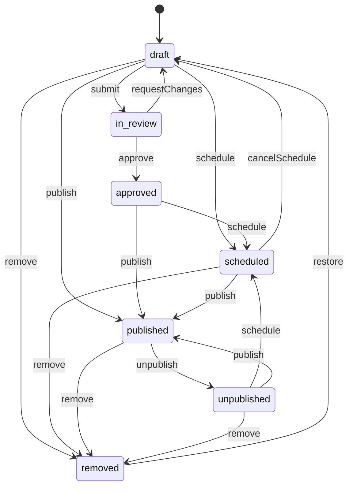
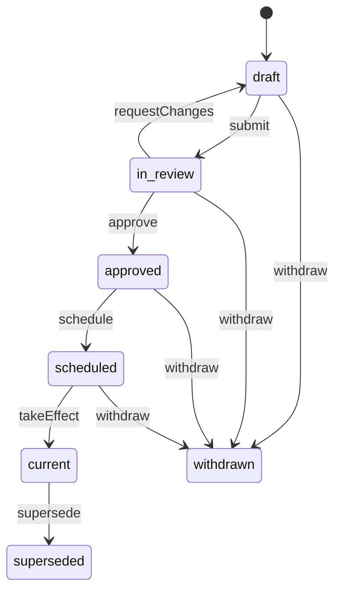

<!-- GENERATED by `npm run gen` from docs/api/modules/content.md. Do not edit: change the spec and regenerate. -->

# Content (`content`)

Store content managed by the Content Manager: ordered and scheduled homepage sections, campaign pages and curated collections, Help Center articles and categories, policies with versions and effective dates, the About page and footer links. Every item has an owner, a preview, a publication status and schedule, a version history with restore, and a correction or removal action.

- **Group:** Growth · **Launch phase:** 1 · **Plan chapters:** 19, 15, 4, 3, 17
- **Depends on:** [media](../media/README.md), [access](../access/README.md) · **Optional:** [catalog](../catalog/README.md), [offers](../offers/README.md), [inventory](../inventory/README.md), [promotions](../promotions/README.md), [advertising](../advertising/README.md), [sellers](../sellers/README.md), [search](../search/README.md), [reports](../reports/README.md), [notifications](../notifications/README.md), [audit](../audit/README.md), [settings](../settings/README.md), [shipping](../shipping/README.md), [wishlist](../wishlist/README.md), [support](../support/README.md), [returns](../returns/README.md)

## Owns
- Homepage sections: order, owner, schedule (show from / remove at with time zone), status, preview on desktop and phone, published layout versions
- Ad positions shown as locked markers in the homepage layout (controlled by advertising)
- Pages: campaign pages, curated collections (New arrivals, Best sellers, Seasonal, Curated collection), the About page and other landing pages
- Publication workflow and schedule: draft, review, scheduled publish and removal, unpublish, correction or removal with reason
- Versions for every page, section layout and article, with restore that creates a new version
- Help Center: categories (topics), articles with effective and updated dates, related articles, search, helpfulness feedback, review-due flags
- Policies (returns, shipping and delivery, privacy, purchase terms, seller rules and fees, advertising and sponsored labels) with numbered versions, effective dates, change summaries, impact on existing orders, owner and Business Owner approval
- Policy version references for purchase snapshots (orders keep the terms accepted at purchase)
- Footer and service information links

**Not here:**
- Ad creatives, ad placements, opening ads and pop-ups: advertising
- Discounts, deal prices, flash sales and coupons: promotions (sections and campaign pages reference them)
- Product data, prices and stock: catalog, offers and inventory (read through their public APIs when rendering)
- Notification templates: notifications
- Recently viewed products: customers
- Return rules (baseline window, who pays return shipping, category exceptions) and their approval: returns; content keeps the customer-facing policy text and its versions, and orders store both

## Store API

| Method | Path | Purpose | Auth | Body → Response |
|---|---|---|---|---|
| GET | `/api/store/content/home` | Homepage sections in order, resolved for display | shopper | `Homepage` |
| GET | `/api/store/content/pages/{slug}` | Campaign page, collection, About or landing page | visitor | `StorePage` |
| GET | `/api/store/content/collections` | Published collections of a brand (or of one collection kind) as cards | visitor | Page<CollectionCard> |
| GET | `/api/store/content/pages/{slug}/products` | More products for rule-based collections (New arrivals, Best sellers) | visitor | Page<ProductTile> |
| GET | `/api/store/content/navigation` | Header and footer links, service strip, contact details and company line | visitor | `SiteNavigation` |
| GET | `/api/store/content/help` | Help Center: topics, popular articles, popular searches, featured guide and contact channels | visitor | `HelpHome` |
| GET | `/api/store/content/help/articles` | Search or browse help articles | visitor | Page<HelpArticleSummary> |
| GET | `/api/store/content/help/articles/{slug}` | A help article with effective and updated dates and related articles | visitor | `HelpArticle` |
| POST | `/api/store/content/help/articles/{id}/feedback` | Was this helpful? | shopper | `{ helpful: bool, comment: text? }` → 204 No content |
| GET | `/api/store/content/policies` | Policies with effective date and version | visitor | `PolicySummary[]` |
| GET | `/api/store/content/policies/{key}` | Current policy (or the version in effect at a date) | visitor | `StorePolicy` |
| GET | `/api/store/content/policies/{key}/versions` | Previous versions of a policy | visitor | `PolicyVersionRef[]` |
| GET | `/api/store/content/policy-versions/{id}` | One past or current policy version (linked from order details) | visitor | `StorePolicy` |

## Admin API

| Method | Path | Purpose | Auth | Body → Response |
|---|---|---|---|---|
| GET | `/api/admin/content/homepage` | Homepage sections with owner, schedule, status and locked ad positions | staff<br>`content.homepage.manage` | `HomepageAdmin` |
| POST | `/api/admin/content/homepage/sections` | Add a section to the draft layout _(audited)_ | staff<br>`content.homepage.manage` | `SectionInput` → `HomeSectionAdmin` |
| PATCH | `/api/admin/content/homepage/sections/{id}` | Edit a section (heading, product source, schedule, position, owner) _(audited)_ | staff<br>`content.homepage.manage` | `SectionInput` → `HomeSectionAdmin` |
| GET | `/api/admin/content/homepage/sections/{id}/products` | Products in a section, resolved with title, seller and stock | staff<br>`content.homepage.manage` | Page<SectionProductRow> |
| POST | `/api/admin/content/homepage/sections/{id}/schedule` | Schedule a section (show from / remove at) _(audited)_ | staff<br>`content.homepage.manage` | `{ showFrom: datetime, removeAt: datetime?, timeZone: string }` → `HomeSectionAdmin` |
| POST | `/api/admin/content/homepage/sections/{id}/remove` | Remove a section (correction or removal, reason required) _(audited)_ | staff<br>`content.homepage.manage` | `{ kind: enum(correction|removal), reason: text, immediately: bool }` → `HomeSectionAdmin` |
| PUT | `/api/admin/content/homepage/order` | Reorder sections in the draft (ad positions move with the layout but stay locked) | staff<br>`content.homepage.manage` | `{ sectionIds: uuid[] }` → `HomepageAdmin` |
| POST | `/api/admin/content/homepage/preview` | Preview the homepage (draft or live) on desktop or phone at a given time | staff<br>`content.homepage.manage` | `PreviewRequest` → `Homepage` |
| POST | `/api/admin/content/homepage/submit` | Send the draft layout for review _(audited)_ | staff<br>`content.homepage.manage` | `{ summary: string? }` → `HomepageAdmin` |
| POST | `/api/admin/content/homepage/review` | Approve the draft layout or request changes _(audited)_ | staff<br>`content.homepage.publish` | `{ approve: bool, note: text? }` → `HomepageAdmin` |
| POST | `/api/admin/content/homepage/publish` | Publish the draft layout as a new version _(audited)_ | staff<br>`content.homepage.publish` | `{ summary: string }` → `HomepageAdmin` |
| POST | `/api/admin/content/homepage/discard-draft` | Discard the unpublished layout draft | staff<br>`content.homepage.manage` | `HomepageAdmin` |
| GET | `/api/admin/content/homepage/versions` | Homepage version history | staff<br>`content.homepage.manage` | Page<Version> |
| POST | `/api/admin/content/homepage/versions/{number}/restore` | Restore an earlier layout (creates a new version; nothing is overwritten) _(audited)_ | staff<br>`content.homepage.publish` | `{ reason: text, publish: bool }` → `HomepageAdmin` |
| GET | `/api/admin/content/pages` | Campaign pages and collections with publish and removal times | staff<br>`content.pages.manage` | Page<PageSummary> |
| POST | `/api/admin/content/pages` | Create a page or collection draft _(audited)_ | staff<br>`content.pages.manage` | `PageDraftInput` → `PageAdmin` |
| GET | `/api/admin/content/pages/{id}` | Page with draft and live versions, checks and linked promotion | staff<br>`content.pages.manage` | `PageAdmin` |
| PATCH | `/api/admin/content/pages/{id}` | Edit the page draft (creates or updates the draft version) _(audited)_ | staff<br>`content.pages.manage` | `PageDraftInput` → `PageAdmin` |
| POST | `/api/admin/content/pages/{id}/preview` | Preview the draft as customers will see it | staff<br>`content.pages.manage` | `PreviewRequest` → `StorePage` |
| POST | `/api/admin/content/pages/{id}/submit` | Send for review _(audited)_ | staff<br>`content.pages.manage` | `PageAdmin` |
| POST | `/api/admin/content/pages/{id}/approve` | Approve or request changes _(audited)_ | staff<br>`content.pages.publish` | `{ approve: bool, reason: text? }` → `PageAdmin` |
| POST | `/api/admin/content/pages/{id}/schedule` | Set publish and removal times _(audited)_ | staff<br>`content.pages.publish` | `{ publishAt: datetime, unpublishAt: datetime?, timeZone: string }` → `PageAdmin` |
| POST | `/api/admin/content/pages/{id}/cancel-schedule` | Cancel a scheduled publication _(audited)_ | staff<br>`content.pages.publish` | `{ reason: text? }` → `PageAdmin` |
| POST | `/api/admin/content/pages/{id}/publish` | Publish the draft now _(audited)_ | staff<br>`content.pages.publish` | `PageAdmin` |
| POST | `/api/admin/content/pages/{id}/unpublish` | Take a page down (it can be republished) _(audited)_ | staff<br>`content.pages.publish` | `{ reason: text? }` → `PageAdmin` |
| POST | `/api/admin/content/pages/{id}/remove` | Correction or removal action (reason required, takes effect now) _(audited)_ | staff<br>`content.pages.remove` | `{ kind: enum(correction|removal), reason: text, correctionNote: text? }` → `PageAdmin` |
| GET | `/api/admin/content/pages/{id}/versions` | Version history of a page | staff<br>`content.pages.manage` | Page<Version> |
| POST | `/api/admin/content/pages/{id}/versions/{number}/restore` | Restore an earlier version as a new draft version _(audited)_ | staff<br>`content.pages.manage` | `{ reason: text }` → `PageAdmin` |
| GET | `/api/admin/content/help/summary` | Published articles, policies, articles needing review and helpful rating | staff<br>`content.help.manage` | `HelpSummary` |
| GET | `/api/admin/content/help/items` | Policies and help articles in one list | staff<br>`content.help.manage` | Page<ContentListItem> |
| GET | `/api/admin/content/help/categories` | Help categories including hidden | staff<br>`content.help.manage` | `HelpCategory[]` |
| POST | `/api/admin/content/help/categories` | Create a help category _(audited)_ | staff<br>`content.help.manage` | `{ name: string, slug: string?, icon: string?, description: string?, audience: enum(customer|seller|both), visible: bool? }` → `HelpCategory` |
| PATCH | `/api/admin/content/help/categories/{id}` | Rename, hide or reorder a category _(audited)_ | staff<br>`content.help.manage` | `{ name: string?, icon: string?, description: string?, position: int?, visible: bool? }` → `HelpCategory` |
| POST | `/api/admin/content/help/articles` | Create a help article draft _(audited)_ | staff<br>`content.help.manage` | `HelpArticleInput` → `HelpArticleAdmin` |
| GET | `/api/admin/content/help/articles/{id}` | Article with status, versions and feedback | staff<br>`content.help.manage` | `HelpArticleAdmin` |
| PATCH | `/api/admin/content/help/articles/{id}` | Edit the article draft _(audited)_ | staff<br>`content.help.manage` | `HelpArticleInput` → `HelpArticleAdmin` |
| POST | `/api/admin/content/help/articles/{id}/transition` | Submit, approve, request changes, schedule, publish, unpublish or remove an article _(audited)_ | staff<br>`content.help.manage` | `{ action: enum(submit|approve|requestChanges|schedule|cancelSchedule|publish|unpublish|remove|restore), reason: text?, kind: enum(correction|removal)?, publishAt: datetime?, unpublishAt: datetime? }` → `HelpArticleAdmin` |
| GET | `/api/admin/content/help/articles/{id}/versions` | Article version history | staff<br>`content.help.manage` | Page<Version> |
| POST | `/api/admin/content/help/articles/{id}/versions/{number}/restore` | Restore an earlier article version as a new draft _(audited)_ | staff<br>`content.help.manage` | `{ reason: text }` → `HelpArticleAdmin` |
| GET | `/api/admin/content/policies` | Policies with current, scheduled and draft versions | staff<br>`content.policies.edit` | `PolicySummary[]` |
| POST | `/api/admin/content/policies` | Create a new policy with its business owner _(audited)_ | staff<br>`content.policies.manage` | `{ key: string, kind: enum(returns|shipping|privacy|purchase_terms|seller_rules|advertising|cookies|other)?, title: string, ownerStaffId: uuid, editorStaffId: uuid?, audience: enum(customer|seller|both) }` → `PolicySummary` |
| GET | `/api/admin/content/policies/{id}/versions` | All versions of a policy with effective date, summary and approver | staff<br>`content.policies.edit` | `PolicyVersion[]` |
| POST | `/api/admin/content/policies/{id}/versions` | Start a new version draft (copies the current text) _(audited)_ | staff<br>`content.policies.edit` | `{ version: string? }` → `PolicyVersion` |
| GET | `/api/admin/content/policy-versions/{id}` | A policy version with approvals | staff<br>`content.policies.edit` | `PolicyVersion` |
| PATCH | `/api/admin/content/policy-versions/{id}` | Edit a draft version (text, effective date, change summary, impact, notices) _(audited)_ | staff<br>`content.policies.edit` | `PolicyVersionInput` → `PolicyVersion` |
| GET | `/api/admin/content/policy-versions/{id}/diff` | Changes from the previous version | staff<br>`content.policies.edit` | `PolicyDiff` |
| POST | `/api/admin/content/policy-versions/{id}/submit` | Send for approval (policy owner, then Business Owner) _(audited)_ | staff<br>`content.policies.edit` | `PolicyVersion` |
| POST | `/api/admin/content/policy-versions/{id}/approve` | Policy owner approval or changes requested _(audited)_ | staff<br>`content.policies.approve` | `{ approve: bool, note: text? }` → `PolicyVersion` |
| POST | `/api/admin/content/policy-versions/{id}/schedule` | Publish an approved version with its effective date _(audited)_ | staff<br>`content.policies.edit` | `{ effectiveAt: datetime }` → `PolicyVersion` |
| POST | `/api/admin/content/policy-versions/{id}/withdraw` | Withdraw a version before it takes effect _(audited)_ | staff<br>`content.policies.edit` | `{ reason: text }` → `PolicyVersion` |
| PUT | `/api/admin/content/navigation` | Replace header and footer links _(audited)_ | staff<br>`content.pages.publish` | `{ header: LinkRef[], footer: FooterGroup[], serviceStrip: ServiceStrip?, reason: text? }` → `SiteNavigation` |

## Types

### PublicationStatus

| Field | Type |
|---|---|
| status | `enum(draft|in_review|approved|scheduled|published|unpublished|removed)` Shared by sections, pages and articles |

### Schedule

| Field | Type |
|---|---|
| publishAt | `datetime?` |
| unpublishAt | `datetime?` |
| timeZone | `string` IANA zone, default America/Los_Angeles |
| label | `string` e.g. Oct 9, 6:00 AM – Oct 31; Always on; Follows campaigns |

### OwnerRef

| Field | Type |
|---|---|
| staffId | `uuid?` |
| name | `string` |
| role | `string` e.g. Content, Marketing, Official Store, Sellers, Advertising |

### ProductTile

| Field | Type |
|---|---|
| productId | `uuid` |
| offerId | `uuid?` |
| title | `string` |
| image | `MediaRef?` |
| price | `Money?` |
| wasPrice | `Money?` |
| fromPrice | `bool` |
| sellerName | `string?` |
| officialStore | `bool` |
| rating | `number?` |
| ratingCount | `int?` |
| availability | `enum(in_stock|low_stock|out_of_stock)?` |
| availableQty | `int?` |
| checkedAt | `datetime?` |
| badge | `string?` e.g. −20%, Home Week |
| rank | `int?` |

### SellerTile

| Field | Type |
|---|---|
| sellerId | `uuid` |
| name | `string` |
| logo | `MediaRef?` |
| verified | `bool` |
| positivePct | `number?` |
| location | `string?` |
| dispatchLabel | `string?` |

### BrandTile

| Field | Type |
|---|---|
| brandId | `uuid` |
| name | `string` |
| logo | `MediaRef?` |
| productCount | `int` |

### CategoryTile

| Field | Type |
|---|---|
| categoryId | `uuid` |
| name | `string` |
| image | `MediaRef?` |

### BannerBlock

| Field | Type |
|---|---|
| eyebrow | `string?` |
| headline | `string` |
| body | `string?` |
| images | `MediaRef[]` |
| primaryCta | `LinkRef` |
| secondaryCta | `LinkRef?` |
| theme | `enum(brand|light|dark)?` |

### LinkRef

| Field | Type |
|---|---|
| label | `string` |
| url | `string` |
| kind | `enum(page|collection|category|product|deals|seller|brand|policy|help|external)?` |

### ProductSource

| Field | Type |
|---|---|
| mode | `enum(manual|collection|rule)` |
| productIds | `uuid[]?` |
| collectionId | `uuid?` |
| rule | `SourceRule?` |
| limit | `int?` |

### SourceRule

| Field | Type |
|---|---|
| kind | `enum(new_arrivals|best_sellers|top_sellers_in_category|official_store|deals)` |
| categoryId | `uuid?` |
| days | `int?` |
| campaignId | `uuid?` deals only: limit to one promotion (promotions.liveDeals({ campaignId })); the section or page then hides when that promotion ends, like linkedPromotionId |
| description | `string` Published selection rule, e.g. Ranked by units sold in the last 30 days across all sellers. Sponsored placements don't affect rank. |

### SectionKind

| Field | Type |
|---|---|
| kind | `enum(campaign_banner|category_shortcuts|deals|official_highlights|featured_products|featured_sellers|new_arrivals|popular_products|brand_collections|recently_viewed|collection_teaser|promise_strip|ad_position)` |

### SectionInput

| Field | Type |
|---|---|
| kind | `enum(campaign_banner|category_shortcuts|deals|official_highlights|featured_products|featured_sellers|new_arrivals|popular_products|brand_collections|recently_viewed|collection_teaser|promise_strip)` |
| heading | `string?` |
| subheading | `string?` |
| banner | `BannerBlock?` |
| productSource | `ProductSource?` |
| categoryIds | `uuid[]?` |
| sellerIds | `uuid[]?` |
| brandIds | `uuid[]?` |
| linkedPromotionId | `uuid?` Section hides when the promotion ends |
| linkedPageId | `uuid?` |
| promiseItems | `PromiseItem[]?` promise_strip only (2–4 items) |
| showFrom | `datetime?` |
| removeAt | `datetime?` |
| timeZone | `string?` |
| ownerStaffId | `uuid?` |
| ownerRole | `string?` |
| position | `int?` 1-based position in the draft layout |

### HomeSectionAdmin

| Field | Type |
|---|---|
| id | `uuid` |
| position | `int` |
| kind | `string` |
| title | `string` |
| description | `string` e.g. 12 products · manual selection |
| owner | `OwnerRef` |
| schedule | `Schedule` |
| status | `enum(draft|scheduled|published|unpublished|removed)` |
| locked | `bool` Ad positions are controlled by advertising and cannot be edited here |
| adPlacementKey | `string?` |
| managedIn | `string?` |
| config | `SectionInput?` |
| unavailableHidden | `int` Products hidden automatically because they are unavailable |
| productCount | `int` Products in the section after unavailable ones are hidden, e.g. 12 (the drawer shows the first rows and + 8 more) |
| updatedAt | `datetime` |

### SectionProductRow

| Field | Type |
|---|---|
| productId | `uuid` |
| offerId | `uuid?` |
| position | `int` |
| title | `string` |
| image | `MediaRef?` |
| sellerName | `string?` Seller of the offer shown, e.g. Official Store |
| stock | `int?` Available quantity of that offer (inventory) |
| available | `bool` |
| hiddenReason | `enum(out_of_stock|product_hidden|offer_paused|seller_suspended)?` Set when the product is hidden automatically from the live section |

### HomepageAdmin

| Field | Type |
|---|---|
| liveVersion | `int` |
| draftVersion | `int?` |
| hasDraft | `bool` |
| draftReview | `HomepageReview` Review of the draft layout when content.reviewRequired.section is on |
| sections | `HomeSectionAdmin[]` |
| timeZone | `string` |
| owner | `OwnerRef` |

### HomeSection

| Field | Type |
|---|---|
| id | `uuid` |
| kind | `string` |
| heading | `string?` |
| subheading | `string?` |
| link | `LinkRef?` |
| banner | `BannerBlock?` |
| products | `ProductTile[]` |
| categories | `CategoryTile[]` |
| sellers | `SellerTile[]` |
| brands | `BrandTile[]` |
| deals | `json?` promotions.FlashSaleBlock[] when promotions is enabled (countdown, claimed meters, limits) |
| promiseItems | `PromiseItem[]` PROMISE_STRIP only: the promises in order; empty for other kinds |
| adPlacementKey | `string?` For ad_position sections: the slot to request from advertising (POST /api/store/advertising/decisions) |
| endsAt | `datetime?` |

### PromiseItem

| Field | Type |
|---|---|
| icon | `string` Icon name from the design system, e.g. calendar-check |
| title | `string` e.g. Delivery date first |
| body | `string` e.g. See arrival dates and the full total before you pay. |

### Homepage

| Field | Type |
|---|---|
| version | `int` |
| generatedAt | `datetime` |
| sections | `HomeSection[]` |

### PageBlock

| Field | Type |
|---|---|
| type | `enum(hero|text|product_grid|product_section|banner|terms|faq|seller_feature|image|availability_note|chips)` |
| id | `string` |
| title | `string?` |
| icon | `string?` |
| body | `text?` |
| editorNote | `text?` |
| banner | `BannerBlock?` |
| productSource | `ProductSource?` |
| products | `ProductTile[]` Resolved on read for store responses; unavailable products removed or replaced |
| items | `string[]?` Terms lines, chip labels |
| link | `LinkRef?` |
| sellerId | `uuid?` seller_feature blocks: the featured seller. Store reads leave the block out while the seller is suspended, restricted from sales or closed (sellers status at read time), and show it again after reinstatement |

### SellerAnnouncement

| Field | Type |
|---|---|
| policyVersionId | `uuid` |
| policyKey | `string` |
| title | `string` |
| version | `string` |
| state | `enum(scheduled|current)` |
| effectiveAt | `datetime` |
| changeSummary | `text?` |
| url | `string` Public version page, /policy-versions/{id} |

### HomepageReview

| Field | Type |
|---|---|
| state | `enum(not_required|not_submitted|in_review|approved|changes_requested)` not_required when reviewRequired.section is false. Any edit to the draft after submission returns it to not_submitted |
| submittedBy | `Actor?` |
| submittedAt | `datetime?` |
| reviewedBy | `Actor?` |
| reviewedAt | `datetime?` |
| note | `text?` |

### PageDraftInput

| Field | Type |
|---|---|
| kind | `enum(campaign|collection|about|landing)` |
| collectionKind | `enum(curated|new_arrivals|best_sellers|seasonal|brand|official)?` |
| brandId | `uuid?` Required when collectionKind is brand: the brand page lists the collection |
| coverImage | `MediaRef?` Card image when the collection is listed (brand page, Official Store); defaults to the first product image |
| title | `string` |
| slug | `string?` |
| eyebrow | `string?` |
| intro | `text?` |
| curatorName | `string?` |
| blocks | `PageBlock[]` |
| linkedPromotionId | `uuid?` |
| period | `DateTimeRange?` Campaign period shown on the page, e.g. Oct 6 – Oct 19, 2026 |
| seoTitle | `string?` |
| seoDescription | `string?` |
| ownerStaffId | `uuid?` |
| changeNote | `string?` |

### DateTimeRange

| Field | Type |
|---|---|
| from | `datetime` |
| to | `datetime` |
| timeZone | `string` |

### PageSummary

| Field | Type |
|---|---|
| id | `uuid` |
| kind | `string` |
| collectionKind | `string?` |
| title | `string` |
| slug | `string` |
| url | `string` |
| owner | `OwnerRef` |
| schedule | `Schedule` |
| status | `enum(draft|in_review|approved|scheduled|published|unpublished|removed)` |
| liveVersion | `int?` |
| draftVersion | `int?` |
| updatedAt | `datetime` |
| allowedActions | `string[]` |

### PageAdmin

| Field | Type |
|---|---|
| summary | `PageSummary` |
| draft | `PageDraftInput?` |
| live | `PageDraftInput?` |
| linkedPromotion | `LinkedPromotion?` |
| checks | `Check[]` e.g. unavailable products hidden, campaign starts at the same time as the page, missing images |
| removal | `RemovalInfo?` |

### LinkedPromotion

| Field | Type |
|---|---|
| id | `uuid` |
| name | `string` |
| status | `string` |
| startsAt | `datetime` |
| endsAt | `datetime` |

### Check

| Field | Type |
|---|---|
| state | `enum(ok|warn|fail|info)` |
| label | `string` |
| detail | `string?` |

### RemovalInfo

| Field | Type |
|---|---|
| kind | `enum(correction|removal)` |
| reason | `text` |
| actor | `Actor` |
| at | `datetime` |

### StorePage

| Field | Type |
|---|---|
| id | `uuid` |
| kind | `string` |
| collectionKind | `string?` |
| title | `string` |
| slug | `string` |
| eyebrow | `string?` |
| intro | `text?` |
| curator | `Curator?` |
| breadcrumb | `LinkRef[]` |
| period | `DateTimeRange?` |
| endsInSeconds | `int?` |
| blocks | `PageBlock[]` |
| notes | `string[]` e.g. Only in-stock offers are included; no seller paid to be included; prices and stock are live |
| updatedAt | `datetime` |
| version | `int` |

### CollectionCard

| Field | Type |
|---|---|
| id | `uuid` |
| slug | `string` |
| url | `string` |
| title | `string` |
| collectionKind | `string?` |
| productCount | `int` Available products in the collection, e.g. 6 products |
| image | `MediaRef?` |

### Curator

| Field | Type |
|---|---|
| name | `string` |
| avatar | `MediaRef?` |
| updatedAt | `datetime` |
| sectionCount | `int` |
| productCount | `int` |

### Version

| Field | Type |
|---|---|
| id | `uuid` |
| entity | `enum(homepage|page|article)` |
| entityId | `uuid` |
| number | `int` |
| state | `enum(draft|live|superseded|discarded)` |
| summary | `string` e.g. Published Home Week banner, moved Deals above Official Store |
| author | `Actor` |
| createdAt | `datetime` |
| publishedAt | `datetime?` |
| restoredFrom | `int?` |

### HelpCategory

| Field | Type |
|---|---|
| id | `uuid` |
| slug | `string` |
| name | `string` |
| icon | `string?` |
| description | `string?` |
| position | `int` |
| visible | `bool` |
| audience | `enum(customer|seller|both)` |
| articleCount | `int` |
| topArticles | `HelpArticleSummary[]?` Filled on the help home only: the topic card article links (up to 4, by position then views) |

### HelpArticleSummary

| Field | Type |
|---|---|
| id | `uuid` |
| slug | `string` |
| title | `string` |
| categoryId | `uuid` |
| categoryName | `string` |
| summary | `string?` |
| readMinutes | `int?` |
| updatedAt | `datetime` |

### HelpArticle

| Field | Type |
|---|---|
| id | `uuid` |
| slug | `string` |
| title | `string` |
| category | `HelpCategory` |
| breadcrumb | `LinkRef[]` |
| effectiveAt | `datetime?` |
| updatedAt | `datetime` |
| readMinutes | `int` |
| body | `text` Structured rich text (headings, lists, tables, links), sanitized |
| tables | `json[]?` e.g. who pays return shipping |
| related | `HelpArticleSummary[]` |
| actions | `LinkRef[]` e.g. Go to my orders, Contact us |
| policyLinks | `LinkRef[]` |
| version | `int` |

### HelpArticleInput

| Field | Type |
|---|---|
| title | `string` |
| slug | `string?` |
| categoryId | `uuid` |
| summary | `string?` |
| body | `text` |
| tables | `json[]?` |
| relatedIds | `uuid[]?` |
| policyKeys | `string[]?` |
| audience | `enum(customer|seller|both)?` |
| topics | `string[]?` Order-problem topics this article answers (for support suggestions) |
| ownerStaffId | `uuid?` |
| effectiveAt | `datetime?` |
| changeNote | `string?` |
| featured | `bool?` Make this the featured guide on the help home of its audience (one per audience; setting it clears the previous one) |
| popularSearch | `string?` Optional chip label under the help search for its audience, e.g. Payout schedule |

### HelpArticleAdmin

| Field | Type |
|---|---|
| article | `HelpArticle` |
| status | `enum(draft|in_review|approved|scheduled|published|unpublished|removed)` |
| owner | `OwnerRef` |
| draftVersion | `int?` |
| liveVersion | `int?` |
| reviewDueAt | `datetime?` |
| helpfulPct | `number?` |
| feedbackCount | `int` |
| schedule | `Schedule` |

### ContentListItem

| Field | Type |
|---|---|
| id | `uuid` |
| title | `string` |
| type | `enum(policy|article)` |
| category | `string` |
| owner | `OwnerRef` |
| status | `string` |
| effectiveAt | `datetime?` |
| version | `string` |
| editUrl | `string` |

### HelpSummary

| Field | Type |
|---|---|
| publishedArticles | `int` |
| categories | `int` |
| policies | `int` |
| policiesScheduled | `int` |
| policiesDraft | `int` |
| articlesNeedingReview | `int` |
| helpfulPct | `number` |
| helpfulWindowDays | `int` |
| tabs | `json` |

### ContactChannel

| Field | Type |
|---|---|
| kind | `enum(chat|phone|message)` |
| label | `string` |
| hours | `string` |
| detail | `string` |
| action | `LinkRef` |

### HelpHome

| Field | Type |
|---|---|
| topics | `HelpCategory[]` |
| popular | `HelpArticleSummary[]` |
| popularSearches | `LinkRef[]` Per audience, e.g. Payout schedule, Changes requested for sellers |
| featured | `HelpArticle?` Featured guide for this audience, shown in full (e.g. Fix a rejected or changes-requested product · 4 min read) |
| contact | `ContactChannel[]` |
| sellerFirstNote | `string` e.g. For items from marketplace sellers, the seller answers first… |

### PolicyVersionRef

| Field | Type |
|---|---|
| policyKey | `string` |
| versionId | `uuid` |
| version | `string` |
| effectiveAt | `datetime` |

### PolicySummary

| Field | Type |
|---|---|
| id | `uuid` |
| key | `string` Slug in the policy URL (/policies/{key}), unique, lowercase letters, digits, - and _, e.g. returns, gift-cards |
| kind | `enum(returns|shipping|privacy|purchase_terms|seller_rules|advertising|cookies|other)` What the policy governs; several policies may share other |
| title | `string` |
| owner | `OwnerRef` |
| editor | `OwnerRef?` |
| current | `PolicyVersionRef?` |
| scheduled | `PolicyVersionRef?` |
| draft | `PolicyVersionRef?` |

### PolicyVersion

| Field | Type |
|---|---|
| id | `uuid` |
| policyId | `uuid` |
| policyKey | `string` |
| title | `string` |
| version | `string` e.g. 3.1 |
| state | `enum(draft|in_review|approved|scheduled|current|superseded|withdrawn)` |
| body | `text` |
| tables | `json[]?` |
| effectiveAt | `datetime?` |
| changeSummary | `text?` |
| impact | `enum(new_orders_only|extend_open_orders)` Extending to open orders is allowed only for changes that favor the customer |
| notifyCustomers | `bool` |
| notifySellers | `bool` |
| approvals | `PolicyApproval[]` |
| approval | `ApprovalInfo?` |
| createdBy | `Actor` |
| createdAt | `datetime` |
| publishedAt | `datetime?` |

### PolicyApproval

| Field | Type |
|---|---|
| role | `enum(policy_owner|business_owner)` |
| reviewer | `Actor?` |
| state | `enum(waiting|approved|changes_requested)` |
| at | `datetime?` |
| note | `text?` |

### PolicyVersionInput

| Field | Type |
|---|---|
| title | `string?` |
| body | `text` |
| tables | `json[]?` |
| effectiveAt | `datetime?` |
| changeSummary | `text?` |
| impact | `enum(new_orders_only|extend_open_orders)?` |
| notifyCustomers | `bool?` |
| notifySellers | `bool?` |

### PolicyDiff

| Field | Type |
|---|---|
| fromVersion | `string` |
| toVersion | `string` |
| html | `text` Diff with <ins>/<del> markup |
| changeSummary | `text?` |

### StorePolicy

| Field | Type |
|---|---|
| key | `string` |
| title | `string` |
| version | `string` |
| effectiveAt | `datetime` |
| body | `text` |
| tables | `json[]?` |
| previousVersion | `PolicyVersionRef?` |
| upcoming | `PolicyVersionRef?` A scheduled version with its effective date and change summary |
| upcomingSummary | `text?` |
| ordersNote | `string` Orders keep the terms accepted at purchase |
| owner | `string` |
| siblings | `LinkRef[]` |

### SiteNavigation

| Field | Type |
|---|---|
| header | `LinkRef[]` |
| footer | `FooterGroup[]` |
| contact | `ContactChannel[]` |
| companyLine | `string` settings.storeInfo market.companyLine (footer line, e.g. Marketly, Inc. · 500 Market St …); when settings is off: '© <year> Marketly' |
| legalName | `string` settings.storeInfo market.legalName; 'Marketly' when settings is off |
| checks | `Check[]?` Admin only (PUT /navigation answer; null on store reads): warnings when the service strip text disagrees with the facts in force, e.g. a free-shipping amount other than shipping.getOfficialFreeShipping or a return window other than returns.defaultWindowDays. Warnings never block saving (decision: warn only) |
| serviceStrip | `ServiceStrip?` Service message above the store header; null when none is active |

### ServiceStrip

| Field | Type |
|---|---|
| text | `string` e.g. Free delivery on Official Store orders over $35 · 30-day returns on most items. Thresholds in the text must match the shipping and returns settings; the editor checks this before saving. |
| link | `LinkRef?` e.g. Delivery details → shipping policy |
| activeFrom | `datetime?` |
| activeUntil | `datetime?` |

### FooterGroup

| Field | Type |
|---|---|
| title | `string` |
| links | `LinkRef[]` |

### PreviewRequest

| Field | Type |
|---|---|
| device | `enum(desktop|phone)` |
| at | `datetime?` Preview what customers will see at this time (scheduled sections included) |
| useDraft | `bool` |

## Status flows

### Content publication (`PageSummary.status`)



Applies to pages, collections, homepage sections and help articles. Review is optional for pages and sections (content.reviewRequired setting) and required for help articles. scheduled → publish runs from the schedule job at publishAt; unpublish also runs at unpublishAt ('Removed Sep 16'). remove is the correction or removal action for content that must come down now (also a draft or a scheduled item that must never go live; a scheduled one loses its schedule): it requires a reason, records who and why, and leaves a correction note where configured. Editing a published item creates a new draft version; the live version stays until the draft is published.

### Policy version (`PolicyVersion.state`)



approve completes when the policy owner and the Business Owner (final approval, through access) have approved. schedule needs an effective date at least policyNoticeDays after publishing for customer-facing changes; an earlier date needs a second approval. takeEffect runs at effectiveAt and supersedes the previous current version. Approved versions are immutable; corrections need a new version. Orders reference the version that was current when they were placed.

## Data (schema `content`)

**home_sections**: Homepage sections (draft state); ad positions are rows with kind ad_position and a placement key

| Column | Type |
|---|---|
| id | uuid pk |
| kind | text |
| heading | text? |
| subheading | text? |
| config | jsonb |
| linked_promotion_id | uuid? |
| linked_page_id | uuid? |
| ad_placement_key | text? |
| show_from | timestamptz? |
| remove_at | timestamptz? |
| time_zone | text |
| owner_staff_id | uuid? |
| owner_role | text? |
| status | text |
| draft_position | int |
| removed_reason | text? |
| updated_by | text |
| updated_at | timestamptz |

**pages**: Campaign pages, collections, About and landing pages

| Column | Type |
|---|---|
| id | uuid pk |
| kind | text |
| collection_kind | text? |
| slug | text unique |
| title | text |
| brand_id | uuid? |
| owner_staff_id | uuid? |
| linked_promotion_id | uuid? |
| status | text |
| publish_at | timestamptz? |
| unpublish_at | timestamptz? |
| time_zone | text |
| live_version_id | uuid? → versions |
| draft_version_id | uuid? → versions |
| removal | jsonb? |
| created_at | timestamptz |
| updated_at | timestamptz |

Indexes: `(kind, status)`, `(brand_id, status)`, `(status, publish_at)`, `(status, unpublish_at)`

**versions**: Immutable snapshots of homepage layouts, pages and articles. Restore copies a snapshot into a new version.

| Column | Type |
|---|---|
| id | uuid pk |
| entity | text (homepage|page|article) |
| entity_id | uuid |
| number | int |
| state | text |
| snapshot | jsonb |
| summary | text? |
| author_kind | text |
| author_id | text? |
| restored_from | int? |
| review_state | text? (not_submitted|in_review|approved|changes_requested) |
| submitted_by | text? |
| submitted_at | timestamptz? |
| reviewed_by | text? |
| reviewed_at | timestamptz? |
| review_note | text? |
| created_at | timestamptz |
| published_at | timestamptz? |

Indexes: `unique (entity, entity_id, number)`

**help_categories**

| Column | Type |
|---|---|
| id | uuid pk |
| slug | text unique |
| name | text |
| icon | text? |
| description | text? |
| position | int |
| visible | bool |
| audience | text |

**help_articles**

| Column | Type |
|---|---|
| id | uuid pk |
| slug | text unique |
| category_id | uuid → help_categories |
| title | text |
| summary | text? |
| audience | text |
| topics | jsonb |
| related_ids | jsonb |
| policy_keys | jsonb |
| featured | bool |
| popular_search | text? |
| owner_staff_id | uuid? |
| status | text |
| publish_at | timestamptz? |
| unpublish_at | timestamptz? |
| effective_at | timestamptz? |
| review_due_at | timestamptz? |
| live_version_id | uuid? → versions |
| draft_version_id | uuid? → versions |
| views | int |
| search | text? (generated from the live version: title, summary, topics and body as plain text, matched by help search) |
| updated_at | timestamptz |

Indexes: `(category_id, status)`, `(status, review_due_at)`

**article_feedback**

| Column | Type |
|---|---|
| id | uuid pk |
| article_id | uuid → help_articles |
| helpful | bool |
| comment | text? |
| visitor_key | text |
| customer_id | uuid? |
| at | timestamptz |

Indexes: `unique (article_id, visitor_key)`

**policies**

| Column | Type |
|---|---|
| id | uuid pk |
| key | text unique (URL slug) |
| kind | text (returns|shipping|privacy|purchase_terms|seller_rules|advertising|cookies|other) |
| title | text |
| owner_staff_id | uuid |
| editor_staff_id | uuid? |
| audience | text (customer|seller|both) |

**policy_versions**: Never edited after approval; orders reference these ids

| Column | Type |
|---|---|
| id | uuid pk |
| policy_id | uuid → policies |
| version | text |
| state | text |
| title | text |
| body | text |
| tables | jsonb? |
| effective_at | timestamptz? |
| change_summary | text? |
| impact | text |
| notify_customers | bool |
| notify_sellers | bool |
| approval_request_id | uuid? |
| created_by | text |
| created_at | timestamptz |
| published_at | timestamptz? |

Indexes: `unique (policy_id, version)`, `(policy_id, state, effective_at)`

**policy_approvals**

| Column | Type |
|---|---|
| id | uuid pk |
| policy_version_id | uuid → policy_versions |
| role | text |
| reviewer_id | text? |
| state | text |
| note | text? |
| at | timestamptz? |

**navigation**: Header and footer link groups (versioned through versions with entity page kind 'navigation' is not needed; edits are audited)

| Column | Type |
|---|---|
| id | uuid pk |
| area | text (header|footer|service_strip) |
| group_title | text? |
| position | int |
| label | text |
| url | text |
| kind | text |
| text | text? (service_strip only) |
| active_from | timestamptz? |
| active_until | timestamptz? |

**content_log**: Publication, schedule, unpublish, correction and removal actions with reasons

| Column | Type |
|---|---|
| id | uuid pk |
| entity | text |
| entity_id | uuid |
| action | text |
| reason | text? |
| actor_kind | text |
| actor_id | text? |
| at | timestamptz |

## Events

| Publishes | When | Payload | Consumed by |
|---|---|---|---|
| `content.page.published` | A page, collection or homepage layout version goes live (now or on schedule) | `{ entity: enum(homepage|page), entityId: uuid, slug: string?, version: int, url: string }` | advertising |
| `content.page.unpublished` | A page is unpublished or reaches its removal time | `{ pageId: uuid, slug: string, reason: text? }` | - |
| `content.page.removed` | A correction or removal action takes content down | `{ entity: string, entityId: uuid, kind: enum(correction|removal), reason: text }` | - |
| `content.article.published` | A help article version goes live | `{ articleId: uuid, slug: string, version: int }` | - |
| `content.article.review_due` | A published help article has not been reviewed for articleReviewDays (daily, once per review period) | `{ articleId: uuid, slug: string, title: string, ownerStaffId: uuid?, lastReviewedAt: datetime?, dueSince: datetime }` | notifications |
| `content.policy.submitted` | A policy version is sent for approval | `{ policyVersionId: uuid, policyKey: string }` | - |
| `content.policy.scheduled` | An approved policy version is published with an effective date (customers and sellers are notified when flagged) | `{ policyVersionId: uuid, policyKey: string, version: string, effectiveAt: datetime, changeSummary: text?, notifyCustomers: bool, notifySellers: bool }` | - |
| `content.policy.effective` | A policy version takes effect and supersedes the previous one | `{ policyVersionId: uuid, policyKey: string, version: string, supersededVersionId: uuid? }` | sellers |

| Consumes | From | Does |
|---|---|---|
| `promotions.campaign.ended` | promotions | Hide homepage sections linked to the promotion; flag linked campaign pages whose removal time is later |
| `promotions.campaign.started` | promotions | Refresh cached sections and pages linked to the promotion |
| `catalog.product.publication_changed` | catalog | Drop hidden or suspended products from manual selections (recorded in the next version) |
| `catalog.product.merged` | catalog | Replace the duplicate product id in sections and collections |
| `offers.offer.status_changed` | offers | Invalidate cached product tiles |
| `inventory.stock.changed` | inventory | Invalidate availability on curated collections |
| `sellers.seller.suspended` | sellers | Remove the seller from Featured sellers; seller_feature blocks naming the seller (PageBlock.sellerId) are hidden on store reads until reinstatement; refresh cached pages |
| `sellers.seller.reinstated` | sellers | Refresh cached pages so seller_feature blocks of the seller show again |
| `sellers.seller.closed` | sellers | Hide seller_feature blocks naming the seller for good and flag the pages for the owner to edit |
| `access.approval.decided` | access | Complete Business Owner approval of a policy version or a short-notice schedule |

## In-process API (for other modules)

| Function | Signature | Used by |
|---|---|---|
| currentPolicyVersions | `(keys: string[], at?: datetime) => PolicyVersionRef[]`<br>Policy versions in effect at a moment. Checkout and orders store these ids on the order so the order keeps the purchase terms and return policy accepted at purchase (plan ch. 3, 8). | checkout, orders, returns, sellers |
| getPolicyVersion | `(versionId: uuid) => PolicyVersion`<br>Exact text of a version, e.g. for order details and disputes. | orders, support, returns |
| helpArticlesFor | `(topic: string, limit: int) => HelpArticleSummary[]`<br>Suggested articles for an order problem or case category. | support, graphql |
| pageLink | `(pageId: uuid) => { url: string, status: string, publishAt?: datetime, unpublishAt?: datetime } | null`<br>Public URL and status of a campaign page, used for ad destination link checks. | advertising, promotions |
| getHomePage | `(ctx: { customerId?: uuid, device?: string, at?: datetime }) => Homepage`<br>Published homepage sections in order with schedules applied (showFrom/removeAt), unavailable products hidden and ended promotions removed (GET /home). Product, offer, deal and stock data are resolved by their owning modules. | graphql |
| previewHomePage | `(req: PreviewRequest) => Homepage`<br>The draft or live homepage as customers will see it at a given time on desktop or phone (POST /homepage/preview, a read). | graphql |
| getStorePage | `(slug: string) => StorePage | null`<br>A published campaign page, collection, About or landing page by slug, with blocks resolved (GET /pages/{slug}). | graphql |
| previewPage | `(pageId: uuid) => StorePage`<br>The draft of a page as customers will see it (POST /pages/{id}/preview, a read). | graphql |
| collectionProducts | `(pageId: uuid, opts: { categoryId?: uuid, paging: PageInput }) => Paged<ProductTile>`<br>Products of a collection page by its selection rule or manual list, page by page, optionally limited to a category tab (GET /pages/{slug}/products). | graphql |
| getHelpCenter | `(audience: 'customer' | 'seller') => HelpHome`<br>Help Center home: topics, popular articles, popular searches, contact channels and the seller-first note (GET /help). | graphql |
| getHelpArticle | `(slug: string) => HelpArticle | null`<br>A published help article with effective and updated dates, related articles and actions (GET /help/articles/{slug}). | graphql |
| countHelpArticlesForPolicy | `(policyKey: string) => { count: int, articleIds: uuid[] }`<br>Published Help articles whose policyKeys include the policy (e.g. returns), so a policy change preview can say how many need review. | returns |
| sellerAnnouncements | `(opts: { since?: datetime, limit: int }) => SellerAnnouncement[]`<br>Announcements for Seller Center, newest first: policy versions with notifySellers that are scheduled or current (audience seller or both), from policy_versions. No separate announcements table at launch. | reports, graphql |
| contentForCampaign | `(campaignId: uuid) => { sections: { id: uuid, kind: string, heading?: string, status: string }[], pages: { id: uuid, slug: string, title: string, status: string, url: string }[] }`<br>Homepage sections and pages linked to a promotion (linkedPromotionId, or a deals SourceRule with that campaignId), for the campaign detail in promotions and ad destination checks | promotions, advertising, graphql |

## Permissions

| Key | Who | Allows |
|---|---|---|
| `content.homepage.manage` | staff | Edit homepage sections, order and schedules; preview |
| `content.homepage.publish` | staff | Publish the homepage layout and restore versions |
| `content.pages.manage` | staff | Create and edit campaign pages and collections |
| `content.pages.publish` | staff | Approve, schedule, publish and unpublish pages; edit navigation |
| `content.pages.remove` | staff | Correction or removal action on live content (reason required) |
| `content.help.manage` | staff | Help categories and articles |
| `content.policies.edit` | staff | Draft policy versions, submit and schedule approved versions |
| `content.policies.approve` | staff | Policy owner approval |
| `content.policies.manage` | staff | Create policies and assign their owners |

## Approval actions

Checked through the access module (limits per role, second reviewer).

| Action | Limit | Second reviewer | Approvers | Meaning |
|---|---|---|---|---|
| `content.policies.approve` | none | always | Business Owner (after the policy owner approves) | Final approval of a new policy version (returns, shipping, purchase terms, privacy, seller rules, advertising) |
| `content.policies.short-notice` | none | always | Business Owner | Schedule a customer-facing policy change with less than policyNoticeDays notice |

## Error codes

| Code | Status | Meaning |
|---|---|---|
| `SECTION_LOCKED` | 409 | Ad positions are controlled by advertising and cannot be edited here. |
| `SLUG_TAKEN` | 409 | Another page or article uses this URL. |
| `DRAFT_EXISTS` | 409 | The policy already has an open draft version. |
| `SAME_REVIEWER` | 409 | The author cannot approve their own article or homepage draft. |

## Background jobs

| Job | Schedule | Does |
|---|---|---|
| `content.run-schedules` | every 1 min | Publish and unpublish sections, pages and articles whose publishAt / unpublishAt has passed; record a homepage version when the visible layout changes |
| `content.policy-effective` | every 1 min | Scheduled policy versions past effectiveAt → current; previous → superseded |
| `content.refresh-collections` | hourly | Rebuild rule-based collections (best sellers hourly, new arrivals daily) and re-check availability of curated items, replacing or removing sold-out ones |
| `content.article-review-due` | daily 07:00 market time | Flag articles not reviewed for articleReviewDays; publish content.article.review_due (notifications tells the owner) |
| `content.cache-warm` | every 5 min | Rebuild the resolved homepage for desktop, phone and app |

## Settings

| Key | Default | Rules | Meaning |
|---|---|---|---|
| marketTimeZone | `"America/Los_Angeles"` | string | Default time zone for schedules |
| policyNoticeDays | `14` | duration, days, 0–…, approval: business owner | Minimum days between publishing and the effective date of customer-facing policy changes |
| articleReviewDays | `90` | duration, days, 1–… | Articles older than this are flagged for review |
| reviewRequired | `{"page":false,"section":false,"article":true}` | json, approval: second reviewer | Whether the review step is required before publishing |
| availabilityCheckMinutes | `60` | duration, minutes, 5–… | How often curated collections re-check stock |
| maxSectionProducts | `24` | int, 1–… | Products per homepage section |

## Notes
- Homepage sections each have their own schedule; the published layout version is the ordered list of section snapshots. Reordering or editing creates a draft layout; customers see it after Publish. Scheduled sections appear automatically at showFrom without a new manual publish (the job records a new version so history stays complete).
- Ad positions (opening full-screen, sponsored brand banner) are rows of kind ad_position with a placement key: they keep their place in the order and show 'Managed in Advertisements'. Content never decides which ad shows.
- Store responses resolve product tiles through catalog, offers and promotions public APIs when those modules are enabled; unavailable products are hidden automatically and expired deals removed (plan ch. 4). Sponsored placements never change rank in Best sellers.
- Restoring any version creates a new version; nothing is overwritten (admin/content).
- Policies: orders keep the terms accepted at purchase. Checkout calls currentPolicyVersions and the order stores the version ids; account/order links to /policy-versions/{id}. Extending a change to open orders is allowed only when it favors the customer.
- The About page is a page of kind about at slug 'about' (info/about).
- Homepage review: content.reviewRequired.section applies to the homepage draft layout as a whole (submitHomepageDraft → reviewHomepageDraft → publishHomepage); pages follow reviewRequired.page through submitPage / approvePage; articles always need review.
- Policy approvals: the owner step is a permission check plus ownership; only the Business Owner step goes through access approvals. The access seed must let content.policies.approve be requested by policy owners (recommend_only for Content Manager and other owner roles) so requestApproval is not denied for proposers.
- Campaign content: a deals source with campaignId and sections or pages with linkedPromotionId are what contentForCampaign returns; both hide when promotions.campaign.ended arrives.
- Dependencies follow the architecture doc (media, access); catalog, offers, inventory, promotions, advertising and sellers are optional and only enrich rendering.

## GraphQL (read layer)

This module's fragment of the GraphQL schemas (see [../graphql/README.md](../graphql/README.md)). Writes stay on the REST endpoints above.

```graphql
# content: homepage sections, campaign pages and curated collections, Help Center articles.
# Read-only views of what the Content Manager published. Editing, scheduling, publishing and
# version restore stay on REST (/api/admin/content/...).
#
# Products inside sections and pages are nested as catalog Product and offers Offer, so the
# screen query asks for price, deal badge (promotions Offer.deal) and stock (inventory) on the
# same objects as everywhere else. Content only decides WHICH products appear and in what order.
#
# Other modules extending HomeSection or ContentPage must limit the field to
# @areas(in: [STORE, ADMIN]) (or narrower): these types are not in the seller schema.

# ------------------------------------------------------------------ links, banners, tiles

"A link shown on a section, block, breadcrumb or help article"
type ContentLink @areas(in: [STORE, ADMIN]) {
  label: String!
  "Store path or absolute URL"
  url: String!
  kind: ContentLinkKind
}

enum ContentLinkKind @areas(in: [STORE, ADMIN]) {
  PAGE
  COLLECTION
  CATEGORY
  PRODUCT
  DEALS
  SELLER
  BRAND
  POLICY
  HELP
  EXTERNAL
}

"Campaign or promotional banner (hero) used by sections and page blocks"
type ContentBanner @areas(in: [STORE, ADMIN]) {
  eyebrow: String
  headline: String!
  body: String
  images: [MediaRef!]!
  primaryCta: ContentLink!
  secondaryCta: ContentLink
  theme: ContentBannerTheme
}

enum ContentBannerTheme @areas(in: [STORE, ADMIN]) {
  BRAND
  LIGHT
  DARK
}

"""
One product placed by content (section, page block or collection). Price, was price, deal badge,
seller and stock are read from `offer` (or `product.featuredOffer` when no offer is pinned).
"""
type ContentProductTile @areas(in: [STORE, ADMIN]) {
  product: Product!
  "The offer this placement shows (e.g. the deal offer). Null = use product.featuredOffer."
  offer: Offer
  "Editorial badge, e.g. Home Week. Price badges come from Offer.deal."
  badge: String
  "Position in a ranked collection (Best sellers)"
  rank: Int
  "Grouping label, e.g. Added Oct 6 (New arrivals)"
  group: String
  "When content last confirmed the product is available (curated collections show it)"
  checkedAt: DateTime
}

type ContentProductTilePage implements Paged @areas(in: [STORE, ADMIN]) {
  items: [ContentProductTile!]!
  nextCursor: String
  page: Int
  totalPages: Int
  total: Int
}

"A category shortcut with the image chosen by content (catalog categories have no artwork)"
type ContentCategoryShortcut @areas(in: [STORE, ADMIN]) {
  category: Category!
  image: MediaRef
  "Shorter label for the shortcut; defaults to the category name"
  label: String
}

"Campaign or page period, shown with its time zone"
type ContentPeriod @areas(in: [STORE, ADMIN]) {
  from: DateTime!
  to: DateTime!
  "IANA zone, e.g. America/Los_Angeles"
  timeZone: String!
}

# ------------------------------------------------------------------ homepage

"The published homepage: ordered sections with their schedules already applied"
type HomePage @areas(in: [STORE, ADMIN]) {
  "Published layout version"
  version: Int!
  generatedAt: DateTime!
  sections: [HomeSection!]!
}

enum HomeSectionKind @areas(in: [STORE, ADMIN]) {
  CAMPAIGN_BANNER
  CATEGORY_SHORTCUTS
  "Flash deals strip: read HomeSection.flashSales (promotions)"
  DEALS
  OFFICIAL_HIGHLIGHTS
  FEATURED_PRODUCTS
  FEATURED_SELLERS
  NEW_ARRIVALS
  POPULAR_PRODUCTS
  BRAND_COLLECTIONS
  "Read Query.recentlyViewed (customers); content only places the section"
  RECENTLY_VIEWED
  COLLECTION_TEASER
  PROMISE_STRIP
  "Locked ad slot: request the ad from REST POST /api/store/advertising/decisions with adPlacementKey"
  AD_POSITION
}

"""
One homepage section. Only the fields that fit its kind are filled; the others are empty lists or null.
Sections appear at their showFrom time and disappear at removeAt (or when their linked promotion ends).
"""
type HomeSection @areas(in: [STORE, ADMIN]) {
  id: UUID!
  "1-based position in the published layout"
  position: Int!
  kind: HomeSectionKind!
  heading: String
  subheading: String
  "Section link, e.g. See all deals"
  link: ContentLink
  banner: ContentBanner
  "Products in order, unavailable ones already removed"
  products(limit: Int): [ContentProductTile!]! @cost(weight: 10)
  categories: [ContentCategoryShortcut!]!
  "Featured seller cards in published order (FEATURED_SELLERS), resolved by reference to sellers: name, slug, logo, Verified label, location, dispatch label. Rating comes from reviews (Seller.rating). Suspended or closed sellers are left out."
  sellers: [Seller!]!
  brands: [Brand!]!
  "Collection teased by a COLLECTION_TEASER section (or the See all target of a product section)"
  collection: Collection
  "Published selection rule for rule-based sections, e.g. Ranked by units sold in the last 30 days. Sponsored placements don't affect rank."
  selectionRule: String
  "AD_POSITION only: the slot to request from advertising (REST, records impressions)"
  adPlacementKey: String
  "When the section is scheduled to disappear (campaign banners count down to it)"
  endsAt: DateTime
  "PROMISE_STRIP only: the promises in order (icon, title, text); empty for other kinds"
  promiseItems: [ContentPromiseItem!]!
}

"One item of the Our promise strip, e.g. Delivery date first"
type ContentPromiseItem @areas(in: [STORE, ADMIN]) {
  "Icon name from the design system, e.g. calendar-check"
  icon: String!
  title: String!
  body: String!
}

# ------------------------------------------------------------------ pages and collections

enum ContentPageKind @areas(in: [STORE, ADMIN]) {
  CAMPAIGN
  COLLECTION
  ABOUT
  LANDING
}

enum ContentBlockType @areas(in: [STORE, ADMIN]) {
  HERO
  TEXT
  PRODUCT_GRID
  PRODUCT_SECTION
  BANNER
  TERMS
  FAQ
  SELLER_FEATURE
  IMAGE
  AVAILABILITY_NOTE
  CHIPS
}

"One block of a campaign page or collection, in page order"
type ContentBlock @areas(in: [STORE, ADMIN]) {
  "Stable block id, used for in-page anchors (chips link to sections)"
  id: String!
  type: ContentBlockType!
  title: String
  "Icon name from the design system, e.g. lamp-desk"
  icon: String
  "Sanitized rich text"
  body: String
  "Editor's note shown above a curated section"
  editorNote: String
  banner: ContentBanner
  "Resolved on read; unavailable products are removed or replaced"
  products: [ContentProductTile!]! @cost(weight: 10)
  "Terms lines or chip labels"
  items: [String!]!
  link: ContentLink
}

"""
A store page: campaign page (e.g. Home Week), curated collection, About or landing page.
Collections also carry `collection` for the curator, selection rule and paged products.
"""
type ContentPage @areas(in: [STORE, ADMIN]) {
  id: UUID!
  kind: ContentPageKind!
  title: String!
  slug: String!
  eyebrow: String
  intro: String
  breadcrumb: [ContentLink!]!
  "Campaign period shown on the page, e.g. Oct 6 – Oct 19, 2026"
  period: ContentPeriod
  "Seconds until the period ends, computed at serve time for countdowns"
  endsInSeconds: Int
  blocks: [ContentBlock!]!
  "Trust notes, e.g. Only in-stock offers are included; no seller paid to be included"
  notes: [String!]!
  "Set when kind is COLLECTION"
  collection: Collection
  seoTitle: String
  seoDescription: String
  updatedAt: DateTime!
  version: Int!
}

enum CollectionKind @areas(in: [STORE, ADMIN]) {
  CURATED
  NEW_ARRIVALS
  BEST_SELLERS
  SEASONAL
  BRAND
  OFFICIAL
}

"Editor who curated a collection"
type ContentCurator @areas(in: [STORE, ADMIN]) {
  name: String!
  avatar: MediaRef
  updatedAt: DateTime!
  sectionCount: Int!
  productCount: Int!
}

"A curated or rule-based product collection (New arrivals, Best sellers, Seasonal, editor collections)"
type Collection @areas(in: [STORE, ADMIN]) {
  "Same id as its ContentPage"
  id: UUID!
  kind: CollectionKind!
  title: String!
  slug: String!
  "Store path of the collection page"
  url: String!
  curator: ContentCurator
  "Published selection rule, e.g. Products first listed in the last 30 days, newest first. Updated daily."
  selectionRule: String
  "Category tabs or chips offered on the collection (e.g. Best sellers by category)"
  categoryFilters: [Category!]!
  "When the ranking or selection was last refreshed"
  refreshedAt: DateTime
  "All products of the collection, page by page, optionally limited to one category tab"
  products(categoryId: UUID, paging: PageInput): ContentProductTilePage! @cost(weight: 10) @source(module: "content", fn: "collectionProducts")
}

# ------------------------------------------------------------------ Help Center (store)

enum HelpAudience @areas(in: [STORE]) {
  CUSTOMER
  SELLER
  BOTH
}

"A Help Center topic, e.g. Returns"
type HelpCategory @areas(in: [STORE]) {
  id: UUID!
  slug: String!
  name: String!
  "Icon name from the design system"
  icon: String
  description: String
  position: Int!
  audience: HelpAudience!
  articleCount: Int!
}

"Article card for lists, related articles and suggestions"
type HelpArticleSummary @areas(in: [STORE]) {
  id: UUID!
  slug: String!
  title: String!
  category: HelpCategory!
  summary: String
  readMinutes: Int
  updatedAt: DateTime!
}

"A published help article"
type HelpArticle @areas(in: [STORE]) {
  id: UUID!
  slug: String!
  title: String!
  category: HelpCategory!
  breadcrumb: [ContentLink!]!
  "When the rules the article describes take effect"
  effectiveAt: DateTime
  updatedAt: DateTime!
  readMinutes: Int!
  "Structured rich text (headings, lists, links), sanitized"
  body: String!
  "Tables such as who pays return shipping"
  tables: [JSON!]!
  related: [HelpArticleSummary!]!
  "e.g. Go to my orders, Contact us"
  actions: [ContentLink!]!
  policyLinks: [ContentLink!]!
  version: Int!
}

enum HelpContactKind @areas(in: [STORE]) {
  CHAT
  PHONE
  MESSAGE
}

type HelpContactChannel @areas(in: [STORE]) {
  kind: HelpContactKind!
  label: String!
  "e.g. Mon–Sat, 8 AM–8 PM PT"
  hours: String!
  detail: String!
  action: ContentLink!
}

"Help Center home. The screen adds recent orders (orders) and open cases (support) in the same query."
type HelpCenter @areas(in: [STORE]) {
  topics: [HelpCategory!]!
  popular: [HelpArticleSummary!]!
  popularSearches: [ContentLink!]!
  contact: [HelpContactChannel!]!
  "e.g. For items from marketplace sellers, the seller answers first…"
  sellerFirstNote: String!
}

# ------------------------------------------------------------------ fields on other modules' types

extend type Case {
  "Help articles for this case's topic, suggested on the case page"
  helpArticles(limit: Int = 3): [HelpArticleSummary!]! @areas(in: [STORE]) @source(module: "content", fn: "helpArticlesFor")
}

# ------------------------------------------------------------------ queries

extend type Query {
  "Homepage sections in published order, resolved for display (public, CDN-cacheable without a session)"
  homePage: HomePage! @areas(in: [STORE]) @cost(weight: 20) @source(module: "content", fn: "getHomePage")

  "Campaign page, collection, About or landing page. Null when not published."
  contentPage(slug: String!): ContentPage @areas(in: [STORE]) @cost(weight: 10) @source(module: "content", fn: "getStorePage")

  "Help Center home: topics, popular articles, popular searches and contact channels"
  helpCenter: HelpCenter! @areas(in: [STORE]) @source(module: "content", fn: "getHelpCenter")

  "A help article by slug"
  helpArticle(slug: String!): HelpArticle @areas(in: [STORE]) @source(module: "content", fn: "getHelpArticle")

  "Preview the draft or live homepage at a moment, exactly as customers will see it"
  homePagePreview(at: DateTime, device: String, useDraft: Boolean = true): HomePage @areas(in: [ADMIN]) @auth(requires: STAFF, permission: "content.homepage.manage") @cost(weight: 20) @source(module: "content", fn: "previewHomePage")

  "Preview a page draft as customers will see it"
  contentPagePreview(id: UUID!): ContentPage @areas(in: [ADMIN]) @auth(requires: STAFF, permission: "content.pages.manage") @cost(weight: 10) @source(module: "content", fn: "previewPage")
}
```
