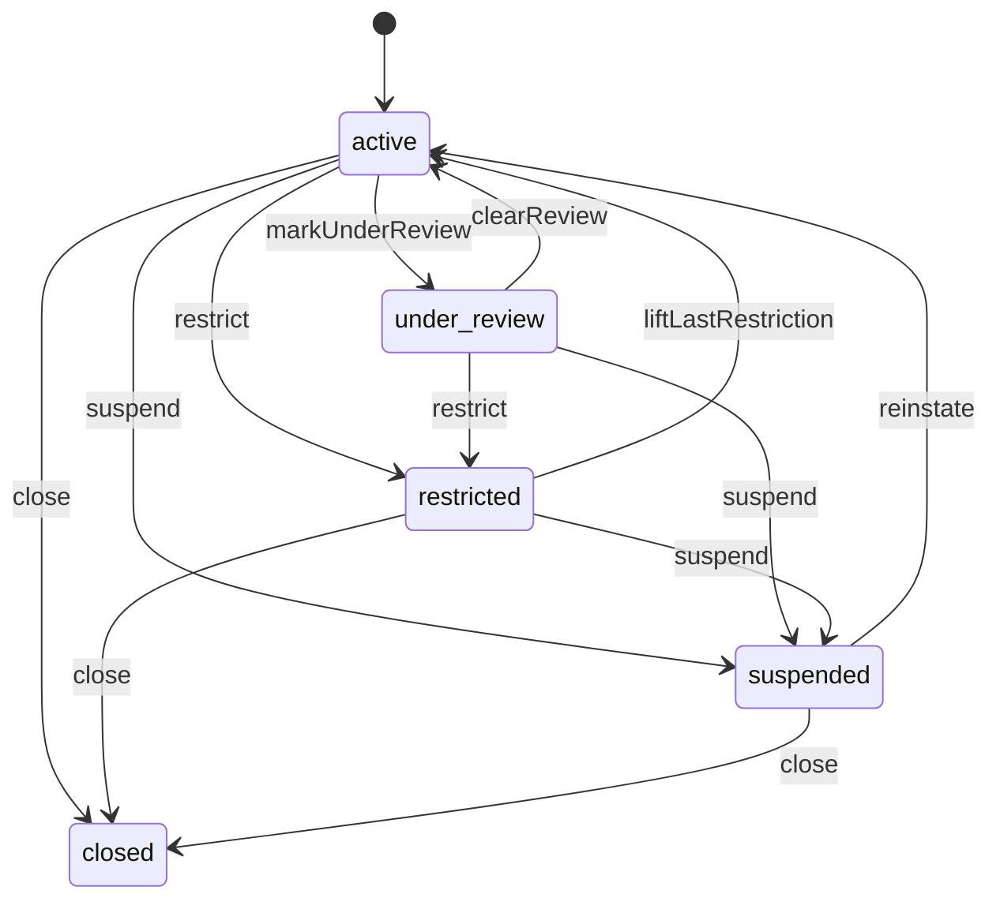
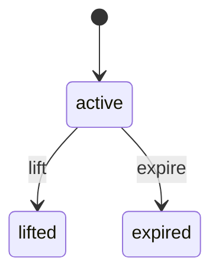
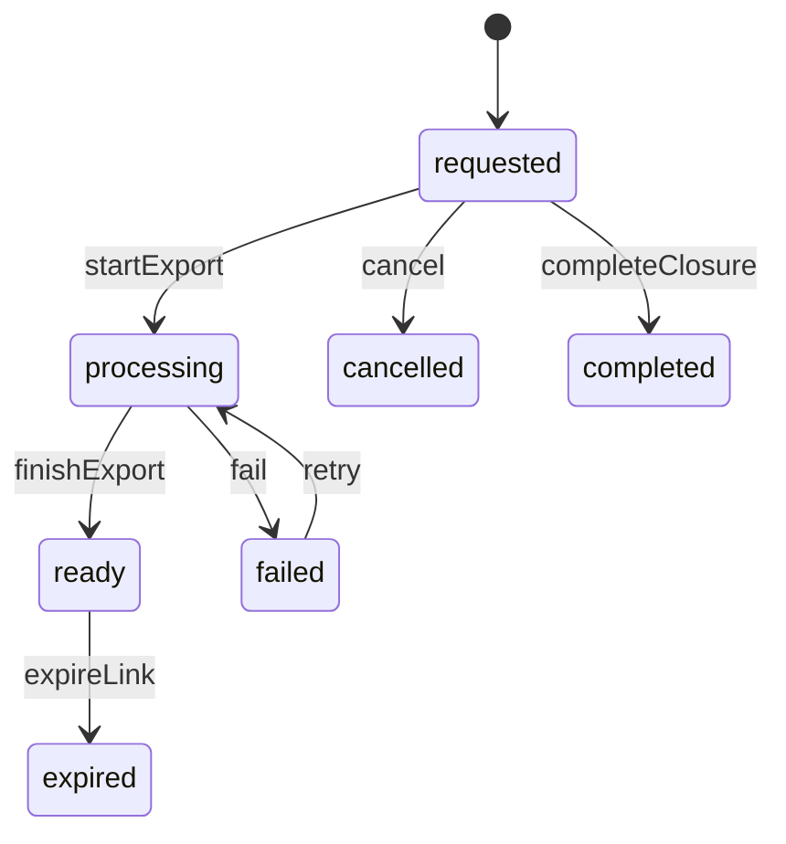

<!-- GENERATED by `npm run gen` from docs/api/modules/customers.md. Do not edit: change the spec and regenerate. -->

# Customers (`customers`)

The customer side of an account: profile, saved addresses, marketing consent, recently viewed products, the Account tab overview, guest order access, data export and account closure, and the staff view of customer accounts with notes and recorded account actions. Credentials, sessions and verification belong to identity.

- **Group:** Participants · **Launch phase:** 1 · **Plan chapters:** 3, 4, 6, 7, 17, 18, 19
- **Depends on:** [identity](../identity/README.md) · **Optional:** [orders](../orders/README.md), [returns](../returns/README.md), [support](../support/README.md), [messaging](../messaging/README.md), [wallet](../wallet/README.md), [catalog](../catalog/README.md), [offers](../offers/README.md), [trust](../trust/README.md), [reports](../reports/README.md), [notifications](../notifications/README.md), [access](../access/README.md), [audit](../audit/README.md), [media](../media/README.md), [workqueues](../workqueues/README.md)
- **Required by:** [checkout](../checkout/README.md), [wallet](../wallet/README.md), [wishlist](../wishlist/README.md)

## Owns
- Customer profile (name, phone, member since) linked one-to-one to an identity user
- Saved delivery addresses with a default; checkout copies the address into the order, so later changes never alter accepted orders
- Marketing preferences per channel (email, SMS, push promotions, wishlist alerts, personalised recommendations) with a consent log; essential order messages are always on
- Recently viewed products for customers and guest sessions (launch feature on the home page)
- Account overview aggregate for the Account tab (orders in progress, open returns, unread messages, store credit, recent orders, open cases, delay alerts)
- Guest order access: lookup by order reference and checkout email, and emailing order links
- Customer account status (Active, Under review, Restricted, Suspended, Closed) and scoped restrictions (messaging, ordering, reviews) with reason, end date and appeal route
- Admin customer list and detail, internal notes and account actions that always record a reason
- Personal data export requests and account closure requests

**Not here:**
- Email, password, 2-step verification, devices and sessions: identity (account actions call identity in-process)
- Saved payment methods: payments
- Orders, returns, cases, messages, store credit: orders, returns, support, messaging, wallet (the overview only reads them)
- Wishlist and price or availability alerts: wishlist (phase 3); the wishlistAlerts consent flag lives here so one preference page covers all promotional messages
- Notification delivery and channel routing: notifications (reads consent from here)
- Abuse reports about customers: trust (shown read-only in the admin detail)

## Store API

| Method | Path | Purpose | Auth | Body → Response |
|---|---|---|---|---|
| GET | `/api/store/customers/overview` | Account tab home: tiles, alerts, recent orders, open cases and returns | customer | `AccountOverview` |
| GET | `/api/store/customers/profile` | Profile, verification state and active restrictions | customer | `CustomerProfile` |
| PATCH | `/api/store/customers/profile` | Change name or mobile phone | customer | `ProfileInput` → `CustomerProfile` |
| GET | `/api/store/customers/addresses` | Saved addresses (bounded by maxAddresses, not paged) | customer | `SavedAddress[]` |
| POST | `/api/store/customers/addresses` | Add an address | customer | `AddressInput` → `SavedAddress` |
| PATCH | `/api/store/customers/addresses/{id}` | Edit an address | customer | `AddressInput` → `SavedAddress` |
| DELETE | `/api/store/customers/addresses/{id}` | Remove an address | customer | 204 No content |
| POST | `/api/store/customers/addresses/{id}/make-default` | Set the default delivery address | customer | `SavedAddress[]` |
| POST | `/api/store/customers/addresses/validate` | Check an address before saving or at guest checkout | shopper | `Address` → `AddressValidation` |
| GET | `/api/store/customers/marketing-preferences` | Promotional consent per channel | customer | `MarketingPreferences` |
| PUT | `/api/store/customers/marketing-preferences` | Turn promotional channels on or off | customer | `MarketingPreferencesInput` → `MarketingPreferences` |
| GET | `/api/store/customers/recently-viewed` | Recently viewed products for the home page | shopper | `RecentlyViewedItem[]` |
| POST | `/api/store/customers/recently-viewed` | Record a product view | shopper | `{ productId: uuid, variantId: uuid? }` → 204 No content |
| DELETE | `/api/store/customers/recently-viewed` | Clear the whole list | shopper | 204 No content |
| DELETE | `/api/store/customers/recently-viewed/{productId}` | Remove one product from the list | shopper | 204 No content |
| POST | `/api/store/customers/data-requests/exports` | Request a copy of my data | customer | `DataRequest` |
| GET | `/api/store/customers/data-requests` | My export and closure requests | customer | `DataRequest[]` |
| GET | `/api/store/customers/closure-eligibility` | Can I close my account now, and what blocks it | customer | `ClosureEligibility` |
| POST | `/api/store/customers/data-requests/closure` | Request account closure | customer | `{ reauthToken: string, reason: text? }` → `DataRequest` |
| POST | `/api/store/customers/data-requests/{id}/cancel` | Cancel a pending closure or export request | customer | `DataRequest` |
| POST | `/api/store/customers/guest-orders/lookup` | Find a guest order by reference and checkout email | shopper | `{ orderRef: string, email: email }` → `GuestOrderAccess` |
| POST | `/api/store/customers/guest-orders/links` | Email fresh links to every guest order placed with this email | anyone | `{ email: email }` → 204 No content |

## Admin API

| Method | Path | Purpose | Auth | Body → Response |
|---|---|---|---|---|
| GET | `/api/admin/customers/guest-buyers` | Guest buyers (orders without an account) with order count and spend | staff<br>`customers.accounts.view` | Page<GuestBuyerRow> |
| GET | `/api/admin/customers/customers` | Customer accounts with orders, spend, open cases, status and verification | staff<br>`customers.accounts.view` | Page<AdminCustomerRow> |
| GET | `/api/admin/customers/customers/{id}` | Customer detail: profile, orders, cases, messages, notes, abuse reports, restrictions _(audited)_ | staff<br>`customers.accounts.view` | `AdminCustomerDetail` |
| POST | `/api/admin/customers/customers/{id}/notes` | Add an internal note _(audited)_ | staff<br>`customers.notes.write` | `{ body: text }` → `CustomerNote` |
| POST | `/api/admin/customers/customers/{id}/actions` | Apply an account action with a recorded reason _(audited)_ | staff<br>`customers.accounts.act` | `AccountActionInput` → `AccountActionResult` |
| POST | `/api/admin/customers/customers/{id}/restrictions/{restrictionId}/lift` | Lift a restriction early _(audited)_ | staff<br>`customers.accounts.act` | `{ reason: text }` → `AccountActionResult` |
| GET | `/api/admin/customers/customers/{id}/actions` | Account action history for one customer | staff<br>`customers.accounts.view` | Page<AccountActionRecord> |
| POST | `/api/admin/customers/customers/exports` | Export the filtered customer list _(audited)_ | staff<br>`customers.accounts.export` | `{ filters: json, format: enum(csv|xlsx)? }` → `reports.ExportJob` |
| GET | `/api/admin/customers/data-requests` | Export and closure requests across customers (privacy queue) | staff<br>`customers.data-requests.manage` | Page<item> |
| POST | `/api/admin/customers/data-requests/{id}/retry` | Retry a failed export _(audited)_ | staff<br>`customers.data-requests.manage` | `DataRequest` |

## Public API

| Method | Path | Purpose | Auth | Body → Response |
|---|---|---|---|---|
| POST | `/api/public/customers/unsubscribe` | One-click stop of promotional messages from an email or SMS link | anyone | `{ token: string, channel: enum(email|sms|push|all)? }` → `MarketingPreferences` |

## Types

### CustomerSnapshot

| Field | Type |
|---|---|
| id | `uuid` |
| userId | `uuid` |
| ref | `string` Human reference, e.g. CU-208114 |
| displayName | `string` |
| email | `email` |
| phone | `string?` |
| accountStatus | `enum(active|under_review|restricted|suspended|closed)` |
| canOrder | `bool` |
| canMessage | `bool` |

### CustomerProfile

| Field | Type |
|---|---|
| id | `uuid` |
| ref | `string` |
| firstName | `string` |
| lastName | `string` |
| displayName | `string` |
| email | `email` |
| emailVerified | `bool` |
| emailVerifiedAt | `datetime?` |
| phone | `string?` |
| phoneVerified | `bool` |
| memberSince | `date` |
| defaultAddressId | `uuid?` |
| accountStatus | `enum(active|under_review|restricted|suspended|closed)` |
| restrictions | `AccountRestriction[]` Active restrictions the customer can see, with appeal route |
| updatedAt | `datetime` |

### ProfileInput

| Field | Type |
|---|---|
| firstName | `string?` |
| lastName | `string?` |
| phone | `string?` Changing it clears phoneVerified; identity sends a code |

### SavedAddress

| Field | Type |
|---|---|
| id | `uuid` |
| label | `string?` e.g. Home, Work |
| address | `Address` |
| deliveryInstructions | `text?` |
| isDefault | `bool` |
| lastUsedAt | `datetime?` |
| createdAt | `datetime` |
| updatedAt | `datetime` |

### AddressInput

| Field | Type |
|---|---|
| label | `string?` |
| address | `Address` |
| deliveryInstructions | `text?` |
| makeDefault | `bool?` |

### AddressValidation

| Field | Type |
|---|---|
| valid | `bool` |
| issues | `AddressIssue[]` Field-level problems, e.g. 5-digit ZIP required |
| suggestion | `Address?` Normalised address from the validation provider |
| deliverable | `bool` Inside the service region (all 50 US states at launch) |
| poBox | `bool` |

### AddressIssue

| Field | Type |
|---|---|
| field | `string` |
| code | `enum(missing|invalid_format|not_found|outside_service_region|po_box_not_allowed)` |
| message | `string` |

### MarketingPreferences

| Field | Type |
|---|---|
| emailPromotions | `bool` |
| smsPromotions | `bool` |
| pushPromotions | `bool` Android app promotions; set separately from order push notices |
| wishlistAlerts | `bool` Price-drop and back-in-stock notices (used once wishlist is on) |
| personalizedRecommendations | `bool` |
| recentSearches | `bool` Keep my recent searches (search stores them; this is the on/off switch) |
| essentialAlwaysOn | `bool` Always true. Order, payment, delivery, return, refund, case and security messages cannot be turned off. |
| smsNumber | `string?` |
| updatedAt | `datetime` |

### MarketingPreferencesInput

| Field | Type |
|---|---|
| emailPromotions | `bool?` |
| smsPromotions | `bool?` |
| pushPromotions | `bool?` |
| wishlistAlerts | `bool?` |
| personalizedRecommendations | `bool?` |
| recentSearches | `bool?` |
| source | `enum(profile|app_settings|checkout|registration)?` |

### ConsentRecord

| Field | Type |
|---|---|
| channel | `enum(email|sms|push|wishlist|personalization)` |
| granted | `bool` |
| source | `enum(profile|app_settings|checkout|registration|unsubscribe_link|staff)` |
| at | `datetime` |

### RecentlyViewedItem

| Field | Type |
|---|---|
| productId | `uuid` |
| variantId | `uuid?` |
| slug | `string?` |
| title | `string` |
| image | `MediaRef?` |
| price | `Money?` Current main-offer price from offers when enabled; null if no eligible offer |
| wasPrice | `Money?` |
| available | `bool` False when the product is hidden, suspended or has no eligible offer; the app greys it out |
| viewedAt | `datetime` |

### OverviewTile

| Field | Type |
|---|---|
| key | `enum(orders_in_progress|open_returns|unread_messages|store_credit)` |
| count | `int?` |
| amount | `Money?` |
| note | `string?` e.g. '1 package delayed', '1 needs drop-off' |
| available | `bool` False when the source module is disabled; the app hides the tile |

### OverviewAlert

| Field | Type |
|---|---|
| kind | `enum(item_delayed|payment_being_checked|return_action_needed|case_waiting_on_you|payment_failed)` |
| title | `string` |
| body | `text` |
| orderId | `uuid?` |
| orderRef | `string?` |
| caseRef | `string?` |
| returnRef | `string?` |
| actions | `string[]` e.g. wait, cancel_item, view_case |

### OverviewOrder

| Field | Type |
|---|---|
| orderId | `uuid` |
| ref | `string` |
| placedAt | `datetime` |
| total | `Money` |
| statusLabel | `string` Overall summary, e.g. Partly delivered |
| packageCount | `int` |
| thumbnails | `MediaRef[]` |
| itemStates | `map<int>` Item-level counts, e.g. { delivered: 1, in_transit: 2, delayed: 1 } |

### OverviewCase

| Field | Type |
|---|---|
| caseId | `uuid` |
| ref | `string` |
| subject | `string` |
| statusLabel | `string` |
| handledBy | `string?` |
| nextUpdateBy | `datetime?` |
| orderRef | `string?` |
| sellerName | `string?` |

### OverviewReturn

| Field | Type |
|---|---|
| returnId | `uuid` |
| ref | `string` |
| productTitle | `string` |
| image | `MediaRef?` |
| returnStatus | `string` |
| refundStatus | `string` Requested, Under review, Approved, Processing, Sent or Failed. Approved does not mean the money has arrived. |

### AccountOverview

| Field | Type |
|---|---|
| customer | `{"firstName":"string","displayName":"string","email":"email","memberSince":"date"}` |
| tiles | `OverviewTile[]` |
| alerts | `OverviewAlert[]` |
| recentOrders | `OverviewOrder[]` Up to 3 |
| openCases | `OverviewCase[]` Up to 3 |
| openReturns | `OverviewReturn[]` Up to 2 |
| menuCounts | `map<int>` Badge counts for the account menu keyed by screen, e.g. { 'account/messages': 2 } |
| unavailable | `string[]` Sections not shown because their module is off or did not answer in time (e.g. 'store_credit') |
| generatedAt | `datetime` |

### AccountRestriction

| Field | Type |
|---|---|
| id | `uuid` |
| scope | `enum(messaging|ordering|reviews|account)` |
| reasonCode | `enum(customer_request|suspected_takeover|abusive_messages|payment_fraud_review|policy_violation|other)` |
| reason | `text` Shown to the customer |
| stillWorks | `string[]` e.g. existing orders, returns, refunds and cases |
| appealRoute | `text` How and by when to appeal |
| appealDeadline | `datetime?` |
| startsAt | `datetime` |
| endsAt | `datetime?` |
| state | `enum(active|lifted|expired)` |
| setBy | `Actor` |
| trustReportId | `uuid?` |
| trustEnforcementId | `uuid?` |

### ClosureBlocker

| Field | Type |
|---|---|
| kind | `enum(open_orders|open_returns|open_cases|pending_refunds|store_credit_balance)` |
| count | `int` |
| detail | `string` |

### ClosureEligibility

| Field | Type |
|---|---|
| eligible | `bool` |
| blockers | `ClosureBlocker[]` |
| retainedRecords | `string[]` What is kept after closure as the law requires, e.g. order and tax records |

### DataRequest

| Field | Type |
|---|---|
| id | `uuid` |
| kind | `enum(export|closure)` |
| state | `enum(requested|processing|ready|expired|failed|completed|cancelled)` |
| requestedAt | `datetime` |
| dueBy | `datetime` |
| readyAt | `datetime?` |
| downloadUrl | `url?` Signed link, only while ready |
| expiresAt | `datetime?` |
| scheduledFor | `datetime?` Closure date after the cooling-off period |
| completedAt | `datetime?` |
| cancelledAt | `datetime?` |

### GuestOrderAccess

| Field | Type |
|---|---|
| orderId | `uuid` |
| orderRef | `string` |
| granted | `bool` True: identity added this order to the caller's guest session (identity.grantGuestOrderAccess, via lookup). The app then reads the order from orders with the same X-Guest-Session. |
| accessUntil | `datetime` When the guest session's access to this order ends |
| canCreateAccount | `bool` No member account exists for the email yet; show the create-account prompt |

### GuestBuyerRow

| Field | Type |
|---|---|
| id | `uuid` |
| email | `email` |
| name | `string` Name from the latest guest checkout |
| orderCount | `int` |
| totalSpend | `Money` |
| firstOrderAt | `datetime` |
| lastOrderAt | `datetime` |
| openCases | `int?` From support when enabled |
| lastOrderRef | `string?` |

### AdminCustomerRow

| Field | Type |
|---|---|
| id | `uuid` |
| ref | `string` |
| name | `string` |
| email | `email` |
| location | `string?` |
| orderCount | `int` |
| totalSpend | `Money` |
| openCases | `int` |
| accountStatus | `enum(active|under_review|restricted|suspended|closed)` |
| verification | `enum(email_and_phone|email_only|not_verified)` |
| abuseReports | `int` |
| joinedAt | `datetime` |

### CustomerNote

| Field | Type |
|---|---|
| id | `uuid` |
| body | `text` |
| author | `Actor` |
| createdAt | `datetime` |

### AccountActionRecord

| Field | Type |
|---|---|
| id | `uuid` |
| action | `enum(send_password_reset|sign_out_everywhere|mark_under_review|clear_review|restrict|lift_restriction|suspend|reinstate|close)` |
| reasonCode | `string` |
| details | `text` |
| fromStatus | `string?` |
| toStatus | `string?` |
| restrictionId | `uuid?` |
| actor | `Actor` |
| at | `datetime` |

### AdminCustomerDetail

| Field | Type |
|---|---|
| profile | `CustomerProfile` |
| defaultAddress | `SavedAddress?` |
| addresses | `SavedAddress[]` |
| signIn | `json` From identity: method, twoStepEnabled, lastSignInAt |
| marketing | `MarketingPreferences` |
| orders | `{"count":"int","totalSpend":"Money","recent":"OverviewOrder[]"}` |
| openCases | `OverviewCase[]` |
| messages | `{"conversationCount":"int","lastMessageAt":"datetime?","lastCounterparty":"string?"}` |
| abuseReports | `{"filedBy":"int","against":"int","reportIds":"uuid[]"}` |
| notes | `CustomerNote[]` |
| restrictions | `AccountRestriction[]` |
| recentActions | `AccountActionRecord[]` |
| dataRequests | `DataRequest[]` |
| unavailable | `string[]` |

### AccountActionInput

| Field | Type |
|---|---|
| action | `enum(send_password_reset|sign_out_everywhere|mark_under_review|clear_review|restrict_messaging|restrict_ordering|restrict_reviews|restrict_account|suspend|reinstate|close)` |
| reasonCode | `enum(customer_request|suspected_takeover|abusive_messages|payment_fraud_review|policy_violation|other)` |
| details | `text` Required: what happened and what evidence was checked |
| endsAt | `datetime?` For restrictions; null = until lifted |
| customerMessage | `text?` Shown to the customer with the restriction; defaults from the reason |
| trustReportId | `uuid?` |

### AccountActionResult

| Field | Type |
|---|---|
| accountStatus | `enum(active|under_review|restricted|suspended|closed)` |
| record | `AccountActionRecord` |
| restriction | `AccountRestriction?` |
| effects | `string[]` What changed and what stays available, e.g. 'Existing orders, returns, refunds and cases stay open' |

## Status flows

### Customer account status (`CustomerProfile.accountStatus`)



Restricted means at least one active scoped restriction (messaging, ordering, reviews or account). Suspended stops new orders, messages and reviews. In every state except closed, existing orders, returns, refunds and cases stay reachable by the customer and staff (plan ch. 17, scenario 7). Close by staff requires reason code and runs the same obligation check as a customer request unless the reason is suspected fraud.

### Account restriction (`AccountRestriction.state`)



Lift requires a reason. The expire job runs when endsAt passes. When the last active restriction ends the account returns to active.

### Data request (`DataRequest.state`)



Exports: requested → processing → ready (link emailed, valid exportLinkValidDays) → expired. Closures: requested stays open for closureCoolingOffDays (customer can cancel), then the job re-checks obligations and completes; if new obligations appeared it keeps waiting and tells the customer.

## Data (schema `customers`)

**customers**: One row per identity user who shops

| Column | Type |
|---|---|
| id | uuid pk |
| user_id | uuid unique |
| ref | text unique (CU-NNNNNN) |
| first_name | text |
| last_name | text |
| email | text (mirror of identity, lower-case) |
| email_verified_at | timestamptz? |
| phone | text? |
| phone_verified_at | timestamptz? |
| account_status | text |
| default_address_id | uuid? → addresses |
| order_count | int (read model from orders events) |
| total_spend_minor | bigint |
| currency | text |
| closed_at | timestamptz? |
| created_at | timestamptz |
| updated_at | timestamptz |

Indexes: `(account_status, id)`, `(email)`, `(created_at, id)`, `gin(to_tsvector(first_name || ' ' || last_name || ' ' || email))`

**addresses**: Saved addresses. Soft-deleted so past checkout references stay explainable; orders hold their own copy.

| Column | Type |
|---|---|
| id | uuid pk |
| customer_id | uuid → customers |
| label | text? |
| name | text |
| line1 | text |
| line2 | text? |
| city | text |
| region | text |
| postal_code | text |
| country | text |
| phone | text? |
| delivery_instructions | text? |
| is_default | bool |
| validated_at | timestamptz? |
| last_used_at | timestamptz? |
| deleted_at | timestamptz? |
| created_at | timestamptz |
| updated_at | timestamptz |

Indexes: `(customer_id) where deleted_at is null`, `unique(customer_id) where is_default and deleted_at is null`

**marketing_preferences**

| Column | Type |
|---|---|
| customer_id | uuid pk → customers |
| email_promotions | bool |
| sms_promotions | bool |
| push_promotions | bool |
| wishlist_alerts | bool |
| personalized_recommendations | bool |
| recent_searches | bool |
| updated_at | timestamptz |

**consent_log**: Append-only history of every consent change (proof of opt-in and opt-out)

| Column | Type |
|---|---|
| id | uuid pk |
| customer_id | uuid → customers |
| channel | text |
| granted | bool |
| source | text |
| actor_kind | text |
| actor_id | text? |
| ip | inet? |
| at | timestamptz |

Indexes: `(customer_id, at desc)`

**recently_viewed**: One row per owner and product; upserted on each view

| Column | Type |
|---|---|
| id | uuid pk |
| owner_kind | text (customer|guest) |
| owner_id | text |
| product_id | uuid |
| variant_id | uuid? |
| title | text (snapshot at view time) |
| image_media_id | uuid? |
| viewed_at | timestamptz |

Indexes: `unique(owner_kind, owner_id, product_id)`, `(owner_kind, owner_id, viewed_at desc)`

**account_restrictions**

| Column | Type |
|---|---|
| id | uuid pk |
| customer_id | uuid → customers |
| scope | text |
| reason_code | text |
| reason | text |
| still_works | jsonb |
| appeal_route | text |
| appeal_deadline | timestamptz? |
| starts_at | timestamptz |
| ends_at | timestamptz? |
| state | text |
| set_by_kind | text |
| set_by_id | text? |
| trust_report_id | uuid? |
| trust_enforcement_id | uuid? |
| lifted_at | timestamptz? |
| lift_reason | text? |

Indexes: `(customer_id, state)`, `(state, ends_at)`

**account_actions**: Every staff account action with reason and before/after status (also sent to audit)

| Column | Type |
|---|---|
| id | uuid pk |
| customer_id | uuid → customers |
| action | text |
| reason_code | text |
| details | text |
| from_status | text? |
| to_status | text? |
| restriction_id | uuid? |
| actor_kind | text |
| actor_id | text |
| at | timestamptz |

Indexes: `(customer_id, at desc)`

**guest_buyers**: Read model of people who bought without an account, one row per checkout email (from orders.order.placed with guestEmail); removed when the email registers

| Column | Type |
|---|---|
| id | uuid pk |
| email_normalized | text unique |
| email | text |
| name | text |
| order_count | int |
| total_spend | bigint |
| currency | text |
| first_order_at | timestamptz |
| last_order_at | timestamptz |
| last_order_id | uuid |
| last_order_ref | text |

Indexes: `(last_order_at desc)`

**customer_notes**: Internal staff notes; never shown to the customer

| Column | Type |
|---|---|
| id | uuid pk |
| customer_id | uuid → customers |
| body | text |
| author_id | text |
| author_name | text |
| created_at | timestamptz |

Indexes: `(customer_id, created_at desc)`

**data_requests**

| Column | Type |
|---|---|
| id | uuid pk |
| customer_id | uuid → customers |
| kind | text (export|closure) |
| state | text |
| requested_at | timestamptz |
| due_by | timestamptz |
| file_media_id | uuid? |
| ready_at | timestamptz? |
| expires_at | timestamptz? |
| scheduled_for | timestamptz? |
| completed_at | timestamptz? |
| cancelled_at | timestamptz? |
| failure | text? |

Indexes: `(state, due_by)`, `(customer_id, requested_at desc)`

**guest_lookup_attempts**: Guest order lookup attempts for rate limiting and abuse signals (the access grants themselves live in identity)

| Column | Type |
|---|---|
| id | uuid pk |
| email_hash | text |
| ip | inet |
| guest_session_id | uuid? |
| succeeded | bool |
| order_id | uuid? |
| at | timestamptz |

Indexes: `(email_hash, at desc)`, `(ip, at desc)`

## Events

| Publishes | When | Payload | Consumed by |
|---|---|---|---|
| `customers.customer.created` | A customer profile is created for a newly registered identity user | `{ customerId: uuid, userId: uuid }` | - |
| `customers.profile.updated` | Name or phone changes | `{ customerId: uuid, fields: string[] }` | - |
| `customers.address.saved` | An address is added or edited (orders ignore it; accepted orders keep their copy) | `{ customerId: uuid, addressId: uuid, isDefault: bool }` | - |
| `customers.marketing_preferences.changed` | Any promotional consent or personalization preference changes (including recentSearches and personalizedRecommendations) | `{ customerId: uuid, emailPromotions: bool, smsPromotions: bool, pushPromotions: bool, wishlistAlerts: bool, source: string, personalizedRecommendations: bool, recentSearches: bool }` | notifications, search |
| `customers.account.status_changed` | Account status moves through the status machine | `{ customerId: uuid, from: string, to: string, reasonCode: string }` | - |
| `customers.account.restricted` | A scoped restriction starts | `{ customerId: uuid, restrictionId: uuid, scope: string, endsAt: datetime?, trustReportId: uuid?, trustEnforcementId: uuid? }` | trust |
| `customers.account.restriction_lifted` | A restriction is lifted or expires | `{ customerId: uuid, restrictionId: uuid, scope: string, trustEnforcementId: uuid? }` | trust |
| `customers.data_export.requested` | A customer asks for their data | `{ customerId: uuid, requestId: uuid }` | workqueues |
| `customers.data_export.ready` | The export file is ready (notifications emails the link) | `{ customerId: uuid, requestId: uuid, expiresAt: datetime }` | notifications, workqueues |
| `customers.closure.requested` | A customer asks to close the account | `{ customerId: uuid, requestId: uuid, scheduledFor: datetime }` | - |
| `customers.account.closed` | Closure completes; identity disables sign-in, notifications stops promotional sends | `{ customerId: uuid, userId: uuid }` | identity, media, notifications |

| Consumes | From | Does |
|---|---|---|
| `orders.order.placed` | orders | When guestEmail is set, add or update the guest buyer row (order count, spend, last order) |
| `identity.user.registered` | identity | Create the customer profile, default marketing preferences (all promotional channels off unless opted in at registration) and the first consent log rows; remove the guest buyer row with the same email |
| `identity.user.verified` | identity | Mark email or phone verified (orders attaches guest orders with that email itself) |
| `identity.guest_session.claimed` | identity | Merge the guest session's recently viewed list into the customer's list (newest view wins) and delete the guest rows |
| `identity.email.changed` | identity | Update the mirrored email and its verification date |
| `identity.account.closed` | identity | If identity closed the account directly (staff tool), move the customer to closed and stop promotional consent |
| `orders.order.placed` | orders | Update order count, spend and the used address's lastUsedAt |
| `trust.enforcement.recorded` | trust | When the target is a customer (restrict messaging, ordering, reviews or account), create the restriction with the enforcement's reason, end date and appeal route |
| `catalog.product.merged` | catalog | Repoint recently viewed rows from the duplicate to the kept product |

## In-process API (for other modules)

| Function | Signature | Used by |
|---|---|---|
| getCustomer | `(customerId: uuid) => CustomerSnapshot | null`<br>Name, email, phone, account status and what the customer may do now | orders, support, messaging, trust, checkout, reviews, graphql |
| getCustomerByUserId | `(userId: uuid) => CustomerSnapshot | null`<br>Resolve the customer for an identity session | checkout, cart, wishlist, graphql |
| getAddressForOrder | `(customerId: uuid, addressId: uuid) => Address`<br>Returns a copy of a saved address. Checkout stores that copy on the order. Later edits or deletions never change the order (plan ch. 7). | checkout |
| rememberCheckoutAddress | `(customerId: uuid, address: Address, label?: string) => SavedAddress`<br>Save an address entered at checkout when the customer ticks 'save to my addresses' | checkout |
| canPlaceOrders | `(customerId: uuid) => { allowed: bool, reason?: string }`<br>False while the account is suspended, closed or has an active ordering restriction | checkout |
| canSendMessages | `(customerId: uuid) => { allowed: bool, reason?: string, until?: datetime }`<br>False during an active messaging restriction. Replies inside open cases stay allowed (support decides). | messaging, reviews |
| getMarketingConsent | `(customerId: uuid) => MarketingPreferences`<br>Promotional consent per channel plus the personalisation switches (recommendations, recent searches). Essential order messages ignore it. search reads recentSearches before saving a search to the account. | notifications, promotions, advertising, search |
| validateAddress | `(address: Address) => AddressValidation`<br>Same checks as POST /addresses/validate (provider when configured): issues, deliverability and a suggested correction. Used for addresses typed at checkout that are not saved. | checkout |
| listRecentlyViewed | `(owner: { customerId?: uuid, guestSessionId?: string }, limit: int) => uuid[]`<br>Product ids, newest first, for recommendations and the phase-3 wishlist | wishlist, search |
| listRecentlyViewedItems | `(owner: { customerId?: uuid, guestSessionId?: string }, limit: int) => RecentlyViewedItem[]`<br>Recently viewed rows, newest first, with the title and image snapshot and availability (same rows as GET /recently-viewed). In GraphQL the current price comes from offers through RecentlyViewedItem.product. | graphql |
| searchCustomers | `(filter: { search?: string, statuses?: string[], verification?: string, joinedFrom?: date, joinedTo?: date }, page: PageInput) => Page<CustomerSnapshot>`<br>Admin customer list with the same filters and permission rules as GET /api/admin/customers/customers | graphql, search |
| exportRows | `(dataset: string, filters: json, principal: identity.Principal, cursor?: string) => { rows: json[], nextCursor?: string }`<br>Export rows for reports dataset customers.admin.accounts (the filtered customer list) | reports |

## Permissions

| Key | Who | Allows |
|---|---|---|
| `customers.accounts.view` | staff | View customer accounts, orders summary, cases and notes |
| `customers.accounts.act` | staff | Restrict, suspend, reinstate or close customer accounts (reason required) |
| `customers.accounts.security` | staff | Send password reset links and sign a customer out everywhere |
| `customers.notes.write` | staff | Add internal notes to a customer |
| `customers.accounts.export` | staff | Export customer lists including contact details |
| `customers.data-requests.manage` | staff | Work the data export and closure queue |

## Approval actions

Checked through the access module (limits per role, second reviewer).

| Action | Limit | Second reviewer | Approvers | Meaning |
|---|---|---|---|---|
| `customers.accounts.close-with-obligations` | none | always | Customer Support Manager or Business Owner (not the requester) | Staff closure of a customer account that still has open orders, returns or cases |

## Error codes

| Code | Status | Meaning |
|---|---|---|
| `ADDRESS_LIMIT_REACHED` | 409 | The customer already has maxAddresses saved addresses |
| `ADDRESS_UNDELIVERABLE` | 422 | Outside the service region or not deliverable; details.issues explains |
| `CLOSURE_BLOCKED` | 409 | Open orders, returns, cases, pending refunds or credit; details.blockers lists them |
| `DATA_REQUEST_IN_PROGRESS` | 409 | A request of the same kind is already open |
| `GUEST_ORDER_NOT_FOUND` | 404 | No guest order matches that reference and email |
| `UNSUBSCRIBE_TOKEN_INVALID` | 400 | The unsubscribe link is invalid or expired |

## Background jobs

| Job | Schedule | Does |
|---|---|---|
| `customers.expire-restrictions` | every 10 min | Expire restrictions past endsAt; return the account to active when none remain |
| `customers.build-data-exports` | every 5 min | Process requested exports: collect each enabled module's export hook, write a ZIP to media, mark ready, publish customers.data_export.ready |
| `customers.expire-export-links` | hourly | Expire ready exports after exportLinkValidDays and delete the file |
| `customers.complete-closures` | daily 02:00 market time | For closures past the cooling-off date, re-check obligations; close the account, anonymise profile and addresses, keep order references |
| `customers.prune-recently-viewed` | daily | Delete rows older than recentlyViewedRetentionDays and guest rows whose session expired |

## Settings

| Key | Default | Meaning |
|---|---|---|
| maxAddresses | `20` | Saved addresses per customer |
| recentlyViewedShown | `12` | Items returned to the home page by default |
| recentlyViewedRetained | `50` | Items kept per owner |
| recentlyViewedRetentionDays | `90` | Days a view is kept |
| dataExportSlaHours | `48` | Promised time to deliver a data export |
| exportLinkValidDays | `7` | Download link lifetime |
| closureCoolingOffDays | `14` | Days before a requested closure completes; the customer can cancel until then |
| guestLookupAttemptsPerHour | `10` | Lookups per IP and per email |
| overviewSourceTimeoutMs | `300` | Per-module budget for the account overview aggregate |

## Integrations
- **Address validation provider (optional)**: Normalise US addresses and detect PO boxes; format rules only when not configured

## Notes
- Customer id is separate from the identity user id (one-to-one). Other modules store customerId; the guest order flow stores email only.
- Recently viewed is owned here at launch (brief: phase 1, used on the home page) instead of the phase-3 wishlist module listed in the architecture doc. Wishlist reads it through listRecentlyViewed. optionalDeps gain catalog and offers for current price and availability.
- Overview aggregation uses ctx.tryUse for orders, returns, messaging, support and wallet. Each source answers within overviewSourceTimeoutMs or is reported in `unavailable`; the page never fails because one module is slow or off. Builders: those modules must expose countInProgress, listRecentForCustomer, listDelayedItemsForCustomer (orders), listOpenForCustomer (returns), unreadCount (messaging, exists), listOpenCasesForCustomer (support) and getBalance (wallet) in their contracts.
- Marketing consent is the source of truth here; notifications reads getMarketingConsent and consumes customers.marketing_preferences.changed. Notification channel routing and essential notices stay in notifications. This resolves the overlap between 'marketing preferences' (customers) and 'preferences (essential vs promotional)' (notifications) in the architecture doc.
- Guest order lookup is served here (architecture doc); the access grant itself is identity's (grantGuestOrderAccess on the caller's guest session), so orders, shipping, returns and support only check identity.hasGuestOrderAccess. Needs orders to expose findGuestOrder(orderRef, email) and listGuestOrdersByEmail(email).
- Approval action registered with access: customers.accounts.close-with-obligations (limit none, secondReviewer always; see approvalActions) for staff closures while orders, returns or cases are still open.
- Account actions call identity in-process: send_password_reset uses the forced-reset tool, sign_out_everywhere uses revokeSessions, completed closure uses closeAccount.
- Customer restrictions applied directly by staff are appealed through a support case (route stated in appealRoute). Restrictions that come from a trust enforcement are appealed in trust (POST /api/store/trust/appeals).
- Address changes never alter accepted orders: checkout copies the address via getAddressForOrder and orders store that copy.

## GraphQL (read layer)

This module's fragment of the GraphQL schemas (see [../graphql/README.md](../graphql/README.md)). Writes stay on the REST endpoints above.

```graphql
# customers: the customer side of an account (profile, addresses, marketing consent, recently viewed,
# account status and restrictions) and the staff view of customer accounts.
#
# Customer is the hub other modules extend for the AccountOverview screen and the admin customer 360, e.g.
#   orders → orderCounts, delayedItems; returns → returnsOverview, openReturns, returns (admin); support → openCases,
#   cases (admin); messaging → unreadMessages; payments → paymentMethods; promotions → coupons; identity → security
#   (admin); audit → auditTrail (admin); trust → trustReportCounts, trustReports (admin); wallet / wishlist (phase 3).
# Customer is never reachable from the seller schema: no seller-area field may return it (sellers see the order's
# buyer label, owned by orders). Personal fields are limited to STORE and ADMIN.

"""
A shopper's account. In the store it is always the signed-in customer (`me`); in Admin Center any customer
(`customer(id)`, `customers`). Credentials, sessions and 2-step verification belong to identity.
"""
type Customer {
  id: UUID!
  "Human reference, e.g. CU-208114"
  ref: String!
  displayName: String!
  firstName: String! @areas(in: [STORE, ADMIN])
  lastName: String! @areas(in: [STORE, ADMIN])
  email: Email! @areas(in: [STORE, ADMIN])
  emailVerified: Boolean! @areas(in: [STORE, ADMIN])
  phone: String @areas(in: [STORE, ADMIN])
  phoneVerified: Boolean! @areas(in: [STORE, ADMIN])
  memberSince: Date! @areas(in: [STORE, ADMIN])
  accountStatus: CustomerAccountStatus! @areas(in: [STORE, ADMIN])
  "False while suspended, closed or under an ordering restriction"
  canOrder: Boolean! @areas(in: [STORE, ADMIN])
  "False during a messaging restriction (replies inside open cases stay allowed)"
  canMessage: Boolean! @areas(in: [STORE, ADMIN])
  "Active restrictions with reason, what still works and the appeal route. `includeEnded` shows lifted and expired ones (admin history)."
  restrictions(includeEnded: Boolean = false): [CustomerRestriction!]! @areas(in: [STORE, ADMIN])
  defaultAddress: CustomerAddress @areas(in: [STORE, ADMIN])
  "Saved addresses, default first (at most maxAddresses, 20)"
  addresses: [CustomerAddress!]! @areas(in: [STORE, ADMIN])
  marketingPreferences: CustomerMarketingPreferences! @areas(in: [STORE, ADMIN])
  "Data export and closure requests, newest first"
  dataRequests: [CustomerDataRequest!]! @areas(in: [STORE, ADMIN])

  # ---- Admin Center only (customer 360)
  "City and state from the default address, for lists"
  location: String @areas(in: [ADMIN])
  "Read model from orders events, for the customer list column. Orders owns the figures: the 360 uses Customer.orderCounts (orders) and recent orders via ordersAdmin(filter: { customerId })."
  orderCount: Int! @areas(in: [ADMIN])
  "Read model from orders events"
  totalSpend: Money! @areas(in: [ADMIN])
  verification: CustomerVerification! @areas(in: [ADMIN])
  "Internal notes, newest first. Never shown to the customer."
  notes: [CustomerNote!]! @areas(in: [ADMIN]) @auth(requires: STAFF, permission: "customers.accounts.view")
  "Recorded account actions (reset link, sign-out, restrict, suspend, close) with reason, newest first"
  accountActions(limit: Int = 20): [CustomerAccountAction!]! @areas(in: [ADMIN]) @auth(requires: STAFF, permission: "customers.accounts.view")
}

enum CustomerAccountStatus {
  ACTIVE
  UNDER_REVIEW
  RESTRICTED
  SUSPENDED
  CLOSED
}

enum CustomerVerification @areas(in: [ADMIN]) {
  EMAIL_AND_PHONE
  EMAIL_ONLY
  NOT_VERIFIED
}

"A delivery address saved by the customer. Orders keep their own copy, so later edits never change accepted orders."
type CustomerAddress {
  id: UUID!
  "e.g. Home, Work"
  label: String
  address: Address!
  deliveryInstructions: String
  isDefault: Boolean!
  lastUsedAt: DateTime
  updatedAt: DateTime!
}

"Promotional consent per channel. Essential order, payment, delivery, return, refund, case and security messages are always on."
type CustomerMarketingPreferences {
  emailPromotions: Boolean!
  smsPromotions: Boolean!
  "Android app promotions; separate from order push notices"
  pushPromotions: Boolean!
  "Price-drop and back-in-stock notices (used once wishlist is on)"
  wishlistAlerts: Boolean!
  personalizedRecommendations: Boolean!
  "Keep my recent searches (search stores them; this is the switch)"
  recentSearches: Boolean!
  "Always true"
  essentialAlwaysOn: Boolean!
  smsNumber: String
  updatedAt: DateTime!
}

enum CustomerRestrictionScope {
  MESSAGING
  ORDERING
  REVIEWS
  ACCOUNT
}

enum CustomerRestrictionReason {
  CUSTOMER_REQUEST
  SUSPECTED_TAKEOVER
  ABUSIVE_MESSAGES
  PAYMENT_FRAUD_REVIEW
  POLICY_VIOLATION
  OTHER
}

enum CustomerRestrictionState {
  ACTIVE
  LIFTED
  EXPIRED
}

"A scoped restriction on a customer account. Existing orders, returns, refunds and cases always stay reachable."
type CustomerRestriction {
  id: UUID!
  scope: CustomerRestrictionScope!
  reasonCode: CustomerRestrictionReason!
  "Shown to the customer"
  reason: String!
  "e.g. existing orders, returns, refunds and cases"
  stillWorks: [String!]!
  "How and by when to appeal: a support case for staff restrictions, trust appeals for trust enforcement"
  appealRoute: String!
  appealDeadline: DateTime
  startsAt: DateTime!
  "Null = until lifted"
  endsAt: DateTime
  state: CustomerRestrictionState!
  setBy: Actor! @areas(in: [ADMIN])
  "Trust report that led to it (trust adds CustomerRestriction.trustReport)"
  trustReportId: UUID @areas(in: [ADMIN])
}

enum CustomerDataRequestKind {
  EXPORT
  CLOSURE
}

enum CustomerDataRequestState {
  REQUESTED
  PROCESSING
  READY
  EXPIRED
  FAILED
  COMPLETED
  CANCELLED
}

"A personal data export or account closure request"
type CustomerDataRequest {
  id: UUID!
  kind: CustomerDataRequestKind!
  state: CustomerDataRequestState!
  requestedAt: DateTime!
  dueBy: DateTime!
  readyAt: DateTime
  "Signed link, only while READY and only to the customer"
  downloadUrl: URL @areas(in: [STORE])
  expiresAt: DateTime
  "Closure date after the cooling-off period"
  scheduledFor: DateTime
  completedAt: DateTime
  cancelledAt: DateTime
}

"A product the customer (or guest session) viewed recently, newest first"
type RecentlyViewedItem {
  productId: UUID!
  variantId: UUID
  "Snapshot kept so the row can be greyed out when the product is no longer shown"
  title: String!
  image: MediaRef
  """
  The product with its current offers (offers adds Product.featuredOffer for the price).
  Null when the product is hidden or suspended.
  """
  product: Product
  "False when the product is hidden, suspended or has no eligible offer; the app greys it out"
  available: Boolean!
  viewedAt: DateTime!
}

"Internal staff note on a customer"
type CustomerNote @areas(in: [ADMIN]) {
  id: UUID!
  body: String!
  author: Actor!
  createdAt: DateTime!
}

enum CustomerAccountActionKind @areas(in: [ADMIN]) {
  SEND_PASSWORD_RESET
  SIGN_OUT_EVERYWHERE
  MARK_UNDER_REVIEW
  CLEAR_REVIEW
  RESTRICT
  LIFT_RESTRICTION
  SUSPEND
  REINSTATE
  CLOSE
}

"A recorded staff action on the account. Every action has a reason."
type CustomerAccountAction @areas(in: [ADMIN]) {
  id: UUID!
  action: CustomerAccountActionKind!
  reasonCode: String!
  details: String!
  fromStatus: CustomerAccountStatus
  toStatus: CustomerAccountStatus
  restrictionId: UUID
  actor: Actor!
  at: DateTime!
}

type CustomerPage implements Paged @areas(in: [ADMIN]) {
  items: [Customer!]!
  nextCursor: String
  page: Int
  totalPages: Int
  total: Int
}

"Filters for the admin customer list"
input CustomerFilterInput @areas(in: [ADMIN]) {
  "Name, email or CU- reference"
  search: String
  statuses: [CustomerAccountStatus!]
  verification: CustomerVerification
  joinedFrom: Date
  joinedTo: Date
}

extend type Query {
  "The signed-in customer: Account tab, profile and the AccountOverview screen query"
  me: Customer @areas(in: [STORE]) @auth(requires: CUSTOMER) @source(module: "customers", fn: "getCustomerByUserId")

  "Recently viewed products for the customer or guest session (home page row, account). Default recentlyViewedShown (12), max 50."
  recentlyViewed(limit: Int = 12): [RecentlyViewedItem!]! @areas(in: [STORE]) @auth(requires: SHOPPER) @source(module: "customers", fn: "listRecentlyViewedItems")

  "Customer 360 (Admin Center customer detail)"
  customer(id: UUID!): Customer @areas(in: [ADMIN]) @auth(requires: STAFF, permission: "customers.accounts.view") @source(module: "customers", fn: "getCustomer")

  "Admin customer list"
  customers(filter: CustomerFilterInput, paging: PageInput): CustomerPage! @areas(in: [ADMIN]) @auth(requires: STAFF, permission: "customers.accounts.view") @source(module: "customers", fn: "searchCustomers")
}
```
