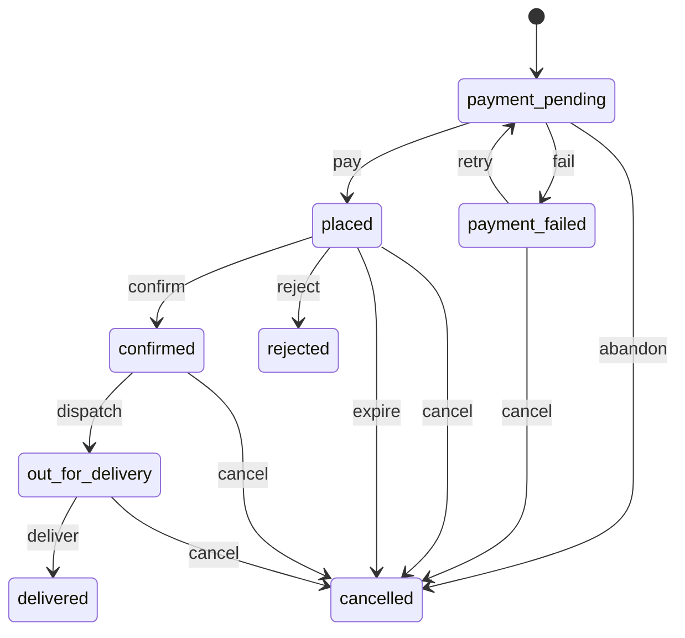

<!-- GENERATED by `npm run gen` from docs/api/modules/farm.md. Do not edit: change the spec and regenerate. -->

# Farm orders (`farm`)

Farm machine orders from the app's Farm machines department: the dealers staff keep in Admin (address, map point, hours, phone), the customer's nearest dealer, and farm orders of a picked machine with its attachments delivered to the customer's farm, paid in full by card (payments purchase intents, captured when the dealer confirms), by installments the dealer arranges, or on delivery. Staff confirm, schedule, send out and deliver each order on the dealer's behalf.

- **Group:** Growth · **Launch phase:** 2 · **Plan chapters:** -
- **Depends on:** [payments](../payments/README.md), [customers](../customers/README.md) · **Optional:** [departments](../departments/README.md), [audit](../audit/README.md)

## Owns
- Dealers: name, address and map point (geocoded, or a pin staff set), opening hours text, phone, message phone or email, lead time, active, order
- The customer's nearest dealer (from their saved default address)
- Farm orders (FM- references): the machine and attachments with their prices at order time, delivery date, farm location with an optional pin, contact, payment option, notes for the dealer, status and payment

**Not here:**
- Machine types, picked machines and their attachments: departments (getFarmMachine; Admin › Departments › Farm machines)
- Prices and availability of machines and attachments: search product cards (through departments)
- Card payments: payments purchase intents (authorizePurchase, completeAction, capturePurchase, voidIntent)
- Saved addresses, the customer's location and geocoding: customers (getAddressForOrder, customerLocation, geocodeAddress)
- Cart, checkout and orders of the main store: farm orders never go there (2026-10-22 decision 3)
- Renting machines: out of v1

## Store API

| Method | Path | Purpose | Auth | Body → Response |
|---|---|---|---|---|
| GET | `/api/store/farm/dealers/nearest` | Your nearest dealer, for Farm machines | visitor | `NearestDealer` |
| POST | `/api/store/farm/quotes` | Price a machine with attachments, the dealer and the payment options | visitor | `QuoteInput` → `FarmQuote` |
| GET | `/api/store/farm/payment-options` | Saved cards and a new-card session for a farm order's card amount | customer | `payments.PaymentOptions` |
| POST | `/api/store/farm/orders` | Order a machine for delivery to your farm _(idempotent)_ | customer | `PlaceOrderInput` → `FarmOrder` |
| GET | `/api/store/farm/orders` | My farm orders, newest first | customer | Page<FarmOrder> |
| GET | `/api/store/farm/orders/{id}` | A farm order with its status and payment | customer | `FarmOrder` |
| POST | `/api/store/farm/orders/{id}/complete-action` | Finish the bank challenge of a farm order _(idempotent)_ | customer | `CompleteActionInput` → `FarmOrder` |
| POST | `/api/store/farm/orders/{id}/retry` | Pay a failed farm order again _(idempotent)_ | customer | `RetryPaymentInput` → `FarmOrder` |
| POST | `/api/store/farm/orders/{id}/cancel` | Cancel an order the dealer hasn't confirmed | customer | `CancelInput` → `FarmOrder` |

## Admin API

| Method | Path | Purpose | Auth | Body → Response |
|---|---|---|---|---|
| GET | `/api/admin/farm/dealers` | Dealers in order | staff `farm.view` | `DealerAdmin[]` |
| POST | `/api/admin/farm/dealers` | Add a dealer _(audited)_ | staff `farm.manage` | `DealerInput` → `DealerAdmin` |
| GET | `/api/admin/farm/dealers/{id}` | A dealer for editing | staff `farm.view` | `DealerAdmin` |
| PATCH | `/api/admin/farm/dealers/{id}` | Change a dealer, move its pin or switch it off _(audited)_ | staff `farm.manage` | `DealerInput` → `DealerAdmin` |
| DELETE | `/api/admin/farm/dealers/{id}` | Delete a dealer with no orders _(audited)_ | staff `farm.manage` | 204 No content |
| GET | `/api/admin/farm/orders` | Farm orders, newest first | staff `farm.view` | Page<FarmOrderAdmin> |
| GET | `/api/admin/farm/orders/{id}` | A farm order with its history | staff `farm.view` | `FarmOrderAdmin` |
| POST | `/api/admin/farm/orders/{id}/status` | Confirm with a delivery date, reject, send out, deliver, cancel or reschedule an order _(audited)_ | staff `farm.orders.manage` | `OrderAction` → `FarmOrderAdmin` |

## Types

### DealerAddress

| Field | Type |
|---|---|
| line1 | `string` |
| line2 | `string?` |
| city | `string` |
| region | `string` State code, e.g. OR |
| postalCode | `string?` |
| country | `string?` ISO 3166-1 alpha-2; the market's when left out |

### DealerMessage

| Field | Type |
|---|---|
| kind | `enum(sms|email)` The Message button opens a text message, or an email when the dealer has no message phone |
| to | `string` |

### DealerCard

| Field | Type |
|---|---|
| id | `uuid` |
| name | `string` e.g. Greenfield Agri Equipment |
| addressLabel | `string` First address line and city, e.g. Route 9, Millbrook |
| city | `string` |
| distanceLabel | `string?` e.g. 12 mi; null when the customer's location or the dealer's point is unknown |
| metaLabel | `string` The line under the name: Route 9, Millbrook · 12 mi away, or the address alone without a distance |
| hours | `string` e.g. Mon–Sat 7:00–18:00 |
| phone | `string` The Call button |
| message | `DealerMessage?` |
| point | `customers.GeoPoint?` |

### NearestDealer

| Field | Type |
|---|---|
| dealer | `DealerCard?` Null only when there is no active dealer (the app hides the section) |
| basis | `enum(your_address|market_default)` your_address: the nearest active dealer to the signed-in customer's geocoded default address; market_default: the first active dealer in Admin order (visitors, and customers without a geocoded default address), shown without a distance |

### FarmLocationInput

| Field | Type |
|---|---|
| addressId | `uuid?` One of the customer's saved addresses; give this or address |
| address | `FarmAddressInput?` A farm address typed in the form |
| point | `customers.GeoPoint?` The pin the customer put on the map; without it the address is geocoded |

### FarmAddressInput

| Field | Type |
|---|---|
| name | `string?` Farm name, e.g. Hollow Creek Farm |
| line1 | `string` |
| line2 | `string?` |
| city | `string` |
| region | `string` |
| postalCode | `string?` |
| country | `string?` |

### FarmLocation

| Field | Type |
|---|---|
| name | `string?` |
| line1 | `string` |
| line2 | `string?` |
| city | `string` |
| region | `string` |
| postalCode | `string?` |
| country | `string` |
| label | `string` e.g. Hollow Creek Farm, 4410 County Rd 12, Millbrook |
| point | `customers.GeoPoint?` The customer's pin, or the geocoded address; null when neither is known |
| pinned | `bool` The customer put the pin on the map |

### QuoteInput

| Field | Type |
|---|---|
| productId | `uuid` A machine picked in Farm machines (departments) |
| attachmentIds | `uuid[]?` Chosen attachments of that machine |
| location | `FarmLocationInput?` The farm location so far; picks the dealer. Without it the signed-in customer's default address, else the market default dealer |

### QuoteAttachment

| Field | Type |
|---|---|
| product | `search.ProductCard` |
| selected | `bool` |
| priceLabel | `string` e.g. +$3,200 |
| available | `bool` False when out of stock; it can't be selected |

### PaymentOptionInfo

| Field | Type |
|---|---|
| option | `enum(pay_in_full|installments|pay_on_delivery)` |
| title | `string` Pay in full, Installments, Pay on delivery |
| subtitle | `string` e.g. 12 months · $1,842/mo, subject to approval, or 10% deposit now, the rest when it arrives |
| needsCard | `bool` Pay in full and pay on delivery (its deposit) take a card |
| cardAmount | `Money` What the card is charged when the dealer confirms: the total, the deposit, or 0 for installments |

### FarmQuote

| Field | Type |
|---|---|
| machine | `search.ProductCard` |
| highlights | `string[]` |
| machineLabel | `string` Highlights and the dealer, e.g. 25 hp · 4WD · Greenfield Agri Equipment |
| attachments | `QuoteAttachment[]` Every attachment of the machine the store still shows, the chosen ones selected |
| dealer | `DealerCard?` |
| machinePrice | `Money` |
| attachmentsTotal | `Money` |
| deliveryFee | `Money` Always 0: delivery is included |
| total | `Money` |
| summaryLabel | `string` e.g. Machine + 1 attachment · delivery included |
| earliestDeliveryDate | `date` Today in the market time zone plus the dealer's lead time |
| latestDeliveryDate | `date` |
| paymentOptions | `PaymentOptionInfo[]` |
| depositPercent | `int` Pay on delivery's deposit share (depositPercent setting) |
| deposit | `Money` Pay on delivery: depositPercent of the total, in whole cents |
| balance | `Money` Pay on delivery: the rest, paid to the dealer when it arrives |
| depositLabel | `string` e.g. $2,210.00 now |
| balanceLabel | `string` e.g. $19,890.00 when it arrives |
| canOrder | `bool` |
| problems | `string[]` e.g. This machine is out of stock; No dealer delivers yet |

### PlaceOrderInput

| Field | Type |
|---|---|
| productId | `uuid` |
| attachmentIds | `uuid[]?` |
| deliveryDate | `date` The date the customer wants it; from earliestDeliveryDate to latestDeliveryDate |
| location | `FarmLocationInput` |
| contactName | `string` |
| contactPhone | `string` |
| paymentOption | `enum(pay_in_full|installments|pay_on_delivery)` |
| notes | `string?` Notes for the dealer: gate code, access road, best time to call (up to 500 characters) |
| expectedTotal | `Money` The total the customer saw; PRICE_CHANGED when it differs |
| method | `payments.MethodSelection?` Required for pay_in_full and pay_on_delivery (the deposit) |
| returnUrl | `url?` Required for pay_in_full and pay_on_delivery: where the bank sends the customer back after a challenge |

### RetryPaymentInput

| Field | Type |
|---|---|
| method | `payments.MethodSelection` |
| returnUrl | `url` |

### CompleteActionInput

| Field | Type |
|---|---|
| resultToken | `string` |

### CancelInput

| Field | Type |
|---|---|
| reason | `string?` |

### OrderMachine

| Field | Type |
|---|---|
| productId | `uuid` |
| slug | `string?` |
| title | `string` |
| image | `MediaRef?` |
| highlights | `string[]` |
| price | `Money` |

### OrderAttachment

| Field | Type |
|---|---|
| productId | `uuid` |
| title | `string` |
| image | `MediaRef?` |
| price | `Money` |
| priceLabel | `string` e.g. +$3,200 |

### StatusChange

| Field | Type |
|---|---|
| status | `string` |
| at | `datetime` |
| by | `string?` Admin only: who changed it |
| note | `string?` |

### FarmOrder

| Field | Type |
|---|---|
| id | `uuid` |
| ref | `string` e.g. FM-7KQ2D |
| status | `enum(payment_pending|payment_failed|placed|confirmed|out_for_delivery|delivered|rejected|cancelled)` |
| statusLabel | `string` e.g. Waiting for Greenfield Agri Equipment to confirm |
| machine | `OrderMachine` |
| attachments | `OrderAttachment[]` |
| machinePrice | `Money` |
| attachmentsTotal | `Money` |
| deliveryFee | `Money` |
| total | `Money` |
| summaryLabel | `string` e.g. Machine + 1 attachment · delivery included |
| paymentOption | `enum(pay_in_full|installments|pay_on_delivery)` |
| paymentLabel | `string` e.g. Pay in full · Visa •••• 4242, Installments · 12 months, subject to approval, Pay on delivery · 10% deposit · Visa •••• 4242 |
| cardAmount | `Money` What the card pays: the total (pay in full), the deposit (pay on delivery) or 0 (installments) |
| deposit | `Money?` Pay on delivery only: the deposit charged by card when the dealer confirms |
| balance | `Money?` Pay on delivery only: the rest, paid to the dealer when it arrives |
| depositLabel | `string?` Pay on delivery only, e.g. $2,210.00 now (once charged: $2,210.00 paid) |
| balanceLabel | `string?` Pay on delivery only, e.g. $19,890.00 when it arrives |
| dealer | `DealerCard` |
| requestedDeliveryDate | `date` |
| deliveryDate | `date` The date the dealer set when confirming, else the requested one |
| deliveryDateConfirmed | `bool` |
| deliveryLabel | `string` e.g. Delivery Tue, Nov 3, or Requested for Tue, Nov 3 |
| location | `FarmLocation` |
| contactName | `string` |
| contactPhone | `string` |
| notes | `string?` |
| dealerNote | `string?` A reject or cancel reason, or a note from the dealer |
| history | `StatusChange[]` Oldest first |
| payment | `payments.PurchasePaymentStatus?` |
| canCancel | `bool` |
| placedAt | `datetime?` |
| confirmedAt | `datetime?` |
| deliveredAt | `datetime?` |
| createdAt | `datetime` |

### DealerAdmin

| Field | Type |
|---|---|
| id | `uuid` |
| name | `string` |
| address | `DealerAddress` |
| point | `customers.GeoPoint?` |
| pinned | `bool` Staff set the point; otherwise it was geocoded from the address |
| hours | `string` |
| phone | `string` |
| messagePhone | `string?` |
| messageEmail | `email?` |
| leadDays | `int?` Days from today to the earliest delivery; null uses the leadDays setting |
| active | `bool` |
| position | `int` |
| openOrders | `int` |
| orderCount | `int` |
| createdAt | `datetime` |
| updatedAt | `datetime` |

### DealerInput

| Field | Type |
|---|---|
| name | `string` |
| address | `DealerAddress` |
| point | `customers.GeoPoint?` A pin; null or left out geocodes the address (customers.geocodeAddress) |
| hours | `string` Free text, e.g. Mon–Sat 7:00–18:00 |
| phone | `string` |
| messagePhone | `string?` For text messages |
| messageEmail | `email?` Used for Message when there is no message phone |
| leadDays | `int?` 0 to 60 |
| active | `bool?` |
| position | `int?` |

### FarmOrderAdmin

| Field | Type |
|---|---|
| id | `uuid` |
| ref | `string` |
| status | `enum(payment_pending|payment_failed|placed|confirmed|out_for_delivery|delivered|rejected|cancelled)` |
| statusLabel | `string` |
| machine | `OrderMachine` |
| attachments | `OrderAttachment[]` |
| machinePrice | `Money` |
| attachmentsTotal | `Money` |
| total | `Money` |
| paymentOption | `enum(pay_in_full|installments|pay_on_delivery)` |
| paymentLabel | `string` |
| cardAmount | `Money` |
| deposit | `Money?` |
| balance | `Money?` Pay on delivery: what the dealer collects when it arrives |
| dealer | `{"id":"uuid","name":"string","phone":"string?"}` |
| customer | `{"id":"uuid","name":"string?","email":"email?"}` |
| requestedDeliveryDate | `date` |
| deliveryDate | `date` |
| deliveryDateConfirmed | `bool` |
| location | `FarmLocation` |
| contactName | `string` |
| contactPhone | `string` |
| notes | `string?` |
| dealerNote | `string?` |
| staffNote | `string?` |
| history | `StatusChange[]` |
| methodLabel | `string?` |
| paymentState | `string?` |
| intentId | `uuid?` |
| placedAt | `datetime?` |
| confirmedAt | `datetime?` |
| deliveredAt | `datetime?` |
| createdAt | `datetime` |
| actions | `enum(confirm|reject|dispatch|deliver|cancel|reschedule)[]` Moves allowed now |

### OrderAction

| Field | Type |
|---|---|
| action | `enum(confirm|reject|dispatch|deliver|cancel|reschedule)` |
| deliveryDate | `date?` confirm: the delivery date (the requested one when left out); reschedule: the new date (required). Today or later |
| note | `string?` Shown to the customer (reject and cancel reasons, a note with the date) |
| staffNote | `string?` |

## Status flows

### Farm order (`FarmOrder.status`)

Pay in full and pay on delivery start in payment_pending; pay: the card is authorized (payments.authorizePurchase) for the total, or for the depositPercent deposit of pay on delivery. Installments need no card and start placed. confirm sets the delivery date and captures the card (payments.capturePurchase); reject, cancel and expire void it (payments.voidIntent). Customers cancel while placed or payment_failed; staff move and cancel on the dealer's behalf, but a captured card order is not cancelled in the app (refunds of purchases are not built). Placed orders not confirmed within confirmHours expire.

## Data (schema `farm`)

**dealers**

| Column | Type |
|---|---|
| id | uuid pk |
| name | text |
| line1 | text |
| line2 | text? |
| city | text |
| region | text |
| postal_code | text? |
| country | text |
| point | jsonb? (GeoPoint) |
| pinned | bool |
| hours | text |
| phone | text |
| message_phone | text? |
| message_email | text? |
| lead_days | int? |
| active | bool |
| position | int |
| created_at | timestamptz |
| updated_at | timestamptz |

Indexes: `(active, position)`

**orders**

| Column | Type |
|---|---|
| id | uuid pk |
| ref | text unique |
| customer_id | uuid |
| dealer_id | uuid → dealers |
| dealer | jsonb (the dealer card at order time: name, address, point, hours, phone, message) |
| machine | jsonb (OrderMachine at order time) |
| attachments | jsonb (OrderAttachment[] at order time) |
| machine_price | bigint |
| attachments_total | bigint |
| total | bigint |
| card_amount | bigint (what the card is authorized and charged for: the total, the pay-on-delivery deposit, or 0) |
| currency | text |
| payment_option | text (pay_in_full|installments|pay_on_delivery) |
| requested_date | date |
| delivery_date | date |
| date_confirmed | bool |
| location | jsonb (FarmLocation) |
| contact_name | text |
| contact_phone | text |
| notes | text? |
| status | text (payment_pending|payment_failed|placed|confirmed|out_for_delivery|delivered|rejected|cancelled) |
| history | jsonb |
| dealer_note | text? |
| staff_note | text? |
| intent_id | uuid? |
| attempts | int |
| method_label | text? |
| captured | bool |
| placed_at | timestamptz? |
| confirmed_at | timestamptz? |
| dispatched_at | timestamptz? |
| delivered_at | timestamptz? |
| idempotency_key | text unique |
| created_at | timestamptz |
| updated_at | timestamptz |

Indexes: `(customer_id, created_at)`, `(status, created_at)`, `(dealer_id, status, created_at)`, `(intent_id)`, `(status, placed_at, id)`, `(status, updated_at, id)`

## Events

| Publishes | When | Payload | Consumed by |
|---|---|---|---|
| `farm.order.placed` | A farm order reaches placed (at once for installments; when the card is authorized for pay in full and for the pay-on-delivery deposit) | `{ orderId: uuid, ref: string, customerId: uuid, dealerId: uuid, dealerName: string, machineName: string, paymentOption: string, total: Money, cardAmount: Money, deliveryDate: date }` | notifications |
| `farm.order.status_changed` | A farm order moves after it is created (confirmed, out for delivery, delivered, rejected, cancelled, payment failed, rescheduled); placed is farm.order.placed | `{ orderId: uuid, ref: string, customerId: uuid, dealerName: string, machineName: string, status: string, paymentOption: string, total: Money, cardAmount: Money, deliveryDate: date, rescheduled: bool, note: string? }` | notifications |

| Consumes | From | Does |
|---|---|---|
| `payments.purchase.authorized` | payments | module farm: a pending or challenged payment went through — place the order |
| `payments.purchase.failed` | payments | module farm: mark the order payment_failed |

## In-process API (for other modules)

| Function | Signature | Used by |
|---|---|---|
| exportCustomerData | `(input: { customerId: uuid, accountId: uuid }) => CustomerDataSection[]` The customer's farm orders (reference, dealer, machine, attachments, amounts, payment option, delivery date, farm location, contact, notes, status, dates) for the personal data export | customers |

## Permissions

| Key | Who | Allows |
|---|---|---|
| `farm.view` | staff | See dealers and farm orders in Admin › Departments › Farm orders |
| `farm.manage` | staff | Add, change and switch off dealers |
| `farm.orders.manage` | staff | Confirm, schedule, reject, send out, deliver and cancel farm orders on the dealer's behalf |

## Error codes

| Code | Status | Meaning |
|---|---|---|
| `IN_USE` | 409 | Orders still use this dealer; switch it off instead. |
| `MACHINE_UNAVAILABLE` | 409 | This machine can't be ordered now (no longer picked or out of stock). |
| `ATTACHMENT_UNAVAILABLE` | 409 | An attachment can't be ordered now. details.productIds. |
| `NO_DEALER` | 409 | No dealer takes farm orders yet. |
| `DELIVERY_DATE_UNAVAILABLE` | 422 | Pick a delivery date from details.earliest to details.latest. |
| `PRICE_CHANGED` | 409 | Prices changed; details.total is the new total. |
| `PAYMENT_CAPTURE_FAILED` | 502 | The card couldn't be charged; the order stays placed. Try again or reject it. |
| `REFUND_NOT_AVAILABLE` | 409 | The card was already charged and refunds of farm orders aren't in the app yet. |

## Background jobs

| Job | Schedule | Does |
|---|---|---|
| `farm.expire-unconfirmed` | every 15 min | Cancel placed orders the dealer hasn't confirmed within confirmHours (void the card hold, tell the customer); cancel payment_pending orders left in a bank challenge for 30 minutes |

## Settings

| Key | Default | Rules | Meaning |
|---|---|---|---|
| confirmHours | `48` | duration, hours, 1–120 | A placed farm order the dealer hasn't confirmed in this time is cancelled and the card hold released (card holds last about 7 days) |
| leadDays | `3` | duration, days, 0–60 | Earliest delivery: today in the market time zone plus this many days, unless the dealer has its own lead time |
| maxAheadDays | `90` | duration, days, 7–365 | Latest delivery date a customer can ask for, counted from today |
| depositPercent | `10` | int, %, 1–100 | Pay on delivery: the share of the total charged by card as a deposit when the dealer confirms (10% deposit now, the rest when it arrives); the rest is paid to the dealer on delivery |
| installmentMonths | `12` | int, 2–60 | Months shown on the Installments option (12 months · $1,842/mo, subject to approval); the dealer arranges the plan |

## Notes
- 2026-10-22 (user, decision 3): farm machines are ordered in their own farm orders, like Food, not through cart and checkout. Buy only; renting is out of v1. Staff act for the dealers in Admin.
- Prices: the machine's and the chosen attachments' product-card prices now (search, through departments.getFarmMachine; departments is an optional dependency, and while it is off no machine can be quoted or ordered); delivery is included (deliveryFee 0). Farm orders don't reserve catalog stock: an out-of-stock machine or attachment can't be ordered, and the dealer confirms availability. Refs are FM- plus five characters from 23456789ABCDEFGHJKLMNPQRSTUVWXYZ.
- Payment: pay in full authorizes the card when the order is placed and captures it when the dealer confirms; reject, cancel and expiry void it, so nothing needs a refund before confirmation. Pay on delivery (2026-10-22, matching the FarmOrder artboard) takes a deposit by card the same way: depositPercent of the total rounded to whole cents, authorized when placed, captured on confirm, voided on reject, cancel or expiry; the balance is paid to the dealer when it arrives (outside the app). Installments (a request the dealer arranges with the customer) take no card.
- Dealer: an order goes to the nearest active dealer with a point to the farm location's point (the pin, else the geocoded address); when that is unknown, to the nearest to the customer's default address; else to the market default (the first active dealer in Admin order). The order keeps a copy of the dealer's name, phone and address.
- Delivery date: from today in the market time zone plus the dealer's lead time (leadDays setting when it has none) to maxAheadDays ahead. When confirming, staff set the date (today or later); reschedule changes it while confirmed.
- Nearest dealer (FarmIntro): the signed-in customer's geocoded default address (decision 4, no device location); visitors and customers without one see the market default dealer without a distance. Distances are miles (kernel geo milesLabel).
- Payment option texts: Pay on delivery is the artboard's '10% deposit now, the rest when it arrives' (built from depositPercent). The artboard's Pay in full says 'Card or bank transfer now', but v1 has no bank transfer, so its subtitle is 'Card now · charged when the dealer confirms'. The app asks GET /payment-options (option, productId, attachmentIds) for the card fields: it prices the order server-side and sets a farm chargeNote instead of checkout's.
- Customers are customers-module ids (the store principal's customerId, else the account id), as payments uses.
