<!-- GENERATED by `npm run gen` from docs/api/modules/finance.md. Do not edit: change the spec and regenerate. -->

# Finance (`finance`)

Seller money and company money kept apart: the seller ledger (proceeds, pending, available, held, negative and amounts owed), fee rules, holds, adjustments, payout runs and payouts, statements, payout-destination verification, daily reconciliation checks, and company trading margins separate from marketplace fee income.

- **Group:** After-sales and money · **Launch phase:** 1 · **Plan chapters:** 14, 9, 18, 19
- **Depends on:** [orders](../orders/README.md), [payments](../payments/README.md), [sellers](../sellers/README.md), [access](../access/README.md) · **Optional:** [returns](../returns/README.md), [advertising](../advertising/README.md), [promotions](../promotions/README.md), [purchasing](../purchasing/README.md), [inventory](../inventory/README.md), [shipping](../shipping/README.md), [support](../support/README.md), [wallet](../wallet/README.md), [workqueues](../workqueues/README.md), [notifications](../notifications/README.md), [audit](../audit/README.md), [identity](../identity/README.md), [media](../media/README.md), [reports](../reports/README.md), [settings](../settings/README.md), [offers](../offers/README.md)
- **Required by:** [fulfillment-service](../fulfillment-service/README.md)

## Owns
- Seller ledger: append-only entries for sales, shipping charged, seller-funded discounts, marketplace fees, refunds (including refund after payout), holds and releases, adjustments, ad charges, label charges and payouts
- Seller balances: sales proceeds, pending, available, held (each hold with reason and review date), negative balance and amounts owed
- Fee rules with versions and effective dates: commission basis (before or after discounts), shipping included or not, platform- vs seller-funded discounts, category rates, fee treatment for cancellations, returns and payment disputes
- Fee charge per order item, computed at sale and reversed in proportion on refund
- Holds: manual and rule-based (chargeback, dispute, unconfirmed delivery, new seller, restriction), release, extension and application
- Adjustments with reason codes, recorded owner and second-reviewer approval above a threshold
- Payout schedule, payout runs (second Finance reviewer above a threshold), payouts (Pending, Processing, Paid, Failed) and failed-payout recovery
- Payout destination verification and change review before money goes to a new account
- Itemised seller statements that reconcile to the payout
- Company trading (Official Store product sales, buying cost, discounts, shipping expense, returns and write-offs, margin) reported separately from marketplace fee income
- Daily reconciliation checks (payments vs orders, seller amounts vs statements, provider deposits, unexplained amounts, failed payouts) with recorded reasons for corrections

**Not here:**
- Charging customers, executing refunds and chargeback cases: payments (finance books their results)
- Refund decisions and approvals for returns and case remedies: returns (finance reads returns.refund.approved for the funding split)
- Seller payout account details and owner-only change requests: sellers (finance verifies and reviews the change before paying to it)
- Approval limits and second-reviewer requests: access
- Ad campaign billing rules: advertising (finance posts the charges it is given)
- Report definitions and exports: reports (reads finance read models)

## Seller API

| Method | Path | Purpose | Auth | Body → Response |
|---|---|---|---|---|
| GET | `/api/seller/finance/balances` | Sales proceeds, pending, available, held (with reasons and review dates), negative balance and next payout | seller<br>`finance.balances.view` | `SellerBalances` |
| GET | `/api/seller/finance/ledger` | Transactions with running balance | seller<br>`finance.balances.view` | Page<LedgerEntry> |
| POST | `/api/seller/finance/ledger/exports` | Export the ledger for a date range _(audited)_ | seller<br>`finance.balances.view` | `{ from: date, to: date, format: enum(csv|xlsx)? }` → `reports.ExportJob` |
| GET | `/api/seller/finance/ledger/exports/{id}` | Ledger export status and download link (requesting member only) | seller<br>`finance.balances.view` | `reports.ExportJob` |
| GET | `/api/seller/finance/payouts` | Payouts with status and result (failed payouts explain the reason) | seller<br>`finance.balances.view` | Page<Payout> |
| GET | `/api/seller/finance/payouts/{id}` | One payout | seller<br>`finance.balances.view` | `Payout` |
| GET | `/api/seller/finance/statements` | Statements by period | seller<br>`finance.balances.view` | Page<StatementSummary> |
| GET | `/api/seller/finance/statements/{id}` | Itemised statement: sales, fees with basis, refunds (incl. after payout), holds, adjustments with reasons, ad charges, reconciliation to the payout | seller<br>`finance.balances.view` | `Statement` |
| GET | `/api/seller/finance/statements/{id}/download` | PDF or CSV of a statement | seller<br>`finance.balances.view` | `{ url: url, expiresAt: datetime }` |
| GET | `/api/seller/finance/fee-schedule` | Fee rules for the seller's categories with example calculations | seller | `FeeSchedule` |
| POST | `/api/seller/finance/payout-destination/confirm-deposits` | Confirm the two test-deposit amounts to verify the payout account (owner only) _(audited)_ | seller<br>`finance.destinations.confirm` | `{ amounts: Money[] }` → `{ destination: DestinationStatus, review: DestinationReview? }` |
| GET | `/api/seller/finance/payout-destination` | Verification status of the payout account and any change under review | seller<br>`finance.balances.view` | `{ destination: DestinationStatus, review: DestinationReview? }` |

## Admin API

| Method | Path | Purpose | Auth | Body → Response |
|---|---|---|---|---|
| GET | `/api/admin/finance/overview` | Collected payments, company sales, fee income, owed to sellers, refunds, holds and discount funding | staff<br>`finance.ledger.view` | `FinanceOverview` |
| GET | `/api/admin/finance/marketplace-income` | Marketplace fee income, ad income and amounts owed to sellers (separate from company trading) | staff<br>`finance.ledger.view` | `MarketplaceIncome` |
| GET | `/api/admin/finance/trading-targets` | Official Store sales and margin targets by month (plan ch. 2) | staff<br>`finance.trading.view` | Page<TradingTarget> |
| PUT | `/api/admin/finance/trading-targets/{period}` | Set the sales and margin target for a month (whole store or one category) _(audited)_ | staff<br>`finance.trading.targets` | `TradingTargetInput` → `TradingTarget` |
| GET | `/api/admin/finance/trading` | Company trading: product sales, cost of goods sold, stock bought, discounts, shipping, returns and margin | staff<br>`finance.trading.view` | `TradingSummary` |
| GET | `/api/admin/finance/fee-rules` | Active fee rules, scheduled changes and history | staff<br>`finance.ledger.view` | `FeeRulesAdmin` |
| POST | `/api/admin/finance/fee-rules` | Propose a new fee rule version with an effective date _(audited)_ | staff<br>`finance.fees.manage` | `FeeRuleSetInput` → `FeeRuleSet` |
| POST | `/api/admin/finance/fee-rules/{id}/withdraw` | Withdraw a draft or scheduled fee rule version _(audited)_ | staff<br>`finance.fees.manage` | `{ reason: text }` → `FeeRuleSet` |
| POST | `/api/admin/finance/fee-rules/calculate` | Example fee and seller earnings for a price | staff | `{ input: FeeCalcInput, ruleSetId: uuid? }` → `FeeCalculation` |
| GET | `/api/admin/finance/sellers` | Seller balances | staff<br>`finance.ledger.view` | Page<SellerFinanceRow> |
| GET | `/api/admin/finance/sellers/{sellerId}` | One seller's balances, holds, payouts, amounts owed and adjustments | staff<br>`finance.ledger.view` | `SellerFinanceDetail` |
| GET | `/api/admin/finance/sellers/{sellerId}/ledger` | A seller's ledger | staff<br>`finance.ledger.view` | Page<LedgerEntry> |
| GET | `/api/admin/finance/sellers/{sellerId}/statements` | A seller's statements | staff<br>`finance.ledger.view` | Page<StatementSummary> |
| GET | `/api/admin/finance/statements/{id}` | A statement as the seller sees it | staff<br>`finance.ledger.view` | `Statement` |
| GET | `/api/admin/finance/holds` | Holds with reason and review date | staff<br>`finance.ledger.view` | Page<Hold> |
| POST | `/api/admin/finance/holds` | Hold part of a seller's earnings with a reason and review date _(idempotent, audited)_ | staff<br>`finance.holds.manage` | `HoldInput` → `Hold` |
| POST | `/api/admin/finance/holds/{id}/release` | Release all or part of a hold _(idempotent, audited)_ | staff<br>`finance.holds.manage` | `{ amount: Money?, reason: text }` → `Hold` |
| POST | `/api/admin/finance/holds/{id}/extend` | Move the review date with a reason _(audited)_ | staff<br>`finance.holds.manage` | `{ reviewDate: date, reason: text }` → `Hold` |
| POST | `/api/admin/finance/holds/{id}/apply` | Turn a held amount into a deduction (e.g. chargeback lost) _(idempotent, audited)_ | staff<br>`finance.holds.manage` | `{ amount: Money?, reason: text }` → `Hold` |
| GET | `/api/admin/finance/adjustments` | Adjustments with reasons and approvals | staff<br>`finance.ledger.view` | Page<Adjustment> |
| POST | `/api/admin/finance/adjustments` | Credit or debit a seller with a recorded reason _(idempotent, audited)_ | staff<br>`finance.adjustments.record` | `AdjustmentInput` → `Adjustment` |
| GET | `/api/admin/finance/amounts-owed` | Negative balances that became amounts owed | staff<br>`finance.ledger.view` | Page<AmountOwed> |
| POST | `/api/admin/finance/amounts-owed/{id}/settle` | Record payment received or write off an amount owed _(idempotent, audited)_ | staff<br>`finance.adjustments.record` | `{ method: enum(seller_paid|offset|written_off), amount: Money, reason: text }` → `AmountOwed` |
| GET | `/api/admin/finance/payout-runs` | Payout runs | staff<br>`finance.ledger.view` | Page<PayoutRun> |
| POST | `/api/admin/finance/payout-runs` | Calculate a payout run for a cutoff (normally created by the schedule) _(idempotent, audited)_ | staff<br>`finance.payouts.prepare` | `{ cutoffAt: datetime, scheduledRelease: datetime }` → `PayoutRun` |
| GET | `/api/admin/finance/payout-runs/{id}` | Run totals, approvals and pre-release checks | staff<br>`finance.ledger.view` | `PayoutRun` |
| GET | `/api/admin/finance/payout-runs/{id}/statements` | Seller statements settled by this payout run | staff<br>`finance.ledger.view` | Page<RunStatementRow> |
| GET | `/api/admin/finance/payout-runs/{id}/payouts` | Sellers in a run (held and changed-destination rows first) | staff<br>`finance.ledger.view` | Page<RunPayoutRow> |
| POST | `/api/admin/finance/payout-runs/{id}/recalculate` | Refresh a draft run after holds, retries or destination changes _(audited)_ | staff<br>`finance.payouts.prepare` | `PayoutRun` |
| POST | `/api/admin/finance/payout-runs/{id}/submit` | Submit the run for approval _(audited)_ | staff<br>`finance.payouts.prepare` | `PayoutRun` |
| POST | `/api/admin/finance/payout-runs/{id}/approve` | Approve a payout run (first or second Finance reviewer) _(idempotent, audited)_ | staff<br>`finance.payouts.approve` | `{ confirmedReview: bool, note: text?, reauthToken: string? }` → `PayoutRun` |
| POST | `/api/admin/finance/payout-runs/{id}/send-back` | Return the run to draft with a comment _(audited)_ | staff<br>`finance.payouts.approve` | `{ reason: text }` → `PayoutRun` |
| POST | `/api/admin/finance/payout-runs/{id}/release` | Release an approved run now (otherwise released at the scheduled time) _(idempotent, audited)_ | staff<br>`finance.payouts.approve` | `PayoutRun` |
| GET | `/api/admin/finance/payouts` | All payouts, e.g. failed payouts to follow up | staff<br>`finance.ledger.view` | Page<Payout> |
| POST | `/api/admin/finance/payouts/{id}/retry` | Recover a failed payout to a verified destination _(idempotent, audited)_ | staff<br>`finance.payouts.approve` | `{ now: bool, reason: text }` → `Payout` |
| GET | `/api/admin/finance/destination-reviews` | Payout destination changes waiting for verification and review | staff<br>`finance.destinations.review` | Page<DestinationReview> |
| POST | `/api/admin/finance/destination-reviews/{id}/approve` | Verify a new payout destination _(audited, step-up: reauth)_ | staff<br>`finance.destinations.review` | `{ reason: text, callbackConfirmed: bool, callbackNote: text?, reauthToken: string }` → `DestinationReview` |
| POST | `/api/admin/finance/destination-reviews/{id}/reject` | Reject a payout destination change _(audited, step-up: reauth)_ | staff<br>`finance.destinations.review` | `{ reason: text, reauthToken: string }` → `DestinationReview` |
| GET | `/api/admin/finance/reconciliation/days/{date}` | Daily finance check: checklist, totals and failed payouts | staff<br>`finance.reconciliation.work` | `ReconDay` |
| GET | `/api/admin/finance/reconciliation/items` | Mismatched payments, seller amounts, deposits and unexplained amounts | staff<br>`finance.reconciliation.work` | Page<ReconItem> |
| POST | `/api/admin/finance/reconciliation/items/{id}/assign` | Set the owner of a mismatch _(audited)_ | staff<br>`finance.reconciliation.work` | `{ ownerId: uuid }` → `ReconItem` |
| POST | `/api/admin/finance/reconciliation/items/{id}/explain` | Close a difference with a recorded reason (no money moves) _(audited)_ | staff<br>`finance.reconciliation.work` | `{ reasonCode: enum(timing|provider_fee|rounding|other), note: text }` → `ReconItem` |
| POST | `/api/admin/finance/reconciliation/items/{id}/correct` | Record a correction with a reason _(idempotent, audited)_ | staff<br>`finance.reconciliation.work` | `CorrectionInput` → `ReconItem` |
| POST | `/api/admin/finance/reconciliation/days/{date}/complete` | Sign off the day's checks _(audited)_ | staff<br>`finance.reconciliation.work` | `{ note: text? }` → `ReconDay` |

## Public API

| Method | Path | Purpose | Auth | Body → Response |
|---|---|---|---|---|
| GET | `/api/public/finance/fee-schedule` | Published fee rules and an example calculation | visitor | `FeeSchedule` |

## Webhooks

| Method | Path | Purpose | Auth | Body → Response |
|---|---|---|---|---|
| POST | `/webhooks/finance/payouts` | Payout provider status (paid, failed, returned) | provider | `PayoutWebhook` → 204 No content |

## Types

### Reference

| Field | Type |
|---|---|
| kind | `enum(order|order_item|return|refund|case|chargeback|payout|adjustment|ad_campaign|fulfillment_service|statement|seller|reconciliation|receipt)` |
| id | `string` |
| ref | `string?` Human reference, e.g. MK-261005-17730, RT-…, PO-…, REC-… (a purchasing receipt: the buying cost of the units received) |

### SettlementRules

| Field | Type |
|---|---|
| schedule | `string` e.g. Weekly, Friday |
| availableAfterDeliveryDays | `int` |
| minimumPayout | `Money` |
| newSellerHoldDays | `int?` Extra days after delivery before earnings become available while the seller is in its new-seller period (seller_accounts.new_seller_extra_days); null after the period |
| newSellerUntil | `date?` Last day of the seller's new-seller period; null when it has ended or never applied |
| refundAfterPayout | `string` Deducted from later earnings; if none, the balance shows the amount owed |
| text | `string` |

### DestinationStatus

| Field | Type |
|---|---|
| label | `string` e.g. Pacific Coast Credit Union •••• 6620 |
| status | `enum(verified|verification_pending|change_under_review|missing|rejected)` |
| verifiedAt | `datetime?` |
| pendingChange | `PendingDestinationChange?` |
| depositsSentAt | `datetime?` When the two test deposits were sent; set while they wait for confirmation |
| depositAttemptsLeft | `int?` Tries left to enter the deposit amounts (depositConfirmAttempts) |

### PendingDestinationChange

| Field | Type |
|---|---|
| label | `string` |
| requestedAt | `datetime` |
| reviewId | `uuid` |
| paysCurrentUntilApproved | `bool` |

### Hold

| Field | Type |
|---|---|
| id | `uuid` |
| sellerId | `uuid` |
| sellerName | `string` |
| amount | `Money` |
| releasedAmount | `Money` |
| reasonCode | `enum(chargeback|dispute|delivery_unconfirmed|new_seller|restriction|risk_review|unusual_refund_rate|identity_recheck|other)` |
| reason | `text` Shown to the seller on the balance and the statement |
| reviewDate | `date` |
| reference | `Reference?` |
| trustReportId | `uuid?` |
| status | `enum(active|released|applied)` |
| placedBy | `Actor` |
| placedAt | `datetime` |
| releasedAt | `datetime?` |
| releaseReason | `text?` |
| approval | `ApprovalInfo?` |

### HoldInput

| Field | Type |
|---|---|
| sellerId | `uuid` |
| amount | `Money` |
| reasonCode | `enum(chargeback|dispute|delivery_unconfirmed|new_seller|restriction|risk_review|unusual_refund_rate|identity_recheck|other)` |
| reason | `text` |
| reviewDate | `date` |
| reference | `Reference?` |
| trustReportId | `uuid?` Set when the hold executes a trust recommendation (hold_payout) |

### NextPayout

| Field | Type |
|---|---|
| estimatedAmount | `Money` |
| scheduledFor | `date` |
| cutoffAt | `datetime` |
| destination | `DestinationStatus` |
| arrivesNote | `string` e.g. Usually 1 business day after sending |
| note | `string` |

### SellerBalances

| Field | Type |
|---|---|
| sellerId | `uuid` |
| asOf | `datetime` |
| salesProceeds | `Money` Accepted sales in the current period including shipping charged, before fees, refunds and holds |
| salesPeriod | `DateRange` |
| pending | `Money` After fees, waiting for delivery plus the hold window |
| available | `Money` Eligible for the next payout; negative when refunds after payout exceed earnings |
| held | `Money` |
| holds | `Hold[]` |
| negative | `bool` |
| amountOwed | `Money?` Negative balance not covered within the agreed period |
| owedDueBy | `date?` |
| nextPayout | `NextPayout?` |
| settlementRules | `SettlementRules` |
| destination | `DestinationStatus` |

### LedgerEntry

| Field | Type |
|---|---|
| id | `uuid` |
| at | `datetime` |
| type | `enum(sale|shipping_charge|seller_discount|marketplace_fee|fee_refund|refund|refund_after_payout|hold|hold_release|adjustment|ad_charge|service_fee|charge_credit|seller_credit|label_charge|chargeback|payout|payout_returned|owed_offset|cancellation)` |
| typeLabel | `string` |
| reference | `Reference` |
| description | `string` e.g. 10% of $184.00 item price (shipping excluded) |
| amount | `Money` |
| bucket | `enum(pending|available|held)` |
| balanceAfter | `Money` pending + available + held after this entry |
| statementId | `uuid?` |
| recordedBy | `Actor?` |
| statementRef | `string?` ST-… reference of the statement the entry is on |

### SellerCredit

| Field | Type |
|---|---|
| id | `uuid` |
| sellerId | `uuid` |
| amount | `Money` |
| reason | `text` |
| reference | `Reference` What the credit is for, e.g. the fulfillment-service lost-unit claim |
| status | `enum(posted|pending_approval|rejected|withdrawn)` withdrawn: the calling module withdrew it while it waited for approval (withdrawSellerCredit) |
| ledgerEntry | `LedgerEntry?` The seller_credit entry once posted |
| approvalRequestId | `uuid?` |
| requestedBy | `Actor` |
| createdAt | `datetime` |
| decidedAt | `datetime?` |

### EarningsLot

| Field | Type |
|---|---|
| id | `uuid` |
| sellerId | `uuid` |
| orderId | `uuid` |
| orderItemId | `uuid` |
| state | `enum(pending|available|in_payout|paid_out|reversed)` |
| gross | `Money` |
| fee | `Money` |
| net | `Money` |
| deliveredAt | `datetime?` |
| availableAt | `datetime?` |
| payoutId | `uuid?` |

### CategoryRate

| Field | Type |
|---|---|
| categoryId | `uuid` |
| categoryName | `string` |
| rateBps | `int` Basis points: 1000 = 10% |

### FeeTreatment

| Field | Type |
|---|---|
| cancellationBeforeDispatch | `enum(no_fee|fee_kept)` |
| returns | `enum(fee_returned_pro_rata|fee_kept)` |
| paymentDisputes | `enum(fee_kept_returned_if_won|fee_kept|fee_returned)` |
| text | `text` Plain explanation, linked from the seller agreement |

### FeeRuleSet

| Field | Type |
|---|---|
| id | `uuid` |
| version | `string` |
| status | `enum(draft|pending_approval|scheduled|active|superseded|withdrawn)` |
| basis | `enum(after_seller_discounts|before_discounts)` |
| includeShipping | `bool` |
| platformDiscountsReduceFee | `bool` False: platform-funded discounts do not lower seller proceeds or the fee basis |
| defaultRateBps | `int` |
| categoryRates | `CategoryRate[]` |
| treatment | `FeeTreatment` |
| agreementVersion | `string` Seller agreement version that carries these rules |
| effectiveFrom | `datetime?` |
| reason | `text?` |
| approval | `ApprovalInfo?` |
| createdBy | `Actor` |
| createdAt | `datetime` |

### FeeRuleSetInput

| Field | Type |
|---|---|
| basis | `enum(after_seller_discounts|before_discounts)` |
| includeShipping | `bool` |
| platformDiscountsReduceFee | `bool` |
| defaultRateBps | `int` |
| categoryRates | `CategoryRate[]` |
| treatment | `FeeTreatment` |
| agreementVersion | `string` |
| effectiveFrom | `datetime` |
| reason | `text` |

### FeeCalcInput

| Field | Type |
|---|---|
| categoryId | `uuid?` |
| itemPrice | `Money` |
| sellerDiscount | `Money?` |
| platformDiscount | `Money?` |
| shippingCharged | `Money?` |

### FeeLine

| Field | Type |
|---|---|
| label | `string` |
| amount | `Money` |

### FeeCalculation

| Field | Type |
|---|---|
| itemPrice | `Money` |
| sellerDiscount | `Money` |
| platformDiscount | `Money` |
| shippingCharged | `Money` |
| feeBasis | `Money` |
| rateBps | `int` |
| fee | `Money` |
| sellerEarnings | `Money` |
| lines | `FeeLine[]` |
| ruleVersion | `string` |

### FeeSchedule

| Field | Type |
|---|---|
| current | `FeeRuleSet` |
| scheduled | `FeeRuleSet?` |
| examples | `FeeCalculation[]` |
| illustration | `string` e.g. $100 sale with a 10% fee: $10 fee income, $90 seller earnings |

### FeeRulesAdmin

| Field | Type |
|---|---|
| active | `FeeRuleSet` |
| upcoming | `FeeRuleSet[]` |
| history | `FeeRuleSet[]` |

### Payout

| Field | Type |
|---|---|
| id | `uuid` |
| ref | `string` PO-YYMMDD-NNNN |
| sellerId | `uuid` |
| sellerName | `string` |
| runId | `uuid?` |
| amount | `Money` |
| status | `enum(pending|on_hold|processing|paid|failed|cancelled)` |
| destination | `DestinationStatus` |
| requestedOn | `date` |
| releasedAt | `datetime?` |
| paidAt | `datetime?` |
| arrivedOn | `date?` |
| failedAt | `datetime?` |
| failureCode | `string?` Bank return code, e.g. R02 |
| failureReason | `string?` |
| nextStep | `string?` |
| retryOf | `uuid?` |
| retriedBy | `uuid?` |
| statementId | `uuid?` |
| statementPeriod | `DateRange?` |
| bankReference | `string?` |
| holdsWithheld | `Money` |
| negativeOffset | `Money` |
| resultNote | `string?` |
| statementRef | `string?` ST-… reference of the statement the payout settles |
| retryOfRef | `string?` PO-… reference of the failed payout this one retries |

### RunApproval

| Field | Type |
|---|---|
| order | `int` |
| approver | `Actor?` |
| role | `string` |
| status | `enum(approved|pending|sent_back)` |
| at | `datetime?` |
| dueAt | `datetime?` |
| note | `text?` |

### RunCheck

| Field | Type |
|---|---|
| level | `enum(ok|info|warn|fail)` |
| title | `string` |
| detail | `string?` |

### PayoutRun

| Field | Type |
|---|---|
| id | `uuid` |
| ref | `string` PO-RUN-YYMMDD |
| status | `enum(draft|pending_approval|approved|releasing|completed|cancelled)` |
| scheduledRelease | `datetime` |
| cutoffAt | `datetime` |
| rule | `string` e.g. earnings from items delivered by Oct 2 and past the 7-day hold |
| total | `Money` |
| payingNow | `Money` |
| held | `Money` |
| negativeOffset | `Money` |
| sellerCount | `int` |
| readyCount | `int` |
| heldCount | `int` |
| retriesIncluded | `int` |
| retriesAmount | `Money` |
| failedLastRun | `int` |
| failedLastRunAmount | `Money` |
| approvals | `RunApproval[]` |
| approval | `ApprovalInfo` |
| checks | `RunCheck[]` |
| viewerCanApprove | `bool` False for staff without payout authority (access is not financial authority) and for the person who already approved |
| createdAt | `datetime` |

### RunPayoutRow

| Field | Type |
|---|---|
| payoutId | `uuid` |
| sellerId | `uuid` |
| sellerName | `string` |
| available | `Money` |
| holds | `Hold[]` |
| negativeBalance | `Money?` |
| destination | `DestinationStatus` |
| payout | `Money` |
| status | `enum(pending|on_hold|processing|paid|failed|cancelled)` |
| isRetry | `bool` |

### DestinationCheck

| Field | Type |
|---|---|
| label | `string` |
| result | `enum(passed|pending|failed)` |

### DestinationReview

| Field | Type |
|---|---|
| id | `uuid` |
| sellerId | `uuid` |
| sellerName | `string` |
| fromLabel | `string?` |
| toLabel | `string` |
| requestedBy | `Actor` |
| requestedAt | `datetime` |
| status | `enum(under_review|verified|rejected)` |
| checks | `DestinationCheck[]` |
| pauseUntil | `datetime?` Payouts to the new account wait at least this long |
| decidedBy | `Actor?` |
| decidedAt | `datetime?` |
| reason | `text?` |

### StatementLine

| Field | Type |
|---|---|
| date | `date?` |
| reference | `Reference?` |
| sku | `string?` Seller SKU of the order item the line is about (sales, fees and refunds of an item, from the order's offer snapshot); null for other lines |
| description | `string` |
| detail | `string?` |
| units | `int?` |
| basis | `Money?` |
| amount | `Money` |
| reason | `string?` Holds and adjustments: reason, review date, who recorded it |

### StatementSection

| Field | Type |
|---|---|
| key | `enum(sales|fees|refunds|holds|adjustments|ads)` |
| title | `string` |
| subtitle | `string?` |
| lines | `StatementLine[]` |
| total | `Money` |
| totalLabel | `string` |

### Statement

| Field | Type |
|---|---|
| id | `uuid` |
| ref | `string` ST-YYMM-SELLER-NN |
| sellerId | `uuid` |
| sellerName | `string` |
| sellerCode | `string` |
| period | `DateRange` |
| status | `enum(open|issued)` |
| issuedAt | `datetime?` |
| payout | `Payout?` |
| sections | `StatementSection[]` |
| feeBasisNote | `text` |
| reconciliation | `{"openingAvailable":"Money","lines":"FeeLine[]","payout":"Money","closingAvailable":"Money"}` |
| afterPayoutNotices | `string[]` e.g. RT-260924-0533 was refunded after its earnings were paid out; the net amount was deducted here |
| ruleVersion | `string` |

### StatementSummary

| Field | Type |
|---|---|
| id | `uuid` |
| ref | `string` |
| period | `DateRange` |
| status | `enum(open|issued)` |
| payoutRef | `string?` |
| payoutAmount | `Money?` |
| payoutStatus | `string?` |
| issuedAt | `datetime?` |

### Adjustment

| Field | Type |
|---|---|
| id | `uuid` |
| ref | `string` ADJ-YYMMDD-NNNN |
| sellerId | `uuid` |
| sellerName | `string` |
| direction | `enum(credit|debit)` |
| amount | `Money` |
| reasonCode | `enum(carrier_claim|duplicate_charge|goodwill|fee_correction|late_dispatch_penalty|reconciliation_correction|other)` |
| reason | `text` |
| reference | `Reference?` |
| status | `enum(proposed|pending_approval|recorded|rejected)` |
| recordedBy | `Actor` |
| approval | `ApprovalInfo?` |
| createdAt | `datetime` |

### AdjustmentInput

| Field | Type |
|---|---|
| sellerId | `uuid` |
| direction | `enum(credit|debit)` |
| amount | `Money` |
| reasonCode | `enum(carrier_claim|duplicate_charge|goodwill|fee_correction|late_dispatch_penalty|reconciliation_correction|other)` |
| reason | `text` |
| reference | `Reference?` |

### AmountOwed

| Field | Type |
|---|---|
| id | `uuid` |
| sellerId | `uuid` |
| sellerName | `string` |
| amount | `Money` |
| remaining | `Money` |
| since | `date` |
| dueBy | `date?` |
| status | `enum(open|settled|written_off)` |
| origin | `Reference[]` |
| note | `text?` |
| pendingWriteOff | `Money?` A write-off waiting for a second Finance reviewer (finance.writeoffs.approve); applied when approved |
| approval | `ApprovalInfo?` The approval request of the pending write-off |

### SellerFinanceRow

| Field | Type |
|---|---|
| sellerId | `uuid` |
| sellerName | `string` |
| pending | `Money` |
| available | `Money` |
| held | `Money` |
| negative | `bool` |
| owed | `Money?` |
| nextPayout | `Money?` |
| destination | `DestinationStatus` |
| lastPayoutStatus | `string?` |

### SellerFinanceDetail

| Field | Type |
|---|---|
| balances | `SellerBalances` |
| recentPayouts | `Payout[]` |
| openHolds | `Hold[]` |
| owed | `AmountOwed[]` |
| recentAdjustments | `Adjustment[]` |
| feeRuleVersion | `string` |

### FinanceOverview

| Field | Type |
|---|---|
| range | `DateRange` |
| basis | `string` e.g. counted by payment date, USD, Pacific Time |
| collectedPayments | `Money` |
| collectedCount | `int` |
| companySales | `Money` |
| sellerSales | `Money` |
| shippingCollected | `Money` |
| marketplaceFeeIncome | `Money` |
| sellerEarnings | `Money` |
| owedToSellers | `Money` |
| owedPending | `Money` |
| owedAvailable | `Money` |
| refundsSent | `Money` |
| refundsSentCount | `int` |
| refundsFailing | `int` |
| holds | `Money` |
| holdSellers | `int` |
| paidOut | `Money` |
| lastRunRef | `string?` |
| discountFunding | `{"platformCoupons":"Money","sellerMarkdowns":"Money","sharedCampaigns":"Money","total":"Money"}` |
| queueCounts | `{"unexplained":"int","mismatches":"int","failedPayouts":"int"}` |

### TradingDay

| Field | Type |
|---|---|
| date | `date` |
| sales | `Money` |
| margin | `Money` Sales less the cost of goods sold of the day |

### TradingTarget

| Field | Type |
|---|---|
| id | `uuid` |
| period | `string` Calendar month, YYYY-MM |
| categoryId | `uuid?` Null for the whole Official Store |
| categoryName | `string?` |
| salesTarget | `Money` |
| marginTargetPct | `number?` Gross margin target, % of product sales |
| note | `text?` |
| setBy | `Actor` |
| setAt | `datetime` |

### TradingTargetInput

| Field | Type |
|---|---|
| categoryId | `uuid?` |
| salesTarget | `Money` |
| marginTargetPct | `number?` |
| note | `text?` |

### TradingTargetProgress

| Field | Type |
|---|---|
| salesTarget | `Money` Monthly targets prorated to the summary range |
| salesAttainmentPct | `number` productSales as % of salesTarget |
| marginTargetPct | `number?` |
| marginVsTargetPts | `number?` grossMarginPct minus the margin target, in points |

### TradingSummary

| Field | Type |
|---|---|
| range | `DateRange` |
| costBasis | `string` How costOfGoodsSold is valued, e.g. weighted average buying cost when the order was accepted |
| productSales | `Money` Official Store item sales before discounts, less cancellations, by booking day |
| costOfGoodsSold | `Money` Unit cost (inventory weighted average buying cost) × quantity of the items sold, booked when the order is accepted and reversed in proportion on cancellation. Items with no unit cost add nothing: see uncostedSales |
| uncostedSales | `Money` The part of productSales whose items had no unit cost when sold (inventory off or no cost recorded): counted in the margin with no cost |
| stockBought | `Money` Buying cost of goods received from suppliers and other buying costs booked (purchasing receipts). Stock bought, not the cost of what was sold: never taken off the margin |
| buyingCost | `Money` Deprecated: equals costOfGoodsSold (until 2026-10-21 it was the stock bought). Read costOfGoodsSold or stockBought |
| grossMargin | `Money` productSales − costOfGoodsSold |
| grossMarginPct | `number` grossMargin as % of productSales |
| discounts | `Money` Company-funded discounts on Official Store items |
| shippingExpense | `Money` |
| returnsCost | `Money` |
| writeOffs | `Money` |
| chargebackLosses | `Money` |
| netMargin | `Money` grossMargin − discounts − shippingExpense − returnsCost − writeOffs − chargebackLosses + supplier credits |
| returnsPctOfSales | `number` |
| returnsPctChangePts | `number?` Change of returnsPctOfSales vs the prior period of the same length, in percentage points (negative = fewer returns) |
| target | `TradingTargetProgress?` Trading against the Official Store Manager's targets; null when no target is set for the range |
| salesChangePct | `number?` |
| daily | `TradingDay[]` |

### DailySellerIncome

| Field | Type |
|---|---|
| date | `date` |
| sellerId | `uuid` |
| feeIncome | `Money` |
| feeRefunds | `Money` |
| netFeeIncome | `Money` |
| adIncome | `Money` |

### DailyCompanyCost

| Field | Type |
|---|---|
| date | `date` |
| kind | `enum(buying_cost|discount|shipping_expense|return_loss|write_off|chargeback_loss|supplier_credit)` |
| amount | `Money` |
| entries | `int` Trading entries summed into amount |

### MarketplaceIncome

| Field | Type |
|---|---|
| range | `DateRange` |
| sellerSales | `Money` Not company revenue |
| feeIncome | `Money` |
| feeRefunds | `Money` |
| netFeeIncome | `Money` |
| adIncome | `Money` Seller ad charges, separate from commission |
| platformDiscountCost | `Money` |
| owedToSellers | `Money` |
| holds | `Money` |
| payoutsCompleted | `Money` |

### ReconChecklistItem

| Field | Type |
|---|---|
| key | `enum(provider_deposit|chargebacks_reviewed|payments_matched|seller_amounts_matched|store_credit_matched|failed_payouts_followed|unexplained_explained)` |
| label | `string` |
| state | `enum(done|in_progress|late|todo)` |
| note | `string?` |
| doneAt | `datetime?` |

### Correction

| Field | Type |
|---|---|
| type | `enum(refund_duplicate_capture|adjust_order_total|seller_adjustment|fee_correction|write_off|other)` |
| amount | `Money` |
| reasonCode | `enum(duplicate_capture|coupon_after_authorization|fee_calculation_error|shipping_counted_twice|refund_deducted_twice|provider_fee|timing|other)` |
| note | `text` |
| status | `enum(pending_approval|applied|rejected)` |
| approval | `ApprovalInfo?` |
| recordedBy | `Actor` |
| at | `datetime` |
| resultReference | `Reference?` |

### CorrectionInput

| Field | Type |
|---|---|
| type | `enum(refund_duplicate_capture|adjust_order_total|seller_adjustment|fee_correction|write_off|other)` |
| amount | `Money` |
| reasonCode | `enum(duplicate_capture|coupon_after_authorization|fee_calculation_error|shipping_counted_twice|refund_deducted_twice|provider_fee|timing|other)` |
| note | `text` |

### ReconItem

| Field | Type |
|---|---|
| id | `uuid` |
| date | `date` |
| check | `enum(payments_vs_orders|seller_amounts|provider_deposit|store_credit|unexplained_amount)` store_credit: wallet balances vs finance's store-credit liability, and per-account differences reported by wallet (recordExternalDifference) |
| reference | `Reference?` |
| subject | `string` Seller name, payment method or deposit |
| description | `string` |
| expected | `Money` payments_vs_orders: the order (or package) total less items cancelled before they were charged |
| actual | `Money` payments_vs_orders: the card amount captured (what the provider deposits) |
| credit | `Money?` Store credit applied with a captured payment (payments_vs_orders, unexplained_amount); difference = actual + credit − expected. Null for other checks |
| difference | `Money` |
| detectedAt | `datetime` |
| ageDays | `int` |
| status | `enum(open|explained|correction_pending|corrected|matched)` |
| note | `string?` |
| owner | `Actor?` |
| ownerRole | `string?` Role label of the owner from access.getStaffRef, e.g. Finance Manager / Finance Specialist |
| correction | `Correction?` |

### ReconDay

| Field | Type |
|---|---|
| date | `date` |
| status | `enum(open|completed)` |
| owner | `Actor` |
| backup | `Actor?` |
| due | `Deadline` |
| checklist | `ReconChecklistItem[]` |
| openMismatches | `int` |
| netDifference | `Money` |
| chargebacksOpen | `int` From payments, for the checklist |
| chargebacksAtRisk | `Money` |
| failedPayouts | `Payout[]` |
| unexplained | `Money` |
| completedBy | `Actor?` |
| completedAt | `datetime?` |

### RunStatementRow

| Field | Type |
|---|---|
| statementId | `uuid` |
| statementRef | `string` ST-YYMM-SELLER-NN |
| sellerId | `uuid` |
| sellerName | `string` |
| period | `DateRange` |
| status | `enum(open|issued)` |
| payoutId | `uuid?` |
| payoutRef | `string?` |
| amount | `Money` Amount this run pays against the statement |

### PayoutWebhook

| Field | Type |
|---|---|
| providerPayoutId | `string` |
| event | `enum(paid|failed|returned)` |
| at | `datetime` |
| failureCode | `string?` |
| failureReason | `string?` |
| bankReference | `string?` |

### EarningsPreview

| Field | Type |
|---|---|
| price | `Money` |
| feeBasis | `Money` |
| rateBps | `int` |
| fee | `Money` |
| earnings | `Money` |
| feeBasisNote | `string` e.g. Fee is 10% of the item price after your discounts; shipping is not included |
| exampleLabel | `string` e.g. Example: at $184.00 you earn $165.60 after a $18.40 fee |
| ruleVersion | `string` |

### RefundImpactPreview

| Field | Type |
|---|---|
| orderRef | `string` |
| refund | `Money` |
| fundedBy | `enum(seller|platform|shared|official_store)` |
| sellerEarningsChange | `Money` |
| feeReturned | `Money` |
| platformShare | `Money` |
| afterPayout | `bool` |
| balanceAfter | `Money?` |
| note | `string` |

## Status flows

### Earnings lot (`EarningsLot.state`)

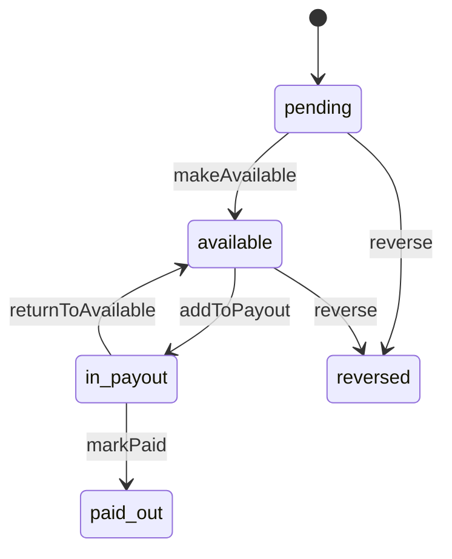

makeAvailable runs when the item is delivered and the hold window (availableAfterDeliveryDays) has passed. A refund after paid_out does not touch the lot: it is a refund_after_payout ledger entry that can make the balance negative. A failed payout returns its lots to available.

### Hold (`Hold.status`)

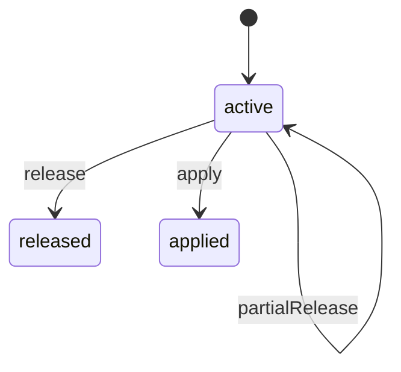

Every hold has a reason and a review date shown to the seller. apply turns the held amount into a deduction (e.g. chargeback lost) with a reason. Placing or releasing above the approver's hold limit needs an access approval.

### Payout run (`PayoutRun.status`)

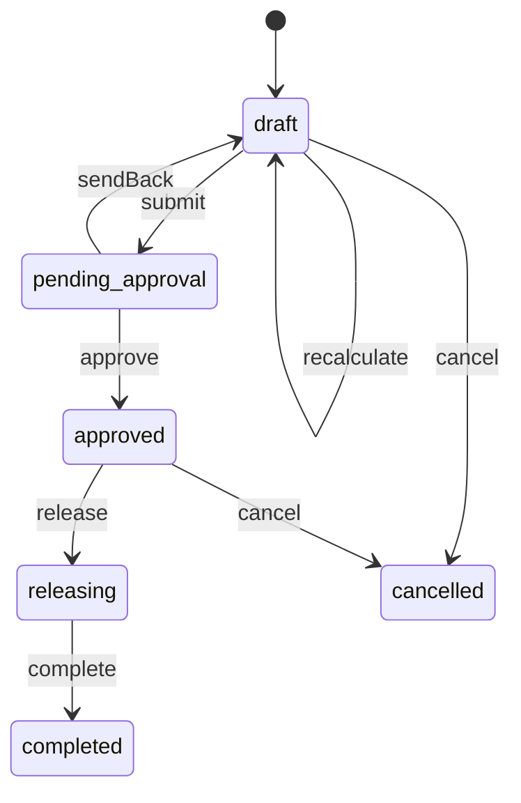

A run above the first approver's finance.payouts.release limit (access) needs a second, different Finance approver (access approval request for the second). Approved is not paid: release sends each pending payout to the provider (processing). complete runs when every payout is paid, failed or cancelled.

### Payout (`Payout.status`)

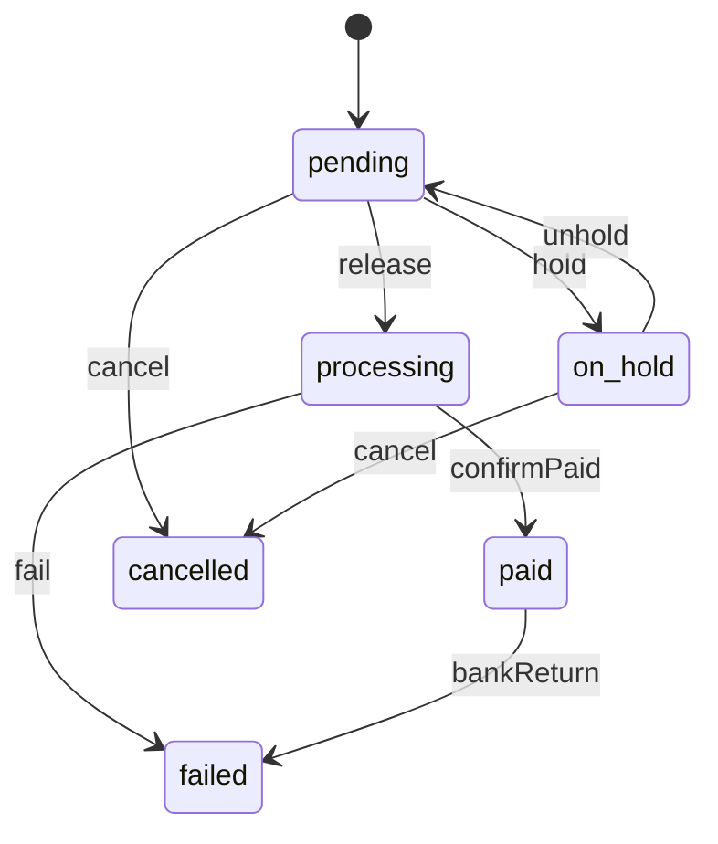

Plan ch. 14 payout statuses. Paid only when the provider confirms the deposit. A failed payout returns its money to the seller's available balance (payout_returned entry); recovery creates a new payout (retryOf) after the destination is fixed and verified. Payouts only go to a verified destination.

### Destination review (`DestinationReview.status`)

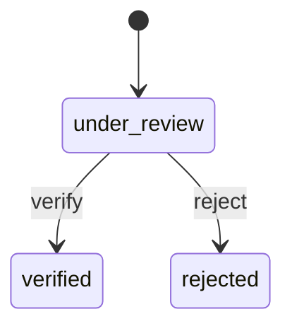

Created when sellers publishes sellers.payout_account.changed. Checks: micro-deposits (confirm-deposits), owner re-authentication, callback to the registered phone (the reviewer records it with callbackConfirmed on approve; verify is refused with CHECKS_INCOMPLETE until all three passed). Payouts keep going to the current verified account until verify; payouts to the new one wait at least destinationChangePauseHours.

### Fee rule set (`FeeRuleSet.status`)

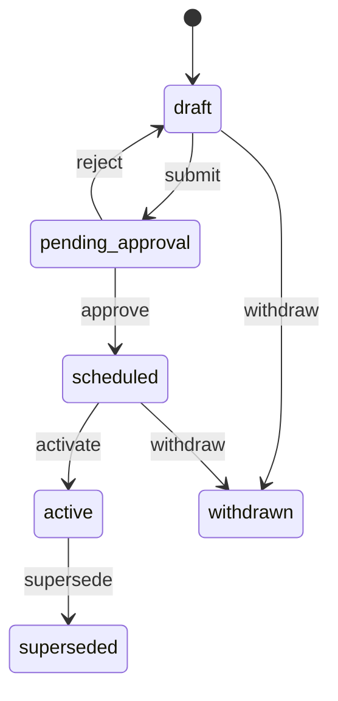

Proposed by the Platform Administrator or Finance, approved by the Business Owner (access). Fees on an order item use the version active when the order was accepted.

### Adjustment (`Adjustment.status`)

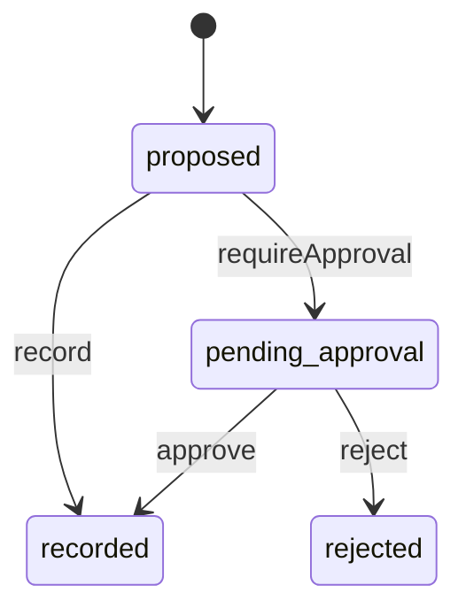

Within the recorder's finance.adjustments.record limit (access) an adjustment is recorded at once; above it it waits for a second Finance reviewer.

### Seller credit (`SellerCredit.status`)

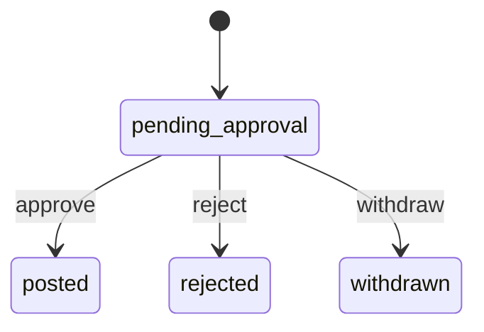

creditSeller posts credits up to creditSecondReviewerThreshold at once (created posted). Larger credits wait for finance.credits.issue and finish on access.approval.decided. withdraw (withdrawSellerCredit, by the module that asked for the credit) cancels the approval request; an approval decided after a withdrawal posts nothing.

### Reconciliation item (`ReconItem.status`)

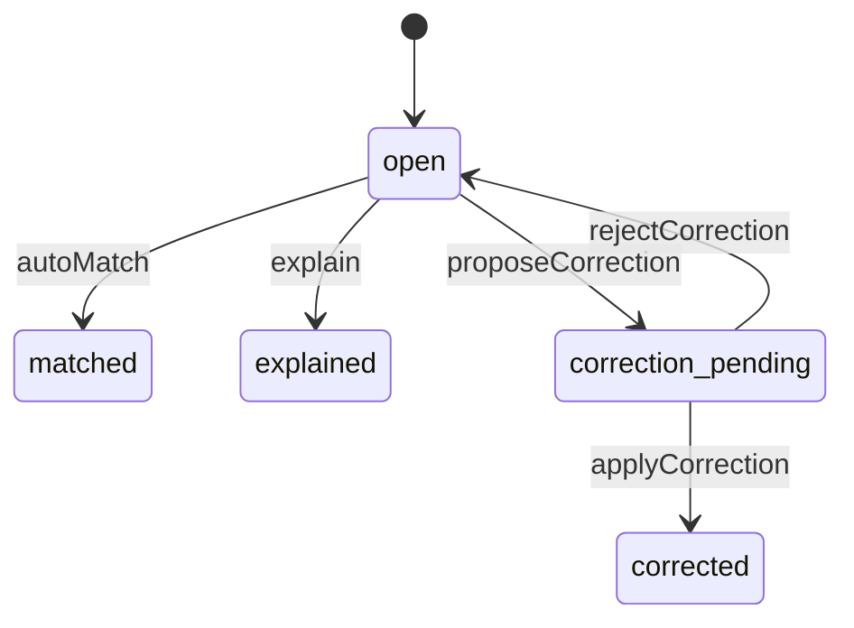

explain records a reason when no money needs to move (timing, provider fee). Corrections above the caller's correction limit (access) need a second reviewer; applying one posts the matching entry (refund via payments, seller adjustment, write-off).

### Amount owed (`AmountOwed.status`)

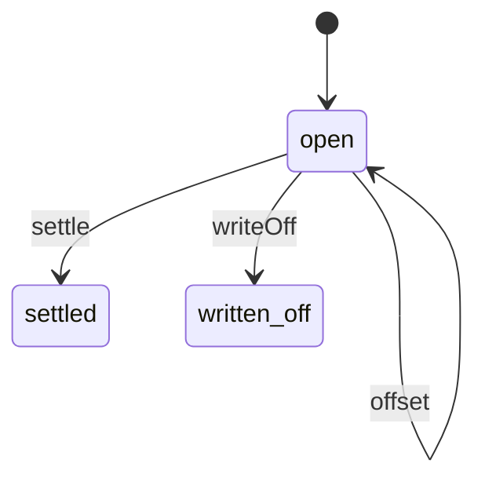

Created when a negative balance is not covered within negativeBalanceOwedAfterDays. New earnings offset it first. Write-off needs a reason and, above the caller's limit, a second Finance reviewer: the pending write-off is kept on the record (pendingWriteOff, approval) until decided.

### Statement (`Statement.status`)

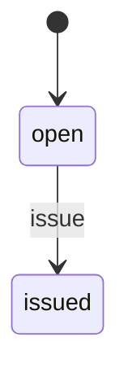

The open statement of a period exists from the seller's approval (or the previous statement's issue); issued at the payout cutoff and immutable afterwards.

## Data (schema `finance`)

**seller_accounts**: Running balances per seller (derived from ledger_entries, kept for fast reads)

| Column | Type |
|---|---|
| seller_id | uuid pk |
| pending | bigint |
| available | bigint |
| held | bigint |
| currency | text |
| negative_since | timestamptz? |
| payouts_blocked_reason | text? |
| fee_override_set_id | uuid? |
| new_seller_until | date? (last market day of the new-seller period, set when sellers.seller.approved is consumed) |
| new_seller_extra_days | int? (extra days after delivery before earnings become available during the period) |
| updated_at | timestamptz |

Indexes: `(updated_at desc, seller_id desc)`

**ledger_entries** (append-only): Append-only seller ledger. Corrections are new entries, never edits.

| Column | Type |
|---|---|
| id | uuid pk |
| seller_id | uuid |
| at | timestamptz |
| type | text |
| ref_kind | text |
| ref_id | text |
| ref_label | text? |
| description | text |
| amount | bigint |
| currency | text |
| bucket | text |
| balance_after | bigint |
| lot_id | uuid? |
| statement_id | uuid? |
| recorded_by | text? |
| source_event_id | text? unique |

Indexes: `(seller_id, at desc)`, `(ref_kind, ref_id)`, `(statement_id)`, `(lot_id)`, `(type, at)`

**earnings_lots**: Net earnings per seller order item, moving pending → available → paid out

| Column | Type |
|---|---|
| id | uuid pk |
| seller_id | uuid |
| order_id | uuid |
| order_item_id | uuid unique |
| state | text |
| gross | bigint |
| fee | bigint |
| net | bigint |
| delivered_at | timestamptz? |
| available_at | timestamptz? |
| payout_id | uuid? |
| left_pending_at | timestamptz? (when the lot left pending: made available or reversed; null while pending and on lots that left before 2026-10-21) |

Indexes: `(state, available_at)`, `(seller_id, state)`, `(payout_id)`, `(order_id)`, `(left_pending_at)`

**fee_rule_sets**

| Column | Type |
|---|---|
| id | uuid pk |
| version | text |
| status | text |
| basis | text |
| include_shipping | bool |
| platform_discounts_reduce_fee | bool |
| default_rate_bps | int |
| treatment | jsonb |
| agreement_version | text |
| effective_from | timestamptz? |
| reason | text? |
| approval_request_id | uuid? |
| created_by | text |
| created_at | timestamptz |

Indexes: `(status, effective_from)`

**fee_category_rates**

| Column | Type |
|---|---|
| rule_set_id | uuid → fee_rule_sets |
| category_id | uuid |
| category_name | text (as named when the rule set was proposed) |
| rate_bps | int |

Indexes: `(rule_set_id, category_id) unique`

**fee_charges**: Fee computed per order item at sale with the rule version used

| Column | Type |
|---|---|
| id | uuid pk |
| order_item_id | uuid unique |
| seller_id | uuid |
| rule_set_id | uuid → fee_rule_sets |
| basis_amount | bigint |
| rate_bps | int |
| fee | bigint |
| refunded_fee | bigint |
| status | text (charged|kept_disputed|reversed) |
| created_at | timestamptz |
| changed_at | timestamptz? (last change of fee, refunded fee or status; reports pulls the fees changed since its last run. Older rows get created_at from a data migration) |

Indexes: `(changed_at, id)`

**refund_allocations**: Funding split from returns.refund.approved, applied when payments.refund.sent arrives

| Column | Type |
|---|---|
| refund_request_id | uuid pk |
| payment_refund_id | uuid? |
| order_id | uuid |
| owner_type | text (official|seller) |
| seller_id | uuid? |
| funded_by | text |
| seller_share | bigint |
| platform_share | bigint |
| breakdown | jsonb |
| applied_at | timestamptz? |

Indexes: `(payment_refund_id)`, `(applied_at)`

**holds**

| Column | Type |
|---|---|
| id | uuid pk |
| seller_id | uuid |
| amount | bigint |
| released_amount | bigint |
| currency | text |
| reason_code | text |
| reason | text |
| review_date | date |
| ref_kind | text? |
| ref_id | text? |
| status | text |
| placed_by | text |
| placed_at | timestamptz |
| released_at | timestamptz? |
| release_reason | text? |
| approval_request_id | uuid? |
| trust_report_id | uuid? (set when the hold executes a trust recommendation; kept through approval so finance.hold.placed carries it when the approved hold is placed) |

Indexes: `(seller_id, status)`, `(status, review_date)`, `(ref_kind, ref_id)`

**adjustments**

| Column | Type |
|---|---|
| id | uuid pk |
| ref | text unique |
| seller_id | uuid |
| direction | text |
| amount | bigint |
| currency | text |
| reason_code | text |
| reason | text |
| ref_kind | text? |
| ref_id | text? |
| status | text |
| recorded_by | text |
| approval_request_id | uuid? |
| idempotency_key | text unique? |
| created_at | timestamptz |

Indexes: `(seller_id, created_at desc)`, `(status)`

**seller_credits**: Credits to sellers without an original charge (creditSeller); pending ones wait for finance.credits.issue

| Column | Type |
|---|---|
| id | uuid pk |
| seller_id | uuid |
| amount | bigint |
| currency | text |
| reason | text |
| ref_kind | text |
| ref_id | text |
| ref_label | text? |
| status | text (posted|pending_approval|rejected|withdrawn) |
| idempotency_key | text unique |
| requested_by | text |
| approval_request_id | uuid? |
| ledger_entry_id | uuid? → ledger_entries |
| created_at | timestamptz |
| decided_at | timestamptz? |

Indexes: `(seller_id, created_at desc)`, `(status)`

**amounts_owed**

| Column | Type |
|---|---|
| id | uuid pk |
| seller_id | uuid |
| amount | bigint |
| remaining | bigint |
| currency | text |
| since | date |
| due_by | date? |
| status | text |
| origin | jsonb |
| note | text? |
| write_off_amount | bigint? (a write-off waiting for approval) |
| write_off_reason | text? |
| approval_request_id | uuid? (the pending write-off's access approval request) |

Indexes: `(seller_id, status)`

**payout_destinations**: Verification state of the seller's payout account (details stay in sellers)

| Column | Type |
|---|---|
| id | uuid pk |
| seller_id | uuid |
| sellers_account_id | uuid |
| label | text |
| provider_destination_id | text? |
| status | text |
| verified_at | timestamptz? |
| active | bool |
| pause_until | timestamptz? |
| deposits_sent_at | timestamptz? |
| deposit_attempts | int |

Indexes: `(seller_id, active)`

**destination_reviews**

| Column | Type |
|---|---|
| id | uuid pk |
| seller_id | uuid |
| destination_id | uuid → payout_destinations |
| from_label | text? |
| to_label | text |
| requested_by | text |
| requested_at | timestamptz |
| status | text |
| checks | jsonb |
| decided_by | text? |
| decided_at | timestamptz? |
| reason | text? |

Indexes: `(status, requested_at)`, `(seller_id, status)`

**payout_runs**

| Column | Type |
|---|---|
| id | uuid pk |
| ref | text unique |
| status | text (draft|pending_approval|approved|releasing|completed|cancelled) |
| scheduled_release | timestamptz |
| cutoff_at | timestamptz |
| total | bigint |
| paying_now | bigint |
| held | bigint |
| negative_offset | bigint |
| currency | text |
| approvals | jsonb |
| approval_request_id | uuid? |
| created_at | timestamptz |
| released_at | timestamptz? |
| completed_at | timestamptz? |

Indexes: `(status, scheduled_release)`, `unique (cutoff_at) where status <> 'cancelled'`

**payouts**

| Column | Type |
|---|---|
| id | uuid pk |
| ref | text unique |
| seller_id | uuid |
| run_id | uuid? → payout_runs |
| amount | bigint |
| currency | text |
| status | text |
| destination_id | uuid → payout_destinations |
| requested_on | date |
| released_at | timestamptz? |
| paid_at | timestamptz? |
| failed_at | timestamptz? |
| failure_code | text? |
| failure_reason | text? |
| retry_of | uuid? → payouts |
| provider_payout_id | text? unique |
| bank_reference | text? |
| statement_id | uuid? |
| holds_withheld | bigint |
| negative_offset | bigint |
| idempotency_key | text unique? |

Indexes: `(seller_id, requested_on desc)`, `(run_id, status)`, `(status, paid_at)`, `(retry_of)`

**statements**: Issued statements are immutable; later corrections appear on the next statement

| Column | Type |
|---|---|
| id | uuid pk |
| ref | text unique |
| seller_id | uuid |
| period_from | date |
| period_to | date |
| status | text |
| issued_at | timestamptz? |
| payout_id | uuid? |
| sections | jsonb |
| reconciliation | jsonb |
| rule_version | text |
| pdf_media_id | uuid? |
| csv_media_id | uuid? |

Indexes: `(seller_id, period_to desc)`

**trading_entries**: Company trading facts for the Official Store (never part of seller payouts). cost_of_goods is the unit cost × quantity of an item sold, booked with its sale (ref_kind order_item) and reversed with a cancellation (ref_kind cancellation); ref_kind cost_pending marks a sale booked before cost_of_goods existed whose cost is still to be filled. buying_cost is stock bought (goods received), never the cost of what was sold. Marketplace (platform) facts live in captures, discount_funding, platform_costs and store_credit_liability, never here

| Column | Type |
|---|---|
| id | uuid pk |
| at | timestamptz |
| kind | text (sale|cost_of_goods|buying_cost|discount|shipping_expense|return|write_off|chargeback_loss|supplier_credit) |
| amount | bigint |
| currency | text |
| order_id | uuid? |
| order_item_id | uuid? |
| variant_id | uuid? |
| ref_kind | text? |
| ref_id | text? |

Indexes: `(at)`, `(kind, at)`, `(ref_kind, at)`

**trading_targets**: Official Store sales and margin targets per month, optionally per category

| Column | Type |
|---|---|
| id | uuid pk |
| period | text |
| category_id | uuid? |
| sales_target | bigint |
| currency | text |
| margin_target_bps | int? |
| note | text? |
| set_by | text |
| set_at | timestamptz |

Indexes: `(period, category_id) unique`

**recon_days**

| Column | Type |
|---|---|
| date | date pk |
| status | text |
| owner_staff_id | uuid |
| backup_staff_id | uuid? |
| due_at | timestamptz |
| checklist | jsonb |
| completed_by | text? |
| completed_at | timestamptz? |

**recon_items**

| Column | Type |
|---|---|
| id | uuid pk |
| date | date → recon_days |
| check | text |
| ref_kind | text? |
| ref_id | text? |
| subject | text |
| description | text |
| expected | bigint |
| actual | bigint |
| credit | bigint (store credit applied with a captured payment; 0 otherwise) |
| difference | bigint |
| currency | text |
| detected_at | timestamptz |
| status | text |
| note | text? |
| owner_staff_id | uuid? |
| correction | jsonb? |
| approval_request_id | uuid? |

Indexes: `(date, check)`, `(status, detected_at)`

**captures**: Payments captured (payments.payment.captured): the card amount the provider deposits and the store credit applied with it. The provider_deposit check adds up card_amount per market day of captured_at; each capture also has its payments_vs_orders (or unexplained_amount) item in recon_items

| Column | Type |
|---|---|
| id | uuid pk (payments capture id) |
| intent_id | uuid? (null for captures recorded before pass 4) |
| order_id | uuid? (null when no matching order was found, or recorded before pass 4) |
| group_id | uuid? |
| card_amount | bigint |
| credit_amount | bigint |
| currency | text |
| provider_ref | text? |
| captured_at | timestamptz |
| recon_item_id | uuid? |

Indexes: `(captured_at)`, `(order_id)`

**discount_funding**: Coupon discount funding per redemption (promotions.coupon.redeemed, promotions.redemption.reversed): the platform part is a marketplace cost, the seller part is funded by the seller. Reversals are negative rows

| Column | Type |
|---|---|
| id | uuid pk |
| at | timestamptz |
| redemption_id | uuid |
| funded_by | text (platform|seller) |
| kind | text (redeemed|reversed) |
| amount | bigint (signed) |
| currency | text |
| order_id | uuid? |
| order_item_id | uuid? |

Indexes: `(at)`, `(redemption_id)`

**platform_costs**: Marketplace (platform) costs and recoveries that are not Official Store trading: labels and refund shares the platform pays on seller orders, carrier claims paid to the platform, platform-funded goodwill store credit, store credit corrections and breakage, written-off seller debts. amount is a cost (positive) or a recovery (negative)

| Column | Type |
|---|---|
| id | uuid pk |
| at | timestamptz |
| kind | text (label|refund|carrier_claim|goodwill_credit|credit_correction|credit_breakage|write_off) |
| amount | bigint (signed) |
| currency | text |
| order_id | uuid? |
| order_item_id | uuid? |
| ref_kind | text? (label|refund|claim|wallet_entry|amount_owed) |
| ref_id | text? |

Indexes: `(at)`, `(kind, at)`

**store_credit_liability**: Finance's store credit liability, one row per wallet event: granted adds, used, reversed and expired reduce, corrected adds or reduces. The daily store_credit check compares the sum up to a day with wallet.getLiabilityTotal

| Column | Type |
|---|---|
| id | uuid pk |
| at | timestamptz |
| kind | text (granted|used|reversed|expired|corrected) |
| amount | bigint (signed) |
| currency | text |
| wallet_entry_id | uuid? (the wallet ledger entry; null for uses, keyed by order) |
| order_id | uuid? |

Indexes: `(at)`

## Events

| Publishes | When | Payload | Consumed by |
|---|---|---|---|
| `finance.payout.paid` | The provider confirms a deposit | `{ payoutId: uuid, ref: string, sellerId: uuid, amount: Money, paidAt: datetime }` | notifications, reports, workqueues |
| `finance.payout.failed` | The bank rejects or returns a payout | `{ payoutId: uuid, ref: string, sellerId: uuid, amount: Money, failureCode: string?, failureReason: string }` | notifications, reports, workqueues |
| `finance.payout.processing` | A payout is sent to the provider | `{ payoutId: uuid, sellerId: uuid, amount: Money }` | - |
| `finance.hold.placed` | A hold is placed (manual or rule) | `{ holdId: uuid, sellerId: uuid, amount: Money, reasonCode: string, reason: text, reviewDate: date, trustReportId: uuid? }` | notifications, reports, trust |
| `finance.hold.released` | A hold is released in full or part | `{ holdId: uuid, sellerId: uuid, amount: Money, reason: text }` | notifications, reports |
| `finance.balance.negative` | A seller's available balance drops below zero | `{ sellerId: uuid, available: Money, cause: Reference }` | notifications |
| `finance.amount_owed.created` | A negative balance is not covered within the agreed period | `{ amountOwedId: uuid, sellerId: uuid, amount: Money, dueBy: date? }` | reports |
| `finance.adjustment.recorded` | An adjustment or correction is posted | `{ adjustmentId: uuid, sellerId: uuid?, direction: string, amount: Money, reasonCode: string }` | - |
| `finance.seller_credit.decided` | A seller credit that waited for approval is posted or rejected | `{ creditId: uuid, sellerId: uuid, reference: Reference, idempotencyKey: string, amount: Money, outcome: enum(posted|rejected), ledgerEntryId: uuid? }` | - |
| `finance.payout_run.approved` | A run has all required approvals | `{ runId: uuid, total: Money, scheduledRelease: datetime }` | - |
| `finance.payout_run.released` | A run's payouts are sent | `{ runId: uuid, payoutCount: int, total: Money }` | - |
| `finance.statement.issued` | A statement is issued at the payout cutoff | `{ statementId: uuid, sellerId: uuid, period: DateRange, payoutId: uuid? }` | notifications |
| `finance.destination.verified` | A payout destination change is verified | `{ sellerId: uuid, reviewId: uuid }` | notifications, sellers |
| `finance.destination.rejected` | A payout destination change is rejected | `{ sellerId: uuid, reviewId: uuid, reason: text }` | notifications, sellers |
| `finance.fee_rules.proposed` | A fee rule version is proposed | `{ ruleSetId: uuid, effectiveFrom: datetime }` | - |
| `finance.fee_rules.changed` | A fee rule version becomes active | `{ ruleSetId: uuid, version: string, effectiveFrom: datetime }` | - |
| `finance.reconciliation.mismatch_found` | The daily check finds a difference | `{ itemId: uuid, check: string, difference: Money }` | notifications, workqueues |
| `finance.reconciliation.item_closed` | A reconciliation item is matched (automatically or by a later event), explained or corrected | `{ itemId: uuid, check: string, date: date, outcome: enum(matched|explained|corrected) }` | workqueues |

| Consumes | From | Does |
|---|---|---|
| `orders.order.accepted` | orders | Create pending earnings lots and fee charges per seller item (sale, shipping charged, seller-funded discount, fee); Official Store items go to trading_entries (sale, discount, shipping charged and, when inventory knows the unit cost, cost_of_goods) |
| `orders.item.cancelled` | orders | Reverse the lot; apply the cancellation fee treatment. Before dispatch the shipping stays with the seller while the rest of the package ships; once every item of the package is cancelled, the shipping credited with each of its sales (the customer's and Marketly's) is reversed, once per lot. After dispatch the item's refunded shipping is reversed with it. Official Store items: the sale, discount and shipping trading entries are reversed, and the cost_of_goods in proportion to the item amount cancelled |
| `orders.item.delivered` | orders | Start the availability clock for the item's lot |
| `payments.payment.captured` | payments | Record collected money for reconciliation (payments vs orders): card amount plus creditAmount (store credit) per capture, including captures with amount 0 for orders or groups paid entirely by store credit; the daily check compares card captures plus credit with the order total less cancelled items, so mixed and credit-only payments are not mismatches |
| `returns.refund.approved` | returns | Store the funding split (seller, platform, shared) for the refund |
| `payments.refund.sent` | payments | Post the refund and proportional fee refund to the seller ledger (refund_after_payout when the lot was paid out) or to company trading. The seller is charged its funding share of the refund without the sales tax (Marketly refunds it), plus that share of a Marketly-funded discount it was paid with the sale and of the return shipping the customer paid for a Marketly label (recovered as a platform label cost), so a returned unit nets to zero |
| `payments.chargeback.opened` | payments | Place a chargeback hold on the seller (fee kept while open per fee treatment) |
| `payments.chargeback.decided` | payments | won: release the chargeback hold. lost: apply the hold as a chargeback deduction from the seller (or a company trading loss for Official Store orders) and record the fee treatment |
| `returns.label.created` | returns | Return labels: charge a seller-paid label to the seller, record a platform shipping expense, or a platform label cost when the customer pays (the fee deducted from the refund is recovered from the seller share when the refund is sent). Keyed by labelId |
| `shipping.label.purchased` | shipping | Outbound and replacement labels: charge seller-bought labels to the seller ledger, record company labels as Official Store shipping expense and platform labels as platform cost. kind = return is ignored (booked from returns.label.created) |
| `shipping.label.voided` | shipping | Reverse the charge or expense booked for that labelId (any kind) |
| `shipping.claim.status_changed` | shipping | paid: credit paidAmount to whoever bore the loss (seller ledger or company trading); other statuses are kept for reconciliation |
| `promotions.coupon.redeemed` | promotions | Record discount funding (platform vs seller) for fee basis and discount reports |
| `promotions.redemption.reversed` | promotions | Reverse the recorded discount funding (platform and seller parts) for the order item, so fee basis and discount reports match after a cancellation or refund |
| `payments.refund.failed` | payments | Mark the refund's stored funding split failed (nothing is posted until payments.refund.sent); on the final attempt list it in the daily reconciliation |
| `sellers.seller.approved` | sellers | Open the seller account and apply the new-seller hold rule |
| `sellers.seller.suspended` | sellers | Put the seller's pending payouts on hold with reason restriction (review date from the restriction) |
| `sellers.seller.reinstated` | sellers | After a suspension (from suspended): clear the payout block it set, release its hold on the available balance (restriction_hold) and put the payouts it held back to pending |
| `sellers.seller.closed` | sellers | Issue a final statement and schedule the last payout after open obligations |
| `sellers.payout_account.changed` | sellers | Open a destination review; keep paying the current verified destination |
| `access.approval.decided` | access | Finish approval-required holds, adjustments, corrections, payout runs, fee rule changes and seller credits (finance.credits.issue: post or reject, publish finance.seller_credit.decided) |
| `support.case.decided` | support | Release or apply dispute holds linked to the case |
| `wallet.credit.granted` | wallet | Phase 3: record the store-credit liability (refund to credit, goodwill, gift cards). Only kind goodwill with chargedTo platform is booked as a platform cost; chargedTo seller is posted to the seller's earnings |
| `wallet.credit.used` | wallet | Phase 3: reduce the store-credit liability when credit pays for an order |
| `wallet.credit.reversed` | wallet | Phase 3: a goodwill grant was reversed (unused credit removed): reduce the store-credit liability by the amount; chargedTo seller: credit the seller back the goodwill charge posted for the grant (keyed by grantEntryId, never more than was charged); chargedTo platform: reduce the platform goodwill cost. Keyed by entryId |
| `wallet.credit.expired` | wallet | Phase 3: unused credit expired: reduce the store-credit liability (expired credit is recorded as platform breakage, not seller money). Keyed by entryId |
| `wallet.credit.corrected` | wallet | Phase 3: staff corrected a balance: increase (positive) or reduce (negative) the store-credit liability, booked as a platform credit correction with the reason. Keyed by entryId |

## In-process API (for other modules)

| Function | Signature | Used by |
|---|---|---|
| previewRefundImpact | `(orderItemIds: uuid[], refund: Money, fundedBy: string) => { sellerEarningsChange: Money, feeReturned: Money, afterPayout: bool, note: string }`<br>Effect of a refund on seller earnings and fees, shown before deciding | returns, support, orders |
| sellerBalanceTotals | `() => { total: Money, held: Money, negativeCount: int }`<br>All seller balances together for the sellers header (SellerStats.balances): total = pending + available + held across sellers, the held part, and how many sellers have a negative available balance | sellers, reports |
| bookedRefundImpact | `(paymentRefundId: uuid, orderItemIds: uuid[]) => { sellerEarningsChange: Money, feeReturned: Money, afterPayout: bool, note: string } | null`<br>What a sent refund changed on the seller ledger: the refund (or refund_after_payout) and fee_refund entries posted for it on these order items. Null until payments.refund.sent is booked (then a preview is all there is) | returns |
| calculateFee | `(input: FeeCalcInput) => FeeCalculation`<br>Fee and seller earnings for a price under the active fee rules | offers, promotions, sellers, orders |
| getSellerBalances | `(sellerId: uuid) => SellerBalances`<br>Balances for dashboards and seller detail | sellers, reports, graphql |
| balancesForSellers | `(sellerIds: uuid[]) => Map<uuid, SellerBalances>`<br>Batched getSellerBalances (the admin seller list): the same balances getSellerBalances gives for each seller (zeros for a seller without an account yet), from a few reads for all of them. Ids that are not uuids are left out (getSellerBalances answers them Not found). | sellers |
| recordAdCharge | `(input: { sellerId: uuid, campaignId: uuid, campaignRef: string, period: DateRange, amount: Money, description: string }) => LedgerEntry`<br>Posts a seller ad charge, kept separate from commission | advertising |
| recordServiceFee | `(input: { sellerId: uuid, amount: Money, kind: string, reference: Reference, description: string, idempotencyKey: string }) => LedgerEntry`<br>Posts a fulfillment-service fee (storage, handling, receiving, returns processing, removal; kind = the FeeCharge type) to the seller ledger as service_fee, kept separate from commission and ad charges. Same idempotencyKey returns the first entry. | fulfillment-service |
| creditSellerCharge | `(input: { sellerId: uuid, amount: Money, originalEntryId: uuid, reason: string, idempotencyKey: string }) => LedgerEntry`<br>Credits back all or part of an ad charge or service fee (originalEntryId = the LedgerEntry returned by recordAdCharge or recordServiceFee) as charge_credit; never more than the original minus earlier credits. Same idempotencyKey returns the first entry. | advertising, fulfillment-service |
| creditSeller | `(input: { sellerId: uuid, amount: Money, reason: string, reference: Reference, idempotencyKey: string }) => SellerCredit`<br>Credits a seller without an original charge (fulfillment-service reimbursements for lost or damaged units, goodwill to a seller) as ledger type seller_credit. Up to creditSecondReviewerThreshold it is posted at once (status posted, ledgerEntry set). Above it the credit waits as pending_approval with an approval request (finance.credits.issue) and is posted or rejected on access.approval.decided, publishing finance.seller_credit.decided. Same idempotencyKey returns the first credit. | fulfillment-service |
| getSellerCredit | `(by: { creditId?: uuid, idempotencyKey?: string }) => SellerCredit | null`<br>Current state of a credit asked for with creditSeller (posted, pending_approval, rejected or withdrawn), by id or by the caller's idempotency key; replaces re-calling creditSeller to read it back | fulfillment-service |
| withdrawSellerCredit | `(input: { creditId?: uuid, idempotencyKey?: string, reason: string }) => SellerCredit`<br>Withdraws a credit still pending_approval (e.g. the reimbursement it pays was reversed): status withdrawn, its approval request is cancelled through access, nothing is posted. A posted credit is refused with ILLEGAL_TRANSITION (reverse it with an adjustment); withdrawing a withdrawn credit returns it unchanged | fulfillment-service |
| recordExternalDifference | `(input: { check: 'store_credit', subject: string, description: string, expected: Money, actual: Money, reference?: Reference, key: string }) => ReconItem`<br>Another module reports a money difference it found in its own books for the daily check (wallet: a customer balance that differs from its ledger sum). Creates an open reconciliation item on today's day for check store_credit (finance.reconciliation.mismatch_found); the same key returns the existing item, and a later report with expected = actual matches it (finance.reconciliation.item_closed) | wallet |
| recordCompanyCost | `(input: { kind: 'buying_cost' | 'shipping_expense' | 'return_loss' | 'write_off' | 'supplier_credit', amount: Money, reference: Reference, at: datetime }) => void`<br>Company trading costs for the Official Store. buying_cost is stock bought (goods received from a supplier): getTrading shows it as stockBought and never takes it off the margin, which uses the cost of goods sold booked when an order is accepted | purchasing, inventory, shipping, warehouse |
| hasPayoutBlock | `(sellerId: uuid) => { blocked: bool, reasons: string[] }`<br>Whether a seller can be paid (verified destination, no full hold) | sellers |
| marketplaceIncomeByDay | `(range: DateRange, sellerId?: uuid) => DailySellerIncome[]`<br>Fee income per seller per market day (commission and fees charged, fee refunds, net, ad income), from fee_charges and ledger_entries. Company revenue only; seller sales are not income. | reports |
| companyCostsByDay | `(range: DateRange) => DailyCompanyCost[]`<br>Official Store trading costs per market day and kind (buying cost = stock bought, Official Store discounts, shipping expense, return losses, write-offs, chargeback losses, supplier credits), from what recordCompanyCost and the order and claim events record in trading_entries. Costs are positive; reversals are negative; supplier credits are positive amounts that lower cost. The cost of goods sold (trading_entries kind cost_of_goods) is not a booked cost and is left out. | reports |
| ledgerDailyTotals | `(range: { from: date, to: date, sellerId?: uuid }) => { sellerId: uuid, day: date, type: string, amount: Money, count: int }[]`<br>Seller ledger entries summed per seller, market day of at and entry type (amounts signed as in the ledger, e.g. marketplace_fee negative), for the reports finance facts (docs/09 §3.2). One aggregation on the (type, at) index, or (seller_id, at) for one seller | reports |
| companyDailyTotals | `(range: { from: date, to: date }) => { day: date, source: 'trading' | 'platform_cost' | 'discount_funding', kind: string, amount: Money }[]`<br>Company money per market day: Official Store trading_entries by kind as stored (sale, cost_of_goods, buying_cost, discount, shipping_expense, return, write_off, chargeback_loss, supplier_credit; buying_cost is stock bought, cost_of_goods the cost of the items sold), platform_costs by kind (signed: costs positive, recoveries negative) and coupon discount_funding by funder (kind platform or seller, reversals negative) on marketplace seller items only: funding on Official Store items is already in the trading discount | reports |
| itemFeesChangedSince | `(input: { since: datetime, after?: string, limit: int }) => { orderItemId: uuid, sellerId: uuid, fee: Money, refundedFee: Money, changedAt: datetime, cursor: string }[]`<br>Fee charges (fee_charges) whose fee, refunded fee or status changed at or after since, oldest change first, keyset-paged by (changed_at, id): pass the cursor of the last row as after for the next page; at most limit (1-1000) rows | reports |
| sellerBalancesByDay | `(range: { from: date, to: date }) => { day: date, sellerId: uuid, pending: Money, available: Money, held: Money, owed: Money }[]`<br>End-of-day seller balances per market day (today: as of now), rebuilt from the ledger. held and the total (pending + available + held) come exactly from the entries; pending is the entries of earnings lots still pending at the end of the day (earnings_lots.left_pending_at; lots that left pending before that column existed use their available_at, and a lot reversed before delivery counts as pending, which only matters when it kept a non-zero net); available is the rest. owed = what the seller owes Marketly (a negative available balance, as a positive amount). Sellers whose four figures are all zero that day are left out | reports |
| getSellerAccount | `(sellerId: uuid) => SellerFinanceDetail`<br>One seller's balances, ledger, payouts, statements, holds, amounts owed and adjustments (seller Finance page, admin seller 360) | graphql |
| getStatementForSeller | `(sellerId: uuid, ref: string) => Statement | null`<br>An itemised statement of this seller | graphql |
| getStatement | `(ref: string) => Statement | null`<br>Any seller's statement as the seller sees it (staff) | graphql |
| getPayoutRun | `(ref: string) => PayoutRun & { sellers: Page<RunPayoutRow>, failedPayouts: Payout[], destinationReviews: DestinationReview[] } | null`<br>Payout run with seller rows, holds, approvals, pre-release checks, the last run's failed payouts and destination reviews | graphql |
| listPayoutRuns | `(filter: { status?: string }, page: PageInput) => Page<PayoutRun>`<br>Payout runs, newest first | graphql |
| holdsForReference | `(references: { kind: string, id: string }[]) => Hold[]`<br>Holds placed for a case, order or chargeback, batched (Case.holds in the dispute view) | graphql, support |
| previewOfferEarnings | `(items: { offerId: uuid, sellerId: uuid, categoryId: uuid | null, price: Money }[]) => map<EarningsPreview>`<br>Fee and earnings at a price on the seller's own offer form (calculateFee under the active rules, with the fee basis explained) | offers, graphql |
| getNextPayoutRun | `() => PayoutRun | null`<br>The next payout run to be released (draft, pending approval or approved), for the admin dashboard | reports, graphql |
| previewRefundImpactForOrder | `(orderRef: string, items: { orderItemId: uuid, quantity?: int }[] | null, refund: Money | null, fundedBy: string) => RefundImpactPreview`<br>previewRefundImpact for staff decision panels: resolves the order's items and refundable amounts, then the seller earnings, fee and balance effect | support, returns, graphql |
| exportRows | `(dataset: string, filters: json, principal: identity.Principal, cursor?: string) => { rows: json[], nextCursor?: string }`<br>Export rows for reports datasets finance.admin.ledger, finance.admin.payout_run, finance.admin.checks, finance.admin.overview (one row per overview figure, filters from, to, basis; G72) and finance.seller.ledger (seller rows scoped to the principal's seller) | reports |

## Permissions

| Key | Who | Allows |
|---|---|---|
| `finance.ledger.view` | staff | View balances, ledgers, statements, payouts, fee rules and finance overview |
| `finance.trading.targets` | staff | Set Official Store sales and margin targets (Official Store Manager, Business Owner) |
| `finance.trading.view` | staff | View company trading figures (Official Store Manager, Finance, Business Owner) |
| `finance.holds.manage` | staff | Place, extend, release and apply holds within limits |
| `finance.adjustments.record` | staff | Record seller adjustments and settle amounts owed within limits |
| `finance.payouts.prepare` | staff | Create, recalculate and submit payout runs |
| `finance.payouts.approve` | staff | Approve, send back and release payout runs; retry failed payouts |
| `finance.destinations.review` | staff | Verify or reject payout destination changes |
| `finance.fees.manage` | staff | Propose fee rule versions (activation needs Business Owner approval) |
| `finance.reconciliation.work` | staff | Daily finance checks: explain, correct and sign off |
| `finance.destinations.confirm` | seller | Confirm the test deposits of the payout account (store owner only, like changing the account; not delegable) |
| `finance.balances.view` | seller | View the seller's balances, ledger, payouts and statements (owner and finance staff) |

## Approval actions

Checked through the access module (limits per role, second reviewer).

| Action | Limit | Second reviewer | Approvers | Meaning |
|---|---|---|---|---|
| `finance.fees.change` | none | always | Business Owner | Activate a new fee rule version (scheduled after approval with seller notice) |
| `finance.holds.place` | money | above-limit | Finance staff within their hold limit; Finance Manager above it; Business Owner above $50,000 (example values) | Place a manual hold on seller funds |
| `finance.holds.release` | money | above-limit | Finance staff within their hold limit; Finance Manager above it (example values) | Release a hold early or apply it |
| `finance.adjustments.record` | money | above-limit | Finance staff within their adjustment limit (access, e.g. $500); a second Finance reviewer above it | Record a manual seller adjustment (credit or debit) |
| `finance.credits.issue` | money | above-limit | A Finance reviewer above creditSecondReviewerThreshold (e.g. $500); Finance Manager above their limit (example values) | Post a seller credit without an original charge (creditSeller, e.g. a fulfillment-service reimbursement) above creditSecondReviewerThreshold |
| `finance.writeoffs.approve` | money | always | A second Finance reviewer (Finance Manager or Business Owner above their limit) | Write off an amount a seller owes |
| `finance.payouts.release` | money | above-limit | Finance Manager within their payout limit (access, e.g. $50,000); a second Finance reviewer above it; Business Owner above the manager limit (example values) | Approve and release a payout run |
| `finance.destinations.approve` | none | always | A Finance reviewer other than the person who requested or entered the change | Approve a seller payout destination change before money goes to the new account |
| `finance.reconciliation.correct` | money | above-limit | Finance staff within their correction limit (access, e.g. $200); a second Finance reviewer above it | Apply a reconciliation correction that moves money |

## Error codes

| Code | Status | Meaning |
|---|---|---|
| `DESTINATION_NOT_VERIFIED` | 409 | The seller has no verified payout destination; money stays in the balance. |
| `SAME_APPROVER` | 409 | The second approval must come from a different person than the first approver or the requester. |
| `RUN_ALREADY_EXISTS` | 409 | A payout run already exists for this cutoff. details.runId. |
| `PAYOUT_NOT_RETRYABLE` | 409 | Only failed payouts without an open retry can be retried. |
| `STATEMENT_NOT_READY` | 409 | The statement period is still open. |
| `CHECKS_INCOMPLETE` | 409 | Destination verification checks are not all passed. details.pending. |
| `DEPOSIT_AMOUNTS_INCORRECT` | 422 | The amounts do not match the test deposits. details.attemptsLeft. |
| `DEPOSIT_ATTEMPTS_EXCEEDED` | 409 | No tries left; new test deposits must be sent. |
| `RECON_DAY_INCOMPLETE` | 409 | Open mismatches remain; explain or correct them first. details.openItems. |

## Background jobs

| Job | Schedule | Does |
|---|---|---|
| `finance.release-pending` | hourly | Move earnings lots to available once delivered + availableAfterDeliveryDays have passed |
| `finance.payout-run.create` | every 15 min | Checks the payoutSchedule cutoff itself (e.g. Thu 23:59 market time before a Friday payout): once the latest cutoff has passed and no run exists for it, issue statements for the period and create the draft payout run. Idempotent per cutoff (RUN_ALREADY_EXISTS-safe), so a late or repeated run, or a restart after the cutoff, creates exactly one run. Also opens the current period's statement for seller accounts that have none (statements are never created on read) |
| `finance.payout-run.release` | every 5 min | Release approved runs at their scheduled time |
| `finance.payout-status.poll` | every 30 min | Ask the provider about processing payouts without a webhook result |
| `finance.reconcile.daily` | daily 06:00 PT | Build the day check: payments vs orders (card captures plus store credit used against the order total less cancelled items), seller amounts vs statements, provider deposit, store credit (finance's store-credit liability vs wallet.getLiabilityTotal when wallet is enabled, plus differences wallet reported with recordExternalDifference), unexplained amounts, failed payouts; publish mismatches, and finance.reconciliation.item_closed for items that now match |
| `finance.holds.review-due` | daily 07:00 PT | List holds reaching their review date for Finance (workqueues) |
| `finance.negative-balance.age` | daily 01:00 PT | Turn negative balances older than negativeBalanceOwedAfterDays into amounts owed |
| `finance.fee-rules.activate` | every 5 min | Activate scheduled fee rule versions at their effective time |

## Settings

| Key | Default | Rules | Meaning |
|---|---|---|---|
| payoutSchedule | `"weekly:FRI"` | string, approval: business owner, seller-visible, 30 d notice | Payout cadence (example: weekly, Friday) |
| payoutReleaseTime | `"10:00"` | time, approval: second reviewer, seller-visible | Release time in market time zone |
| availableAfterDeliveryDays | `7` | duration, days, 0–…, approval: business owner, seller-visible, 30 d notice | Hold window after delivery before earnings become available (example) |
| minimumPayout | `{"amount":2500,"currency":"USD"}` | money, 0–…, approval: second reviewer, seller-visible | Smaller balances roll to the next run |
| newSellerHoldDays | `14` | duration, days, 0–…, approval: second reviewer, seller-visible | Extra hold during the first newSellerPeriodDays of selling |
| newSellerPeriodDays | `30` | duration, days, 0–…, approval: second reviewer, seller-visible | Length of the new-seller period |
| creditSecondReviewerThreshold | `{"amount":50000,"currency":"USD"}` | money, 0–…, approval: business owner | Seller credits from other modules (creditSeller) above this wait for a Finance reviewer ($500 example). The only finance threshold setting: a module caller has no access limit of its own; staff actions use access limits |
| negativeBalanceOwedAfterDays | `30` | duration, days, 1–…, approval: second reviewer, seller-visible | Uncovered negative balance becomes an amount owed |
| destinationChangePauseHours | `72` | duration, hours, 0–…, approval: business owner, seller-visible | Minimum wait before paying a newly verified destination |
| depositConfirmAttempts | `3` | int, 1–10, approval: second reviewer | Tries to enter the two test-deposit amounts before new deposits are sent |

## Integrations
- **Payout provider (bank transfer / ACH through the payment provider's payouts API)**: Send payouts, receive paid/failed/returned results by webhook, micro-deposit verification of destinations
- **Provider settlement reports**: Daily deposit totals for reconciliation

## Notes
- Fulfilled by Marketly money (decision D1, no finance change): the seller stays the seller of record, so the sale and the shipping charge stay in the seller's proceeds as for any seller group; the outbound label the warehouse buys for a marketly_service group is billedTo seller and booked from shipping.label.purchased like a seller-bought label; Fulfilled by Marketly fees arrive through recordServiceFee (service_fee, fulfillment section of the statement) and reimbursements through creditSeller / creditSellerCharge; refunds of Fulfilled by Marketly returns are seller-funded like other seller returns.
- Seller ledger exports run through reports like every other export: POST /api/seller/finance/ledger/exports creates a finance.seller.ledger job (date range; columns: date, entry type, order or payout reference, description, amount, balance after) and GET /ledger/exports/{id} returns its status and link.
- The ledger is append-only and the source of truth; seller_accounts is a projection. Every entry references the record that caused it (order, return, refund, case, chargeback, payout, adjustment, ad campaign).
- Seller money and company money never mix: Official Store sales go to trading_entries and company trading reports, never to a seller payout. Marketplace seller sales are not company revenue; only the fee portion is marketplace income.
- Fee example (illustration only): an eligible $100 item sale with a 10% fee creates $10 of fee income and $90 of seller earnings before other adjustments. Default rules: commission on item price after seller-funded discounts, shipping excluded, platform-funded discounts do not lower seller proceeds. Category rates are examples (Electronics 8%, Computers 7%, Home & Kitchen 12%, Fashion 15%, Sports 10%, Beauty 12%).
- Refund after payout: the refund is deducted from later earnings (refund_after_payout entry); if the balance stays negative for negativeBalanceOwedAfterDays it becomes an amount owed. Statements show the deduction with the original payout reference (acceptance scenario 6).
- Ad charges are separate ledger entries and a separate statement section, never part of commission.
- Approvals (decision F-D1: limits come from access only): holds, adjustments, corrections, write-offs, payout runs and fee rule changes check the caller's limit through access (seller credits from creditSeller use creditSecondReviewerThreshold, since the caller is a module); above it the record is saved pending and the endpoint answers its normal status with `approval` in the body (FORMAT.md, Approval responses), finishing on access.approval.decided. The former runSecondReviewerThreshold, adjustmentSecondReviewerThreshold and correctionSecondReviewerThreshold settings are removed (their stored values are deleted by the settings module); the example amounts live in the access limits seed. Staff access to finance screens is not financial authority: approve endpoints need finance.payouts.approve and a limit.
- Marketplace facts have their own tables, never trading_entries: captures (payments captured, card and store credit), discount_funding (coupon platform and seller parts), platform_costs (labels, refund shares, carrier claims, goodwill credit, credit corrections and breakage, written-off seller debts) and store_credit_liability. trading_entries holds Official Store trading only.
- Store credit liability (phase 3): finance keeps the liability (store_credit_liability) from wallet events: granted adds, used, reversed and expired reduce, corrected adds or reduces (each keyed by the wallet entry id). A reversed seller-charged goodwill grant credits the seller back the charge posted for it. The daily store_credit check compares the liability with wallet.getLiabilityTotal and lists per-account differences wallet reports through recordExternalDifference.
- New-seller period: when sellers.seller.approved is consumed the seller account gets new_seller_until (today + newSellerPeriodDays) and new_seller_extra_days (recommendedHoldDays, else newSellerHoldDays). Items delivered up to that day become available that many extra days later. It is shown in SettlementRules, not as a hold.
- Statements: a seller's open statement is created when the seller is approved and, for the next period, when a statement is issued (finance.payout-run.create also opens one for any seller account that has none); reading statements never creates one.
- Trust holds: a hold placed for a trust recommendation (HoldInput.trustReportId) keeps holds.trust_report_id through an approval, so finance.hold.placed carries trustReportId when the approved hold is finally placed and trust can confirm the hold_payout action.
- Payout destination details belong to sellers (owner-only changes); finance stores only a label, provider destination id and verification state, and never pays an unverified destination.
- Chargeback cases themselves are in payments; finance holds the seller amount and applies or releases it when payments reports the outcome.
- Dependency note: returns, advertising, promotions, purchasing, inventory, shipping and support are optional inputs; without them their lines are simply absent from statements and trading.
- Micro-deposit verification: the payout provider sends the two test deposits to the new destination and checks the amounts the owner enters (POST /api/seller/finance/payout-destination/confirm-deposits); finance moves no money for the check and records only the result on the destination review.

## GraphQL (read layer)

This module's fragment of the GraphQL schemas (see [../graphql/README.md](../graphql/README.md)). Writes stay on the REST endpoints above.

```graphql
# finance: seller balances, ledger, holds, payouts, payout runs and statements.
# Adds Seller.balance (seller: own account; admin), Seller.finance (admin), Case.holds (admin) and Offer.earningsPreview
# (seller, own offers). Admin queries nextPayoutRun (dashboard) and refundImpactPreview (decision panels).
# Seller money only. Company trading figures, reconciliation and fee rule administration stay on REST.

"""
A seller's balances explained one by one: sales proceeds, pending, available, held (each hold with reason and review date),
negative balance or amount owed, and the next payout.
"""
type SellerBalance @areas(in: [SELLER, ADMIN]) {
  sellerId: UUID!
  asOf: DateTime!
  "Accepted sales in the current period including shipping charged, before fees, refunds and holds"
  salesProceeds: Money!
  salesPeriod: FinancePeriod!
  "After fees, waiting for delivery plus the hold window"
  pending: Money!
  "Eligible for the next payout; negative when refunds after payout exceed earnings"
  available: Money!
  held: Money!
  holds: [Hold!]!
  negative: Boolean!
  "Negative balance not covered within the agreed period"
  amountOwed: Money
  owedDueBy: Date
  nextPayout: PayoutForecast
  settlementRules: FinanceSettlementRules!
  destination: PayoutDestination!
}

"A date range (inclusive)"
type FinancePeriod @areas(in: [SELLER, ADMIN]) {
  from: Date!
  to: Date!
}

"What a ledger line, hold or statement line refers to"
type FinanceReference @areas(in: [SELLER, ADMIN]) {
  kind: FinanceReferenceKind!
  id: String!
  "Human reference, e.g. MK-261005-17730, RT-…, PO-…"
  ref: String
}

enum FinanceReferenceKind @areas(in: [SELLER, ADMIN]) {
  ORDER
  ORDER_ITEM
  RETURN
  REFUND
  CASE
  CHARGEBACK
  PAYOUT
  ADJUSTMENT
  AD_CAMPAIGN
  FULFILLMENT_SERVICE
  STATEMENT
  SELLER
  RECONCILIATION
}

type FinanceSettlementRules @areas(in: [SELLER, ADMIN]) {
  "e.g. Weekly, Monday"
  schedule: String!
  availableAfterDeliveryDays: Int!
  minimumPayout: Money!
  "Extra days before earnings become available while in the new-seller period; null after it"
  newSellerHoldDays: Int
  "Last day of the new-seller period"
  newSellerUntil: Date
  "Deducted from later earnings; if none, the balance shows the amount owed"
  refundAfterPayout: String!
  text: String!
}

"Estimate of the next payout; the amount is fixed at the cutoff"
type PayoutForecast @areas(in: [SELLER, ADMIN]) {
  estimatedAmount: Money!
  scheduledFor: Date!
  cutoffAt: DateTime!
  destination: PayoutDestination!
  "e.g. Usually 1 business day after sending"
  arrivesNote: String!
  note: String!
}

"The payout bank account and its verification state"
type PayoutDestination @areas(in: [SELLER, ADMIN]) {
  "e.g. Pacific Coast Credit Union •••• 6620"
  label: String!
  status: PayoutDestinationStatus!
  verifiedAt: DateTime
  pendingChange: PayoutDestinationChange
}

enum PayoutDestinationStatus @areas(in: [SELLER, ADMIN]) {
  VERIFIED
  VERIFICATION_PENDING
  CHANGE_UNDER_REVIEW
  MISSING
  REJECTED
}

type PayoutDestinationChange @areas(in: [SELLER, ADMIN]) {
  label: String!
  requestedAt: DateTime!
  "Payouts keep going to the current verified account until the change is approved"
  paysCurrentUntilApproved: Boolean!
}

"Part of a seller's earnings withheld with a reason and a review date. Not lost: released or applied after review."
type Hold @areas(in: [SELLER, ADMIN]) {
  id: UUID!
  sellerId: UUID!
  sellerName: String!
  amount: Money!
  releasedAmount: Money!
  reasonCode: HoldReason!
  "Shown to the seller on the balance and the statement"
  reason: String!
  reviewDate: Date!
  reference: FinanceReference
  status: HoldStatus!
  placedBy: Actor!
  placedAt: DateTime!
  releasedAt: DateTime
  releaseReason: String

  # ---- Admin Center only
  "Approval when the hold is above the approver's limit"
  approval: ApprovalInfo @areas(in: [ADMIN])
  "Set when the hold executes a trust recommendation"
  trustReportId: UUID @areas(in: [ADMIN])
}

enum HoldReason @areas(in: [SELLER, ADMIN]) {
  CHARGEBACK
  DISPUTE
  DELIVERY_UNCONFIRMED
  NEW_SELLER
  RESTRICTION
  RISK_REVIEW
  UNUSUAL_REFUND_RATE
  IDENTITY_RECHECK
  OTHER
}

enum HoldStatus @areas(in: [SELLER, ADMIN]) {
  ACTIVE
  RELEASED
  APPLIED
}

"One ledger transaction with the running balance"
type LedgerEntry @areas(in: [SELLER, ADMIN]) {
  id: UUID!
  at: DateTime!
  type: LedgerEntryType!
  "e.g. Marketplace fee"
  typeLabel: String!
  reference: FinanceReference!
  "e.g. 10% of $184.00 item price (shipping excluded)"
  description: String!
  amount: Money!
  bucket: LedgerBucket!
  "pending + available + held after this entry"
  balanceAfter: Money!
  statementId: UUID
  "ST-… reference of the statement the entry is on, for opening it with Query.statement(ref). Null while the period is open."
  statementRef: String
  "Who recorded it, for adjustments and holds"
  recordedBy: Actor
}

enum LedgerEntryType @areas(in: [SELLER, ADMIN]) {
  SALE
  SHIPPING_CHARGE
  SELLER_DISCOUNT
  MARKETPLACE_FEE
  FEE_REFUND
  REFUND
  REFUND_AFTER_PAYOUT
  HOLD
  HOLD_RELEASE
  ADJUSTMENT
  AD_CHARGE
  SERVICE_FEE
  CHARGE_CREDIT
  SELLER_CREDIT
  LABEL_CHARGE
  CHARGEBACK
  PAYOUT
  PAYOUT_RETURNED
  OWED_OFFSET
  CANCELLATION
}

enum LedgerBucket @areas(in: [SELLER, ADMIN]) {
  PENDING
  AVAILABLE
  HELD
}

type LedgerEntryPage implements Paged @areas(in: [SELLER, ADMIN]) {
  items: [LedgerEntry!]!
  nextCursor: String
  page: Int
  totalPages: Int
  total: Int
}

"A payout to one seller: Pending → Processing → Paid, or Failed with the bank's reason"
type Payout @areas(in: [SELLER, ADMIN]) {
  id: UUID!
  "PO-YYMMDD-NNNN"
  ref: String!
  sellerId: UUID!
  sellerName: String!
  amount: Money!
  status: PayoutStatus!
  destination: PayoutDestination!
  requestedOn: Date!
  releasedAt: DateTime
  "Paid only when the provider confirms the deposit"
  paidAt: DateTime
  arrivedOn: Date
  failedAt: DateTime
  "Bank return code, e.g. R02"
  failureCode: String
  failureReason: String
  nextStep: String
  "The failed payout this one retries"
  retryOf: UUID
  "PO-… reference of the failed payout this one retries, e.g. Retry of PO-260925-0412"
  retryOfRef: String
  retriedBy: UUID
  statementId: UUID
  "ST-… reference of the statement the payout settles, for opening it with Query.statement(ref)"
  statementRef: String
  statementPeriod: FinancePeriod
  bankReference: String
  holdsWithheld: Money!
  negativeOffset: Money!
  resultNote: String
  "Payout run that released it"
  runId: UUID @areas(in: [ADMIN])
}

enum PayoutStatus @areas(in: [SELLER, ADMIN]) {
  PENDING
  ON_HOLD
  PROCESSING
  PAID
  FAILED
  CANCELLED
}

type PayoutPage implements Paged @areas(in: [SELLER, ADMIN]) {
  items: [Payout!]!
  nextCursor: String
  page: Int
  totalPages: Int
  total: Int
}

"""
Itemised payout statement: sales, fees with their basis, refunds (including after payout), holds, adjustments with reasons
and ad charges, reconciled to one payout. Immutable once issued.
"""
type Statement @areas(in: [SELLER, ADMIN]) {
  id: UUID!
  "ST-YYMM-SELLER-NN"
  ref: String!
  sellerId: UUID!
  sellerName: String!
  "e.g. NWA-20714"
  sellerCode: String!
  period: FinancePeriod!
  status: StatementStatus!
  issuedAt: DateTime
  payout: Payout
  "Section totals for the statement list; lines are on each section"
  sections: [StatementSection!]! @cost(weight: 5)
  "How the fee basis works"
  feeBasisNote: String!
  reconciliation: StatementReconciliation!
  "e.g. RT-260924-0533 was refunded after its earnings were paid out; the net amount was deducted here"
  afterPayoutNotices: [String!]!
  ruleVersion: String!
}

enum StatementStatus @areas(in: [SELLER, ADMIN]) {
  OPEN
  ISSUED
}

type StatementSection @areas(in: [SELLER, ADMIN]) {
  key: StatementSectionKey!
  title: String!
  subtitle: String
  lines: [StatementLine!]!
  total: Money!
  "e.g. Sales proceeds, Fees total"
  totalLabel: String!
}

enum StatementSectionKey @areas(in: [SELLER, ADMIN]) {
  SALES
  FEES
  REFUNDS
  HOLDS
  ADJUSTMENTS
  ADS
}

type StatementLine @areas(in: [SELLER, ADMIN]) {
  date: Date
  reference: FinanceReference
  description: String!
  detail: String
  units: Int
  "Fee basis, for fee lines"
  basis: Money
  amount: Money!
  "Holds and adjustments: reason, review date, who recorded it"
  reason: String
}

"Opening available balance + section totals − payout = closing available balance"
type StatementReconciliation @areas(in: [SELLER, ADMIN]) {
  openingAvailable: Money!
  lines: [StatementReconciliationLine!]!
  payout: Money!
  closingAvailable: Money!
}

type StatementReconciliationLine @areas(in: [SELLER, ADMIN]) {
  label: String!
  amount: Money!
}

type StatementPage implements Paged @areas(in: [SELLER, ADMIN]) {
  items: [Statement!]!
  nextCursor: String
  page: Int
  totalPages: Int
  total: Int
}

"A negative balance that was not covered in time and became an amount owed"
type FinanceAmountOwed @areas(in: [SELLER, ADMIN]) {
  id: UUID!
  amount: Money!
  remaining: Money!
  since: Date!
  dueBy: Date
  status: FinanceAmountOwedStatus!
  origin: [FinanceReference!]!
  note: String
  "A write-off waiting for a second Finance reviewer"
  pendingWriteOff: Money
  "Approval request of the pending write-off"
  approval: ApprovalInfo @areas(in: [ADMIN])
}

enum FinanceAmountOwedStatus @areas(in: [SELLER, ADMIN]) {
  OPEN
  SETTLED
  WRITTEN_OFF
}

"A seller credit or debit with a recorded reason (staff view)"
type FinanceAdjustment @areas(in: [ADMIN]) {
  id: UUID!
  "ADJ-YYMMDD-NNNN"
  ref: String!
  direction: FinanceAdjustmentDirection!
  amount: Money!
  reasonCode: FinanceAdjustmentReason!
  reason: String!
  reference: FinanceReference
  status: FinanceAdjustmentStatus!
  recordedBy: Actor!
  approval: ApprovalInfo
  createdAt: DateTime!
}

enum FinanceAdjustmentDirection @areas(in: [ADMIN]) {
  CREDIT
  DEBIT
}

enum FinanceAdjustmentReason @areas(in: [ADMIN]) {
  CARRIER_CLAIM
  DUPLICATE_CHARGE
  GOODWILL
  FEE_CORRECTION
  LATE_DISPATCH_PENALTY
  RECONCILIATION_CORRECTION
  OTHER
}

enum FinanceAdjustmentStatus @areas(in: [ADMIN]) {
  PROPOSED
  PENDING_APPROVAL
  RECORDED
  REJECTED
}

"""
One seller's money in one place: balances, ledger, payouts, statements, holds and amounts owed.
Serves the seller Finance page (own account) and the Finance part of the admin seller 360.
"""
type FinanceSellerAccount @areas(in: [SELLER, ADMIN]) {
  sellerId: UUID!
  balance: SellerBalance!
  "Transactions with running balance, newest first. types filters to several entry types at once (e.g. the Fees tab: MARKETPLACE_FEE and FEE_REFUND); type is the single-type shortcut."
  ledger(type: LedgerEntryType, types: [LedgerEntryType!], from: Date, to: Date, paging: PageInput): LedgerEntryPage!
  "Payouts with status and result, newest first (failed payouts explain the reason)"
  payouts(status: PayoutStatus, paging: PageInput): PayoutPage!
  "Statements by period, newest first"
  statements(paging: PageInput): StatementPage!
  "Active holds with reason and review date"
  openHolds: [Hold!]!
  amountsOwed: [FinanceAmountOwed!]!
  "Fee rule version applied to new sales"
  feeRuleVersion: String!
  "Recent credits and debits with reasons"
  recentAdjustments: [FinanceAdjustment!]! @areas(in: [ADMIN])
}

# ---------------------------------------------------------------- payout runs (Admin Center)

"""
A scheduled payout run: totals, per-seller rows with holds and destinations, approvals and pre-release checks.
Runs above the second-reviewer threshold need two different Finance approvers. Approved is not paid.
"""
type PayoutRun @areas(in: [ADMIN]) {
  id: UUID!
  "PO-RUN-YYMMDD"
  ref: String!
  status: PayoutRunStatus!
  scheduledRelease: DateTime!
  cutoffAt: DateTime!
  "e.g. earnings from items delivered by Oct 2 and past the 7-day hold"
  rule: String!
  total: Money!
  payingNow: Money!
  held: Money!
  negativeOffset: Money!
  sellerCount: Int!
  readyCount: Int!
  heldCount: Int!
  retriesIncluded: Int!
  retriesAmount: Money!
  failedLastRun: Int!
  failedLastRunAmount: Money!
  approvals: [PayoutRunApproval!]!
  approval: ApprovalInfo!
  checks: [PayoutRunCheck!]!
  "False for staff without payout authority and for the person who already approved"
  viewerCanApprove: Boolean!
  createdAt: DateTime!
  "Sellers in the run; held and changed-destination rows first"
  sellers(filter: PayoutRunSellerFilter = ALL, search: String, paging: PageInput): PayoutRunSellerPage! @cost(weight: 10)
  "Failed payouts from the previous run, to retry or fix"
  failedPayouts: [Payout!]!
  "Destination changes under review for sellers in this run"
  destinationReviews: [PayoutDestinationReview!]!
}

enum PayoutRunStatus @areas(in: [ADMIN]) {
  DRAFT
  PENDING_APPROVAL
  APPROVED
  RELEASING
  COMPLETED
  CANCELLED
}

type PayoutRunApproval @areas(in: [ADMIN]) {
  order: Int!
  approver: Actor
  "e.g. Finance Specialist · second reviewer"
  role: String!
  status: PayoutRunApprovalStatus!
  at: DateTime
  dueAt: DateTime
  note: String
}

enum PayoutRunApprovalStatus @areas(in: [ADMIN]) {
  APPROVED
  PENDING
  SENT_BACK
}

type PayoutRunCheck @areas(in: [ADMIN]) {
  level: PayoutRunCheckLevel!
  title: String!
  detail: String
}

enum PayoutRunCheckLevel @areas(in: [ADMIN]) {
  OK
  INFO
  WARN
  FAIL
}

"One seller's row in a payout run"
type PayoutRunSeller @areas(in: [ADMIN]) {
  payoutId: UUID!
  sellerId: UUID!
  sellerName: String!
  available: Money!
  holds: [Hold!]!
  negativeBalance: Money
  destination: PayoutDestination!
  payout: Money!
  status: PayoutStatus!
  isRetry: Boolean!
}

enum PayoutRunSellerFilter @areas(in: [ADMIN]) {
  ALL
  HELD
  CHANGED_DESTINATION
  NEGATIVE
  RETRIES
}

type PayoutRunSellerPage implements Paged @areas(in: [ADMIN]) {
  items: [PayoutRunSeller!]!
  nextCursor: String
  page: Int
  totalPages: Int
  total: Int
}

type PayoutRunPage implements Paged @areas(in: [ADMIN]) {
  items: [PayoutRun!]!
  nextCursor: String
  page: Int
  totalPages: Int
  total: Int
}

"A payout destination change waiting for verification and review"
type PayoutDestinationReview @areas(in: [ADMIN]) {
  id: UUID!
  sellerId: UUID!
  sellerName: String!
  fromLabel: String
  toLabel: String!
  requestedBy: Actor!
  requestedAt: DateTime!
  status: PayoutDestinationReviewStatus!
  checks: [PayoutDestinationCheck!]!
  "Payouts to the new account wait at least this long"
  pauseUntil: DateTime
  decidedBy: Actor
  decidedAt: DateTime
  reason: String
}

enum PayoutDestinationReviewStatus @areas(in: [ADMIN]) {
  UNDER_REVIEW
  VERIFIED
  REJECTED
}

type PayoutDestinationCheck @areas(in: [ADMIN]) {
  "e.g. Micro-deposits confirmed"
  label: String!
  result: PayoutDestinationCheckResult!
}

enum PayoutDestinationCheckResult @areas(in: [ADMIN]) {
  PASSED
  PENDING
  FAILED
}

"""
What the seller would earn at a price on the offer form, under the fee rules in force for the offer's category.
Example figures only: the fee is charged on the actual sale.
"""
type FinanceEarningsPreview @areas(in: [SELLER]) {
  "Price the preview is for (the argument, else the offer's current price)"
  price: Money!
  "Amount the fee is charged on (item price after seller discounts; shipping excluded unless the rule includes it)"
  feeBasis: Money!
  "Fee rate in basis points, e.g. 1000 = 10%"
  rateBps: Int!
  fee: Money!
  "Price minus fee, before shipping charged and label costs"
  earnings: Money!
  "e.g. Fee is 10% of the item price after your discounts; shipping is not included"
  feeBasisNote: String!
  "e.g. Example: at $184.00 you earn $165.60 after a $18.40 fee"
  exampleLabel: String!
  ruleVersion: String!
}

"""
Effect of a proposed remedy on the seller's money before staff decide it (AdminCase decision panel): earnings reversed,
fee returned, whether the sale was already paid out and how the balance changes.
"""
type FinanceRefundImpact @areas(in: [ADMIN]) {
  orderRef: String!
  "Refund the preview is for (the amount argument, else the full refundable amount of the items)"
  refund: Money!
  fundedBy: FinanceRefundFundedBy!
  "Negative when earnings are reversed"
  sellerEarningsChange: Money!
  "Marketplace fee returned to the seller in proportion"
  feeReturned: Money!
  "Platform-funded part, not charged to the seller"
  platformShare: Money!
  "The sale was already paid out; the amount comes off the next payout or becomes an amount owed"
  afterPayout: Boolean!
  "Seller balance after the remedy (pending + available + held), when the seller has a balance"
  balanceAfter: Money
  "Plain explanation, e.g. Earnings of $165.60 reversed; $18.40 fee returned; deducted from the Oct 16 payout"
  note: String!
}

"Who pays for a refund in a remedy preview"
enum FinanceRefundFundedBy @areas(in: [ADMIN]) {
  SELLER
  PLATFORM
  SHARED
  OFFICIAL_STORE
}

"One order item and quantity in a remedy preview"
input FinanceRefundImpactItemInput @areas(in: [ADMIN]) {
  orderItemId: UUID!
  "Defaults to the full quantity"
  quantity: Int
}

# ---------------------------------------------------------------- fields on other modules' types

extend type Offer {
  "Fee and earnings at a price (minor units; default: the offer's current price), for the seller's own offer form"
  earningsPreview(price: Int): FinanceEarningsPreview @areas(in: [SELLER]) @auth(requires: SELLER) @source(module: "finance", fn: "previewOfferEarnings") @cost(weight: 2)
}

extend type Seller {
  "The caller's own balances, holds and next payout (seller dashboard)"
  balance: SellerBalance @areas(in: [SELLER]) @auth(requires: SELLER, permission: "finance.balances.view") @source(module: "finance", fn: "getSellerBalances")
}

extend type Seller {
  "Seller 360: balances, holds with reason and review date, next payout"
  balance: SellerBalance @areas(in: [ADMIN]) @auth(requires: STAFF, permission: "finance.ledger.view") @source(module: "finance", fn: "getSellerBalances")
  "Seller 360: ledger, payouts, statements, amounts owed and adjustments"
  finance: FinanceSellerAccount @areas(in: [ADMIN]) @auth(requires: STAFF, permission: "finance.ledger.view") @source(module: "finance", fn: "getSellerAccount") @cost(weight: 3)
}

extend type Case {
  "Finance holds placed because of this case (dispute review)"
  holds: [Hold!] @areas(in: [ADMIN]) @auth(requires: STAFF, permission: "finance.ledger.view") @source(module: "finance", fn: "holdsForReference")
}

extend type Query {
  "The caller's seller money: balances, ledger, payouts and statements (Finance page)"
  sellerFinance: FinanceSellerAccount @areas(in: [SELLER]) @auth(requires: SELLER, permission: "finance.balances.view") @source(module: "finance", fn: "getSellerAccount")

  "An itemised statement of the caller's seller account"
  statement(ref: String!): Statement @areas(in: [SELLER]) @auth(requires: SELLER, permission: "finance.balances.view") @source(module: "finance", fn: "getStatementForSeller")

  "Any seller's statement as the seller sees it (staff)"
  statementAdmin(ref: String!): Statement @areas(in: [ADMIN]) @auth(requires: STAFF, permission: "finance.ledger.view") @source(module: "finance", fn: "getStatement")

  "One payout run with sellers, holds, approvals and pre-release checks"
  payoutRun(ref: String!): PayoutRun @areas(in: [ADMIN]) @auth(requires: STAFF, permission: "finance.ledger.view") @source(module: "finance", fn: "getPayoutRun")

  "The next payout run to be released (draft, pending approval or approved), for the admin dashboard. Null when none is scheduled."
  nextPayoutRun: PayoutRun @areas(in: [ADMIN]) @auth(requires: STAFF, permission: "finance.ledger.view") @source(module: "finance", fn: "getNextPayoutRun")

  """
  Seller earnings and fee effect of a proposed refund remedy, before deciding it (case and return decision panels).
  items omitted = every item of the order; amount (minor units) omitted = the items' full refundable amount.
  """
  refundImpactPreview(orderRef: String!, items: [FinanceRefundImpactItemInput!], amount: Int, fundedBy: FinanceRefundFundedBy = SELLER): FinanceRefundImpact @areas(in: [ADMIN]) @auth(requires: STAFF, permission: "finance.ledger.view") @source(module: "finance", fn: "previewRefundImpactForOrder") @cost(weight: 3)

  "Payout runs, newest first"
  payoutRuns(status: PayoutRunStatus, paging: PageInput): PayoutRunPage @areas(in: [ADMIN]) @auth(requires: STAFF, permission: "finance.ledger.view") @source(module: "finance", fn: "listPayoutRuns")
}
```
