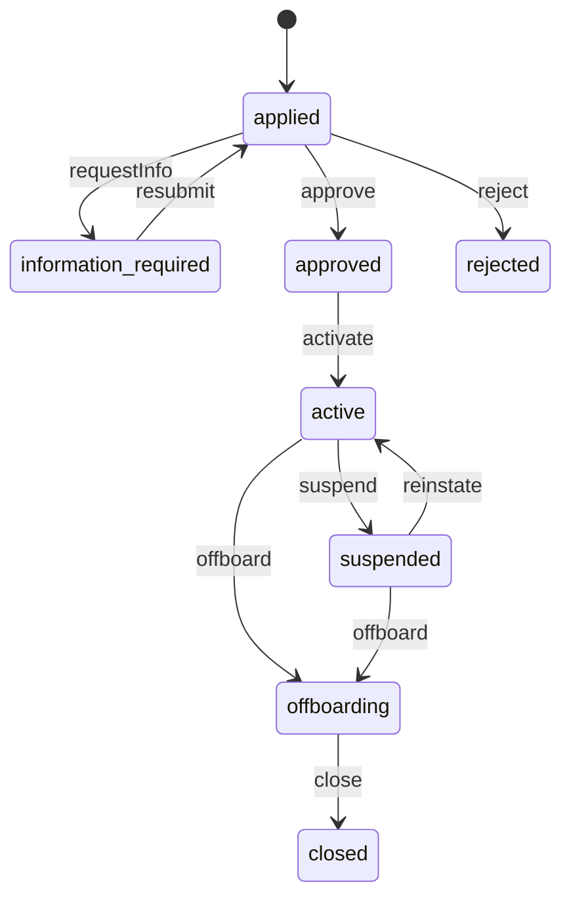
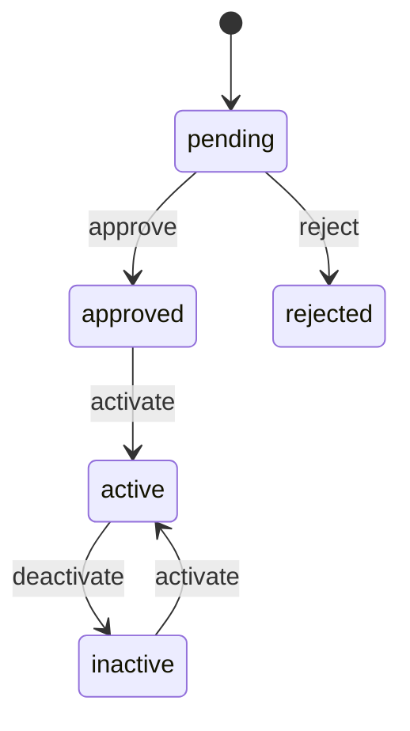
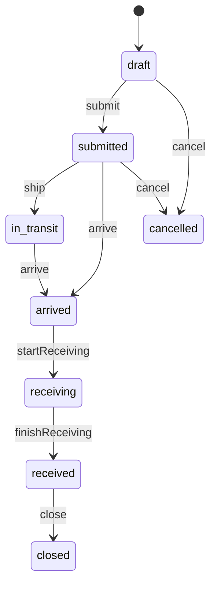
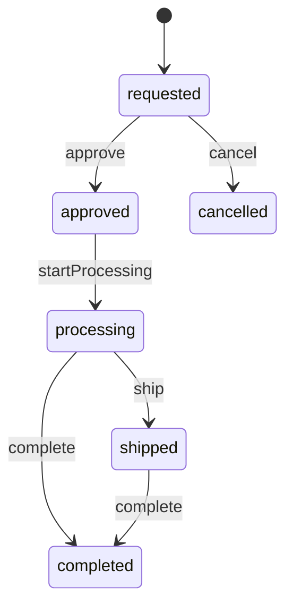
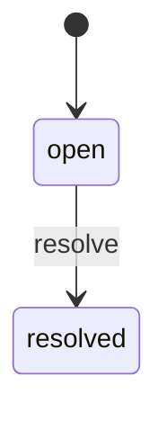
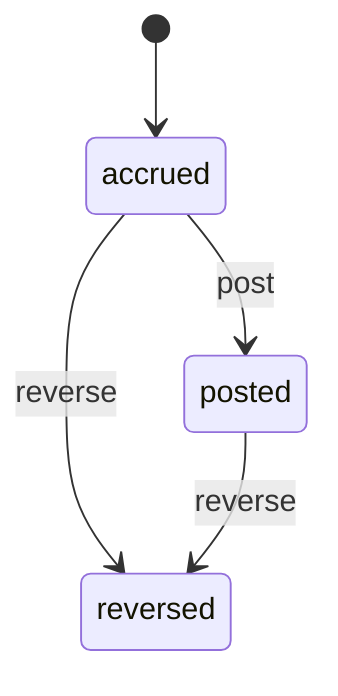

<!-- GENERATED by `npm run gen` from docs/api/modules/fulfillment-service.md. Do not edit: change the spec and regenerate. -->

# Fulfillment service (`fulfillment-service`)

Platform storage and shipping for sellers: seller enrollment under service terms, SKU enrollment, inbound shipments to our warehouse, receiving into seller-owned stock, picking and shipping by us while the seller stays the seller of record, returns handling, removal of stock, and storage and handling fees with full seller visibility.

- **Group:** Later phases · **Launch phase:** 4 · **Plan chapters:** 1, 12, 9, 14
- **Depends on:** [inventory](../inventory/README.md), [warehouse](../warehouse/README.md), [finance](../finance/README.md) · **Optional:** [sellers](../sellers/README.md), [offers](../offers/README.md), [orders](../orders/README.md), [shipping](../shipping/README.md), [returns](../returns/README.md), [media](../media/README.md), [access](../access/README.md), [notifications](../notifications/README.md), [reports](../reports/README.md), [audit](../audit/README.md), [workqueues](../workqueues/README.md)

## Owns
- Service enrollment: application, accepted service terms and fee schedule version, status, capacity allowance
- SKU enrollment: which offers are fulfilled by Marketly, with dimensions, weight, labelling and restricted-item checks
- Inbound shipments (seller → our warehouse): plan, boxes, carrier and tracking, arrival, receiving results, discrepancies and seller acknowledgement or claim
- Ownership tracking: every unit in our warehouse that belongs to a seller is recorded against that seller (stock owner), never mixed with company stock
- Fulfillment requests: orders for service offers routed to our warehouse; the seller remains the seller of record
- Returns handling for service offers: receipt, inspection outcome on seller-owned stock (sellable, unsellable, removal)
- Removal and disposal orders (sending stock back to the seller or disposing of it at the seller's request)
- Fee schedule and fee charges: receiving, storage (per volume per month, long-term surcharge), pick and pack per unit and order, returns processing, removal; posted to finance as separate lines
- Seller visibility: stock held by the company by group and fees charged

**Not here:**
- Stock quantities and reservations: inventory (with owner = seller and location = our warehouse)
- Physical receiving, picking, packing and labels: warehouse (works the tasks this module creates)
- Shipments and tracking to customers: shipping
- Return eligibility and refunds: returns and payments
- Seller ledger and statements: finance
- Seller accounts and restrictions: sellers

## Seller API

| Method | Path | Purpose | Auth | Body → Response |
|---|---|---|---|---|
| GET | `/api/seller/fulfillment-service/overview` | Enrollment, stock held by Marketly, open inbound shipments and fees | seller | `SellerServiceOverview` |
| POST | `/api/seller/fulfillment-service/enrollment` | Apply for storage and shipping by Marketly and accept the service terms _(audited)_ | seller `fulfillment-service.enrollment.manage` | `EnrollmentInput` → `Enrollment` |
| GET | `/api/seller/fulfillment-service/enrollment` | Own enrollment status, terms, capacity | seller | `Enrollment` |
| POST | `/api/seller/fulfillment-service/enrollment/offboard` | Stop using the service (stock must be removed) _(audited)_ | seller `fulfillment-service.enrollment.manage` | `{ reason: text, removal: enum(return_to_seller|dispose) }` → `Enrollment` |
| GET | `/api/seller/fulfillment-service/fee-schedule` | Current and upcoming fee schedule | seller | `{ current: FeeSchedule, upcoming: FeeSchedule? }` |
| GET | `/api/seller/fulfillment-service/skus` | Enrolled SKUs with stock held by Marketly by group | seller | Page<SkuEnrollment> |
| POST | `/api/seller/fulfillment-service/skus` | Enroll an offer for fulfillment by Marketly | seller `fulfillment-service.inbound.manage` | `SkuEnrollmentInput` → `SkuEnrollment` |
| POST | `/api/seller/fulfillment-service/skus/{id}/deactivate` | Stop using the service for a SKU | seller `fulfillment-service.inbound.manage` | `SkuEnrollment` |
| GET | `/api/seller/fulfillment-service/inbound` | Own inbound shipments | seller | Page<InboundShipment> |
| POST | `/api/seller/fulfillment-service/inbound` | Plan an inbound shipment to our warehouse | seller `fulfillment-service.inbound.manage` | `InboundInput` → `InboundShipment` |
| GET | `/api/seller/fulfillment-service/inbound/{id}` | Inbound shipment with labels, receiving results and discrepancies | seller | `InboundShipment` |
| PATCH | `/api/seller/fulfillment-service/inbound/{id}` | Edit a draft or add carrier and tracking | seller `fulfillment-service.inbound.manage` | `InboundInput` → `InboundShipment` |
| POST | `/api/seller/fulfillment-service/inbound/{id}/submit` | Submit and get box and unit labels | seller `fulfillment-service.inbound.manage` | `InboundShipment` |
| POST | `/api/seller/fulfillment-service/inbound/{id}/ship` | Mark as shipped with carrier and tracking | seller `fulfillment-service.inbound.manage` | `{ carrier: string, tracking: string, expectedArrival: date? }` → `InboundShipment` |
| POST | `/api/seller/fulfillment-service/inbound/{id}/cancel` | Cancel before it ships | seller `fulfillment-service.inbound.manage` | `{ reason: text? }` → `InboundShipment` |
| POST | `/api/seller/fulfillment-service/inbound/{id}/discrepancy-response` | Accept a receiving discrepancy or claim it with evidence | seller `fulfillment-service.inbound.manage` | `{ response: enum(accepted|claimed), note: text?, evidenceIds: uuid[]? }` → `InboundShipment` |
| GET | `/api/seller/fulfillment-service/returns` | Returns of service offers received at our warehouse with inspection outcome | seller | Page<ServiceReturn> |
| GET | `/api/seller/fulfillment-service/removals` | Removal and disposal orders | seller | Page<RemovalOrder> |
| POST | `/api/seller/fulfillment-service/removals` | Ask for stock back or to dispose of it _(idempotent, audited)_ | seller `fulfillment-service.inbound.manage` | `RemovalInput` → `RemovalOrder` |
| POST | `/api/seller/fulfillment-service/removals/{id}/cancel` | Cancel a removal that has not been approved | seller `fulfillment-service.inbound.manage` | `RemovalOrder` |
| GET | `/api/seller/fulfillment-service/fees` | Fees charged (storage, handling, receiving, returns, removal) | seller `fulfillment-service.fees.view` | Page<FeeCharge> |
| GET | `/api/seller/fulfillment-service/skus/{id}/movements` | Ownership ledger for one SKU (every unit movement with reason) | seller | Page<item> |

## Admin API

| Method | Path | Purpose | Auth | Body → Response |
|---|---|---|---|---|
| GET | `/api/admin/fulfillment-service/enrollments` | Seller enrollments | staff `fulfillment-service.enrollment.review` | Page<Enrollment> |
| POST | `/api/admin/fulfillment-service/enrollments/{id}/decide` | Approve with capacity, reject or request information _(audited)_ | staff `fulfillment-service.enrollment.review` | `{ decision: enum(approve|reject|request_info), reason: text, capacity: Capacity? }` → `Enrollment` |
| POST | `/api/admin/fulfillment-service/enrollments/{id}/status` | Suspend, reinstate, offboard or close an enrollment _(audited)_ | staff `fulfillment-service.enrollment.review` | `{ action: enum(suspend|reinstate|offboard|close), reason: text, affectedActivity: string?, appealRoute: string? }` → `Enrollment` |
| POST | `/api/admin/fulfillment-service/skus/{id}/review` | Approve or reject a SKU for the service _(audited)_ | staff `fulfillment-service.enrollment.review` | `{ approve: bool, reason: text?, sizeTier: enum(small|standard|large|oversize)? }` → `SkuEnrollment` |
| GET | `/api/admin/fulfillment-service/inbound` | Inbound shipments expected and arriving (receiving queue) | staff `fulfillment-service.inbound.receive` | Page<InboundShipment> |
| POST | `/api/admin/fulfillment-service/inbound/{id}/arrive` | Record arrival at the dock _(audited)_ | staff `fulfillment-service.inbound.receive` | `{ boxesArrived: int, note: text? }` → `InboundShipment` |
| POST | `/api/admin/fulfillment-service/inbound/{id}/receive` | Record received and damaged units (partial or complete) _(idempotent, audited)_ | staff `fulfillment-service.inbound.receive` | `ReceivingInput` → `InboundShipment` |
| POST | `/api/admin/fulfillment-service/inbound/{id}/discrepancy-decision` | Decide a claimed discrepancy (reimburse, adjust or reject) _(idempotent, audited)_ | staff `fulfillment-service.inbound.receive` | `{ decision: enum(adjust_stock|reimburse|reject), units: int?, amount: Money?, reason: text }` → `InboundShipment` |
| GET | `/api/admin/fulfillment-service/fulfillment-requests` | Orders for service offers and their warehouse progress | staff `fulfillment-service.operations.view` | Page<FulfillmentRequest> |
| POST | `/api/admin/fulfillment-service/returns/{id}/outcome` | Record the inspection outcome of a returned service unit _(audited)_ | staff `fulfillment-service.inbound.receive` | `{ outcome: enum(restocked|unsellable|removal|disposed), note: text, evidenceIds: uuid[]? }` → `ServiceReturn` |
| GET | `/api/admin/fulfillment-service/removals` | Removal and disposal orders | staff `fulfillment-service.operations.view` | Page<RemovalOrder> |
| POST | `/api/admin/fulfillment-service/removals/{id}/transition` | Approve, process, ship or complete a removal order _(audited)_ | staff `fulfillment-service.inbound.receive` | `{ action: enum(approve|startProcessing|ship|complete|cancel), tracking: string?, reason: text? }` → `RemovalOrder` |
| GET | `/api/admin/fulfillment-service/sellers/{sellerId}/stock` | Seller-owned stock held by the company, by SKU and group | staff `fulfillment-service.operations.view` | Page<SkuEnrollment> |
| GET | `/api/admin/fulfillment-service/stock-differences` | Differences between the ownership ledger and inventory found by the daily reconciliation | staff `fulfillment-service.operations.view` | Page<StockDifference> |
| POST | `/api/admin/fulfillment-service/stock-differences/{id}/resolve` | Resolve a stock difference: adjust the ledger, reimburse the seller or leave it _(idempotent, audited)_ | staff `fulfillment-service.inbound.receive` | `{ decision: enum(adjust_ledger|reimburse|no_change), amount: Money?, reason: text }` → `StockDifference` |
| GET | `/api/admin/fulfillment-service/fee-schedules` | Fee schedule versions | staff `fulfillment-service.fees.manage` | `FeeSchedule[]` |
| POST | `/api/admin/fulfillment-service/fee-schedules` | Propose a new fee schedule with an effective date _(audited)_ | staff `fulfillment-service.fees.manage` | `{ version: string, effectiveAt: datetime, rates: FeeRate[], reason: text }` → `FeeSchedule` |
| GET | `/api/admin/fulfillment-service/fees` | Fee charges across sellers | staff `fulfillment-service.fees.manage` | Page<FeeCharge> |
| POST | `/api/admin/fulfillment-service/fees/{id}/reverse` | Reverse a fee charge with a reason _(idempotent, audited)_ | staff `fulfillment-service.fees.manage` | `{ reason: text }` → `FeeCharge` |

## Types

### Enrollment

| Field | Type |
|---|---|
| id | `uuid` |
| sellerId | `uuid` |
| sellerName | `string` |
| state | `enum(applied|information_required|approved|active|suspended|offboarding|closed|rejected)` |
| termsVersion | `string` |
| feeScheduleVersion | `string` |
| acceptedAt | `datetime?` |
| acceptedBy | `Actor?` |
| capacity | `Capacity` |
| expectedSkus | `int` From the application; the approved allowance is capacity.maxSkus |
| expectedMonthlyUnits | `int` |
| categories | `uuid[]` Catalog categories the seller expects to store |
| contactNote | `text?` The applicant's note; reason holds only staff decision reasons |
| reason | `text?` |
| reviewer | `Actor?` |
| createdAt | `datetime` |
| decidedAt | `datetime?` |

### Capacity

| Field | Type |
|---|---|
| maxCubicFeet | `number` |
| usedCubicFeet | `number` |
| maxSkus | `int` |
| usedSkus | `int` |

### EnrollmentInput

| Field | Type |
|---|---|
| expectedSkus | `int` |
| expectedMonthlyUnits | `int` |
| categories | `uuid[]` |
| termsVersion | `string` |
| feeScheduleVersion | `string` |
| acceptTerms | `bool` |
| contactNote | `text?` |

### SkuEnrollment

| Field | Type |
|---|---|
| id | `uuid` |
| offerId | `uuid` |
| productId | `uuid` |
| title | `string` |
| sku | `string` |
| image | `MediaRef?` |
| dimensionsCm | `Dimensions` |
| weightGrams | `int` |
| sizeTier | `enum(small|standard|large|oversize)` |
| barcode | `string?` |
| labelRequired | `bool` |
| restricted | `bool` |
| restrictionReason | `string?` |
| hazmat | `bool` Declared by the seller at enrollment |
| notes | `text?` |
| state | `enum(pending|approved|rejected|active|inactive)` |
| stock | `OwnedStock?` |

### ServiceTerms

| Field | Type |
|---|---|
| offerId | `uuid` |
| sellerId | `uuid` |
| skuEnrollmentId | `uuid` |
| stockItemId | `uuid` |
| sellable | `bool` True while the enrollment is active and a shipping profile exists; false while it is suspended or offboarding (the offer is Ineligible, never seller-shipped, decision D5) |
| notSellableReason | `enum(enrollment_suspended|enrollment_offboarding|service_unavailable)?` |
| locationId | `uuid` The service location (getServiceLocation) |
| shipsFrom | `string` e.g. 'Reno, NV (Marketly warehouse)' |
| dispatch | `{"businessDays":"int","sameDayCutoff":"string?"}` |
| shippingProfileId | `uuid` Setting serviceShippingProfileId, else shipping.getOfficialDefaultProfile |
| parcel | `{"weightGrams":"int","dimensionsCm":"Dimensions"}` |

### StockDifference

| Field | Type |
|---|---|
| id | `uuid` |
| skuEnrollmentId | `uuid` |
| sku | `string` |
| sellerId | `uuid` |
| day | `date` |
| ledger | `json` Ownership ledger groups mapped to inventory groups: { incoming, available, reserved, damagedHeld, returned } |
| inventory | `json` inventory.getLevels at the service location: { incoming, available, reserved, damagedHeld, returned } |
| state | `enum(open|resolved)` |
| decision | `enum(adjust_ledger|reimburse|no_change)?` |
| reason | `text?` |
| amount | `Money?` |
| decidedBy | `Actor?` |
| decidedAt | `datetime?` |
| approval | `ApprovalInfo?` |

### ServiceReceipt

| Field | Type |
|---|---|
| id | `uuid` Also the receiptId given to inventory.submitServiceReceipt |
| seq | `int` 1, 2, … per inbound shipment (one per receiving record) |
| state | `enum(submitted|confirmed)` submitted: counted, waiting for the Inventory Manager (inventory confirmInbound); confirmed: units are sellable seller-owned stock |
| received | `int` |
| damaged | `int` |
| countedBy | `Actor` |
| countedAt | `datetime` |
| confirmedBy | `Actor?` |
| confirmedAt | `datetime?` |

### Dimensions

| Field | Type |
|---|---|
| length | `number` |
| width | `number` |
| height | `number` |

### SkuEnrollmentInput

| Field | Type |
|---|---|
| offerId | `uuid` |
| dimensionsCm | `Dimensions` |
| weightGrams | `int` |
| barcode | `string?` |
| hazmat | `bool` |
| notes | `text?` |

### OwnedStock

| Field | Type |
|---|---|
| available | `int` |
| reserved | `int` |
| inbound | `int` |
| receiving | `int` |
| unsellable | `int` |
| returned | `int` |
| removalPending | `int` |
| volumeCubicFeet | `number` |
| agedDays | `map<int>` Units by age bucket, e.g. 0-90, 91-180, 181-365, 365+ |

### InboundLineInput

| Field | Type |
|---|---|
| skuEnrollmentId | `uuid` |
| quantity | `int` |

### InboundInput

| Field | Type |
|---|---|
| shipFrom | `Address` |
| lines | `InboundLineInput[]` |
| boxes | `int` |
| carrier | `string?` |
| tracking | `string?` |
| expectedArrival | `date?` |

### InboundLine

| Field | Type |
|---|---|
| skuEnrollmentId | `uuid` |
| sku | `string` |
| title | `string` |
| expected | `int` |
| received | `int` |
| damaged | `int` |
| missing | `int` |
| extra | `int` |

### InboundShipment

| Field | Type |
|---|---|
| id | `uuid` |
| ref | `string` IB-YYMMDD-NNNN |
| sellerId | `uuid` |
| state | `enum(draft|submitted|in_transit|arrived|receiving|received|closed|cancelled)` |
| destination | `Address` |
| shipFrom | `Address` |
| boxes | `int` |
| carrier | `string?` |
| tracking | `string?` |
| expectedArrival | `date?` |
| arrivedAt | `datetime?` |
| receivedAt | `datetime?` |
| lines | `InboundLine[]` |
| receipts | `ServiceReceipt[]` Receiving records; units become available only when inventory confirms each one |
| discrepancy | `Discrepancy?` |
| labels | `MediaRef[]` Box and unit labels to print |
| fees | `FeeCharge[]` |
| timeline | `TimelineEvent[]` |

### Discrepancy

| Field | Type |
|---|---|
| summary | `string` |
| evidence | `MediaRef[]` |
| sellerResponse | `enum(pending|accepted|claimed)` |
| claimNote | `text?` |
| decision | `text?` |
| decidedBy | `Actor?` |

### ReceivingInput

| Field | Type |
|---|---|
| lines | `ReceivedLine[]` |
| evidenceIds | `uuid[]?` |
| note | `text?` |
| complete | `bool` |

### ReceivedLine

| Field | Type |
|---|---|
| skuEnrollmentId | `uuid` |
| received | `int` |
| damaged | `int` |

### ReceivedEventLine

| Field | Type |
|---|---|
| skuEnrollmentId | `uuid` |
| stockItemId | `uuid` |
| sku | `string` |
| label | `string` |
| received | `int` Units counted in this receiving record, damaged included |
| damaged | `int` |

### FulfillmentRequest

| Field | Type |
|---|---|
| id | `uuid` |
| orderId | `uuid` |
| orderRef | `string` |
| sellerGroupId | `uuid` |
| sellerId | `uuid` |
| state | `enum(open|picking|packed|shipped|cancelled|short)` |
| items | `json[]` orderItemId, offerId, sku, quantity, cancelled, picked, shipped (units dispatched so far; a request is shipped when every uncancelled unit has shipped, across several packages) |
| warehouseTaskId | `uuid?` |
| shipmentId | `uuid?` Latest shipment of the request |
| dispatchBy | `Deadline` |
| shortReportedAt | `datetime?` |
| createdAt | `datetime` |

### ServiceReturn

| Field | Type |
|---|---|
| id | `uuid` |
| returnId | `uuid` |
| returnRef | `string` |
| sellerId | `uuid` |
| skuEnrollmentId | `uuid` |
| orderItemId | `uuid` |
| quantity | `int` |
| outcome | `enum(pending|restocked|unsellable|removal|disposed)` |
| proposedOutcome | `string?` returns' proposedStockOutcome from returns.return.inspected; staff confirm the outcome with recordReturnOutcome (decision D8) |
| inspectionNote | `text?` |
| evidence | `MediaRef[]` |
| inspectedAt | `datetime?` |

### RemovalInput

| Field | Type |
|---|---|
| kind | `enum(return_to_seller|dispose)` |
| lines | `InboundLineInput[]` |
| fromGroup | `enum(available|unsellable)` |
| shipTo | `Address?` |
| reason | `text?` |

### RemovalOrder

| Field | Type |
|---|---|
| id | `uuid` |
| ref | `string` |
| sellerId | `uuid` |
| kind | `enum(return_to_seller|dispose)` |
| state | `enum(requested|approved|processing|shipped|completed|cancelled)` |
| lines | `InboundLine[]` |
| shipTo | `Address?` |
| tracking | `string?` |
| fee | `Money?` |
| reason | `text?` |
| createdAt | `datetime` |
| approvedAt | `datetime?` |
| completedAt | `datetime?` |

### FeeRate

| Field | Type |
|---|---|
| type | `enum(receiving_per_unit|storage_per_cubic_foot_month|long_term_storage_per_cubic_foot_month|pick_pack_per_unit|order_handling|returns_processing_per_unit|removal_per_unit|disposal_per_unit|label_per_unit)` |
| sizeTier | `enum(small|standard|large|oversize|any)` |
| rate | `Money` |
| note | `string?` |

### FeeSchedule

| Field | Type |
|---|---|
| id | `uuid` |
| version | `string` |
| effectiveAt | `datetime` |
| rates | `FeeRate[]` |
| state | `enum(draft|scheduled|current|superseded)` |
| isExample | `bool` |

### FeeCharge

| Field | Type |
|---|---|
| id | `uuid` |
| sellerId | `uuid` |
| type | `string` |
| period | `string?` |
| reference | `string?` Inbound, order, return or removal ref |
| units | `number` |
| rate | `Money` |
| amount | `Money` |
| state | `enum(accrued|posted|reversed)` |
| postedAt | `datetime?` |
| reason | `text?` |

### SellerServiceOverview

| Field | Type |
|---|---|
| enrollment | `Enrollment` |
| stockTotals | `OwnedStock` |
| openInbound | `InboundShipment[]` |
| feesThisMonth | `Money` |
| feesLastMonth | `Money` |
| alerts | `string[]` e.g. 12 units aged over 365 days will incur long-term storage on Nov 15 |

## Status flows

### Service enrollment (`Enrollment.state`)

activate happens when the first service receipt is confirmed by inventory (inventory.receipt.confirmed), not at the count. suspend stops new inbound shipments and new service-offer sales (offers become Ineligible with reason fulfillment_service_suspended, never seller-shipped; decision D5) but keeps fulfilling accepted orders and returns (plan ch. 10). offboarding also stops sales; it requires all stock to be removed or disposed before close; storage keeps accruing until then. Every suspend, reinstate, offboard and close publishes fulfillment-service.offer.service_changed for each active SKU.

### SKU enrollment (`SkuEnrollment.state`)

activate when a service receipt with sellable units is confirmed: inventory.setServiceLocation(stockItemId, service location) is applied first, then fulfillment-service.offer.service_changed (fulfilledBy marketly_service) is published and the offer shows 'Ships from Marketly'. deactivate when the seller stops using the service for the SKU (requires zero available units at the service location, else STOCK_REMAINING; reserved and other groups finish through orders, returns and removals): inventory.setServiceLocation(stockItemId, null), then service_changed with fulfilledBy seller, and the seller's own-location units sell again (decision D4).

### Inbound shipment (`InboundShipment.state`)

submit calls inventory.expectServiceInbound (Incoming at the service location); cancel calls inventory.cancelServiceInbound. Each receiving record (recordReceiving) is submitted as a service receipt (inventory.submitServiceReceipt); its units stay in the ledger's receiving group until the Inventory Manager confirms it (inventory confirmInbound → inventory.receipt.confirmed), then move to available (sellable) and unsellable (damaged) (decision D3). finishReceiving writes missing units and cancels the remaining Incoming. Discrepancies (short, damaged, extra) open a discrepancy the seller accepts or claims; close happens when it is resolved or after discrepancyResponseDays.

### Removal order (`RemovalOrder.state`)

Disposal completes without shipping. Units are reserved out of available when approved (inventory.moveServiceStock available → damaged_held, reason service_removal_reserved) and leave stock on complete (damaged_held → out, service_removal_completed). Return-to-seller removals are worked by staff with tracking typed in (advanceRemoval); a warehouse removal-pick task and bought labels are a later step (decision D9).

### Stock difference (`StockDifference.state`)

Opened by the reconcile job (one per SKU and day, with a fulfillment.reconciliation work item); resolved by staff with adjust_ledger (an adjusted ledger movement to match inventory), reimburse (a reimbursement accrued through the approval action fulfillment-service.reimbursements.approve; the difference stays open with approval set until access.approval.decided) or no_change. Decision D11: no automatic valuation.

### Service fee charge (`FeeCharge.state`)

Posted charges reach the seller statement as fulfillment-service lines separate from commission and ad charges. Reversal needs a reason; above the caller's limit it needs Finance approval.

## Data (schema `fulfillment_service`)

**enrollments**

| Column | Type |
|---|---|
| id | uuid pk |
| seller_id | uuid unique |
| state | text |
| terms_version | text |
| fee_schedule_version | text |
| accepted_at | timestamptz? |
| accepted_by | text? |
| max_cubic_feet | numeric(12,3) |
| max_skus | int (approved SKU allowance; never the applicant's expectedSkus) |
| expected_skus | int |
| expected_monthly_units | int |
| categories | jsonb |
| contact_note | text? |
| reason | text? (staff decision reasons only) |
| seller_suspension_id | uuid? (sellers suspension that suspended this enrollment; sellers.seller.reinstated with the same endedSuspensionId reinstates it) |
| reviewer_id | text? |
| created_at | timestamptz |
| decided_at | timestamptz? |

**sku_enrollments**

| Column | Type |
|---|---|
| id | uuid pk |
| seller_id | uuid |
| offer_id | uuid unique |
| product_id | uuid |
| sku | text |
| dimensions | jsonb |
| weight_grams | int |
| size_tier | text |
| barcode | text? |
| label_required | bool |
| restricted | bool |
| restriction_reason | text? |
| hazmat | bool |
| notes | text? |
| state | text |
| inventory_item_id | uuid? |

Indexes: `(seller_id, state)`

**inbound_shipments**

| Column | Type |
|---|---|
| id | uuid pk |
| ref | text unique |
| seller_id | uuid |
| state | text |
| ship_from | jsonb |
| destination | jsonb |
| boxes | int |
| carrier | text? |
| tracking | text? |
| expected_arrival | date? |
| arrived_at | timestamptz? |
| received_at | timestamptz? |
| created_at | timestamptz |

Indexes: `(seller_id, state)`, `(state, expected_arrival)`

**inbound_lines**

| Column | Type |
|---|---|
| inbound_id | uuid → inbound_shipments |
| sku_enrollment_id | uuid → sku_enrollments |
| expected | int |
| received | int |
| damaged | int |

Indexes: `(inbound_id)`

**inbound_receipts**: One row per receiving record of an inbound shipment, submitted to inventory as a service receipt and confirmed by the Inventory Manager

| Column | Type |
|---|---|
| id | uuid pk (= inventory receiptId) |
| inbound_id | uuid → inbound_shipments |
| seq | int |
| inventory_receipt_id | uuid? (inventory InboundReceipt.id) |
| lines | jsonb ({ skuEnrollmentId, stockItemId, received, damaged }[]) |
| state | text (submitted|confirmed) |
| counted_by | text |
| counted_at | timestamptz |
| confirmed_by | text? |
| confirmed_at | timestamptz? |

Indexes: `unique (inbound_id, seq)`, `(inventory_receipt_id)`

**discrepancies**

| Column | Type |
|---|---|
| id | uuid pk |
| inbound_id | uuid → inbound_shipments |
| summary | text |
| evidence_media_ids | jsonb |
| seller_response | text |
| claim_note | text? |
| decision | text? |
| decided_by | text? |
| decided_at | timestamptz? |

Indexes: `(inbound_id)`

**ownership_ledger**: Every movement of seller-owned units in our warehouse (received, reserved, shipped, returned, unsellable, removed, disposed, adjusted) with reason; reconciles with inventory

| Column | Type |
|---|---|
| id | uuid pk |
| seller_id | uuid |
| sku_enrollment_id | uuid → sku_enrollments |
| movement | text |
| quantity | int |
| from_group | text? |
| to_group | text? |
| reference | text? |
| actor_kind | text |
| actor_id | text? |
| reason | text? |
| at | timestamptz |

Indexes: `(seller_id, at)`, `(sku_enrollment_id, at)`

**fulfillment_requests**

| Column | Type |
|---|---|
| id | uuid pk |
| order_id | uuid |
| order_ref | text |
| seller_group_id | uuid unique |
| seller_id | uuid |
| state | text |
| items | jsonb (RequestItem[] with cancelled, picked and shipped per item) |
| warehouse_task_id | uuid? |
| shipment_id | uuid? |
| dispatch_by | timestamptz |
| short_reported_at | timestamptz? |
| created_at | timestamptz |

Indexes: `(seller_id, state)`, `(order_id)`

**service_returns**

| Column | Type |
|---|---|
| id | uuid pk |
| return_id | uuid |
| return_ref | text |
| order_item_id | uuid |
| seller_id | uuid |
| sku_enrollment_id | uuid |
| quantity | int |
| outcome | text |
| proposed_outcome | text? |
| inspection_note | text? |
| evidence_media_ids | jsonb |
| inspected_at | timestamptz? |

Indexes: `unique (return_id, order_item_id)`, `(seller_id, outcome)`

**removal_orders**

| Column | Type |
|---|---|
| id | uuid pk |
| ref | text unique |
| seller_id | uuid |
| kind | text |
| state | text |
| lines | jsonb |
| ship_to | jsonb? |
| tracking | text? |
| reason | text? |
| fee_amount | bigint? |
| created_at | timestamptz |
| approved_at | timestamptz? |
| completed_at | timestamptz? |

Indexes: `(seller_id, state)`

**stock_differences**: Daily reconciliation differences between the ownership ledger and inventory at the service location, per SKU

| Column | Type |
|---|---|
| id | uuid pk |
| seller_id | uuid |
| sku_enrollment_id | uuid → sku_enrollments |
| day | date |
| ledger | jsonb |
| inventory | jsonb |
| state | text (open|resolved) |
| decision | text? |
| reason | text? |
| amount | bigint? |
| approval_request_id | uuid? |
| decided_by | text? |
| decided_at | timestamptz? |

Indexes: `unique (sku_enrollment_id, day)`, `(state, day)`, `(seller_id, state)`

**fee_schedules**

| Column | Type |
|---|---|
| id | uuid pk |
| version | text unique |
| effective_at | timestamptz |
| rates | jsonb |
| state | text |
| approval_request_id | uuid? |

**fee_charges**

| Column | Type |
|---|---|
| id | uuid pk |
| seller_id | uuid |
| type | text |
| period | text? |
| reference | text? |
| units | numeric(14,3) |
| rate | bigint |
| amount | bigint |
| currency | text |
| state | text |
| posted_at | timestamptz? |
| ledger_entry_id | uuid? |
| reason | text? |
| idempotency_key | text unique |

Indexes: `(seller_id, state)`, `(type, period)`, `(seller_id, period)`, `(reference)`

**storage_snapshots**: Daily volume per seller and SKU for storage billing

| Column | Type |
|---|---|
| day | date |
| seller_id | uuid |
| sku_enrollment_id | uuid |
| units | int |
| cubic_feet | numeric(12,3) |
| aged_units | jsonb |

Indexes: `unique (day, sku_enrollment_id)`, `(seller_id, day)`

## Events

| Publishes | When | Payload | Consumed by |
|---|---|---|---|
| `fulfillment-service.enrollment.submitted` | A seller applies | `{ enrollmentId: uuid, sellerId: uuid }` | - |
| `fulfillment-service.enrollment.decided` | Approve, reject, request info, suspend, reinstate, offboard or close | `{ enrollmentId: uuid, sellerId: uuid, state: string, reason: text? }` | - |
| `fulfillment-service.inbound.submitted` | An inbound shipment is submitted (warehouse expects it) | `{ inboundId: uuid, sellerId: uuid, units: int, expectedArrival: date? }` | - |
| `fulfillment-service.inbound.received` | A receiving record is counted and submitted to inventory (warehouse creates put-away tasks from it). Counts are for this receiving record only, not cumulative | `{ inboundId: uuid, ref: string, receiptId: uuid, sellerId: uuid, locationId: uuid, received: int, damaged: int, complete: bool, lines: ReceivedEventLine[] }` | warehouse |
| `fulfillment-service.offer.service_changed` | An offer starts or stops being fulfilled by Marketly, or its service sellability changes: SKU activated or deactivated, enrollment suspended, reinstated, offboarded or closed. Published after inventory.setServiceLocation has been applied | `{ offerId: uuid, sellerId: uuid, skuEnrollmentId: uuid, stockItemId: uuid, fulfilledBy: enum(marketly_service|seller), sellable: bool, reason: enum(sku_activated|sku_deactivated|enrollment_suspended|enrollment_reinstated|enrollment_offboarding|enrollment_closed), at: datetime }` | offers |
| `fulfillment-service.return.inspected` | A returned service unit gets an outcome | `{ serviceReturnId: uuid, returnId: uuid, sellerId: uuid, outcome: string }` | - |
| `fulfillment-service.removal.completed` | A removal or disposal is completed | `{ removalId: uuid, sellerId: uuid, units: int }` | - |
| `fulfillment-service.fee.charged` | Fee charges are posted for seller statements | `{ chargeId: uuid, sellerId: uuid, type: string, amount: Money, reference: string?, period: string? }` | reports |
| `fulfillment-service.fee.reversed` | A fee charge is reversed | `{ chargeId: uuid, sellerId: uuid, amount: Money, reason: text, period: string? }` | reports |

| Consumes | From | Does |
|---|---|---|
| `orders.order.accepted` | orders | Create a fulfillment request for each group with fulfilledBy marketly_service (items = payload items filtered by the group's itemIds; ref and dispatchBy from the payload; no orders.getFulfillmentTask call) and reserve the units in the ownership ledger; notify the seller (seller.fulfillment.order_received). Declined payments never reach here, so no reservation leaks |
| `orders.order.cancelled` | orders | Safety net: cancel any open request of the order and release its ledger reservations |
| `orders.item.cancelled` | orders | Cancel or shorten open fulfillment requests and release seller-owned reservations |
| `orders.item.split` | orders | Split the request item so later cancel, dispatch and return events naming newItemId match it (as warehouse and inventory do) |
| `shipping.shipment.dispatched` | shipping | For a request's group (fulfilledBy marketly_service): move that shipment's lines reserved → shipped in the ledger (claimed per shipmentId); the request is shipped when every uncancelled unit has shipped. Accrue pick-and-pack per shipment (key pick_pack:<requestId>:<shipmentId>:<tier>) and order handling once per request |
| `warehouse.fulfillment.status_changed` | warehouse | Follow the warehouse task: request state picking, packed or short (with shortReportedAt and a fulfillment.requests work item); replaces reading warehouse progress on every list call |
| `returns.return.received` | returns | For returned items of a shipped request (payload items: orderItemId, stockItemId, quantity): create a service return (return_ref, order_item_id), move the units into inventory returned at the service location (inventory.moveServiceStock out → returned, reason service_return_received) and the ledger, and accrue the returns processing fee |
| `returns.return.inspected` | returns | Store returns' proposedStockOutcome on the service return as proposed_outcome; staff still record the outcome with recordReturnOutcome (decision D8) |
| `inventory.receipt.confirmed` | inventory | For source.kind service_inbound: per confirmed line move the ledger receiving → available (sellable) and receiving → unsellable (damaged), adding extra units from outside; mark the receipt confirmed; activate the SKU (first time: inventory.setServiceLocation, then fulfillment-service.offer.service_changed) and the enrollment if approved; notify the seller (seller.fulfillment.stock_available). Purchase-order receipts are ignored |
| `inventory.adjustment.recorded` | inventory | For serviceManaged movements (staff adjustments, counts and discrepancy resolutions at the service location): the ownership ledger follows with an adjusted movement carrying the inventory reason and movementId (claimed per movementId) |
| `inventory.stock.low` | inventory | For serviceManaged items: notify the seller to send more stock (seller.fulfillment.stock_low) |
| `sellers.seller.suspended` | sellers | Suspend the enrollment (remember the suspensionId) for new inbound and new service-offer sales; keep fulfilling accepted orders and returns |
| `sellers.seller.reinstated` | sellers | Reinstate an enrollment suspended by that suspension (endedSuspensionId = enrollments.seller_suspension_id); enrollments suspended by staff stay suspended |
| `sellers.seller.closed` | sellers | Start offboarding; ask the seller to remove stock |
| `access.approval.decided` | access | Apply approved fee schedules, reimbursements (discrepancies and stock differences) and fee reversals |

## In-process API (for other modules)

| Function | Signature | Used by |
|---|---|---|
| isServiceOffer | `(offerId: uuid) => bool` True when Marketly fulfils the offer, sellable or not: its SKU enrollment is active and the seller's enrollment is active, suspended or offboarding, and a service location exists (the same rule as getServiceTerms). Orders uses it to validate that a marketly_service group holds only service offers and a seller group none. | orders |
| getServiceTerms | `(offerIds: uuid[]) => map<ServiceTerms | null>` Customer-facing fulfilment terms of Marketly-fulfilled offers, keyed by offer id; null when the offer is not Marketly-fulfilled (see isServiceOffer). Reads settings once per call; the profile comes from serviceShippingProfileId or shipping.getOfficialDefaultProfile, the location from serviceLocationId or inventory.getDefaultLocation, the parcel from the SKU's dimensions and weight. Offers resolves Offer.shipping for marketly_service offers with one batched call. | offers |
| getServiceLocation | `() => { locationId: uuid, address: Address, shipsFrom: string } | null` The company warehouse that holds and ships seller stock (setting serviceLocationId, else inventory.getDefaultLocation); shipsFrom is its 'City, Region'. Null when no company location exists (then nothing is Marketly-fulfilled). Warehouse creates service fulfilments there and labels from its address; shipping quotes service packages from it. | warehouse, shipping |
| stockOwner | `(stockItemId: uuid) => { kind: 'company' | 'seller', sellerId?: uuid }` Owner of stock in our warehouse; reports and inventory use it to keep seller stock separate from company stock (plan ch. 9). | inventory, warehouse, reports |
| createFulfillmentRequest | `(orderId: uuid, sellerGroupId: uuid, items: { orderItemId: uuid, offerId: uuid, quantity: int }[]) => FulfillmentRequest` Kept for staff tooling and tests. Requests are created from orders.order.accepted (groups with fulfilledBy marketly_service); warehouse creates the pick work from the same event, so no module calls this. |  |
| exportRows | `(dataset: string, filters: json, principal: identity.Principal, cursor?: string) => { rows: json[], nextCursor?: string }` Rows of the datasets this module registers with reports.registerDataset at boot: fulfillment-service.seller.fees and fulfillment-service.seller.stock (seller audience, own rows only), fulfillment-service.admin.stock_by_owner (fulfillment-service.operations.view) and fulfillment-service.admin.fees (fulfillment-service.fees.manage). | reports |

## Permissions

| Key | Who | Allows |
|---|---|---|
| `fulfillment-service.enrollment.review` | staff | Decide enrollments, SKU approvals and enrollment status |
| `fulfillment-service.inbound.receive` | staff | Record arrivals, receiving, discrepancy decisions, return outcomes and removals |
| `fulfillment-service.operations.view` | staff | View fulfillment requests, removals and seller-owned stock |
| `fulfillment-service.fees.manage` | staff | Fee schedules and fee charges (reversals within limits) |
| `fulfillment-service.enrollment.manage` | seller | Apply, accept service terms and offboard |
| `fulfillment-service.inbound.manage` | seller | Enroll SKUs, plan inbound shipments, request removals |
| `fulfillment-service.fees.view` | seller | View service fees |

## Approval actions

Checked through the access module (limits per role, second reviewer).

| Action | Limit | Second reviewer | Approvers | Meaning |
|---|---|---|---|---|
| `fulfillment-service.reimbursements.approve` | money | above-limit | Warehouse Manager within the limit; Finance Manager above it (example values) | Reimburse a seller for an inbound discrepancy or lost unit |
| `fulfillment-service.fees.change` | none | always | Business Owner | Publish a new fulfillment fee schedule (with sellerNoticeDays notice) |
| `fulfillment-service.charges.reverse` | money | above-limit | Within the caller's adjustment limit; Finance Manager above it | Reverse a fulfillment fee charged to a seller |

## Error codes

| Code | Status | Meaning |
|---|---|---|
| `TERMS_NOT_ACCEPTED` | 422 | The service terms and fee schedule must be accepted. |
| `CAPACITY_EXCEEDED` | 409 | The seller's storage or SKU allowance would be exceeded. |
| `SKU_RESTRICTED` | 422 | The item can't be stored (hazardous, oversize beyond limits, restricted category). |
| `STOCK_REMAINING` | 409 | Seller-owned stock is still in our warehouse; remove or dispose of it first. |
| `INSUFFICIENT_STOCK` | 409 | Not enough units in the requested stock group. |

## Background jobs

| Job | Schedule | Does |
|---|---|---|
| `fulfillment-service.storage-snapshot` | daily 23:55 market time | Record units and volume per seller SKU with age buckets |
| `fulfillment-service.monthly-storage-fees` | monthly, 1st 03:00 market time | Accrue storage and long-term storage fees from the month's snapshots |
| `fulfillment-service.post-fees` | daily 02:30 market time | Post accrued fees to finance (fee.charged) |
| `fulfillment-service.inbound-overdue` | daily | Flag inbound shipments past expected arrival (work item kind receiving in fulfillment.receiving, dedupeKey fs_inbound_overdue:<inboundId>); close discrepancies without a seller response after discrepancyResponseDays |
| `fulfillment-service.aged-stock-notice` | weekly | Warn sellers about units approaching long-term storage (seller.fulfillment.stock_aged) |
| `fulfillment-service.reconcile` | daily | Compare the ownership ledger with inventory.getLevels at the service location per seller SKU (inbound + receiving ↔ incoming, available ↔ available, reserved ↔ reserved, unsellable + removal_pending ↔ damagedHeld, returned ↔ returned); write a stock_differences row and raise a fulfillment.reconciliation work item (kind manual_task, dedupeKey fs_stock_difference:<skuEnrollmentId>) per SKU that differs |

## Settings

| Key | Default | Rules | Meaning |
|---|---|---|---|
| longTermStorageDays | `365` | duration, days, 1–…, approval: second reviewer, seller-visible, 30 d notice | Age after which the long-term storage rate applies |
| discrepancyResponseDays | `14` | duration, days, 1–…, seller-visible | Time for the seller to accept or claim a receiving discrepancy |
| sellerNoticeDays | `30` | duration, days, 0–…, approval: business owner, seller-visible | Notice before a new fee schedule takes effect |
| serviceLocationId | `null` | string, approval: business owner, seller-visible, 30 d notice | inventory location id of the company warehouse that holds and ships seller stock; null = inventory's default location (decision D2). Its address is the inbound destination (decision D12) |
| serviceShippingProfileId | `null` | string, approval: second reviewer | Official Store shipping profile customers are quoted for Marketly-fulfilled packages; null = shipping.getOfficialDefaultProfile (decision D1) |
| serviceDispatchBusinessDays | `null` | int, business days, 0–10, approval: second reviewer | Dispatch promise of Marketly-fulfilled packages in business days; null = the service profile's handling days |
| serviceSameDayCutoff | `null` | time, approval: second reviewer | Same-day dispatch cutoff of Marketly-fulfilled packages; null = the service profile's cutoff |
| unsellableDisposalDays | `60` | duration, days, 30–…, approval: second reviewer, seller-visible | Unsellable units not removed by the seller are disposed after this (with notice) |

## Notes
- Phase 4 (plan ch. 1, 12, 20): introduced only when warehouse responsibilities and service terms are ready; the module is off until the owner enables it (with serviceLocationId and serviceShippingProfileId set, or relying on the defaults). The prototype has no dedicated screens, so screen ids point at the existing inventory, receiving, pick-pack and finance screens that will host these views.
- Owner decisions (all adopted). D1 outbound economics: customers see Marketly's rates (serviceShippingProfileId, else the Official Store default profile); the shipping charge stays in the seller's proceeds; the outbound label is billed to the seller (billedTo seller, already booked by finance); pick/pack and order handling follow the fee schedule. D2 service stock lives at the Official Store default warehouse (inventory.getDefaultLocation), or serviceLocationId for a later multi-warehouse rollout. D3 received units become sellable only after the Inventory Manager confirms the receipt in inventory's existing receipt confirmation queue. D4 while a SKU is active the item sells only from the Marketly location; the seller's own-location units are kept but not on sale and seller quantity edits are refused (inventory SERVICE_MANAGED); deactivating the SKU makes them sellable again. D5 a suspended or offboarding enrollment stops service offers selling (offers Ineligible, reason fulfillment_service_suspended), never switching them to seller shipping; accepted orders and returns continue. D6 cancellations and seller actions on service groups work like Official Store groups: instant until picking starts, then the Order Manager decides; the seller cannot prepare, delay, cancel, print slips, record shipments or answer cancellations (409 FULFILLED_BY_MARKETLY in orders and shipping). D7 returns of service items are platform handled from the request, auto-approved within the seller's return window, sent to returns.officialReturnAddress and inspected by Marketly; the refund is approved under policy and funded by the seller as seller of record; the seller sees them read-only. D8 recordReturnOutcome here is the single stock decision for a returned service unit; inventory stays out of seller returns. D9 removal orders are worked by staff through advanceRemoval with tracking typed in; a warehouse removal-pick task is a follow-up. D10 the seller sees only the city and region of a service order's address. D11 units lost or damaged in Marketly's custody are reimbursed by a staff decision per difference (resolveStockDifference, approval action fulfillment-service.reimbursements.approve); no automatic valuation. D12 the warehouseAddress setting is removed; the inbound destination is the service location's address (settings drops the stored key in a migration).
- Flow end to end: the seller applies and is approved with capacity → enrolls an offer, staff approve the SKU → plans and submits an inbound (inventory.expectServiceInbound) → ships → staff record arrival and receiving (inventory.submitServiceReceipt; fulfillment-service.inbound.received; warehouse puts the units away) → the Inventory Manager confirms (inventory.receipt.confirmed) → ledger available, SKU and enrollment active, inventory.setServiceLocation, fulfillment-service.offer.service_changed → offers shows 'Ships from Marketly' with the service terms (getServiceTerms) → checkout makes a separate marketly_service package quoted with the service profile and Official closures → orders.order.accepted: warehouse creates the fulfilment at the service location (getServiceLocation) and this module the request → pick, pack, label billed to the seller, hand-over → shipping.shipment.dispatched: request shipped, pick/pack and order handling fees → returns come back platform handled to the Marketly dock → service return, staff record the outcome → fees post daily to finance as service_fee lines; reconcile compares the ledger with inventory daily.
- Inventory calls (decision D3, D4): submit → expectServiceInbound({ inboundId, ref, locationId, lines }); cancel → cancelServiceInbound(inboundId); each receiving record → submitServiceReceipt({ receiptId = ServiceReceipt.id, … }) plus an inbound_receipts row; found units → moveServiceStock out → available (service_found); removal approve → available → damaged_held (service_removal_reserved); removal complete → damaged_held → out (service_removal_completed); return received → out → returned (service_return_received); return outcome → returned → available (service_return_restocked), damaged_held (service_return_unsellable) or out (service_return_disposed); staff reconcile corrections → service_reconcile. Idempotency keys fs:<what>:<id>[:<skuEnrollmentId>] (e.g. fs:return-received:<serviceReturnId>). The old read-then-set of seller quantities through applyBulkQuantities on the seller's own location is gone.
- Ledger movement values are unchanged (received, released, shipped, returned, restocked, adjusted, …); inventory movements carry the reason codes above as is.
- Notifications: this module calls notifications.notify for every topic below (notifications declares the topics and templates; seller preference group fulfillment_service, permission fulfillment-service.inbound.manage): seller.fulfillment.enrollment_decided (dedupe fs:enrollment:<id>:<state>; enrollment.state, reason), seller.fulfillment.sku_reviewed (fs:sku:<id>:review; sku, approved, reason), seller.fulfillment.inbound_received (fs:inbound:<id>:received; inbound.ref, received, damaged, discrepancy), seller.fulfillment.stock_available (fs:receipt:<receiptId>:confirmed; inbound.ref, units), seller.fulfillment.discrepancy_decided (fs:discrepancy:<inboundId>; inbound.ref, decision), seller.fulfillment.order_received (fs:order:<groupId>; order.ref, items), seller.fulfillment.return_inspected (fs:return:<serviceReturnId>; return.ref, outcome), seller.fulfillment.removal_completed (fs:removal:<id>; removal.ref, units), seller.fulfillment.stock_low (fs:low:<skuEnrollmentId>:<day>; stock.label, available), seller.fulfillment.stock_aged (fs:aged:<sellerId>:<week>; units, effective), seller.fulfillment.disposal_scheduled (fs:dispose:<removalId>; units, days, removal.ref), seller.fulfillment.fee_schedule_changed (fs:schedule:<id>; version, effective), seller.fulfillment.offboarding (fs:offboarding:<enrollmentId>; removal.refs); staff.fulfillment.enrollment_submitted (role seller_manager; fs:enrollment:<id>:submitted), staff.fulfillment.inbound_submitted (role warehouse_manager; fs:inbound:<id>:submitted), staff.fulfillment.discrepancy_claimed (role warehouse_manager; fs:inbound:<id>:claimed). Low stock no longer reuses seller.stock.low, and aged stock, disposal and fee schedules no longer reuse seller.platform.change_scheduled.
- Work items (workqueues.raise, resolved with resolveBySource; queues seeded by workqueues): fulfillment.receiving (warehouse_manager, ops/receiving, kind receiving; dedupe fs_inbound_overdue:<inboundId> and fs_discrepancy:<inboundId>), fulfillment.reconciliation (inventory_manager, ops/inventory, kind manual_task; fs_stock_difference:<skuEnrollmentId>), fulfillment.requests (warehouse_manager, ops/pick-pack, kind pick_pack; fs_request_short:<requestId>), fulfillment.enrollments (seller_manager, admin/sellers, kind application_waiting; fs_enrollment:<id> and fs_sku:<id>, resolved on decision).
- Audit: every audited endpoint writes an audit entry through the optional audit module (ctx.tryUse('audit')).
- Exports (reports.registerDataset at boot when reports is on; rows from exportRows): fulfillment-service.seller.fees, fulfillment-service.seller.stock, fulfillment-service.admin.stock_by_owner, fulfillment-service.admin.fees.
- Finance credits: postAll reads a pending reimbursement with finance.getSellerCredit({ idempotencyKey }) instead of calling creditSeller again; reversing an accrued reimbursement whose credit is pending calls finance.withdrawSellerCredit.
- Selling and shipping are separate: the seller stays the named seller of record on the offer, order and invoice; offers only add 'Ships from Marketly'.
- Ownership: inventory holds the quantities with owner = seller at the service location (stock_items.service_location_id); this module keeps the ownership ledger and reconciles daily. Seller stock is never pooled with company stock and reports identify the stock owner and the charges (plan ch. 9).
- Fees are seller charges separate from commission and ad charges; finance shows them as their own statement lines. Fee schedules are versioned with effective dates and seller notice.
- Physical work (receiving, pick, pack, returns inspection) is done by warehouse tasks; this module creates and tracks them and records outcomes that concern ownership and fees.
