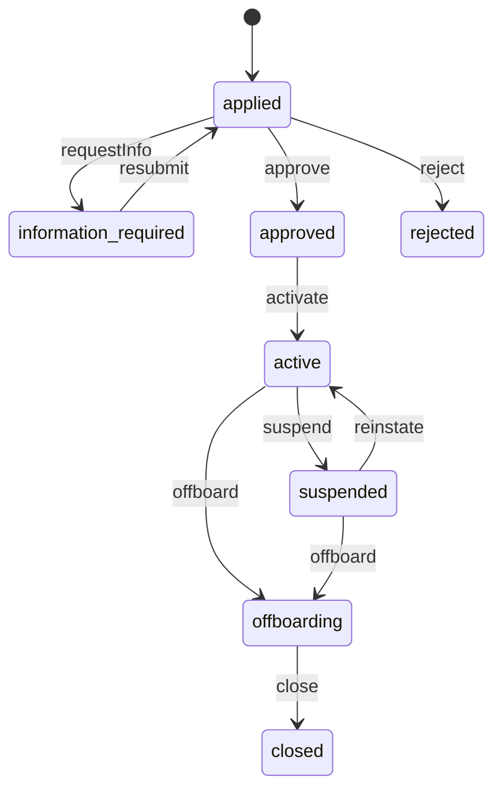
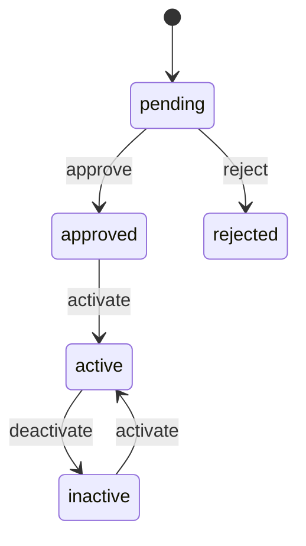
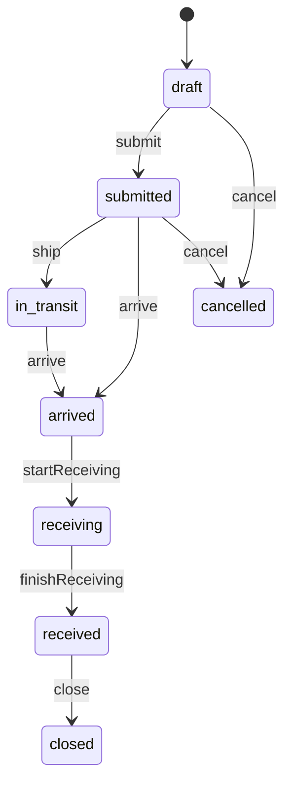
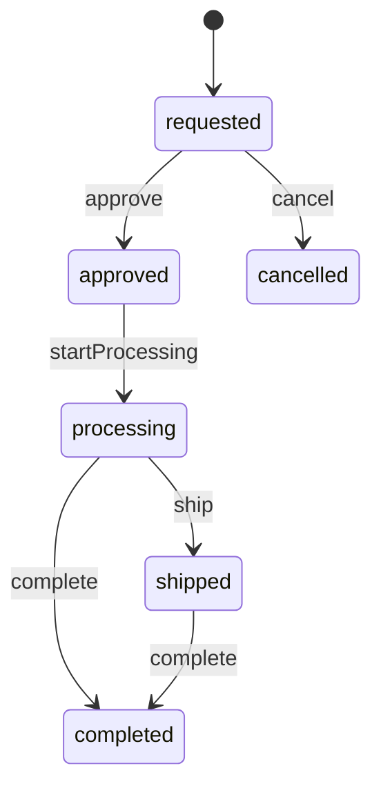
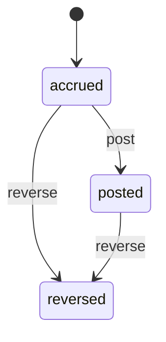

<!-- GENERATED by `npm run gen` from docs/api/modules/fulfillment-service.md. Do not edit: change the spec and regenerate. -->

# Fulfillment service (`fulfillment-service`)

Platform storage and shipping for sellers: seller enrollment under service terms, SKU enrollment, inbound shipments to our warehouse, receiving into seller-owned stock, picking and shipping by us while the seller stays the seller of record, returns handling, removal of stock, and storage and handling fees with full seller visibility.

- **Group:** Later phases · **Launch phase:** 4 · **Plan chapters:** 1, 12, 9, 14
- **Depends on:** [inventory](../inventory/README.md), [warehouse](../warehouse/README.md), [finance](../finance/README.md) · **Optional:** [sellers](../sellers/README.md), [offers](../offers/README.md), [orders](../orders/README.md), [shipping](../shipping/README.md), [returns](../returns/README.md), [media](../media/README.md), [access](../access/README.md), [notifications](../notifications/README.md), [reports](../reports/README.md)

## Owns
- Service enrollment: application, accepted service terms and fee schedule version, status, capacity allowance
- SKU enrollment: which offers are fulfilled by Marketly, with dimensions, weight, labelling and restricted-item checks
- Inbound shipments (seller → our warehouse): plan, boxes, carrier and tracking, arrival, receiving results, discrepancies and seller acknowledgement or claim
- Ownership tracking: every unit in our warehouse that belongs to a seller is recorded against that seller (stock owner), never mixed with company stock
- Fulfillment requests: orders for service offers routed to our warehouse; the seller remains the seller of record
- Returns handling for service offers: receipt, inspection outcome on seller-owned stock (sellable, unsellable, removal)
- Removal and disposal orders (sending stock back to the seller or disposing of it at the seller's request)
- Fee schedule and fee charges: receiving, storage (per volume per month, long-term surcharge), pick and pack per unit and order, returns processing, removal; posted to finance as separate lines
- Seller visibility: stock held by the company by group and fees charged

**Not here:**
- Stock quantities and reservations: inventory (with owner = seller and location = our warehouse)
- Physical receiving, picking, packing and labels: warehouse (works the tasks this module creates)
- Shipments and tracking to customers: shipping
- Return eligibility and refunds: returns and payments
- Seller ledger and statements: finance
- Seller accounts and restrictions: sellers

## Seller API

| Method | Path | Purpose | Auth | Body → Response |
|---|---|---|---|---|
| GET | `/api/seller/fulfillment-service/overview` | Enrollment, stock held by Marketly, open inbound shipments and fees | seller | `SellerServiceOverview` |
| POST | `/api/seller/fulfillment-service/enrollment` | Apply for storage and shipping by Marketly and accept the service terms _(audited)_ | seller `fulfillment-service.enrollment.manage` | `EnrollmentInput` → `Enrollment` |
| GET | `/api/seller/fulfillment-service/enrollment` | Own enrollment status, terms, capacity | seller | `Enrollment` |
| POST | `/api/seller/fulfillment-service/enrollment/offboard` | Stop using the service (stock must be removed) _(audited)_ | seller `fulfillment-service.enrollment.manage` | `{ reason: text, removal: enum(return_to_seller|dispose) }` → `Enrollment` |
| GET | `/api/seller/fulfillment-service/fee-schedule` | Current and upcoming fee schedule | seller | `{ current: FeeSchedule, upcoming: FeeSchedule? }` |
| GET | `/api/seller/fulfillment-service/skus` | Enrolled SKUs with stock held by Marketly by group | seller | Page<SkuEnrollment> |
| POST | `/api/seller/fulfillment-service/skus` | Enroll an offer for fulfillment by Marketly | seller `fulfillment-service.inbound.manage` | `SkuEnrollmentInput` → `SkuEnrollment` |
| POST | `/api/seller/fulfillment-service/skus/{id}/deactivate` | Stop using the service for a SKU | seller `fulfillment-service.inbound.manage` | `SkuEnrollment` |
| GET | `/api/seller/fulfillment-service/inbound` | Own inbound shipments | seller | Page<InboundShipment> |
| POST | `/api/seller/fulfillment-service/inbound` | Plan an inbound shipment to our warehouse | seller `fulfillment-service.inbound.manage` | `InboundInput` → `InboundShipment` |
| GET | `/api/seller/fulfillment-service/inbound/{id}` | Inbound shipment with labels, receiving results and discrepancies | seller | `InboundShipment` |
| PATCH | `/api/seller/fulfillment-service/inbound/{id}` | Edit a draft or add carrier and tracking | seller `fulfillment-service.inbound.manage` | `InboundInput` → `InboundShipment` |
| POST | `/api/seller/fulfillment-service/inbound/{id}/submit` | Submit and get box and unit labels | seller `fulfillment-service.inbound.manage` | `InboundShipment` |
| POST | `/api/seller/fulfillment-service/inbound/{id}/ship` | Mark as shipped with carrier and tracking | seller `fulfillment-service.inbound.manage` | `{ carrier: string, tracking: string, expectedArrival: date? }` → `InboundShipment` |
| POST | `/api/seller/fulfillment-service/inbound/{id}/cancel` | Cancel before it ships | seller `fulfillment-service.inbound.manage` | `{ reason: text? }` → `InboundShipment` |
| POST | `/api/seller/fulfillment-service/inbound/{id}/discrepancy-response` | Accept a receiving discrepancy or claim it with evidence | seller `fulfillment-service.inbound.manage` | `{ response: enum(accepted|claimed), note: text?, evidenceIds: uuid[]? }` → `InboundShipment` |
| GET | `/api/seller/fulfillment-service/returns` | Returns of service offers received at our warehouse with inspection outcome | seller | Page<ServiceReturn> |
| GET | `/api/seller/fulfillment-service/removals` | Removal and disposal orders | seller | Page<RemovalOrder> |
| POST | `/api/seller/fulfillment-service/removals` | Ask for stock back or to dispose of it _(idempotent, audited)_ | seller `fulfillment-service.inbound.manage` | `RemovalInput` → `RemovalOrder` |
| POST | `/api/seller/fulfillment-service/removals/{id}/cancel` | Cancel a removal that has not been approved | seller `fulfillment-service.inbound.manage` | `RemovalOrder` |
| GET | `/api/seller/fulfillment-service/fees` | Fees charged (storage, handling, receiving, returns, removal) | seller `fulfillment-service.fees.view` | Page<FeeCharge> |
| GET | `/api/seller/fulfillment-service/skus/{id}/movements` | Ownership ledger for one SKU (every unit movement with reason) | seller | Page<item> |

## Admin API

| Method | Path | Purpose | Auth | Body → Response |
|---|---|---|---|---|
| GET | `/api/admin/fulfillment-service/enrollments` | Seller enrollments | staff `fulfillment-service.enrollment.review` | Page<Enrollment> |
| POST | `/api/admin/fulfillment-service/enrollments/{id}/decide` | Approve with capacity, reject or request information _(audited)_ | staff `fulfillment-service.enrollment.review` | `{ decision: enum(approve|reject|request_info), reason: text, capacity: Capacity? }` → `Enrollment` |
| POST | `/api/admin/fulfillment-service/enrollments/{id}/status` | Suspend, reinstate, offboard or close an enrollment _(audited)_ | staff `fulfillment-service.enrollment.review` | `{ action: enum(suspend|reinstate|offboard|close), reason: text, affectedActivity: string?, appealRoute: string? }` → `Enrollment` |
| POST | `/api/admin/fulfillment-service/skus/{id}/review` | Approve or reject a SKU for the service _(audited)_ | staff `fulfillment-service.enrollment.review` | `{ approve: bool, reason: text?, sizeTier: enum(small|standard|large|oversize)? }` → `SkuEnrollment` |
| GET | `/api/admin/fulfillment-service/inbound` | Inbound shipments expected and arriving (receiving queue) | staff `fulfillment-service.inbound.receive` | Page<InboundShipment> |
| POST | `/api/admin/fulfillment-service/inbound/{id}/arrive` | Record arrival at the dock _(audited)_ | staff `fulfillment-service.inbound.receive` | `{ boxesArrived: int, note: text? }` → `InboundShipment` |
| POST | `/api/admin/fulfillment-service/inbound/{id}/receive` | Record received and damaged units (partial or complete) _(idempotent, audited)_ | staff `fulfillment-service.inbound.receive` | `ReceivingInput` → `InboundShipment` |
| POST | `/api/admin/fulfillment-service/inbound/{id}/discrepancy-decision` | Decide a claimed discrepancy (reimburse, adjust or reject) _(idempotent, audited)_ | staff `fulfillment-service.inbound.receive` | `{ decision: enum(adjust_stock|reimburse|reject), units: int?, amount: Money?, reason: text }` → `InboundShipment` |
| GET | `/api/admin/fulfillment-service/fulfillment-requests` | Orders for service offers and their warehouse progress | staff `fulfillment-service.operations.view` | Page<FulfillmentRequest> |
| POST | `/api/admin/fulfillment-service/returns/{id}/outcome` | Record the inspection outcome of a returned service unit _(audited)_ | staff `fulfillment-service.inbound.receive` | `{ outcome: enum(restocked|unsellable|removal|disposed), note: text, evidenceIds: uuid[]? }` → `ServiceReturn` |
| GET | `/api/admin/fulfillment-service/removals` | Removal and disposal orders | staff `fulfillment-service.operations.view` | Page<RemovalOrder> |
| POST | `/api/admin/fulfillment-service/removals/{id}/transition` | Approve, process, ship or complete a removal order _(audited)_ | staff `fulfillment-service.inbound.receive` | `{ action: enum(approve|startProcessing|ship|complete|cancel), tracking: string?, reason: text? }` → `RemovalOrder` |
| GET | `/api/admin/fulfillment-service/sellers/{sellerId}/stock` | Seller-owned stock held by the company, by SKU and group | staff `fulfillment-service.operations.view` | Page<SkuEnrollment> |
| GET | `/api/admin/fulfillment-service/fee-schedules` | Fee schedule versions | staff `fulfillment-service.fees.manage` | `FeeSchedule[]` |
| POST | `/api/admin/fulfillment-service/fee-schedules` | Propose a new fee schedule with an effective date _(audited)_ | staff `fulfillment-service.fees.manage` | `{ version: string, effectiveAt: datetime, rates: FeeRate[], reason: text }` → `FeeSchedule` |
| GET | `/api/admin/fulfillment-service/fees` | Fee charges across sellers | staff `fulfillment-service.fees.manage` | Page<FeeCharge> |
| POST | `/api/admin/fulfillment-service/fees/{id}/reverse` | Reverse a fee charge with a reason _(idempotent, audited)_ | staff `fulfillment-service.fees.manage` | `{ reason: text }` → `FeeCharge` |

## Types

### Enrollment

| Field | Type |
|---|---|
| id | `uuid` |
| sellerId | `uuid` |
| sellerName | `string` |
| state | `enum(applied|information_required|approved|active|suspended|offboarding|closed|rejected)` |
| termsVersion | `string` |
| feeScheduleVersion | `string` |
| acceptedAt | `datetime?` |
| acceptedBy | `Actor?` |
| capacity | `Capacity` |
| reason | `text?` |
| reviewer | `Actor?` |
| createdAt | `datetime` |
| decidedAt | `datetime?` |

### Capacity

| Field | Type |
|---|---|
| maxCubicFeet | `number` |
| usedCubicFeet | `number` |
| maxSkus | `int` |
| usedSkus | `int` |

### EnrollmentInput

| Field | Type |
|---|---|
| expectedSkus | `int` |
| expectedMonthlyUnits | `int` |
| categories | `uuid[]` |
| termsVersion | `string` |
| feeScheduleVersion | `string` |
| acceptTerms | `bool` |
| contactNote | `text?` |

### SkuEnrollment

| Field | Type |
|---|---|
| id | `uuid` |
| offerId | `uuid` |
| productId | `uuid` |
| title | `string` |
| sku | `string` |
| image | `MediaRef?` |
| dimensionsCm | `Dimensions` |
| weightGrams | `int` |
| sizeTier | `enum(small|standard|large|oversize)` |
| barcode | `string?` |
| labelRequired | `bool` |
| restricted | `bool` |
| restrictionReason | `string?` |
| state | `enum(pending|approved|rejected|active|inactive)` |
| stock | `OwnedStock?` |

### Dimensions

| Field | Type |
|---|---|
| length | `number` |
| width | `number` |
| height | `number` |

### SkuEnrollmentInput

| Field | Type |
|---|---|
| offerId | `uuid` |
| dimensionsCm | `Dimensions` |
| weightGrams | `int` |
| barcode | `string?` |
| hazmat | `bool` |
| notes | `text?` |

### OwnedStock

| Field | Type |
|---|---|
| available | `int` |
| reserved | `int` |
| inbound | `int` |
| receiving | `int` |
| unsellable | `int` |
| returned | `int` |
| removalPending | `int` |
| volumeCubicFeet | `number` |
| agedDays | `map<int>` Units by age bucket, e.g. 0-90, 91-180, 181-365, 365+ |

### InboundLineInput

| Field | Type |
|---|---|
| skuEnrollmentId | `uuid` |
| quantity | `int` |

### InboundInput

| Field | Type |
|---|---|
| shipFrom | `Address` |
| lines | `InboundLineInput[]` |
| boxes | `int` |
| carrier | `string?` |
| tracking | `string?` |
| expectedArrival | `date?` |

### InboundLine

| Field | Type |
|---|---|
| skuEnrollmentId | `uuid` |
| sku | `string` |
| title | `string` |
| expected | `int` |
| received | `int` |
| damaged | `int` |
| missing | `int` |
| extra | `int` |

### InboundShipment

| Field | Type |
|---|---|
| id | `uuid` |
| ref | `string` IB-YYMMDD-NNNN |
| sellerId | `uuid` |
| state | `enum(draft|submitted|in_transit|arrived|receiving|received|closed|cancelled)` |
| destination | `Address` |
| shipFrom | `Address` |
| boxes | `int` |
| carrier | `string?` |
| tracking | `string?` |
| expectedArrival | `date?` |
| arrivedAt | `datetime?` |
| receivedAt | `datetime?` |
| lines | `InboundLine[]` |
| discrepancy | `Discrepancy?` |
| labels | `MediaRef[]` Box and unit labels to print |
| fees | `FeeCharge[]` |
| timeline | `TimelineEvent[]` |

### Discrepancy

| Field | Type |
|---|---|
| summary | `string` |
| evidence | `MediaRef[]` |
| sellerResponse | `enum(pending|accepted|claimed)` |
| claimNote | `text?` |
| decision | `text?` |
| decidedBy | `Actor?` |

### ReceivingInput

| Field | Type |
|---|---|
| lines | `ReceivedLine[]` |
| evidenceIds | `uuid[]?` |
| note | `text?` |
| complete | `bool` |

### ReceivedLine

| Field | Type |
|---|---|
| skuEnrollmentId | `uuid` |
| received | `int` |
| damaged | `int` |

### FulfillmentRequest

| Field | Type |
|---|---|
| id | `uuid` |
| orderId | `uuid` |
| orderRef | `string` |
| sellerGroupId | `uuid` |
| sellerId | `uuid` |
| state | `enum(open|picking|packed|shipped|cancelled|short)` |
| items | `json[]` orderItemId, offerId, sku, quantity, picked |
| warehouseTaskId | `uuid?` |
| shipmentId | `uuid?` |
| dispatchBy | `Deadline` |
| createdAt | `datetime` |

### ServiceReturn

| Field | Type |
|---|---|
| id | `uuid` |
| returnId | `uuid` |
| returnRef | `string` |
| sellerId | `uuid` |
| skuEnrollmentId | `uuid` |
| quantity | `int` |
| outcome | `enum(pending|restocked|unsellable|removal|disposed)` |
| inspectionNote | `text?` |
| evidence | `MediaRef[]` |
| inspectedAt | `datetime?` |

### RemovalInput

| Field | Type |
|---|---|
| kind | `enum(return_to_seller|dispose)` |
| lines | `InboundLineInput[]` |
| fromGroup | `enum(available|unsellable)` |
| shipTo | `Address?` |
| reason | `text?` |

### RemovalOrder

| Field | Type |
|---|---|
| id | `uuid` |
| ref | `string` |
| sellerId | `uuid` |
| kind | `enum(return_to_seller|dispose)` |
| state | `enum(requested|approved|processing|shipped|completed|cancelled)` |
| lines | `InboundLine[]` |
| shipTo | `Address?` |
| tracking | `string?` |
| fee | `Money?` |
| createdAt | `datetime` |

### FeeRate

| Field | Type |
|---|---|
| type | `enum(receiving_per_unit|storage_per_cubic_foot_month|long_term_storage_per_cubic_foot_month|pick_pack_per_unit|order_handling|returns_processing_per_unit|removal_per_unit|disposal_per_unit|label_per_unit)` |
| sizeTier | `enum(small|standard|large|oversize|any)` |
| rate | `Money` |
| note | `string?` |

### FeeSchedule

| Field | Type |
|---|---|
| id | `uuid` |
| version | `string` |
| effectiveAt | `datetime` |
| rates | `FeeRate[]` |
| state | `enum(draft|scheduled|current|superseded)` |
| isExample | `bool` |

### FeeCharge

| Field | Type |
|---|---|
| id | `uuid` |
| sellerId | `uuid` |
| type | `string` |
| period | `string?` |
| reference | `string?` Inbound, order, return or removal ref |
| units | `number` |
| rate | `Money` |
| amount | `Money` |
| state | `enum(accrued|posted|reversed)` |
| postedAt | `datetime?` |
| reason | `text?` |

### SellerServiceOverview

| Field | Type |
|---|---|
| enrollment | `Enrollment` |
| stockTotals | `OwnedStock` |
| openInbound | `InboundShipment[]` |
| feesThisMonth | `Money` |
| feesLastMonth | `Money` |
| alerts | `string[]` e.g. 12 units aged over 365 days will incur long-term storage on Nov 15 |

## Status flows

### Service enrollment (`Enrollment.state`)

activate happens when the first inbound shipment is received. suspend stops new inbound shipments and new service-offer sales but keeps fulfilling accepted orders and returns (plan ch. 10). offboarding requires all stock to be removed or disposed before close; storage keeps accruing until then.

### SKU enrollment (`SkuEnrollment.state`)

activate when stock is received; the offer then shows 'Ships from Marketly'. deactivate when the seller stops using the service for the SKU (requires zero available stock or a removal order).

### Inbound shipment (`InboundShipment.state`)

Received units become available seller-owned stock only after inspection (Inventory Manager confirms). Discrepancies (short, damaged, extra) open a discrepancy the seller accepts or claims; close happens when it is resolved or after discrepancyResponseDays.

### Removal order (`RemovalOrder.state`)

Disposal completes without shipping. Units are reserved out of available when approved.

### Service fee charge (`FeeCharge.state`)

Posted charges reach the seller statement as fulfillment-service lines separate from commission and ad charges. Reversal needs a reason; above the caller's limit it needs Finance approval.

## Data (schema `fulfillment_service`)

**enrollments**

| Column | Type |
|---|---|
| id | uuid pk |
| seller_id | uuid unique |
| state | text |
| terms_version | text |
| fee_schedule_version | text |
| accepted_at | timestamptz? |
| accepted_by | text? |
| max_cubic_feet | numeric |
| max_skus | int |
| reason | text? |
| reviewer_id | text? |
| created_at | timestamptz |
| decided_at | timestamptz? |

**sku_enrollments**

| Column | Type |
|---|---|
| id | uuid pk |
| seller_id | uuid |
| offer_id | uuid unique |
| product_id | uuid |
| sku | text |
| dimensions | jsonb |
| weight_grams | int |
| size_tier | text |
| barcode | text? |
| label_required | bool |
| restricted | bool |
| restriction_reason | text? |
| state | text |
| inventory_item_id | uuid? |

Indexes: `(seller_id, state)`

**inbound_shipments**

| Column | Type |
|---|---|
| id | uuid pk |
| ref | text unique |
| seller_id | uuid |
| state | text |
| ship_from | jsonb |
| destination | jsonb |
| boxes | int |
| carrier | text? |
| tracking | text? |
| expected_arrival | date? |
| arrived_at | timestamptz? |
| received_at | timestamptz? |
| warehouse_receipt_id | uuid? |
| created_at | timestamptz |

Indexes: `(seller_id, state)`, `(state, expected_arrival)`

**inbound_lines**

| Column | Type |
|---|---|
| inbound_id | uuid → inbound_shipments |
| sku_enrollment_id | uuid → sku_enrollments |
| expected | int |
| received | int |
| damaged | int |

**discrepancies**

| Column | Type |
|---|---|
| id | uuid pk |
| inbound_id | uuid → inbound_shipments |
| summary | text |
| evidence_media_ids | jsonb |
| seller_response | text |
| claim_note | text? |
| decision | text? |
| decided_by | text? |
| decided_at | timestamptz? |

**ownership_ledger**: Every movement of seller-owned units in our warehouse (received, reserved, shipped, returned, unsellable, removed, disposed, adjusted) with reason; reconciles with inventory

| Column | Type |
|---|---|
| id | uuid pk |
| seller_id | uuid |
| sku_enrollment_id | uuid → sku_enrollments |
| movement | text |
| quantity | int |
| from_group | text? |
| to_group | text? |
| reference | text? |
| actor_kind | text |
| actor_id | text? |
| reason | text? |
| at | timestamptz |

Indexes: `(seller_id, at)`, `(sku_enrollment_id, at)`

**fulfillment_requests**

| Column | Type |
|---|---|
| id | uuid pk |
| order_id | uuid |
| seller_group_id | uuid unique |
| seller_id | uuid |
| state | text |
| items | jsonb |
| warehouse_task_id | uuid? |
| shipment_id | uuid? |
| dispatch_by | timestamptz |
| created_at | timestamptz |

**service_returns**

| Column | Type |
|---|---|
| id | uuid pk |
| return_id | uuid |
| seller_id | uuid |
| sku_enrollment_id | uuid |
| quantity | int |
| outcome | text |
| inspection_note | text? |
| evidence_media_ids | jsonb |
| inspected_at | timestamptz? |

**removal_orders**

| Column | Type |
|---|---|
| id | uuid pk |
| ref | text unique |
| seller_id | uuid |
| kind | text |
| state | text |
| lines | jsonb |
| ship_to | jsonb? |
| tracking | text? |
| created_at | timestamptz |

**fee_schedules**

| Column | Type |
|---|---|
| id | uuid pk |
| version | text unique |
| effective_at | timestamptz |
| rates | jsonb |
| state | text |
| approval_request_id | uuid? |

**fee_charges**

| Column | Type |
|---|---|
| id | uuid pk |
| seller_id | uuid |
| type | text |
| period | text? |
| reference | text? |
| units | numeric |
| rate | bigint |
| amount | bigint |
| currency | text |
| state | text |
| posted_at | timestamptz? |
| reason | text? |
| idempotency_key | text unique |

Indexes: `(seller_id, state)`, `(type, period)`

**storage_snapshots**: Daily volume per seller and SKU for storage billing

| Column | Type |
|---|---|
| day | date |
| seller_id | uuid |
| sku_enrollment_id | uuid |
| units | int |
| cubic_feet | numeric |
| aged_units | jsonb |

Indexes: `unique (day, sku_enrollment_id)`

## Events

| Publishes | When | Payload | Consumed by |
|---|---|---|---|
| `fulfillment-service.enrollment.submitted` | A seller applies | `{ enrollmentId: uuid, sellerId: uuid }` | - |
| `fulfillment-service.enrollment.decided` | Approve, reject, request info, suspend, reinstate, offboard or close | `{ enrollmentId: uuid, sellerId: uuid, state: string, reason: text? }` | - |
| `fulfillment-service.inbound.submitted` | An inbound shipment is submitted (warehouse expects it) | `{ inboundId: uuid, sellerId: uuid, units: int, expectedArrival: date? }` | - |
| `fulfillment-service.inbound.received` | Receiving is recorded | `{ inboundId: uuid, sellerId: uuid, received: int, damaged: int, complete: bool }` | - |
| `fulfillment-service.return.inspected` | A returned service unit gets an outcome | `{ serviceReturnId: uuid, returnId: uuid, sellerId: uuid, outcome: string }` | - |
| `fulfillment-service.removal.completed` | A removal or disposal is completed | `{ removalId: uuid, sellerId: uuid, units: int }` | - |
| `fulfillment-service.fee.charged` | Fee charges are posted for seller statements | `{ chargeId: uuid, sellerId: uuid, type: string, amount: Money, reference: string? }` | - |
| `fulfillment-service.fee.reversed` | A fee charge is reversed | `{ chargeId: uuid, sellerId: uuid, amount: Money, reason: text }` | - |

| Consumes | From | Does |
|---|---|---|
| `orders.order.placed` | orders | Create fulfillment requests for seller groups with service offers |
| `orders.item.cancelled` | orders | Cancel or shorten open fulfillment requests and release seller-owned reservations |
| `shipping.shipment.dispatched` | shipping | Mark requests shipped; accrue pick-and-pack and order handling fees |
| `returns.return.received` | returns | Create a service return for units returned to our warehouse; accrue the returns processing fee |
| `inventory.stock.low` | inventory | Notify the seller to send more stock for service SKUs |
| `sellers.seller.suspended` | sellers | Suspend the enrollment for new inbound; keep fulfilling accepted orders |
| `sellers.seller.closed` | sellers | Start offboarding; ask the seller to remove stock |
| `access.approval.decided` | access | Apply approved fee schedules, reimbursements and fee reversals |

## In-process API (for other modules)

| Function | Signature | Used by |
|---|---|---|
| isServiceOffer | `(offerId: uuid) => bool` True when the offer is fulfilled by Marketly. Offers shows 'Ships from Marketly' while the seller stays named; orders route the seller group's fulfillment to our warehouse. | offers, orders, shipping, checkout |
| stockOwner | `(stockItemId: uuid) => { kind: 'company' | 'seller', sellerId?: uuid }` Owner of stock in our warehouse; reports and inventory use it to keep seller stock separate from company stock (plan ch. 9). | inventory, warehouse, reports |
| createFulfillmentRequest | `(orderId: uuid, sellerGroupId: uuid, items: { orderItemId: uuid, offerId: uuid, quantity: int }[]) => FulfillmentRequest` Called when a seller group contains service offers; creates the warehouse pick task. Also triggered by orders.order.placed. | orders |

## Permissions

| Key | Who | Allows |
|---|---|---|
| `fulfillment-service.enrollment.review` | staff | Decide enrollments, SKU approvals and enrollment status |
| `fulfillment-service.inbound.receive` | staff | Record arrivals, receiving, discrepancy decisions, return outcomes and removals |
| `fulfillment-service.operations.view` | staff | View fulfillment requests, removals and seller-owned stock |
| `fulfillment-service.fees.manage` | staff | Fee schedules and fee charges (reversals within limits) |
| `fulfillment-service.enrollment.manage` | seller | Apply, accept service terms and offboard |
| `fulfillment-service.inbound.manage` | seller | Enroll SKUs, plan inbound shipments, request removals |
| `fulfillment-service.fees.view` | seller | View service fees |

## Approval actions

Checked through the access module (limits per role, second reviewer).

| Action | Limit | Second reviewer | Approvers | Meaning |
|---|---|---|---|---|
| `fulfillment-service.reimbursements.approve` | money | above-limit | Warehouse Manager within the limit; Finance Manager above it (example values) | Reimburse a seller for an inbound discrepancy or lost unit |
| `fulfillment-service.fees.change` | none | always | Business Owner | Publish a new fulfillment fee schedule (with sellerNoticeDays notice) |
| `fulfillment-service.charges.reverse` | money | above-limit | Within the caller's adjustment limit; Finance Manager above it | Reverse a fulfillment fee charged to a seller |

## Error codes

| Code | Status | Meaning |
|---|---|---|
| `TERMS_NOT_ACCEPTED` | 422 | The service terms and fee schedule must be accepted. |
| `CAPACITY_EXCEEDED` | 409 | The seller's storage or SKU allowance would be exceeded. |
| `SKU_RESTRICTED` | 422 | The item can't be stored (hazardous, oversize beyond limits, restricted category). |
| `STOCK_REMAINING` | 409 | Seller-owned stock is still in our warehouse; remove or dispose of it first. |
| `INSUFFICIENT_STOCK` | 409 | Not enough units in the requested stock group. |

## Background jobs

| Job | Schedule | Does |
|---|---|---|
| `fulfillment-service.storage-snapshot` | daily 23:55 market time | Record units and volume per seller SKU with age buckets |
| `fulfillment-service.monthly-storage-fees` | monthly, 1st 03:00 market time | Accrue storage and long-term storage fees from the month's snapshots |
| `fulfillment-service.post-fees` | daily 02:30 market time | Post accrued fees to finance (fee.charged) |
| `fulfillment-service.inbound-overdue` | daily | Flag inbound shipments past expected arrival; close discrepancies without a seller response after discrepancyResponseDays |
| `fulfillment-service.aged-stock-notice` | weekly | Warn sellers about units approaching long-term storage |
| `fulfillment-service.reconcile` | daily | Compare the ownership ledger with inventory quantities per seller SKU; open a work item for differences |

## Settings

| Key | Default | Meaning |
|---|---|---|
| longTermStorageDays | `365` | Age after which the long-term storage rate applies |
| discrepancyResponseDays | `14` | Time for the seller to accept or claim a receiving discrepancy |
| sellerNoticeDays | `30` | Notice before a new fee schedule takes effect |
| warehouseAddress | `"Reno, NV warehouse (placeholder)"` | Inbound destination |
| unsellableDisposalDays | `60` | Unsellable units not removed by the seller are disposed after this (with notice) |

## Notes
- Phase 4 (plan ch. 1, 12, 20): introduced only when warehouse responsibilities and service terms are ready; the module is off at launch and the prototype has no dedicated screens, so screen ids point at the existing inventory, receiving, pick-pack and finance screens that will host these views.
- Selling and shipping are separate: the seller stays the named seller of record on the offer, order and invoice; offers only add 'Ships from Marketly'.
- Ownership: inventory holds the quantities with owner = seller at our warehouse location; this module keeps the ownership ledger and reconciles daily. Seller stock is never pooled with company stock and reports identify the stock owner and the charges (plan ch. 9).
- Fees are seller charges separate from commission and ad charges; finance shows them as their own statement lines. Fee schedules are versioned with effective dates and seller notice.
- Physical work (receiving, pick, pack, returns inspection) is done by warehouse tasks; this module creates and tracks them and records outcomes that concern ownership and fees.
