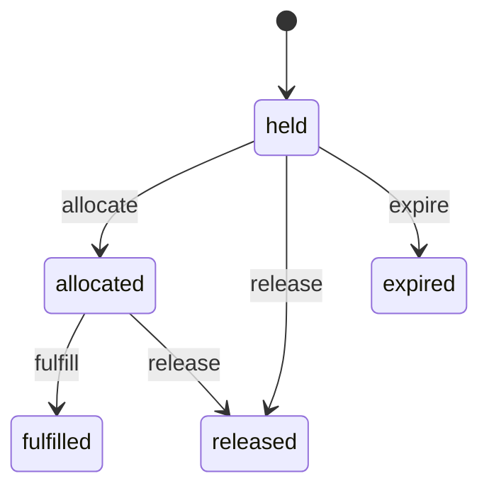
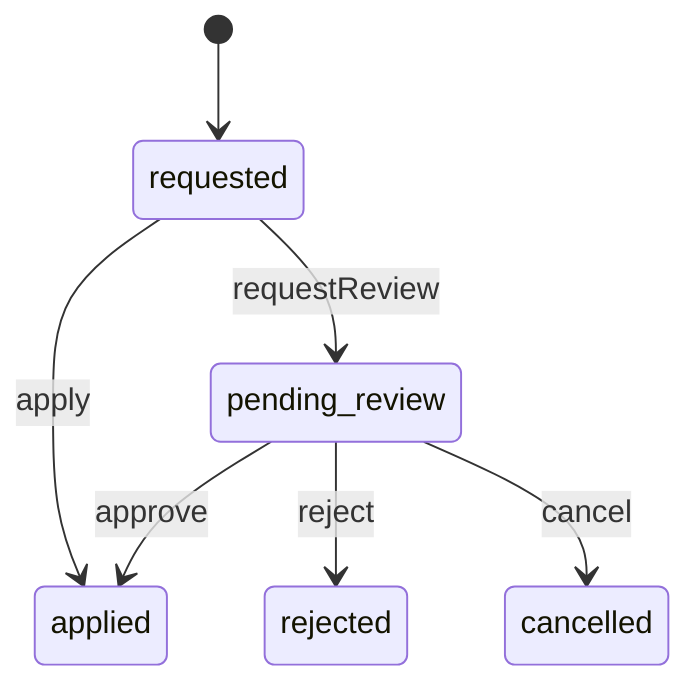
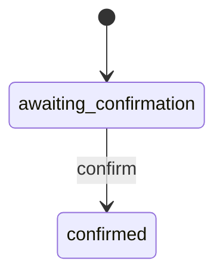
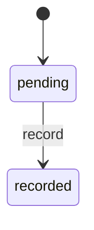
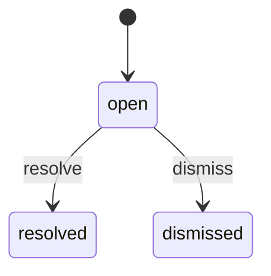
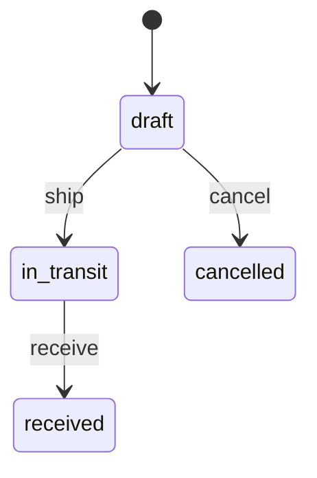
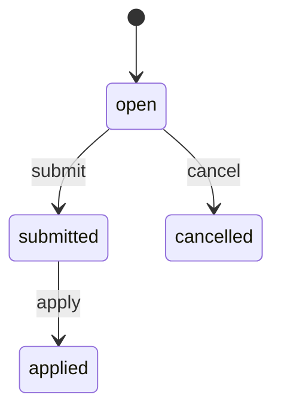

<!-- GENERATED by `npm run gen` from docs/api/modules/inventory.md. Do not edit: change the spec and regenerate. -->

# Inventory (`inventory`)

How many units exist and in which stock group: stock items per offer/SKU with Available, Reserved, Incoming, Damaged or held and Returned quantities per location, checkout holds and order allocations, an append-only movement ledger, reasoned adjustments with second review, low-stock alerts, receipt confirmation and return stock outcomes.

- **Group:** Catalog and stock · **Launch phase:** 1 · **Plan chapters:** 9, 11, 12, 13
- **Depends on:** nothing · **Optional:** [access](../access/README.md), [audit](../audit/README.md), [catalog](../catalog/README.md), [finance](../finance/README.md), [fulfillment-service](../fulfillment-service/README.md), [media](../media/README.md), [purchasing](../purchasing/README.md), [reports](../reports/README.md), [workqueues](../workqueues/README.md), [offers](../offers/README.md)
- **Required by:** [cart](../cart/README.md), [checkout](../checkout/README.md), [fulfillment-service](../fulfillment-service/README.md), [offers](../offers/README.md), [purchasing](../purchasing/README.md), [returns](../returns/README.md), [warehouse](../warehouse/README.md)

## Owns
- Stock items: one per seller offer, one per Official Store SKU; seller stock never mixed with company stock
- Quantities per stock group (Available, Reserved, Incoming, Damaged or held, Returned) per location
- Stock locations (warehouse sites; one at launch, more in phase 4) and transfers between them (phase 4)
- Reservations: checkout holds with expiry, allocation on order acceptance, fulfilment on dispatch, release on cancel
- Movement ledger: every quantity change with reason, staff member, reference and time
- Adjustments with reason codes; second review above the role's limit (via access)
- Low-stock thresholds (reorder points) and alerts
- Confirmation of received stock (Incoming → Available / Damaged or held) by the Inventory Manager
- Stock outcome of inspected returns (restock, different condition, damaged stock, repair, return to supplier, write-off)
- Discrepancies reported by the warehouse (pick shortage, damage found) and their resolution
- Weighted average unit cost of company stock (valuation at cost)
- Stock counts (phase 4)

**Not here:**
- Bins and physical put-away: warehouse (inventory only shows the primary bin code it is told about)
- Purchase orders, receipts and supplier claims: purchasing
- Prices, offer status and the seller bulk file: offers (inventory applies the quantity rows)
- Return inspection and condition decision: returns
- Seller storage and handling for the future fulfillment service: fulfillment-service (inventory already keys items by owner)
- Back-in-stock customer alerts: wishlist

## Seller API

| Method | Path | Purpose | Auth | Body → Response |
|---|---|---|---|---|
| GET | `/api/seller/inventory/stock-items` | Quantities for the seller's offers: available, reserved, low-stock threshold, status | seller | Page<SellerStockRow> |
| GET | `/api/seller/inventory/summary` | In stock, low, out of stock and reserved totals | seller | `SellerStockSummary` |
| POST | `/api/seller/inventory/stock-items/exports` | Export the seller's stock rows (current filters or selected rows) as CSV _(audited)_ | seller<br>`inventory.stock.export` | `{ filters: json?, stockItemIds: uuid[]?, format: enum(csv|xlsx)? }` → `reports.ExportJob` |
| GET | `/api/seller/inventory/stock-items/exports/{id}` | Stock export status and download link (requesting member only) | seller<br>`inventory.stock.export` | `reports.ExportJob` |
| GET | `/api/seller/inventory/stock-items/{id}` | One stock item with reservations and movement history | seller | `StockItemDetail` |
| POST | `/api/seller/inventory/stock-items/{id}/adjustments` | Set a new available quantity with a reason | seller<br>`inventory.stock.adjust` | `SellerAdjustmentRequest` → `Movement` |
| POST | `/api/seller/inventory/adjustments/batch` | Save several inline quantity edits at once (each with a reason) | seller<br>`inventory.stock.adjust` | `{ items: SellerAdjustmentItem[], note: text? }` → `{ results: AdjustmentResult[] }` |
| PATCH | `/api/seller/inventory/stock-items/{id}` | Change the low-stock alert threshold | seller<br>`inventory.stock.adjust` | `{ lowStockThreshold: int? }` → `StockItem` |
| GET | `/api/seller/inventory/movements` | Adjustment and movement history (reason, person, time) | seller | Page<Movement> |

## Admin API

| Method | Path | Purpose | Auth | Body → Response |
|---|---|---|---|---|
| GET | `/api/admin/inventory/stock-items` | Stock by SKU with all five groups, bin, reorder point, cost and status | staff<br>`inventory.stock.view` | Page<StockItem> |
| GET | `/api/admin/inventory/summary` | Units and value at cost per stock group, low and out-of-stock counts | staff<br>`inventory.stock.view` | `StockSummary` |
| GET | `/api/admin/inventory/stock-items/{id}` | Stock item with levels per location, reservations, incoming, pending adjustments and history | staff<br>`inventory.stock.view` | `StockItemDetail` |
| POST | `/api/admin/inventory/stock-items` | Create a company stock item (SKU) at a location _(audited)_ | staff<br>`inventory.items.manage` | `StockItemInput` → `StockItem` |
| PATCH | `/api/admin/inventory/stock-items/{id}` | Change reorder point, reorder quantity or archive a company SKU _(audited)_ | staff<br>`inventory.items.manage` | `{ lowStockThreshold: int?, reorderQuantity: int?, archived: bool? }` → `StockItem` |
| POST | `/api/admin/inventory/stock-items/{id}/merge` | Merge this company SKU into another one (e.g. after a catalog variant merge) _(audited)_ | staff<br>`inventory.items.manage` | `{ intoStockItemId: uuid, reason: text }` → `StockItem` |
| POST | `/api/admin/inventory/adjustments` | Move company stock between groups, or into or out of stock, with a reason _(audited)_ | staff<br>`inventory.stock.adjust-official` | `AdjustmentRequest` → `Adjustment` |
| GET | `/api/admin/inventory/adjustments` | Adjustments, including those waiting for second review | staff<br>`inventory.stock.view` | Page<Adjustment> |
| POST | `/api/admin/inventory/adjustments/{id}/cancel` | Withdraw an adjustment waiting for review _(audited)_ | staff<br>`inventory.stock.adjust-official` | `{ reason: text }` → `Adjustment` |
| GET | `/api/admin/inventory/movements` | Movement ledger (adjustment history with reason, staff and date) | staff<br>`inventory.stock.view` | Page<Movement> |
| GET | `/api/admin/inventory/reservations` | Holds and allocations by order or stock item | staff<br>`inventory.stock.view` | Page<Reservation> |
| POST | `/api/admin/inventory/reservations/{id}/release` | Release a stuck hold or allocation (e.g. order closed without a cancel event) _(audited)_ | staff<br>`inventory.reservations.manage` | `{ reason: text, lineIds: uuid[]? }` → `Reservation` |
| GET | `/api/admin/inventory/inbound` | Received deliveries waiting for the Inventory Manager to make them sellable | staff<br>`inventory.stock.view` | Page<InboundReceipt> |
| GET | `/api/admin/inventory/inbound/{id}` | One counted receipt: received, damaged, shortage and proposed sellable per line | staff<br>`inventory.stock.view` | `InboundReceipt` |
| POST | `/api/admin/inventory/inbound/{id}/confirm` | Make received units available for sale _(audited)_ | staff<br>`inventory.inbound.confirm` | `ConfirmInboundRequest` → `InboundReceipt` |
| GET | `/api/admin/inventory/return-outcomes` | Inspected Official Store returns waiting for their stock outcome | staff<br>`inventory.stock.view` | Page<ReturnOutcome> |
| POST | `/api/admin/inventory/return-outcomes/{id}/record` | Record the stock outcome of a returned item _(audited)_ | staff<br>`inventory.returns.record` | `RecordReturnOutcomeRequest` → `ReturnOutcome` |
| GET | `/api/admin/inventory/discrepancies` | Shortages and damage reported by the warehouse | staff<br>`inventory.stock.view` | Page<Discrepancy> |
| POST | `/api/admin/inventory/discrepancies/{id}/resolve` | Resolve a shortage or damage report (reallocate, adjust or no change) _(audited)_ | staff<br>`inventory.discrepancies.resolve` | `ResolveDiscrepancyRequest` → `Discrepancy` |
| GET | `/api/admin/inventory/low-stock` | SKUs at or below reorder point with incoming stock and suggested reorder quantity | staff<br>`inventory.stock.view` | Page<LowStockRow> |
| GET | `/api/admin/inventory/locations` | Company stock locations | staff<br>`inventory.stock.view` | `Location[]` |
| POST | `/api/admin/inventory/locations` | Add a company stock location _(audited)_ | staff<br>`inventory.locations.manage` | `LocationInput` → `Location` |
| PATCH | `/api/admin/inventory/locations/{id}` | Rename, deactivate or change whether a location is sellable _(audited)_ | staff<br>`inventory.locations.manage` | `{ name: string?, address: Address?, sellable: bool?, active: bool? }` → `Location` |
| POST | `/api/admin/inventory/transfers` | Plan a transfer between warehouses _(audited, phase 4)_ | staff<br>`inventory.transfers.manage` | `{ fromLocationId: uuid, toLocationId: uuid, lines: TransferLine[], note: text? }` → `Transfer` |
| GET | `/api/admin/inventory/transfers` | Transfers _(phase 4)_ | staff<br>`inventory.stock.view` | Page<Transfer> |
| POST | `/api/admin/inventory/transfers/{id}/ship` | Send a transfer (source Available → destination Incoming) _(audited, phase 4)_ | staff<br>`inventory.transfers.manage` | `Transfer` |
| POST | `/api/admin/inventory/transfers/{id}/receive` | Receive a transfer (received quantities per line) _(audited, phase 4)_ | staff<br>`inventory.transfers.manage` | `{ lines: TransferLine[], note: text? }` → `Transfer` |
| POST | `/api/admin/inventory/transfers/{id}/cancel` | Cancel a draft transfer _(audited, phase 4)_ | staff<br>`inventory.transfers.manage` | `{ reason: text }` → `Transfer` |
| POST | `/api/admin/inventory/counts` | Start a stock count for a zone, bin range or SKU list _(phase 4)_ | staff<br>`inventory.counts.manage` | `{ locationId: uuid, scope: string }` → `StockCount` |
| PUT | `/api/admin/inventory/counts/{id}/lines` | Record counted quantities _(phase 4)_ | staff<br>`inventory.counts.manage` | `{ lines: CountLine[] }` → `StockCount` |
| POST | `/api/admin/inventory/counts/{id}/submit` | Submit a count; differences become count-correction adjustments _(audited, phase 4)_ | staff<br>`inventory.counts.manage` | `StockCount` |

## Types

### StockQuantities

| Field | Type |
|---|---|
| available | `int` Sellable to new customers |
| reserved | `int` Held during checkout or allocated to accepted orders |
| incoming | `int` Expected from suppliers or transfers, or received and waiting for confirmation |
| damagedHeld | `int` Awaiting inspection or unsuitable for sale |
| returned | `int` Received back, needs a condition decision |

### IncomingCue

| Field | Type |
|---|---|
| quantity | `int` |
| expectedDate | `date?` |
| purchaseOrderRef | `string?` |

### StockItem

| Field | Type |
|---|---|
| id | `uuid` |
| ownerType | `enum(official|seller)` |
| sellerId | `uuid?` |
| sku | `string` Company SKU or seller SKU |
| offerId | `uuid?` Seller items: the one offer. Company items: the offer selling this SKU, if any |
| productId | `uuid` |
| variantId | `uuid` |
| condition | `string` |
| label | `string` Product title and variant, e.g. 'Halden Aurora ANC Headphones, Black' |
| image | `MediaRef?` The variant's first image, else the product's (read from catalog.getProducts; null while catalog is off) |
| quantities | `StockQuantities` |
| state | `enum(in_stock|low_stock|out_of_stock)` |
| lowStockThreshold | `int?` Low-stock alert at / reorder point |
| reorderQuantity | `int?` |
| unitCost | `Money?` Company stock only; weighted average |
| valueAtCost | `Money?` |
| binCode | `string?` Primary bin from warehouse, e.g. A-03-2 |
| nextIncoming | `IncomingCue?` |
| serviceLocationId | `uuid?` Fulfilled by Marketly: the company location this seller item sells from (setServiceLocation). While set, quantities are those at that location ('At Marketly') |
| ownLocationQuantities | `StockQuantities?` Set with serviceLocationId: units at the seller's own location, kept but not on sale while Marketly fulfils the item (decision D4) |
| archived | `bool` |
| updatedAt | `datetime` |

### StockItemRef

| Field | Type |
|---|---|
| id | `uuid` |
| sku | `string` |
| label | `string` |
| ownerType | `enum(official|seller)` |
| sellerId | `uuid?` |
| offerId | `uuid?` |
| productId | `uuid` |
| variantId | `uuid` |
| condition | `string` |
| locationId | `uuid?` Main location: the seller's virtual location, or the company location holding the item's stock (the default location when it has none) |
| locationCode | `string?` |
| binCode | `string?` Primary bin |
| gtin | `string?` Variant GTIN from catalog.getVariants (null when catalog is off or the variant has none), so warehouse scans can match item barcodes |

### StockItemInput

| Field | Type |
|---|---|
| sku | `string` |
| productId | `uuid` |
| variantId | `uuid` |
| condition | `string` |
| locationId | `uuid` |
| lowStockThreshold | `int?` |
| reorderQuantity | `int?` |

### StockLevel

| Field | Type |
|---|---|
| locationId | `uuid` |
| locationName | `string` |
| binCode | `string?` |
| quantities | `StockQuantities` |

### Location

| Field | Type |
|---|---|
| id | `uuid` |
| code | `string` e.g. RNO1 |
| name | `string` e.g. 'Reno, NV warehouse' |
| kind | `enum(warehouse|seller_virtual)` seller_virtual = one per seller; sellers manage their own physical stock |
| ownerType | `enum(official|seller)` |
| sellerId | `uuid?` |
| address | `Address?` |
| timeZone | `string` |
| sellable | `bool` Available units here count toward checkout |
| active | `bool` |
| isDefault | `bool` |

### LocationInput

| Field | Type |
|---|---|
| code | `string` |
| name | `string` |
| address | `Address` |
| timeZone | `string` |
| sellable | `bool?` |
| active | `bool?` |

### MovementRef

| Field | Type |
|---|---|
| kind | `enum(order|reservation|purchase_order|receipt|return|adjustment|bulk_update|transfer|count|discrepancy|initial|merge|service_inbound|service_return|service_removal|service_reconcile)` |
| id | `string` |
| label | `string` e.g. 'Received PUR-2610-0031', 'Return RT-261001-0161' |

### Movement

| Field | Type |
|---|---|
| id | `uuid` |
| stockItemId | `uuid` |
| sku | `string` |
| locationId | `uuid` |
| fromGroup | `enum(available|reserved|incoming|damaged_held|returned|outside)` |
| toGroup | `enum(available|reserved|incoming|damaged_held|returned|outside)` |
| quantity | `int` Always positive; direction is from → to. outside = entering or leaving stock |
| reasonCode | `string` |
| reasonLabel | `string` |
| note | `text?` |
| reference | `MovementRef?` |
| actor | `Actor` |
| approvedBy | `Actor?` |
| at | `datetime` |
| after | `StockQuantities` |

### SellerAdjustmentRequest

| Field | Type |
|---|---|
| newAvailable | `int` New Available quantity (≥ 0). Reserved units are not affected. |
| reasonCode | `enum(received_stock|count_correction|damaged_or_defective|lost_or_missing|returned_item_restocked|moved_to_another_channel|other)` |
| note | `text?` |

### SellerAdjustmentItem

| Field | Type |
|---|---|
| stockItemId | `uuid` |
| newAvailable | `int` |
| reasonCode | `enum(received_stock|count_correction|damaged_or_defective|lost_or_missing|returned_item_restocked|moved_to_another_channel|bulk_update|other)` bulk_update: the row is part of a bulk stock edit (recorded as Bulk update, G53b) |

### AdjustmentResult

| Field | Type |
|---|---|
| stockItemId | `uuid` |
| ok | `bool` |
| movement | `Movement?` |
| error | `ErrorBody?` |

### SellerStockRow

| Field | Type |
|---|---|
| stockItemId | `uuid` |
| offerId | `uuid?` |
| productTitle | `string` |
| variantLabel | `string` |
| image | `MediaRef?` |
| sku | `string` |
| available | `int` |
| reserved | `int` |
| lowStockThreshold | `int?` |
| state | `enum(in_stock|low_stock|out_of_stock)` |
| lastChange | `string?` e.g. 'Oct 6, 4:30 PM · Avery Stone' |
| fulfilledByMarketly | `bool` True while the item has a service location: available and reserved are 'At Marketly' and the row is read-only (SERVICE_MANAGED) |
| ownLocationAvailable | `int?` With fulfilledByMarketly: units at the seller's own location, 'At your location (not on sale)' |
| updatedAt | `datetime` |

### SellerStockSummary

| Field | Type |
|---|---|
| inStockSkus | `int` |
| inStockUnits | `int` |
| lowStockSkus | `int` |
| outOfStockSkus | `int` |
| reservedUnits | `int` |
| outOfStockLabels | `string[]` For the dashboard tile, e.g. 'Aurora, Silver' |

### StockGroupTotal

| Field | Type |
|---|---|
| group | `enum(available|reserved|incoming|damaged_held|returned)` |
| label | `string` |
| meaning | `string` |
| units | `int` |
| valueAtCost | `Money?` |

### StockSummary

| Field | Type |
|---|---|
| ownerType | `enum(official|seller)` |
| locationId | `uuid?` |
| skuCount | `int` |
| groups | `StockGroupTotal[]` |
| lowStockCount | `int` |
| outOfStockCount | `int` |
| lowStockHeadline | `string?` e.g. '3 SKUs at or below reorder point' |

### StockItemDetail

| Field | Type |
|---|---|
| item | `StockItem` |
| levels | `StockLevel[]` |
| reservations | `Reservation[]` |
| incoming | `IncomingCue[]` |
| pendingAdjustments | `Adjustment[]` |
| openDiscrepancies | `Discrepancy[]` |
| recentMovements | `Movement[]` |

### AdjustmentRequest

| Field | Type |
|---|---|
| stockItemId | `uuid` |
| locationId | `uuid?` |
| fromGroup | `enum(available|incoming|damaged_held|returned|outside)` outside = stock found / entering |
| toGroup | `enum(available|damaged_held|returned|outside)` outside = write off / leaving stock |
| quantity | `int` |
| reasonCode | `enum(quality_hold|damaged_in_warehouse|count_correction|found_stock|theft_or_loss|write_off|repair|supplier_return|other)` |
| note | `text?` |
| reviewDate | `date?` Required when moving into Damaged or held: when the hold is reviewed |
| secondReviewerId | `uuid?` Preferred reviewer when a second review is needed |

### Adjustment

| Field | Type |
|---|---|
| id | `uuid` |
| stockItemId | `uuid` |
| sku | `string` |
| label | `string` |
| locationId | `uuid` |
| fromGroup | `string` |
| toGroup | `string` |
| quantity | `int` |
| reasonCode | `string` |
| reasonLabel | `string` |
| note | `text?` |
| reviewDate | `date?` |
| before | `StockQuantities` |
| after | `StockQuantities` |
| affectedReservedUnits | `int` Reserved units on the item; they stay with their orders and Order Manager is told |
| state | `enum(requested|pending_review|applied|rejected|cancelled)` |
| approval | `ApprovalInfo?` |
| requestedBy | `Actor` |
| decidedBy | `Actor?` |
| createdAt | `datetime` |
| appliedAt | `datetime?` |

### Reservation

| Field | Type |
|---|---|
| id | `uuid` |
| key | `string` Idempotency key within its source: the checkout session key (holds), order:<orderId> (an order re-allocated after its hold expired), or the caller's key for allocateForOrder |
| source | `enum(checkout|replacement|exchange)` checkout: a checkout hold and the order's own allocation; replacement or exchange: allocateForOrder for a replacement or exchange shipment (no expiry; releaseHold may release it) |
| state | `enum(held|allocated|fulfilled|released|expired)` |
| orderId | `uuid?` |
| orderRef | `string?` |
| expiresAt | `datetime?` Holds only |
| lines | `ReservationLine[]` |
| releasedReason | `string?` |
| createdAt | `datetime` |

### ReservationLine

| Field | Type |
|---|---|
| id | `uuid` |
| stockItemId | `uuid` |
| sku | `string` |
| locationId | `uuid` |
| orderItemId | `uuid?` |
| quantity | `int` |
| fulfilledQuantity | `int` |
| releasedQuantity | `int` |
| state | `enum(held|allocated|fulfilled|released|expired)` |

### InboundReceipt

| Field | Type |
|---|---|
| id | `uuid` |
| receiptId | `uuid` |
| receiptRef | `string` e.g. REC-261006-03 |
| source | `ReceiptSource` What the units arrive against: a purchase order (company stock) or a Fulfilled by Marketly inbound shipment (seller stock) |
| ownerType | `enum(official|seller)` seller for service_inbound receipts |
| sellerId | `uuid?` |
| purchaseOrderId | `uuid?` Null for service_inbound receipts |
| purchaseOrderRef | `string?` |
| supplierName | `string` The supplier; for service_inbound receipts the seller's name |
| locationId | `uuid` |
| receivedBy | `Actor` |
| receivedAt | `datetime` |
| state | `enum(awaiting_confirmation|confirmed)` |
| lines | `InboundLine[]` |
| totals | `{"received":"int","damaged":"int","shortage":"int","sellable":"int"}` |
| openPickShortages | `int` Open pick-shortage discrepancies on this receipt's SKUs; resolve them (reallocate) first. There are no backorders at launch: an order is never accepted without reserved units |
| confirmedBy | `Actor?` |
| confirmedAt | `datetime?` |

### InboundLine

| Field | Type |
|---|---|
| stockItemId | `uuid` |
| sku | `string` |
| label | `string` |
| expected | `int` |
| received | `int` |
| damaged | `int` |
| shortage | `int` |
| binCode | `string?` |
| unitCost | `Money?` Null for service_inbound receipts (seller stock has no company cost) |
| sellable | `int` Proposed received − damaged; set on confirmation |
| outOfStockNow | `bool` |

### ReceiptSource

| Field | Type |
|---|---|
| kind | `enum(purchase_order|service_inbound)` |
| id | `uuid` Purchase order id or fulfillment-service inbound shipment id |
| ref | `string` PO or IB- reference |

### ConfirmInboundLine

| Field | Type |
|---|---|
| stockItemId | `uuid` |
| sellable | `int` |
| damaged | `int` |
| reason | `text?` Required when sellable differs from received − damaged |

### ConfirmInboundRequest

| Field | Type |
|---|---|
| lines | `ConfirmInboundLine[]` |
| checked | `bool` 'I counted and checked these units' must be true |
| note | `text?` |

### ReturnOutcome

| Field | Type |
|---|---|
| id | `uuid` |
| returnId | `uuid` |
| returnRef | `string` e.g. RT-261005-0212 |
| orderRef | `string` |
| stockItemId | `uuid` |
| sku | `string` |
| label | `string` |
| quantity | `int` |
| inspectedCondition | `string` From returns inspection, e.g. 'Like new, opened' |
| proposedOutcome | `enum(restock|different_condition|damaged_stock|repair|return_to_supplier|write_off)` |
| proposedTargetSku | `string?` |
| state | `enum(pending|recorded)` |
| recordedOutcome | `enum(restock|different_condition|damaged_stock|repair|return_to_supplier|write_off)?` |
| targetStockItemId | `uuid?` |
| movements | `Movement[]` |
| recordedBy | `Actor?` |
| recordedAt | `datetime?` |
| inspectedAt | `datetime` |

### RecordReturnOutcomeRequest

| Field | Type |
|---|---|
| outcome | `enum(restock|different_condition|damaged_stock|repair|return_to_supplier|write_off)` |
| targetStockItemId | `uuid?` different_condition: the company stock item for the new condition (e.g. HAL-AUR-BLK-LN) |
| binCode | `string?` |
| reviewDate | `date?` repair and return_to_supplier keep the unit in Damaged or held until this date |
| note | `text?` |

### Discrepancy

| Field | Type |
|---|---|
| id | `uuid` |
| kind | `enum(pick_shortage|damage_found|count_mismatch)` |
| stockItemId | `uuid` |
| sku | `string` |
| label | `string` |
| locationId | `uuid` |
| binCode | `string?` |
| quantity | `int` |
| orderId | `uuid?` |
| orderRef | `string?` |
| note | `text?` |
| photos | `MediaRef[]` |
| reportedBy | `Actor` |
| reportedAt | `datetime` |
| state | `enum(open|resolved|dismissed)` |
| resolution | `enum(reallocated|adjusted|no_change)?` |
| resolutionNote | `text?` |
| resolvedBy | `Actor?` |
| resolvedAt | `datetime?` |

### ResolveDiscrepancyRequest

| Field | Type |
|---|---|
| resolution | `enum(reallocated|adjusted|no_change)` reallocated: another unit (e.g. from Returned or another bin) now serves the order; adjusted: missing units written off |
| adjustQuantity | `int?` |
| sourceGroup | `enum(available|returned)?` Where the replacement unit came from when reallocated |
| note | `text` |

### LowStockDigestItem

| Field | Type |
|---|---|
| stockItemId | `uuid` |
| offerId | `uuid?` |
| sku | `string` |
| label | `string` |
| available | `int` |
| threshold | `int?` |
| state | `enum(low_stock|out_of_stock)` |

### LowStockRow

| Field | Type |
|---|---|
| item | `StockItem` |
| daysOfCover | `number?` Available ÷ average daily sales (30 days) |
| suggestedReorderQuantity | `int?` |
| incoming | `IncomingCue?` |

### Transfer

| Field | Type |
|---|---|
| id | `uuid` |
| ref | `string` TRF-YYMMDD-NNNN (numbered per market day) |
| note | `text?` Planner's note from createTransfer |
| fromLocationId | `uuid` |
| toLocationId | `uuid` |
| state | `enum(draft|in_transit|received|cancelled)` |
| lines | `TransferLine[]` |
| createdBy | `Actor` |
| shippedAt | `datetime?` |
| receivedAt | `datetime?` |

### TransferLine

| Field | Type |
|---|---|
| stockItemId | `uuid` |
| sku | `string` |
| quantity | `int` |
| receivedQuantity | `int?` |

### StockCount

| Field | Type |
|---|---|
| id | `uuid` |
| locationId | `uuid` |
| scope | `string` Zone, bin prefix or SKU list |
| state | `enum(open|submitted|applied|cancelled)` |
| lines | `CountLine[]` |
| createdBy | `Actor` |
| submittedAt | `datetime?` |

### CountLine

| Field | Type |
|---|---|
| stockItemId | `uuid` |
| sku | `string` |
| binCode | `string?` |
| expected | `int` |
| counted | `int?` |

## Status flows

### Reservation (`Reservation.state`)



held: checkout hold (Available → Reserved) with expiresAt, extended while a payment result is checked. allocate on orders.order.accepted. fulfill on shipping.shipment.dispatched (Reserved → outside). release on cancellation (orders.item.cancelled) or abandoned checkout: Reserved → Available. Released units return to Available only when the purchase has ended or been cancelled (plan ch. 9). Lines move individually (partial cancel or partial shipment); the reservation state is the furthest state of its open lines. On allocate, hold units that match no accepted order item are released at once (reason unmatched). orders.item.split splits a line so each order item keeps its own units. allocateForOrder (replacements, exchanges) creates a reservation directly as allocated with no expiresAt; it never expires and is fulfilled or released like any allocation.

### Adjustment (`Adjustment.state`)



requestReview when access says the quantity or value at cost is above the requester's adjustment limit (example: Inventory Manager 50 units). approve/reject come from access.approval.decided; the reviewer must be a different person. Nothing moves until applied. Seller adjustments on their own stock apply directly.

### Inbound confirmation (`InboundReceipt.state`)



Units stay in Incoming until confirm: sellable → Available, damaged → Damaged or held (review date = supplier claim follow-up). Open pick shortages on the receipt's SKUs are shown (openPickShortages) so the Inventory Manager can reallocate to them first; nothing is allocated automatically (no backorders at launch).

### Return stock outcome (`ReturnOutcome.state`)



Created on returns.return.inspected; the units entered Returned on returns.return.received. restock: Returned → Available. different_condition: Returned → outside on this item and outside → Available on the target item, at the original unit cost. damaged_stock: Returned → Damaged or held (kept, not for sale) with a review date. repair / return_to_supplier: Returned → Damaged or held with a review date. write_off: Returned → outside; value at cost reported to finance.

### Discrepancy (`Discrepancy.state`)



Opened by warehouse pick shortages and damage at packing. The affected order stays on hold in warehouse until resolved (inventory.discrepancy.resolved).

### Transfer (`Transfer.state`)



Phase 4 (multiple warehouses). ship: Available at source → outside, Incoming at destination; receive: Incoming → Available.

### Stock count (`StockCount.state`)



Phase 4. apply creates count_correction adjustments; those above the limit go to second review.

## Data (schema `inventory`)

**locations**: Stock locations (company warehouses; one virtual location per seller)

| Column | Type |
|---|---|
| id | uuid pk |
| code | text unique |
| name | text |
| kind | text |
| owner_type | text |
| seller_id | uuid? |
| address | jsonb? |
| time_zone | text |
| sellable | bool |
| active | bool |
| is_default | bool |

**stock_items**: One per seller offer or company SKU

| Column | Type |
|---|---|
| id | uuid pk |
| owner_type | text (official|seller) |
| seller_id | uuid? |
| sku | text |
| offer_id | uuid? |
| product_id | uuid |
| variant_id | uuid |
| condition | text |
| label | text |
| low_stock_threshold | int? |
| reorder_quantity | int? |
| unit_cost_amount | bigint? |
| currency | char(3) |
| primary_bin_code | text? |
| low_since | timestamptz? |
| service_location_id | uuid? → locations (Fulfilled by Marketly: the company location this seller item sells from; null = the seller's own location) |
| archived | bool |
| created_at | timestamptz |
| updated_at | timestamptz |

Indexes: `unique (owner_type, coalesce(seller_id, '00000000-0000-0000-0000-000000000000'), sku)`, `(seller_id, archived)`, `(offer_id)`, `(variant_id)`, `(service_location_id) where service_location_id is not null`

**stock_levels**: Current quantities per item and location; changed only together with a movement row

| Column | Type |
|---|---|
| stock_item_id | uuid → stock_items |
| location_id | uuid → locations |
| available | int check >= 0 |
| reserved | int check >= 0 |
| incoming | int check >= 0 |
| damaged_held | int check >= 0 |
| returned | int check >= 0 |
| version | int (optimistic lock) |
| updated_at | timestamptz |

Indexes: `pk (stock_item_id, location_id)`, `(location_id)`

**stock_movements**: Append-only ledger; never updated or deleted

| Column | Type |
|---|---|
| id | uuid pk |
| stock_item_id | uuid → stock_items |
| location_id | uuid → locations |
| from_group | text |
| to_group | text |
| quantity | int check > 0 |
| reason_code | text |
| note | text? |
| ref_kind | text? |
| ref_id | text? |
| ref_label | text? |
| actor_kind | text |
| actor_id | text? |
| actor_name | text? |
| approved_by | text? |
| after | jsonb |
| at | timestamptz |

Indexes: `(stock_item_id, at)`, `(ref_kind, ref_id)`, `(reason_code, at)`

**incoming_expectations**: Open incoming quantities from purchase orders, transfers and Fulfilled by Marketly inbound shipments

| Column | Type |
|---|---|
| id | uuid pk |
| stock_item_id | uuid → stock_items |
| location_id | uuid → locations |
| source_kind | text (purchase_order|transfer|service_inbound) |
| source_id | uuid |
| source_ref | text |
| quantity_open | int |
| expected_date | date? |

Indexes: `(stock_item_id, expected_date)`, `(source_kind, source_id)`

**reservations**

| Column | Type |
|---|---|
| id | uuid pk |
| source | text (checkout|replacement|exchange) |
| key | text |
| order_id | uuid? |
| order_ref | text? |
| state | text |
| expires_at | timestamptz? |
| released_reason | text? |
| created_at | timestamptz |
| updated_at | timestamptz |

Indexes: `(source, key) unique`, `(state, expires_at)`, `(order_id)`

**reservation_lines**

| Column | Type |
|---|---|
| id | uuid pk |
| reservation_id | uuid → reservations |
| stock_item_id | uuid → stock_items |
| location_id | uuid → locations |
| order_item_id | uuid? |
| quantity | int |
| fulfilled_qty | int |
| released_qty | int |
| state | text |

Indexes: `(reservation_id)`, `(stock_item_id, state)`, `(order_item_id)`

**adjustments**: Staff adjustment requests incl. those waiting for a second reviewer

| Column | Type |
|---|---|
| id | uuid pk |
| stock_item_id | uuid → stock_items |
| location_id | uuid → locations |
| from_group | text |
| to_group | text |
| quantity | int |
| reason_code | text |
| note | text? |
| review_date | date? |
| state | text |
| approval_request_id | uuid? |
| requested_by | text |
| decided_by | text? |
| movement_id | uuid? → stock_movements |
| created_at | timestamptz |
| applied_at | timestamptz? |

Indexes: `(state, created_at)`, `(stock_item_id)`, `(approval_request_id)`

**held_stock**: Units in Damaged or held with reason and review date

| Column | Type |
|---|---|
| id | uuid pk |
| stock_item_id | uuid → stock_items |
| location_id | uuid → locations |
| quantity | int |
| reason_code | text |
| reason | text? |
| review_date | date |
| source_ref | text? |
| released_at | timestamptz? |

Indexes: `(review_date) where released_at is null`, `(stock_item_id, location_id)`

**inbound_receipts**: Counted receipts from purchasing and from the fulfillment service waiting for confirmation

| Column | Type |
|---|---|
| id | uuid pk |
| receipt_id | uuid unique |
| receipt_ref | text |
| source_kind | text (purchase_order|service_inbound) |
| source_id | uuid? (purchase order or inbound shipment id; existing rows backfilled from purchase_order_id) |
| source_ref | text? |
| owner_type | text (official|seller) |
| seller_id | uuid? |
| purchase_order_id | uuid? |
| purchase_order_ref | text? |
| supplier_name | text |
| location_id | uuid → locations |
| received_by | text |
| received_at | timestamptz |
| state | text |
| confirmed_by | text? |
| confirmed_at | timestamptz? |
| note | text? |

Indexes: `(state, received_at)`, `(source_kind, source_id)`

**inbound_lines**

| Column | Type |
|---|---|
| inbound_id | uuid → inbound_receipts |
| stock_item_id | uuid → stock_items |
| expected | int |
| received | int |
| damaged | int |
| bin_code | text? |
| unit_cost_amount | bigint? (null for service_inbound receipts) |
| sellable | int? |
| reason | text? |

Indexes: `pk (inbound_id, stock_item_id)`

**return_outcomes**

| Column | Type |
|---|---|
| id | uuid pk |
| return_id | uuid |
| return_ref | text |
| order_ref | text |
| stock_item_id | uuid → stock_items |
| quantity | int |
| inspected_condition | text |
| proposed_outcome | text |
| proposed_target_sku | text? |
| state | text |
| recorded_outcome | text? |
| target_stock_item_id | uuid? |
| recorded_by | text? |
| recorded_at | timestamptz? |
| inspected_at | timestamptz |

Indexes: `unique (return_id, stock_item_id)`, `(state)`

**discrepancies**

| Column | Type |
|---|---|
| id | uuid pk |
| kind | text |
| stock_item_id | uuid → stock_items |
| location_id | uuid → locations |
| bin_code | text? |
| quantity | int |
| order_id | uuid? |
| order_ref | text? |
| note | text? |
| photo_media_ids | jsonb |
| state | text |
| resolution | text? |
| resolution_note | text? |
| reported_by | text |
| reported_at | timestamptz |
| resolved_by | text? |
| resolved_at | timestamptz? |

Indexes: `(state, reported_at)`, `(order_id)`

**transfers**: Phase 4

| Column | Type |
|---|---|
| id | uuid pk |
| ref | text unique |
| from_location_id | uuid → locations |
| to_location_id | uuid → locations |
| state | text |
| created_by | text |
| note | text? |
| shipped_at | timestamptz? |
| received_at | timestamptz? |

**transfer_lines**: Phase 4

| Column | Type |
|---|---|
| transfer_id | uuid → transfers |
| stock_item_id | uuid → stock_items |
| quantity | int |
| received_quantity | int? |

Indexes: `pk (transfer_id, stock_item_id)`

**valuation_snapshots**: Daily company stock valuation per stock group (job inventory.valuation-snapshot) for trading reports; one row per market day and group, rewritten if the job runs again that day

| Column | Type |
|---|---|
| snapshot_date | date |
| stock_group | text (available|reserved|incoming|damaged_held|returned) |
| units | int |
| value_at_cost_amount | bigint |
| currency | char(3) |
| sku_count | int |
| taken_at | timestamptz |

Indexes: `pk (snapshot_date, stock_group)`

**stock_counts**: Phase 4

| Column | Type |
|---|---|
| id | uuid pk |
| location_id | uuid → locations |
| scope | text |
| state | text |
| created_by | text |
| submitted_at | timestamptz? |

**count_lines**: Phase 4

| Column | Type |
|---|---|
| count_id | uuid → stock_counts |
| stock_item_id | uuid → stock_items |
| bin_code | text? |
| expected | int |
| counted | int? |

Indexes: `pk (count_id, stock_item_id)`

## Events

| Publishes | When | Payload | Consumed by |
|---|---|---|---|
| `inventory.stock.changed` | Available or Reserved changes for a stock item, or the item is re-keyed, archived or unarchived | `{ stockItemId: uuid, offerId: uuid?, ownerType: string, sellerId: uuid?, productId: uuid, variantId: uuid, available: int, reserved: int, previousAvailable: int, state: enum(in_stock|low_stock|out_of_stock), archived: bool, cause: string }` | advertising, cart, catalog, content, offers, promotions, reports, search, wishlist, workqueues |
| `inventory.stock.low` | Available drops to or below the threshold (once per cooldown) | `{ stockItemId: uuid, offerId: uuid?, ownerType: string, sellerId: uuid?, productId: uuid, variantId: uuid, sku: string, label: string, available: int, threshold: int, serviceManaged: bool }` | advertising, fulfillment-service, notifications, purchasing, workqueues |
| `inventory.stock.low_digest` | Daily low-stock digest (job inventory.low-stock-digest): one event per seller with low or out-of-stock items, and one for the Official Store (ownerType official); nothing when there is nothing to report | `{ ownerType: enum(official|seller), sellerId: uuid?, date: date, lowCount: int, outOfStockCount: int, items: LowStockDigestItem[] }` | notifications |
| `inventory.reservation.allocated` | A hold is allocated to an accepted order, or allocateForOrder allocates units for a replacement or exchange | `{ reservationId: uuid, orderId: uuid, lines: ReservationLine[], source: enum(checkout|replacement|exchange) }` | - |
| `inventory.reservation.released` | Held or allocated units return to Available (cancel, expiry, abandoned checkout, staff release, hold units no accepted item matched) | `{ reservationId: uuid, orderId: uuid?, reason: enum(cancelled|expired|abandoned|staff|unmatched), lines: ReservationLine[] }` | - |
| `inventory.adjustment.recorded` | A seller or staff adjustment is applied (adjustments, count corrections and discrepancy resolutions that move units; never moveServiceStock) | `{ adjustmentId: uuid?, movementId: uuid, stockItemId: uuid, locationId: uuid, ownerType: string, sellerId: uuid?, serviceManaged: bool, fromGroup: string, toGroup: string, quantity: int, reasonCode: string, actor: Actor }` | fulfillment-service |
| `inventory.receipt.confirmed` | The Inventory Manager confirms a receipt (purchase or Fulfilled by Marketly) | `{ inboundId: uuid, receiptId: uuid, source: ReceiptSource, ownerType: enum(official|seller), sellerId: uuid?, purchaseOrderId: uuid?, locationId: uuid, lines: InboundLine[], confirmedBy: Actor }` | fulfillment-service, purchasing |
| `inventory.return_outcome.recorded` | Stock outcome of a return is recorded | `{ returnId: uuid, stockItemId: uuid, outcome: string, targetStockItemId: uuid?, quantity: int, valueAtCost: Money? }` | - |
| `inventory.discrepancy.reported` | Warehouse reports a shortage or damage | `{ discrepancyId: uuid, kind: string, stockItemId: uuid, orderId: uuid?, quantity: int }` | - |
| `inventory.discrepancy.resolved` | Inventory resolves a discrepancy | `{ discrepancyId: uuid, resolution: string, orderId: uuid? }` | warehouse |
| `inventory.hold.review_due` | Damaged or held stock reaches its review date | `{ stockItemId: uuid, quantity: int, reasonCode: string, reviewDate: date }` | - |
| `inventory.transfer.received` | Phase 4: a transfer is received | `{ transferId: uuid, toLocationId: uuid }` | - |

| Consumes | From | Does |
|---|---|---|
| `orders.order.accepted` | orders | Allocate the order's held reservation (reservationId) to its order items: each reservation line is matched to an entry of items by stockItemId and quantity, so allocation never depends on checkout's attachOrder (lines it already attached keep their orderItemId). Hold units that match no accepted item (quantity reduced or line dropped at placement) are released in the same transaction (inventory.reservation.released, reason unmatched), so no units stay reserved without an order item |
| `orders.item.cancelled` | orders | Release that item's held or allocated units back to Available (matched by itemId, so a split-off item releases only its own units) |
| `orders.item.split` | orders | A line was split for a partial cancel, shipment or return (decision S-D1): split the reservation line of itemId so newItemId gets its own line with quantity units (same stock item, location and state; fulfilled and released counts stay on the original line) and the original keeps the rest. Later cancel, dispatch and release events name either item. Idempotent per newItemId |
| `shipping.shipment.dispatched` | shipping | Fulfil the allocated lines in the shipment (Reserved → leaves stock), matched by order item id; replacement and exchange shipments fulfil their allocateForOrder reservation |
| `returns.return.received` | returns | Official Store items: add each listed item's units (items[].stockItemId, quantity) to Returned at the receiving warehouse, once per return item. Seller returns are recorded by sellers through adjustments. |
| `returns.return.inspected` | returns | Create a pending return stock outcome with the inspector's proposed outcome. The units stay in Returned until the outcome is recorded (restock → Available; damaged_stock, repair, return_to_supplier → Damaged or held; write_off → outside). Units that never arrived through returns.return.received are added to Returned first, so a missed event loses no stock |
| `warehouse.bin.assigned` | warehouse | Update the stock item's primary bin code shown in stock lists |
| `offers.offer.status_changed` | offers | Archive a seller stock item when its offer is removed (reserved units stay with their orders); unarchive it when the offer leaves removed (reinstated), so the offer shows its kept quantity again |
| `catalog.product.merged` | catalog | Re-point company stock items of the merged product to the kept product and the mapped variant (newVariantId or intoVariantId) with updateStockItem; when the kept variant already has a company item with the same condition, raise it for the Inventory Manager to merge (POST /stock-items/{id}/merge). Seller items follow their offers (offers calls updateStockItem or mergeStockItems) |
| `sellers.seller.closed` | sellers | Archive the seller's stock items |
| `access.approval.decided` | access | Apply or reject adjustments waiting for second review |

## In-process API (for other modules)

| Function | Signature | Used by |
|---|---|---|
| createStockItem | `(input: { ownerType: 'official'|'seller', sellerId?: uuid, offerId?: uuid, sku: string, productId: uuid, variantId: uuid, condition: string, label: string, initialAvailable: int, lowStockThreshold?: int, locationId?: uuid }) => StockItem`<br>Called when an offer is created. Seller items get the seller's virtual location. | offers |
| getAvailability | `(stockItemIds: uuid[]) => map<{ available: int, state: string, lowStockThreshold: int|null, nextIncoming: IncomingCue|null }>`<br>Sellable quantity summed over sellable locations | offers, search, cart, checkout |
| hold | `(key: string, lines: { stockItemId: uuid, quantity: int }[], ttlMinutes?: int) => Reservation`<br>All-or-nothing checkout hold; throws INSUFFICIENT_STOCK with details per line. Same key returns the existing hold (idempotent). | checkout |
| extendHold | `(reservationId: uuid, until: datetime) => Reservation`<br>Keeps stock while a payment result is being checked (scenario 3) | checkout, payments |
| attachOrder | `(reservationId: uuid, orderId: uuid, lines: { stockItemId: uuid, orderItemId: uuid }[]) => Reservation`<br>Links a hold to the placed order so acceptance can allocate it | checkout, orders |
| releaseHold | `(reservationId: uuid, reason: string) => void`<br>Abandoned checkout or failed purchase; also releases an allocation made with allocateForOrder that is no longer needed (cancelled replacement or exchange) | checkout, returns |
| allocateForOrder | `(input: { key: string, orderId: uuid, orderRef?: string, source: { kind: 'replacement' | 'exchange', id: uuid, ref?: string }, lines: { stockItemId: uuid, quantity: int, orderItemId?: uuid }[], actor: Actor }) => Reservation`<br>All-or-nothing allocation with no expiry for a replacement or exchange shipment of an existing order (Available → Reserved, state allocated, publishes inventory.reservation.allocated). Throws INSUFFICIENT_STOCK with details per line. Same key returns the existing reservation (idempotent). Fulfilled on shipping.shipment.dispatched like any allocation; released with releaseHold | returns, support |
| getLocations | `(opts?: { ownerType?: 'official' | 'seller', sellerId?: uuid, activeOnly?: bool }) => Location[]`<br>Stock locations with code, name, address and time zone (company warehouses by default) | purchasing, warehouse, shipping, returns, offers |
| getDefaultLocation | `() => Location | null`<br>The default company location (isDefault): Official Store ships-from address for delivery estimates and rates (decision O3), receiving and return default. Null only before the first location is created | offers, shipping, cart, checkout, returns, purchasing, warehouse |
| updateStockItem | `(stockItemId: uuid, patch: { productId?: uuid, variantId?: uuid, condition?: string, sku?: string, label?: string, offerId?: uuid }, actor: Actor) => StockItem`<br>Keep a stock item in step with its offer or catalog record (variant change on an offer, catalog merge, SKU or condition change). Quantities and history stay on the item; SKU_TAKEN when the new SKU is used by another item of the same owner. Publishes inventory.stock.changed (cause item_updated) so read models re-key | offers |
| unarchiveStockItem | `(stockItemId: uuid, actor: Actor) => StockItem`<br>Reinstated offer: the archived item becomes active again with the quantities it kept, so the offer is not stuck out of stock. Publishes inventory.stock.changed (cause unarchived) | offers |
| mergeStockItems | `(fromStockItemId: uuid, intoStockItemId: uuid, reason: string, actor: Actor) => StockItem`<br>Two items of the same owner now describe the same thing (variant merge, duplicate seller offers): every quantity group moves to the target with merge movements, open reservation lines and incoming expectations move with their units (still matched by orderItemId), and the source is archived. Returns the target | offers |
| getSalesRate | `(stockItemIds: uuid[], days?: int) => map<{ unitsSold: int, days: int, avgDailySales: number }>`<br>Units that left stock to customer orders (fulfilled order allocations, net of restocked returns) over the last days (default 30), for reorder maths and days of cover | purchasing, reports |
| applyBulkQuantities | `(sellerId: uuid, rows: { stockItemId: uuid, newAvailable: int }[], jobId: uuid, actor: Actor) => { stockItemId: uuid, ok: bool, error?: string }[]`<br>Seller bulk file quantities, recorded as 'Bulk update' movements | offers |
| getUnitCost | `(stockItemId: uuid) => Money | null`<br>Weighted average buying cost of company stock | offers, finance, returns, reports |
| expectIncoming | `(purchaseOrderId: uuid, purchaseOrderRef: string, locationId: uuid, lines: { stockItemId: uuid, quantity: int, expectedDate: date }[]) => void`<br>Adds Incoming when a purchase order is sent; repeated calls replace the open quantities for that PO | purchasing |
| cancelIncoming | `(purchaseOrderId: uuid, lines?: { stockItemId: uuid, quantity: int }[]) => void`<br>Cancelled or short-closed purchase orders | purchasing |
| submitInbound | `(receipt: { receiptId: uuid, receiptRef: string, purchaseOrderId: uuid, purchaseOrderRef: string, supplierName: string, locationId: uuid, receivedBy: Actor, receivedAt: datetime, lines: { stockItemId: uuid, expected: int, received: int, damaged: int, binCode?: string, unitCost: Money }[] }) => InboundReceipt`<br>Counted receipt waiting for the Inventory Manager to confirm what can be sold | purchasing |
| reportDiscrepancy | `(input: { kind: 'pick_shortage'|'damage_found', stockItemId: uuid, locationId: uuid, binCode?: string, quantity: int, orderId?: uuid, orderRef?: string, note?: string, photoIds?: uuid[], reportedBy: Actor }) => Discrepancy`<br>Called from pick and pack. Damaged reserved units move to Damaged or held at once. | warehouse |
| findBySku | `(ownerType: 'official'|'seller', skus: string[], sellerId?: uuid) => StockItem[]`<br>Resolve SKUs from scans and files | warehouse, purchasing, offers |
| getStockItems | `(stockItemIds: uuid[]) => StockItemRef[]`<br>Stock items by id with SKU, label, owner and main location; unknown ids are left out | purchasing, warehouse |
| getOfferAvailability | `(offers: { offerId: uuid, stockItemId: uuid, purchaseLimit?: int }[]) => map<{ state: string, quantity: int|null, maxPerOrder: int, purchaseLimit: int|null, label: string, expectedRestockDate: date|null }>`<br>Customer view of offer stock: state, low-stock count, quantity selector limit and restock estimate | graphql |
| getStockForOffers | `(offerIds: uuid[], viewer: { sellerId?: uuid }) => map<StockItem | null>`<br>Stock item per offer; with sellerId only that seller's items resolve | graphql |
| listStockForVariants | `(variantIds: uuid[], viewer: { sellerId?: uuid }) => map<StockItem[]>`<br>Stock items per variant: the seller's own items, or (staff) company and seller items, never summed | graphql |
| getSellerStockSummary | `(sellerId: uuid) => SellerStockSummary`<br>In stock, low, out of stock and reserved totals for the seller dashboard | graphql, reports |
| getStockSummary | `(locationId?: uuid) => StockSummary`<br>Official Store units and value at cost per stock group with low and out-of-stock counts | graphql, reports |
| exportRows | `(dataset: string, filters: json, principal: identity.Principal, cursor?: string) => { rows: json[], nextCursor?: string }`<br>Export rows for reports datasets inventory.admin.stock and inventory.seller.stock (seller rows scoped to the principal's seller) | reports |
| setServiceLocation | `(stockItemId: uuid, locationId: uuid | null, actor: Actor) => StockItem`<br>Fulfilled by Marketly: designates the company location a seller item sells from (stock_items.service_location_id); null returns it to the seller's own location. While set, the item sells only from that location and the seller's own-location units are kept but not on sale (decision D4). Refused for Official Store items and for locations that are not active company warehouses (VALIDATION_FAILED). Publishes inventory.stock.changed (cause service_location). Same value again is a no-op | fulfillment-service |
| moveServiceStock | `(input: { key: string, stockItemId: uuid, locationId: uuid, from: 'available'|'reserved'|'incoming'|'damaged_held'|'returned'|null, to: 'available'|'reserved'|'incoming'|'damaged_held'|'returned'|null, quantity: int, reasonCode: 'service_return_received'|'service_return_restocked'|'service_return_unsellable'|'service_return_disposed'|'service_removal_reserved'|'service_removal_completed'|'service_found'|'service_reconcile', ref: MovementRef, actor: Actor }) => { movementId: uuid, levels: StockQuantities }`<br>One atomic movement of a seller item at its service location (null = outside stock: entering or leaving). Idempotent per key through the inbox (the same key returns the first result). Only for seller items whose service_location_id is locationId (VALIDATION_FAILED otherwise); INSUFFICIENT_STOCK if a group would go negative. Moving into damaged_held writes a held_stock row. Publishes inventory.stock.changed (and inventory.stock.low when it applies); not inventory.adjustment.recorded, so the fulfillment service never hears its own movements back | fulfillment-service |
| expectServiceInbound | `(input: { inboundId: uuid, ref: string, locationId: uuid, lines: { stockItemId: uuid, quantity: int, expectedDate?: date }[] }) => void`<br>Incoming at the service location for a submitted inbound shipment (incoming_expectations source_kind service_inbound, source_id inboundId); repeated calls replace the open quantities for that inbound | fulfillment-service |
| cancelServiceInbound | `(inboundId: uuid) => void`<br>Removes the open Incoming of a cancelled or completed inbound shipment; no-op when nothing is open | fulfillment-service |
| submitServiceReceipt | `(receipt: { receiptId: uuid, receiptRef: string, inboundId: uuid, inboundRef: string, sellerId: uuid, sellerName: string, locationId: uuid, receivedBy: Actor, receivedAt: datetime, lines: { stockItemId: uuid, expected: int, received: int, damaged: int, binCode?: string }[] }) => InboundReceipt`<br>Like submitInbound for a Fulfilled by Marketly receiving record, without cost: the receipt (source service_inbound, ownerType seller) waits in the same confirmation queue and the Inventory Manager confirms it on confirmInbound (decision D3). Confirmation moves Incoming → Available / Damaged or held at the service location without unit cost or valuation; units beyond the open Incoming are added at confirmation. Same receiptId returns the first receipt | fulfillment-service |
| getLevels | `(stockItemIds: uuid[], locationId: uuid) => map<StockQuantities>`<br>Quantities of the items at one location, keyed by stock item id (zeros for items with no level row there); the fulfillment service reconciles its ownership ledger with it | fulfillment-service |

## Permissions

| Key | Who | Allows |
|---|---|---|
| `inventory.stock.adjust` | seller | Change own available quantities and thresholds (reason required) |
| `inventory.stock.export` | seller | Export own stock rows |
| `inventory.stock.view` | staff | View stock, movements, reservations, inbound receipts, outcomes and discrepancies |
| `inventory.stock.adjust-official` | staff | Adjust company stock between groups (limits and second review from access) |
| `inventory.items.manage` | staff | Create and edit company stock items, reorder points and quantities |
| `inventory.reservations.manage` | staff | Release stuck reservations |
| `inventory.inbound.confirm` | staff | Confirm received stock as sellable (Inventory Manager) |
| `inventory.returns.record` | staff | Record stock outcomes of inspected returns |
| `inventory.discrepancies.resolve` | staff | Resolve warehouse shortages and damage reports |
| `inventory.locations.manage` | staff | Create and change stock locations |
| `inventory.transfers.manage` | staff | Phase 4: transfers between warehouses |
| `inventory.counts.manage` | staff | Phase 4: stock counts |

## Approval actions

Checked through the access module (limits per role, second reviewer).

| Action | Limit | Second reviewer | Approvers | Meaning |
|---|---|---|---|---|
| `inventory.adjustments.apply` | units | above-limit | Inventory Manager up to 50 units per adjustment (example); a second reviewer (Inventory Manager, Finance Manager or Business Owner) above it | Apply a company stock adjustment or a stock-count difference between stock groups |

## Error codes

| Code | Status | Meaning |
|---|---|---|
| `INSUFFICIENT_STOCK` | 409 | Not enough Available units. details.lines[{ stockItemId, requested, available }] |
| `RESERVATION_EXPIRED` | 409 | The checkout hold expired; create a new hold |
| `GROUP_QUANTITY_EXCEEDED` | 409 | The from-group does not hold that many units. details.group, details.quantity |
| `RESERVED_NOT_ADJUSTABLE` | 409 | Reserved units belong to orders; they move through reservations or discrepancies only |
| `REVIEW_DATE_REQUIRED` | 400 | Moving units into Damaged or held needs a review date |
| `SELLABLE_EXCEEDS_RECEIVED` | 400 | Sellable + damaged cannot exceed the received quantity on a line |
| `SKU_TAKEN` | 409 | A stock item with this SKU already exists for this owner |
| `STOCK_ITEM_ARCHIVED` | 409 | The stock item is archived (its offer was removed) |
| `SERVICE_MANAGED` | 409 | Marketly holds and sells this item's stock; change it through the fulfillment service. |

## Background jobs

| Job | Schedule | Does |
|---|---|---|
| `inventory.expire-holds` | every 1 min | Expire held reservations past expiresAt (Reserved → Available); publish inventory.reservation.released with reason expired |
| `inventory.reconcile-reservations` | every 15 min | Find allocations whose order items are cancelled, completed or delivered without a matching event and raise them for review (no automatic release of allocated units) |
| `inventory.low-stock-digest` | daily 07:00 market time | Low and out-of-stock summary per seller and for the Official Store: publish inventory.stock.low_digest (notifications emails it) |
| `inventory.held-stock-review` | daily 07:00 market time | Publish inventory.hold.review_due for Damaged or held stock past its review date (work queue for the Inventory Manager) |
| `inventory.valuation-snapshot` | daily 23:59 market time | Snapshot units and value at cost per group of company stock into valuation_snapshots (one row per market day and group) for company trading reports |

## Settings

| Key | Default | Rules | Meaning |
|---|---|---|---|
| holdMinutes | `15` | duration, minutes, 1–60 | Checkout hold lifetime |
| pendingPaymentHoldMinutes | `60` | duration, minutes, 1–… | Maximum hold extension while a payment result is being checked |
| defaultLowStockThreshold | `3` | int, 0–…, seller-visible | Low-stock threshold of stock items without their own (seller items and company SKUs) |
| lowStockAlertCooldownHours | `24` | duration, hours, 1–… | Minimum time between inventory.stock.low events for one item |
| costingMethod | `"weighted_average"` | enum (weighted_average \| fifo), approval: business owner | Company stock valuation |
| allowSellerNegativeAvailable | `false` | bool, read-only | Never sell beyond available quantity (plan ch. 9) |

## Notes
- References: transfers are TRF-YYMMDD-NNNN (ctx.refs, numbered per market day).
- Event consumers are idempotent through the kernel inbox, never through movement notes: orders.item.cancelled claims item-cancelled:<cancellationId>:<itemId>:<reservationId> and shipping.shipment.dispatched claims shipment-dispatched:<shipmentId> in the transaction that moves the units.
- Work items: merge candidates after catalog.product.merged (two company stock items now hold the same variant and condition) are raised as manual_task items in the inventory.merge_candidates queue (owner Inventory Manager); order allocation problems go to inventory.reservations.
- Stock groups are quantities, not statuses: each stock item carries all five numbers per location. Every change writes one stock_movements row and updates stock_levels in the same transaction with an optimistic version check (CONFLICT on race).
- Sellable quantity = Available at sellable locations. Checkout cannot hold more than Available (plan ch. 9: prevent selling beyond eligible available quantities).
- Seller stock and company stock are separate stock items with ownerType; summaries never add them together. The fulfillment service keeps ownerType = seller at a company warehouse location, so reports can name the stock owner.
- Fulfilled by Marketly sellable rule (decision D4): a seller item sells from its service_location_id when one is set, and otherwise only from its seller-virtual location; company locations never sell a seller item that is not designated there. The rule applies everywhere sellable stock is read or taken: sellable levels and availability (getAvailability, getOfferAvailability), hold, low stock and inventory.stock.changed. While set, the seller's own-location units are kept but not on sale; clearing it (setServiceLocation null) makes them sellable again.
- Seller quantity edits on items with a service location are refused with SERVICE_MANAGED: adjustOwnStock, each batchAdjustOwnStock item and each applyBulkQuantities row (error per row). Staff adjustments, stock counts and discrepancy resolutions at the service location stay allowed and publish inventory.adjustment.recorded with serviceManaged true (moveServiceStock never publishes it). The seller's stock views split 'At Marketly' from 'At your location (not on sale)' (StockItem.ownLocationQuantities, SellerStockRow.fulfilledByMarketly).
- Fulfilled by Marketly receiving (decision D3): fulfillment-service plans Incoming with expectServiceInbound (incoming_expectations source_kind service_inbound), submits each counted receiving record with submitServiceReceipt and the Inventory Manager confirms it in the same queue as purchase receipts (listInbound source filter). inventory.receipt.confirmed carries source, ownerType and sellerId; purchasing ignores service_inbound receipts and fulfillment-service ignores purchase_order ones. Returns of service items stay out of inventory's return outcomes (the fulfillment service records them with moveServiceStock, decision D8).
- Receiving flow (plan ch. 2, 9): purchasing records the counted receipt (warehouse staff) → inventory.submitInbound keeps the units in Incoming → Inventory Manager confirms with confirmInbound → Available / Damaged or held. Warehouse puts the units away in bins in parallel.
- Return flow: warehouse receives the parcel → returns inspects and proposes an outcome → inventory records the stock outcome (recordReturnOutcome) → finance handles the refund. Inventory never decides the refund.
- Second review limits come from access approval limits (e.g. Inventory Manager: adjustments over 50 units); inventory calls access.check(principal, 'inventory.adjustments.apply', { number: units }) and, on approval_required, access.requestApproval (value at cost shown to the reviewer); the adjustment stays pending until access.approval.decided.
- Holds carry a reason and a review date: any units moved into Damaged or held get a held_stock row; the daily job raises the ones due for review.
- The seller bulk price-and-quantity file is owned by offers (seller SKU lives there); its quantity rows are applied here through applyBulkQuantities with reason 'Bulk update'.
- Exports: seller exports run through reports (registerDataset / requestExport) so permission filtering, audit and link expiry match other modules. Inventory registers dataset inventory.seller.stock (seller audience; columns: product, variant, seller SKU, condition, available, reserved, incoming, low-stock threshold, state, updated at) and serves it from POST /api/seller/inventory/stock-items/exports.
- Inventory has no hard dependencies; it reads product labels through the optional catalog dependency when creating company stock items and otherwise trusts the label passed in.
- Discrepancy photos (reportDiscrepancy photoIds) are attached with media.attach (usage kind inspection_photo, refId the discrepancy id) when the discrepancy is created, so the media orphan sweep never deletes them. They are expected to be the reporting staff member's (reportedBy): their own files or platform files they uploaded (what the Admin Center sends), the same owner warehouse checks on its damage report.
- Locations: getDefaultLocation is the single source of the Official Store ships-from address (decision O3); offers, shipping, cart and checkout read it instead of configuration. getLocations gives purchasing and warehouse location names and time zones.
- Seller stock items follow their offer: offers calls updateStockItem when an offer's variant, condition or SKU changes, mergeStockItems when two offers become one, and unarchiveStockItem (or the status_changed consumer) when a removed offer is reinstated.
- GraphQL: stock fields on Offer.stock and Variant.stock resolve only for the owning seller or staff with inventory.stock.view; cost fields (unitCost, valueAtCost) need inventory.stock.view. Customers see stock only through getOfferAvailability.
- No backorders at launch: an order is accepted only with reserved units; a pick shortage is a discrepancy that inventory resolves (reallocate, adjust or no change).

## GraphQL (read layer)

This module's fragment of the GraphQL schemas (see [../graphql/README.md](../graphql/README.md)). Writes stay on the REST endpoints above.

```graphql
# inventory: how many units exist and in which stock group.
# Adds Offer.availability (customer view), Offer.stock and Variant.stock (Seller Center: own stock only; Admin Center),
# and stock summaries for the seller and admin dashboards.

"Customer view of an offer's stock: drives the stock label and the quantity selector"
type Availability {
  state: StockState!
  "Shown when low (e.g. '9 left'); null otherwise in the store"
  quantity: Int
  "min(available, purchase limit); drives the quantity selector"
  maxPerOrder: Int!
  purchaseLimit: Int
  "e.g. 'In stock', '2 left', 'Limit 3 per customer'"
  label: String!
  "Estimate from incoming stock when out of stock, e.g. 'around Oct 26'"
  expectedRestockDate: Date
}

enum StockState {
  IN_STOCK
  LOW_STOCK
  OUT_OF_STOCK
}

"""
One stock item: one per seller offer, or one per Official Store SKU. Seller stock and company stock are never added together.
In the Seller Center only the caller's own items resolve; in the Admin Center reading needs inventory.stock.view
(Offer.stock and Variant.stock check it for staff; customers see stock only through Offer.availability).
"""
type StockItem @areas(in: [SELLER, ADMIN]) {
  id: UUID!
  ownerType: StockOwnerType!
  "Company SKU or seller SKU"
  sku: String!
  "Product title and variant, e.g. 'Halden Aurora ANC Headphones, Black'"
  label: String!
  image: MediaRef
  condition: String!
  quantities: StockQuantities!
  state: StockState!
  "Low-stock alert at / reorder point"
  lowStockThreshold: Int
  "e.g. 'Oct 6, 4:30 PM · Avery Stone'"
  lastChange: String
  updatedAt: DateTime!
  "Latest quantity changes with reason, person and reference"
  recentMovements(limit: Int = 10): [StockMovement!]! @cost(weight: 3)

  # ---- Admin Center only (company stock)
  reorderQuantity: Int @areas(in: [ADMIN])
  "Weighted average buying cost (company stock only)"
  unitCost: Money @areas(in: [ADMIN]) @auth(requires: STAFF, permission: "inventory.stock.view")
  valueAtCost: Money @areas(in: [ADMIN]) @auth(requires: STAFF, permission: "inventory.stock.view")
  "Primary bin from warehouse, e.g. A-03-2"
  binCode: String @areas(in: [ADMIN])
  nextIncoming: StockIncoming @areas(in: [ADMIN])
}

enum StockOwnerType @areas(in: [SELLER, ADMIN]) {
  OFFICIAL
  SELLER
}

"The five stock groups. Quantities, not statuses: every item carries all five."
type StockQuantities @areas(in: [SELLER, ADMIN]) {
  "Sellable to new customers"
  available: Int!
  "Held during checkout or allocated to accepted orders"
  reserved: Int!
  "Expected from suppliers or transfers, or received and waiting for confirmation"
  incoming: Int!
  "Awaiting inspection or unsuitable for sale"
  damagedHeld: Int!
  "Received back, needs a condition decision"
  returned: Int!
}

type StockIncoming @areas(in: [ADMIN]) {
  quantity: Int!
  expectedDate: Date
  "e.g. PUR-2610-0042"
  purchaseOrderRef: String
}

"One quantity change in the movement ledger"
type StockMovement @areas(in: [SELLER, ADMIN]) {
  id: UUID!
  fromGroup: StockGroup!
  toGroup: StockGroup!
  "Always positive; direction is from → to"
  quantity: Int!
  reasonCode: String!
  reasonLabel: String!
  note: String
  "e.g. 'Received PUR-2610-0031', 'Return RT-261001-0161'"
  referenceLabel: String
  actor: Actor!
  approvedBy: Actor
  at: DateTime!
}

enum StockGroup @areas(in: [SELLER, ADMIN]) {
  AVAILABLE
  RESERVED
  INCOMING
  DAMAGED_HELD
  RETURNED
  "Entering or leaving stock"
  OUTSIDE
}

"Seller dashboard tile: in stock, low, out of stock and reserved"
type StockSellerSummary @areas(in: [SELLER]) {
  inStockSkus: Int!
  inStockUnits: Int!
  lowStockSkus: Int!
  outOfStockSkus: Int!
  reservedUnits: Int!
  "e.g. 'Aurora, Silver'"
  outOfStockLabels: [String!]!
}

"Official Store stock by group, with low and out-of-stock counts"
type StockSummary @areas(in: [ADMIN]) {
  skuCount: Int!
  groups: [StockGroupTotal!]!
  lowStockCount: Int!
  outOfStockCount: Int!
  "e.g. '3 SKUs at or below reorder point'"
  lowStockHeadline: String
}

type StockGroupTotal @areas(in: [ADMIN]) {
  group: StockGroup!
  label: String!
  meaning: String!
  units: Int!
  valueAtCost: Money
}

# ------------------------------------------------------------------ extensions

extend type Offer {
  "Stock state, low-stock count and quantity limit as the customer sees them"
  availability: Availability! @source(module: "inventory", fn: "getOfferAvailability")

  "The stock item holding this offer's quantities (seller: own offers only)"
  stock: StockItem @areas(in: [SELLER, ADMIN]) @auth(requires: SELLER) @source(module: "inventory", fn: "getStockForOffers")
}

extend type Variant {
  "Stock items for this variant. Seller Center: the caller's own items; Admin Center: company and seller items, never summed"
  stock: [StockItem!] @areas(in: [SELLER, ADMIN]) @auth(requires: SELLER) @source(module: "inventory", fn: "listStockForVariants")
}

extend type Query {
  "Seller dashboard stock tile"
  myStockSummary: StockSellerSummary @areas(in: [SELLER]) @auth(requires: SELLER) @source(module: "inventory", fn: "getSellerStockSummary")

  "Official Store stock by group (admin dashboard and stock overview)"
  stockSummary(locationId: UUID): StockSummary @areas(in: [ADMIN]) @auth(requires: STAFF, permission: "inventory.stock.view") @source(module: "inventory", fn: "getStockSummary") @cost(weight: 5)
}
```
