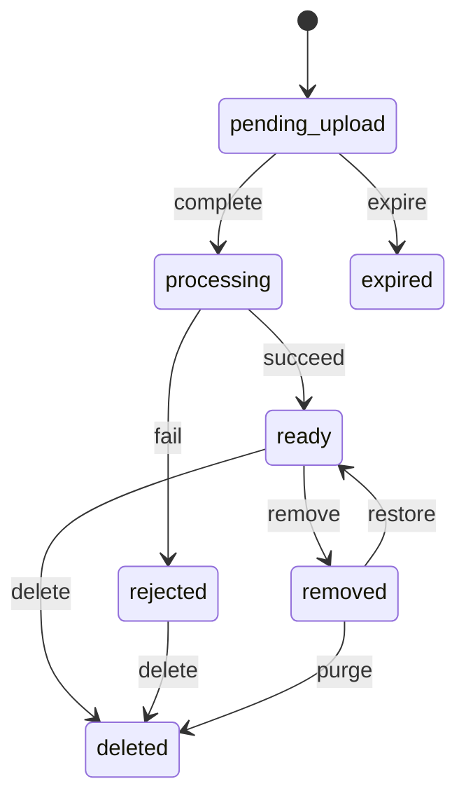

<!-- GENERATED by `npm run gen` from docs/api/modules/media.md. Do not edit: change the spec and regenerate. -->

# Media (`media`)

Every uploaded or generated file: images, video and documents. Uploads and signed download links, scanning and processing, renditions, alt text, ownership (seller, staff, customer, platform), image standard checks, where each file is used, and the rules for deleting, removing and retaining files (files in use or kept as evidence cannot be deleted).

- **Group:** Platform · **Launch phase:** 1 · **Plan chapters:** 5, 8, 13, 16, 17
- **Depends on:** nothing · **Optional:** [audit](../audit/README.md), [identity](../identity/README.md)
- **Required by:** [advertising](../advertising/README.md), [catalog](../catalog/README.md), [content](../content/README.md), [sellers](../sellers/README.md)

## Owns
- Upload sessions with expiring upload tickets (website and Android app): the bytes go to the API's PUT /uploads/{id}/content, streamed to storage
- Processing: malware scan, type sniffing, decoding, EXIF/GPS stripping, orientation, image renditions (product images: detail and thumb at the product image spec; other images: thumb to zoom), video poster and transcode, document page count
- The product image spec (setting productImage: aspect ratio, detail and thumbnail widths, quality), served to every app at GET /media/image-specs, enforced on product images, and the rebuild of existing product images when it changes
- Assets: kind, purpose, owner, visibility (public or private), alt text and title, status
- Image standard checks against rules supplied by the caller (catalog category rules, ad formats) plus platform baseline checks
- Usage tracking: which product, offer, return, case, review, ad or page uses a file
- Deletion rules: files in use cannot be deleted; evidence files are retained for the evidence period even after they stop being used
- Staff takedown (remove with reason, placeholder shown) and restore
- Signed download links (GET /files/{bucket}/{key}, served by the API): short-lived links for private files (verification documents, evidence, exports) after access checks, permanent links for public renditions
- Generated files from other modules (exports, statements, correction reports, data exports) with expiry
- Storage adapter (MEDIA_STORAGE): the server's local file system in production (MEDIA_STORAGE_DIR), memory in tests

**Not here:**
- Which images a product, offer or ad shows and in what order: catalog, offers, advertising, content (they attach assets by id)
- Image standards per category (minimum size, background, count): catalog; ad creative formats and sizes: advertising. media evaluates the rules they pass
- Whether a customer may attach evidence to a given return or case: returns and support (they call attach after their own checks)
- Content moderation decisions about reviews or listings: reviews, catalog, trust (they ask media to remove a file)

## Store API

| Method | Path | Purpose | Auth | Body → Response |
|---|---|---|---|---|
| POST | `/api/store/media/uploads` | Start an upload (return photos, case evidence, review photos, message attachments, seller application documents) | shopper | `UploadRequest` → `UploadTicket` |
| POST | `/api/store/media/uploads/{id}/complete` | Confirm the bytes are uploaded; processing starts | shopper | `MediaAsset` |
| PUT | `/api/store/media/uploads/{id}/content` | Send the file bytes of an upload | shopper | raw bytes → 204 No content |
| GET | `/api/store/media/assets/{id}` | My upload (poll until ready) | shopper | `MediaAsset` |
| PATCH | `/api/store/media/assets/{id}` | Describe my photo (alt text) | shopper | `AssetUpdate` → `MediaAsset` |
| DELETE | `/api/store/media/assets/{id}` | Remove my upload before submitting | shopper | 204 No content |
| GET | `/api/store/media/assets/{id}/download` | Signed link to one of my private files | shopper | `DownloadLink` |
| GET | `/api/store/media/image-specs` | The product image spec (aspect ratio and the detail and thumbnail sizes) | visitor | `ImageSpecs` |

## Seller API

| Method | Path | Purpose | Auth | Body → Response |
|---|---|---|---|---|
| POST | `/api/seller/media/uploads` | Start an upload (product images and video, store logo and banner, ad creatives, documents, inspection photos, return evidence, case evidence, bulk files) | seller `media.assets.upload` | `UploadRequest` → `UploadTicket` |
| POST | `/api/seller/media/uploads/{id}/complete` | Confirm the upload; processing starts | seller `media.assets.upload` | `MediaAsset` |
| PUT | `/api/seller/media/uploads/{id}/content` | Send the file bytes of an upload | seller `media.assets.upload` | raw bytes → 204 No content |
| GET | `/api/seller/media/assets` | Seller media library | seller | Page<MediaAsset> |
| GET | `/api/seller/media/assets/{id}` | One file with where it is used and whether it can be deleted | seller | `MediaAssetDetail` |
| PATCH | `/api/seller/media/assets/{id}` | Edit alt text or title | seller `media.assets.upload` | `AssetUpdate` → `MediaAsset` |
| DELETE | `/api/seller/media/assets/{id}` | Delete an unused file | seller `media.assets.upload` | 204 No content |
| POST | `/api/seller/media/assets/{id}/checks` | Check an image against category or placement rules before submitting | seller | `{ rules: ImageRules, rulesSource: string? }` → `ImageCheckResult` |
| GET | `/api/seller/media/assets/{id}/download` | Signed link to one of the seller's private files | seller | `DownloadLink` |
| GET | `/api/seller/media/image-specs` | The product image spec the Seller Center crops product photos to _(before seller is chosen)_ | seller | `ImageSpecs` |

## Admin API

| Method | Path | Purpose | Auth | Body → Response |
|---|---|---|---|---|
| POST | `/api/admin/media/uploads` | Start a staff upload (Official Store products, content, ad creatives, inspection photos, evidence) | staff `media.assets.manage` | `{ upload: UploadRequest, ownerKind: enum(platform|staff)? }` → `UploadTicket` |
| POST | `/api/admin/media/uploads/{id}/complete` | Confirm a staff upload | staff `media.assets.manage` | `MediaAsset` |
| PUT | `/api/admin/media/uploads/{id}/content` | Send the file bytes of a staff upload | staff `media.assets.manage` | raw bytes → 204 No content |
| GET | `/api/admin/media/assets` | All files with filters | staff `media.assets.view` | Page<MediaAsset> |
| GET | `/api/admin/media/assets/{id}` | File detail with usages, checks and history | staff `media.assets.view` | `MediaAssetDetail` |
| PATCH | `/api/admin/media/assets/{id}` | Edit alt text or title of a platform file | staff `media.assets.manage` | `AssetUpdate` → `MediaAsset` |
| POST | `/api/admin/media/assets/{id}/checks` | Check an image against rules | staff `media.assets.view` | `{ rules: ImageRules, rulesSource: string? }` → `ImageCheckResult` |
| POST | `/api/admin/media/assets/{id}/remove` | Take a file down (policy, rights, privacy) with a reason _(audited)_ | staff `media.assets.moderate` | `RemoveRequest` → `MediaAssetDetail` |
| POST | `/api/admin/media/assets/{id}/restore` | Restore a removed file _(audited)_ | staff `media.assets.moderate` | `{ reason: text }` → `MediaAssetDetail` |
| DELETE | `/api/admin/media/assets/{id}` | Delete an unused platform file _(audited)_ | staff `media.assets.manage` | 204 No content |
| GET | `/api/admin/media/assets/{id}/download` | Signed link to a private file (verification documents, evidence) _(audited)_ | staff `media.assets.view-private` | `DownloadLink` |
| GET | `/api/admin/media/image-specs` | The product image spec in force | staff | `ImageSpecs` |

## Webhooks

| Method | Path | Purpose | Auth | Body → Response |
|---|---|---|---|---|
| POST | `/webhooks/media/storage-events` | Object-created notifications from storage | provider | `{ events: StorageEvent[] }` → 204 No content |
| POST | `/webhooks/media/processing-results` | Video transcoding results | provider | `{ providerJobId: string, status: enum(succeeded|failed), outputs: Rendition[], durationSeconds: number?, error: string? }` → 204 No content |

## Types

### MediaOwner

| Field | Type |
|---|---|
| kind | `enum(seller|staff|customer|guest|platform)` |
| id | `string?` sellerId, staff accountId, customer accountId or guest session id |
| label | `string?` |

### UploadRequest

| Field | Type |
|---|---|
| purpose | `enum(product_image|product_video|brand_logo|store_logo|store_banner|offer_photo|ad_creative|ad_video|content_image|verification_document|return_evidence|case_evidence|review_photo|message_attachment|inspection_photo|bulk_file|other_document)` Decides allowed types, size limit, visibility and retention |
| fileName | `string` |
| contentType | `string` image/jpeg, image/png, image/webp, image/heic, video/mp4, application/pdf, text/csv… |
| sizeBytes | `int` |
| sha256 | `string?` Hex; verified after upload, also used to spot exact duplicates |
| alt | `string?` |

### UploadTicket

| Field | Type |
|---|---|
| uploadId | `uuid` |
| assetId | `uuid` |
| method | `enum(PUT|POST)` |
| url | `url` Where to send the bytes, with method and headers. With storage the API serves (local disk, memory) it is this API's PUT /uploads/{id}/content in the same area: send the caller's own Authorization header. With a direct-upload store it would be the store's signed URL |
| headers | `map<string>` |
| fields | `map<string>` Form fields for POST policy uploads |
| maxBytes | `int` |
| expiresAt | `datetime` |

### Rendition

| Field | Type |
|---|---|
| size | `enum(thumb|small|medium|large|zoom|detail|poster|video_720|video_1080)` Product images: detail (product page) and thumb (cards, lists) at the product image spec; images processed before it may also keep small to zoom. Other images: thumb, small, medium, large, zoom by renditionWidths |
| url | `url` Signed link to GET /files/{bucket}/{key}: permanent for public files (usable as ), short-lived for private ones |
| width | `int` |
| height | `int` |
| format | `string` webp, avif, jpeg, mp4 |
| bytes | `int` |

### MediaAsset

| Field | Type |
|---|---|
| id | `uuid` |
| kind | `enum(image|video|document|spreadsheet)` |
| purpose | `string` |
| status | `enum(pending_upload|processing|ready|rejected|removed|deleted|expired)` |
| fileName | `string` |
| contentType | `string` |
| sizeBytes | `int` |
| width | `int?` |
| height | `int?` |
| durationSeconds | `number?` |
| pageCount | `int?` |
| alt | `string?` Required before a product or content image can be published (catalog/content check) |
| title | `string?` |
| owner | `MediaOwner` |
| visibility | `enum(public|private)` |
| url | `url?` Public: permanent signed link to the medium rendition (images; the detail rendition for product images) or poster (video). Private files have no URL; use the download endpoint. |
| renditions | `Rendition[]` |
| check | `ImageCheckResult?` |
| rejectionReason | `string?` Unsupported or corrupt file, malware found, size or dimensions outside limits |
| inUse | `bool` |
| usageCount | `int` |
| retainUntil | `datetime?` Evidence files cannot be deleted before this |
| removedAt | `datetime?` Taken down by staff (status removed); null otherwise |
| removedReason | `string?` The takedown reason given by staff (status removed) |
| showPlaceholder | `bool?` Taken-down public files: true when url and the old rendition URLs serve the neutral placeholder, false when they stop serving (no url). Null unless removed |
| createdAt | `datetime` |
| readyAt | `datetime?` |

### UsageInput

| Field | Type |
|---|---|
| module | `string` |
| kind | `enum(product_image|product_video|variant_image|offer_photo|brand_logo|brand_banner|category_image|store_logo|store_banner|ad_creative|content_block|help_article|verification_document|return_evidence|case_evidence|order_evidence|inspection_photo|correction_evidence|trust_evidence|dispute_evidence|supplier_document|review_photo|message_attachment|bulk_file|generated)` Evidence kinds: verification_document, return_evidence, case_evidence, order_evidence, inspection_photo, correction_evidence, trust_evidence, dispute_evidence, supplier_document. The upload purposes each kind accepts are listed in the notes. |
| refId | `string` |
| refLabel | `string?` |

### Usage

| Field | Type |
|---|---|
| module | `string` |
| kind | `string` |
| refId | `string` |
| refLabel | `string?` |
| evidence | `bool` |
| attachedAt | `datetime` |
| detachedAt | `datetime?` |

### MediaAssetDetail

| Field | Type |
|---|---|
| asset | `MediaAsset` |
| usages | `Usage[]` |
| deletable | `bool` |
| deleteBlockedReason | `string?` Used by 2 products · Kept as return evidence until Oct 2028 |
| history | `TimelineEvent[]` |

### AssetUpdate

| Field | Type |
|---|---|
| alt | `string?` |
| title | `string?` |

### ImageRules

| Field | Type |
|---|---|
| minWidth | `int?` |
| minHeight | `int?` |
| minShortSide | `int?` |
| aspectRatios | `string[]` Allowed ratios, e.g. ['1:1', '4:5'] |
| aspectTolerance | `number?` Allowed deviation, e.g. 0.02 |
| background | `enum(any|white|light)?` |
| allowWatermark | `bool?` |
| allowTextOverlay | `bool?` |
| formats | `string[]` |
| maxBytes | `int?` |

### ImageMeasurements

| Field | Type |
|---|---|
| width | `int` |
| height | `int` |
| aspect | `number` |
| hasAlpha | `bool` |
| backgroundWhiteness | `number?` 0–1 share of near-white border pixels |
| sharpness | `number?` Variance-of-Laplacian score |
| watermarkLikely | `bool?` |
| textCoverage | `number?` 0–1 estimated area covered by text |
| duplicateOf | `uuid?` Same perceptual hash as another asset of this owner |

### ImageIssue

| Field | Type |
|---|---|
| code | `enum(too_small|wrong_aspect|background_not_white|watermark|blurry|text_overlay|format_not_allowed|too_large|duplicate)` |
| severity | `enum(blocking|warning)` |
| message | `string` Plain language for the seller: 'Image is 800 px wide; this category needs at least 1,000 px.' |

### ImageCheckResult

| Field | Type |
|---|---|
| assetId | `uuid` |
| passed | `bool` No blocking issues |
| rulesSource | `string?` e.g. catalog category Monitors, advertising opening_fullscreen mobile |
| measured | `ImageMeasurements` |
| issues | `ImageIssue[]` |
| checkedAt | `datetime` |

### DownloadLink

| Field | Type |
|---|---|
| url | `url` Signed link to GET /files/{bucket}/{key}, bound to the file, content type, disposition and expiry; no Authorization header needed (the signature is the token, checked by the auth middleware). Range requests are supported |
| expiresAt | `datetime` |
| fileName | `string` |
| contentType | `string` |
| sizeBytes | `int` |

### StorageEvent

| Field | Type |
|---|---|
| bucket | `string` |
| key | `string` |
| versionId | `string?` |
| sizeBytes | `int` |
| etag | `string` |
| at | `datetime` |

### RemoveRequest

| Field | Type |
|---|---|
| reason | `text` |
| showPlaceholder | `bool` Public URLs return a neutral placeholder instead of 404 |

### ImageSize

| Field | Type |
|---|---|
| width | `int` |
| height | `int` |

### ProductImageSpec

| Field | Type |
|---|---|
| aspectRatio | `string` W:H, e.g. 1:1 or 4:5 (setting media.productImage) |
| detailWidth | `int` Product page image width in px |
| thumbnailWidth | `int` Thumbnail width in px (cards, lists, cart, orders) |
| quality | `int` WebP and JPEG quality, 50–95 |
| ratio | `ImageSize` The ratio as two whole numbers |
| detail | `ImageSize` detailWidth × round(detailWidth × H ÷ W): the size product images are uploaded at, and their minimum |
| thumbnail | `ImageSize` thumbnailWidth × round(thumbnailWidth × H ÷ W) |

### ImageSpecs

| Field | Type |
|---|---|
| productImage | `ProductImageSpec` |

### RecropItem

| Field | Type |
|---|---|
| assetId | `uuid` |
| owner | `MediaOwner` |
| recrop | `bool` true: the image no longer has the spec's aspect ratio (re-crop it); false: it has it again |
| usages | `Usage[]` Active usages of the image (catalog: product_image and variant_image with the product id) |

## Status flows

### Asset (`MediaAsset.status`)

complete is called by the client (POST /uploads/{id}/complete) or by the storage notification webhook, whichever comes first; size and sha256 are verified. fail covers malware, unreadable or mismatched files and hard limits (status rejected with rejectionReason). delete is refused while the asset has active usages (ASSET_IN_USE) or before retainUntil (ASSET_RETAINED). remove (staff takedown) works even when in use: public URLs serve a placeholder, the original stays private for evidence, and media.asset.removed tells the using modules. Storage objects of deleted assets are erased after deletedGraceDays.

## Data (schema `media`)

**assets**

| Column | Type |
|---|---|
| id | uuid pk |
| kind | text |
| purpose | text |
| status | text |
| file_name | text |
| content_type | text |
| size_bytes | bigint |
| sha256 | text? |
| phash | bigint? (images) |
| width | int? |
| height | int? |
| duration_seconds | numeric? |
| page_count | int? |
| alt | text? |
| title | text? |
| owner_kind | text |
| owner_id | text? |
| owner_label | text? |
| visibility | text |
| storage_bucket | text |
| storage_key | text |
| check_result | jsonb? |
| rejection_reason | text? |
| removed_reason | text? |
| removed_by | text? |
| removed_at | timestamptz? (set while status is removed) |
| show_placeholder | bool? (while removed: public URLs serve the neutral placeholder; false = they stop serving) |
| retain_until | timestamptz? |
| expires_at | timestamptz? (generated files) |
| created_at | timestamptz |
| ready_at | timestamptz? |
| deleted_at | timestamptz? |
| processing_spec | jsonb? (product images: the spec their renditions were built with: aspectRatio, detailWidth, thumbnailWidth, quality, settingsVersion) |

Indexes: `(owner_kind, owner_id, created_at desc)`, `(status, created_at)`, `(purpose, created_at)`, `(owner_kind, owner_id, phash)`, `(retain_until)`, `(expires_at)`, `(storage_key)`

**renditions**

| Column | Type |
|---|---|
| asset_id | uuid → assets |
| size | text |
| storage_key | text |
| url | text |
| width | int |
| height | int |
| format | text |
| bytes | bigint |

Indexes: `pk (asset_id, size, format)`

**uploads**: Upload sessions (signed URL issued, waiting for bytes)

| Column | Type |
|---|---|
| id | uuid pk |
| asset_id | uuid → assets |
| expected_bytes | bigint |
| expected_sha256 | text? |
| url_expires_at | timestamptz |
| completed_at | timestamptz? |
| client_ip | inet? |
| created_by_kind | text |
| created_by_id | text? |

Indexes: `(url_expires_at) where completed_at is null`, `(asset_id)`

**usages**

| Column | Type |
|---|---|
| id | uuid pk |
| asset_id | uuid → assets |
| module | text |
| kind | text |
| ref_id | text |
| ref_label | text? |
| evidence | bool |
| attached_at | timestamptz |
| detached_at | timestamptz? |

Indexes: `(asset_id) where detached_at is null`, `unique (asset_id, module, kind, ref_id) where detached_at is null`, `(module, kind, ref_id)`

**processing_jobs**

| Column | Type |
|---|---|
| id | uuid pk |
| asset_id | uuid → assets |
| step | text (scan|probe|strip|renditions|transcode|check) |
| status | text |
| attempts | int |
| provider_ref | text? |
| error | text? |
| next_attempt_at | timestamptz? |
| created_at | timestamptz |
| finished_at | timestamptz? |

Indexes: `(status, next_attempt_at)`, `(provider_ref)`, `(asset_id)`

**upload_counters**: Daily per-owner counts and bytes for rate limits and quotas

| Column | Type |
|---|---|
| owner_kind | text |
| owner_id | text |
| day | date |
| count | int |
| bytes | bigint |

Indexes: `pk (owner_kind, owner_id, day)`

## Events

| Publishes | When | Payload | Consumed by |
|---|---|---|---|
| `media.asset.ready` | Processing finished and the file can be used | `{ assetId: uuid, kind: string, purpose: string, owner: MediaOwner }` | - |
| `media.asset.rejected` | Processing refused the file | `{ assetId: uuid, purpose: string, owner: MediaOwner, reason: string }` | - |
| `media.asset.removed` | Staff take a file down | `{ assetId: uuid, reason: text, usages: Usage[], by: Actor }` | - |
| `media.asset.restored` | A removed file is restored | `{ assetId: uuid, usages: Usage[], by: Actor }` | - |
| `media.asset.deleted` | A file is deleted | `{ assetId: uuid, owner: MediaOwner }` | - |
| `media.product_images.recrop_changed` | media.rebuild-product-renditions found product images whose aspect ratio no longer matches the product image spec (recrop true: flagged wrong_aspect, not blocking), or matches it again (recrop false); one event per batch of up to 50 images | `{ aspectRatio: string, items: RecropItem[] }` | catalog |
| `media.product_images.rebuilt` | media.rebuild-product-renditions finished a run that changed product images (their renditions are rebuilt at the spec in force): search re-indexes products | `{ aspectRatio: string, settingsVersion: int?, rebuilt: int, flagged: int, cleared: int }` | search |

| Consumes | From | Does |
|---|---|---|
| `settings.setting.changed` | settings | key media.productImage: start media.rebuild-product-renditions now (new sizes or quality rebuild the renditions of existing product images; a new aspect ratio flags the images that no longer match) |
| `sellers.seller.closed` | sellers | Mark the seller's never-used files for deletion after orphanGraceDays; evidence and files used by past orders' snapshots are kept until retainUntil |
| `customers.account.closed` | customers | Delete the customer's unused uploads; evidence attached to returns and cases is kept until retainUntil, then purged |

## In-process API (for other modules)

| Function | Signature | Used by |
|---|---|---|
| getAsset | `(assetId: uuid) => MediaAsset | null` Asset with renditions and status | catalog, offers, sellers, content, advertising, reviews, returns, support, messaging, customers |
| refs | `(assetIds: uuid[], size?: 'thumb' | 'small' | 'medium' | 'large' | 'zoom' | 'detail') => MediaRef[]` common.MediaRef (id, url, alt, width, height, fileName) for embedding in responses; removed files return the placeholder (or are left out when taken down without one). Default size medium. Product images (purpose product_image) keep only two sizes, detail and thumb: small and thumb answer thumb, medium, large, zoom and detail answer detail, and their refs also carry thumbUrl and detailUrl (null for other files). Other images keep thumb to zoom; detail answers medium for them. | catalog, offers, sellers, content, advertising, reviews, returns, support, messaging, search, cart, orders, wishlist |
| attach | `(assetId: uuid, usage: UsageInput, expectedOwner: MediaOwner) => void` Record that a record uses a file. Fails if the asset is not ready, belongs to another owner (ASSET_NOT_OWNED) or the purpose does not fit the usage. Evidence usages extend retainUntil. | catalog, offers, sellers, content, advertising, reviews, returns, support, messaging, warehouse, trust |
| detach | `(assetId: uuid, usage: { module: string, kind: string, refId: string }) => void` Record that a record no longer uses a file (image replaced, draft deleted) | catalog, offers, sellers, content, advertising, reviews, returns, support, messaging |
| checkImage | `(assetId: uuid, rules: ImageRules) => ImageCheckResult` Evaluate an image against category or placement rules; the result is stored on the asset | catalog, advertising, content, sellers |
| storeGeneratedFile | `(input: { owner: MediaOwner, fileName: string, contentType: string, body: ReadableStream, ttlHours?: int, purpose: 'export' | 'statement' | 'report' | 'correction_report' | 'data_export' | 'label' | 'gift_card_codes' }) => MediaAsset` Store a file produced by the platform (private). gift_card_codes files (a wallet gift card batch's codes) are sensitive: download links need the owning module's check and are recorded with a reason; they expire after ttlHours like every generated file. | audit, offers, customers, finance, reports, warehouse, shipping, inventory, wallet |
| signedDownload | `(assetId: uuid, principal: identity.Principal, reason?: string) => DownloadLink` Signed link for a private file after the caller's module checked access; recorded for sensitive purposes | customers, finance, reports, audit, sellers, returns, support |
| remove | `(assetId: uuid, input: { reason: string, by: Actor }) => void` Takedown on behalf of a moderation decision (trust, reviews, catalog) | trust, reviews, catalog, advertising |
| readFile | `(assetId: uuid, expectedOwner?: MediaOwner, opts?: { maxBytes?: int }) => { fileName: string, contentType: string, sizeBytes: int, body: Uint8Array }` The original bytes of a ready file, for modules that parse uploads in-process (offers bulk files, purchasing supplier files). Fails with ASSET_NOT_OWNED when expectedOwner is given and differs, ILLEGAL_TRANSITION when the asset is not ready, FILE_TOO_LARGE above maxBytes (default 25 MB). Works with every storage adapter (development disk included); callers never fetch signed URLs themselves. | offers, purchasing, catalog, inventory |
| storeInboundFile | `(input: { owner: MediaOwner, purpose: 'message_attachment' | 'case_evidence' | 'other_document', fileName: string, contentType: string, body: Uint8Array, source: string }) => MediaAsset` Store a file that arrived outside an upload session (inbound email attachments) under the purpose's type and size limits. It is processed like an upload (scan, strip, renditions) and starts in processing; the receiving module attaches it like any upload. Refused types and sizes fail with FILE_TYPE_NOT_ALLOWED or FILE_TOO_LARGE so the caller can tell the sender. source goes on the asset history, e.g. inbound-email:<providerEventId>. | notifications |
| findSimilar | `(assetId: uuid, scope: { ownerKind?: 'seller' | 'platform', ownerId?: string, usageKinds?: string[], maxDistance?: int, limit?: int }) => { assetId: uuid, distance: int, owner: MediaOwner, usages: Usage[] }[]` Ready images whose perceptual hash is within maxDistance (Hamming distance, default 6) of this image, closest first (default limit 20), for duplicate-product checks. Never returns private evidence files. | catalog |

## Permissions

| Key | Who | Allows |
|---|---|---|
| `media.assets.view` | staff | Browse all files and their usages |
| `media.assets.manage` | staff | Upload, edit and delete platform files (Official Store, content, ads, evidence) |
| `media.assets.moderate` | staff | Take files down and restore them (reason required) |
| `media.assets.view-private` | staff | Download private files of sellers and customers (verification documents, evidence); every download is recorded |
| `media.assets.upload` | seller | Upload and manage the seller's files |

## Error codes

| Code | Status | Meaning |
|---|---|---|
| `PURPOSE_NOT_ALLOWED` | 403 | This caller cannot upload files for that purpose. |
| `FILE_TYPE_NOT_ALLOWED` | 415 | Type not accepted for this purpose. details.allowed. |
| `FILE_TOO_LARGE` | 413 | Above the size limit for this purpose. details.maxBytes. |
| `QUOTA_EXCEEDED` | 429 | Daily upload count or storage quota reached. |
| `UPLOAD_INCOMPLETE` | 409 | The storage object is missing or smaller than declared. |
| `UPLOAD_EXPIRED` | 410 | The upload URL expired; start a new upload. |
| `CHECKSUM_MISMATCH` | 422 | The uploaded bytes do not match the declared sha256. |
| `ASSET_IN_USE` | 409 | The file is used by details.usages (product, offer, ad, page…); remove it there first. |
| `ASSET_RETAINED` | 409 | The file is kept as evidence until details.retainUntil. |
| `ASSET_NOT_OWNED` | 403 | The file belongs to another owner and cannot be attached here. |
| `DIRECT_UPLOAD_ONLY` | 409 | Storage takes the bytes directly at its own ticket URL, not through this API: send them to the ticket URL. |

## Background jobs

| Job | Schedule | Does |
|---|---|---|
| `media.process` | every minute | Also started at once when an upload completes. Scan, probe, strip metadata, build renditions, run baseline image checks, start video transcodes; retry with backoff; publish media.asset.ready or media.asset.rejected |
| `media.rebuild-product-renditions` | hourly | Also started at once when media.productImage changes. Ready product images built with another spec (or before the spec existed) get their detail and thumb renditions rebuilt from the stored original at the spec in force (same storage keys, never enlarged; older small to zoom files are kept for order snapshots and old links), and their wrong_aspect flag set or cleared; at most rebuildBatchLimit images per run, in batches with a pause; idempotent. Publishes media.product_images.recrop_changed per batch and media.product_images.rebuilt with the counts, which are also logged and recorded in the audit history |
| `media.expire-uploads` | hourly | Expire pending uploads past pendingUploadExpiryHours and delete partial objects |
| `media.sweep-orphans` | daily | Delete ready files never attached to anything after orphanGraceDays (except generated files, which follow their own expiry) |
| `media.expire-generated` | hourly | Delete generated files (exports, reports) past expires_at |
| `media.purge-deleted` | daily | Erase storage objects of deleted assets after deletedGraceDays and of removed evidence after retainUntil |
| `media.reconcile-storage` | weekly | Compare storage listing with assets; report orphaned objects and missing files |

## Settings

| Key | Default | Rules | Meaning |
|---|---|---|---|
| productImage | `{"aspectRatio":"1:1","detailWidth":800,"thumbnailWidth":320,"quality":80}` | json, approval: second reviewer, seller-visible | Product images: aspect ratio W:H (whole numbers 1–32, height ÷ width 0.5–2), detail width 480–2048 px (product page; also the minimum upload size), thumbnail width 120–640 px (smaller than detail; cards and lists), WebP/JPEG quality 50–95. Heights follow from the ratio. New uploads use it from the effective date; existing images are rebuilt (sizes, quality) or flagged for re-crop (ratio) by media.rebuild-product-renditions |
| rebuildBatchLimit | `500` | int, 10–10000 | Product images media.rebuild-product-renditions rebuilds per run (the rest wait for the next run) |
| limitsByPurpose | `{"product_image":{"maxMB":20,"types":["jpeg","png","webp"]},"product_video":{"maxMB":500,"types":["mp4","mov"]},"ad_creative":{"maxMB":5,"types":["jpeg","png","webp"]},"verification_document":{"maxMB":10,"types":["pdf","jpeg","png"]},"return_evidence":{"maxMB":15,"types":["jpeg","png","webp","heic","mp4"]},"bulk_file":{"maxMB":25,"types":["csv","xlsx"]}}` | json, seller-visible | Size and type limits per purpose (others default to 20 MB images, 25 MB documents). Product images are never HEIC, whatever this lists |
| renditionWidths | `{"thumb":160,"small":320,"medium":640,"large":1280,"zoom":2048}` | json | Image rendition widths (WebP plus JPEG fallback) |
| baselineImageRules | `{"minShortSide":500,"formats":["jpeg","png","webp"]}` | json, seller-visible | Checks applied to every image regardless of caller rules (product images: the product image spec's minimum size replaces minShortSide) |
| uploadUrlTtlMinutes | `15` | duration, minutes, 1–60 | Upload ticket lifetime (the bytes must arrive before it ends) |
| downloadUrlTtlMinutes | `10` | duration, minutes, 1–60 | Signed download link lifetime for private files (public renditions have permanent links) |
| pendingUploadExpiryHours | `24` | duration, hours, 1–… | Pending uploads expire after this |
| orphanGraceDays | `30` | duration, days, 1–… | Never-attached files are deleted after this |
| evidenceRetentionDays | `730` | duration, days, 365–…, approval: business owner | Evidence files are kept at least this long after their last use (business decision to confirm) |
| deletedGraceDays | `7` | duration, days, 0–… | Storage objects of deleted files are erased after this |
| customerUploadsPerDay | `50` | int, 1–… | Uploads per customer or guest per day |
| sellerStorageQuotaGB | `20` | int, GB, 1–…, seller-visible | Storage per seller (QUOTA_EXCEEDED above it) |

## Integrations
- **Local file system (owner decision: no S3)**: MEDIA_STORAGE=local: two buckets as folders under MEDIA_STORAGE_DIR, public (renditions) and private (originals, documents, evidence, generated files); metadata beside them, atomic writes (temp file + rename), streaming in both directions. Uploads arrive at PUT /api/{area}/media/uploads/{id}/content; downloads are served at GET /files/{bucket}/{key} by signed links the auth middleware verifies (docs/03-auth-middleware.md). MEDIA_STORAGE=memory (tests) behaves the same in memory. The folder must be backed up with the database, and shared between servers when there is more than one. An S3-compatible adapter (presigned uploads and downloads, object-created notifications at POST /webhooks/media/storage-events) can still be added behind the same port.
- **Image processing (sharp / libvips, MEDIA_IMAGE_PROCESSOR=sharp)**: Decode (a file that doesn't decode is rejected), auto-orient, strip EXIF and GPS, cover-fit resize (centred, never enlarged), renditions in WebP and JPEG, perceptual hash, background and sharpness measurements. The prebuilt binaries can't decode HEIC: HEIC files of other purposes are kept as uploaded (header probe, no renditions); product images are never HEIC. MEDIA_IMAGE_PROCESSOR=dev (the test default) reads headers only and copies bytes
- **Video transcoding service**: MP4 720p/1080p and poster frame for optional product and ad videos; results by webhook
- **Malware scanning (ClamAV or provider)**: Scan every upload before it becomes ready; documents and spreadsheets are never served inline
- **CDN (optional)**: May cache GET /files/marketly-public/… (public renditions, permanent links, Cache-Control public for an hour); a takedown replaces the file at the same link, so cached copies follow within that hour unless purged

## Notes
- Upload flow (website and Android): 1) POST /uploads with purpose, type, size → upload ticket (URL, method, headers, maxBytes, expiresAt); 2) send the bytes to the ticket URL: PUT /api/{area}/media/uploads/{id}/content with the caller's Authorization header (local-disk storage; the API streams them to disk, refusing more than maxBytes); 3) POST /uploads/{id}/complete → 202 processing; 4) poll GET /assets/{id} or just attach: attach waits for ready and returns ILLEGAL_TRANSITION if processing failed. The app can upload several files in parallel and resume after a network change by starting a new upload.
- Ownership: seller uploads belong to the seller account (any member with media.assets.upload), never to the person; staff uploads for Official Store, content and ads belong to the platform; customer uploads belong to the customer account, guest uploads to the guest session until attached to their return or case. A file can only be attached by its owner's module calls (attach checks expectedOwner), so a seller cannot reuse another seller's images.
- Deletion rules: a file in use cannot be deleted (ASSET_IN_USE); files attached as evidence (return, case, order, inspection, verification, catalog correction, trust, payment dispute, supplier document) get retainUntil = last use + evidenceRetentionDays and cannot be deleted before that (ASSET_RETAINED) even if the record is closed. Past orders keep their product snapshot image URL; removing a product image does not break past orders because snapshot renditions are kept while referenced (usage kind order_evidence is attached by orders when a snapshot is taken).
- Image standards: catalog owns per-category rules and passes them to checkImage when a seller submits; the result (measurements and plain-language issues) is stored on the asset and returned by catalog with the submission. media itself only enforces the platform baseline (minimum short side, formats) and the product image spec.
- Product images (purpose product_image; also what variant_image and offer_photo usages take when they use one): the setting productImage (aspect ratio W:H, detailWidth, thumbnailWidth, quality) is the spec, served by GET /api/{store|seller|admin}/media/image-specs. Clients crop to the ratio and upload at the detail size (no server-side crop rectangle). Processing builds exactly two renditions from the stripped original, detail (detailWidth × detailHeight) and thumb (thumbnailWidth × thumbnailHeight), each WebP and JPEG at quality, cover-fit and centred (a safety net: correct uploads already have the ratio), never enlarged; an image off the ratio (a staff upload used elsewhere, an image from before a ratio change) keeps its own ratio at those widths. The spec used is stored on the asset (processing_spec). Checks: the ratio within 1% (wrong_aspect: 'Crop the image to 4:5. The Seller Center crops it for you when you upload.') and at least the detail size (too_small: 'The image must be at least 800 × 1000.'). Seller uploads (the Seller Center uploads only product photos with this purpose) that fail either are rejected (media.asset.rejected, rejectionReason). Staff uploads are not rejected (the purpose also serves category and content images); attaching one that fails to a product_image, variant_image or offer_photo usage answers VALIDATION_FAILED with the same message. HEIC is refused for product images at upload (FILE_TYPE_NOT_ALLOWED). Category image standards' aspectRatios are ignored for product photos: the global ratio wins. refs answers small/thumb with the thumb rendition and medium/large/zoom/detail with the detail rendition (images processed before the spec: small and large), and fills MediaRef.thumbUrl and detailUrl. When the setting changes, media.rebuild-product-renditions rebuilds existing images (new sizes or quality; same keys, so links keep working) and flags the images whose ratio no longer matches (wrong_aspect warning, not blocking: products stay live; catalog shows Re-crop images and tells the sellers), then search re-indexes.
- Usage kinds and the upload purposes they accept: product_image and variant_image ← product_image; product_video ← product_video; offer_photo ← offer_photo, product_image; brand_logo ← brand_logo; brand_banner ← store_banner, content_image; category_image ← content_image, product_image; store_logo ← store_logo; store_banner ← store_banner; ad_creative ← ad_creative, ad_video; content_block ← content_image, product_image, product_video, ad_creative; help_article ← content_image; verification_document ← verification_document, other_document; return_evidence ← return_evidence; case_evidence ← case_evidence, return_evidence, inspection_photo, message_attachment, verification_document; order_evidence ← product_image, offer_photo, product_video; inspection_photo ← inspection_photo; correction_evidence ← product_image, other_document, verification_document, case_evidence; trust_evidence ← case_evidence, return_evidence, inspection_photo, message_attachment, verification_document, other_document, product_image; dispute_evidence ← case_evidence, return_evidence, inspection_photo, message_attachment, other_document; supplier_document ← other_document, inspection_photo, bulk_file; review_photo ← review_photo; message_attachment ← message_attachment; bulk_file ← bulk_file; generated ← generated purposes.
- Who attaches what (every file a module keeps must be attached, or media.sweep-orphans deletes it after orphanGraceDays): catalog brand banners (brand_banner), category images (category_image), correction evidence (correction_evidence); trust report, appeal and proof files (trust_evidence; reporters and appellants upload them with purpose case_evidence, there is no trust upload purpose); payments dispute evidence (dispute_evidence); purchasing PO attachments (supplier_document) and receipt damage photos (inspection_photo); warehouse damage and return-parcel photos (inspection_photo); inventory discrepancy photos (inspection_photo); orders product snapshot images (order_evidence); wallet gift card code files are generated files (storeGeneratedFile, no usage needed).
- Privacy: EXIF and GPS are stripped from every image before any rendition is public, which matters for customer return photos taken on phones.
- Downloads (GET /files/{bucket}/{key}, served by the API, not a spec endpoint): an  or a download link can't send an Authorization header, so the link's signature is its token: HMAC-SHA256 with secretFor(config, 'media.files') over the bucket, key, expiry (exp), content type (ct) and disposition (cd), verified by the auth middleware as its own auth kind (file-link) before media code runs. Missing or tampered signature → 401 UNAUTHORIZED (details.reason link_missing / link_invalid); expired → 403 FORBIDDEN (link_expired): ask the API for a new link. Private files: links from the download endpoints, refs and asset views, valid downloadUrlTtlMinutes. Public renditions: permanent links (no exp), accepted only for the public bucket, built from the key on every read. Range requests (206, 416), HEAD, ETag / If-None-Match and Last-Modified / If-Modified-Since (304) are supported. Cache-Control: public renditions public, max-age=3600; private inline files private, max-age up to the link's expiry (at most an hour); attachments private, no-store. Every file is served with nosniff and a sandboxing Content-Security-Policy, so an uploaded file never runs as a page. Rotating APP_SECRET changes the key: links already handed out, including public image URLs other modules stored (order snapshots), stop working.
- Storage keys are '/'-separated segments of letters, digits, '.', '_' and '-' (no '..', no leading dot, no Windows device names); the storage adapters refuse any other key, so a key can never reach outside its bucket folder.
