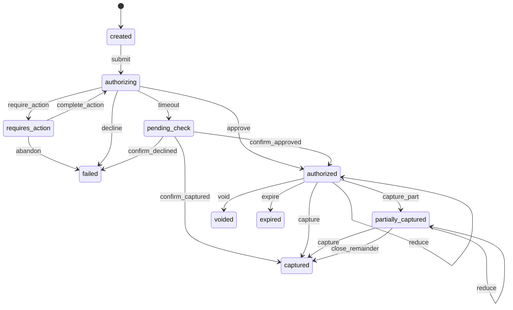
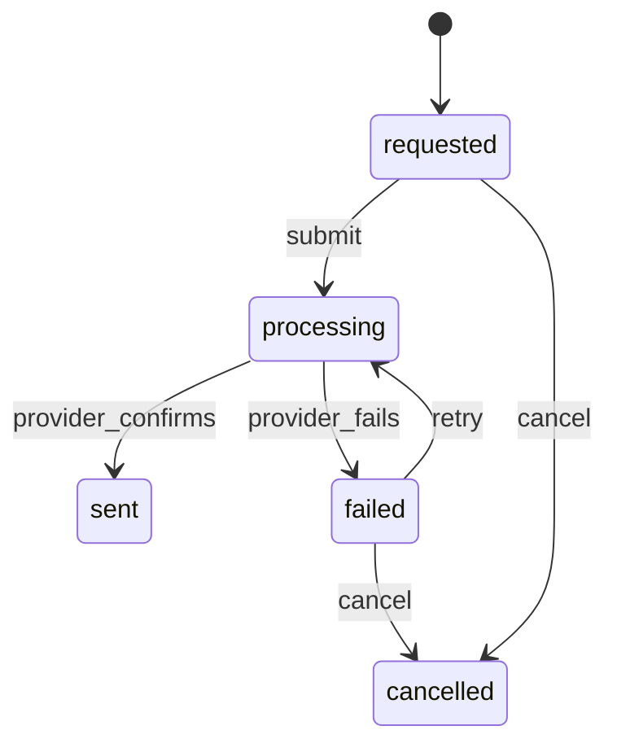
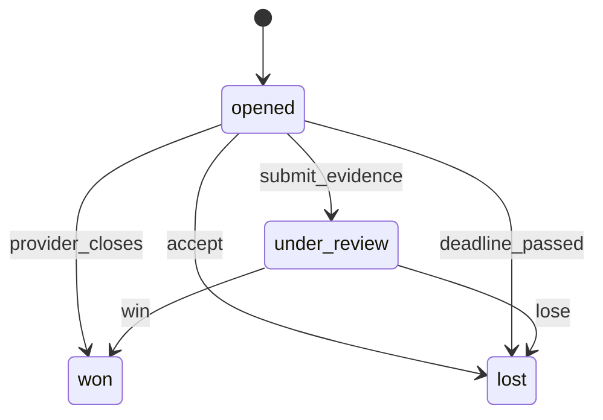

<!-- GENERATED by `npm run gen` from docs/api/modules/payments.md. Do not edit: change the spec and regenerate. -->

# Payments (`payments`)

Charging customers through provider adapters (card, digital wallet): payment intents per checkout attempt, authorization and capture per order and seller group, declines with retry, uncertain results resolved by a status-check job, refund execution (Requested → Processing → Sent / Failed) capped at the remaining refundable amount, chargebacks and payment disputes, saved payment methods and provider webhooks.

- **Group:** Buying · **Launch phase:** 1 · **Plan chapters:** 6, 7, 13, 14
- **Depends on:** [orders](../orders/README.md) · **Optional:** [access](../access/README.md), [customers](../customers/README.md), [media](../media/README.md), [wallet](../wallet/README.md), [audit](../audit/README.md), [checkout](../checkout/README.md), [inventory](../inventory/README.md), [promotions](../promotions/README.md), [support](../support/README.md), [trust](../trust/README.md), [identity](../identity/README.md)
- **Required by:** [checkout](../checkout/README.md), [finance](../finance/README.md), [returns](../returns/README.md), [wallet](../wallet/README.md)

## Owns
- Payment intents: one per checkout payment attempt, with tender split (card or wallet, plus store credit in phase 3), method snapshot and allocation to seller groups
- Authorization, capture (on acceptance, or per seller group on dispatch) and voids
- Declines with a customer-safe reason and retry with the same or another method; the cart and order reference are kept by checkout
- Uncertain results (timeouts, provider errors): pending check with a status-check job, never a second charge
- Orphan detection: money authorized or captured without an order is voided or refunded
- Refund execution for full orders, selected items and partial amounts: cap at the remaining refundable amount per item, duplicate prevention, destination and timing, Requested → Processing → Sent / Failed with provider-checked retries
- Chargebacks and payment disputes queue with evidence deadlines
- Saved payment methods: tokenized at the provider, label, brand, last 4 and expiry, default, removable without affecting receipts
- Provider adapters and provider webhooks

**Not here:**
- Refund requests and their approval (Requested, Under review, Approved): returns; payments starts at hand-over
- Cancellation decisions and refund amounts for cancellations: orders
- Seller balances, holds for chargebacks, fee reversals and the daily reconciliation (payments vs orders, provider deposits): finance
- Store credit balances and holds: wallet (phase 3)
- Checkout steps, idempotent order placement and the payment-result page flow: checkout

## Store API

| Method | Path | Purpose | Auth | Body → Response |
|---|---|---|---|---|
| GET | `/api/store/payments/options` | Accepted methods, saved cards, wallet availability and new-card setup | shopper | `PaymentOptions` |
| GET | `/api/store/payments/intents/{id}` | Payment result for the payment-result page (accepted, pending check, failed) | shopper | `PaymentStatusView` |
| POST | `/api/store/payments/intents/{id}/check` | Ask the provider for the result now ('Check now') | shopper | `PaymentStatusView` |
| GET | `/api/store/payments/methods` | Saved cards and wallets | customer | `SavedPaymentMethod[]` |
| POST | `/api/store/payments/methods/setup` | Start adding a card (provider fields receive the card number) | customer | `SetupSession` |
| POST | `/api/store/payments/methods` | Save a card after the provider confirmed the setup | customer | `{ setupToken: string, label: string?, billingAddressId: uuid?, billingAddress: Address?, makeDefault: bool? }` → `SavedPaymentMethod` |
| PATCH | `/api/store/payments/methods/{id}` | Change the label, billing address or expiry date | customer | `{ label: string?, billingAddressId: uuid?, billingAddress: Address?, expMonth: int?, expYear: int? }` → `SavedPaymentMethod` |
| POST | `/api/store/payments/methods/{id}/make-default` | Use this card by default at checkout | customer | `SavedPaymentMethod` |
| DELETE | `/api/store/payments/methods/{id}` | Remove a saved card | customer | 204 No content |
| GET | `/api/store/payments/refunds` | My refunds with status (Requested, Processing, Sent, Failed) | customer | Page<RefundView> |
| GET | `/api/store/payments/refunds/{id}` | One refund with destination and timing | shopper | `RefundView` |
| POST | `/api/store/payments/refunds/{id}/destination` | Choose where a failed refund should go instead _(idempotent)_ | shopper | `{ savedMethodId: uuid?, providerToken: string?, storeCredit: bool? }` → `RefundView` |

## Admin API

| Method | Path | Purpose | Auth | Body → Response |
|---|---|---|---|---|
| GET | `/api/admin/payments/payments` | Payments with status and flags (pending check, orphan, capture failed, chargeback) | staff<br>`payments.payments.view` | Page<PaymentRow> |
| GET | `/api/admin/payments/payments/{id}` | Payment with tenders, allocations, captures, refunds, disputes, provider calls and webhooks | staff<br>`payments.payments.view` | `PaymentDetail` |
| GET | `/api/admin/payments/orders/{orderId}/summary` | Payment panel of an order (method, authorized, captured, processor ref, refunded, attempts) | staff<br>`payments.payments.view` | `OrderPaymentSummary` |
| GET | `/api/admin/payments/orders/{orderId}/refundable` | Remaining refundable amount per item (the cap shown in refund dialogs) | staff<br>`payments.payments.view` | `RefundableSummary` |
| POST | `/api/admin/payments/payments/{id}/check` | Ask the provider for the current result | staff<br>`payments.payments.manage` | `PaymentDetail` |
| POST | `/api/admin/payments/payments/{id}/capture` | Capture an authorization manually (e.g. after a capture failure) _(idempotent, audited)_ | staff<br>`payments.payments.manage` | `{ amount: Money?, groupId: uuid?, reason: text, reauthToken: string? }` → `PaymentDetail` |
| POST | `/api/admin/payments/payments/{id}/void` | Void an authorization that should not be captured _(idempotent, audited)_ | staff<br>`payments.payments.manage` | `{ reason: text, reauthToken: string? }` → `PaymentDetail` |
| POST | `/api/admin/payments/payments/{id}/resolve-orphan` | Refund or link a payment that has no order _(idempotent, audited)_ | staff<br>`payments.payments.manage` | `{ action: enum(refund|link_to_order), orderId: uuid?, reason: text, reauthToken: string? }` → `PaymentDetail` |
| GET | `/api/admin/payments/refunds` | Refund executions, e.g. failing refunds | staff<br>`payments.refunds.view` | Page<Refund> |
| GET | `/api/admin/payments/refunds/{id}` | One refund with items, attempts and history | staff<br>`payments.refunds.view` | `Refund` |
| POST | `/api/admin/payments/refunds/{id}/check` | Ask the provider for the refund's outcome | staff<br>`payments.refunds.manage` | `Refund` |
| POST | `/api/admin/payments/refunds/{id}/retry` | Retry a failed refund (checks the provider first) _(idempotent, audited)_ | staff<br>`payments.refunds.manage` | `{ reason: text, reauthToken: string? }` → `Refund` |
| POST | `/api/admin/payments/refunds/{id}/request-destination` | Ask the customer for a new payment method for a failed refund _(audited)_ | staff<br>`payments.refunds.manage` | `{ message: text? }` → `Refund` |
| POST | `/api/admin/payments/refunds/{id}/cancel` | Cancel a requested or failed refund with a reason _(audited)_ | staff<br>`payments.refunds.manage` | `{ reason: text, reauthToken: string? }` → `Refund` |
| GET | `/api/admin/payments/disputes` | Chargebacks and payment disputes, evidence due first | staff<br>`payments.disputes.manage` | Page<Dispute> |
| GET | `/api/admin/payments/disputes/{id}` | One dispute with order, evidence and seller balance effect | staff<br>`payments.disputes.manage` | `Dispute` |
| POST | `/api/admin/payments/disputes/{id}/assign` | Set the owner _(audited)_ | staff<br>`payments.disputes.manage` | `{ ownerStaffId: uuid }` → `Dispute` |
| POST | `/api/admin/payments/disputes/{id}/evidence` | Save or submit evidence (tracking, delivery proof, messages, receipts) _(audited)_ | staff<br>`payments.disputes.manage` | `{ text: text, fileIds: uuid[]?, submit: bool }` → `Dispute` |
| POST | `/api/admin/payments/disputes/{id}/accept` | Concede the dispute (the provider keeps the money) _(audited)_ | staff<br>`payments.disputes.manage` | `{ reason: text }` → `Dispute` |

## Webhooks

| Method | Path | Purpose | Auth | Body → Response |
|---|---|---|---|---|
| POST | `/webhooks/payments/providers/{provider}/events` | Payment provider events (authorization, capture, refund, dispute, card updates) | provider | `json` → `{ received: bool }` |

## Types

### MethodSnapshot

| Field | Type |
|---|---|
| kind | `enum(card|digital_wallet|store_credit)` |
| brand | `string?` |
| last4 | `string?` |
| expMonth | `int?` |
| expYear | `int?` |
| wallet | `enum(apple_pay|google_pay)?` |
| label | `string` 'Visa •••• 4417'; kept on the payment even if the saved method is removed |
| savedMethodId | `uuid?` |

### Tender

| Field | Type |
|---|---|
| kind | `enum(card|digital_wallet|store_credit)` |
| amount | `Money` |
| creditHoldId | `uuid?` wallet hold (phase 3) |

### Allocation

| Field | Type |
|---|---|
| groupId | `uuid` |
| ownerType | `enum(official|seller)` |
| sellerId | `uuid?` |
| amount | `Money` |

### MethodSelection

| Field | Type |
|---|---|
| kind | `enum(saved_card|new_card|digital_wallet)` |
| savedMethodId | `uuid?` |
| providerToken | `string?` Single-use token from the provider's card fields or wallet sheet; card numbers never reach Marketly |
| saveForLater | `bool?` |
| label | `string?` |
| billingAddress | `Address?` |

### AuthorizeInput

| Field | Type |
|---|---|
| checkoutSessionId | `uuid` |
| attemptNo | `int` |
| customerId | `uuid?` |
| guestEmail | `email?` |
| amount | `Money` The whole order total, store-credit share included. The card is authorized for amount − creditAmount |
| method | `MethodSelection` |
| creditHoldId | `uuid?` wallet hold of the store-credit share (checkout holds it before authorizing) |
| creditAmount | `Money?` Store-credit share of amount (the wallet hold); null or absent when no credit is used. Must not exceed amount; when it equals amount nothing is authorized on the card |
| description | `string` |
| returnUrl | `url` Where the provider sends the customer back after a bank challenge |

### AuthorizeResult

| Field | Type |
|---|---|
| intentId | `uuid` |
| state | `enum(accepted|failed|pending_check|requires_action)` |
| decline | `Decline?` |
| nextAction | `NextAction?` |
| methodLabel | `string` |

### Decline

| Field | Type |
|---|---|
| code | `string` Provider or bank code, e.g. 05 |
| category | `enum(insufficient_funds|card_declined|expired_card|incorrect_details|authentication_failed|processing_error|fraud_suspected)` |
| message | `string` Customer-safe text: 'Your bank declined Visa •••• 4417. Nothing was charged.' |
| advice | `string` |
| retryable | `bool` |

### NextAction

| Field | Type |
|---|---|
| kind | `enum(three_ds_challenge|redirect|wallet_sheet)` |
| url | `url?` |
| clientSecret | `string?` |

### PaymentStatusView

| Field | Type |
|---|---|
| intentId | `uuid` |
| checkoutSessionId | `uuid` |
| state | `enum(accepted|pending|failed|requires_action)` Customer view: Accepted, Pending (being checked), Failed |
| title | `string` |
| message | `string` Pending: 'We're confirming your payment with your bank. Don't pay again.' |
| methodLabel | `string` |
| amount | `Money` |
| orderId | `uuid?` |
| orderRef | `string?` |
| placedAt | `datetime?` When the order was placed (orders' placedAt); null while no order exists |
| failedAt | `datetime?` When the payment failed (state failed only) |
| lastCheckedAt | `datetime?` |
| nextCheckInSeconds | `int?` |
| decline | `Decline?` |
| retryAllowed | `bool` |
| holdNote | `string?` 'Your bank may show a temporary hold for $429.98. Placing the order again could create a second hold.' |
| nextAction | `NextAction?` |

### SavedPaymentMethod

| Field | Type |
|---|---|
| id | `uuid` |
| kind | `enum(card|digital_wallet)` |
| brand | `string` |
| label | `string` Customer's name for it, e.g. 'Work Mastercard' |
| last4 | `string` |
| expMonth | `int` |
| expYear | `int` |
| expired | `bool` |
| isDefault | `bool` |
| billingSummary | `string` 'Home, Portland 97205' |
| createdAt | `datetime` |

### SetupSession

| Field | Type |
|---|---|
| provider | `string` |
| clientSecret | `string` |
| publishableKey | `string` |
| expiresAt | `datetime` |

### PaymentOptions

| Field | Type |
|---|---|
| acceptedBrands | `string[]` |
| savedMethods | `SavedPaymentMethod[]` |
| walletAvailable | `bool` |
| walletKinds | `enum(apple_pay|google_pay)[]` |
| newCard | `SetupSession` |
| chargeNote | `string` 'Your card is charged once, when the order is accepted. Each seller is paid by Marketly after delivery.' |

### Capture

| Field | Type |
|---|---|
| id | `uuid` |
| groupId | `uuid?` |
| amount | `Money` Card amount captured; 0 for a credit-only capture (store credit alone paid the order or group, no provider call) |
| creditAmount | `Money?` Store-credit share charged with this capture; null when no credit was used |
| status | `enum(pending|succeeded|failed|unknown)` |
| providerRef | `string?` |
| at | `datetime` |

### ProviderCall

| Field | Type |
|---|---|
| at | `datetime` |
| operation | `enum(authorize|capture|void|partial_void|refund|retrieve|setup|detach|dispute_retrieve|dispute_evidence|dispute_accept)` partial_void lowers an authorization when the adapter supports it; dispute_* calls are logged against the dispute's intent |
| outcome | `enum(ok|declined|error|timeout)` |
| providerRef | `string?` |
| message | `string?` |

### WebhookLog

| Field | Type |
|---|---|
| id | `uuid` |
| type | `string` |
| receivedAt | `datetime` |
| processedAt | `datetime?` |
| outcome | `string` |

### PaymentRow

| Field | Type |
|---|---|
| id | `uuid` |
| ref | `string` |
| orderId | `uuid?` |
| orderRef | `string?` |
| checkoutSessionId | `uuid` |
| customerName | `string` |
| amount | `Money` |
| methodLabel | `string` |
| status | `string` |
| statusLabel | `string` |
| provider | `string` |
| flags | `enum(orphan|pending_check|capture_failed|chargeback|partly_refunded|refunded)[]` |
| createdAt | `datetime` |

### PaymentDetail

| Field | Type |
|---|---|
| id | `uuid` |
| ref | `string` PAY-XXXXXXXX |
| checkoutSessionId | `uuid` |
| attemptNo | `int` |
| orderId | `uuid?` |
| orderRef | `string?` |
| customerId | `uuid?` |
| guestEmail | `email?` |
| amount | `Money` |
| tenders | `Tender[]` |
| method | `MethodSnapshot` |
| provider | `string` |
| providerRef | `string?` Processor reference, e.g. ch_3PqK8e2L0dX41 |
| status | `enum(created|requires_action|authorizing|pending_check|authorized|partially_captured|captured|failed|voided|expired)` |
| customerState | `enum(accepted|pending|failed|partly_refunded|refunded)` |
| decline | `Decline?` |
| allocations | `Allocation[]` |
| authorizedAmount | `Money` |
| capturedAmount | `Money` |
| refundedAmount | `Money` |
| authorizedAt | `datetime?` |
| capturedAt | `datetime?` |
| authorizationExpiresAt | `datetime?` |
| lastCheckedAt | `datetime?` |
| orphan | `bool` Authorized or captured with no order after orphanGraceMinutes |
| captures | `Capture[]` |
| refunds | `Refund[]` |
| disputes | `Dispute[]` |
| calls | `ProviderCall[]` |
| webhooks | `WebhookLog[]` |
| createdAt | `datetime` |

### OrderPaymentSummary

| Field | Type |
|---|---|
| orderId | `uuid` |
| state | `string` |
| methodLabel | `string` |
| authorizedAt | `datetime?` |
| capturedAt | `datetime?` |
| processorRef | `string?` |
| captured | `Money` |
| refunded | `Money` |
| inFlight | `Money` |
| remainingRefundable | `Money` |
| attempts | `PaymentRow[]` |

### RefundableItem

| Field | Type |
|---|---|
| orderItemId | `uuid` |
| title | `string` |
| groupId | `uuid` |
| sellerName | `string` |
| paid | `Money` |
| refunded | `Money` |
| inFlight | `Money` Requested, processing and failed refunds: a failed refund keeps reserving its amount (it may still be retried or sent to a new destination) until it is sent or cancelled, so no second refund can take the same money |
| remaining | `Money` |
| blockedReason | `string?` e.g. 'In transit: refund after delivery or a confirmed loss' |

### RefundableSummary

| Field | Type |
|---|---|
| orderId | `uuid` |
| captured | `Money` |
| refunded | `Money` |
| inFlight | `Money` Requested, processing and failed refunds (a failed refund reserves its amount until sent or cancelled) |
| remaining | `Money` Captured less refunded and in flight |
| items | `RefundableItem[]` |

### RefundItem

| Field | Type |
|---|---|
| orderItemId | `uuid` |
| title | `string` |
| groupId | `uuid` |
| sellerId | `uuid?` |
| amount | `Money` |

### Refund

| Field | Type |
|---|---|
| id | `uuid` |
| ref | `string` RF-YYMMDD-NNNN (the returns request reference when handed over by returns) |
| orderId | `uuid` The order refunded; for an orphan payment refund (money without an order) the checkout session id, as on the refund events (refunds.order_id is null then) |
| checkoutSessionId | `uuid` Checkout session of the payment refunded |
| orderRef | `string` |
| paymentIntentId | `uuid` |
| customerName | `string` Customer on the payment (customers profile name, or the guest email for guest orders); shown in the admin failing-refunds table |
| origin | `enum(cancellation|return|case|exception|correction|orphan_payment)` |
| originId | `uuid?` |
| originRef | `string?` e.g. RT-261006-0193, CS-261007-0412 |
| items | `RefundItem[]` |
| amount | `Money` |
| destination | `enum(original_method|store_credit|new_method)` |
| destinationLabel | `string` 'Visa •••• 4417' or 'Marketly store credit' |
| status | `enum(requested|processing|sent|failed|cancelled)` |
| statusLabel | `string` |
| attempts | `int` |
| maxAttempts | `int` |
| lastAttemptAt | `datetime?` When the latest provider attempt (send, retry or status check) was made; 'why it failed' shows method and this time |
| outcomeUnknown | `bool` Provider did not answer; the next step is a status check, never a resend |
| failureCode | `string?` |
| failureReason | `string?` e.g. 'Card closed by the issuer' |
| nextStep | `string?` |
| arrivalNote | `string` 'Card refunds usually arrive 3–5 business days after we send them.' |
| sentAt | `datetime?` |
| providerRef | `string?` |
| reason | `text` |
| requestedBy | `Actor` |
| createdAt | `datetime` |
| history | `TimelineEvent[]` |

### RefundView

| Field | Type |
|---|---|
| id | `uuid` |
| ref | `string` |
| orderId | `uuid` |
| orderRef | `string` |
| status | `enum(requested|processing|sent|failed|cancelled)` |
| statusLabel | `string` |
| steps | `string[]` ['Requested', 'Processing', 'Sent'] |
| currentStep | `int` |
| amount | `Money` |
| destinationLabel | `string` |
| items | `RefundItem[]` |
| sentAt | `datetime?` |
| arrivalNote | `string` |
| failure | `RefundFailureView?` |
| explanation | `string` 'Sent means we've sent it to your bank; it usually shows in 3–5 business days.' |

### RefundFailureView

| Field | Type |
|---|---|
| reason | `string` |
| action | `enum(choose_new_destination|wait_for_retry|contact_support)` |

### StartRefundInput

| Field | Type |
|---|---|
| orderId | `uuid` |
| origin | `enum(cancellation|return|case|exception|correction|orphan_payment)` |
| originId | `uuid?` |
| originRef | `string?` |
| requestRef | `string?` |
| items | `RefundItemInput[]` |
| destination | `enum(original_method|store_credit)` |
| reason | `text` |
| requestedBy | `Actor` |

### RefundItemInput

| Field | Type |
|---|---|
| orderItemId | `uuid` |
| amount | `Money` |

### DisputeEvidence

| Field | Type |
|---|---|
| text | `text?` |
| files | `MediaRef[]` |
| submittedAt | `datetime?` |
| submittedBy | `Actor?` |

### Dispute

| Field | Type |
|---|---|
| id | `uuid` |
| ref | `string` CB-YYMMDD-NNNN for chargebacks, DP- for wallet or provider disputes |
| kind | `enum(chargeback|inquiry|wallet_dispute)` |
| provider | `string` |
| providerCaseId | `string` |
| paymentIntentId | `uuid` |
| orderId | `uuid` |
| orderRef | `string` |
| groupId | `uuid?` |
| ownerType | `enum(official|seller)?` |
| sellerId | `uuid?` |
| sellerName | `string?` |
| customerName | `string` |
| reasonCode | `string` |
| reason | `string` 'Item not received (card issuer)' |
| amount | `Money` |
| evidenceDue | `Deadline?` |
| status | `enum(opened|under_review|won|lost)` |
| statusLabel | `string` |
| sellerBalanceEffect | `string` What the dispute does to the seller balance, worded by payments from the dispute status and the group owner (finance applies it on payments.chargeback.opened and decided; payments does not read finance): seller group open 'Held $480.00', won 'Hold of $480.00 released', lost '$480.00 deducted from the seller balance'; Official Store 'Company sale. A loss is recorded in company trading.'; no single group 'Not linked to one seller. Finance decides who carries the loss.' |
| evidence | `DisputeEvidence` |
| owner | `string?` |
| history | `TimelineEvent[]` |
| openedAt | `datetime` |
| decidedAt | `datetime?` |

## Status flows

### Payment intent (`PaymentDetail.status`)



Customer view: Accepted = authorized, partially_captured or captured; Pending = authorizing, requires_action or pending_check; Failed = failed, voided before an order or expired. Refunded and Partly refunded are derived from refunds. A retry after failed is a new intent (attempt n+1) for the same checkout session; only one non-failed intent per session can exist, so a double submit cannot authorize twice. pending_check is resolved only by asking the provider (job or webhook), never by charging again. reduce lowers the authorized amount through the adapter's partial reversal (ProviderCall partial_void) when items are cancelled before capture and the adapter supports it; without support the authorized amount stays and the cancelled card share is only taken off the allocations (released at the final capture by close_remainder). An intent paid entirely by store credit (card share 0) goes authorized → captured on capture with no provider call.

### Refund execution (`Refund.status`)



Starts when returns hands over an approved refund request, orders cancels items, finance records a correction or payments finds an orphan payment. Approval (Under review, Approved) lives in returns. processing covers provider-pending and unknown outcomes (outcomeUnknown); retry first retrieves the provider's record of the earlier attempt and only resends when the provider confirms nothing was sent, so a refund is never sent twice. Each attempt stores its provider idempotency key (refunds.attempt_key) before the provider call, so a status check or retry after a restart asks about the same attempt. Retries stop at refundMaxAttempts; then the customer is asked for a new destination or support takes over. A new destination chosen by the customer (saved method or single-use token) is stored on the refund (refunds.destination_ref) before it is sent, so an uncertain send is checked and retried to the same destination after a restart; it is cleared when the refund is sent or cancelled. Store credit destinations (phase 3) go through wallet.creditRefund and are sent immediately. cancel requires a reason (e.g. settled another way) and releases the in-flight amount.

### Payment dispute (`Dispute.status`)



The provider takes the money back when a chargeback opens; finance holds the seller amount on payments.chargeback.opened and applies or releases it on payments.chargeback.decided. accept (concede) is audited and needs approval above the staff member's limit. Inquiries that close without a chargeback end as won.

## Data (schema `payments`)

**intents**: One per checkout payment attempt

| Column | Type |
|---|---|
| id | uuid pk |
| ref | text unique |
| checkout_session_id | uuid |
| attempt_no | int |
| order_id | uuid? |
| customer_id | uuid? |
| guest_email | text? |
| amount | int |
| currency | text |
| tenders | jsonb |
| method | jsonb (MethodSnapshot) |
| provider | text |
| provider_ref | text? |
| status | text (created|authorizing|requires_action|pending_check|authorized|partially_captured|captured|failed|voided|expired) |
| decline | jsonb? |
| next_action | jsonb? (NextAction: the bank challenge waiting for the customer while the intent is requires_action; cleared when it ends) |
| authorized_amount | int |
| captured_amount | int |
| refunded_amount | int |
| authorized_at | timestamptz? |
| captured_at | timestamptz? |
| authorization_expires_at | timestamptz? |
| last_checked_at | timestamptz? |
| next_check_at | timestamptz? |
| check_attempts | int |
| orphan | bool |
| idempotency_key | text unique |
| created_at | timestamptz |
| updated_at | timestamptz |

Indexes: `(checkout_session_id, attempt_no)`, `unique (checkout_session_id) where status in ('created','authorizing','requires_action','pending_check','authorized','partially_captured','captured')`, `(order_id)`, `(status, next_check_at)`, `(provider, provider_ref)`, `(status, updated_at, id)`, `(customer_id, status, updated_at)`, `(idempotency_key)`

**allocations**: Captured money per seller group

| Column | Type |
|---|---|
| intent_id | uuid → intents |
| group_id | uuid |
| owner_type | text |
| seller_id | uuid? |
| amount | int |

Indexes: `(intent_id)`, `(group_id)`

**captures**: One row per capture attempt key; a credit-only capture is a succeeded row with amount 0 and no provider call

| Column | Type |
|---|---|
| id | uuid pk |
| intent_id | uuid → intents |
| group_id | uuid? |
| amount | int |
| credit_amount | int (store-credit share charged with this capture; 0 when none) |
| status | text |
| provider_ref | text? |
| idempotency_key | text unique |
| at | timestamptz |

Indexes: `(intent_id)`, `(idempotency_key)`, `(status, at)`

**provider_calls**: Every adapter call with outcome (no card data)

| Column | Type |
|---|---|
| id | uuid pk |
| intent_id | uuid? |
| refund_id | uuid? |
| operation | text |
| outcome | text |
| provider_ref | text? |
| message | text? |
| latency_ms | int? |
| at | timestamptz |

Indexes: `(intent_id, at)`, `(refund_id, at)`

**refunds**

| Column | Type |
|---|---|
| id | uuid pk |
| ref | text unique |
| order_id | uuid? (null for an orphan payment refund: money without an order) |
| checkout_session_id | uuid (checkout session of the payment; what an orphan payment refund is found by) |
| intent_id | uuid → intents |
| origin | text (cancellation|return|case|exception|correction|orphan_payment) |
| origin_id | uuid? |
| origin_ref | text? |
| amount | int |
| currency | text |
| destination | text |
| destination_label | text |
| status | text (requested|processing|sent|failed|cancelled) |
| attempts | int |
| outcome_unknown | bool |
| failure_code | text? |
| failure_reason | text? |
| provider_ref | text? |
| reason | text |
| requested_by | jsonb |
| idempotency_key | text unique |
| destination_ref | text? (provider method id or single-use token of a customer-chosen new destination; kept until the refund is sent or cancelled, then cleared) |
| attempt_key | text? (provider idempotency key of the attempt in flight; status checks and retries of that attempt reuse it) |
| sent_at | timestamptz? |
| last_attempt_at | timestamptz? |
| next_attempt_at | timestamptz? |
| created_at | timestamptz |
| updated_at | timestamptz |

Indexes: `(order_id)`, `(checkout_session_id)`, `(status, next_attempt_at)`, `unique (origin, origin_id) where origin_id is not null and origin <> 'cancellation' and status <> 'cancelled'`, `(origin, origin_id)`, `(intent_id)`, `(idempotency_key)`, `(ref)`, `(provider_ref)`

**refund_items**: Refund amount per order item; the cap check sums these

| Column | Type |
|---|---|
| refund_id | uuid → refunds |
| order_item_id | uuid |
| group_id | uuid |
| seller_id | uuid? |
| amount | int |

Indexes: `(order_item_id)`, `(refund_id)`

**refund_log**

| Column | Type |
|---|---|
| id | uuid pk |
| refund_id | uuid → refunds |
| from_status | text? |
| to_status | text |
| detail | text? |
| actor | jsonb |
| at | timestamptz |

Indexes: `(refund_id, at)`

**disputes**

| Column | Type |
|---|---|
| id | uuid pk |
| ref | text unique |
| kind | text |
| provider | text |
| provider_case_id | text |
| intent_id | uuid → intents |
| order_id | uuid |
| group_id | uuid? |
| seller_id | uuid? |
| reason_code | text |
| reason | text |
| amount | int |
| currency | text |
| evidence_due_at | timestamptz? |
| due_soon_flagged_at | timestamptz? (when payments.dispute-deadlines flagged the evidence due within 48 h; once per dispute) |
| status | text |
| evidence | jsonb (DisputeEvidence: text, file ids and refs, submitted at and by) |
| approval_request_id | uuid? (a concession waiting for approval: the access approval request; cleared when decided) |
| concession_reason | text? (reason given with the concession waiting for approval) |
| owner_staff_id | uuid? |
| opened_at | timestamptz |
| decided_at | timestamptz? |

Indexes: `unique (provider, provider_case_id)`, `(status, evidence_due_at)`, `(approval_request_id) where approval_request_id is not null`, `(intent_id)`, `(order_id)`

**dispute_log**: Dispute history: opened, owner set, evidence saved and submitted, concession asked and decided, deadlines, outcome (Dispute.history)

| Column | Type |
|---|---|
| id | uuid pk |
| dispute_id | uuid → disputes |
| label | text |
| detail | text? |
| actor | jsonb (Actor) |
| at | timestamptz |

Indexes: `(dispute_id, at)`

**saved_methods**: Provider tokens only: brand, last 4, expiry, label

| Column | Type |
|---|---|
| id | uuid pk |
| customer_id | uuid |
| provider | text |
| provider_method_id | text |
| kind | text |
| brand | text |
| last4 | text |
| exp_month | int |
| exp_year | int |
| label | text |
| billing_address | jsonb |
| is_default | bool |
| removed_at | timestamptz? |
| created_at | timestamptz |

Indexes: `(customer_id)`, `(provider, provider_method_id)`

**webhook_events**: Raw provider events, deduplicated by provider event id

| Column | Type |
|---|---|
| id | uuid pk |
| provider | text |
| external_id | text |
| type | text |
| payload | jsonb |
| intent_id | uuid? (the payment the event was applied to) |
| refund_id | uuid? (the refund the event was applied to) |
| received_at | timestamptz |
| processed_at | timestamptz? |
| outcome | text? |

Indexes: `unique (provider, external_id)`, `(intent_id, received_at)`, `(refund_id, received_at)`

**ref_sequences**: Daily counters for RF- and CB- references

| Column | Type |
|---|---|
| kind | text |
| day | date |
| last_value | int |

Indexes: `unique (kind, day)`

## Events

| Publishes | When | Payload | Consumed by |
|---|---|---|---|
| `payments.payment.authorized` | An authorization succeeds (directly or after a pending check) | `{ intentId: uuid, checkoutSessionId: uuid, orderId: uuid?, amount: Money, methodLabel: string, at: datetime }` | checkout, orders, workqueues |
| `payments.payment.captured` | Money is captured (whole order or one seller group). Also published with amount 0 when store credit alone pays the order or a group (credit-only order, or a group whose card share is 0): a capture row is written without a provider call and creditAmount carries the credit | `{ intentId: uuid, captureId: uuid, orderId: uuid, customerId: uuid?, contactEmail: email?, groupId: uuid?, amount: Money, creditAmount: Money?, allocations: Allocation[], providerRef: string?, capturedAt: datetime }` | finance, notifications, orders, reports, workqueues |
| `payments.payment.failed` | An authorization is declined or a pending check ends declined | `{ intentId: uuid, checkoutSessionId: uuid, orderId: uuid?, orderRef: string?, customerId: uuid?, contactEmail: email?, declineCategory: string, afterPendingCheck: bool, at: datetime }` | checkout, notifications, orders, promotions, trust, wallet, workqueues |
| `payments.payment.pending_check` | The provider's answer is uncertain; the status-check job takes over | `{ intentId: uuid, checkoutSessionId: uuid, orderId: uuid?, customerId: uuid?, contactEmail: email?, amount: Money, since: datetime }` | notifications, workqueues |
| `payments.payment.voided` | An authorization is released without capture | `{ intentId: uuid, checkoutSessionId: uuid, orderId: uuid?, reason: string }` | - |
| `payments.payment.orphaned` | Money was authorized or captured but no order exists after the grace period | `{ intentId: uuid, checkoutSessionId: uuid, amount: Money, creditAmount: Money?, captured: bool, action: enum(voided|refund_started|needs_review) }` | - |
| `payments.refund.status_changed` | Any refund status change (requested, processing, sent, failed, cancelled) | `{ refundId: uuid, ref: string, orderId: uuid, origin: string, originId: uuid?, from: string?, to: string, amount: Money, items: RefundItem[] }` | orders |
| `payments.refund.sent` | The provider confirms the refund was sent (or store credit was granted) | `{ refundId: uuid, ref: string, orderId: uuid, orderRef: string?, customerId: uuid?, contactEmail: email?, origin: string, originId: uuid?, amount: Money, items: RefundItem[], destination: string, sentAt: datetime }` | finance, notifications, orders, reports, returns, shipping, support |
| `payments.refund.failed` | A refund attempt failed | `{ refundId: uuid, ref: string, orderId: uuid, orderRef: string?, customerId: uuid?, contactEmail: email?, origin: string, originId: uuid?, amount: Money, reason: string, attempts: int, finalAttempt: bool }` | finance, notifications, returns, support |
| `payments.refund.destination_requested` | The customer is asked for a new refund destination | `{ refundId: uuid, ref: string, orderId: uuid, orderRef: string, customerId: uuid?, contactEmail: email?, amount: Money, failureReason: string?, message: text? }` | notifications |
| `payments.chargeback.opened` | A provider dispute or chargeback is opened | `{ disputeId: uuid, ref: string, kind: string, orderId: uuid, customerId: uuid?, contactEmail: email?, groupId: uuid?, sellerId: uuid?, amount: Money, evidenceDueAt: datetime? }` | finance, notifications, orders, trust, workqueues |
| `payments.chargeback.status_changed` | Evidence is submitted or the provider moves the case | `{ disputeId: uuid, status: string }` | - |
| `payments.chargeback.decided` | The dispute is won or lost (including conceded) | `{ disputeId: uuid, orderId: uuid, sellerId: uuid?, outcome: enum(won|lost), amount: Money }` | finance, workqueues |
| `payments.method.saved` | A customer saves a payment method | `{ customerId: uuid, methodId: uuid, brand: string }` | - |
| `payments.method.removed` | A customer removes a payment method | `{ customerId: uuid, methodId: uuid }` | - |

| Consumes | From | Does |
|---|---|---|
| `orders.order.placed` | orders | Link the intent to the order and store seller-group allocations (fallback when linkOrder was not called) |
| `orders.order.accepted` | orders | Capture the authorization when captureMode is on_acceptance: the card is charged only the card share; the store-credit share is taken from the wallet hold and reported as creditAmount (a credit-only order is captured with amount 0) |
| `shipping.shipment.dispatched` | shipping | Capture the group's allocation when captureMode is per_group_on_dispatch: the card is charged only the group's card share (allocation minus its store-credit share, reported as creditAmount; a group paid entirely by credit is captured with amount 0) |
| `orders.order.cancelled` | orders | Void the authorization if nothing was captured, and return the uncaptured store-credit share to the wallet |
| `orders.item.cancelled` | orders | Start a cancellation refund for the item's refund breakdown (origin cancellation, originId = the event's cancellationId, no Finance approval; one cancellation of several items publishes one event per item, so each item gets its own refund keyed by cancellationId + itemId and the (origin, origin_id) uniqueness does not apply to cancellations; the part above the item's remaining amount, such as the shipping of items cancelled earlier refunded when the last part of a package is cancelled, comes from the package's other items, smallest remaining first) or reduce the uncaptured authorization (partial reversal through the adapter when supported). Before capture, the item's store-credit share goes back to the wallet (wallet.creditRefund, keyed by the item) and only its card share is taken off the authorization; an authorization whose remaining card amount drops to 0 is voided (payments.payment.voided) instead of being left to lapse |
| `access.approval.decided` | access | Complete or drop a dispute concession waiting for approval; carry out an approved manual money action (payments.payments.correct: capture, void, orphan refund, refund retry or cancel) with what was asked, as the approver |

## In-process API (for other modules)

| Function | Signature | Used by |
|---|---|---|
| listOptions | `(owner: { customerId?: uuid, guestSessionId?: uuid }, amount: Money) => PaymentOptions`<br>Accepted brands, saved methods, wallet availability and a setup session for a new card | checkout |
| authorize | `(input: AuthorizeInput, idempotencyKey: string) => AuthorizeResult`<br>Create an intent for a checkout attempt and authorize it. Returns accepted, failed (with decline), pending_check (uncertain) or requires_action. Only one non-failed intent per checkout session at a time; the same key returns the first result. | checkout |
| linkOrder | `(intentId: uuid, orderId: uuid, allocations: Allocation[]) => void`<br>Attach the created order and its seller-group allocations. Also done on orders.order.placed. | checkout |
| completeAction | `(intentId: uuid, resultToken: string, idempotencyKey: string) => AuthorizeResult`<br>Finish an authorization after a bank challenge or wallet confirmation (checkout calls it from POST /sessions/{id}/complete-action) | checkout |
| getIntentStatus | `(intentId: uuid, refresh?: bool) => PaymentStatusView`<br>Current customer-facing state; refresh asks the provider first | checkout |
| voidIntent | `(intentId: uuid, reason: string) => void`<br>Release an authorization (abandoned checkout, order cancelled before capture) | checkout |
| remainingRefundable | `(orderId: uuid, orderItemIds?: uuid[]) => RefundableSummary`<br>Per item: paid, refunded, in flight (requested, processing and failed refunds) and remaining. The cap for every refund. | returns, orders, support, finance |
| startRefund | `(input: StartRefundInput, idempotencyKey: string) => Refund`<br>Hand over an approved refund for execution. Fails with REFUND_EXCEEDS_REFUNDABLE or DUPLICATE_REFUND. Returns the existing refund for the same key or origin. | returns, finance, support |
| getRefund | `(refundId: uuid) => Refund | null`<br>Execution status for mirrors in returns, support and orders | returns, support, orders |
| methodLabel | `(intentId: uuid) => string`<br>e.g. 'Visa •••• 4417', from the snapshot (stays after the saved card is removed) | orders, returns |
| getPaymentForOrder | `(orderId: uuid) => PaymentDetail | null`<br>The order's accepted payment intent. Callers show the customer view (customerState, method label, amounts) to customers and the full detail to staff. | graphql |
| listRefundsForOrder | `(orderId: uuid) => Refund[]`<br>Refund executions of an order, newest first, with items and status (Requested, Processing, Sent, Failed, Cancelled) | graphql |
| listDisputesForOrder | `(orderId: uuid) => Dispute[]`<br>Chargebacks and payment disputes on an order (order 360, dispute case) | graphql |
| listSavedMethods | `(customerId: uuid) => SavedPaymentMethod[]`<br>The customer's saved cards and wallets, default first | graphql |
| listFailedPaymentsForCustomer | `(customerId: uuid, since: datetime) => PaymentStatusView[]`<br>Payments of the customer that failed after their order was placed (an uncertain payment finally declined, so orders cancelled the order), failed since `since`, newest first, at most 5. For the account overview's payment_failed alert | customers |
| exportCustomerData | `(input: { customerId: uuid, accountId: uuid }) => CustomerDataSection[]`<br>The customer's payment data for the personal data export: saved payment methods masked (brand, last 4, expiry, label, billing city and postal code; never a provider token), payments (reference, order, amount, method label, status, dates; declines with their plain reason) and refunds (reference, order, amount, destination label, status, dates). No provider references, card fingerprints or staff notes. Export hook called by customers.build-data-exports | customers |

## Permissions

| Key | Who | Allows |
|---|---|---|
| `payments.payments.view` | staff | See payments, captures, refundable amounts and provider logs |
| `payments.payments.manage` | staff | Status checks, manual capture, voids and orphan payment resolution |
| `payments.refunds.view` | staff | See refund executions |
| `payments.refunds.manage` | staff | Check, retry, cancel failed refunds and ask customers for a new destination (does not approve refunds) |
| `payments.disputes.manage` | staff | Work chargebacks and disputes: evidence, assignment, concession within limits |

## Approval actions

Checked through the access module (limits per role, second reviewer).

| Action | Limit | Second reviewer | Approvers | Meaning |
|---|---|---|---|---|
| `payments.disputes.accept` | money | above-limit | Finance staff within their dispute limit; Finance Manager above it (example values) | Accept a chargeback or payment dispute instead of contesting it |
| `payments.payments.correct` | money | above-limit | Finance Manager within their limit; Business Owner above it (example values) | Move money on a payment by hand: capture or void an authorization, return the money of a payment without an order, retry or cancel a refund |

## Error codes

| Code | Status | Meaning |
|---|---|---|
| `PAYMENT_METHOD_INVALID` | 422 | The token or saved method cannot be used (not found, removed, wrong owner). |
| `PAYMENT_METHOD_EXPIRED` | 422 | The saved card has expired; update the expiry or use another card. |
| `PROVIDER_UNAVAILABLE` | 503 | The payment provider did not respond; nothing was charged by this call. Retry later. |
| `CAPTURE_EXCEEDS_AUTHORIZED` | 422 | The capture is more than the remaining authorized amount. |
| `REFUND_EXCEEDS_REFUNDABLE` | 422 | The refund is more than the remaining refundable amount for an item or the payment. details.items with remaining per item. |
| `DUPLICATE_REFUND` | 409 | A refund for the same origin (return, case, exception, correction or orphan payment; for cancellations the same cancellation and item) already exists. details.refundId. |
| `REFUND_RETRY_LIMIT` | 409 | The refund reached its maximum attempts; ask the customer for a new destination. |
| `REFUND_OUTCOME_UNKNOWN` | 409 | The provider has not confirmed the earlier attempt; check status before retrying. |
| `EVIDENCE_WINDOW_CLOSED` | 409 | The provider's evidence deadline has passed. |
| `WEBHOOK_SIGNATURE_INVALID` | 401 | The provider signature did not verify. |

## Background jobs

| Job | Schedule | Does |
|---|---|---|
| `payments.check-uncertain` | every 30 s | Retrieve pending_check intents from the provider with backoff (30 s, 1 min, 2 min, 5 min…); while an intent with a store-credit hold is pending, keep the hold alive with wallet.extendHold (until the next check plus a margin) so it never lapses into INSUFFICIENT_CREDIT; after uncertainMaxHours raise it to Finance (payments.payment.orphaned with needs_review if money moved) |
| `payments.process-refunds` | every 1 min | Submit requested refunds; retrieve processing refunds with unknown outcome; retry failed refunds with retryable reasons up to refundMaxAttempts after confirming with the provider that nothing was sent |
| `payments.detect-orphans` | every 10 min | Intents authorized or captured with no order after orphanGraceMinutes and a completed or expired checkout session: void authorizations, start refunds for captures, publish payments.payment.orphaned |
| `payments.expire-authorizations` | hourly | Walks every live authorization (authorized or partially_captured) in keyset pages ordered by (updated_at, id) until none are left, never only the oldest page: an authorization with no card amount left is voided at once (groups paid entirely by store credit count as charged, never as open card amount); authorizations near expiry are captured if the order is accepted, otherwise voided. A failed expiry capture is retried on the next run with a new capture key (intent id + expiry + attempt number), never blocked by the failed row's key; one failing intent never stops the walk |
| `payments.dispute-deadlines` | hourly | Flag disputes with evidence due within 48 h; mark lost when the deadline passed without evidence |
| `payments.card-expiry` | daily 05:00 PT | Mark saved cards expired; apply provider card-updater results |

## Settings

| Key | Default | Rules | Meaning |
|---|---|---|---|
| captureMode | `"on_acceptance"` | enum (on_acceptance \| per_group_on_dispatch), approval: business owner, 14 d notice | on_acceptance (one capture when the order is accepted) or per_group_on_dispatch (capture each seller group when it ships) |
| authorizationValidDays | `7` | duration, days, 1–30, approval: second reviewer | Authorization lifetime assumed for expiry handling |
| uncertainMaxHours | `24` | duration, hours, 1–…, approval: second reviewer | Pending checks older than this go to Finance review |
| storeCheckRateLimitSeconds | `15` | duration, seconds, 1–… | Minimum time between customer 'Check now' calls |
| refundMaxAttempts | `3` | int, 1–10, approval: second reviewer | Attempts before asking for a new destination |
| refundArrivalNote | `"Card refunds usually arrive 3–5 business days after we send them."` | string | Timing text shown with refunds |
| orphanGraceMinutes | `15` | duration, minutes, 1–…, approval: second reviewer | Wait before treating a payment without an order as orphaned |
| acceptedCardBrands | `["visa","mastercard","amex","discover"]` | json, approval: business owner | Brands shown at checkout |
| walletsEnabled | `true` | bool, approval: second reviewer | Offer digital wallets where the device supports them |
| statementDescriptor | `"MARKETLY"` | string, approval: business owner | Text on the customer's bank statement |

## Integrations
- **Card processor (provider adapter)**: Hosted card fields and tokens, authorization, capture, void, partial reversal of an authorization (optional capability), refunds, retrieve, saved methods, disputes (retrieve, submit evidence, accept), webhooks
- **Digital wallets (through the card processor)**: Apple Pay and Google Pay tokens on web and Android
- **Secret store**: Provider API keys and webhook signing secrets

## Notes
- No duplicate charges (scenario 3): checkout places with an Idempotency-Key; authorize is idempotent per key and allows one non-failed intent per checkout session; provider calls carry their own idempotency keys (intent id + operation); uncertain outcomes are resolved by retrieving from the provider, never by charging again.
- Order of events at Place order: authorize (accepted or pending_check) → checkout creates the order (orders.createOrder) → linkOrder with seller-group allocations → orders.order.accepted → capture. A decline creates no order; the customer keeps the cart and delivery choices and can retry with the same or another method (new intent, same checkout session). If an order never appears, detect-orphans voids or refunds the money.
- Capture per seller group: allocations record each group's share; with per_group_on_dispatch each group is captured when it ships and cancelled groups are never captured. At launch the default is one capture on acceptance ('charged once, when the order is accepted').
- Capture with store credit (mixed tender): each group's allocation is split into a card share and a store-credit share in proportion to the tenders. A capture charges the card only the card share and reports the credit share as creditAmount on payments.payment.captured. When items are cancelled before capture, their credit share goes back to the wallet and their card share comes off the authorization; an authorization whose card amount drops to 0 is voided. Finance's daily check compares card captures plus creditAmount with the order total.
- Credit-only captures: when store credit alone pays the order (card share 0) or a seller group (its card share is 0), the capture still happens: payments writes a succeeded capture row with amount 0 and credit_amount, captures the wallet hold share, and publishes payments.payment.captured with amount 0 and creditAmount, keyed like any capture so it happens once. Such groups count as charged everywhere (card amount left, expiry sweep, release of an authorization with nothing left).
- Partial reversal (decision D-P1): the provider port has an optional partial reversal (lower an authorization by an amount). When the adapter supports it, cancelling items before capture lowers the authorization by their card share (ProviderCall partial_void, intent transition reduce); when it does not, the authorized amount stays, the card share is tracked in the allocations and the remainder is released at the final capture (close_remainder) or voided when nothing is left.
- Refund caps: remaining = paid per item (orders.getPaidAmounts) − sent − in flight (requested, processing and failed: a failed refund keeps reserving its amount until it is sent, retried to a new destination or cancelled; cancelRefund releases it). Every refund names its items, so a partial refund never marks other items refunded. Destination is the original method by default; card refunds show the timing note; a failed card refund asks the customer for a new destination. The credit part of a mixed tender goes back to store credit first (wallet, phase 3).
- Approval split: returns approves refund requests (Finance limits from access) and hands them over with startRefund; cancellation refunds follow the cancellation policy and start from orders.item.cancelled; finance starts correction refunds. Payments never shows Approved; its customer states are Requested, Processing, Sent and Failed.
- Saved methods: only provider tokens and display data are stored. Removing a method detaches it at the provider; payments keep their MethodSnapshot so receipts and refunds are unaffected.
- Daily reconciliation (payments vs orders, provider deposits, unexplained amounts) is finance's ops/finance-checks; finance reads payments.payment.captured, payments.refund.sent and payments.payment.orphaned and corrects through startRefund.
- Dependencies: architecture lists orders. Optional: access (dispute concession limits), customers (billing addresses), media (dispute evidence files), wallet (store credit tender and refunds, resolved lazily at call time because wallet depends on payments).
- Store credit refunds: payments calls wallet.creditRefund for the refunds it executes with destination store_credit and for the store-credit part of a mixed tender; returns calls it directly for return refunds to store credit, which do not reach payments. Both pass the refund id, so an overlap or retry never credits twice. wallet is phase 3 and an optional dependency resolved at call time; while it is off a store_credit destination is refused.

## GraphQL (read layer)

This module's fragment of the GraphQL schemas (see [../graphql/README.md](../graphql/README.md)). Writes stay on the REST endpoints above.

```graphql
# payments: charging, refunds executed (Requested → Processing → Sent / Failed), disputes and saved methods.
# Adds Order.payment, Order.refunds, Order.refundable (admin), Order.paymentDisputes (admin) and Customer.paymentMethods.
# Approval of refunds lives in returns; payments only shows execution states (never "Approved").
# Checkout reads PaymentOptions and PaymentStatus through its own CheckoutSession fields.

"""
The payment of an order. Store: the customer view (Accepted, Pending, Failed, Partly refunded, Refunded).
Admin: adds the intent status, captures, attempts and provider references.
"""
type Payment @areas(in: [STORE, ADMIN]) {
  id: UUID!
  "Customer-facing state; refunded states are derived from sent refunds"
  state: PaymentState!
  stateLabel: String!
  "e.g. 'Visa •••• 4417'; kept even after the saved card is removed"
  methodLabel: String!
  method: PaymentMethodSnapshot!
  amount: Money!
  capturedAmount: Money!
  "Refunds sent"
  refundedAmount: Money!
  "Refunds requested or processing"
  refundsInFlight: Money!
  "When the customer was charged (capture, or authorization when capture is per group)"
  chargedAt: DateTime

  # ---- Admin Center only
  "PAY-XXXXXXXX"
  ref: String! @areas(in: [ADMIN])
  status: PaymentIntentStatus! @areas(in: [ADMIN])
  provider: String! @areas(in: [ADMIN])
  "Processor reference, e.g. ch_3PqK8e2L0dX41"
  providerRef: String @areas(in: [ADMIN]) @auth(requires: STAFF, permission: "payments.payments.view")
  authorizedAmount: Money! @areas(in: [ADMIN])
  authorizedAt: DateTime @areas(in: [ADMIN])
  capturedAt: DateTime @areas(in: [ADMIN])
  authorizationExpiresAt: DateTime @areas(in: [ADMIN])
  lastCheckedAt: DateTime @areas(in: [ADMIN])
  "Last decline on this checkout's attempts, if any"
  decline: PaymentDecline @areas(in: [ADMIN])
  "Share of the payment per seller group"
  allocations: [PaymentAllocation!] @areas(in: [ADMIN]) @auth(requires: STAFF, permission: "payments.payments.view")
  captures: [PaymentCapture!] @areas(in: [ADMIN]) @auth(requires: STAFF, permission: "payments.payments.view")
  "Every payment attempt of the checkout session (declines, retries)"
  attempts: [PaymentAttempt!] @areas(in: [ADMIN]) @auth(requires: STAFF, permission: "payments.payments.view")
  "Provider calls (authorize, capture, refund, retrieve) with outcomes"
  providerCalls: [PaymentProviderCall!] @areas(in: [ADMIN]) @auth(requires: STAFF, permission: "payments.payments.view") @cost(weight: 5)
}

"How the customer paid, as recorded on the payment"
type PaymentMethodSnapshot @areas(in: [STORE, ADMIN]) {
  kind: PaymentMethodKind!
  brand: String
  last4: String
  wallet: PaymentWallet
  "'Visa •••• 4417'"
  label: String!
}

"A saved card or wallet (Payment methods page, checkout)"
type PaymentMethod @areas(in: [STORE]) {
  id: UUID!
  kind: PaymentMethodKind!
  brand: String!
  "Customer's name for it, e.g. 'Work Mastercard'"
  label: String!
  last4: String!
  expMonth: Int!
  expYear: Int!
  expired: Boolean!
  isDefault: Boolean!
  "'Home, Portland 97205'"
  billingSummary: String!
  createdAt: DateTime!
}

"Payment choices at checkout. New-card setup sessions come from REST (POST /methods/setup)."
type PaymentOptions @areas(in: [STORE]) {
  acceptedBrands: [String!]!
  savedMethods: [PaymentMethod!]!
  walletAvailable: Boolean!
  walletKinds: [PaymentWallet!]!
  "'Your card is charged once, when the order is accepted. Each seller is paid by Marketly after delivery.'"
  chargeNote: String!
}

"Customer-facing result of a payment attempt (payment-result page, checkout after a decline)"
type PaymentStatus @areas(in: [STORE]) {
  intentId: UUID!
  state: PaymentAttemptState!
  title: String!
  "Pending: 'We're confirming your payment with your bank. Don't pay again.'"
  message: String!
  methodLabel: String!
  amount: Money!
  orderRef: String
  "When the order was placed; null while no order exists"
  placedAt: DateTime
  lastCheckedAt: DateTime
  nextCheckInSeconds: Int
  decline: PaymentDecline
  retryAllowed: Boolean!
  "'Your bank may show a temporary hold for $429.98…'"
  holdNote: String
}

type PaymentDecline @areas(in: [STORE, ADMIN]) {
  "Provider or bank code, e.g. 05"
  code: String!
  category: PaymentDeclineCategory!
  "'Your bank declined Visa •••• 4417. Nothing was charged.'"
  message: String!
  advice: String!
  retryable: Boolean!
}

type PaymentAllocation @areas(in: [ADMIN]) {
  groupId: UUID!
  "Seller id; null for the Official Store"
  sellerId: UUID
  amount: Money!
}

type PaymentCapture @areas(in: [ADMIN]) {
  id: UUID!
  groupId: UUID
  amount: Money!
  status: PaymentCaptureStatus!
  providerRef: String
  at: DateTime!
}

type PaymentAttempt @areas(in: [ADMIN]) {
  id: UUID!
  ref: String!
  attemptNo: Int!
  amount: Money!
  methodLabel: String!
  status: PaymentIntentStatus!
  statusLabel: String!
  decline: PaymentDecline
  createdAt: DateTime!
}

type PaymentProviderCall @areas(in: [ADMIN]) {
  at: DateTime!
  operation: String!
  "ok, declined, error or timeout"
  outcome: String!
  providerRef: String
  message: String
}

"""
A refund being executed. Store: the customer view with steps (Requested, Processing, Sent) and failure action.
Admin: adds attempts, provider outcome and history.
"""
type Refund @areas(in: [STORE, ADMIN]) {
  id: UUID!
  "RF-YYMMDD-NNNN, or the returns request reference when handed over by returns"
  ref: String!
  orderId: UUID!
  orderRef: String!
  origin: PaymentRefundOrigin!
  "e.g. RT-261006-0193, CS-261007-0412"
  originRef: String
  items: [PaymentRefundItem!]!
  amount: Money!
  destination: PaymentRefundDestination!
  "'Visa •••• 4417' or 'Marketly store credit'"
  destinationLabel: String!
  status: PaymentRefundStatus!
  statusLabel: String!
  "['Requested', 'Processing', 'Sent']"
  steps: [String!]!
  currentStep: Int!
  sentAt: DateTime
  "'Card refunds usually arrive 3–5 business days after we send them.'"
  arrivalNote: String!
  "'Sent means we've sent it to your bank; it usually shows in 3–5 business days.'"
  explanation: String!
  "Set when the refund failed and the customer must act"
  failure: PaymentRefundFailure
  createdAt: DateTime!

  # ---- Admin Center only
  attempts: Int! @areas(in: [ADMIN])
  maxAttempts: Int! @areas(in: [ADMIN])
  "Provider did not answer; the next step is a status check, never a resend"
  outcomeUnknown: Boolean! @areas(in: [ADMIN])
  failureCode: String @areas(in: [ADMIN])
  "e.g. 'Card closed by the issuer'"
  failureReason: String @areas(in: [ADMIN])
  nextStep: String @areas(in: [ADMIN])
  providerRef: String @areas(in: [ADMIN]) @auth(requires: STAFF, permission: "payments.refunds.view")
  reason: String @areas(in: [ADMIN]) @auth(requires: STAFF, permission: "payments.refunds.view")
  requestedBy: Actor @areas(in: [ADMIN])
  history: [TimelineEvent!] @areas(in: [ADMIN]) @auth(requires: STAFF, permission: "payments.refunds.view")
}

type PaymentRefundItem @areas(in: [STORE, ADMIN]) {
  orderItemId: UUID!
  title: String!
  groupId: UUID!
  amount: Money!
}

type PaymentRefundFailure @areas(in: [STORE, ADMIN]) {
  reason: String!
  action: PaymentRefundFailureAction!
}

"Remaining refundable amount per item: the cap shown in refund dialogs"
type PaymentRefundable @areas(in: [ADMIN]) {
  captured: Money!
  refunded: Money!
  "Requested or processing refunds"
  inFlight: Money!
  remaining: Money!
  items: [PaymentRefundableItem!]!
}

type PaymentRefundableItem @areas(in: [ADMIN]) {
  orderItemId: UUID!
  title: String!
  groupId: UUID!
  sellerName: String!
  paid: Money!
  refunded: Money!
  inFlight: Money!
  remaining: Money!
  "e.g. 'In transit: refund after delivery or a confirmed loss'"
  blockedReason: String
}

"A chargeback or payment dispute on an order"
type PaymentDispute @areas(in: [ADMIN]) {
  id: UUID!
  "CB-YYMMDD-NNNN for chargebacks, DP- for wallet or provider disputes"
  ref: String!
  kind: PaymentDisputeKind!
  provider: String!
  providerCaseId: String!
  groupId: UUID
  sellerName: String
  reasonCode: String!
  "'Item not received (card issuer)'"
  reason: String!
  amount: Money!
  evidenceDue: Deadline
  status: PaymentDisputeStatus!
  statusLabel: String!
  "From finance, e.g. 'Held $480.00' or 'Company sale. A loss is recorded in company trading.'"
  sellerBalanceEffect: String!
  evidenceText: String
  evidenceFiles: [MediaRef!]!
  evidenceSubmittedAt: DateTime
  owner: String
  history: [TimelineEvent!]!
  openedAt: DateTime!
  decidedAt: DateTime
}

# ------------------------------------------------------------------ enums

enum PaymentState @areas(in: [STORE, ADMIN]) {
  ACCEPTED
  PENDING
  FAILED
  PARTLY_REFUNDED
  REFUNDED
}

"State of one payment attempt as the customer sees it"
enum PaymentAttemptState @areas(in: [STORE]) {
  ACCEPTED
  PENDING
  FAILED
  REQUIRES_ACTION
}

enum PaymentIntentStatus @areas(in: [ADMIN]) {
  CREATED
  REQUIRES_ACTION
  AUTHORIZING
  PENDING_CHECK
  AUTHORIZED
  PARTIALLY_CAPTURED
  CAPTURED
  FAILED
  VOIDED
  EXPIRED
}

enum PaymentMethodKind @areas(in: [STORE, ADMIN]) {
  CARD
  DIGITAL_WALLET
  STORE_CREDIT
}

enum PaymentWallet @areas(in: [STORE, ADMIN]) {
  APPLE_PAY
  GOOGLE_PAY
}

enum PaymentDeclineCategory @areas(in: [STORE, ADMIN]) {
  INSUFFICIENT_FUNDS
  CARD_DECLINED
  EXPIRED_CARD
  INCORRECT_DETAILS
  AUTHENTICATION_FAILED
  PROCESSING_ERROR
  FRAUD_SUSPECTED
}

enum PaymentCaptureStatus @areas(in: [ADMIN]) {
  PENDING
  SUCCEEDED
  FAILED
  UNKNOWN
}

enum PaymentRefundOrigin @areas(in: [STORE, ADMIN]) {
  CANCELLATION
  RETURN
  CASE
  EXCEPTION
  CORRECTION
  ORPHAN_PAYMENT
}

enum PaymentRefundDestination @areas(in: [STORE, ADMIN]) {
  ORIGINAL_METHOD
  STORE_CREDIT
  NEW_METHOD
}

enum PaymentRefundStatus @areas(in: [STORE, ADMIN]) {
  REQUESTED
  PROCESSING
  SENT
  FAILED
  CANCELLED
}

enum PaymentRefundFailureAction @areas(in: [STORE, ADMIN]) {
  CHOOSE_NEW_DESTINATION
  WAIT_FOR_RETRY
  CONTACT_SUPPORT
}

enum PaymentDisputeKind @areas(in: [ADMIN]) {
  CHARGEBACK
  INQUIRY
  WALLET_DISPUTE
}

enum PaymentDisputeStatus @areas(in: [ADMIN]) {
  OPENED
  UNDER_REVIEW
  WON
  LOST
}

# ------------------------------------------------------------------ extensions

extend type Order {
  "The accepted payment of this order (null while none is linked)"
  payment: Payment @areas(in: [STORE, ADMIN]) @source(module: "payments", fn: "getPaymentForOrder")

  "Refund executions on this order, newest first. Each names its items, so a partial refund never marks other items refunded."
  refunds: [Refund!]! @areas(in: [STORE, ADMIN]) @source(module: "payments", fn: "listRefundsForOrder")

  "Paid, refunded, in-flight and remaining per item: the cap for the Issue refund dialog"
  refundable: PaymentRefundable @areas(in: [ADMIN]) @auth(requires: STAFF, permission: "payments.payments.view") @source(module: "payments", fn: "remainingRefundable") @cost(weight: 3)

  "Chargebacks and payment disputes on this order (order 360, dispute case)"
  paymentDisputes: [PaymentDispute!] @areas(in: [ADMIN]) @auth(requires: STAFF, permission: "payments.disputes.manage") @source(module: "payments", fn: "listDisputesForOrder")
}

extend type Customer {
  "Saved cards and wallets"
  paymentMethods: [PaymentMethod!]! @areas(in: [STORE]) @source(module: "payments", fn: "listSavedMethods")
}
```
