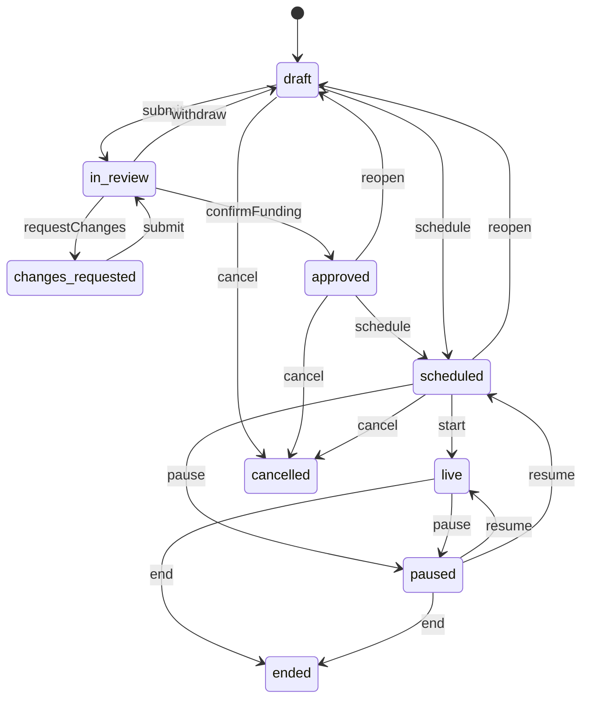
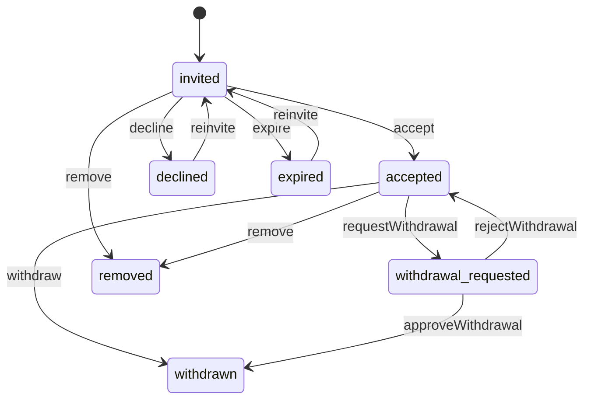
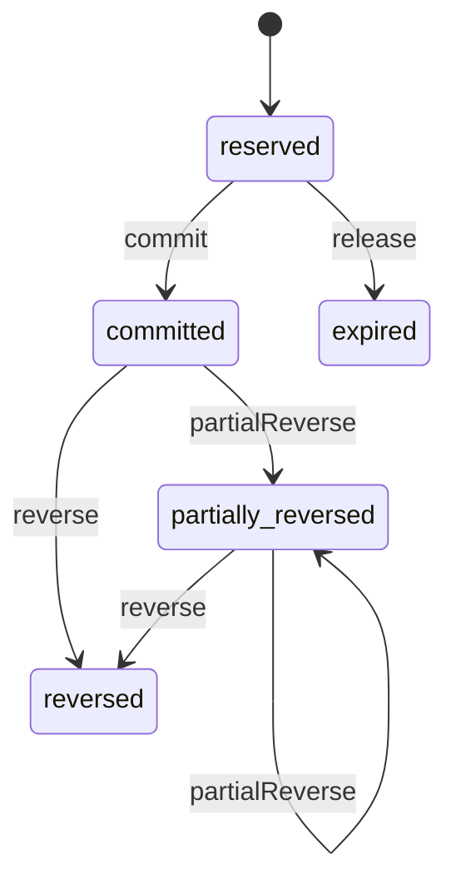
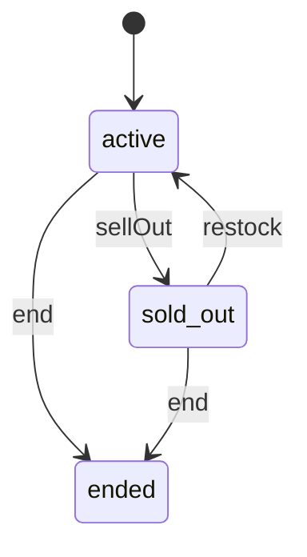

<!-- GENERATED by `npm run gen` from docs/api/modules/promotions.md. Do not edit: change the spec and regenerate. -->

# Promotions (`promotions`)

Discounts and sales campaigns: markdowns, percentage and fixed coupons, minimum-spend and free-shipping offers, flash sales, seller discounts and platform campaigns with seller consent. Owns eligibility, stacking, budgets and caps, the funding owner of every discount, coupon clipping and redemption, the Deals page data and campaign results.

- **Group:** Growth · **Launch phase:** 1 · **Plan chapters:** 15, 14, 6, 5
- **Depends on:** [catalog](../catalog/README.md), [offers](../offers/README.md) · **Optional:** [sellers](../sellers/README.md), [inventory](../inventory/README.md), [orders](../orders/README.md), [customers](../customers/README.md), [access](../access/README.md), [notifications](../notifications/README.md), [reports](../reports/README.md), [advertising](../advertising/README.md), [audit](../audit/README.md), [content](../content/README.md), [finance](../finance/README.md), [reviews](../reviews/README.md), [search](../search/README.md), [settings](../settings/README.md)
- **Required by:** [rewards](../rewards/README.md)

## Owns
- Campaigns: name, period with time zone, participating categories, products, offers or sellers, exclusions, eligible customers, discount type and value
- Launch discount types: item markdown, percentage coupon, fixed-amount coupon, minimum-spend discount, free shipping
- Growth discount types: flash sales with deal stock, purchase limits and real countdowns; bundles, quantity deals (phase 3)
- Budget and usage caps, per-customer and per-order limits, maximum discount per order
- Funding owner (platform, seller, shared) and the per-line funding split; platform-funded parts never reduce seller proceeds
- Stacking rules and exclusions (with seller markdowns, other coupons, free shipping, flash prices)
- Seller discounts (seller-funded) and seller participation in platform campaigns: invitation, offer eligibility, expected earnings impact, explicit consent, withdrawal
- Finance funding confirmation before a platform or shared campaign can go live
- Coupon codes (shared and unique), coupon clipping, redemption reservations and reversals
- Eligibility evaluation for cart and checkout (in-process public API) with explained rejections and the items each discount covers
- Deals page data: flash sales, coupons, clearance, upcoming events and event reminders
- The 'was' price rule shown with campaign prices (lowest price in the previous 30 days), read from offers.lowestPrice so discount claims are authentic
- Campaign results: sales, orders, discount cost by funder, margin impact, redemptions, seller participation and returns

**Not here:**
- Offer base prices: offers (a markdown is a promotion layered on top of the offer price)
- Offer price history: offers (offer_price_history); the reference 'was' price comes from offers.lowestPrice, promotions keeps no price history of its own
- Applying a code to a cart or quote: cart and checkout endpoints, which call evaluateCart / reserveRedemption
- Commission and seller ledger postings: finance (reads fundingSplitFor and the redemption events)
- Campaign pages, banners and homepage sections: content; ad delivery for a campaign: advertising
- Promotional messages: notifications; marketing consent: customers
- Store credit, gift cards and loyalty: wallet

## Store API

| Method | Path | Purpose | Auth | Body → Response |
|---|---|---|---|---|
| GET | `/api/store/promotions/deals` | Deals page: flash sales, coupons, clearance and upcoming events | shopper | `DealsPage` |
| GET | `/api/store/promotions/deals/clearance` | More clearance products | visitor | Page<DealProduct> |
| GET | `/api/store/promotions/deals/coupons` | More clippable coupons | shopper | Page<CouponCard> |
| GET | `/api/store/promotions/flash-sales/{campaignId}` | One flash sale with live claimed meters _(phase 2)_ | visitor | `FlashSaleBlock` |
| GET | `/api/store/promotions/products/{productId}` | Promotions for a product page: deal prices per offer, purchase limits, countdowns, seller promos and coupons | shopper | `ProductPromotions` |
| GET | `/api/store/promotions/offer-prices` | Promotion prices for a set of offers (product cards, collections, wishlist) | shopper | `OfferPromotion[]` |
| GET | `/api/store/promotions/campaigns/{id}/eligible-products` | Items a coupon or campaign applies to ('Eligible items') | visitor | Page<DealProduct> |
| POST | `/api/store/promotions/codes/check` | Look up a coupon code's terms without applying it | shopper | `{ code: string }` → `CodeCheck` |
| GET | `/api/store/promotions/coupons` | My coupons: available and clipped, used and expired | customer | `AccountCoupons` |
| POST | `/api/store/promotions/coupons/{campaignId}/clip` | Clip a coupon so it applies automatically at checkout | customer | `CouponCard` |
| DELETE | `/api/store/promotions/coupons/{campaignId}/clip` | Remove a clipped coupon | customer | 204 No content |
| POST | `/api/store/promotions/events/{campaignId}/reminder` | Remind me when an upcoming event starts | customer | `UpcomingEvent` |
| DELETE | `/api/store/promotions/events/{campaignId}/reminder` | Cancel an event reminder | customer | 204 No content |

## Seller API

| Method | Path | Purpose | Auth | Body → Response |
|---|---|---|---|---|
| GET | `/api/seller/promotions/discounts` | Discounts this seller funds | seller | Page<SellerDiscount> |
| POST | `/api/seller/promotions/discounts/preview` | What the customer sees and the seller earns per unit | seller | `DiscountPreviewRequest` → `{ customerPrice: Money, regularPrice: Money, earnings: EarningsImpact }` |
| POST | `/api/seller/promotions/discounts` | Create a seller-funded discount draft | seller<br>`promotions.discounts.manage` | `SellerDiscountInput` → `SellerDiscount` |
| GET | `/api/seller/promotions/discounts/{id}` | One own discount with usage | seller | `SellerDiscount` |
| PATCH | `/api/seller/promotions/discounts/{id}` | Edit a draft or scheduled discount | seller<br>`promotions.discounts.manage` | `SellerDiscountInput` → `SellerDiscount` |
| POST | `/api/seller/promotions/discounts/{id}/schedule` | Schedule a discount (goes live at its start time) | seller<br>`promotions.discounts.manage` | `SellerDiscount` |
| POST | `/api/seller/promotions/discounts/{id}/pause` | Pause an own discount | seller<br>`promotions.discounts.manage` | `SellerDiscount` |
| POST | `/api/seller/promotions/discounts/{id}/resume` | Resume an own discount | seller<br>`promotions.discounts.manage` | `SellerDiscount` |
| POST | `/api/seller/promotions/discounts/{id}/end` | End an own discount now (or cancel before start) | seller<br>`promotions.discounts.manage` | `{ reason: text? }` → `SellerDiscount` |
| GET | `/api/seller/promotions/invitations` | Platform campaign invitations and past participation | seller | Page<Invitation> |
| GET | `/api/seller/promotions/invitations/{id}` | Invitation with eligibility per offer, funding split and expected earnings per unit | seller | `Invitation` |
| POST | `/api/seller/promotions/invitations/{id}/accept` | Consent to join with selected eligible offers _(audited)_ | seller<br>`promotions.campaigns.join` | `{ offerIds: uuid[], consent: bool, consentTextVersion: string }` → `Invitation` |
| POST | `/api/seller/promotions/invitations/{id}/decline` | Decline an invitation | seller<br>`promotions.campaigns.join` | `{ reason: text? }` → `Invitation` |
| POST | `/api/seller/promotions/invitations/{id}/withdraw` | Leave a campaign _(audited)_ | seller<br>`promotions.campaigns.join` | `{ reason: text? }` → `Invitation` |

## Admin API

| Method | Path | Purpose | Auth | Body → Response |
|---|---|---|---|---|
| GET | `/api/admin/promotions/dashboard` | KPIs, tab counts, daily discount cost and campaign results | staff<br>`promotions.results.view` | `PromotionsDashboard` |
| GET | `/api/admin/promotions/campaigns` | All campaigns and seller discounts | staff<br>`promotions.campaigns.view` | Page<CampaignSummary> |
| POST | `/api/admin/promotions/campaigns` | Create a campaign draft _(audited)_ | staff<br>`promotions.campaigns.manage` | `CampaignInput` → `Campaign` |
| GET | `/api/admin/promotions/campaigns/{id}` | Campaign with eligible count, funding review, readiness and participation summary | staff<br>`promotions.campaigns.view` | `Campaign` |
| PATCH | `/api/admin/promotions/campaigns/{id}` | Edit a campaign _(audited)_ | staff<br>`promotions.campaigns.manage` | `CampaignPatch` → `Campaign` |
| GET | `/api/admin/promotions/campaigns/{id}/eligible-offers` | Offers the scope resolves to, with exclusion and ineligibility reasons | staff<br>`promotions.campaigns.view` | Page<ParticipationOffer> |
| POST | `/api/admin/promotions/campaigns/{id}/price-preview` | Product card, cart and checkout preview for a sample offer | staff<br>`promotions.campaigns.view` | `{ offerId: uuid? }` → `PricePreview` |
| POST | `/api/admin/promotions/campaigns/{id}/invitations` | Invite sellers to join (consent required before their offers are included) _(audited)_ | staff<br>`promotions.campaigns.manage` | `{ sellerIds: uuid[]?, respondBy: datetime }` → `Participation[]` |
| GET | `/api/admin/promotions/campaigns/{id}/participations` | Sellers invited, with consent state and earnings per $100 sale | staff<br>`promotions.campaigns.view` | Page<Participation> |
| POST | `/api/admin/promotions/participations/{id}/decide-withdrawal` | Approve or reject a seller's request to leave a live campaign _(audited)_ | staff<br>`promotions.campaigns.manage` | `{ approve: bool, reason: text }` → `Participation` |
| POST | `/api/admin/promotions/participations/{id}/remove` | Remove a seller or some of its offers from a campaign _(audited)_ | staff<br>`promotions.campaigns.manage` | `{ offerIds: uuid[]?, reason: text }` → `Participation` |
| PUT | `/api/admin/promotions/campaigns/{id}/flash-items` | Set flash sale offers, deal prices, deal stock and purchase limits _(audited, phase 2)_ | staff<br>`promotions.campaigns.manage` | `{ items: FlashItemInput[], reason: text? }` → `FlashItem[]` |
| GET | `/api/admin/promotions/campaigns/{id}/flash-items` | Flash items with claimed and sold-out state _(phase 2)_ | staff<br>`promotions.campaigns.view` | `FlashItem[]` |
| POST | `/api/admin/promotions/campaigns/{id}/submit` | Send to Finance for funding confirmation _(audited)_ | staff<br>`promotions.campaigns.manage` | `{ note: text? }` → `Campaign` |
| POST | `/api/admin/promotions/campaigns/{id}/withdraw` | Take a campaign back from Finance review to draft _(audited)_ | staff<br>`promotions.campaigns.manage` | `Campaign` |
| POST | `/api/admin/promotions/campaigns/{id}/confirm-funding` | Finance confirms funding _(audited)_ | staff<br>`promotions.funding.confirm` | `{ comment: text?, costCenter: string? }` → `Campaign` |
| POST | `/api/admin/promotions/campaigns/{id}/request-changes` | Finance sends the campaign back with a reason _(audited)_ | staff<br>`promotions.funding.confirm` | `{ reason: text }` → `Campaign` |
| POST | `/api/admin/promotions/campaigns/{id}/schedule` | Schedule an approved campaign _(audited)_ | staff<br>`promotions.campaigns.publish` | `Campaign` |
| POST | `/api/admin/promotions/campaigns/{id}/pause` | Pause a scheduled or live campaign _(audited)_ | staff<br>`promotions.campaigns.publish` | `{ reason: text? }` → `Campaign` |
| POST | `/api/admin/promotions/campaigns/{id}/resume` | Resume a paused campaign _(audited)_ | staff<br>`promotions.campaigns.publish` | `{ reason: text? }` → `Campaign` |
| POST | `/api/admin/promotions/campaigns/{id}/end` | End a live or paused campaign early _(audited)_ | staff<br>`promotions.campaigns.publish` | `{ reason: text }` → `Campaign` |
| POST | `/api/admin/promotions/campaigns/{id}/cancel` | Cancel a campaign that has not started _(audited)_ | staff<br>`promotions.campaigns.manage` | `{ reason: text }` → `Campaign` |
| POST | `/api/admin/promotions/campaigns/{id}/codes` | Generate unique single-use codes (e.g. for support or partners) _(audited)_ | staff<br>`promotions.campaigns.manage` | `{ count: int, prefix: string?, maxRedemptionsEach: int?, assignedCustomerIds: uuid[]? }` → `{ created: int, sample: CouponCode[] }` |
| GET | `/api/admin/promotions/campaigns/{id}/codes` | Codes with redemptions | staff<br>`promotions.campaigns.view` | Page<CouponCode> |
| POST | `/api/admin/promotions/codes/{id}/deactivate` | Deactivate a leaked or misused code _(audited)_ | staff<br>`promotions.campaigns.manage` | `{ reason: text }` → `CouponCode` |
| GET | `/api/admin/promotions/campaigns/{id}/redemptions` | Redemptions with funding split and reversals | staff<br>`promotions.results.view` | Page<Redemption> |
| GET | `/api/admin/promotions/campaigns/{id}/results` | Sales, discount cost by funder, margin impact, redemptions, returns and seller participation | staff<br>`promotions.results.view` | `{ result: CampaignResult, daily: DailyPoint[], bySeller: json[] }` |
| GET | `/api/admin/promotions/campaigns/{id}/history` | Submission, decisions, status changes and edits with reasons | staff<br>`promotions.campaigns.view` | Page<CampaignLogEntry> |

## Types

### Percent

| Field | Type |
|---|---|
| bps | `int` Basis points: 2000 = 20% |

### SchedulePeriod

| Field | Type |
|---|---|
| startsAt | `datetime` |
| endsAt | `datetime` |
| timeZone | `string` IANA zone the campaign was set up in, e.g. America/Los_Angeles. Countdowns use startsAt/endsAt exactly. |
| display | `string` e.g. Oct 16 – Oct 25, 2026 PT |

### QuantityTier

| Field | Type |
|---|---|
| minQuantity | `int` |
| percentOffBps | `int?` |
| amountOff | `Money?` |

### BundleRule

| Field | Type |
|---|---|
| components | `TargetRef[]` |
| bundlePrice | `Money?` |
| percentOffBps | `int?` |

### DiscountRule

| Field | Type |
|---|---|
| kind | `enum(markdown|percent_coupon|fixed_coupon|min_spend|free_shipping|flash_sale|bundle|quantity_deal)` |
| percentOffBps | `int?` Percentage discounts in basis points |
| amountOff | `Money?` Fixed amount off (per order for coupons, per unit for markdowns) |
| maxDiscountPerOrder | `Money?` |
| minSpend | `Money?` |
| minSpendScope | `enum(eligible_items|seller_package|order)?` What the minimum spend is measured on |
| freeShipping | `bool?` Free shipping on qualifying packages |
| bundle | `BundleRule?` Phase 3 |
| quantityTiers | `QuantityTier[]?` Phase 3 |

### TargetRef

| Field | Type |
|---|---|
| kind | `enum(category|product|offer|seller|brand|official_store)` |
| id | `uuid` |
| label | `string?` |

### Scope

| Field | Type |
|---|---|
| mode | `enum(sitewide|categories|products|offers|sellers)` |
| include | `TargetRef[]` |
| exclude | `TargetRef[]` Exclusions, e.g. clearance items, a restricted seller, a product under review |

### Eligibility

| Field | Type |
|---|---|
| audience | `enum(everyone|signed_in|new_customers|regions)` |
| regions | `string[]?` Region codes within the service region, e.g. CA, OR |
| newCustomerRule | `string?` Shown to customers, e.g. first order on Marketly |

### Limits

| Field | Type |
|---|---|
| budget | `Money?` Campaign stops when the discount cost reaches it |
| usageCap | `int?` Total redemptions |
| perCustomer | `int?` Uses per customer |
| perOrder | `int?` Codes of this campaign per order: empty or 1. A campaign applies at most once per order (a second code of the same campaign is rejected with per_order_limit); a value above 1 is refused with VALIDATION_FAILED |
| perCustomerUnits | `int?` Purchase limit in units (markdowns, flash sales) |

### Funding

| Field | Type |
|---|---|
| owner | `enum(platform|seller|shared)` |
| platformShareBps | `int?` Platform share of the discount on seller offers when shared, e.g. 5000 |
| costCenter | `string?` |
| note | `string?` Funding note for Finance (column campaigns.funding_note), e.g. Official Store items: the discount is a company cost shown in company trading margin |

### StackingRules

| Field | Type |
|---|---|
| withSellerMarkdowns | `bool` |
| withOtherCoupons | `bool` |
| withFreeShipping | `bool` |
| withFlashSalePrices | `bool` |
| exclusiveGroup | `string?` Campaigns in the same group never combine |

### ParticipationSettings

| Field | Type |
|---|---|
| inviteSellers | `bool` |
| respondBy | `datetime?` |
| rules | `string[]` Eligibility shown to sellers, e.g. Offer rating 4.0 or higher, At least 20 units in stock, No price increase in the last 30 days |
| minStock | `int?` |
| minRating | `number?` |
| maxDispatchDays | `int?` |
| noPriceIncreaseDays | `int?` |

### DealsPlacement

| Field | Type |
|---|---|
| show | `bool` |
| section | `enum(flash|clearance|coupons|events)?` |

### CampaignInput

| Field | Type |
|---|---|
| name | `string` |
| description | `string?` Customer-facing one-liner, e.g. 20% off bedding and lighting |
| internalNote | `string?` |
| discount | `DiscountRule` |
| code | `string?` Shared code, e.g. FALLHOME20. Omit for automatic discounts. |
| autoApply | `bool?` Authoritative (decision P1): true = applied automatically to every eligible cart, with or without the code; false = applied only through its code or, for signed-in customers, a clip. A campaign with no code and autoApply false is clip-only. Default false. |
| startsAt | `datetime` |
| endsAt | `datetime` |
| timeZone | `string` |
| scope | `Scope` |
| eligibility | `Eligibility` |
| limits | `Limits` |
| funding | `Funding` |
| stacking | `StackingRules` |
| participation | `ParticipationSettings?` |
| deals | `DealsPlacement?` |
| terms | `text?` Public terms shown on the Deals page, campaign page and coupon |

### CampaignPatch

| Field | Type |
|---|---|
| name | `string?` |
| description | `string?` |
| internalNote | `string?` |
| discount | `DiscountRule?` |
| code | `string?` |
| autoApply | `bool?` |
| startsAt | `datetime?` |
| endsAt | `datetime?` |
| timeZone | `string?` |
| scope | `Scope?` |
| eligibility | `Eligibility?` |
| limits | `Limits?` |
| funding | `Funding?` |
| stacking | `StackingRules?` |
| participation | `ParticipationSettings?` |
| deals | `DealsPlacement?` |
| terms | `text?` |
| version | `int` Optimistic lock; CONFLICT if stale |

### FundingBreakdown

| Field | Type |
|---|---|
| total | `Money` |
| platform | `Money` |
| seller | `Money` |

### ReviewCheck

| Field | Type |
|---|---|
| state | `enum(ok|warn|fail|info)` |
| label | `string` |
| detail | `string?` |

### FundingReview

| Field | Type |
|---|---|
| state | `enum(not_sent|waiting|confirmed|changes_requested)` |
| sentAt | `datetime?` |
| reviewer | `Actor?` |
| decidedAt | `datetime?` |
| checks | `ReviewCheck[]` e.g. budget above the Marketing limit, platform share does not reduce seller proceeds, seller share matches consent, cost center balance |
| platformMaximum | `Money` |
| sellersMaximum | `Money` |
| expectedSales | `Money?` |
| officialMarginImpactPts | `number?` Official Store margin change in percentage points, e.g. -3.1 |
| costCenter | `string?` |
| costCenterRemaining | `Money?` |
| comment | `text?` Finance comment, visible to Marketing |
| approval | `ApprovalInfo?` |

### ReadinessItem

| Field | Type |
|---|---|
| role | `string` |
| owner | `string?` |
| state | `enum(done|waiting|info)` |
| label | `string` |

### EligibleCount

| Field | Type |
|---|---|
| offers | `int` |
| sellers | `int` |
| officialStore | `bool` |
| excludedOffers | `int` |

### CampaignSummary

| Field | Type |
|---|---|
| id | `uuid` |
| ref | `string` PRM-YYMMDD-NNNN |
| name | `string` |
| description | `string?` |
| kind | `enum(markdown|percent_coupon|fixed_coupon|min_spend|free_shipping|flash_sale|bundle|quantity_deal)` |
| code | `string?` |
| period | `SchedulePeriod` |
| ownerKind | `enum(platform|seller)` |
| sellerId | `uuid?` |
| fundingOwner | `enum(platform|seller|shared)` |
| fundingLabel | `string` e.g. Shared 50/50 |
| budget | `Money?` |
| budgetUsed | `Money` |
| usageCap | `int?` |
| redemptions | `int` |
| status | `enum(draft|in_review|changes_requested|approved|scheduled|live|paused|ended|cancelled)` |
| nextAction | `string?` e.g. Waiting for Finance |

### Campaign

| Field | Type |
|---|---|
| id | `uuid` |
| ref | `string` |
| name | `string` |
| description | `string?` |
| internalNote | `string?` |
| ownerKind | `enum(platform|seller)` |
| sellerId | `uuid?` |
| discount | `DiscountRule` |
| code | `string?` |
| autoApply | `bool` |
| codeCount | `int` Unique codes generated |
| period | `SchedulePeriod` |
| scope | `Scope` |
| eligibility | `Eligibility` |
| limits | `Limits` |
| funding | `Funding` |
| stacking | `StackingRules` |
| participation | `ParticipationSettings?` |
| participationSummary | `ParticipationSummary?` |
| deals | `DealsPlacement?` |
| terms | `text?` |
| status | `enum(draft|in_review|changes_requested|approved|scheduled|live|paused|ended|cancelled)` |
| endedReason | `enum(period_over|budget_exhausted|usage_cap_reached|ended_early|sold_out)?` |
| locked | `bool` Edits locked while Finance reviews |
| eligible | `EligibleCount` |
| fundingReview | `FundingReview?` |
| readiness | `ReadinessItem[]` |
| budgetUsed | `Money` |
| redemptions | `int` |
| discountCost | `FundingBreakdown` |
| createdBy | `Actor` |
| createdAt | `datetime` |
| updatedAt | `datetime` |
| version | `int` |

### ParticipationSummary

| Field | Type |
|---|---|
| invited | `int` |
| accepted | `int` |
| pending | `int` |
| declined | `int` |
| withdrawn | `int` |

### EarningsImpact

| Field | Type |
|---|---|
| basePrice | `Money` |
| customerPays | `Money` |
| sellerFunds | `Money` |
| platformFunds | `Money` |
| feeBasis | `Money` Price after the seller-funded part; platform-funded part is not deducted |
| feeRateBps | `int` |
| fee | `Money` |
| sellerEarns | `Money` |
| regularSellerEarns | `Money` |
| explanation | `text` e.g. On a $100.00 sale at 20% off with shared funding: the customer pays $80.00 … |
| isExample | `bool` |

### ParticipationOffer

| Field | Type |
|---|---|
| offerId | `uuid` |
| productId | `uuid` |
| title | `string` |
| sku | `string?` |
| image | `MediaRef?` |
| stock | `int` |
| eligible | `bool` |
| ineligibleReasons | `string[]` e.g. Needs at least 20 units in stock (you have 12) |
| included | `bool` |
| regularPrice | `Money` |
| campaignPrice | `Money?` |
| earnings | `EarningsImpact?` |

### Participation

| Field | Type |
|---|---|
| id | `uuid` |
| campaignId | `uuid` |
| sellerId | `uuid` |
| sellerName | `string` |
| state | `enum(invited|accepted|declined|withdrawal_requested|withdrawn|removed|expired)` |
| offerCount | `int` |
| offers | `ParticipationOffer[]` |
| sellerShareBps | `int` |
| platformShareBps | `int` |
| respondBy | `datetime?` |
| consentedAt | `datetime?` |
| consentedBy | `Actor?` |
| consentText | `text?` Exact text the seller agreed to, kept with the record |
| earningsExample | `EarningsImpact?` |
| reason | `text?` |

### Invitation

| Field | Type |
|---|---|
| participation | `Participation` |
| campaign | `{"id":"uuid","name":"string","description":"string?","period":"SchedulePeriod","banner":"MediaRef?","featuredOn":{"type":"string[]","desc":"e.g. Home page, Deals page, Opening ad"},"discountLabel":"string","rules":"string[]","funding":{"discountBps":"int","sellerFundsBps":"int","platformFundsBps":"int","feeBasisNote":"string"}}` |
| leavePolicy | `string` e.g. You can leave before Oct 12. After it starts, leaving needs Marketing approval. |
| salesNote | `string?` Historical context; never a promise of sales |
| consentText | `text` The text the seller agrees to by accepting (worded for the eligible offers; once accepted, the exact text recorded with the participation) |
| consentTextVersion | `string` Version of the consent wording shown; send it back as consentTextVersion when accepting |

### SellerDiscountInput

| Field | Type |
|---|---|
| name | `string` |
| kind | `enum(markdown|percent_coupon|fixed_coupon|min_spend|free_shipping)` |
| discount | `DiscountRule` |
| offerIds | `uuid[]` |
| startsAt | `datetime` |
| endsAt | `datetime` |
| timeZone | `string?` |
| code | `string?` |
| perCustomerUnits | `int?` |
| perCustomer | `int?` |
| combinesWithPlatformCoupons | `bool` The platform-funded part never comes from the seller |
| showOnDeals | `bool?` |

### SellerDiscount

| Field | Type |
|---|---|
| campaign | `CampaignSummary` |
| discount | `DiscountRule` |
| discountLabel | `string` The rule in words for the Your discounts table, e.g. 10% off, $5 off, Free shipping over $75 |
| offers | `ParticipationOffer[]` Offers covered, with customer price and earnings per unit |
| usedOrders | `int` |
| preview | `EarningsImpact?` |

### DiscountPreviewRequest

| Field | Type |
|---|---|
| offerId | `uuid` |
| discount | `DiscountRule` |
| campaignId | `uuid?` |

### PreviewLine

| Field | Type |
|---|---|
| label | `string` |
| amount | `Money` |
| kind | `enum(item|discount|shipping|tax|total)` |

### PricePreview

| Field | Type |
|---|---|
| productCard | `{"productTitle":"string","image":"MediaRef?","price":"Money","wasPrice":"Money?","badge":"string","sellerName":"string"}` |
| cart | `{"packageLabel":"string","lines":"PreviewLine[]"}` |
| checkout | `{"lines":"PreviewLine[]","appliedNote":"string"}` |

### FlashItemInput

| Field | Type |
|---|---|
| offerId | `uuid` |
| dealPrice | `Money` |
| dealStock | `int` |
| purchaseLimit | `int` |

### FlashItem

| Field | Type |
|---|---|
| id | `uuid` |
| offerId | `uuid` |
| productId | `uuid` |
| title | `string` |
| image | `MediaRef?` |
| sellerId | `uuid` |
| sellerName | `string` |
| sellerSlug | `string?` Storefront slug for /shop/:slug; null for the Official Store |
| dealPrice | `Money` |
| regularPrice | `Money` |
| percentOffBps | `int` |
| dealStock | `int` |
| claimed | `int` |
| claimedPct | `int` |
| purchaseLimit | `int` |
| state | `enum(active|sold_out|ended)` |
| soldOutAt | `datetime?` |
| regularOffer | `OfferPromotion?` When the deal sells out, the regular offer is shown separately |

### CouponCode

| Field | Type |
|---|---|
| id | `uuid` |
| campaignId | `uuid` |
| code | `string` |
| kind | `enum(shared|unique)` |
| maxRedemptions | `int?` |
| redemptions | `int` |
| active | `bool` |
| assignedCustomerId | `uuid?` |
| createdAt | `datetime` |

### Redemption

| Field | Type |
|---|---|
| id | `uuid` |
| campaignId | `uuid` |
| code | `string?` |
| orderId | `uuid?` |
| orderRef | `string?` |
| customer | `Actor?` |
| state | `enum(reserved|committed|partially_reversed|reversed|expired)` |
| discount | `FundingBreakdown` |
| reversed | `Money` |
| items | `int` |
| at | `datetime` |

### CampaignLogEntry

| Field | Type |
|---|---|
| id | `uuid` |
| action | `string` |
| reason | `text?` |
| detail | `json?` |
| actor | `Actor` |
| at | `datetime` |

### TabCount

| Field | Type |
|---|---|
| key | `string` |
| label | `string` |
| count | `int` |

### DailyPoint

| Field | Type |
|---|---|
| date | `date` |
| value | `Money` |
| partial | `bool` |

### CampaignResult

| Field | Type |
|---|---|
| campaignId | `uuid` |
| name | `string` |
| status | `string` |
| period | `SchedulePeriod` |
| sales | `Money` Sales of promoted items (recorded separately from discount cost) |
| orders | `int` |
| discountCost | `FundingBreakdown` |
| marginImpactPts | `number?` Official Store margin change on promoted items, landed-cost basis |
| marginNote | `string?` e.g. Seller funded, Not affected |
| redemptions | `int` |
| redemptionShareOfOrders | `number?` |
| sellersJoined | `int` |
| returnsRatePct | `number?` |
| budget | `Money?` |
| budgetUsed | `Money` |

### PromotionsDashboard

| Field | Type |
|---|---|
| range | `DateRange` |
| timeZone | `string` |
| promotedSales | `Money` |
| promotedOrders | `int` |
| discountCost | `FundingBreakdown` |
| sharedCost | `Money` |
| officialMargin | `{"before":{"type":"number?","desc":"Official Store gross margin % over the same number of days just before the range (reports.officialMargin); null when reports is off or nothing was costed"},"after":{"type":"number?","desc":"Official Store gross margin % in the range"},"changePts":{"type":"number?","desc":"after − before in points; without both, the change of official revenue over its cost basis on promoted orders"}}` |
| couponRedemptions | `int` |
| redemptionShareOfOrders | `number` |
| returnsOnPromotedPct | `number` |
| storeReturnsPct | `number?` Store-wide return rate for the same range, from reports when enabled; null when not available (never 0 as a stand-in) |
| tabs | `TabCount[]` |
| dailyCost | `DailyPoint[]` |
| results | `CampaignResult[]` |

### PromoBadge

| Field | Type |
|---|---|
| label | `string` |
| kind | `enum(deal|coupon|flash|clearance|free_shipping|campaign)` |

### OfferPromotion

| Field | Type |
|---|---|
| offerId | `uuid` |
| regularPrice | `Money` |
| price | `Money` Price after markdown or flash price |
| wasPrice | `Money?` Reference price, lowest in the look-back window |
| wasPriceRule | `string?` |
| badges | `PromoBadge[]` |
| campaignId | `uuid?` |
| purchaseLimit | `int?` |
| flash | `FlashCountdown?` |
| sellerPromos | `PromoBanner[]` e.g. 10% off orders over $100 from Northwind Audio, applied automatically |
| automaticDiscount | `Money?` Per-unit discount the customer gets without doing anything (running autoApply coupon campaigns for everyone, or every signed-in customer when signed in, e.g. an automatic 10% off), on top of price. A minimum spend counts when one unit at price reaches it; category and brand scopes are matched from catalog (getProducts). Offers subtracts it in comparable totals for the featured-offer rule (Total price = item + shipping − automatic discounts). Null when none |
| automaticDiscountLabel | `string?` |

### FlashCountdown

| Field | Type |
|---|---|
| campaignId | `uuid` |
| startsAt | `datetime` |
| endsAt | `datetime` |
| claimedPct | `int` |
| dealStockLeft | `int` |
| state | `enum(upcoming|active|sold_out|ended)` |

### PromoBanner

| Field | Type |
|---|---|
| campaignId | `uuid` |
| title | `string` |
| detail | `string` |
| period | `SchedulePeriod` |
| autoApply | `bool` |
| code | `string?` |

### ProductPromotions

| Field | Type |
|---|---|
| productId | `uuid` |
| offers | `OfferPromotion[]` |
| coupons | `CouponCard[]` |

### CouponCard

| Field | Type |
|---|---|
| campaignId | `uuid` |
| codeId | `uuid?` |
| code | `string?` |
| title | `string` |
| amountLabel | `string` e.g. $10, 15%, Free |
| unitLabel | `string` e.g. off, shipping |
| conditions | `string` e.g. Casa Verde Home · minimum spend $100 · one use per customer |
| fundedBy | `string` |
| expiresAt | `datetime` |
| state | `enum(available|clipped|used|expired)` |
| autoApply | `bool` |
| terms | `text?` |
| usedOn | `UsedOn?` |

### UsedOn

| Field | Type |
|---|---|
| orderId | `uuid` |
| orderRef | `string` |
| saved | `Money` |
| at | `datetime` |

### DealProduct

| Field | Type |
|---|---|
| productId | `uuid` |
| offerId | `uuid` |
| title | `string` |
| image | `MediaRef?` |
| sellerName | `string` |
| sellerSlug | `string?` Storefront slug for /shop/:slug; null for the Official Store |
| price | `Money` |
| wasPrice | `Money?` |
| endsAt | `datetime?` |
| stockLeft | `int?` |

### UpcomingEvent

| Field | Type |
|---|---|
| campaignId | `uuid` |
| name | `string` |
| period | `SchedulePeriod` |
| summary | `string` |
| reminderSet | `bool` |

### FlashSaleBlock

| Field | Type |
|---|---|
| campaignId | `uuid` |
| name | `string` |
| period | `SchedulePeriod` |
| state | `enum(upcoming|live|ended)` |
| secondsLeft | `int` Computed from endsAt and serverTime; clients count down from it |
| items | `FlashItem[]` |

### DealsPage

| Field | Type |
|---|---|
| serverTime | `datetime` |
| tabs | `TabCount[]` |
| flashSales | `FlashSaleBlock[]` |
| coupons | `CouponCard[]` |
| clearance | `DealProduct[]` |
| upcomingEvents | `UpcomingEvent[]` |
| rules | `string[]` e.g. Coupons can't be combined with flash sale prices unless the coupon says so. One coupon per seller per order. |

### IssuedCoupon

| Field | Type |
|---|---|
| codeId | `uuid` |
| code | `string` |
| campaignId | `uuid` |
| title | `string` The coupon's customer-facing title, e.g. $5 off orders over $50 |
| endsAt | `datetime?` |

### AccountCoupons

| Field | Type |
|---|---|
| available | `CouponCard[]` |
| usedOrExpired | `CouponCard[]` |
| rules | `string[]` |

### CodeCheck

| Field | Type |
|---|---|
| code | `string` |
| valid | `bool` |
| coupon | `CouponCard?` |
| reason | `string?` |

### PublicCampaign

| Field | Type |
|---|---|
| id | `uuid` |
| name | `string` |
| description | `string?` |
| period | `SchedulePeriod` |
| terms | `text?` |
| status | `string` |
| code | `string?` |

### CartLineInput

| Field | Type |
|---|---|
| lineId | `string` |
| offerId | `uuid` |
| productId | `uuid` |
| variantId | `uuid` |
| sellerId | `uuid` The seller id, or OFFICIAL_STORE_ID for Official Store lines. Defensive: evaluateCart maps '' or null to OFFICIAL_STORE_ID when officialStore is true (VALIDATION_FAILED otherwise), so redemption_lines.seller_id is always a uuid |
| officialStore | `bool` |
| categoryId | `uuid?` Null when the caller does not know it (catalog off); category-scoped campaigns then do not match the line |
| brandId | `uuid?` |
| quantity | `int` |
| unitPrice | `Money` Offer price before promotions |
| packageId | `string` |

### CartEvaluationInput

| Field | Type |
|---|---|
| customerId | `uuid?` |
| guestSessionId | `string?` |
| region | `string?` |
| contactEmail | `email?` Guest checkout contact email. Per-customer limits and new-customer eligibility for guests key on its normalised hash (usage_counters.customer_key), so one person cannot reuse a one-per-customer coupon by checking out as a new guest. Ignored when customerId is set |
| lines | `CartLineInput[]` |
| codes | `string[]` Codes entered by the customer; clipped coupons of a signed-in customer are added automatically |
| shipping | `map<Money>?` packageId → shipping charge, for free-shipping evaluation |
| at | `datetime?` |

### DiscountAllocation

| Field | Type |
|---|---|
| campaignId | `uuid` |
| code | `string?` |
| label | `string` |
| amount | `Money` |
| platformPart | `Money` |
| sellerPart | `Money` |

### LineDiscount

| Field | Type |
|---|---|
| lineId | `string` |
| regularUnitPrice | `Money` |
| unitPrice | `Money` |
| allocations | `DiscountAllocation[]` |
| lineDiscount | `Money` |
| purchaseLimit | `int?` |
| limitExceeded | `bool` |
| discountedQuantity | `int` Units that get the deal price (decision P2). Quantity above the remaining per-customer or deal limit is split: discountedQuantity units at unitPrice, the rest at regularUnitPrice, limitExceeded true. Equals the line quantity when nothing is over the limit |

### PackageDiscount

| Field | Type |
|---|---|
| packageId | `string` |
| sellerId | `uuid` |
| shippingDiscount | `Money` |
| freeShipping | `bool` |
| campaignId | `uuid?` |
| allocation | `DiscountAllocation?` |

### AppliedPromotion

| Field | Type |
|---|---|
| campaignId | `uuid` |
| code | `string?` |
| label | `string` |
| amount | `Money` |
| coversLineIds | `string[]` |
| source | `enum(automatic|code|clipped)` |

### SkippedPromotion

| Field | Type |
|---|---|
| campaignId | `uuid` |
| label | `string` |
| reason | `enum(budget_insufficient|budget_exhausted|usage_limit|deal_sold_out|purchase_limit)` |
| message | `text` |

### RejectedCode

| Field | Type |
|---|---|
| code | `string` |
| reason | `enum(not_found|not_started|expired|no_eligible_items|min_spend_not_met|customer_not_eligible|sign_in_required|region|usage_limit|budget_exhausted|budget_insufficient|not_combinable|per_order_limit)` budget_insufficient: the remaining budget does not cover the whole discount for this cart; nothing is applied (decision P3, never a partial discount) |
| message | `text` e.g. Applies only to Home & Kitchen items from the Official Store. None in your cart qualify. |
| details | `string[]` |

### CartEvaluation

| Field | Type |
|---|---|
| evaluationId | `uuid` |
| validUntil | `datetime` |
| lines | `LineDiscount[]` |
| packages | `PackageDiscount[]` |
| applied | `AppliedPromotion[]` |
| rejected | `RejectedCode[]` |
| skipped | `SkippedPromotion[]` Automatic or clipped campaigns that matched but were not applied, with a reason the customer can read |
| totals | `FundingBreakdown` |
| changes | `string[]` Differences from the previous evaluation, e.g. HOMEWEEK10 ended at 12:00 PM PT |

### RedemptionReservation

| Field | Type |
|---|---|
| reservationId | `uuid` |
| evaluationId | `uuid` |
| expiresAt | `datetime` |

### FundingSplit

| Field | Type |
|---|---|
| orderItemId | `uuid` |
| allocations | `DiscountAllocation[]` |
| sellerFunded | `Money` |
| platformFunded | `Money` |

### RefundShare

| Field | Type |
|---|---|
| orderItemId | `uuid` |
| quantity | `int` |
| couponShare | `Money` |
| platformPart | `Money` |
| sellerPart | `Money` |

## Status flows

### Promotion campaign (`Campaign.status`)



Platform and shared campaigns must pass Finance (confirmFunding) before schedule. draft → schedule is allowed only for seller-funded discounts owned by a seller. Edits are locked in in_review. Material edits to an approved or scheduled campaign (discount, scope, budget, funding, period) reopen it to draft and need a new Finance confirmation; cosmetic edits (name, description, terms) do not. start/end run from jobs at startsAt/endsAt; end also fires on budget exhausted, usage cap reached or sold out (endedReason). resume returns to scheduled when the start time has not arrived. Live campaigns cannot be cancelled, only ended (redemptions already exist).

### Seller participation (`Participation.state`)



accept records the exact consent text, the offers and the seller share; a seller's offers are included only after consent (plan ch. 15). withdraw is allowed before the campaign starts; after start it becomes requestWithdrawal and Marketing decides. remove is a staff or system action with a reason (offer became ineligible, seller restricted or suspended).

### Redemption (`Redemption.state`)



Reservations expire after reservationTtlMinutes unless committed. Reversal happens on item cancellation and refunds; usage counts are restored only for full cancellations before dispatch (setting restoreUsageOnCancel). Budget is not credited back for refunds after delivery unless refundRestoresBudget is on.

### Flash item (`FlashItem.state`)



sellOut fires when claimed + reserved reaches dealStock. The regular offer stays purchasable at its regular price and is shown separately. restock is a staff edit that raises deal stock (audited).

## Data (schema `promotions`)

**campaigns**: Platform campaigns and seller discounts (owner_kind). Seller discounts are seller-funded and skip Finance confirmation.

| Column | Type |
|---|---|
| id | uuid pk |
| ref | text unique |
| name | text |
| description | text? |
| internal_note | text? |
| owner_kind | text (platform|seller) |
| seller_id | uuid? |
| kind | text |
| discount | jsonb |
| auto_apply | bool |
| starts_at | timestamptz |
| ends_at | timestamptz |
| time_zone | text |
| scope_mode | text |
| eligibility | jsonb |
| budget_amount | bigint? |
| budget_used | bigint |
| usage_cap | int? |
| usage_count | int |
| per_customer | int? |
| per_order | int? |
| per_customer_units | int? |
| funding_owner | text |
| platform_share_bps | int? |
| cost_center | text? |
| funding_note | text? (Funding.note) |
| stacking | jsonb |
| exclusive_group | text? |
| participation | jsonb? |
| deals | jsonb? (DealsPlacement) |
| terms | text? |
| status | text |
| ended_reason | text? |
| approval_request_id | uuid? |
| currency | text |
| created_by | text |
| created_at | timestamptz |
| updated_at | timestamptz |
| version | int |

Indexes: `(status, starts_at)`, `(status, ends_at)`, `(seller_id, status)`, `(owner_kind, status, id)`

**campaign_targets**: Included and excluded categories, products, offers, sellers, brands

| Column | Type |
|---|---|
| campaign_id | uuid → campaigns |
| kind | text |
| target_id | uuid |
| excluded | bool |
| label | text? |

Indexes: `unique (campaign_id, kind, target_id)`, `(kind, target_id)`

**eligible_offers**: Resolved offer set per campaign (rebuilt on scope change and offer events) for fast evaluation and the eligible count

| Column | Type |
|---|---|
| campaign_id | uuid → campaigns |
| offer_id | uuid |
| seller_id | uuid |
| official_store | bool |
| eligible | bool |
| reason | text? |
| refreshed_at | timestamptz |

Indexes: `(offer_id, campaign_id)`, `(campaign_id, seller_id)`, `(seller_id, eligible)`

**funding_reviews**: Finance confirmation per submission

| Column | Type |
|---|---|
| id | uuid pk |
| campaign_id | uuid → campaigns |
| state | text |
| sent_at | timestamptz |
| reviewer_id | text? |
| decided_at | timestamptz? |
| checks | jsonb |
| platform_max | bigint |
| sellers_max | bigint |
| expected_sales | bigint? |
| margin_impact_pts | numeric? |
| comment | text? |
| approval_request_id | uuid? |

**participations**: Seller invitations and consent for platform campaigns

| Column | Type |
|---|---|
| id | uuid pk |
| campaign_id | uuid → campaigns |
| seller_id | uuid |
| state | text |
| seller_share_bps | int |
| platform_share_bps | int |
| respond_by | timestamptz? |
| consented_at | timestamptz? |
| consented_by | text? |
| consent_text | text? |
| reason | text? |
| updated_at | timestamptz |

Indexes: `unique (campaign_id, seller_id)`, `(seller_id, state)`, `(state, respond_by)`

**participation_offers**

| Column | Type |
|---|---|
| participation_id | uuid → participations |
| offer_id | uuid |
| eligible | bool |
| ineligible_reasons | jsonb |
| included | bool |

Indexes: `unique (participation_id, offer_id)`, `(offer_id)`

**flash_items**: Deal price, deal stock and purchase limit per offer in a flash sale. approved_* keep what Finance confirmed (set at confirmFunding): a live or paused sale can only change within them

| Column | Type |
|---|---|
| id | uuid pk |
| campaign_id | uuid → campaigns |
| offer_id | uuid |
| deal_price | bigint |
| regular_price | bigint |
| deal_stock | int |
| claimed | int |
| reserved | int |
| purchase_limit | int |
| state | text |
| sold_out_at | timestamptz? |
| approved_deal_price | bigint? |
| approved_deal_stock | int? |
| approved_purchase_limit | int? |

Indexes: `unique (campaign_id, offer_id)`, `(offer_id, state)`

**coupon_codes**

| Column | Type |
|---|---|
| id | uuid pk |
| campaign_id | uuid → campaigns |
| code | text ci (unique by code among active codes, compared without case; a code frees up when its campaign ends or is cancelled) |
| kind | text (shared|unique) |
| max_redemptions | int? |
| redemptions | int |
| assigned_customer_id | uuid? |
| issue_key | text? (issueCode idempotency key) |
| active | bool |
| created_at | timestamptz |

Indexes: `unique (upper(code)) where active`, `(campaign_id, created_at)`, `(assigned_customer_id)`, `unique (issue_key)`

**coupon_clips**: Coupons a customer clipped; applied automatically at checkout

| Column | Type |
|---|---|
| customer_id | uuid |
| campaign_id | uuid → campaigns |
| code_id | uuid? → coupon_codes |
| clipped_at | timestamptz |

Indexes: `unique (customer_id, campaign_id)`

**evaluations**: Short-lived cart evaluations referenced by reservations

| Column | Type |
|---|---|
| id | uuid pk |
| input_hash | text |
| result | jsonb |
| valid_until | timestamptz |

Indexes: `(input_hash, valid_until)`, `(valid_until)`

**redemptions**: Reserved then committed discounts per order

| Column | Type |
|---|---|
| id | uuid pk |
| campaign_id | uuid → campaigns |
| code_id | uuid? |
| reservation_id | uuid |
| idempotency_key | text |
| evaluation_id | uuid |
| order_id | uuid? |
| customer_id | uuid? |
| guest_key | text? |
| state | text |
| amount | bigint |
| platform_part | bigint |
| seller_part | bigint |
| reversed | bigint |
| currency | text |
| expires_at | timestamptz? |
| created_at | timestamptz |

Indexes: `unique (reservation_id, campaign_id)`, `(campaign_id, state)`, `(customer_id, campaign_id)`, `(order_id)`, `(idempotency_key, state)`, `(evaluation_id, idempotency_key)`, `(state, expires_at)`

**redemption_lines**: Per order item allocation; the source for fundingSplitFor and refundShare

| Column | Type |
|---|---|
| redemption_id | uuid → redemptions |
| line_id | text |
| order_item_id | uuid? |
| offer_id | uuid |
| seller_id | uuid |
| quantity | int |
| amount | bigint |
| platform_part | bigint |
| seller_part | bigint |
| reversed | bigint |

Indexes: `(order_item_id)`, `(redemption_id, line_id)`

**usage_counters**: Per-customer uses and units for limits (row-locked during reservation)

| Column | Type |
|---|---|
| campaign_id | uuid → campaigns |
| customer_key | text (customer id or guest email hash) |
| uses | int |
| units | int |

Indexes: `unique (campaign_id, customer_key)`

**event_reminders**: Remind me on upcoming Deals events

| Column | Type |
|---|---|
| customer_id | uuid |
| campaign_id | uuid → campaigns |
| created_at | timestamptz |
| sent_at | timestamptz? |

Indexes: `unique (customer_id, campaign_id)`, `(campaign_id, sent_at)`

**campaign_log**: Every submission, decision, status change, edit and removal with reason

| Column | Type |
|---|---|
| id | uuid pk |
| campaign_id | uuid → campaigns |
| action | text |
| reason | text? |
| detail | jsonb? |
| actor_kind | text |
| actor_id | text? |
| at | timestamptz |

Indexes: `(campaign_id, action)`, `(campaign_id, at)`

**campaign_results_daily**: Read model rolled up from order, redemption and return events

| Column | Type |
|---|---|
| campaign_id | uuid → campaigns |
| day | date |
| sales | bigint |
| orders | int |
| cost_platform | bigint |
| cost_seller | bigint |
| redemptions | int |
| returned_items | int |
| official_cost_basis | bigint |
| official_revenue | bigint |

Indexes: `unique (campaign_id, day)`

## Events

| Publishes | When | Payload | Consumed by |
|---|---|---|---|
| `promotions.campaign.submitted` | Marketing sends a campaign to Finance | `{ campaignId: uuid, budget: Money?, fundingOwner: string }` | - |
| `promotions.campaign.funding_confirmed` | Finance confirms funding | `{ campaignId: uuid, platformMaximum: Money, sellersMaximum: Money }` | - |
| `promotions.campaign.changes_requested` | Finance sends a campaign back | `{ campaignId: uuid, reason: text }` | - |
| `promotions.campaign.scheduled` | A campaign or seller discount is scheduled | `{ campaignId: uuid, startsAt: datetime, endsAt: datetime, sellerId: uuid? }` | - |
| `promotions.campaign.started` | A campaign goes live at its start time | `{ campaignId: uuid, kind: string, offerIds: uuid[], endsAt: datetime }` | content, offers, search |
| `promotions.campaign.paused` | A campaign is paused | `{ campaignId: uuid, reason: text? }` | advertising |
| `promotions.campaign.resumed` | A paused campaign resumes | `{ campaignId: uuid }` | advertising |
| `promotions.campaign.ended` | Period over, budget or usage cap reached, sold out, or ended early | `{ campaignId: uuid, reason: enum(period_over|budget_exhausted|usage_cap_reached|ended_early|sold_out) }` | advertising, content, offers, search |
| `promotions.campaign.cancelled` | A campaign is cancelled before it starts | `{ campaignId: uuid, reason: text }` | - |
| `promotions.participation.invited` | Sellers are invited to a platform campaign | `{ campaignId: uuid, sellerIds: uuid[], respondBy: datetime }` | notifications |
| `promotions.participation.decided` | A seller accepts, declines or withdraws, or staff remove a participation | `{ participationId: uuid, campaignId: uuid, sellerId: uuid, state: string }` | - |
| `promotions.coupon.redeemed` | A redemption is committed to a placed order | `{ redemptionId: uuid, campaignId: uuid, orderId: uuid, amount: Money, platformPart: Money, sellerPart: Money }` | finance, reports |
| `promotions.redemption.reversed` | A redemption is fully or partly reversed after cancellation or refund | `{ redemptionId: uuid, orderItemId: uuid, amount: Money, platformPart: Money, sellerPart: Money }` | finance, reports |
| `promotions.flash_item.sold_out` | Deal stock of a flash item is used up | `{ campaignId: uuid, offerId: uuid, at: datetime }` | - |
| `promotions.budget.threshold_reached` | Budget use crosses 90% | `{ campaignId: uuid, budget: Money, used: Money }` | - |

| Consumes | From | Does |
|---|---|---|
| `orders.order.placed` | orders | Commit reservations referenced by the order (fallback when commitRedemption was not called) |
| `orders.item.cancelled` | orders | Reverse the item's allocations; restore usage and deal stock when cancelled before dispatch |
| `returns.refund.approved` | returns | Partially reverse each item's allocations by its refunded quantity from the payload items ({ orderItemId, quantity }[]; a refund without items reverses nothing and is logged); count the return in campaign results |
| `orders.item.split` | orders | Split the item's redemption_lines between the original and the new order item in proportion to the quantities, so later cancellations, refundShare and fundingSplitFor on either id find their share |
| `payments.payment.failed` | payments | Keep the declined checkout's reservations (idempotency key = checkoutSessionId) for the retry window: expiresAt is extended to at least reservationTtlMinutes after the decline, never shortened. They go back when they expire (release-expired-reservations), when checkout releases them (abandoned or expired session) or when the retry reserves a changed quote |
| `offers.offer.price_changed` | offers | Flag participations whose seller raised the price during the campaign (the was price itself is read from offers.lowestPrice) |
| `offers.offer.status_changed` | offers | Rebuild eligible offers; remove deactivated offers from flash sales |
| `inventory.stock.changed` | inventory | Cap remaining flash deal stock at available stock; re-check participation stock rules |
| `catalog.product.publication_changed` | catalog | Exclude hidden or suspended products from live campaigns |
| `catalog.product.merged` | catalog | Retarget campaign targets and coupon product scopes from the duplicate to the kept product (variants mapped through newVariantId / intoVariantId); redemptions already made keep their order snapshots |
| `sellers.seller.restricted` | sellers | Remove the seller's offers from campaigns where the restriction covers new sales (reason recorded) |
| `sellers.seller.suspended` | sellers | Remove the seller from all upcoming and live campaigns; pause its own discounts |
| `access.approval.decided` | access | Complete or reject a pending funding confirmation |

## In-process API (for other modules)

| Function | Signature | Used by |
|---|---|---|
| linkTargets | `(input: { kind: 'deal', q?: string, ids?: string[], limit?: int }) => LinkTarget[]`<br>Link targets for ad destination pickers (search by q, or resolve ids): platform promotion campaigns that are live or scheduled (/deals?campaign={id}); resolving ids also returns ended ones as unavailable, each with its store path the app opens, a label, a short meta line, an image and whether it is shown in the store. Unknown ids are left out. | advertising |
| priceOffers | `(offerIds: uuid[], ctx: { customerId?: uuid, at?: datetime }) => OfferPromotion[]`<br>Current markdown or flash price, was price, badges, purchase limit and countdown per offer. Used for product cards, the purchase box and cart lines so prices match everywhere (plan ch. 15: consistent across product page, cart, checkout and confirmation). | offers, search, cart, content, wishlist, graphql, reports |
| evaluateCart | `(input: CartEvaluationInput) => CartEvaluation`<br>Runs eligibility, stacking, limits and budgets for a cart or checkout quote. Returns per-line discounts with the funding split, free-shipping packages, applied codes with the items they cover and rejected codes with a reason the customer can read. Pure read: nothing is reserved. | cart, checkout |
| reserveRedemption | `(evaluationId: uuid, idempotencyKey: string) => RedemptionReservation`<br>Holds budget, usage counts and flash deal stock for a quote while payment runs. Fails with BUDGET_EXHAUSTED, USAGE_LIMIT_REACHED (total, per-customer or code limit, details.limit) or DEAL_SOLD_OUT so checkout can show the revised total before the customer commits (plan ch. 6); also PURCHASE_LIMIT_EXCEEDED (per-customer unit limit of a markdown or flash price, details.limit), COUPON_NOT_ELIGIBLE (details.reason expired: a campaign of the quote is no longer running), CONFLICT (the quote's validUntil has passed: evaluate again), NOT_FOUND (unknown evaluationId) and VALIDATION_FAILED (no idempotency key). Same evaluation and key while the hold is live: the same reservation. | checkout |
| commitRedemption | `(reservationId: uuid, orderId: uuid, orderItemIds: map<string>) => Redemption[]`<br>Binds a reservation to the placed order (line id → order item id). Also triggered by orders.order.placed. | checkout |
| releaseRedemption | `(reservationId: uuid) => void`<br>Releases held budget, usage and deal stock when payment fails or the quote expires. | checkout |
| fundingSplitFor | `(orderItemId: uuid) => FundingSplit`<br>Discount allocations of one order item with platform and seller parts. Finance charges commission on the price after the seller-funded part only and credits the platform-funded part to seller proceeds. | finance, orders, returns, graphql |
| refundShare | `(orderItemId: uuid, quantity: int) => RefundShare`<br>Coupon share to deduct when refunding part of an order (coupons are split across items by value). Used to cap refunds at the remaining refundable amount. | returns, payments, support |
| getPublicCampaign | `(campaignId: uuid) => PublicCampaign | null`<br>Name, period, terms and status for campaign pages, banners and ads. | content, advertising, graphql |
| isCampaignActive | `(campaignId: uuid) => { active: bool, reason?: string }`<br>False when ended, paused, out of budget or sold out. Advertising stops linked ads; content hides teasers. | advertising, content |
| liveDeals | `(opts: { limit: int, campaignId?: uuid }) => FlashSaleBlock[]`<br>Flash deals for the homepage Deals section. campaignId limits the result to one campaign (content SourceRule.campaignId: a section or collection fed by one promotion). | content, graphql |
| referencePrice | `(offerId: uuid) => Money | null`<br>Honest 'was' price: delegates to offers.lowestPrice(offerId, offers.wasPriceLookbackDays (read with ctx.settings.read; offers owns the window, decision O5), campaignStart or now) and returns null when offers has no history for the window. No price history is kept in promotions. | offers, wishlist |
| getDealsPage | `(ctx: { customerId?: uuid, at?: datetime }) => DealsPage`<br>Deals page data in one call: tab counts, live flash sales, clippable coupons (clipped state for the customer), the first clearance batch, upcoming events with reminder state, the combination rules and serverTime for countdowns. Same data as GET /api/store/promotions/deals. | graphql, workqueues |
| listClearance | `(paging: PageInput) => Paged<DealProduct>`<br>Clearance products page by page (GET /deals/clearance). | graphql |
| getFlashSale | `(campaignId: uuid) => FlashSaleBlock | null`<br>One flash sale with live claimed meters, deal stock and countdown (GET /flash-sales/{campaignId}). | graphql |
| couponsForProduct | `(productIds: uuid[], ctx: { customerId?: uuid }) => map<CouponCard[]>`<br>Clippable coupons that cover each product, with the customer's clipped state (the coupons part of GET /products/{productId}). Batched per request. | graphql |
| issueCode | `(campaignId: uuid, customerId: uuid, idempotencyKey: string) => IssuedCoupon`<br>Give one customer their own single-use code of a coupon campaign (a Daily rewards redemption, 2026-10-22). The campaign must be a coupon campaign that is scheduled or running (CAMPAIGN_NOT_ACTIVE otherwise); the code is unique, max_redemptions 1, assigned to the customer, and shows in their coupons. The same key returns the same code. | rewards, departments |
| couponsForCustomer | `(customerId: uuid) => AccountCoupons`<br>My coupons: available and clipped, used and expired, with the rules line (GET /coupons). | graphql |
| activeSellerPromotions | `(sellerIds: uuid[], ctx: { customerId?: uuid, at?: datetime }) => map<PromoBanner[]>`<br>Live seller-funded promotions for the storefront (automatic or by code), soonest ending first. Same eligibility and period rules as priceOffers; platform campaigns are not included. | sellers, graphql |
| exportRows | `(dataset: string, filters: json, principal: identity.Principal, cursor?: string) => { rows: json[], nextCursor?: string }`<br>Export rows for reports dataset promotions.admin.campaigns (campaign results) | reports |

## Permissions

| Key | Who | Allows |
|---|---|---|
| `promotions.campaigns.view` | staff | View campaigns, participations and codes |
| `promotions.campaigns.manage` | staff | Create and edit campaigns, invite sellers, flash items, codes, cancel |
| `promotions.campaigns.publish` | staff | Schedule, pause, resume and end campaigns |
| `promotions.funding.confirm` | staff | Finance: confirm funding or request changes (within approval limits) |
| `promotions.results.view` | staff | Campaign results, discount cost and margin impact |
| `promotions.discounts.manage` | seller | Create and manage seller-funded discounts |
| `promotions.campaigns.join` | seller | Consent to fund platform campaigns, decline or withdraw |

## Approval actions

Checked through the access module (limits per role, second reviewer).

| Action | Limit | Second reviewer | Approvers | Meaning |
|---|---|---|---|---|
| `promotions.budgets.approve` | money | above-limit | Marketing Manager within the Marketing limit; above it a Finance member whose limit covers the budget; above that limit's second-review threshold a second Finance reviewer or the Business Owner (example values) | Confirm the platform-funded budget of a platform or shared campaign (per campaign) |

## Error codes

| Code | Status | Meaning |
|---|---|---|
| `CAMPAIGN_NOT_ACTIVE` | 409 | The coupon campaign is not scheduled or running, or is not a coupon campaign. |
| `COUPON_NOT_FOUND` | 404 | No active campaign has this code. |
| `COUPON_NOT_ELIGIBLE` | 422 | The customer or cart does not meet the coupon's conditions. details.reason uses RejectedCode.reason. |
| `BUDGET_EXHAUSTED` | 409 | The campaign budget is used up; the revised total must be shown before ordering. |
| `USAGE_LIMIT_REACHED` | 409 | Total, per-customer or per-order limit reached. |
| `DEAL_SOLD_OUT` | 409 | Flash deal stock is used up; the regular offer is still available separately. |
| `PURCHASE_LIMIT_EXCEEDED` | 409 | Quantity above the per-customer unit limit. details.limit. |
| `CAMPAIGN_LOCKED` | 409 | Edits are locked while Finance reviews the funding. |
| `CONSENT_REQUIRED` | 409 | The seller must explicitly consent before its offers are included. |
| `INVITATION_CLOSED` | 409 | The response deadline has passed or the campaign was cancelled. |
| `OFFER_NOT_ELIGIBLE` | 422 | An offer does not meet the campaign rules. details.offers lists each reason. |
| `INSUFFICIENT_STOCK` | 422 | Deal stock is above the offer's available stock. |
| `CODE_TAKEN` | 409 | The coupon code is already used by another active or scheduled campaign. |
| `SAME_REVIEWER` | 409 | The person who created a campaign or sent it to Finance can't confirm its funding. |

## Background jobs

| Job | Schedule | Does |
|---|---|---|
| `promotions.start-due` | every 1 min | Scheduled campaigns whose startsAt has passed → live; publish promotions.campaign.started |
| `promotions.end-due` | every 1 min | Live or paused campaigns past endsAt → ended (period_over); expire flash items |
| `promotions.release-expired-reservations` | every 1 min | Release reservations past expiresAt and return deal stock and usage |
| `promotions.invitation-deadlines` | hourly | Remind sellers 24 h before respondBy; expire unanswered invitations |
| `promotions.refresh-eligible-offers` | every 15 min | Rebuild eligible_offers for scheduled and live campaigns (stock, rating, dispatch, price-increase rules) |
| `promotions.results-rollup` | every 15 min | Roll up campaign_results_daily from redemptions, orders and returns |
| `promotions.event-reminders` | every 5 min | Send reminders for events that start within the next 15 minutes (promotional preference permitting) |

## Settings

| Key | Default | Rules | Meaning |
|---|---|---|---|
| marketTimeZone | `"America/Los_Angeles"` | string | Default time zone for new campaigns |
| reservationTtlMinutes | `30` | duration, minutes, 1–… | How long a checkout reservation holds budget, usage and deal stock |
| couponsPerSellerPackage | `1` | int, 1–…, approval: second reviewer, seller-visible | Coupons per seller package (plan default: one coupon per seller per order) |
| budgetWarningPct | `90` | number, %, 1–100 | Notify Marketing and Finance when budget use crosses this |
| restoreUsageOnCancel | `true` | bool | Give the use back to the customer when an item is cancelled before dispatch |
| refundRestoresBudget | `false` | bool, approval: second reviewer | Whether refunds after delivery free budget |
| codeCheckRateLimit | `"10 per minute per session"` | string | Brute-force protection for code lookups |

## Notes
- Funding rule (plan ch. 14–15): every discount allocation is split into platformPart and sellerPart. Finance charges commission on the item price after the seller-funded part only, and the platform-funded part is credited to seller proceeds, so a platform-funded coupon never reduces seller proceeds. Official Store items: the whole discount is a company cost and appears in company trading margin.
- Coupons are split across the items they cover by item value; refundShare returns the share to deduct so refunds never exceed the remaining refundable amount (admin/order, account/cancel).
- Evaluation order: markdowns and flash prices set the unit price; then coupons per seller package (couponsPerSellerPackage) honouring stacking flags and exclusive groups; then free shipping per package. Rejections always carry a customer-readable message and the items involved (store/checkout 'Coupon rejected').
- Evaluation is deterministic for an evaluationId; checkout re-evaluates before placing and shows changes (store/checkout-review-changes). Reservations are idempotent per Idempotency-Key from checkout.
- Flash sale stock is a promotional allocation on top of inventory: when deal stock ends the offer stays purchasable at its regular price and the Deals page shows it separately (plan ch. 15).
- Was prices are the offer's lowest price in the look-back window before the campaign starts. The window is offers' setting offers.wasPriceLookbackDays (decision O5: offers owns it; promotions reads it with ctx.settings.read and keeps no copy). referencePrice and priceOffers read it from offers.lowestPrice (offers owns offer_price_history, the single source); promotions stores no daily prices. Campaign terms state the rule.
- Seller views are scoped to the caller's seller account; sellers never see other sellers' consent or earnings.
- Which campaigns need seller consent: a platform campaign whose funding owner is seller or shared, or one that invites sellers (participation.inviteSellers). A seller's offers count in such a campaign only after the seller accepted the invitation with those offers (CONSENT_REQUIRED without the consent tick). A platform-funded campaign that invites nobody applies to seller offers in scope without consent: the platform pays the whole discount and seller proceeds are unchanged. Official Store offers never need consent. Seller discounts are the seller's own and need none.
- Bundles and quantity deals (DiscountRule.bundle / quantityTiers) are phase 3: the kinds are accepted only when the phase-3 feature flag is on, otherwise VALIDATION_FAILED. Flash sales are phase 2 (plan 'growth promotions'); their endpoints are marked phase 2.
- Automatic vs code vs clip (decision P1): autoApply decides. Evaluation applies autoApply campaigns without input, code campaigns only when the code is entered, and clip-only campaigns when a signed-in customer clipped them.
- Deal limits (decision P2): quantity over a per-customer unit limit or the remaining deal stock is not refused; the line is split into discounted and regular-price units (LineDiscount.discountedQuantity) and the cart shows why.
- Budgets (decision P3): a discount is applied in full or not at all. When the remaining budget (minus live reservations) is below the discount for this cart, a code is rejected with budget_insufficient and an automatic campaign is listed in skipped; reserveRedemption re-checks and fails BUDGET_EXHAUSTED if the budget moved in between.
- New customers: audience new_customers means orders.hasPlacedOrder({ customerId }) is false, or for guests hasPlacedOrder({ email: contactEmail }); a guest without a contact email is not eligible (customer_not_eligible).
- Offer reads: evaluation, eligibility rebuilds and participation checks read offers in one batch with offers.getOffers(ids) (any status, with sellerId) instead of per-offer getOffer calls.
- access is an optional dependency here: funding confirmation checks the approval action promotions.budgets.approve through access.check / access.requestApproval when access is enabled.
- Campaign pages, banners and the Deals homepage section are content; promotional ads are advertising. Both read campaign status through getPublicCampaign / isCampaignActive and react to promotions.campaign.ended.

## GraphQL (read layer)

This module's fragment of the GraphQL schemas (see [../graphql/README.md](../graphql/README.md)). Writes stay on the REST endpoints above.

```graphql
# promotions: deal prices and badges on offers, flash sales, coupons and the Deals page.
# Reads only. Clipping coupons, event reminders, campaign setup, seller consent and every
# redemption stay on REST (/api/{store,seller,admin}/promotions/...).
# Adds Offer.deal, Product.coupons, Customer.coupons, OrderItem.discountFunding, HomeSection.flashSales / campaign,
# ContentPage.campaign and Seller.activePromotions (storefront).
#
# Price rule: Offer.deal comes from the same priceOffers() call that cart, checkout and
# confirmation use, so a deal price matches everywhere. Was prices are the offer's lowest
# price in the look-back window (offers.lowestPrice), never an invented reference.

# ------------------------------------------------------------------ campaigns

enum PromotionCampaignStatus {
  DRAFT
  IN_REVIEW
  CHANGES_REQUESTED
  APPROVED
  SCHEDULED
  LIVE
  PAUSED
  ENDED
  CANCELLED
}

"Campaign period with its time zone. Countdowns use startsAt/endsAt exactly."
type PromotionPeriod {
  startsAt: DateTime!
  endsAt: DateTime!
  "IANA zone the campaign was set up in, e.g. America/Los_Angeles"
  timeZone: String!
  "e.g. Oct 16 – Oct 25, 2026 PT"
  display: String!
}

"Public face of a promotion campaign: name, period, terms and status (campaign pages, banners, deal badges)"
type PromotionCampaign {
  id: UUID!
  name: String!
  "Customer-facing one-liner, e.g. 20% off bedding and lighting"
  description: String
  period: PromotionPeriod!
  "Public terms shown on the Deals page, campaign page and coupon"
  terms: String
  status: PromotionCampaignStatus!
  "Shared coupon code, when the campaign has one"
  code: String
}

# ------------------------------------------------------------------ deal on an offer (Offer.deal)

enum DealBadgeKind {
  DEAL
  COUPON
  FLASH
  CLEARANCE
  FREE_SHIPPING
  CAMPAIGN
}

"Badge on product cards and the purchase box, e.g. −20%, Home Week, Flash deal"
type DealBadge {
  label: String!
  kind: DealBadgeKind!
}

enum FlashDealState {
  UPCOMING
  ACTIVE
  SOLD_OUT
  ENDED
}

"Live countdown and claimed meter of a flash deal on one offer"
type FlashDealCountdown {
  campaignId: UUID!
  startsAt: DateTime!
  endsAt: DateTime!
  claimedPct: Int!
  dealStockLeft: Int!
  state: FlashDealState!
}

"Seller promotion applied automatically or by code, e.g. 10% off orders over $100 from Northwind Audio"
type PromotionBanner {
  campaign: PromotionCampaign!
  title: String!
  detail: String!
  period: PromotionPeriod!
  autoApply: Boolean!
  code: String
}

"""
The promotion currently applied to one offer: deal price, honest was price, badges, purchase limit,
countdown and terms. Null on Offer.deal when no promotion applies (the offer's own price stands).
"""
type Deal {
  "Offer price before promotions"
  regularPrice: Money!
  "Price after markdown or flash price; what the cart will charge"
  price: Money!
  "Reference price: the offer's lowest price in the look-back window. Null when there is no history."
  wasPrice: Money
  "e.g. Lowest price from this seller in the 30 days before Oct 6"
  wasPriceRule: String
  "Discount from regularPrice in basis points: 2000 = 20%"
  percentOffBps: Int
  badges: [DealBadge!]!
  "Campaign that sets the price (null for a plain seller markdown without a campaign page)"
  campaign: PromotionCampaign
  "Units per customer at the deal price"
  purchaseLimit: Int
  "Set for flash deals"
  flash: FlashDealCountdown
  "When the deal price ends (campaign end or flash end)"
  endsAt: DateTime
  "Seller promotions that also apply to this offer"
  sellerPromos: [PromotionBanner!]!
}

# ------------------------------------------------------------------ flash sales

enum FlashSaleState {
  UPCOMING
  LIVE
  ENDED
}

"One flash-sale item: a single seller's offer at a deal price with limited deal stock"
type FlashSaleItem {
  id: UUID!
  offer: Offer!
  product: Product!
  dealPrice: Money!
  regularPrice: Money!
  "Basis points: 2000 = 20%"
  percentOffBps: Int!
  dealStock: Int!
  claimed: Int!
  claimedPct: Int!
  purchaseLimit: Int!
  "When SOLD_OUT, show the regular offer separately (offer price without the deal)"
  state: FlashDealState!
  soldOutAt: DateTime
}

"A flash sale with real start and end times, claimed meters and purchase limits"
type FlashSale {
  "Campaign id"
  id: UUID!
  campaign: PromotionCampaign!
  name: String!
  period: PromotionPeriod!
  state: FlashSaleState!
  "Computed from endsAt and server time; clients count down from it"
  secondsLeft: Int!
  items: [FlashSaleItem!]!
}

# ------------------------------------------------------------------ coupons

enum CouponState @areas(in: [STORE]) {
  AVAILABLE
  CLIPPED
  USED
  EXPIRED
}

"Where a coupon was used"
type CouponUse @areas(in: [STORE]) {
  orderId: UUID!
  orderRef: String!
  saved: Money!
  at: DateTime!
}

"A clippable coupon card (Deals page, product page, My coupons). Clip and unclip use REST."
type Coupon @areas(in: [STORE]) {
  "Campaign id (one card per campaign for a customer)"
  id: UUID!
  campaign: PromotionCampaign!
  "Unique code assigned to this customer, if any"
  codeId: UUID
  code: String
  title: String!
  "e.g. $10, 15%, Free"
  amountLabel: String!
  "e.g. off, shipping"
  unitLabel: String!
  "e.g. Casa Verde Home · minimum spend $100 · one use per customer"
  conditions: String!
  "Seller or Marketly name of who funds the discount"
  fundedBy: String!
  expiresAt: DateTime!
  state: CouponState!
  autoApply: Boolean!
  terms: String
  usedOn: CouponUse
}

"The signed-in customer's coupons (account Coupons and credit screen)"
type CustomerCoupons @areas(in: [STORE]) {
  available: [Coupon!]!
  usedOrExpired: [Coupon!]!
  "e.g. One coupon per seller package."
  rules: [String!]!
}

# ------------------------------------------------------------------ Deals page

"Product on a deal list (clearance), priced for the named seller's offer"
type DealItem @areas(in: [STORE]) {
  product: Product!
  offer: Offer!
  price: Money!
  wasPrice: Money
  endsAt: DateTime
  "Clearance lasts while the seller's current stock lasts"
  stockLeft: Int
}

type DealItemPage implements Paged @areas(in: [STORE]) {
  items: [DealItem!]!
  nextCursor: String
  page: Int
  totalPages: Int
  total: Int
}

"An upcoming sale event with the customer's reminder state (set or cancel the reminder through REST)"
type DealEvent @areas(in: [STORE]) {
  campaign: PromotionCampaign!
  "e.g. Cookware and coffee from the Official Store and Casa Verde"
  summary: String!
  "Always false for guests"
  reminderSet: Boolean!
}

type DealTab @areas(in: [STORE]) {
  key: String!
  label: String!
  count: Int!
}

"Deals page: flash sales, coupons, clearance and upcoming events in one read"
type DealsOverview @areas(in: [STORE]) {
  "Server time, so countdowns reflect the real campaign period"
  serverTime: DateTime!
  tabs: [DealTab!]!
  flashSales: [FlashSale!]!
  "First batch of clippable coupons with the customer's clipped state"
  coupons: [Coupon!]!
  "Clearance products, page by page"
  clearance(paging: PageInput): DealItemPage! @cost(weight: 10) @source(module: "promotions", fn: "listClearance")
  upcomingEvents: [DealEvent!]!
  "e.g. Coupons can't be combined with flash sale prices unless the coupon says so."
  rules: [String!]!
}

# ------------------------------------------------------------------ discount funding (seller and admin)

"One discount on an order item, split between the platform and the seller"
type PromotionAllocation @areas(in: [SELLER, ADMIN]) {
  campaign: PromotionCampaign!
  code: String
  "e.g. Coupon WELCOME20"
  label: String!
  amount: Money!
  "Platform-funded part: never reduces seller proceeds"
  platformPart: Money!
  "Seller-funded part: commission is charged on the price after this part"
  sellerPart: Money!
}

"Discounts on one order item and who funds them"
type PromotionFundingSplit @areas(in: [SELLER, ADMIN]) {
  allocations: [PromotionAllocation!]!
  sellerFunded: Money!
  platformFunded: Money!
}

# ------------------------------------------------------------------ fields on other modules' types

extend type Offer {
  "Promotion price, was price, badges, purchase limit and countdown for this offer. Null = no promotion."
  deal: Deal @source(module: "promotions", fn: "priceOffers")
}

extend type Product {
  "Clippable coupons that cover this product (product page)"
  coupons: [Coupon!]! @areas(in: [STORE]) @source(module: "promotions", fn: "couponsForProduct")
}

extend type Customer {
  "My coupons: available and clipped, used and expired"
  coupons: CustomerCoupons @areas(in: [STORE]) @source(module: "promotions", fn: "couponsForCustomer")
}

extend type Seller {
  "Live seller-funded promotions for the storefront banner (automatic or by code), soonest ending first. Platform campaigns are not included."
  activePromotions: [PromotionBanner!]! @areas(in: [STORE]) @source(module: "promotions", fn: "activeSellerPromotions")
}

extend type OrderItem {
  "Discount allocations with platform and seller parts (Seller Center: own items only)"
  discountFunding: PromotionFundingSplit @areas(in: [SELLER, ADMIN]) @source(module: "promotions", fn: "fundingSplitFor")
}

extend type HomeSection {
  "DEALS sections: live flash sales for the home flash strip. Empty for other kinds."
  flashSales(limit: Int = 1): [FlashSale!]! @areas(in: [STORE, ADMIN]) @source(module: "promotions", fn: "liveDeals")
  "Campaign linked to a CAMPAIGN_BANNER section (period and terms); the section hides when it ends"
  campaign: PromotionCampaign @areas(in: [STORE, ADMIN]) @source(module: "promotions", fn: "getPublicCampaign")
}

extend type ContentPage {
  "Campaign behind a campaign page: period, terms and status"
  campaign: PromotionCampaign @areas(in: [STORE, ADMIN]) @source(module: "promotions", fn: "getPublicCampaign")
}

# ------------------------------------------------------------------ queries

extend type Query {
  "Deals page: flash sales, coupons, clearance and upcoming events"
  deals: DealsOverview! @areas(in: [STORE]) @cost(weight: 20) @source(module: "promotions", fn: "getDealsPage")

  "Live flash sales (home flash strip, app Deals tab header)"
  flashSales(limit: Int = 4): [FlashSale!]! @areas(in: [STORE]) @cost(weight: 10) @source(module: "promotions", fn: "liveDeals")

  "One flash sale with live claimed meters"
  flashSale(id: UUID!): FlashSale @areas(in: [STORE]) @source(module: "promotions", fn: "getFlashSale")
}
```
