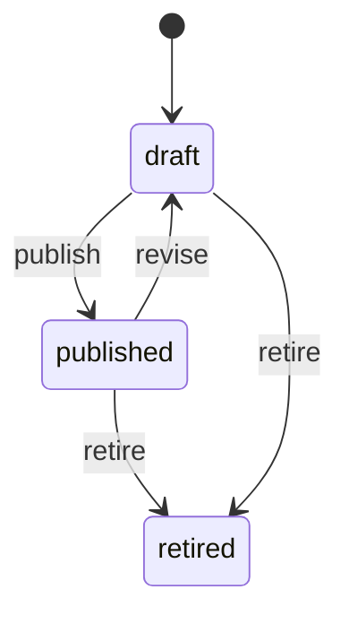
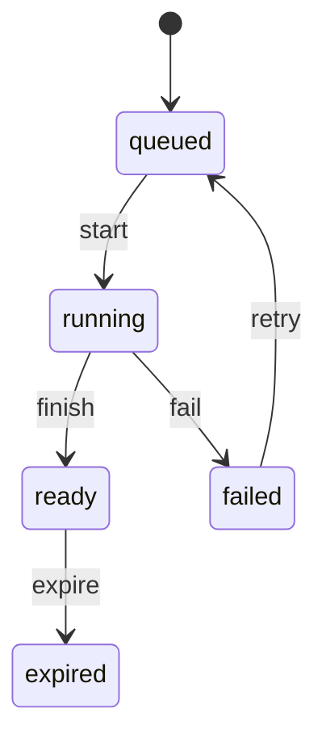
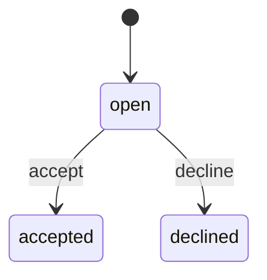

<!-- GENERATED by `npm run gen` from docs/api/modules/reports.md. Do not edit: change the spec and regenerate. -->

# Reports (`reports`)

Business reporting with stated meanings: metric definitions with a named owner and versions, a report catalogue grouped by business area, report queries with an explicit date basis, currency and time zone, the admin and seller dashboards, and authorized export jobs. All figures come from read models fed by other modules' events, never from their tables.

- **Group:** Platform · **Launch phase:** 1 · **Plan chapters:** 1, 11, 14, 15, 16, 18, 19
- **Depends on:** nothing · **Optional:** [access](../access/README.md), [settings](../settings/README.md), [media](../media/README.md), [orders](../orders/README.md), [finance](../finance/README.md), [sellers](../sellers/README.md), [inventory](../inventory/README.md), [search](../search/README.md), [advertising](../advertising/README.md), [promotions](../promotions/README.md), [content](../content/README.md), [workqueues](../workqueues/README.md), [returns](../returns/README.md), [support](../support/README.md), [messaging](../messaging/README.md), [audit](../audit/README.md), [notifications](../notifications/README.md), [cart](../cart/README.md), [fulfillment-service](../fulfillment-service/README.md), [shipping](../shipping/README.md), [wishlist](../wishlist/README.md), [catalog](../catalog/README.md), [offers](../offers/README.md), [purchasing](../purchasing/README.md), [customers](../customers/README.md), [trust](../trust/README.md)

## Owns
- Metric definitions with owner, version history and change suggestions (gross vs net sales, marketplace sales vs marketplace fee income, date basis, currency, time zone, tax treatment)
- Report catalogue in six groups: Commerce, Company trading, Marketplace finance, Products and discovery, Service and sellers, Customers, marketing and ads
- Report queries with filters (date range, date basis placement/payment/shipment/completion, sold by, seller, category, currency, time zone) and saved views
- Admin dashboard figures (gross sales, orders, marketplace fee income, refunds, Official Store vs marketplace split)
- Seller dashboard (work for today, dispatch deadlines, sales, payouts, performance, announcements) and seller reports scoped to the caller's seller
- Authorized exports for every module: async jobs with permission-filtered columns, audit and expiring download links
- Read models (facts per order item, refund, return, payout, service event, discovery signal, campaign and ad charge) built from events, with rebuild

**Not here:**
- Source records: orders, payments, finance, inventory, shipping, returns, support, promotions, advertising own them
- Ad display, click and dismissal tracking and attribution: advertising (reports reads its daily totals)
- Campaign results pages: promotions and advertising have their own detail views; reports holds the cross-campaign summaries
- Action history: audit

## Store API

| Method | Path | Purpose | Auth | Body → Response |
|---|---|---|---|---|
| POST | `/api/store/reports/signals` | Batched anonymous discovery signals from the website and app (product views) | shopper | `{ signals: json[] }` → 202 No content |

## Seller API

| Method | Path | Purpose | Auth | Body → Response |
|---|---|---|---|---|
| GET | `/api/seller/reports/dashboard` | Today at this seller: work tiles, dispatch deadlines, sales, payouts, performance, announcements | seller | `SellerDashboard` |
| GET | `/api/seller/reports/catalogue` | Reports available to sellers | seller | `ReportDefinition[]` |
| POST | `/api/seller/reports/reports/{key}/query` | Run a seller report (product sales, order trend, returns by reason, service performance) | seller<br>`reports.seller.view` | `ReportQuery` → `ReportResult` |
| POST | `/api/seller/reports/exports` | Export a seller report as CSV _(audited, phase 2)_ | seller<br>`reports.seller.export` | `ExportInput` → `ExportJob` |
| GET | `/api/seller/reports/exports` | My seller exports _(phase 2)_ | seller<br>`reports.seller.export` | Page<ExportJob> |
| GET | `/api/seller/reports/exports/{id}` | Seller export status and link (requester only) _(phase 2)_ | seller<br>`reports.seller.export` | `ExportJob` |

## Admin API

| Method | Path | Purpose | Auth | Body → Response |
|---|---|---|---|---|
| GET | `/api/admin/reports/catalogue` | Report library by group with owners | staff<br>`reports.library.view` | `ReportGroup[]` |
| GET | `/api/admin/reports/reports/{key}` | One report: metrics, filters, layout and definitions | staff<br>`reports.library.view` | `{ report: ReportDefinition, definitions: MetricDefinition[] }` |
| POST | `/api/admin/reports/reports/{key}/query` | Run a report with filters | staff<br>`reports.library.view` | `ReportQuery` → `ReportResult` |
| GET | `/api/admin/reports/dashboard` | Admin dashboard figures: gross sales, orders, fee income, refunds and the sales split | staff<br>`reports.dashboard.view` | `AdminDashboard` |
| GET | `/api/admin/reports/metrics` | Metric definitions | staff<br>`reports.library.view` | `MetricDefinition[]` |
| GET | `/api/admin/reports/metrics/{key}` | A metric with its version history | staff<br>`reports.library.view` | `{ metric: MetricDefinition, versions: MetricDefinition[], suggestions: MetricSuggestion[], ownerChanges: MetricOwnerChange[] }` |
| POST | `/api/admin/reports/metrics` | Create a metric definition (draft) _(audited)_ | staff<br>`reports.definitions.manage` | `{ key: string, metric: MetricInput }` → `MetricDefinition` |
| PATCH | `/api/admin/reports/metrics/{key}` | Revise a definition (new draft version) _(audited)_ | staff<br>`reports.definitions.manage` | `MetricInput` → `MetricDefinition` |
| POST | `/api/admin/reports/metrics/{key}/publish` | Publish the draft version with an effective date _(audited)_ | staff<br>`reports.definitions.manage` | `{ effectiveFrom: date, changeNote: text }` → `MetricDefinition` |
| POST | `/api/admin/reports/metrics/{key}/retire` | Retire a metric _(audited)_ | staff<br>`reports.definitions.manage` | `{ reason: text }` → `MetricDefinition` |
| PUT | `/api/admin/reports/metrics/{key}/owner` | Name (or change) the staff member who owns a metric _(audited)_ | staff<br>`reports.definitions.manage` | `{ ownerId: uuid, reason: text }` → `MetricDefinition` |
| PUT | `/api/admin/reports/groups/{key}/owner` | Name (or change) the staff member who owns a report group _(audited)_ | staff<br>`reports.definitions.manage` | `{ ownerId: uuid, reason: text }` → `ReportGroup` |
| POST | `/api/admin/reports/metrics/{key}/suggestions` | Suggest a change to a definition | staff<br>`reports.library.view` | `{ proposed: text, reason: text }` → `MetricSuggestion` |
| POST | `/api/admin/reports/metric-suggestions/{id}/decide` | Accept or decline a suggestion _(audited)_ | staff<br>`reports.definitions.manage` | `{ accept: bool, note: text }` → `MetricSuggestion` |
| GET | `/api/admin/reports/saved-views` | My saved report views plus shared ones | staff<br>`reports.library.view` | `SavedView[]` |
| POST | `/api/admin/reports/saved-views` | Save the current filters as a view | staff<br>`reports.library.view` | `{ reportKey: string, name: string, query: ReportQuery, shared: bool? }` → `SavedView` |
| DELETE | `/api/admin/reports/saved-views/{id}` | Delete a saved view (owner only) | staff<br>`reports.library.view` | 204 No content |
| POST | `/api/admin/reports/exports` | Export a report or a registered dataset _(audited)_ | staff<br>`reports.exports.create` | `ExportInput` → `ExportJob` |
| GET | `/api/admin/reports/export-datasets` | Export dataset registry: what each screen can export, its owner and permission | staff<br>`reports.exports.create` | `ExportDataset[]` |
| GET | `/api/admin/reports/exports` | My exports | staff<br>`reports.exports.create` | Page<ExportJob> |
| GET | `/api/admin/reports/exports/{id}` | Export status and download link (requester only) | staff<br>`reports.exports.create` | `ExportJob` |
| POST | `/api/admin/reports/schedules` | Email a report on a schedule _(audited, phase 2)_ | staff<br>`reports.schedules.manage` | `{ reportKey: string, savedViewId: uuid?, recipientStaffIds: uuid[], frequency: enum(daily|weekly|monthly), dayOfWeek: int?, time: string, format: enum(csv|xlsx) }` → `ReportSchedule` |
| GET | `/api/admin/reports/schedules` | Report email schedules _(phase 2)_ | staff<br>`reports.schedules.manage` | `ReportSchedule[]` |
| DELETE | `/api/admin/reports/schedules/{id}` | Stop a schedule _(audited, phase 2)_ | staff<br>`reports.schedules.manage` | 204 No content |
| GET | `/api/admin/reports/read-models` | Read model health: lag, last event, rebuild state | staff<br>`reports.readmodels.manage` | `ReadModelStatus[]` |
| POST | `/api/admin/reports/read-models/{key}/rebuild` | Rebuild a read model from source snapshots _(audited)_ | staff<br>`reports.readmodels.manage` | `{ reason: text }` → `ReadModelStatus` |

## Types

### StaffRef

| Field | Type |
|---|---|
| staffId | `uuid` |
| name | `string` |
| role | `string` Role label from access.getStaffRef |

### MetricDefinition

| Field | Type |
|---|---|
| key | `string` e.g. commerce.gross_sales |
| name | `string` |
| group | `enum(commerce|company_trading|marketplace_finance|products_discovery|service_sellers|customers_marketing_ads)` |
| definition | `text` Plain-language meaning shown under every report that uses it |
| formula | `text` How it is computed from read-model facts |
| unit | `enum(money|count|percent|ratio|duration_hours|days)` |
| includes | `string[]` |
| excludes | `string[]` e.g. tax |
| dateBasisOptions | `string[]` |
| defaultDateBasis | `enum(placement|payment|shipment|completion|event)` |
| currencyRule | `string` e.g. reporting currency USD; one currency at launch |
| timeZone | `string` e.g. America/Los_Angeles; days run 00:00–23:59 market time |
| relatedKeys | `string[]` e.g. gross sales ↔ sales after cancellations and refunds; marketplace sales ↔ marketplace fee income |
| audience | `enum(staff|seller|both)` |
| launchMeasure | `bool` Part of the small launch set (plan ch. 19) |
| owner | `StaffRef?` Named owner; null until someone is named (seeded metrics start without one). Publishing needs an owner (OWNER_REQUIRED) |
| status | `enum(draft|published|retired)` |
| version | `int` |
| effectiveFrom | `date` |
| reviewedAt | `date?` |
| changeNote | `text?` |

### MetricInput

| Field | Type |
|---|---|
| name | `string` |
| group | `string` |
| definition | `text` |
| formula | `text` |
| unit | `string` |
| includes | `string[]?` |
| excludes | `string[]?` |
| dateBasisOptions | `string[]` |
| defaultDateBasis | `string` |
| relatedKeys | `string[]?` |
| audience | `enum(staff|seller|both)` |
| launchMeasure | `bool?` |
| ownerId | `uuid?` Staff member who owns the metric; may be named later (PUT /metrics/{key}/owner) |
| effectiveFrom | `date?` |
| changeNote | `text` |

### MetricOwnerChange

| Field | Type |
|---|---|
| from | `StaffRef?` |
| to | `StaffRef` |
| reason | `text` |
| changedBy | `Actor` |
| changedAt | `datetime` |

### MetricSuggestion

| Field | Type |
|---|---|
| id | `uuid` |
| metricKey | `string` |
| proposed | `text` |
| reason | `text` |
| suggestedBy | `StaffRef` |
| state | `enum(open|accepted|declined)` |
| decisionNote | `text?` |
| decidedBy | `StaffRef?` |
| createdAt | `datetime` |

### FilterSpec

| Field | Type |
|---|---|
| key | `string` |
| label | `string` |
| type | `enum(date_range|enum|uuid|text|bool)` |
| options | `string[]?` |
| default | `json?` |
| hint | `string?` |

### ReportDefinition

| Field | Type |
|---|---|
| key | `string` e.g. commerce.sales |
| title | `string` |
| group | `string` |
| description | `text` |
| metrics | `string[]` |
| dimensions | `string[]` e.g. day, sold_by, seller, category, product, reason, placement |
| filters | `FilterSpec[]` |
| permission | `string` reports.<group>.view or reports.seller.view |
| audience | `enum(staff|seller)` |
| layout | `string[]` Blocks the screen draws: kpis, series, split, table, breakdown, definitions, callouts |
| phase | `int` |

### ReportGroup

| Field | Type |
|---|---|
| key | `string` |
| label | `string` |
| owner | `StaffRef?` Named owner of the group; null until someone is named |
| ownerRole | `string` Role expected to own it, e.g. Finance Manager (shown while no person is named) |
| reports | `ReportDefinition[]` |

### ReportQuery

| Field | Type |
|---|---|
| preset | `enum(today|last_7_days|last_14_days|last_30_days|last_90_days|month_to_date|custom)?` |
| range | `DateRange?` |
| dateBasis | `enum(placement|payment|shipment|completion)?` |
| soldBy | `enum(all|official|marketplace)?` |
| sellerId | `uuid?` |
| categoryId | `uuid?` |
| productId | `uuid?` |
| currency | `string?` USD only at launch |
| timeZone | `string?` |
| granularity | `enum(day|week|month)?` |
| compare | `enum(none|previous_period)?` |
| filters | `json?` Report-specific filters from FilterSpec |

### KpiValue

| Field | Type |
|---|---|
| metricKey | `string` |
| label | `string` |
| value | `number` |
| money | `Money?` |
| display | `string` |
| delta | `json?` { value, unit: pct|pts, direction: up|down, good: bool } vs the comparison period |
| note | `string?` |

### Series

| Field | Type |
|---|---|
| key | `string` |
| label | `string` |
| points | `json[]` { x: date, y: number } |

### ReportResult

| Field | Type |
|---|---|
| meta | `json` { reportKey, title, range, dateBasis, currency, timeZone, taxIncluded, freshAsOf, mayStillChange, definitionsVersion, compareRange?, scope: platform|seller } |
| kpis | `KpiValue[]` |
| series | `Series[]` |
| split | `json[]?` { label, amount: Money, sharePct } e.g. Official Store vs marketplace sellers |
| table | `json?` { columns: [{ key, label, unit, align }], rows: json[], totals: json } |
| breakdowns | `json[]?` e.g. returns by reason |
| definitions | `MetricDefinition[]` |
| callouts | `json[]` { kind: info|warning, title, body } e.g. 'Marketplace sales are not marketplace fee income' |
| unavailable | `string[]` |

### SavedView

| Field | Type |
|---|---|
| id | `uuid` |
| reportKey | `string` |
| name | `string` |
| query | `ReportQuery` |
| owner | `StaffRef` |
| shared | `bool` |
| createdAt | `datetime` |

### ReportSchedule

| Field | Type |
|---|---|
| id | `uuid` |
| reportKey | `string` |
| savedViewId | `uuid?` |
| recipients | `StaffRef[]` Staff only (decision D2); each must hold the report's group permission |
| frequency | `enum(daily|weekly|monthly)` |
| dayOfWeek | `int?` |
| time | `string` |
| format | `enum(csv|xlsx)` |
| nextRunAt | `datetime` |
| owner | `StaffRef` |
| active | `bool` |

### ExportDatasetKey

| Field | Type |
|---|---|
| key | `enum(reports.report_result|catalog.admin.products|offers.admin.offers|offers.seller.offers|inventory.admin.stock|inventory.seller.stock|purchasing.admin.receiving|shipping.admin.exceptions|returns.admin.requests|returns.seller.requests|returns.admin.inspections|support.admin.cases|finance.admin.ledger|finance.admin.payout_run|finance.admin.checks|finance.seller.ledger|promotions.admin.campaigns|workqueues.admin.items|orders.admin.orders|orders.seller.orders|customers.admin.accounts|sellers.admin.accounts|audit.admin.entries|trust.admin.reports|fulfillment-service.seller.fees|fulfillment-service.seller.stock|fulfillment-service.admin.stock_by_owner|fulfillment-service.admin.fees)` Every dataset a screen can export. See the exportDatasets setting for owner, permission, audience and screens. |

### ExportDataset

| Field | Type |
|---|---|
| key | `enum(reports.report_result|catalog.admin.products|offers.admin.offers|offers.seller.offers|inventory.admin.stock|inventory.seller.stock|purchasing.admin.receiving|shipping.admin.exceptions|returns.admin.requests|returns.seller.requests|returns.admin.inspections|support.admin.cases|finance.admin.ledger|finance.admin.payout_run|finance.admin.checks|finance.seller.ledger|promotions.admin.campaigns|workqueues.admin.items|orders.admin.orders|orders.seller.orders|customers.admin.accounts|sellers.admin.accounts|audit.admin.entries|trust.admin.reports|fulfillment-service.seller.fees|fulfillment-service.seller.stock|fulfillment-service.admin.stock_by_owner|fulfillment-service.admin.fees)` An ExportDatasetKey value |
| owner | `string` Module that supplies the rows through its publicApi exportRows |
| title | `string` |
| permission | `string` Dataset permission, checked in addition to reports.exports.create (staff) or by itself (seller) |
| columns | `json[]` { key, label, permission? } — columns with a permission are dropped for callers without it |
| audience | `enum(staff|seller)` |
| screens | `string[]` Screens whose Export button uses it |
| available | `bool` False while the owner module is disabled (the Export button is hidden) |
| phase | `int` |

### ExportJob

| Field | Type |
|---|---|
| id | `uuid` |
| ref | `string` e.g. EX-261008-0031 |
| dataset | `string` |
| reportKey | `string?` |
| format | `enum(csv|xlsx|jsonl)` jsonl only for audit.admin.entries |
| filters | `json` |
| requestedBy | `Actor` |
| sellerId | `uuid?` |
| state | `enum(queued|running|ready|failed|expired)` |
| rowCount | `int?` |
| columnsExcluded | `string[]` Columns removed because of the caller's permissions |
| fileName | `string?` |
| sha256 | `string?` Checksum of the finished file, so a downloaded export (e.g. audit entries) can be checked for changes |
| downloadUrl | `url?` Signed, single-user link while ready |
| expiresAt | `datetime?` |
| error | `string?` Why a failed job failed, e.g. More than 100,000 rows matched; narrow the filters (EXPORT_TOO_LARGE) |
| createdAt | `datetime` |
| finishedAt | `datetime?` |

### ExportInput

| Field | Type |
|---|---|
| dataset | `string?` An ExportDatasetKey value; omit when exporting a report (reportKey) |
| reportKey | `string?` |
| query | `ReportQuery?` |
| filters | `json?` |
| format | `enum(csv|xlsx|jsonl)?` |

### AdminDashboard

| Field | Type |
|---|---|
| period | `enum(today|last_7_days|last_14_days|last_30_days)` |
| range | `DateRange` |
| asOf | `datetime` |
| dateBasis | `string` Gross sales by order placement date |
| kpis | `KpiValue[]` Gross sales, orders (with AOV), marketplace fee income (on seller sales), refunds (share of gross) |
| salesSplit | `json` { series: Series[] (official, marketplace; last 14 days), official: Money, marketplace: Money, officialSharePct } |
| definitions | `MetricDefinition[]` |
| unavailable | `string[]` |

### SellerWorkTile

| Field | Type |
|---|---|
| key | `enum(overdue_dispatch|dispatch_due_today|new_orders|low_stock|open_returns|unanswered_messages)` |
| count | `int` |
| sub | `string` |
| tone | `enum(danger|warning|neutral)` |
| screen | `string` |
| screenState | `string?` |

### SellerDashboard

| Field | Type |
|---|---|
| date | `date` |
| asOf | `datetime` |
| workToday | `SellerWorkTile[]` |
| dispatchDeadlines | `json[]` Most urgent first: { orderId, orderRef, placedAt, buyerLabel, itemsLabel, deadline: Deadline, nextAction } |
| sales | `json` { range, gross: Money, deltaPct, orders, averageOrder: Money, today: Money, todayOrders, series: Series[], basis: 'item sales before fees, by order date' } |
| payouts | `json?` From finance: { pending, available, held: Money, nextPayout: { date, amount, destinationLabel }, isExampleSchedule } |
| performance | `json?` From sellers: dispatch reliability, cancellation rate and response time vs targets |
| announcements | `json[]` From content: { title, body, kind, effectiveFrom?, link } |
| unavailable | `string[]` |

### ReadModelStatus

| Field | Type |
|---|---|
| key | `string` |
| description | `string` |
| sourceEvents | `string[]` |
| lastEventAt | `datetime?` |
| lagSeconds | `int` |
| rows | `int` |
| state | `enum(live|rebuilding|stale|failed)` |
| rebuildProgressPct | `int?` |
| rebuildable | `bool` False for read models kept from events only (refunds, returns, service): there is no event log to replay yet, so rebuild is refused |
| rebuildNote | `string?` What a rebuild reads, e.g. order facts from orders, or why it is unavailable |

## Status flows

### Metric definition (`MetricDefinition.status`)



Revising a published metric creates a new draft version; the published version stays in use until the new one is published with an effective date. Reports always state the definitions version they used.

### Export job (`ExportJob.state`)



Only the requester can download; the link expires after exportLinkHours and the file is deleted. Every export is audited with dataset, filters, row count and excluded columns.

### Metric suggestion (`MetricSuggestion.state`)



Accepting opens a new draft version of the metric for its owner.

## Data (schema `reports`)

**metric_definitions**

| Column | Type |
|---|---|
| key | text pk |
| name | text |
| group_key | text |
| definition | text |
| formula | text |
| unit | text |
| includes | jsonb |
| excludes | jsonb |
| date_basis_options | jsonb |
| default_date_basis | text |
| currency_rule | text |
| time_zone | text |
| related_keys | jsonb |
| audience | text |
| launch_measure | bool |
| owner_staff_id | uuid? (null until an owner is named) |
| status | text |
| version | int |
| effective_from | date |
| reviewed_at | date? |
| change_note | text? (what the current draft changes, or the published version's note) |

**metric_owner_changes**: Who owned a metric when: every PUT /metrics/{key}/owner (not a new version)

| Column | Type |
|---|---|
| id | uuid pk |
| metric_key | text → metric_definitions |
| from_staff_id | uuid? |
| to_staff_id | uuid |
| reason | text |
| changed_by | text |
| changed_at | timestamptz |

Indexes: `(metric_key, changed_at desc)`

**metric_versions**: Every published version of a definition; reports state which version they used

| Column | Type |
|---|---|
| id | uuid pk |
| metric_key | text → metric_definitions |
| version | int |
| snapshot | jsonb |
| change_note | text |
| changed_by | text |
| effective_from | date |
| created_at | timestamptz |

Indexes: `unique(metric_key, version)`

**metric_suggestions**

| Column | Type |
|---|---|
| id | uuid pk |
| metric_key | text → metric_definitions |
| proposed | text |
| reason | text |
| suggested_by | text |
| state | text |
| decision_note | text? |
| decided_by | text? |
| created_at | timestamptz |

**report_definitions**: Catalogue seeded per launch report; group owners from report_groups

| Column | Type |
|---|---|
| key | text pk |
| group_key | text |
| title | text |
| description | text |
| metrics | jsonb |
| dimensions | jsonb |
| filters | jsonb |
| permission | text |
| audience | text |
| layout | jsonb |
| phase | int |
| active | bool |

**report_groups**

| Column | Type |
|---|---|
| key | text pk |
| label | text |
| owner_staff_id | uuid? (null until an owner is named) |
| position | int |

**saved_views**

| Column | Type |
|---|---|
| id | uuid pk |
| report_key | text |
| name | text |
| query | jsonb |
| owner_staff_id | uuid |
| shared | bool |
| created_at | timestamptz |

**report_schedules**

| Column | Type |
|---|---|
| id | uuid pk |
| report_key | text |
| saved_view_id | uuid? |
| recipients | jsonb (staff ids) |
| frequency | text |
| day_of_week | int? |
| time | text |
| format | text (csv|xlsx) |
| next_run_at | timestamptz |
| owner_staff_id | uuid |
| active | bool |

**export_datasets**: Export dataset registry: one row per ExportDatasetKey, seeded from the exportDatasets setting and filled with columns when the owner registers at boot; available=false while the owner module is disabled

| Column | Type |
|---|---|
| key | text pk |
| owner_module | text |
| title | text |
| permission | text |
| audience | text (staff|seller) |
| columns | jsonb |
| screens | jsonb |
| available | bool |
| phase | int |
| registered_at | timestamptz? |

**export_jobs**

| Column | Type |
|---|---|
| id | uuid pk |
| ref | text unique |
| dataset | text |
| report_key | text? |
| format | text |
| filters | jsonb |
| requested_by_kind | text |
| requested_by_id | text |
| seller_id | uuid? |
| state | text |
| row_count | int? |
| columns_excluded | jsonb |
| file_media_id | uuid? |
| sha256 | text? |
| expires_at | timestamptz? |
| error | text? |
| created_at | timestamptz |
| finished_at | timestamptz? |

Indexes: `(requested_by_id, created_at desc)`, `(state, created_at)`

**fact_order_items**: One row per order item with the four date bases; the base of every sales metric

| Column | Type |
|---|---|
| order_item_id | uuid pk |
| order_id | uuid |
| owner_type | text (official|seller) |
| seller_id | uuid? |
| customer_key | text (hashed customer id or guest email) |
| category_id | uuid? |
| product_id | uuid |
| offer_id | uuid |
| quantity | int |
| item_minor | bigint (after customer discounts) |
| shipping_minor | bigint |
| discount_platform_minor | bigint |
| discount_seller_minor | bigint |
| tax_minor | bigint |
| currency | text |
| placed_at | timestamptz |
| paid_at | timestamptz? |
| shipped_at | timestamptz? |
| delivered_at | timestamptz? |
| completed_at | timestamptz? |
| cancelled_at | timestamptz? |
| cancelled_by | text? |
| cancelled_minor | bigint |
| refunded_minor | bigint |
| last_refund_at | timestamptz? |
| buying_cost_minor | bigint? (Official Store, from inventory.getUnitCost) |
| accepted_at | timestamptz? (order acceptance; rows recorded before pass 4 hold the placement time) |
| group_id | uuid? (seller group of the order; payments.payment.captured is matched on it) |
| fulfilled_by | text? (official_warehouse|seller|marketly_service) (the group's PlacedGroup.fulfilledBy from orders.order.placed; null for rows recorded before it was kept) |

Indexes: `(placed_at)`, `(paid_at)`, `(shipped_at)`, `(completed_at)`, `(seller_id, placed_at)`, `(product_id, placed_at)`, `(order_id, group_id)`

**fact_refunds**: One row per refund and seller share (decision D5): a refund over several sellers' items is split by the items it names (payments.refund.sent items), the rest (shipping, unnamed amounts) proportionally to each seller's item amounts on the order

| Column | Type |
|---|---|
| refund_id | uuid |
| seller_id | uuid (OFFICIAL_STORE_ID for the Official Store) |
| order_id | uuid |
| owner_type | text (official|seller) |
| amount_minor | bigint |
| currency | text |
| reason | text? |
| after_payout | bool (a payout to this seller was paid after the item's delivery and before the refund, so the sale may already have been paid out) |
| sent_at | timestamptz |

Indexes: `pk (refund_id, seller_id)`, `(sent_at)`, `(seller_id, sent_at)`

**fact_returns**

| Column | Type |
|---|---|
| return_id | uuid pk |
| seller_id | uuid |
| product_id | uuid |
| category_id | uuid? |
| units | int |
| reason | text |
| requested_at | timestamptz |
| outcome | text? |
| stock_outcome | text? |

Indexes: `(seller_id, requested_at)`, `(product_id, requested_at)`

**fact_marketplace_finance_daily**: Per seller and day: fee income, discount funding, amounts owed, holds, payouts

| Column | Type |
|---|---|
| seller_id | uuid |
| day | date |
| seller_sales_minor | bigint |
| fee_income_minor | bigint |
| platform_discount_minor | bigint |
| seller_discount_minor | bigint |
| held_minor | bigint |
| payouts_paid_minor | bigint |
| payouts_failed | int |
| owed_minor | bigint |
| ad_charges_minor | bigint |
| service_fees_minor | bigint (Fulfilled by Marketly fees charged less reversals) |

Indexes: `unique(seller_id, day)`

**fact_service_daily**: Per seller and day: dispatch, tracking, cancellations, response time, cases, delivery issues

| Column | Type |
|---|---|
| seller_id | uuid |
| day | date |
| dispatched | int |
| dispatched_on_time | int |
| overdue | int |
| valid_tracking | int |
| seller_cancellations | int |
| delivery_exceptions | int |
| messages_received | int |
| first_reply_minutes_p50 | int? (median first reply minutes of the day from messaging.sellerResponseStats, its average when no median; a range shows the average of the daily medians) |
| cases_opened | int |
| cases_open_eod | int |
| complaints_by_category | jsonb |

Indexes: `unique(seller_id, day)`

**fact_marketly_fulfillment_daily**: Per seller of record and day: dispatches Marketly's warehouse made for Fulfilled by Marketly groups (kept out of fact_service_daily so seller dispatch metrics only count what the seller shipped)

| Column | Type |
|---|---|
| seller_id | uuid |
| day | date |
| dispatched | int |
| dispatched_on_time | int |
| overdue | int |

Indexes: `unique(seller_id, day)`

**fact_discovery_daily**: Per product and day: views, cart additions, purchases, stockout minutes

| Column | Type |
|---|---|
| product_id | uuid |
| day | date |
| views | int |
| cart_adds | int |
| purchases | int |
| stockout_minutes | int |

Indexes: `unique(product_id, day)`

**fact_search_misses_daily**

| Column | Type |
|---|---|
| day | date |
| query_norm | text |
| count | int |
| had_unavailable_match | bool |

Indexes: `unique(day, query_norm)`

**fact_customers**: Returning buyers and repeat purchase

| Column | Type |
|---|---|
| customer_key | text pk |
| first_order_at | timestamptz |
| last_order_at | timestamptz |
| orders | int |
| net_spend_minor | bigint |

**fact_campaigns_daily**

| Column | Type |
|---|---|
| campaign_kind | text (promotion|ad) |
| campaign_id | uuid |
| day | date |
| sales_minor | bigint |
| discount_cost_minor | bigint |
| funded_by | jsonb |
| redemptions | int |
| displays | int |
| clicks | int |
| dismissals | int |
| spend_minor | bigint |
| attributed_purchases | int |

Indexes: `unique(campaign_kind, campaign_id, day)`

**open_stockouts**: Out-of-stock intervals still open per stock item (inventory.stock.changed); closing one adds its minutes to fact_discovery_daily

| Column | Type |
|---|---|
| stock_item_id | uuid pk |
| product_id | uuid |
| since | timestamptz |

**campaign_refs**: Campaign behind a coupon redemption or ad charge, for the reversal or credit that names only the redemption or charge

| Column | Type |
|---|---|
| kind | text (redemption|charge) |
| ref_id | uuid |
| campaign_id | uuid |
| created_at | timestamptz |

Indexes: `pk (kind, ref_id)`

**read_model_checkpoints**

| Column | Type |
|---|---|
| key | text pk |
| last_event_id | text? |
| last_event_at | timestamptz? |
| state | text |
| rebuild_started_at | timestamptz? |
| rebuild_progress | int? |

## Events

| Publishes | When | Payload | Consumed by |
|---|---|---|---|
| `reports.metric.published` | A metric definition version is published | `{ metricKey: string, version: int, effectiveFrom: date }` | - |
| `reports.export.requested` | An export job is created (audit and abuse monitoring) | `{ exportId: uuid, dataset: string, requestedBy: Actor, sellerId: uuid? }` | - |
| `reports.export.ready` | An export file is ready (notifications tells the requester) | `{ exportId: uuid, requestedBy: Actor, expiresAt: datetime }` | notifications |
| `reports.scheduled_report.ready` | Phase 2: a scheduled report file is ready (notifications emails each staff recipient a link to their own export) | `{ scheduleId: uuid, reportKey: string, reportTitle: string, format: enum(csv|xlsx), periodLabel: string, deliveries: json[], skippedStaffIds: uuid[], expiresAt: datetime }` | notifications |

| Consumes | From | Does |
|---|---|---|
| `orders.order.placed` | orders | fact_order_items rows with placement date; fact_customers |
| `orders.order.accepted` | orders | Mark items accepted (orders count from acceptance) |
| `payments.payment.captured` | payments | Payment date basis |
| `shipping.shipment.dispatched` | shipping | Shipment date basis; on-time dispatch in fact_service_daily, or in fact_marketly_fulfillment_daily when fulfilledBy is marketly_service (never in the seller's row) |
| `shipping.dispatch.overdue` | shipping | Overdue counts in fact_service_daily, or in fact_marketly_fulfillment_daily when fulfilledBy is marketly_service |
| `shipping.shipment.exception` | shipping | Delivery issues |
| `orders.item.delivered` | orders | Delivered date |
| `orders.order.completed` | orders | Completion date basis |
| `orders.item.cancelled` | orders | Cancellations (by customer or seller) and cancelled amounts |
| `payments.refund.sent` | payments | Refunds sent (refund date and amount); 'approved' refunds are never counted as sent. One fact_refunds row per seller: the named items' amounts go to their sellers, the rest is split proportionally to each seller's item amounts on the order (decision D5); after_payout from the seller's paid payouts |
| `returns.return.requested` | returns | fact_returns with reason |
| `returns.return.inspected` | returns | Return outcome |
| `inventory.stock.changed` | inventory | Stockout minutes per product |
| `cart.item.added` | cart | Cart additions per product |
| `messaging.message.sent` | messaging | Response time per seller |
| `support.case.opened` | support | Case backlog and complaint patterns |
| `support.case.resolved` | support | Case backlog |
| `finance.payout.paid` | finance | Completed payouts; also the paid-payout dates that decide fact_refunds.after_payout |
| `finance.payout.failed` | finance | Failed payouts |
| `finance.hold.placed` | finance | Held amounts |
| `finance.hold.released` | finance | Held amounts |
| `finance.amount_owed.created` | finance | Amounts owed by sellers |
| `promotions.coupon.redeemed` | promotions | Campaign sales, discount cost and funding owner |
| `promotions.redemption.reversed` | promotions | Reverse discount cost on cancellation |
| `advertising.charge.posted` | advertising | Ad spending per campaign and seller |
| `advertising.charge.credited` | advertising | Ad credits |
| `fulfillment-service.fee.charged` | fulfillment-service | Fulfilled by Marketly fees per seller and day: fact_marketplace_finance_daily.service_fees_minor (claimed per chargeId) |
| `fulfillment-service.fee.reversed` | fulfillment-service | Subtract reversed Fulfilled by Marketly fees from service_fees_minor on the reversal day |

## In-process API (for other modules)

| Function | Signature | Used by |
|---|---|---|
| registerDataset | `(dataset: ExportDataset) => void`<br>Owner modules register the columns of their datasets at boot. Only keys in the export dataset registry (ExportDatasetKey, setting exportDatasets) are accepted. Rows are read page by page through the owner's own publicApi function exportRows(dataset, filters, principal, cursor); reports runs the job, filters columns by permission and stores the file. | catalog, offers, inventory, purchasing, shipping, returns, support, finance, promotions, workqueues, orders, customers, sellers, audit, trust, fulfillment-service |
| requestExport | `(input: { dataset: string, filters: json, format: 'csv' | 'xlsx' | 'jsonl', principal: identity.Principal, sellerId?: uuid }) => ExportJob`<br>Used by other modules' export endpoints; same rules as POST /exports, including the dataset's own permission for the principal (jsonl only for audit.admin.entries). Their status endpoints read the job back with getExport. | catalog, offers, inventory, returns, orders, customers, sellers, workqueues, audit, trust, finance |
| recordSignal | `(signal: { kind: 'product_view' | 'search_no_result' | 'cart_add', productId?: uuid, offerId?: uuid, query?: string, sessionKey?: string, at: datetime }) => void`<br>Discovery signals that are not events (anonymous counts only) | catalog, search, customers |
| metric | `(key: string) => MetricDefinition | null`<br>Published definition text for tooltips in other modules' screens | sellers, finance, advertising, promotions |
| getAdminDashboard | `(period: 'today' | 'last_7_days' | 'last_14_days' | 'last_30_days', principal: identity.Principal) => AdminDashboard`<br>Admin dashboard figures with definitions (same as GET /api/admin/reports/dashboard) | graphql |
| getSellerDashboard | `(sellerId: uuid, period: 'today' | 'last_7_days' | 'last_14_days' | 'last_30_days') => SellerDashboard`<br>The seller's own dashboard figures and work tiles (same as GET /api/seller/reports/dashboard); sellerId always comes from the session | graphql |
| getExport | `(id: uuid, principal: identity.Principal) => ExportJob`<br>One export job for its requester (NOT_FOUND for anyone else); while ready each call signs a fresh download link and records it. The module status endpoints GET …/exports/{id} proxy it. | offers, inventory, returns, orders, audit, finance |
| listExports | `(filter: { dataset: string, state?: string, allRequesters?: bool }, principal: identity.Principal, cursor?: string) => { items: ExportJob[], nextCursor?: string }`<br>Export jobs for one dataset, newest first: the principal's own, or every requester's when allRequesters is set (the calling module checks its own permission first). Used by the audit export list. | audit |

## Permissions

| Key | Who | Allows |
|---|---|---|
| `reports.library.view` | staff | Open the report library (each report also needs its group permission) |
| `reports.commerce.view` | staff | Commerce reports |
| `reports.trading.view` | staff | Company trading reports (margin, buying cost) |
| `reports.marketplace-finance.view` | staff | Marketplace finance reports (fees, amounts owed, holds, payouts) |
| `reports.discovery.view` | staff | Products and discovery reports |
| `reports.service.view` | staff | Service and seller reports |
| `reports.customers-marketing.view` | staff | Customers, marketing and ads reports |
| `reports.dashboard.view` | staff | Admin dashboard figures |
| `reports.definitions.manage` | staff | Create, revise, publish and retire metric definitions (Reports Analyst) |
| `reports.exports.create` | staff | Create exports (plus each dataset's permission) |
| `reports.schedules.manage` | staff | Schedule report emails |
| `reports.readmodels.manage` | staff | See read model health and rebuild |
| `reports.seller.view` | seller | Seller reports |
| `reports.seller.export` | seller | Export seller reports |

## Error codes

| Code | Status | Meaning |
|---|---|---|
| `RANGE_TOO_LARGE` | 422 | The range is longer than maxRangeDays |
| `EXPORT_TOO_LARGE` | 422 | The export matched more than maxExportRows rows. Known only while the job runs (no request answers it): the job fails with this message in ExportJob.error (details.maxRows, details.matchedRows = rows read before stopping); narrow the filters and export again. |
| `OWNER_REQUIRED` | 422 | A metric needs a named owner before it is published |
| `METRIC_IN_USE` | 409 | A published report still uses this metric |
| `DATASET_UNAVAILABLE` | 409 | The dataset is not in the export registry or its owner module is disabled |
| `RECIPIENT_NOT_PERMITTED` | 422 | Scheduled report recipients must be active staff holding the report's permission. details.staffIds. |
| `REBUILD_UNAVAILABLE` | 409 | This read model is kept from events only and cannot be rebuilt until an event log exists |

## Background jobs

| Job | Schedule | Does |
|---|---|---|
| `reports.run-exports` | every 1 min | Run queued export jobs in batches: call the owner module's exportRows(dataset, filters, principal, cursor) until nextCursor is empty (report results come from runReport), drop columns the requester may not see, write the file to media; publish reports.export.ready |
| `reports.expire-exports` | hourly | Expire ready exports after exportLinkHours and delete files |
| `reports.pull-daily` | daily 02:30 market time | Pull figures that have no event: search.zeroResultStats (unavailable searches), finance fee income per seller and day (finance.marketplaceIncomeByDay), advertising displays/clicks/dismissals and attributed purchases (advertising.dailyPerformance), inventory unit costs for Official Store items |
| `reports.run-schedules` | every 15 min | Phase 2: run due schedules: re-check each staff recipient's permission, create one export job per remaining recipient (requested in their name) and publish reports.scheduled_report.ready (notifications sends the emails) |
| `reports.check-lag` | every 5 min | Mark read models stale when their lag exceeds readModelMaxLagMinutes |

## Settings

| Key | Default | Rules | Meaning |
|---|---|---|---|
| reportingCurrency | `"USD"` | string, read-only | One currency at launch |
| reportingTimeZone | `"America/Los_Angeles"` | string, read-only | Market time zone; days run 00:00–23:59 |
| defaultDateBasis | `"placement"` | enum (placement \| payment \| shipment \| completion) | Default basis for sales reports |
| taxIncluded | `false` | bool, approval: second reviewer | Sales figures exclude tax |
| maxRangeDays | `400` | duration, days, 1–… | Longest range one query may cover |
| exportLinkHours | `24` | duration, hours, 1–… | Download link lifetime |
| maxExportRows | `500000` | int, 1–… | Above this the export is refused; narrow the filters |
| exportDatasets | `[{"key":"reports.report_result","owner":"reports","permission":"reports.<group>.view (the report group permission)","audience":"staff","screens":["admin/reports","admin/dashboard"],"phase":1},{"key":"catalog.admin.products","owner":"catalog","permission":"catalog.products.export","audience":"staff","screens":["admin/catalog"],"phase":1},{"key":"offers.admin.offers","owner":"offers","permission":"offers.offers.view","audience":"staff","screens":["admin/catalog"],"phase":1},{"key":"offers.seller.offers","owner":"offers","permission":"offers.offers.export","audience":"seller","screens":["seller/products"],"phase":1},{"key":"inventory.admin.stock","owner":"inventory","permission":"inventory.stock.view","audience":"staff","screens":["ops/inventory"],"phase":1},{"key":"inventory.seller.stock","owner":"inventory","permission":"inventory.stock.export","audience":"seller","screens":["seller/inventory"],"phase":1},{"key":"purchasing.admin.receiving","owner":"purchasing","permission":"purchasing.orders.view","audience":"staff","screens":["ops/receiving"],"phase":1},{"key":"shipping.admin.exceptions","owner":"shipping","permission":"shipping.exceptions.view","audience":"staff","screens":["ops/dispatch"],"phase":1},{"key":"returns.admin.requests","owner":"returns","permission":"returns.requests.view","audience":"staff","screens":["admin/returns"],"phase":1},{"key":"returns.seller.requests","owner":"returns","permission":"returns.requests.export","audience":"seller","screens":["seller/returns"],"phase":1},{"key":"returns.admin.inspections","owner":"returns","permission":"returns.inspections.record","audience":"staff","screens":["ops/return-inspection"],"phase":1},{"key":"support.admin.cases","owner":"support","permission":"support.cases.view","audience":"staff","screens":["admin/cases"],"phase":1},{"key":"finance.admin.ledger","owner":"finance","permission":"finance.ledger.view","audience":"staff","screens":["admin/finance"],"phase":1},{"key":"finance.admin.payout_run","owner":"finance","permission":"finance.payouts.prepare","audience":"staff","screens":["admin/payouts"],"phase":1},{"key":"finance.admin.checks","owner":"finance","permission":"finance.reconciliation.work","audience":"staff","screens":["ops/finance-checks"],"phase":1},{"key":"finance.seller.ledger","owner":"finance","permission":"finance.balances.view","audience":"seller","screens":["seller/finance"],"phase":1},{"key":"promotions.admin.campaigns","owner":"promotions","permission":"promotions.results.view","audience":"staff","screens":["admin/promotions"],"phase":1},{"key":"workqueues.admin.items","owner":"workqueues","permission":"workqueues.items.export","audience":"staff","screens":["ops/queues","admin/dashboard"],"phase":1},{"key":"orders.admin.orders","owner":"orders","permission":"orders.orders.export","audience":"staff","screens":["admin/orders"],"phase":1},{"key":"orders.seller.orders","owner":"orders","permission":"orders.fulfillment.export","audience":"seller","screens":["seller/orders"],"phase":1},{"key":"customers.admin.accounts","owner":"customers","permission":"customers.accounts.export","audience":"staff","screens":["admin/customers"],"phase":1},{"key":"sellers.admin.accounts","owner":"sellers","permission":"sellers.accounts.export","audience":"staff","screens":["admin/sellers"],"phase":1},{"key":"audit.admin.entries","owner":"audit","permission":"audit.entries.export","audience":"staff","screens":["admin/audit"],"phase":1},{"key":"trust.admin.reports","owner":"trust","permission":"trust.reports.export","audience":"staff","screens":["admin/trust"],"phase":1},{"key":"fulfillment-service.seller.fees","owner":"fulfillment-service","permission":"fulfillment-service.fees.view","audience":"seller","screens":["seller/finance"],"phase":4},{"key":"fulfillment-service.seller.stock","owner":"fulfillment-service","permission":"fulfillment-service.inbound.manage","audience":"seller","screens":["seller/inventory"],"phase":4},{"key":"fulfillment-service.admin.stock_by_owner","owner":"fulfillment-service","permission":"fulfillment-service.operations.view","audience":"staff","screens":["ops/inventory"],"phase":4},{"key":"fulfillment-service.admin.fees","owner":"fulfillment-service","permission":"fulfillment-service.fees.manage","audience":"staff","screens":["admin/finance"],"phase":4}]` | json, read-only | Export dataset registry (seed of export_datasets). Adding a dataset needs a new ExportDatasetKey value and an exportRows provider in the owner module. |
| readModelMaxLagMinutes | `15` | duration, minutes, 1–… | Lag before a read model shows as stale |
| launchMetrics | `["commerce.gross_sales","commerce.net_sales","commerce.orders","commerce.average_order_value","commerce.refunds","marketplace.fee_income","marketplace.seller_sales","service.on_time_dispatch","service.case_backlog","discovery.unavailable_searches"]` | json, approval: second reviewer | The small launch set; others become available once they have an owner and a reliable meaning |

## Notes
- Report definitions follow plan ch. 19: every result states range, date basis (placement, payment, shipment or completion), currency, time zone and tax treatment; gross sales are distinguished from sales after cancellations and refunds; marketplace sales are never shown as marketplace fee income (fee income lives in Marketplace finance).
- Read models only: reports never queries another module's schema. Events feed fact tables; figures without events are pulled daily through public APIs. Each read model can be rebuilt.
- Figures without events are pulled daily: fee income per seller and day from finance.marketplaceIncomeByDay(range), and displays, clicks, dismissals and attributed purchases per campaign and day from advertising.dailyPerformance(range). When finance or advertising is off, those figures are listed in `unavailable`.
- Sellers only ever see their own results: seller endpoints take the seller from the session and the report definitions with audience seller.
- Exports for every module run here (registerDataset / requestExport) so permission filtering, audit and link expiry are uniform ('authorized exports', plan ch. 18). Module export endpoints (catalog, offers, inventory, returns, orders, customers, sellers, workqueues, audit, trust) return reports.ExportJob; their status endpoints proxy getExport.
- Export dataset registry: every Export button exports one ExportDatasetKey. Staff: reports.report_result (reports, reports.<group>.view (the report group permission)); catalog.admin.products (catalog, catalog.products.export); offers.admin.offers (offers, offers.offers.view); inventory.admin.stock (inventory, inventory.stock.view); purchasing.admin.receiving (purchasing, purchasing.orders.view); shipping.admin.exceptions (shipping, shipping.exceptions.view); returns.admin.requests (returns, returns.requests.view); returns.admin.inspections (returns, returns.inspections.record); support.admin.cases (support, support.cases.view); finance.admin.ledger (finance, finance.ledger.view); finance.admin.payout_run (finance, finance.payouts.prepare); finance.admin.checks (finance, finance.reconciliation.work); promotions.admin.campaigns (promotions, promotions.results.view); workqueues.admin.items (workqueues, workqueues.items.export); orders.admin.orders (orders, orders.orders.export); customers.admin.accounts (customers, customers.accounts.export); sellers.admin.accounts (sellers, sellers.accounts.export); audit.admin.entries (audit, audit.entries.export); trust.admin.reports (trust, trust.reports.export). Seller: offers.seller.offers (offers, offers.offers.export); inventory.seller.stock (inventory, inventory.stock.export); returns.seller.requests (returns, returns.requests.export); orders.seller.orders (orders, orders.fulfillment.export); finance.seller.ledger (finance, finance.balances.view).
- Export rows: reports never reads another module's tables. Each owner module exposes publicApi exportRows(dataset: string, filters: json, principal: identity.Principal, cursor?: string) => { rows: json[], nextCursor?: string } for its datasets, applies its own row scoping (a seller only gets its own rows) and masking (e.g. orders contact details), and registers the columns with registerDataset. reports.report_result is produced by reports itself.
- Module export endpoints (orders, customers, sellers, workqueues, catalog, offers, inventory, returns, audit, trust) are shortcuts that call requestExport with their dataset key; POST /exports accepts the same keys directly, so the Export buttons on admin/returns, admin/finance, admin/payouts, admin/cases, admin/promotions, ops/inventory, ops/receiving, ops/dispatch, ops/return-inspection and ops/finance-checks need no endpoint of their own.
- Phase 2: scheduled report emails and seller report exports (POST /api/seller/reports/exports on seller/reports; plan ch. 20 'better seller reports'). Seller list exports are phase 1: orders.seller.orders, offers.seller.offers, inventory.seller.stock, returns.seller.requests and finance.seller.ledger run through requestExport from their owner modules, because the seller Orders, Products, Inventory, Returns and Finance ledger lists are phase-1 seller operations (plan ch. 11 and 20) and their screens have Export. Launch measures are a small set (settings.launchMetrics); more are added when each has an owner.
- dependsOn is empty as in the architecture doc; everything else is optional and degrades to `unavailable`.
- Scheduled reports go to staff only (decision D2): recipients are staff ids with the report's permission, checked when the schedule is saved and at every run; each recipient gets an export job in their own name, so the download link works for them and nobody else. Formats are CSV and XLSX; PDF was removed.
- Metric and group owners are nullable (decision D10): seeded metrics and groups start without a person (shown with the expected role) and are named with PUT /metrics/{key}/owner and PUT /groups/{key}/owner; a metric still needs an owner to be published.
- Refunds over several sellers are split per seller (decision D5); see fact_refunds.
- Fulfilled by Marketly (fulfillment-service, phase 4): fact_order_items.fulfilled_by from orders.order.placed groups; Marketly's dispatches for those groups go to fact_marketly_fulfillment_daily, never to the seller's fact_service_daily row, so seller on-time dispatch and overdue figures only count what the seller shipped; service fees per seller and day go to fact_marketplace_finance_daily.service_fees_minor from fulfillment-service.fee.charged and fee.reversed. Metric definitions (seeded): 'Service fees' (marketplace finance group, Σ service_fees_minor) and 'Fulfilled by Marketly on-time dispatch' (service group, Σ dispatched_on_time ÷ Σ dispatched × 100 over fact_marketly_fulfillment_daily). The seller dashboard shows a service-fees line. Export datasets fulfillment-service.seller.fees, fulfillment-service.seller.stock, fulfillment-service.admin.stock_by_owner and fulfillment-service.admin.fees are registered and served by fulfillment-service.

## GraphQL (read layer)

This module's fragment of the GraphQL schemas (see [../graphql/README.md](../graphql/README.md)). Writes stay on the REST endpoints above.

```graphql
# reports: dashboard figures with stated meanings. Every figure carries its range, date basis, currency and time zone,
# and links to its published metric definition. Figures come from reports' read models, never other modules' tables.
#
# AdminDashboard = adminDashboard (KPIs, sales split) + workqueues.workSummary + finance / advertising cards.
# SellerDashboard = sellerDashboard (work tiles, sales) + mySeller { performance, balance (finance) } + orders' dispatch
# deadlines + content announcements. Sellers only ever see their own results.

enum DashboardPeriod {
  TODAY
  LAST_7_DAYS
  LAST_14_DAYS
  LAST_30_DAYS
}

enum DashboardScope {
  "Whole marketplace (Admin Center)"
  PLATFORM
  "The caller's own seller account (Seller Center)"
  SELLER
}

enum MetricDateBasis {
  PLACEMENT
  PAYMENT
  SHIPMENT
  COMPLETION
  EVENT
}

enum MetricUnit {
  MONEY
  COUNT
  PERCENT
  RATIO
  DURATION_HOURS
  DAYS
}

enum MetricGroup {
  COMMERCE
  COMPANY_TRADING
  MARKETPLACE_FINANCE
  PRODUCTS_DISCOVERY
  SERVICE_SELLERS
  CUSTOMERS_MARKETING_ADS
}

"The published meaning of a metric, shown under every figure that uses it"
type MetricDefinition {
  "e.g. commerce.gross_sales"
  key: String!
  name: String!
  group: MetricGroup!
  "Plain-language meaning"
  definition: String!
  unit: MetricUnit!
  includes: [String!]!
  "e.g. tax"
  excludes: [String!]!
  defaultDateBasis: MetricDateBasis!
  "e.g. reporting currency USD"
  currencyRule: String!
  "e.g. America/Los_Angeles; days run 00:00–23:59 market time"
  timeZone: String!
  "e.g. gross sales ↔ sales after cancellations and refunds"
  relatedKeys: [String!]!
  version: Int!
  effectiveFrom: Date!
  ownerName: String @areas(in: [ADMIN])
}

enum MetricDeltaUnit {
  "Percent change"
  PCT
  "Percentage points"
  PTS
}

enum MetricDirection {
  UP
  DOWN
  FLAT
}

"Change against the comparison period"
type MetricDelta {
  value: Float!
  unit: MetricDeltaUnit!
  direction: MetricDirection!
  "Whether the change is good news (refunds going down is good)"
  good: Boolean!
}

"One headline figure (KPI tile)"
type MetricValue {
  metricKey: String!
  label: String!
  value: Float!
  "Set when the unit is MONEY"
  money: Money
  "Formatted for display, e.g. $241.3k, 3,418, 2.1%"
  display: String!
  unit: MetricUnit!
  delta: MetricDelta
  "e.g. avg $71.20, 2.1% of gross, on $109.4k seller sales"
  note: String
  definition: MetricDefinition
}

"One point of a chart series"
type MetricPoint {
  date: Date!
  "Axis label, e.g. Oct 8"
  label: String!
  value: Float!
  "Set when the series unit is MONEY"
  money: Money
}

"A chart line, e.g. daily sales for the Official Store"
type MetricSeries {
  "e.g. official, marketplace, sales"
  key: String!
  label: String!
  metricKey: String!
  unit: MetricUnit!
  "day, week or month"
  granularity: String!
  points: [MetricPoint!]!
  "Sum or average over the series range, formatted like the points"
  total: MetricValue
}

"One share of a split, e.g. Official Store 58% · $140.2k"
type DashboardSplit {
  key: String!
  label: String!
  amount: Money!
  sharePct: Float!
}

enum DashboardTone {
  DANGER
  WARNING
  NEUTRAL
}

enum DashboardWorkTileKey @areas(in: [SELLER]) {
  OVERDUE_DISPATCH
  DISPATCH_DUE_TODAY
  NEW_ORDERS
  LOW_STOCK
  OPEN_RETURNS
  UNANSWERED_MESSAGES
}

"A 'Work for today' tile on the seller dashboard (counts from orders, inventory, returns, messaging, workqueues)"
type DashboardWorkTile @areas(in: [SELLER]) {
  key: DashboardWorkTileKey!
  count: Int!
  "e.g. MK-261007-10433 · 3 h past deadline"
  sub: String!
  tone: DashboardTone!
  "Seller Center screen to open, e.g. seller/orders"
  screen: String!
  screenState: String
}

"""
Dashboard figures for one scope and period: KPI tiles, chart series and splits, each with its definition.
Admin: gross sales, orders (with AOV), marketplace fee income, refunds; series and split Official Store vs marketplace sellers.
Seller: sales (item sales before fees, by order date), orders, average order, today so far; daily sales series.
"""
type DashboardMetrics {
  scope: DashboardScope!
  period: DashboardPeriod!
  from: Date!
  to: Date!
  "Comparison range for deltas (the previous period of the same length)"
  compareFrom: Date
  compareTo: Date
  "Figures include events up to this time"
  asOf: DateTime!
  dateBasis: MetricDateBasis!
  "e.g. Gross sales by order placement date"
  basisLabel: String!
  currency: String!
  timeZone: String!
  taxIncluded: Boolean!
  "Recent days can still change (late cancellations and refunds)"
  mayStillChange: Boolean!
  kpis: [MetricValue!]!
  "Chart series. The sales chart always covers the last 14 days, whatever the period."
  series: [MetricSeries!]!
  "Admin: Official Store vs marketplace sellers. Empty for sellers."
  split: [DashboardSplit!]!
  "Seller only: today's work tiles"
  workToday: [DashboardWorkTile!] @areas(in: [SELLER])
  "Definitions of every metric shown"
  definitions: [MetricDefinition!]!
  "Figures not shown because their source is off or behind, e.g. marketplace_fee_income when finance is off"
  unavailable: [String!]!
}

extend type Query {
  "Admin dashboard figures (AdminDashboard screen query)"
  adminDashboard(period: DashboardPeriod = LAST_7_DAYS): DashboardMetrics @areas(in: [ADMIN]) @auth(requires: STAFF, permission: "reports.dashboard.view") @source(module: "reports", fn: "getAdminDashboard") @cost(weight: 5)

  "The caller's seller dashboard figures and work tiles (SellerDashboard screen query)"
  sellerDashboard(period: DashboardPeriod = LAST_14_DAYS): DashboardMetrics @areas(in: [SELLER]) @auth(requires: SELLER) @source(module: "reports", fn: "getSellerDashboard") @cost(weight: 5)
}
```
