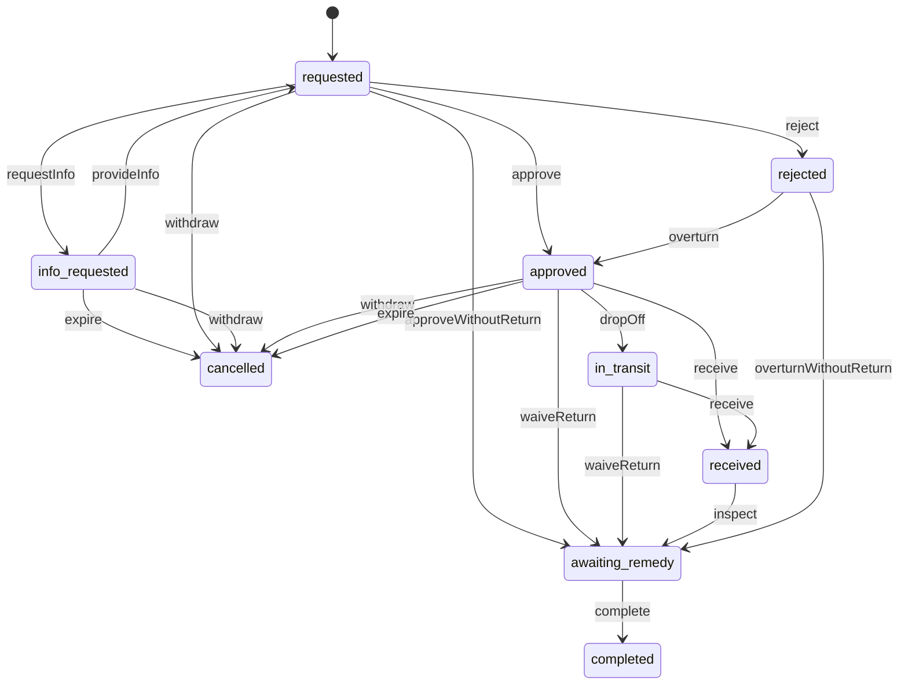
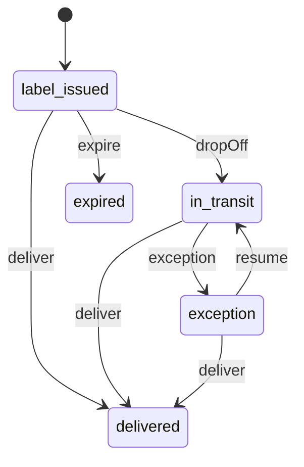
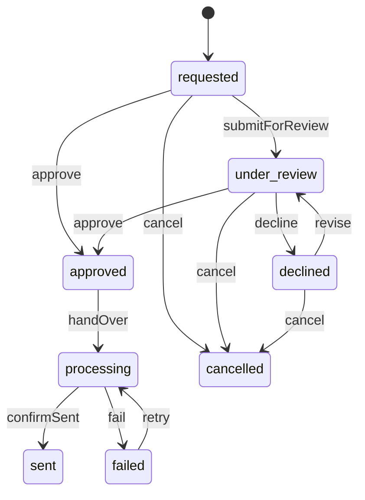
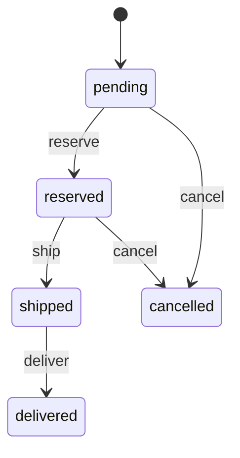
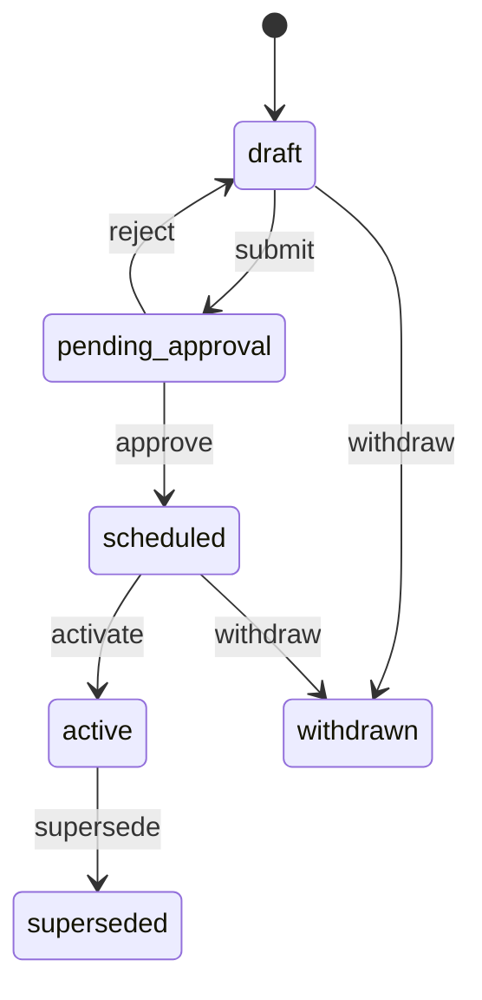
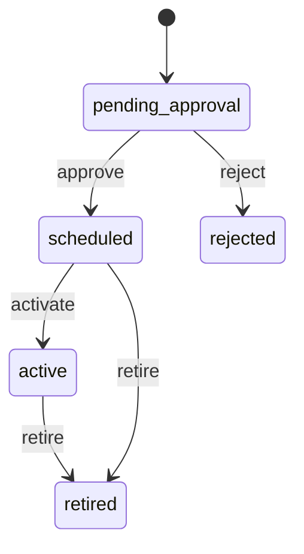

<!-- GENERATED by `npm run gen` from docs/api/modules/returns.md. Do not edit: change the spec and regenerate. -->

# Returns (`returns`)

Return policies (platform baseline, seller terms, category exceptions, who pays return shipping), per-item eligibility, return requests and decisions, return shipments, receipt and inspection, remedies (refund, replacement, exchange) and the refund request that Finance approves before payments sends the money.

- **Group:** After-sales and money · **Launch phase:** 1 · **Plan chapters:** 13, 9, 2
- **Depends on:** [orders](../orders/README.md), [shipping](../shipping/README.md), [payments](../payments/README.md), [inventory](../inventory/README.md) · **Optional:** [media](../media/README.md), [finance](../finance/README.md), [support](../support/README.md), [messaging](../messaging/README.md), [access](../access/README.md), [wallet](../wallet/README.md), [workqueues](../workqueues/README.md), [audit](../audit/README.md), [content](../content/README.md), [identity](../identity/README.md), [notifications](../notifications/README.md), [promotions](../promotions/README.md), [purchasing](../purchasing/README.md), [reports](../reports/README.md), [sellers](../sellers/README.md), [settings](../settings/README.md), [customers](../customers/README.md), [catalog](../catalog/README.md), [offers](../offers/README.md)

## Owns
- Platform return baseline with versions and effective dates, category exceptions and the who-pays-return-shipping matrix
- Seller return terms (more generous than the baseline, never less) and the effective terms resolved for an offer
- Eligibility check per item and quantity before submission: deadline, destination, shipping responsibility, remedy options, refund estimate
- Return requests (RT- references) by item and quantity with reason, details and photos; one return per seller
- Seller and platform decisions: approve, request information, reject with explanation, published response deadlines
- Platform intervention when a seller misses a deadline or the customer challenges an outcome
- Return shipments tracked separately from the original delivery: prepaid label or QR drop-off, customer-arranged tracking
- Receipt, inspection (condition outcome, grade, missing parts, photos) and the proposed stock outcome
- Remedies: full or partial refund with an itemised breakdown, replacement or exchange with its own shipment, store credit when the wallet module is on
- Refund requests (Requested, Under review, Approved, Declined) and their mirrored payment progress (Processing, Sent, Failed)
- Refund-without-return as a controlled exception with a recorded reason

**Not here:**
- Sending money and refund retries: payments (returns hands over an approved refund and mirrors its status)
- Seller earnings, fee refunds and post-payout deductions: finance (reads returns.refund.approved and payments.refund.sent)
- Carrier labels, rates and tracking feeds: shipping (returns asks shipping for a return label and listens for tracking events)
- Stock movements for returned units: inventory (returns proposes the stock outcome; inventory records it)
- Customer/seller disputes, decisions and appeals: support (a return links to its dispute case)
- Store credit balances: wallet (phase 3)
- Customer-facing policy pages: content (returns supplies the policy data shown on them)

## Store API

| Method | Path | Purpose | Auth | Body → Response |
|---|---|---|---|---|
| GET | `/api/store/returns/policy` | Current returns baseline, category exceptions and who pays return shipping | visitor | `PublicPolicy` |
| GET | `/api/store/returns/terms` | Effective return terms for a seller and category | visitor | `EffectiveTerms` |
| GET | `/api/store/returns/orders/{orderId}/returnable-items` | Items of an order with per-item return eligibility | shopper | `{ orderId: uuid, orderRef: string, placedAt: datetime, items: ReturnableItem[] }` |
| POST | `/api/store/returns/eligibility` | Eligibility, deadline, destination, shipping responsibility, remedies and refund estimate before submission | shopper | `EligibilityRequest` → `EligibilityResult` |
| POST | `/api/store/returns/requests` | Request a return for selected items and quantities _(idempotent)_ | shopper | `ReturnCreateInput` → `{ returns: ReturnDetail[] }` |
| GET | `/api/store/returns/requests/overview` | Return and refund totals for the account | customer | `CustomerReturnsOverview` |
| GET | `/api/store/returns/requests` | My returns with return status and refund status side by side | shopper | Page<ReturnSummary> |
| GET | `/api/store/returns/requests/{id}` | Return detail: status track, drop-off, return shipment, refund or replacement progress | shopper | `ReturnDetail` |
| POST | `/api/store/returns/requests/{id}/info` | Answer the seller's or Marketly's question | shopper | `{ reply: text, mediaIds: uuid[]? }` → `ReturnDetail` |
| POST | `/api/store/returns/requests/{id}/withdraw` | Cancel a return before the item is sent back | shopper | `{ reason: string? }` → `ReturnDetail` |
| GET | `/api/store/returns/requests/{id}/label` | Drop-off QR code, printable label, instructions and nearby drop-off points | shopper | `ReturnShipment` |
| POST | `/api/store/returns/requests/{id}/label/email` | Email the drop-off code to the customer | shopper | 204 No content |
| POST | `/api/store/returns/requests/{id}/shipment` | Add carrier and tracking for a customer-arranged return | shopper | `{ carrier: string, trackingNumber: string }` → `ReturnDetail` |
| POST | `/api/store/returns/requests/{id}/escalate` | Ask Marketly to step in | shopper | `{ reason: enum(seller_no_response|customer_disagrees|refund_late|other), note: text? }` → `ReturnDetail` |

## Seller API

| Method | Path | Purpose | Auth | Body → Response |
|---|---|---|---|---|
| POST | `/api/seller/returns/requests/exports` | Export own returns and cases (current tab and filters) as CSV _(audited)_ | seller<br>`returns.requests.export` | `{ filters: json?, returnIds: uuid[]?, format: enum(csv|xlsx)? }` → `reports.ExportJob` |
| GET | `/api/seller/returns/requests/exports/{id}` | Returns export status and download link (requesting member only) | seller<br>`returns.requests.export` | `reports.ExportJob` |
| GET | `/api/seller/returns/requests/counts` | Queue tiles and list tab totals (Return requests, Received to inspect, Disputes, Closed) | seller | `SellerReturnCounts` |
| GET | `/api/seller/returns/requests` | Return requests, received returns to inspect, disputes and closed returns | seller | Page<SellerReturnRow> |
| GET | `/api/seller/returns/requests/{id}` | Return case: request, photos, policy applied, payment, deadlines, shipment, inspection and earnings impact | seller | `ReturnCase` |
| POST | `/api/seller/returns/requests/{id}/approve` | Approve and issue the return label | seller<br>`returns.requests.respond` | `{ labelMethod: enum(prepaid_qr|prepaid_label|customer_arranged), carrierServiceId: uuid?, note: text? }` → `ReturnCase` |
| POST | `/api/seller/returns/requests/{id}/request-info` | Ask the customer a question (pauses the respond-by clock) | seller<br>`returns.requests.respond` | `{ question: text }` → `ReturnCase` |
| POST | `/api/seller/returns/requests/{id}/reject` | Reject with a reason and an explanation shown to the customer | seller<br>`returns.requests.respond` | `{ reasonCode: enum(outside_window|item_not_eligible|damaged_by_customer|other), explanation: text }` → `ReturnCase` |
| POST | `/api/seller/returns/requests/{id}/approve-without-return` | Refund without asking for the item back (recorded reason) _(idempotent)_ | seller<br>`returns.refunds.issue` | `ExceptionInput` → `ReturnCase` |
| POST | `/api/seller/returns/requests/{id}/receive` | Mark the return as received at the seller's return address | seller<br>`returns.refunds.issue` | `{ receivedAt: datetime?, note: text? }` → `ReturnCase` |
| POST | `/api/seller/returns/requests/{id}/inspection` | Record the condition on arrival and the stock outcome | seller<br>`returns.refunds.issue` | `InspectionInput` → `ReturnCase` |
| PUT | `/api/seller/returns/requests/{id}/inspection-draft` | Save an unsent inspection and refund decision | seller<br>`returns.refunds.issue` | `{ inspection: json, remedy: json? }` → `InspectionDraft` |
| POST | `/api/seller/returns/requests/{id}/evidence` | Attach evidence to a return before any case exists _(audited)_ | seller<br>`returns.requests.respond` | `{ kind: enum(photo|video|document|tracking|invoice|other), mediaIds: uuid[], note: text? }` → `ReturnEvidence` |
| POST | `/api/seller/returns/requests/{id}/remedy` | Confirm the refund (full or partial) or ship a replacement or exchange _(idempotent)_ | seller<br>`returns.refunds.issue` | `RemedyInput` → `ReturnCase` |
| POST | `/api/seller/returns/replacements/{id}/cancel` | Cancel a replacement or exchange not shipped yet (e.g. no stock) with a reason _(audited)_ | seller<br>`returns.refunds.issue` | `{ reason: text }` → `Replacement` |
| GET | `/api/seller/returns/terms` | Own return terms, return address and the platform baseline | seller | `SellerReturnTerms` |
| PUT | `/api/seller/returns/terms` | Change return terms or return address _(audited)_ | seller<br>`returns.terms.manage` | `SellerReturnTermsInput` → `SellerReturnTerms` |

## Admin API

| Method | Path | Purpose | Auth | Body → Response |
|---|---|---|---|---|
| GET | `/api/admin/returns/requests/stats` | Returns queue KPIs and queue owner | staff<br>`returns.requests.view` | `ReturnStats` |
| GET | `/api/admin/returns/requests` | Returns and refunds queue with reason, owner, deadline, amount and flags | staff<br>`returns.requests.view` | Page<AdminReturnRow> |
| GET | `/api/admin/returns/requests/{id}` | Full return case with exception record, refund request and action history | staff<br>`returns.requests.view` | `ReturnCase` |
| POST | `/api/admin/returns/requests/{id}/approve` | Approve an Official Store return, or decide a seller return as the platform _(audited)_ | staff<br>`returns.requests.manage` | `{ labelMethod: enum(prepaid_qr|prepaid_label|customer_arranged), carrierServiceId: uuid?, reason: text? }` → `ReturnCase` |
| POST | `/api/admin/returns/requests/{id}/request-info` | Ask the customer for more information or photos _(audited)_ | staff<br>`returns.requests.manage` | `{ question: text }` → `ReturnCase` |
| POST | `/api/admin/returns/requests/{id}/reject` | Reject with an explanation _(audited)_ | staff<br>`returns.requests.manage` | `{ reasonCode: enum(outside_window|item_not_eligible|damaged_by_customer|other), explanation: text }` → `ReturnCase` |
| POST | `/api/admin/returns/requests/{id}/take-over` | Platform intervention: Marketly takes over a seller return _(audited)_ | staff<br>`returns.requests.manage` | `{ reason: enum(seller_no_response|seller_missed_inspection|customer_disagrees|refund_late|other), note: text, ownerId: uuid? }` → `ReturnCase` |
| POST | `/api/admin/returns/requests/{id}/overturn` | Overturn a seller's rejection _(audited)_ | staff<br>`returns.requests.manage` | `{ withoutReturn: bool, reason: text, labelMethod: enum(prepaid_qr|prepaid_label|customer_arranged)? }` → `ReturnCase` |
| POST | `/api/admin/returns/requests/{id}/assign` | Set the owner of a return _(audited)_ | staff<br>`returns.requests.manage` | `{ ownerId: uuid, note: text? }` → `ReturnCase` |
| POST | `/api/admin/returns/requests/{id}/approve-without-return` | Propose refund-without-return (controlled exception) _(idempotent, audited)_ | staff<br>`returns.exceptions.propose` | `ExceptionInput` → `ReturnCase` |
| POST | `/api/admin/returns/requests/{id}/receive` | Record receipt at a seller's address for a platform-handled return _(audited)_ | staff<br>`returns.inspections.record` | `{ receivedAt: datetime?, trackingNumber: string?, note: text? }` → `ReturnCase` |
| GET | `/api/admin/returns/inspections` | Official Store returns received, arriving and decided | staff<br>`returns.inspections.record` | Page<InspectionQueueRow> |
| GET | `/api/admin/returns/inspections/stats` | Inspection queue KPIs | staff<br>`returns.inspections.record` | `InspectionQueueStats` |
| POST | `/api/admin/returns/requests/{id}/start-inspection` | Start (or continue) inspecting a received return: sets the inspector and status Inspecting _(audited)_ | staff<br>`returns.inspections.record` | `{ inspectorId: uuid? }` → `InspectionQueueRow` |
| PUT | `/api/admin/returns/requests/{id}/inspection-draft` | Save an unsent inspection (checks ticked so far, notes, photos) | staff<br>`returns.inspections.record` | `{ inspection: json }` → `InspectionDraft` |
| POST | `/api/admin/returns/requests/{id}/inspection` | Record inspection: photos, condition grade, checks, missing parts and proposed stock outcome _(audited)_ | staff<br>`returns.inspections.record` | `InspectionInput` → `ReturnCase` |
| POST | `/api/admin/returns/requests/{id}/remedy` | Decide the remedy for an Official Store or platform-handled return _(idempotent, audited)_ | staff<br>`returns.requests.manage` | `RemedyInput` → `ReturnCase` |
| POST | `/api/admin/returns/replacements/{id}/cancel` | Cancel a replacement or exchange not shipped yet with a reason _(audited)_ | staff<br>`returns.requests.manage` | `{ reason: text }` → `Replacement` |
| POST | `/api/admin/returns/refunds` | Issue a refund from the order page (exception refund request) _(idempotent, audited)_ | staff<br>`returns.exceptions.propose` | `ExceptionRefundInput` → `RefundRequest` |
| GET | `/api/admin/returns/refunds` | Refund approval queue for Finance | staff<br>`returns.requests.view` | Page<RefundRequest> |
| GET | `/api/admin/returns/refunds/{id}` | One refund request with breakdown, funding and earnings impact | staff<br>`returns.requests.view` | `RefundRequest` |
| POST | `/api/admin/returns/refunds/{id}/approve` | Finance approves the refund and hands it to payments _(idempotent, audited)_ | staff<br>`returns.refunds.approve` | `{ note: text?, stepUpCode: string? }` → `RefundRequest` |
| POST | `/api/admin/returns/refunds/{id}/decline` | Send a refund request back with a reason _(audited)_ | staff<br>`returns.refunds.approve` | `{ reason: text }` → `RefundRequest` |
| POST | `/api/admin/returns/refunds/{id}/revise` | Change a declined refund and resubmit _(audited)_ | staff<br>`returns.requests.manage` | `RemedyInput` → `RefundRequest` |
| GET | `/api/admin/returns/policies` | Active baseline, scheduled changes and history | staff<br>`returns.requests.view` | `ReturnPolicyAdmin` |
| POST | `/api/admin/returns/policies` | Propose a new baseline version with an effective date _(audited)_ | staff<br>`returns.policies.manage` | `PolicyVersionInput` → `PolicyVersion` |
| POST | `/api/admin/returns/policies/{id}/withdraw` | Withdraw a draft or scheduled baseline _(audited)_ | staff<br>`returns.policies.manage` | `{ reason: text }` → `PolicyVersion` |
| POST | `/api/admin/returns/category-exceptions` | Add a category exception with an effective date _(audited)_ | staff<br>`returns.policies.manage` | `CategoryExceptionInput` → `CategoryException` |
| POST | `/api/admin/returns/category-exceptions/preview` | Impact of a category exception change before saving | staff<br>`returns.policies.manage` | `PolicyImpactInput` → `settings.ImpactPreview` |
| PATCH | `/api/admin/returns/category-exceptions/{id}` | Change or retire a category exception from a date _(audited)_ | staff<br>`returns.policies.manage` | `CategoryExceptionInput` → `CategoryException` |

## Types

### ShippingResponsibility

| Field | Type |
|---|---|
| reasonGroup | `enum(damaged|incorrect|defective|not_as_described|missing_parts|change_of_mind|lost_in_transit)` Group the customer reason maps to |
| paidBy | `enum(seller|customer|platform)` |
| customerFee | `Money?` Deducted from the refund when the customer pays, e.g. $7.99 for change of mind |
| originalShippingRefunded | `bool` |
| officialStoreRule | `string?` Official Store wording, e.g. Free for every reason |
| note | `string?` |

### CategoryException

| Field | Type |
|---|---|
| id | `uuid` |
| categoryId | `uuid` |
| categoryName | `string` |
| windowDays | `int?` Change-of-mind window; null means no change-of-mind returns (final sale) |
| changeOfMindAllowed | `bool` |
| condition | `string` e.g. Unopened and sealed |
| faultReturnsWindowDays | `int` Damaged, wrong or defective items: never shorter than the baseline |
| shownOn | `enum(product_page|checkout|order)[]` |
| effectiveFrom | `datetime` |
| effectiveTo | `datetime?` |
| applyScope | `enum(new_orders|undelivered_orders)` Orders placed on or after the effective date / all orders not yet delivered. undelivered_orders is refused when the change shortens a window (open orders keep what they accepted) |
| status | `enum(pending_approval|scheduled|active|retired|rejected)` |
| approval | `ApprovalInfo?` Business Owner approval request when the change shortens a window |
| reason | `text?` |
| createdBy | `Actor?` |

### PolicyImpactInput

| Field | Type |
|---|---|
| exception | `CategoryExceptionInput` |
| exceptionId | `uuid?` Set when previewing a change to an existing exception |

### CategoryExceptionInput

| Field | Type |
|---|---|
| categoryId | `uuid` |
| windowDays | `int?` |
| changeOfMindAllowed | `bool` |
| condition | `string` |
| faultReturnsWindowDays | `int` |
| shownOn | `enum(product_page|checkout|order)[]` |
| effectiveFrom | `datetime` |
| effectiveTo | `datetime?` |
| applyScope | `enum(new_orders|undelivered_orders)?` |
| reason | `text` |

### PolicyVersion

| Field | Type |
|---|---|
| id | `uuid` |
| version | `string` e.g. 3.2 |
| status | `enum(draft|pending_approval|scheduled|active|superseded|withdrawn)` |
| windowDays | `int` Baseline return window after delivery, e.g. 30 |
| sellerResponseBusinessDays | `int` |
| infoReplyDays | `int` Customer has this long to answer a request for information |
| dropOffDays | `int` Time to send the item back after approval |
| inspectionTargetBusinessDays | `int` |
| refundTargetBusinessDays | `int` After inspection |
| responsibilities | `ShippingResponsibility[]` |
| categoryExceptions | `CategoryException[]` |
| effectiveFrom | `datetime?` |
| changeReason | `text?` |
| impact | `string?` e.g. 1,284 open Electronics orders keep their 30-day window |
| approval | `ApprovalInfo?` |
| createdBy | `Actor` |
| createdAt | `datetime` |

### PolicyVersionInput

| Field | Type |
|---|---|
| windowDays | `int` |
| sellerResponseBusinessDays | `int` |
| infoReplyDays | `int` |
| dropOffDays | `int` |
| inspectionTargetBusinessDays | `int` |
| refundTargetBusinessDays | `int` |
| responsibilities | `ShippingResponsibility[]` |
| effectiveFrom | `datetime` |
| reason | `text` |

### ReturnPolicyAdmin

| Field | Type |
|---|---|
| active | `PolicyVersion` |
| upcoming | `PolicyVersion[]` |
| history | `PolicyVersion[]` |

### PublicPolicy

| Field | Type |
|---|---|
| version | `string` |
| effectiveFrom | `datetime` |
| windowDays | `int` |
| responsibilities | `ShippingResponsibility[]` |
| categoryExceptions | `CategoryException[]` |
| refundStatuses | `string[]` Requested, Under review, Approved, Processing, Sent, with the note that Approved is not money arrived |
| platformStepsIn | `string[]` When Marketly intervenes |
| upcomingChange | `string?` e.g. Electronics 15 days from Nov 1, 2026 |

### SellerReturnTerms

| Field | Type |
|---|---|
| sellerId | `uuid` |
| version | `int` |
| windowDays | `int` At least the baseline |
| changeOfMindPaidBy | `enum(seller|customer)` |
| freeReturns | `bool` |
| remedies | `enum(refund|replacement|exchange)[]` |
| returnAddress | `Address` |
| returnContactEmail | `email?` Email shown on the return address card (phone is on the Address) |
| receivingHours | `string?` |
| responseTargetBusinessDays | `int` At most the platform target |
| refundTargetDays | `int` |
| baseline | `PolicyVersion` |
| effectiveFrom | `datetime` |
| updatedAt | `datetime` |

### SellerReturnTermsInput

| Field | Type |
|---|---|
| windowDays | `int` |
| changeOfMindPaidBy | `enum(seller|customer)` |
| freeReturns | `bool` |
| remedies | `enum(refund|replacement|exchange)[]` |
| returnAddress | `Address` |
| returnContactEmail | `email?` |
| receivingHours | `string?` |
| responseTargetBusinessDays | `int` |
| refundTargetDays | `int` |

### EffectiveTerms

| Field | Type |
|---|---|
| sellerId | `uuid` The seller, or OFFICIAL_STORE_ID for the Official Store |
| categoryId | `uuid?` |
| windowDays | `int` |
| changeOfMindAllowed | `bool` |
| condition | `string?` |
| responsibilities | `ShippingResponsibility[]` |
| remedies | `enum(refund|replacement|exchange|store_credit)[]` |
| responseTargetBusinessDays | `int` |
| summary | `string` One line for product page and checkout, e.g. 30-day returns, free for defects |
| policyVersion | `string` |
| policyVersionId | `uuid?` Baseline policy version record the terms were built from; null only for the settings fallback when no version exists |
| sellerTermsVersion | `int?` |
| source | `enum(baseline|seller_terms|category_exception)` |

### ReturnItemInput

| Field | Type |
|---|---|
| orderItemId | `uuid` |
| quantity | `int` |

### ReturnItemView

| Field | Type |
|---|---|
| orderItemId | `uuid` |
| productId | `uuid` |
| variantId | `uuid` |
| title | `string` |
| options | `map<string>` |
| sku | `string?` |
| imageUrl | `url?` |
| quantity | `int` |
| unitPrice | `Money` |

### ReturnableItem

| Field | Type |
|---|---|
| item | `ReturnItemView` |
| ownerType | `enum(official|seller)` |
| sellerId | `uuid?` Null for the Official Store |
| sellerName | `string` |
| quantityPurchased | `int` |
| quantityReturnable | `int` |
| itemState | `string` Order item state from orders, e.g. Delivered, In transit |
| deliveredAt | `datetime?` |
| returnBy | `datetime?` |
| eligible | `bool` |
| ineligibleReason | `enum(not_delivered|not_shipped|window_closed|return_open|final_sale|category_excluded|already_returned|cancelled)?` |
| message | `string` e.g. Return by Sat, Oct 17 / Not shipped yet. You can cancel it instead. |
| openReturnId | `uuid?` |
| openReturnRef | `string?` |

### EligibilityRequest

| Field | Type |
|---|---|
| orderId | `uuid` |
| items | `ReturnItemInput[]` |
| reason | `enum(defective|damaged|wrong_item|not_as_described|missing_parts|changed_mind|better_price|no_longer_needed|wrong_size|other)?` |
| remedy | `enum(refund|replacement|exchange|store_credit)?` |

### ReturnDestination

| Field | Type |
|---|---|
| kind | `enum(marketly_warehouse|seller_address)` |
| name | `string` |
| address | `Address` |

### RemedyOption

| Field | Type |
|---|---|
| kind | `enum(refund|replacement|exchange|store_credit)` |
| available | `bool` |
| description | `string` |
| unavailableReason | `string?` |

### RefundDeduction

| Field | Type |
|---|---|
| label | `string` |
| amount | `Money` |
| reason | `text` |

### ReturnedItem

| Field | Type |
|---|---|
| orderItemId | `uuid` |
| quantity | `int` |
| variantId | `uuid` |
| stockItemId | `uuid?` |

### ReturnItemQuantity

| Field | Type |
|---|---|
| orderItemId | `uuid` |
| quantity | `int` |

### RefundBreakdown

| Field | Type |
|---|---|
| itemAmount | `Money` |
| discountShare | `Money` Coupon share allocated to the returned items (positive number, subtracted) |
| shippingRefund | `Money` |
| returnShippingDeduction | `Money` |
| deductions | `RefundDeduction[]` |
| taxRefund | `Money?` Sales tax on the refunded items and shipping, included in total; null when no tax was charged |
| total | `Money` |
| maxRefundable | `Money` Remaining refundable amount for these items (from payments) |
| destination | `string` e.g. Visa •••• 4417, or Marketly store credit |
| isEstimate | `bool` |

### ItemEligibility

| Field | Type |
|---|---|
| orderItemId | `uuid` |
| quantity | `int` |
| eligible | `bool` |
| ineligibleReason | `string?` |
| message | `string` |

### EligibilityGroup

| Field | Type |
|---|---|
| ownerType | `enum(official|seller)` |
| sellerId | `uuid?` Null for the Official Store |
| sellerName | `string` |
| eligible | `bool` |
| items | `ItemEligibility[]` |
| returnBy | `datetime` |
| destination | `ReturnDestination` |
| shippingPaidBy | `enum(seller|customer|platform)` |
| returnShippingCost | `Money?` |
| labelMethod | `enum(prepaid_qr|prepaid_label|customer_arranged)` |
| remedies | `RemedyOption[]` |
| responseBy | `string` Who reviews the request, e.g. Marketly Official |
| responseDueBusinessDays | `int` |
| estimate | `RefundBreakdown` |
| terms | `EffectiveTerms` |

### EligibilityResult

| Field | Type |
|---|---|
| orderId | `uuid` |
| groups | `EligibilityGroup[]` One per seller; each becomes its own return with its own label |

### ReturnCreateInput

| Field | Type |
|---|---|
| orderId | `uuid` |
| items | `ReturnItemInput[]` |
| reason | `enum(defective|damaged|wrong_item|not_as_described|missing_parts|changed_mind|better_price|no_longer_needed|wrong_size|other)` |
| details | `text` |
| mediaIds | `uuid[]?` |
| remedy | `enum(refund|replacement|exchange|store_credit)` |
| exchangeVariantId | `uuid?` Required for exchange |

### TrackStep

| Field | Type |
|---|---|
| key | `string` |
| label | `string` |
| state | `enum(done|current|upcoming)` |

### InfoRequest

| Field | Type |
|---|---|
| question | `text` |
| askedBy | `Actor` |
| askedAt | `datetime` |
| replyDueAt | `datetime` |
| reply | `text?` |
| replyMedia | `MediaRef[]` |
| repliedAt | `datetime?` |

### ReturnDecision

| Field | Type |
|---|---|
| kind | `enum(approved|approved_without_return|rejected|overturned)` |
| reasonCode | `string?` |
| explanation | `text?` |
| decidedBy | `Actor` |
| decidedAt | `datetime` |
| platformDecision | `bool` True when Marketly decided instead of the seller |

### DropOffPoint

| Field | Type |
|---|---|
| name | `string` |
| address | `string` |
| distanceMiles | `number?` |
| hours | `string?` |

### ReturnShipment

| Field | Type |
|---|---|
| id | `uuid` |
| status | `enum(label_issued|in_transit|delivered|exception|expired)` |
| method | `enum(prepaid_qr|prepaid_label|customer_arranged)` |
| carrier | `string?` |
| service | `string?` |
| trackingNumber | `string?` |
| trackingUrl | `url?` |
| labelUrl | `url?` |
| qrCodeUrl | `url?` |
| dropOffBy | `datetime?` |
| dropOffPoints | `DropOffPoint[]` |
| instructions | `string[]` |
| from | `Address?` |
| to | `Address` |
| cost | `Money?` |
| paidBy | `enum(seller|customer|platform)` |
| shippingShipmentId | `uuid?` Shipment record in the shipping module |
| events | `TimelineEvent[]` |

### RefundView

| Field | Type |
|---|---|
| id | `uuid` |
| ref | `string` |
| status | `enum(requested|under_review|approved|declined|processing|sent|failed|cancelled)` |
| statusLabel | `string` |
| track | `TrackStep[]` |
| breakdown | `RefundBreakdown` |
| approvedAt | `datetime?` |
| sentAt | `datetime?` |
| failedReason | `string?` |
| expectedBy | `datetime?` |
| bankReference | `string?` |
| explanation | `string` Plain words, e.g. Approved still means the money hasn't been sent |

### Replacement

| Field | Type |
|---|---|
| id | `uuid` |
| returnId | `uuid?` The return it replaces items for; null for a replacement decided on a support case without a return |
| caseId | `uuid?` Support case that asked for it (requestReplacement) |
| orderId | `uuid` |
| orderItemId | `uuid` The original order item being replaced |
| kind | `enum(replacement|exchange)` |
| status | `enum(pending|reserved|shipped|delivered|cancelled)` |
| variantId | `uuid` |
| title | `string` |
| options | `map<string>` |
| quantity | `int` |
| chargeNote | `string` e.g. Same item, no charge |
| carrier | `string?` |
| trackingNumber | `string?` |
| estimatedDelivery | `date?` |
| shippingShipmentId | `uuid?` |
| newReturnWindowEnds | `date?` |
| cancelReason | `string?` |
| createdAt | `datetime` |

### Escalation

| Field | Type |
|---|---|
| at | `datetime` |
| by | `Actor` |
| reason | `enum(seller_no_response|seller_missed_inspection|customer_disagrees|refund_late|seller_rejected|other)` |
| note | `text?` |
| caseId | `uuid?` |
| caseRef | `string?` |

### ReturnDetail

| Field | Type |
|---|---|
| id | `uuid` |
| ref | `string` RT-YYMMDD-NNNN |
| orderId | `uuid` |
| orderRef | `string` |
| seller | `{"ownerType":"enum(official|seller)","id":{"type":"uuid?","desc":"Null for the Official Store"},"name":"string"}` |
| status | `enum(requested|info_requested|approved|rejected|in_transit|received|awaiting_remedy|completed|cancelled)` |
| statusLabel | `string` Customer wording, see notes |
| track | `TrackStep[]` |
| items | `ReturnItemView[]` |
| reason | `string` |
| details | `text` |
| media | `MediaRef[]` |
| remedy | `enum(refund|replacement|exchange|store_credit)` |
| handledBy | `enum(seller|official_store|marketplace_support)` |
| responseDue | `Deadline?` |
| infoRequest | `InfoRequest?` |
| decision | `ReturnDecision?` |
| shipment | `ReturnShipment?` |
| refund | `RefundView?` |
| replacement | `Replacement?` |
| terms | `EffectiveTerms` Terms accepted at purchase |
| escalation | `Escalation?` |
| conversationId | `uuid?` |
| timeline | `TimelineEvent[]` |
| nextStep | `string` |
| actions | `enum(withdraw|reply_info|get_label|add_tracking|escalate|report_problem)[]` |
| requestedAt | `datetime` |

### ReturnSummary

| Field | Type |
|---|---|
| id | `uuid` |
| ref | `string` |
| orderId | `uuid` |
| orderRef | `string` |
| ownerType | `enum(official|seller)` |
| sellerId | `uuid?` |
| sellerName | `string` |
| item | `ReturnItemView` |
| itemCount | `int` |
| status | `string` |
| statusLabel | `string` |
| refundStatus | `string?` |
| refundAmount | `Money?` |
| openedAt | `datetime` |
| nextStep | `string` |
| nextDeadline | `Deadline?` |
| open | `bool` |

### CustomerReturnsOverview

| Field | Type |
|---|---|
| openReturns | `int` |
| openNote | `string?` |
| refundsOnTheWay | `Money` |
| refundsOnTheWayNote | `string?` |
| refundedThisYear | `Money` |
| completedThisYear | `int` |

### Inspection

| Field | Type |
|---|---|
| id | `uuid` |
| inspectedBy | `Actor` |
| inspectedAt | `datetime` |
| conditionOutcome | `enum(as_described|damaged_by_customer|missing_parts|not_matching_request|wrong_item_returned|empty_package)` |
| grade | `enum(new_sealed|like_new|good|damaged)` |
| checks | `InspectionCheck[]` |
| missingParts | `string[]` |
| notes | `text?` |
| media | `MediaRef[]` |
| proposedStockOutcome | `enum(restock|different_condition|damaged_stock|repair|return_to_supplier|write_off)` |
| regradeCondition | `string?` e.g. Used – Like new |
| stockOutcomeRecordedBy | `Actor?` |
| stockOutcomeRecordedAt | `datetime?` |

### InspectionCheck

| Field | Type |
|---|---|
| key | `string?` Checklist key when the check comes from the expected checklist |
| label | `string` |
| passed | `bool` |

### ChecklistItem

| Field | Type |
|---|---|
| key | `string` |
| kind | `enum(contents|serial|functional|hygiene|condition)` |
| label | `string` e.g. USB-C cable; Serial number matches order (HA24-0918-7731); Powers on and pairs; Ear cushions clean |
| expected | `string?` Expected value, e.g. the serial number shipped |
| required | `bool` |

### InspectionChecklist

| Field | Type |
|---|---|
| expectedContents | `string[]` Box contents from the order item snapshot (product included items minus the offer's stated missing items) |
| serialShipped | `string?` Serial number recorded at packing (Official Store, from warehouse.getShippedSerials); null when none was recorded |
| items | `ChecklistItem[]` |

### InspectionDraft

| Field | Type |
|---|---|
| inspection | `json` Partial InspectionInput as last saved |
| remedy | `json?` Partial RemedyInput (seller inspect-and-refund form) |
| savedBy | `Actor` |
| savedAt | `datetime` |

### ReturnEvidence

| Field | Type |
|---|---|
| id | `uuid` |
| kind | `enum(photo|video|document|tracking|invoice|other)` |
| media | `MediaRef[]` |
| note | `text?` |
| party | `enum(seller|staff)` |
| addedBy | `Actor` |
| addedAt | `datetime` |
| caseId | `uuid?` Set once copied into the support case on escalation |

### InspectionInput

| Field | Type |
|---|---|
| conditionOutcome | `enum(as_described|damaged_by_customer|missing_parts|not_matching_request|wrong_item_returned|empty_package)` |
| grade | `enum(new_sealed|like_new|good|damaged)` |
| checks | `InspectionCheck[]?` |
| missingParts | `string[]?` |
| notes | `text?` |
| mediaIds | `uuid[]?` |
| proposedStockOutcome | `enum(restock|different_condition|damaged_stock|repair|return_to_supplier|write_off)` |
| regradeCondition | `string?` |

### RemedyInput

| Field | Type |
|---|---|
| kind | `enum(full_refund|partial_refund|replacement|exchange|store_credit)` |
| deductions | `RefundDeduction[]?` Required for partial refunds; each with a reason shown to the customer |
| amount | `Money?` Partial amount; capped at maxRefundable |
| explanation | `text?` |
| exchangeVariantId | `uuid?` |

### ExceptionInput

| Field | Type |
|---|---|
| reasonCode | `enum(return_cost_exceeds_value|unsafe_to_ship|damaged_beyond_resale|lost_by_carrier|customer_goodwill|other)` |
| details | `text` |
| remedy | `RemedyInput` |

### ExceptionRefundLine

| Field | Type |
|---|---|
| orderItemId | `uuid` |
| quantity | `int` |
| amount | `Money` |

### ExceptionRefundInput

| Field | Type |
|---|---|
| orderId | `uuid` |
| items | `ExceptionRefundLine[]` Items of one seller group; amount per line is capped by payments.remainingRefundable |
| shippingRefund | `Money?` |
| reasonCode | `enum(service_failure|price_error|late_delivery|damaged_not_returned|customer_goodwill|risk_review|other)` |
| reason | `text` |
| fundedBy | `enum(seller|platform|shared|official_store)` |
| trustReportId | `uuid?` Set when the refund executes a trust recommendation (refund_buyers); trust confirms it from returns.refund.approved |
| destination | `enum(original_method|store_credit)?` Refund to the original payment (default) or to store credit. store_credit needs the wallet module (plan phase 3); refused with REMEDY_NOT_AVAILABLE while it is off |
| note | `text?` |

### EarningsImpact

| Field | Type |
|---|---|
| refundToCustomer | `Money` |
| sellerEarningsChange | `Money` |
| feeReturned | `Money` |
| labelCharge | `Money?` |
| totalBalanceChange | `Money` |
| afterPayout | `bool` True when the sale was already paid out; the amount is deducted from the next payout |
| note | `string` |

### RefundRequest

| Field | Type |
|---|---|
| id | `uuid` |
| ref | `string` RF-YYMMDD-NNNN |
| source | `enum(return|case|exception|seller)` |
| returnId | `uuid?` |
| returnRef | `string?` |
| caseId | `uuid?` |
| orderId | `uuid` |
| orderRef | `string` |
| orderItemIds | `uuid[]` |
| ownerType | `enum(official|seller)` |
| sellerId | `uuid?` Null for the Official Store |
| sellerName | `string` |
| customerName | `string` |
| status | `enum(requested|under_review|approved|declined|processing|sent|failed|cancelled)` |
| breakdown | `RefundBreakdown` |
| fundedBy | `enum(seller|platform|shared|official_store)` |
| sellerShare | `Money?` |
| platformShare | `Money?` |
| reasonCode | `string?` |
| reason | `text?` |
| trustReportId | `uuid?` |
| earningsImpact | `EarningsImpact?` |
| approval | `ApprovalInfo?` |
| proposedBy | `Actor` |
| approvedBy | `Actor?` |
| declineReason | `text?` |
| paymentRefundId | `uuid?` Refund record in payments once handed over |
| failedReason | `string?` |
| createdAt | `datetime` |
| updatedAt | `datetime` |
| history | `TimelineEvent[]` |

### ExceptionRecord

| Field | Type |
|---|---|
| reasonCode | `string` |
| details | `text` |
| proposedBy | `Actor` |
| proposedAt | `datetime` |
| approvedBy | `Actor?` |
| approvedAt | `datetime?` |
| stockOutcome | `string?` |

### ReturnFlag

| Field | Type |
|---|---|
| kind | `enum(refund_without_return_proposed|refund_without_return_approved|seller_missed_deadline|platform_took_over|refund_failed|customer_escalated|dispute_open|refund_after_payout)` |
| label | `string` |

### ReturnCase

| Field | Type |
|---|---|
| detail | `ReturnDetail` |
| customer | `{"displayName":"string","city":"string?","ordersWithSeller":"int"}` |
| payment | `{"itemPaid":"Money","shippingPaid":"Money","discountShare":"Money","maxRefundable":"Money","refundedSoFar":"Money","methodLabel":"string"}` |
| policyApplied | `EffectiveTerms` |
| shippingPaidBy | `enum(seller|customer|platform)` |
| deadlines | `{"respondBy":"Deadline?","inspectBy":"Deadline?","refundBy":"Deadline?","dropOffBy":"Deadline?"}` |
| inspection | `Inspection?` |
| refundRequest | `RefundRequest?` |
| earningsImpact | `EarningsImpact?` |
| exception | `ExceptionRecord?` |
| owner | `Actor?` |
| flags | `ReturnFlag[]` |
| caseId | `uuid?` |
| caseRef | `string?` |
| activity | `TimelineEvent[]` |
| inspectionChecklist | `InspectionChecklist?` Expected contents, serial shipped and category checks, once the return is received |
| inspectionDraft | `InspectionDraft?` Unsent inspection and refund decision |
| inspector | `Actor?` Who is inspecting (set by start-inspection); status label Inspecting |
| evidence | `ReturnEvidence[]` Evidence added before any case exists; carried into the case on escalation |
| allowedActions | `string[]` |

### SellerReturnRow

| Field | Type |
|---|---|
| id | `uuid` |
| ref | `string` |
| orderId | `uuid` |
| orderRef | `string` |
| item | `ReturnItemView` |
| itemCount | `int` |
| reason | `string` |
| detailNote | `string?` |
| amount | `Money` |
| requestedAt | `datetime` |
| status | `string` |
| statusLabel | `string` |
| deadline | `Deadline?` |
| deadlineLabel | `string` e.g. Overdue 6 h, Customer replies by Oct 11, Appeal by Oct 16 |
| platformInvolved | `bool` |
| caseId | `uuid?` |
| refundedAmount | `Money?` |

### SellerReturnCounts

| Field | Type |
|---|---|
| responseOverdue | `int` |
| overdueRef | `string?` |
| awaitingResponse | `int` |
| nextResponseDueAt | `datetime?` |
| toInspect | `int` |
| oldestReceivedAt | `datetime?` |
| disputesNeedingEvidence | `int` |
| nextEvidenceDueAt | `datetime?` |
| tabs | `{"requests":"int","toInspect":"int","disputes":"int","closed":"int"}` |

### AdminReturnRow

| Field | Type |
|---|---|
| id | `uuid` |
| ref | `string` |
| orderId | `uuid` |
| orderRef | `string` |
| seller | `{"ownerType":"enum(official|seller)","id":{"type":"uuid?","desc":"Null for the Official Store"},"name":"string"}` |
| item | `ReturnItemView` |
| reason | `string` |
| amount | `Money` |
| owner | `Actor?` |
| deadline | `Deadline?` |
| deadlineLabel | `string` |
| status | `string` |
| refundStatus | `string?` |
| flags | `ReturnFlag[]` |
| exceptionNote | `string?` |

### ReturnStats

| Field | Type |
|---|---|
| open | `int` |
| openOfficial | `int` |
| openSellers | `int` |
| pastDeadline | `int` |
| sellerRepliesOverdue | `int` |
| awaitingInspection | `int` |
| refundsPending | `Money` |
| refundsPendingCount | `int` |
| exceptions | `int` |
| tabCounts | `{"allOpen":"int","needsDecision":"int","inTransit":"int","inspecting":"int","refundPending":"int","exceptions":"int"}` |
| queueOwner | `{"lead":"string?","backup":"string?","escalation":"string?"}` |

### InspectionQueueRow

| Field | Type |
|---|---|
| returnId | `uuid` |
| ref | `string` |
| orderRef | `string` |
| item | `ReturnItemView` |
| reason | `string` |
| receivedAt | `datetime?` |
| expectedAt | `datetime?` |
| inspector | `Actor?` |
| status | `string` |
| target | `Deadline?` |

### InspectionQueueStats

| Field | Type |
|---|---|
| waiting | `int` |
| overdue | `int` |
| overdueRef | `string?` |
| arrivingThisWeek | `int` |
| refundsWithFinance | `int` |
| refundsWithFinanceAmount | `Money` |
| tabCounts | `{"received":"int","arriving":"int","decidedThisWeek":"int"}` |

## Status flows

### Return (`ReturnDetail.status`)



Customer labels: requested→Requested, info_requested→Waiting for you, approved→Approved (send it back), in_transit→Sent back, received→Received, awaiting_remedy→Inspected (or Approved without return), completed→Refunded / Replaced / Partly refunded, rejected→Rejected, cancelled→Cancelled. Seller labels: Return requested, Waiting on customer, Return in transit, Inspecting, Escalated (platformHandling flag), Decision made. The respond-by clock pauses while info_requested. approveWithoutReturn / waiveReturn require a recorded reason (refund-without-return exception). overturn is a platform action (returns.returns.manage) after a customer challenges a seller rejection. complete fires automatically when the remedy finishes: refund Sent, replacement shipped, or store credit issued.

### Return shipment (`ReturnShipment.status`)



Driven by shipping tracking events for the return label (first carrier scan = dropOff). Customer-arranged returns start at label_issued without a label and move to in_transit when the customer adds tracking (returns registers it with shipping.registerReturnTracking so carrier events arrive like any return parcel). A label activates when the carrier scans the QR code. Lost in transit to the warehouse leads to waiveReturn on the return with a carrier claim.

### Refund request (`RefundRequest.status`)



Plan ch. 13 refund statuses. requested = estimate shown at request time. Seller-issued refunds for the seller's own return go requested→approved (the seller is the approver). Official Store, platform-decided, case and exception refunds go through under_review and Finance approval (returns.refunds.approve); above the approver's limit approve returns APPROVAL_REQUIRED and an access approval request. handOver happens in the same transaction as approval by calling payments; confirmSent and fail mirror payments.refund.sent / payments.refund.failed. Retry is executed by payments (it checks the provider first so a refund is never sent twice). Approved never means money arrived; only sent does.

### Replacement (`Replacement.status`)



reserve allocates the unit through inventory.allocateForOrder (an allocation tied to the order and the replacement, with no expiry), never a timed hold, so a slow seller or warehouse never loses the unit; returns.replacement.created asks orders/warehouse (Official Store) or the seller to fulfil it as a zero-charge shipment. cancel (POST /replacements/{id}/cancel, or automatically when stock is gone) needs a reason, releases the allocation (inventory.releaseHold), publishes returns.replacement.cancelled and offers a refund instead. A replacement gets a new 30-day return window. Replacements without a return (requestReplacement from a support case) use the same machine.

### Policy version (`PolicyVersion.status`)



Baseline changes need Business Owner approval (access approval request). activate runs at effectiveFrom. Orders placed before the effective date keep their snapshot.

### Category exception (`CategoryException.status`)



A create or change that shortens a window (approval action returns.policies.shorten-window) is saved as pending_approval with an access approval request for the Business Owner ('Send for approval'); approve and reject come from access.approval.decided. Changes that do not shorten a window skip pending_approval and are saved as scheduled. activate runs at effectiveFrom.

## Data (schema `returns`)

**policy_versions**: Platform baseline versions with effective dates; orders keep the version accepted at purchase

| Column | Type |
|---|---|
| id | uuid pk |
| version | text |
| status | text |
| window_days | int |
| seller_response_business_days | int |
| info_reply_days | int |
| drop_off_days | int |
| inspection_target_business_days | int |
| refund_target_business_days | int |
| responsibilities | jsonb |
| effective_from | timestamptz? |
| change_reason | text? |
| approval_request_id | uuid? |
| created_by | text |
| created_at | timestamptz |

Indexes: `(status, effective_from)`

**category_exceptions**

| Column | Type |
|---|---|
| id | uuid pk |
| category_id | uuid |
| window_days | int? |
| change_of_mind_allowed | bool |
| condition | text |
| fault_returns_window_days | int |
| shown_on | jsonb |
| effective_from | timestamptz |
| effective_to | timestamptz? |
| apply_scope | text |
| status | text |
| approval_request_id | uuid? |
| reason | text |
| created_by | text |
| created_at | timestamptz |

Indexes: `(category_id, effective_from)`

**seller_terms**: Seller return terms, one active version per seller; validated against the baseline

| Column | Type |
|---|---|
| id | uuid pk |
| seller_id | uuid |
| version | int |
| window_days | int |
| change_of_mind_paid_by | text |
| free_returns | bool |
| remedies | jsonb |
| return_address | jsonb |
| return_contact_email | text? |
| receiving_hours | text? |
| response_target_business_days | int |
| refund_target_days | int |
| effective_from | timestamptz |
| superseded_at | timestamptz? |
| created_by | text |

Indexes: `(seller_id, effective_from desc)`

**returns**: One return per seller per request. Terms snapshot copied from the order item.

| Column | Type |
|---|---|
| id | uuid pk |
| ref | text unique |
| order_id | uuid |
| order_ref | text |
| customer_id | uuid? |
| guest_session_id | text? |
| owner_type | text (official|seller) |
| seller_id | uuid? |
| status | text |
| reason | text |
| details | text |
| media_ids | jsonb |
| remedy | text |
| exchange_variant_id | uuid? |
| handled_by | text |
| terms_snapshot | jsonb |
| shipping_paid_by | text |
| response_due_at | timestamptz? |
| info_request | jsonb? |
| decision | jsonb? |
| platform_handling | bool |
| escalation | jsonb? |
| owner_staff_id | uuid? |
| case_id | uuid? |
| conversation_id | uuid? |
| exception | jsonb? |
| inspector | jsonb? |
| inspection_started_at | timestamptz? |
| requested_at | timestamptz |
| completed_at | timestamptz? |
| updated_at | timestamptz |

Indexes: `(seller_id, status, response_due_at)`, `(customer_id, requested_at desc)`, `(order_id)`, `(status, response_due_at)`, `(owner_staff_id, status)`

**return_items**

| Column | Type |
|---|---|
| id | uuid pk |
| return_id | uuid → returns |
| order_item_id | uuid |
| product_id | uuid |
| variant_id | uuid |
| title | text |
| options | jsonb |
| sku | text? |
| quantity | int |
| unit_price | bigint |
| currency | text |

Indexes: `(order_item_id)`

**return_shipments**: Return parcels, separate from the original delivery

| Column | Type |
|---|---|
| id | uuid pk |
| return_id | uuid → returns |
| status | text |
| method | text |
| carrier | text? |
| service | text? |
| tracking_number | text? |
| label_url | text? |
| qr_code_url | text? |
| drop_off_by | timestamptz? |
| from_address | jsonb? |
| to_address | jsonb |
| cost | bigint? |
| paid_by | text |
| shipping_shipment_id | uuid? |
| label_id | uuid? (shipping label, for void and the label file) |
| carrier_service_id | uuid? (Label.carrierServiceId; drop-off points are looked up with it) |
| created_at | timestamptz |
| delivered_at | timestamptz? |

Indexes: `(return_id)`, `(tracking_number)`, `(status, drop_off_by)`

**inspection_drafts**: One unsent inspection and remedy draft per return

| Column | Type |
|---|---|
| return_id | uuid pk → returns |
| inspection | jsonb |
| remedy | jsonb? |
| saved_by | jsonb |
| saved_at | timestamptz |

**return_evidence**: Evidence added to a return before a support case exists

| Column | Type |
|---|---|
| id | uuid pk |
| return_id | uuid → returns |
| kind | text |
| media_ids | jsonb |
| note | text? |
| party | text |
| added_by | jsonb |
| added_at | timestamptz |
| case_id | uuid? |

Indexes: `(return_id, added_at)`

**inspections**

| Column | Type |
|---|---|
| id | uuid pk |
| return_id | uuid → returns |
| inspected_by | text |
| inspected_at | timestamptz |
| condition_outcome | text |
| grade | text |
| checks | jsonb |
| missing_parts | jsonb |
| notes | text? |
| media_ids | jsonb |
| proposed_stock_outcome | text |
| regrade_condition | text? |
| stock_outcome_recorded_by | text? |
| stock_outcome_recorded_at | timestamptz? |

Indexes: `(return_id)`

**refund_requests**: Customer refund decisions waiting for or past Finance approval. Money movement is in payments.

| Column | Type |
|---|---|
| id | uuid pk |
| ref | text unique |
| source | text |
| return_id | uuid? → returns |
| case_id | uuid? |
| order_id | uuid |
| order_item_ids | jsonb |
| owner_type | text (official|seller) |
| seller_id | uuid? |
| status | text |
| item_amount | bigint |
| discount_share | bigint |
| shipping_refund | bigint |
| return_shipping_deduction | bigint |
| deductions | jsonb |
| total | bigint |
| currency | text |
| funded_by | text |
| seller_share | bigint? |
| platform_share | bigint? |
| reason_code | text? |
| reason | text? |
| trust_report_id | uuid? |
| approval_request_id | uuid? |
| proposed_by | text |
| approved_by | text? |
| decline_reason | text? |
| payment_refund_id | uuid? |
| failed_reason | text? |
| idempotency_key | text unique? |
| created_at | timestamptz |
| updated_at | timestamptz |

Indexes: `(status, created_at)`, `(order_id)`, `(return_id)`, `(case_id)`

**replacements**: Replacement or exchange units with their own shipment; the original order is not changed. return_id is null for replacements decided on a support case without a return (case_id set)

| Column | Type |
|---|---|
| id | uuid pk |
| return_id | uuid? → returns |
| case_id | uuid? |
| order_id | uuid |
| kind | text |
| status | text |
| order_item_id | uuid |
| variant_id | uuid |
| offer_id | uuid |
| quantity | int |
| reservation_id | uuid? (inventory allocation from allocateForOrder; no expiry) |
| shipping_shipment_id | uuid? |
| cancel_reason | text? |
| idempotency_key | text? unique |
| created_at | timestamptz |
| shipped_at | timestamptz? |
| delivered_at | timestamptz? |

Indexes: `(return_id)`, `(case_id)`, `(order_id)`, `(status)`

**return_events**: Timeline and action history per return (who, what, reason)

| Column | Type |
|---|---|
| id | uuid pk |
| return_id | uuid → returns |
| kind | text |
| label | text |
| detail | text? |
| visibility | text (customer|seller|staff) |
| actor_kind | text |
| actor_id | text? |
| at | timestamptz |

Indexes: `(return_id, at)`

## Events

| Publishes | When | Payload | Consumed by |
|---|---|---|---|
| `returns.return.requested` | A customer submits a return (one event per seller return) | `{ returnId: uuid, ref: string, orderId: uuid, orderRef: string, ownerType: enum(official|seller), sellerId: uuid?, orderItemIds: uuid[], reason: string, responseDueAt: datetime }` | notifications, orders, reports, sellers |
| `returns.return.info_requested` | Seller or staff asks the customer a question | `{ returnId: uuid, ref: string, orderId: uuid, orderRef: string, customerId: uuid?, contactEmail: email?, replyDueAt: datetime }` | notifications |
| `returns.return.approved` | Seller, Official Store or platform approves (with or without return) | `{ returnId: uuid, ref: string, orderId: uuid, orderRef: string, customerId: uuid?, contactEmail: email?, ownerType: enum(official|seller), sellerId: uuid?, items: ReturnItemQuantity[], withoutReturn: bool, platformDecision: bool, dropOffBy: datetime?, trackingNumber: string? }` | notifications, warehouse |
| `returns.return.rejected` | A return is rejected with an explanation | `{ returnId: uuid, ref: string, orderId: uuid, orderRef: string, customerId: uuid?, contactEmail: email?, ownerType: enum(official|seller), sellerId: uuid?, reasonCode: string, platformDecision: bool }` | notifications, orders |
| `returns.return.escalated` | Customer asks Marketly to step in, a seller misses a deadline, or staff take over | `{ returnId: uuid, ref: string, orderId: uuid, orderRef: string, ownerType: enum(official|seller), sellerId: uuid?, reason: string, by: Actor }` | notifications, support, workqueues |
| `returns.return.shipped` | Return parcel dropped off (first carrier scan or customer tracking) | `{ returnId: uuid, ref: string, orderId: uuid, orderRef: string, trackingNumber: string? }` | - |
| `returns.return.received` | Return received at the warehouse or seller address | `{ returnId: uuid, ref: string, orderId: uuid, orderRef: string, customerId: uuid?, contactEmail: email?, ownerType: enum(official|seller), sellerId: uuid?, items: ReturnedItem[], receivedAt: datetime }` | fulfillment-service, inventory, notifications, orders |
| `returns.return.inspected` | Inspection recorded | `{ returnId: uuid, ref: string, orderId: uuid, orderRef: string, customerId: uuid?, contactEmail: email?, ownerType: enum(official|seller), sellerId: uuid?, conditionOutcome: string, proposedStockOutcome: string, orderItemId: uuid, variantId: uuid, stockItemId: uuid?, quantity: int }` | inventory, notifications, reports |
| `returns.return.completed` | The remedy finished (refund sent, replacement shipped, credit issued) | `{ returnId: uuid, ref: string, orderId: uuid, orderRef: string, outcome: enum(refunded|partly_refunded|replaced|exchanged|credited) }` | - |
| `returns.return.cancelled` | Customer withdraws, information or drop-off deadline expires | `{ returnId: uuid, ref: string, orderId: uuid, orderRef: string, by: Actor, reason: string? }` | orders |
| `returns.label.created` | A prepaid return label is issued; finance charges the payer | `{ returnId: uuid, ref: string, orderId: uuid, orderRef: string, customerId: uuid?, contactEmail: email?, ownerType: enum(official|seller), sellerId: uuid?, labelId: uuid, cost: Money, paidBy: enum(seller|customer|platform) }` | finance, notifications |
| `returns.refund.requested` | A refund request enters Finance review | `{ refundRequestId: uuid, orderId: uuid, total: Money, source: string }` | - |
| `returns.refund.approved` | A refund is approved and handed to payments (not yet sent) | `{ refundRequestId: uuid, returnId: uuid?, caseId: uuid?, orderId: uuid, customerId: uuid?, contactEmail: email?, orderItemIds: uuid[], items: ReturnItemQuantity[], ownerType: enum(official|seller), sellerId: uuid?, source: enum(return|case|exception|seller), trustReportId: uuid?, total: Money, breakdown: RefundBreakdown, fundedBy: string, sellerShare: Money?, platformShare: Money?, approvedBy: Actor }` | finance, notifications, orders, promotions, support, trust, workqueues |
| `returns.refund.declined` | Finance sends a refund request back | `{ refundRequestId: uuid, reason: text }` | support |
| `returns.refund.cancelled` | A refund request is cancelled before money moved (e.g. cancelRefundsForCase after an appeal overturns a case decision) | `{ refundRequestId: uuid, ref: string, orderId: uuid, caseId: uuid?, returnId: uuid?, total: Money, reason: text, by: Actor }` | - |
| `returns.exception.proposed` | Refund-without-return proposed by staff | `{ returnId: uuid, reasonCode: string }` | - |
| `returns.exception.approved` | Refund-without-return approved (seller or Finance) | `{ returnId: uuid, reasonCode: string, approvedBy: Actor }` | - |
| `returns.replacement.created` | A replacement or exchange is created and its stock allocated (from a return, or from a support case without a return) | `{ replacementId: uuid, returnId: uuid?, caseId: uuid?, orderId: uuid, customerId: uuid?, contactEmail: email?, orderItemId: uuid, ownerType: enum(official|seller), sellerId: uuid?, variantId: uuid, offerId: uuid, quantity: int, kind: string }` | notifications, orders, shipping, support |
| `returns.replacement.cancelled` | A replacement or exchange not shipped yet is cancelled (no stock, or by the seller or staff); its stock allocation is released | `{ replacementId: uuid, returnId: uuid?, caseId: uuid?, orderId: uuid, orderItemId: uuid, ownerType: enum(official|seller), sellerId: uuid?, reason: text, by: Actor }` | - |
| `returns.seller_terms.changed` | A seller changes return terms or return address | `{ sellerId: uuid, version: int }` | - |
| `returns.policy.proposed` | Baseline or category exception change proposed | `{ policyVersionId: uuid?, categoryExceptionId: uuid?, effectiveFrom: datetime }` | - |
| `returns.policy.changed` | A baseline or category exception becomes active | `{ policyVersionId: uuid?, categoryId: uuid?, effectiveFrom: datetime }` | - |

| Consumes | From | Does |
|---|---|---|
| `orders.item.delivered` | orders | Start the return window for the item (deadline = delivery + effective window) |
| `orders.item.cancelled` | orders | Mark the item not returnable; cancel any requested return for it |
| `shipping.shipment.dispatched` | shipping | Return label first scan → return shipment in transit; replacement shipment shipped |
| `shipping.shipment.delivered` | shipping | Return parcel delivered to the destination; replacement delivered (completes the return) |
| `shipping.shipment.exception` | shipping | Flag return or replacement shipment exceptions to the owner |
| `payments.refund.sent` | payments | Refund request → sent; completes the return when it is the remedy |
| `payments.refund.failed` | payments | Refund request → failed with the reason; flags the return in the queue |
| `access.approval.decided` | access | Finish an approval-required refund approval, baseline change or category exception (pending_approval → scheduled or rejected) |
| `sellers.seller.suspended` | sellers | Open returns of the seller move to platform handling; existing returns stay accessible |
| `sellers.seller.approved` | sellers | Create version 1 of the seller's return terms from the current baseline (window, remedies, response targets) with returnAddress and returnContact from the application, so return labels and drop-off addresses work from the first order. The seller can change terms later, never below the baseline |
| `shipping.shipment.status_changed` | shipping | For kind = return: update the return shipment tracking step and estimated arrival shown on the return |
| `support.case.decided` | support | Apply a dispute decision that concerns a return (overturn, approve without return, close) |

## In-process API (for other modules)

| Function | Signature | Used by |
|---|---|---|
| resolveTerms | `(sellerId: uuid | null, categoryId: uuid | null, condition: string | null) => EffectiveTerms`<br>sellerId null or OFFICIAL_STORE_ID = Official Store (ownerType official): both resolve the Official Store terms (baseline and category exceptions), never a seller_terms lookup. Effective return terms for an offer: baseline, category exception and seller terms combined. Shown before purchase and frozen on the order item. | offers, checkout, orders |
| returnStateForItems | `(orderItemIds: uuid[]) => { orderItemId: uuid, returnId: uuid | null, ref: string | null, status: string | null, refundStatus: string | null }[]`<br>After-sales column of the order detail (return and refund progress per item) | orders, support |
| requestRefund | `(input: { source: 'case' | 'exception', caseId?: uuid, orderId: uuid, orderItemIds: uuid[], items?: { orderItemId: uuid, quantity: int }[], breakdown: RefundBreakdown, fundedBy: string, reasonCode?: string, reason: string, proposedBy: Actor }) => RefundRequest`<br>Creates a refund request in the Finance approval queue for remedies decided outside a return (dispute decisions). Approved does not mean sent. The items must belong to one seller group of the order (a request spanning groups is refused with VALIDATION_FAILED, details.groups; the caller makes one request per group). items gives refunded quantities (default: each item's full quantity) and is carried on returns.refund.approved. Not for goodwill: reasonCode customer_goodwill is refused with REMEDY_NOT_AVAILABLE (goodwill is store credit through wallet; when wallet is off support refuses the remedy, decision D-RT3). | support |
| requestReplacement | `(input: { caseId: uuid, orderId: uuid, orderItemId: uuid, quantity: int, variantId?: uuid, reason: string, requestedBy: Actor }, idempotencyKey: string) => Replacement`<br>A replacement decided on a support case without a return (e.g. lost or damaged parcel): same variant by default (variantId only for a same-product, same-price exchange), stock allocated through inventory.allocateForOrder, then returns.replacement.created with returnId null and caseId set. Refused with REMEDY_NOT_AVAILABLE when no stock or the item was not delivered or reported lost. Same key returns the same replacement. | support |
| defaultWindowDays | `() => { windowDays: int, policyVersion: string | null }`<br>Baseline return window in force now (active policy version, else the baselineWindowDays fallback), e.g. for the content service strip to warn when its text disagrees | content |
| recordWarehouseReceipt | `(returnId: uuid, receivedAt: datetime, receivedBy: Actor, trackingNumber: string | null) => ReturnDetail`<br>Called by warehouse when an Official Store return is scanned at the dock | warehouse |
| sellerReturnStats | `(sellerId: uuid, range: DateRange) => { requests: int, returnRatePct: number, respondedOnTimePct: number, unresolved: int }`<br>Inputs to seller performance and reports | sellers, reports |
| listOpenForCustomer | `(customerId: uuid, limit: int) => { items: ReturnSummary[], total: int }`<br>Open returns of a customer, newest first (open = not closed or cancelled), for the account overview tile and list. | customers, graphql |
| getReturnForCustomer | `(customerId: uuid | null, guestSessionId: uuid | null, ref: string) => ReturnDetail | null`<br>Return detail for the order's customer or guest order session (GraphQL store `return`) | graphql |
| listForCustomer | `(customerId: uuid, filter: { state?: 'open' | 'completed' | 'all' }, page: PageInput) => Page<ReturnSummary>`<br>A customer's returns, newest first, return status and refund status side by side (store list, admin customer 360) | graphql |
| customerOverview | `(customerId: uuid) => CustomerReturnsOverview`<br>Open returns, refunds on the way and refunded this year for the account overview | graphql |
| getReturnForSeller | `(sellerId: uuid, ref: string) => ReturnCase | null`<br>A return of this seller with policy, payment, deadlines, shipment, inspection and earnings impact (GraphQL seller `sellerReturn`) | graphql |
| getReturnAdmin | `(ref: string) => ReturnCase | null`<br>Any return with owner, exception record, refund request and action history (staff) | graphql |
| listForOrder | `(orderId: uuid, viewer: { area: 'store' | 'seller' | 'admin', customerId?: uuid, sellerId?: uuid }) => ReturnCase[]`<br>Returns on one order, newest first. Seller viewer: only that seller's returns; store viewer: customer fields only. Batched per order (Order.returns). | graphql |
| eligibilityForItems | `(orderItemIds: uuid[]) => { orderItemId: uuid, eligible: bool, ineligibleReason: string | null, message: string, quantityPurchased: int, quantityReturnable: int, returnBy: datetime | null, latestReturn: { returnId: uuid, ref: string, status: string, statusLabel: string, refundStatus: string | null } | null }[]`<br>Return eligibility now and the latest return per order item, batched (OrderItem.returnEligibility) | graphql |
| sellerQueueCounts | `(sellerId: uuid) => SellerReturnCounts`<br>Returns queue tiles for the seller dashboard: overdue, awaiting response, to inspect, disputes needing evidence | graphql |
| listEvidence | `(returnId: uuid) => ReturnEvidence[]`<br>Evidence the seller (or staff) attached to a return before escalation; support copies it into the case it opens for this return | support |
| listForSeller | `(sellerId: uuid, filter: { state?: 'open' | 'completed' | 'all', q?: string }, page: PageInput) => Page<AdminReturnRow>`<br>A seller's returns for the admin seller 360 | graphql, search |
| listRefundRequests | `(filter: { status?: string, source?: string }, page: PageInput) => Page<RefundRequest>`<br>Refund approval queue for Finance | graphql |
| getRefundRequest | `(ref: string) => RefundRequest | null`<br>One refund request with breakdown, funding, earnings impact and approval | graphql |
| listRefundRequestsForOrder | `(orderId: uuid) => RefundRequest[]`<br>Refund requests of an order from returns, case decisions and exceptions (admin order 360) | graphql |
| listRefundRequestsForCase | `(caseId: uuid) => RefundRequest[]`<br>Refund requests created by a case decision, with Finance approval state (admin dispute view) | graphql |
| sellerReturnTermsFor | `(sellerIds: uuid[]) => map<EffectiveTerms>`<br>Storefront returns section: the seller's standard terms for new items (resolveTerms with no category or condition). Category exceptions and per-offer terms show on the product page and are frozen on the order item. | sellers, graphql |
| exportRows | `(dataset: string, filters: json, principal: identity.Principal, cursor?: string) => { rows: json[], nextCursor?: string }`<br>Export rows for reports datasets returns.admin.requests, returns.admin.inspections and returns.seller.requests (seller rows scoped to the principal's seller) | reports |
| getReturn | `(returnId: uuid) => ReturnCase | null`<br>Any return by id, staff view (same as getReturnAdmin by ref) | warehouse |
| cancelRefundsForCase | `(caseId: uuid, reason: string, actor: Actor) => { cancelled: RefundRequest[], notCancellable: RefundRequest[] }`<br>When an appeal overturns a case decision: cancel the case's refund requests still requested, under review or declined. Approved, processing or sent ones are returned in notCancellable (money already moving). Each cancellation is recorded in the request history and the audit log as the actor (the staff member deciding the appeal) and publishes returns.refund.cancelled. | support |
| countOpenReturnsForProducts | `(productIds: uuid[]) => map<int>`<br>Open return requests per product (not closed, refunded or rejected). Catalog publication-impact preview. | catalog |

## Permissions

| Key | Who | Allows |
|---|---|---|
| `returns.requests.view` | staff | View returns, refund requests and policies |
| `returns.requests.manage` | staff | Approve, reject, request information, take over, overturn and decide remedies (Returns Manager) |
| `returns.inspections.record` | staff | Record receipt and inspection of returns (Warehouse) |
| `returns.exceptions.propose` | staff | Propose refund-without-return with a recorded reason |
| `returns.refunds.approve` | staff | Approve or decline refund requests within the approval limit (Finance) |
| `returns.policies.manage` | staff | Propose baseline and category exception changes |
| `returns.requests.respond` | seller | Approve, reject or request information on the seller's returns |
| `returns.refunds.issue` | seller | Receive, inspect and refund or replace the seller's returns |
| `returns.terms.manage` | seller | Change return terms and return address |
| `returns.requests.export` | seller | Export own returns and cases |

## Approval actions

Checked through the access module (limits per role, second reviewer).

| Action | Limit | Second reviewer | Approvers | Meaning |
|---|---|---|---|---|
| `returns.refunds.approve` | money | above-limit | Finance staff up to $2,000 per refund (example); a second Finance reviewer or the Business Owner above it | Approve a refund request (return, case, exception or staff-issued refund) and hand it to payments |
| `returns.baseline.change` | none | always | Business Owner | Activate a new platform return baseline version |
| `returns.policies.shorten-window` | none | always | Business Owner | Create or change a category exception that shortens a return window |

## Error codes

| Code | Status | Meaning |
|---|---|---|
| `RETURN_NOT_ELIGIBLE` | 422 | An item cannot be returned. details.items lists each item and why. |
| `RETURN_WINDOW_CLOSED` | 422 | The return window ended. details.returnBy. |
| `QUANTITY_EXCEEDS_RETURNABLE` | 422 | More units than were delivered and not yet returned. |
| `REMEDY_NOT_AVAILABLE` | 422 | The chosen remedy is not offered (e.g. no stock for a replacement, store credit off). |
| `REFUND_EXCEEDS_REFUNDABLE` | 422 | Amount is above the remaining refundable amount. details.maxRefundable. |
| `DUPLICATE_REFUND` | 409 | A refund request still in progress (requested, under review, approved or processing) already covers these items. Sent, failed, declined and cancelled requests do not block a second refund; the remaining refundable amount from payments caps it. details.refundRequestId. |
| `EXCHANGE_NOT_ALLOWED` | 422 | The exchange variant is not another variant of the same product, is not sold by the same seller, or is not at the same price as the original unit (different-price exchanges are phase 4). details.reason. |
| `SHIPPING_PAYER_NOT_ALLOWED` | 422 | Platform rules do not allow the customer to pay return shipping for this reason. |
| `RESPONSE_DEADLINE_PASSED` | 409 | The respond-by time passed and Marketly is handling the return. |
| `ESCALATION_NOT_AVAILABLE` | 409 | Escalation is not open yet (seller still within the deadline). details.availableFrom. |
| `POLICY_BELOW_BASELINE` | 422 | Seller terms are less generous than the platform baseline. details.fields. |

## Background jobs

| Job | Schedule | Does |
|---|---|---|
| `returns.response-deadlines` | every 15 min | Flag seller responses due soon and overdue; after the grace period move the return to platform handling and publish returns.return.escalated (workqueues picks it up) |
| `returns.inspection-deadlines` | every 30 min | Flag received returns past the inspection target and refunds past the refund target; escalate seller cases to the platform |
| `returns.info-expiry` | hourly | Cancel returns whose information request was not answered in time |
| `returns.dropoff-expiry` | daily 02:00 PT | Cancel approved returns not dropped off by the deadline; void unused labels through shipping |
| `returns.policy-activation` | every 5 min | Activate scheduled baseline versions and category exceptions at their effective time |

## Settings

| Key | Default | Rules | Meaning |
|---|---|---|---|
| officialReturnAddress | `{"name":"Marketly Returns","line1":"1250 Logistics Way","line2":"Dock 4","city":"Reno","region":"NV","postalCode":"89502","country":"US","phone":null}` | json, approval: business owner | Where Official Store returns are sent (Address): return labels, drop-off instructions and the return address card (decision D-RT1; example address) |
| baselineWindowDays | `30` | duration, days, 1–…, approval: business owner, seller-visible, 14 d notice | Fallback when no policy version is active (example). A migration seeds baseline version 1.0, so this is only read if that row is missing |
| changeOfMindReturnFee | `{"amount":799,"currency":"USD"}` | money, 0–…, approval: business owner, seller-visible, 14 d notice | Deducted when the customer pays return shipping (example) |
| sellerResponseBusinessDays | `2` | duration, business days, 1–…, approval: second reviewer, seller-visible | Respond-by target for sellers (example) |
| platformInterventionGraceHours | `0` | duration, hours, 0–…, seller-visible | Hours after a missed seller deadline before Marketly takes over |
| autoApproveOfficialWithinWindow | `true` | bool, approval: second reviewer | Official Store returns inside the window are approved automatically |
| maxPhotosPerReturn | `6` | int, 1–20 | Photos or short videos per return request |
| maxMediaMb | `10` | int, MB, 1–… | Upload size per file |
| inspectionChecksByCategory | `{}` | json | Category id → functional and hygiene checks added to the inspection checklist (e.g. Headphones: powers on and pairs, ear cushions clean) |
| refundRefPrefix | `"RF-"` | string, read-only | Human reference prefix for refund requests |

## Integrations
- **Carrier return labels (through shipping)**: Prepaid labels and QR drop-off codes; tracking events for return parcels

## Notes
- Inspection: start-inspection sets the inspector (Inspecting is a sub-state of received, not a separate status). ReturnCase.inspectionChecklist is built from the order item snapshot (included items minus stated missing items), the serial number recorded at packing (warehouse.getShippedSerials, Official Store only) and inspectionChecksByCategory. Drafts (PUT /requests/{id}/inspection-draft) are cleared when the inspection or remedy is recorded. damaged_stock keeps the unit in Damaged or held without a repair or supplier route.
- Evidence before a case: sellers can attach evidence to a return (POST /api/seller/returns/requests/{id}/evidence); on escalation support opens the case with returnId and copies it through returns.listEvidence.
- Exports: seller return exports run through reports (registerDataset / requestExport) like every other module's exports. Returns registers dataset returns.seller.requests (seller audience; columns: return ref, order ref, item, SKU, reason, status, amount, refunded, requested at, deadline, case ref) and serves it from POST /api/seller/returns/requests/exports. Staff use POST /api/admin/reports/exports with the same rows as dataset returns.admin.requests.
- Category exceptions carry applyScope (new_orders default; undelivered_orders only when nothing is shortened) and go through Business Owner approval when they shorten a window. POST /category-exceptions/preview returns the impact before saving in the same ImpactPreview shape settings uses. The preview counts open orders with orders.countOpenOrdersInCategory(categoryId, effective date) and Help articles to update with content.countHelpArticlesForPolicy('returns'); content is optional, and without it the Help line is left out.
- A return is per seller: items from different sellers in one request become separate returns, each with its own RT- reference, label and decision.
- Return terms are read from the order item's purchase snapshot (resolveTerms is called at checkout and stored by orders); later policy changes never apply to existing orders.
- Return status and refund status are separate fields everywhere so Received or Approved is never read as money arrived.
- Refund amounts are always itemised (item, discount share, shipping, return shipping deduction, other deductions with reasons) and capped by the remaining refundable amount from payments. DUPLICATE_REFUND guards against two refunds in progress for the same items.
- Who approves money: the seller for its own returns (its earnings fund it); Finance (returns.refunds.approve, limits via access) for Official Store, platform-decided, case and exception refunds. Granting staff access to returns does not grant refund authority.
- Earnings impact shown to sellers and staff comes from finance.previewRefundImpact when finance is enabled; finance books the real entries when payments.refund.sent arrives.
- Stock outcomes (restock, different_condition, repair, return_to_supplier, write_off; same values as inventory) are proposed here and recorded by inventory (recordReturnOutcome), which owns the Returned stock group. Official Store parcels are scanned in by warehouse, which calls recordWarehouseReceipt.
- Return labels: returns asks shipping.createLabel with kind = return and labelMethod prepaid_qr or prepaid_label (from the seller's return address or the Official Store warehouse); shipping creates the return parcel shipment, its QR code and drop-off deadline, and publishes tracking events with kind = return and returnId. Drop-off points come from shipping.findDropOffPoints. Label cost is booked by finance from returns.label.created, which knows the payer (seller, customer or platform); finance ignores kind = return in shipping.label.purchased to avoid double charging.
- Official Store returns use ownerType official with sellerId null in every type, table and event (same convention as offers, orders and shipping). Callers may pass OFFICIAL_STORE_ID where a seller id is asked for (resolveTerms, sellerReturnTermsFor and the Official Store offers' terms); returns maps it to the Official Store before any lookup, so it never resolves as a seller without terms. EffectiveTerms.sellerId carries OFFICIAL_STORE_ID for the Official Store. The Official Store return address is the officialReturnAddress setting (Business Owner approval).
- Baseline seed (decision D-RT2): a returns migration inserts baseline policy version 1.0 (active, effective at install) with the example values (30-day window, 2 business days seller response, 7 days to reply to an information request, 7 days to drop off, inspection and refund targets, shipping responsibilities per reason group), so resolveTerms, eligibility and terms snapshots always have a policy version and a policyVersionId.
- Duplicate refunds: DUPLICATE_REFUND blocks only refund requests still in progress (requested, under review, approved, processing) for the same items. A second refund on an item whose first refund was sent (e.g. a partial refund, then the rest after inspection) is allowed up to the remaining refundable amount from payments; a failed request blocks nothing in returns while payments keeps counting it until it is cancelled.
- Eligibility reads each order item with orders.getOrderItem (state, delivered at, quantity, terms snapshot) and subtracts quantities on open and completed returns; an item with no return record is judged by its own state, never marked ineligible for lacking one.
- Exchanges (same price only at launch): the new variant must belong to the same product and be offered by the same seller (offers.listOwnOffersForProduct; offers is an optional dependency, without it exchanges are refused with REMEDY_NOT_AVAILABLE) at the original unit price. Replacements and exchanges allocate stock with inventory.allocateForOrder (no expiry) and release it with inventory.releaseHold on cancel.
- Replacement without a return: support calls requestReplacement for a case remedy (lost or damaged parcel). The replacement has caseId and no returnId; shipping matches its parcel by the replacement's order items; nothing completes on a return when it ships.
- Categories: with catalog enabled, returns reads category names and ancestor paths with catalog.getCategoryPaths(categoryIds) to show category names and to match a category exception set on a parent category to items in its subcategories (nearest exception wins). Without catalog, exceptions match the exact category id only and show the id.
- Goodwill (decision D-RT3): goodwill is store credit (wallet). requestRefund refuses reasonCode customer_goodwill, so a support case cannot turn goodwill into a card refund while wallet is off; support refuses the goodwill remedy instead.
- Store credit refunds on returns (remedy store_credit, or a return refund request with destination store_credit) call wallet.creditRefund (phase 3) instead of payments.startRefund, idempotent per refund request id; the refund request then goes approved → sent without a card step. wallet is an optional dependency resolved at call time; while it is off store_credit is refused with REMEDY_NOT_AVAILABLE. Refunds to the original method go to payments, which returns any store-credit part of a mixed tender through wallet.creditRefund itself.
- Store credit as a remedy is offered only when the wallet module (phase 3) is enabled; exchange for a different price is phase 4 (advanced returns). Same-price exchanges are phase 1.
- Guests reach store endpoints with a guest session that has order access (auth/guest-orders); signed-in customers see their own returns only.
- Dependency note: media and finance are optional (photos and earnings previews degrade gracefully); access is optional because approvals fall back to 'needs approval' without it; catalog (category names and paths) and offers (exchange price check) are optional.

## GraphQL (read layer)

This module's fragment of the GraphQL schemas (see [../graphql/README.md](../graphql/README.md)). Writes stay on the REST endpoints above.

```graphql
# returns: return requests, return shipments, inspection, remedies and the refund requests Finance approves.
# Adds Order.returns, Order.refundRequests (admin), OrderItem.returnEligibility, Customer.returnsOverview / openReturns /
# returns (admin), Seller.returnCounts (seller), Seller.returns (admin), Seller.returnTerms (store) and
# Case.refundRequests (admin). Orders adds Return.order and RefundRequest.order (admin) for the full order.
# Return status (the item) and refund status (the money) are always separate fields: "Approved" never means money arrived.

"""
A return request for items of one seller package, from request to remedy.
Store: the customer's view (ReturnDetail). Seller: the seller's own returns with policy, payment, deadlines, inspection and
earnings impact (ReturnCase). Admin: the full case with owner, exception record and refund request.
"""
type Return {
  id: UUID!
  "RT-YYMMDD-NNNN"
  ref: String!
  orderId: UUID!
  "MK-… reference of the original order"
  orderRef: String!
  ownerType: ReturnOwnerType!
  "Null for the Official Store"
  sellerId: UUID
  sellerName: String!
  status: ReturnStatus!
  "Customer wording, e.g. Approved: send it back"
  statusLabel: String!
  "Item track: Requested, Approved, Sent back, Received, Inspected, Refunded (or Replaced)"
  track: [ReturnTrackStep!]!
  items: [ReturnItem!]!
  itemCount: Int!
  "Customer reason, e.g. Arrived damaged"
  reason: String!
  "What the customer wrote"
  details: String
  "Customer photos"
  media: [MediaRef!]!
  "Remedy the customer asked for"
  remedy: ReturnRemedyKind!
  handledBy: ReturnHandler!
  "When the seller (or Marketly) must respond"
  responseDue: Deadline
  infoRequest: ReturnInfoRequest
  decision: ReturnDecision
  "Return label and tracking, separate from the original delivery"
  shipment: ReturnShipment
  "Refund progress (Requested, Under review, Approved, Processing, Sent), kept apart from the return status"
  refund: ReturnRefund
  "Replacement or exchange, with its own shipment"
  replacement: ReturnReplacement
  "Return terms accepted at purchase (frozen on the order item)"
  terms: ReturnTerms!
  escalation: ReturnEscalation
  timeline: [TimelineEvent!]!
  "Plain next step, e.g. Drop off by Thu, Oct 15"
  nextStep: String!
  nextDeadline: Deadline
  "Not completed or cancelled"
  open: Boolean!
  requestedAt: DateTime!
  "What the customer can do now"
  actions: [ReturnCustomerAction!]! @areas(in: [STORE])

  # ---- Seller Center and Admin Center only
  customer: ReturnCustomer @areas(in: [SELLER, ADMIN])
  "What the customer paid for these items and what is still refundable"
  payment: ReturnPayment @areas(in: [SELLER, ADMIN])
  "Who pays return shipping for this reason under the applied terms"
  shippingPaidBy: ReturnShippingPayer @areas(in: [SELLER, ADMIN])
  deadlines: ReturnDeadlines @areas(in: [SELLER, ADMIN])
  inspection: ReturnInspection @areas(in: [SELLER, ADMIN])
  "Refund request in the Finance approval queue, once a refund is decided"
  refundRequest: RefundRequest @areas(in: [SELLER, ADMIN])
  "Effect of the refund on seller earnings: refund, earnings change, fee returned, label charge"
  earningsImpact: ReturnEarningsImpact @areas(in: [SELLER, ADMIN])
  "Marketly support is involved (escalated, took over or following)"
  platformInvolved: Boolean! @areas(in: [SELLER, ADMIN])
  flags: [ReturnFlag!]! @areas(in: [SELLER, ADMIN])
  "Seller and staff activity, newest first"
  activity: [TimelineEvent!]! @areas(in: [SELLER, ADMIN])
  "REST actions the caller may take now, e.g. approve, request-info, reject, inspection, remedy"
  allowedActions: [String!]! @areas(in: [SELLER, ADMIN])
  "Staff owner of the return"
  owner: Actor @areas(in: [ADMIN])
  "Refund-without-return record with reason and approvals"
  exception: ReturnException @areas(in: [ADMIN])
  "Expected contents, serial number shipped and category checks for the inspection, once received"
  inspectionChecklist: ReturnInspectionChecklist @areas(in: [SELLER, ADMIN])
  "Unsent inspection and refund decision (Save draft)"
  inspectionDraft: ReturnInspectionDraft @areas(in: [SELLER, ADMIN])
  "Who is inspecting (Inspecting)"
  inspector: Actor @areas(in: [SELLER, ADMIN])
  "Evidence attached before any case exists; copied into the case on escalation"
  evidence: [ReturnEvidence!]! @areas(in: [SELLER, ADMIN])
}

type ReturnInspectionChecklist @areas(in: [SELLER, ADMIN]) {
  "Box contents from the order item snapshot"
  expectedContents: [String!]!
  "Serial recorded at packing (Official Store); null when none was recorded"
  serialShipped: String
  items: [ReturnChecklistItem!]!
}

type ReturnChecklistItem @areas(in: [SELLER, ADMIN]) {
  key: String!
  kind: ReturnChecklistKind!
  "e.g. Serial number matches order (HA24-0918-7731)"
  label: String!
  expected: String
  required: Boolean!
}

enum ReturnChecklistKind @areas(in: [SELLER, ADMIN]) {
  CONTENTS
  SERIAL
  FUNCTIONAL
  HYGIENE
  CONDITION
}

type ReturnInspectionDraft @areas(in: [SELLER, ADMIN]) {
  "Partial inspection input as last saved"
  inspection: JSON!
  "Partial remedy input (seller form)"
  remedy: JSON
  savedBy: Actor!
  savedAt: DateTime!
}

type ReturnEvidence @areas(in: [SELLER, ADMIN]) {
  id: UUID!
  kind: ReturnEvidenceKind!
  media: [MediaRef!]!
  note: String
  party: String!
  addedBy: Actor!
  addedAt: DateTime!
  "Set once copied into the support case"
  caseId: UUID
}

enum ReturnEvidenceKind @areas(in: [SELLER, ADMIN]) {
  PHOTO
  VIDEO
  DOCUMENT
  TRACKING
  INVOICE
  OTHER
}

enum ReturnOwnerType {
  OFFICIAL
  SELLER
}

enum ReturnStatus {
  REQUESTED
  INFO_REQUESTED
  APPROVED
  REJECTED
  IN_TRANSIT
  RECEIVED
  AWAITING_REMEDY
  COMPLETED
  CANCELLED
}

"STORE_CREDIT needs the wallet module (phase 3)"
enum ReturnRemedyKind {
  REFUND
  REPLACEMENT
  EXCHANGE
  STORE_CREDIT
}

enum ReturnHandler {
  SELLER
  OFFICIAL_STORE
  MARKETPLACE_SUPPORT
}

enum ReturnCustomerAction @areas(in: [STORE]) {
  WITHDRAW
  REPLY_INFO
  GET_LABEL
  ADD_TRACKING
  ESCALATE
  REPORT_PROBLEM
}

enum ReturnShippingPayer {
  SELLER
  CUSTOMER
  PLATFORM
}

"One step of a status track (return or refund)"
type ReturnTrackStep {
  key: String!
  label: String!
  state: ReturnStepState!
}

enum ReturnStepState {
  DONE
  CURRENT
  UPCOMING
}

"A returned order item (snapshot of what was bought)"
type ReturnItem {
  orderItemId: UUID!
  productId: UUID!
  variantId: UUID!
  title: String!
  "e.g. Color → Cream"
  options: [VariantOption!]!
  sku: String
  imageUrl: URL
  quantity: Int!
  unitPrice: Money!
}

"A question from the seller or Marketly; the respond-by clock pauses until the customer replies"
type ReturnInfoRequest {
  question: String!
  askedBy: Actor!
  askedAt: DateTime!
  replyDueAt: DateTime!
  reply: String
  replyMedia: [MediaRef!]!
  repliedAt: DateTime
}

type ReturnDecision {
  kind: ReturnDecisionKind!
  reasonCode: String
  "Shown to the customer"
  explanation: String
  decidedBy: Actor!
  decidedAt: DateTime!
  "True when Marketly decided instead of the seller"
  platformDecision: Boolean!
}

enum ReturnDecisionKind {
  APPROVED
  APPROVED_WITHOUT_RETURN
  REJECTED
  OVERTURNED
}

"The return shipment: drop-off code or label, instructions and tracking"
type ReturnShipment {
  id: UUID!
  status: ReturnShipmentStatus!
  method: ReturnLabelMethod!
  carrier: String
  service: String
  trackingNumber: String
  trackingUrl: URL
  labelUrl: URL
  qrCodeUrl: URL
  dropOffBy: DateTime
  dropOffPoints: [ReturnDropOffPoint!]!
  instructions: [String!]!
  from: Address
  to: Address!
  cost: Money
  paidBy: ReturnShippingPayer!
  "Shipment record in the shipping module"
  shippingShipmentId: UUID
  events: [TimelineEvent!]!
}

enum ReturnShipmentStatus {
  LABEL_ISSUED
  IN_TRANSIT
  DELIVERED
  EXCEPTION
  EXPIRED
}

enum ReturnLabelMethod {
  PREPAID_QR
  PREPAID_LABEL
  CUSTOMER_ARRANGED
}

type ReturnDropOffPoint {
  name: String!
  address: String!
  distanceMiles: Float
  hours: String
}

"Customer-facing refund progress for a return"
type ReturnRefund {
  id: UUID!
  "RF-YYMMDD-NNNN"
  ref: String!
  status: RefundRequestStatus!
  statusLabel: String!
  track: [ReturnTrackStep!]!
  breakdown: ReturnRefundBreakdown!
  approvedAt: DateTime
  sentAt: DateTime
  failedReason: String
  expectedBy: DateTime
  bankReference: String
  "Plain words, e.g. Approved still means the money hasn't been sent"
  explanation: String!
}

"Plan ch. 13 refund statuses. APPROVED is not money sent; SENT means it left Marketly."
enum RefundRequestStatus {
  REQUESTED
  UNDER_REVIEW
  APPROVED
  DECLINED
  PROCESSING
  SENT
  FAILED
  CANCELLED
}

"How a refund amount is made up"
type ReturnRefundBreakdown {
  itemAmount: Money!
  "Coupon share allocated to the returned items (subtracted)"
  discountShare: Money!
  shippingRefund: Money!
  returnShippingDeduction: Money!
  deductions: [ReturnRefundDeduction!]!
  total: Money!
  "Remaining refundable amount for these items"
  maxRefundable: Money!
  "e.g. Visa •••• 4417, or Marketly store credit"
  destination: String!
  isEstimate: Boolean!
}

type ReturnRefundDeduction {
  label: String!
  amount: Money!
  reason: String!
}

type ReturnReplacement {
  id: UUID!
  kind: ReturnReplacementKind!
  status: ReturnReplacementStatus!
  variantId: UUID!
  title: String!
  options: [VariantOption!]!
  quantity: Int!
  "e.g. Same item, no charge"
  chargeNote: String!
  carrier: String
  trackingNumber: String
  estimatedDelivery: Date
  "A replacement gets a new return window"
  newReturnWindowEnds: Date
  cancelReason: String
  createdAt: DateTime!
}

enum ReturnReplacementKind {
  REPLACEMENT
  EXCHANGE
}

enum ReturnReplacementStatus {
  PENDING
  RESERVED
  SHIPPED
  DELIVERED
  CANCELLED
}

"Effective return terms: baseline, category exception and seller terms combined"
type ReturnTerms {
  windowDays: Int!
  changeOfMindAllowed: Boolean!
  "e.g. Unopened and sealed"
  condition: String
  responsibilities: [ReturnShippingRule!]!
  remedies: [ReturnRemedyKind!]!
  responseTargetBusinessDays: Int!
  "One line, e.g. 30-day returns, free for defects"
  summary: String!
  policyVersion: String!
  sellerTermsVersion: Int
  source: ReturnTermsSource!
}

enum ReturnTermsSource {
  BASELINE
  SELLER_TERMS
  CATEGORY_EXCEPTION
}

"Who pays return shipping for a group of reasons"
type ReturnShippingRule {
  reasonGroup: ReturnReasonGroup!
  paidBy: ReturnShippingPayer!
  "Deducted from the refund when the customer pays, e.g. $7.99 for change of mind"
  customerFee: Money
  originalShippingRefunded: Boolean!
  "Official Store wording, e.g. Free for every reason"
  officialStoreRule: String
  note: String
}

enum ReturnReasonGroup {
  DAMAGED
  INCORRECT
  DEFECTIVE
  NOT_AS_DESCRIBED
  MISSING_PARTS
  CHANGE_OF_MIND
  LOST_IN_TRANSIT
}

"The customer asked Marketly to step in"
type ReturnEscalation {
  at: DateTime!
  by: Actor!
  reason: ReturnEscalationReason!
  note: String
  caseId: UUID
  caseRef: String
}

enum ReturnEscalationReason {
  SELLER_NO_RESPONSE
  SELLER_MISSED_INSPECTION
  CUSTOMER_DISAGREES
  REFUND_LATE
  SELLER_REJECTED
  OTHER
}

# ---------------------------------------------------------------- seller and admin views

"The customer as the seller sees them (no contact details)"
type ReturnCustomer @areas(in: [SELLER, ADMIN]) {
  displayName: String!
  city: String
  ordersWithSeller: Int!
}

type ReturnPayment @areas(in: [SELLER, ADMIN]) {
  itemPaid: Money!
  shippingPaid: Money!
  discountShare: Money!
  maxRefundable: Money!
  refundedSoFar: Money!
  "e.g. Visa •••• 2290"
  methodLabel: String!
}

type ReturnDeadlines @areas(in: [SELLER, ADMIN]) {
  respondBy: Deadline
  inspectBy: Deadline
  refundBy: Deadline
  dropOffBy: Deadline
}

"Condition on arrival and the proposed stock outcome"
type ReturnInspection @areas(in: [SELLER, ADMIN]) {
  id: UUID!
  inspectedBy: Actor!
  inspectedAt: DateTime!
  conditionOutcome: ReturnConditionOutcome!
  grade: ReturnGrade!
  checks: [ReturnInspectionCheck!]!
  missingParts: [String!]!
  notes: String
  media: [MediaRef!]!
  proposedStockOutcome: ReturnStockOutcome!
  "e.g. Used – Like new"
  regradeCondition: String
  stockOutcomeRecordedBy: Actor
  stockOutcomeRecordedAt: DateTime
}

enum ReturnConditionOutcome @areas(in: [SELLER, ADMIN]) {
  AS_DESCRIBED
  DAMAGED_BY_CUSTOMER
  MISSING_PARTS
  NOT_MATCHING_REQUEST
  WRONG_ITEM_RETURNED
  EMPTY_PACKAGE
}

enum ReturnGrade @areas(in: [SELLER, ADMIN]) {
  NEW_SEALED
  LIKE_NEW
  GOOD
  DAMAGED
}

enum ReturnStockOutcome @areas(in: [SELLER, ADMIN]) {
  RESTOCK
  DIFFERENT_CONDITION
  "Kept in damaged or held stock, not for sale"
  DAMAGED_STOCK
  REPAIR
  RETURN_TO_SUPPLIER
  WRITE_OFF
}

type ReturnInspectionCheck @areas(in: [SELLER, ADMIN]) {
  label: String!
  passed: Boolean!
}

"Effect of a refund on the seller balance, shown before deciding"
type ReturnEarningsImpact @areas(in: [SELLER, ADMIN]) {
  refundToCustomer: Money!
  sellerEarningsChange: Money!
  feeReturned: Money!
  labelCharge: Money
  totalBalanceChange: Money!
  "The sale was already paid out; the amount comes off the next payout"
  afterPayout: Boolean!
  note: String!
}

type ReturnFlag @areas(in: [SELLER, ADMIN]) {
  kind: ReturnFlagKind!
  label: String!
}

enum ReturnFlagKind @areas(in: [SELLER, ADMIN]) {
  REFUND_WITHOUT_RETURN_PROPOSED
  REFUND_WITHOUT_RETURN_APPROVED
  SELLER_MISSED_DEADLINE
  PLATFORM_TOOK_OVER
  REFUND_FAILED
  CUSTOMER_ESCALATED
  DISPUTE_OPEN
  REFUND_AFTER_PAYOUT
}

"Refund without return: a controlled exception with a recorded reason"
type ReturnException @areas(in: [ADMIN]) {
  reasonCode: String!
  details: String!
  proposedBy: Actor!
  proposedAt: DateTime!
  approvedBy: Actor
  approvedAt: DateTime
  stockOutcome: String
}

"""
A refund decided by returns, a case decision or an exception, waiting for or past Finance approval.
Approved is not sent: payments sends the money after approval.
"""
type RefundRequest @areas(in: [SELLER, ADMIN]) {
  id: UUID!
  "RF-YYMMDD-NNNN"
  ref: String!
  source: RefundRequestSource!
  returnId: UUID
  returnRef: String
  caseId: UUID
  orderId: UUID!
  orderRef: String!
  orderItemIds: [UUID!]!
  ownerType: ReturnOwnerType!
  "Null for the Official Store"
  sellerId: UUID
  sellerName: String!
  customerName: String!
  status: RefundRequestStatus!
  breakdown: ReturnRefundBreakdown!
  fundedBy: RefundFundedBy!
  sellerShare: Money
  platformShare: Money
  reasonCode: String
  reason: String
  earningsImpact: ReturnEarningsImpact
  proposedBy: Actor!
  approvedBy: Actor
  declineReason: String
  failedReason: String
  "Refund record in payments once handed over"
  paymentRefundId: UUID
  history: [TimelineEvent!]!
  createdAt: DateTime!
  updatedAt: DateTime!

  # ---- Admin Center only
  "Finance approval: approver limits and second reviewer"
  approval: ApprovalInfo @areas(in: [ADMIN])
  "Set when the refund executes a trust recommendation"
  trustReportId: UUID @areas(in: [ADMIN])
}

enum RefundRequestSource @areas(in: [SELLER, ADMIN]) {
  RETURN
  CASE
  EXCEPTION
  SELLER
}

enum RefundFundedBy @areas(in: [SELLER, ADMIN]) {
  SELLER
  PLATFORM
  SHARED
  OFFICIAL_STORE
}

type RefundRequestPage implements Paged @areas(in: [ADMIN]) {
  items: [RefundRequest!]!
  nextCursor: String
  page: Int
  totalPages: Int
  total: Int
}

type ReturnPage implements Paged {
  items: [Return!]!
  nextCursor: String
  page: Int
  totalPages: Int
  total: Int
}

enum ReturnListState {
  OPEN
  COMPLETED
  ALL
}

# ---------------------------------------------------------------- order item, account and dashboard views

"Whether an order item can be returned now, and its latest return"
type ReturnEligibility @areas(in: [STORE, ADMIN]) {
  eligible: Boolean!
  ineligibleReason: ReturnIneligibleReason
  "e.g. Return by Sat, Oct 17 / Not shipped yet. You can cancel it instead."
  message: String!
  quantityPurchased: Int!
  quantityReturnable: Int!
  returnBy: DateTime
  "Open or most recent return of this item, with return and refund status side by side"
  latestReturn: ReturnItemState
}

enum ReturnIneligibleReason @areas(in: [STORE, ADMIN]) {
  NOT_DELIVERED
  NOT_SHIPPED
  WINDOW_CLOSED
  RETURN_OPEN
  FINAL_SALE
  CATEGORY_EXCLUDED
  ALREADY_RETURNED
  CANCELLED
}

type ReturnItemState @areas(in: [STORE, ADMIN]) {
  returnId: UUID!
  ref: String!
  status: ReturnStatus!
  statusLabel: String!
  refundStatus: RefundRequestStatus
}

"Return and refund totals for the account"
type ReturnsOverview @areas(in: [STORE]) {
  openReturns: Int!
  "e.g. 1 needs drop-off by Oct 15"
  openNote: String
  refundsOnTheWay: Money!
  refundsOnTheWayNote: String
  refundedThisYear: Money!
  completedThisYear: Int!
}

"Seller returns queue tiles"
type ReturnQueueCounts @areas(in: [SELLER]) {
  responseOverdue: Int!
  overdueRef: String
  awaitingResponse: Int!
  nextResponseDueAt: DateTime
  toInspect: Int!
  oldestReceivedAt: DateTime
  disputesNeedingEvidence: Int!
  nextEvidenceDueAt: DateTime
}

# ---------------------------------------------------------------- fields on other modules' types

extend type Order {
  "Returns on this order, newest first. Seller area: only the caller's own returns."
  returns: [Return!]! @source(module: "returns", fn: "listForOrder") @cost(weight: 5)
  "Refund requests for this order (returns, case decisions and exceptions) with Finance approval state"
  refundRequests: [RefundRequest!]! @areas(in: [ADMIN]) @auth(requires: STAFF, permission: "returns.requests.view") @source(module: "returns", fn: "listRefundRequestsForOrder")
}

extend type OrderItem {
  "Return window and eligibility now, plus the item's latest return"
  returnEligibility: ReturnEligibility @areas(in: [STORE, ADMIN]) @source(module: "returns", fn: "eligibilityForItems")
}

extend type Customer {
  "Account overview and returns page totals"
  returnsOverview: ReturnsOverview @areas(in: [STORE]) @source(module: "returns", fn: "customerOverview") @cost(weight: 3)
  "Open returns, newest first, for the account overview"
  openReturns(limit: Int = 3): ReturnPage! @areas(in: [STORE]) @source(module: "returns", fn: "listOpenForCustomer")
  "Customer 360: the customer's returns"
  returns(state: ReturnListState = ALL, paging: PageInput): ReturnPage! @areas(in: [ADMIN]) @auth(requires: STAFF, permission: "returns.requests.view") @source(module: "returns", fn: "listForCustomer")
}

extend type Seller {
  "Returns queue tiles for the seller dashboard"
  returnCounts: ReturnQueueCounts @areas(in: [SELLER]) @auth(requires: SELLER) @source(module: "returns", fn: "sellerQueueCounts") @cost(weight: 3)
  "Seller 360: the seller's returns"
  returns(state: ReturnListState = OPEN, paging: PageInput): ReturnPage! @areas(in: [ADMIN]) @auth(requires: STAFF, permission: "returns.requests.view") @source(module: "returns", fn: "listForSeller")
  "Storefront returns section: the seller's standard terms for new items (category exceptions show per offer on the product page)"
  returnTerms: ReturnTerms @areas(in: [STORE]) @source(module: "returns", fn: "sellerReturnTermsFor")
}

extend type Case {
  "Refund requests created by this case's decision, with Finance approval state"
  refundRequests: [RefundRequest!]! @areas(in: [ADMIN]) @auth(requires: STAFF, permission: "returns.requests.view") @source(module: "returns", fn: "listRefundRequestsForCase")
}

extend type Query {
  "Return detail for the signed-in customer (or a guest order session)"
  return(ref: String!): Return @areas(in: [STORE]) @auth(requires: SHOPPER) @source(module: "returns", fn: "getReturnForCustomer")

  "My returns, return status and refund status side by side"
  returns(state: ReturnListState = OPEN, paging: PageInput): ReturnPage! @areas(in: [STORE]) @auth(requires: CUSTOMER) @source(module: "returns", fn: "listForCustomer")

  "A return of the caller's seller account: request, policy, payment, deadlines, shipment, inspection and earnings impact"
  sellerReturn(ref: String!): Return @areas(in: [SELLER]) @auth(requires: SELLER) @source(module: "returns", fn: "getReturnForSeller")

  "Any return with owner, exception record, refund request and action history (staff)"
  returnAdmin(ref: String!): Return @areas(in: [ADMIN]) @auth(requires: STAFF, permission: "returns.requests.view") @source(module: "returns", fn: "getReturnAdmin")

  "Refund approval queue for Finance"
  refundRequests(status: RefundRequestStatus, source: RefundRequestSource, paging: PageInput): RefundRequestPage! @areas(in: [ADMIN]) @auth(requires: STAFF, permission: "returns.requests.view") @source(module: "returns", fn: "listRefundRequests")

  "One refund request with breakdown, funding, earnings impact and approval"
  refundRequest(ref: String!): RefundRequest @areas(in: [ADMIN]) @auth(requires: STAFF, permission: "returns.requests.view") @source(module: "returns", fn: "getRefundRequest")
}
```
