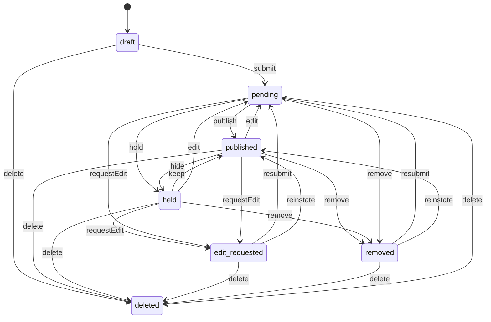
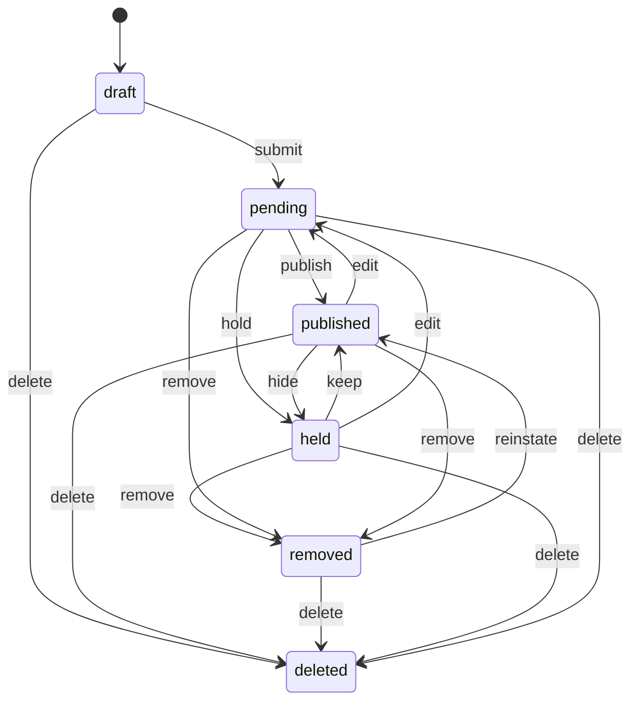
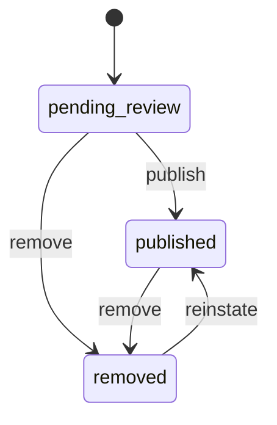
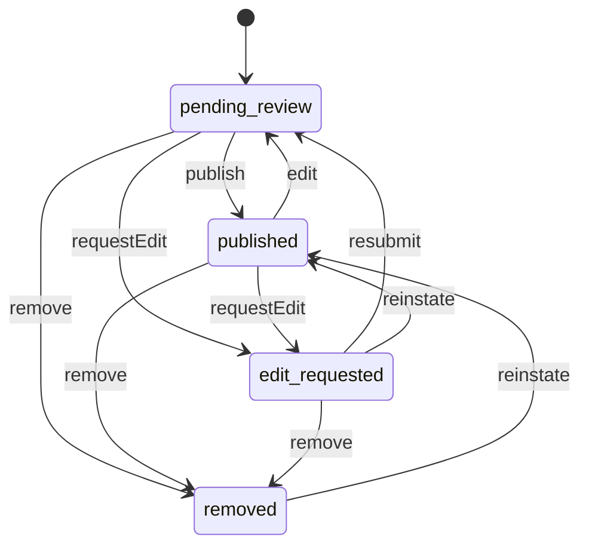
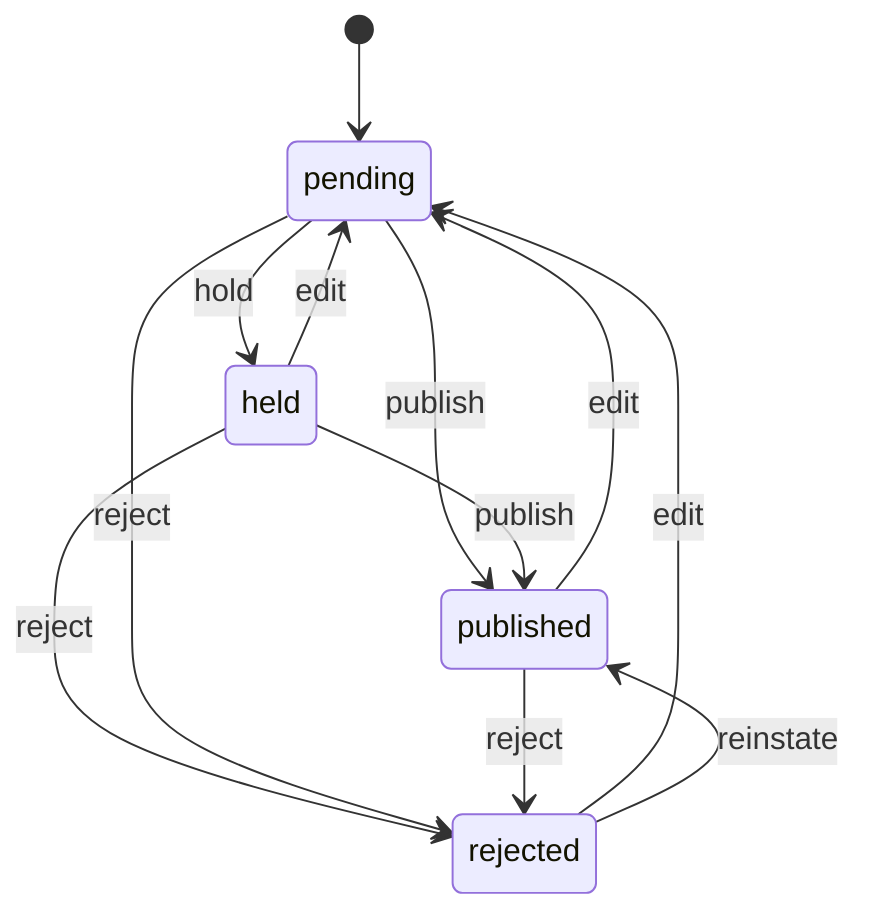
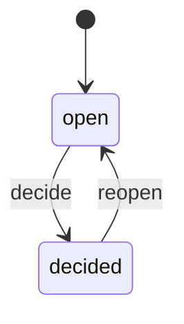
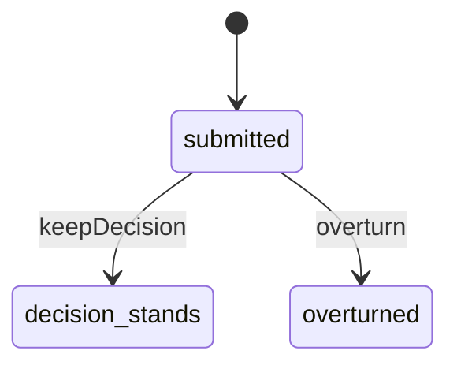

<!-- GENERATED by `npm run gen` from docs/api/modules/reviews.md. Do not edit: change the spec and regenerate. -->

# Reviews (`reviews`)

Product reviews (Verified Purchase), seller feedback kept separate from product reviews, public seller responses under rules, product questions and answers labelled by who answered, reports of inappropriate content, moderation with outcomes visible to reporter and author, appeals, and rating summaries for products and sellers.

- **Group:** After-sales and money · **Launch phase:** 1 · **Plan chapters:** 17, 5
- **Depends on:** [orders](../orders/README.md), [catalog](../catalog/README.md), [sellers](../sellers/README.md) · **Optional:** [media](../media/README.md), [offers](../offers/README.md), [trust](../trust/README.md), [notifications](../notifications/README.md), [access](../access/README.md), [audit](../audit/README.md), [customers](../customers/README.md), [search](../search/README.md), [shipping](../shipping/README.md), [workqueues](../workqueues/README.md)

## Owns
- Product reviews: eligibility from a delivered purchase (Verified Purchase), rating, headline, text, photos, name display, edit and delete
- Seller feedback per seller package: item as described, dispatch speed, communication, comment; shown on the seller profile, never on the product page
- Public seller responses to product reviews and seller feedback, one per review, editable for a limited time, checked against rules
- Product questions and answers labelled Seller, Marketly staff or Customer, with helpful votes
- Helpful votes on reviews and answers
- Reports of inappropriate content by customers, sellers, the system or Trust and Risk
- Moderation queue and decisions with policy reasons; legitimate negative reviews are not removed
- Outcomes visible to the reporter and the author; appeals reviewed by a different moderator
- Rating summaries: product average and distribution; seller positive percentage over 12 months

**Not here:**
- Private order messages: messaging
- Reports about listings (counterfeit, misleading claims) and fake-review investigations: trust (reviews refers patterns there)
- Review invitations by email: notifications (reads reviews.invite.due)
- Search ranking by rating: search (reads reviews.rating.changed)

## Store API

| Method | Path | Purpose | Auth | Body → Response |
|---|---|---|---|---|
| GET | `/api/store/reviews/products/{productId}/reviews` | Published product reviews with filters and sorting | visitor | Page<ProductReview> |
| GET | `/api/store/reviews/products/{productId}/rating-summary` | Average, count, distribution and answered questions (honest no-reviews state) | visitor | `RatingSummary` |
| GET | `/api/store/reviews/rating-summaries` | Ratings for several products (cards) | visitor | `RatingSummary[]` |
| GET | `/api/store/reviews/products/{productId}/questions` | Questions with answers labelled Seller, Marketly staff or Customer | visitor | Page<Question> |
| POST | `/api/store/reviews/products/{productId}/questions` | Ask a question about the product | customer | `{ text: text }` → `Question` |
| POST | `/api/store/reviews/questions/{id}/answers` | Answer another shopper's question (labelled Customer) | customer | `{ text: text }` → `Answer` |
| PATCH | `/api/store/reviews/me/answers/{id}` | Edit my answer, or fix and resubmit it after an edit request | customer | `{ text: text }` → `Answer` |
| POST | `/api/store/reviews/votes` | Mark a review or answer helpful (or undo) | customer | `{ targetType: enum(product_review|answer), targetId: uuid, helpful: bool }` → `{ helpfulCount: int }` |
| POST | `/api/store/reviews/reports` | Report a review, feedback, question, answer or seller response | customer | `ReportInput` → `MyReport` |
| GET | `/api/store/reviews/sellers/{sellerId}/feedback` | Seller feedback with public seller responses | visitor | Page<SellerFeedback> |
| GET | `/api/store/reviews/sellers/{sellerId}/feedback-summary` | Positive percentage and count over 12 months | visitor | `SellerFeedbackSummary` |
| GET | `/api/store/reviews/me/pending` | Delivered purchases waiting for a review and packages waiting for seller feedback | customer | `PendingReviews` |
| GET | `/api/store/reviews/me/review-context/{orderItemId}` | Everything the write-a-review page needs: product, Verified Purchase, seller, existing review and feedback, guidelines | customer | `ReviewContext` |
| GET | `/api/store/reviews/me/reviews` | My product reviews with status and moderation outcomes | customer | Page<MyReview> |
| GET | `/api/store/reviews/me/feedback` | Seller feedback I gave, with seller responses | customer | Page<MyFeedback> |
| GET | `/api/store/reviews/me/reports` | Reports I made and their outcomes | customer | Page<MyReport> |
| POST | `/api/store/reviews/me/reviews` | Write a product review (or save a draft) | customer | `ReviewInput` → `MyReview` |
| PATCH | `/api/store/reviews/me/reviews/{id}` | Edit a review, or fix and resubmit after removal or an edit request | customer | `ReviewUpdateInput` → `MyReview` |
| DELETE | `/api/store/reviews/me/reviews/{id}` | Delete my review | customer | 204 No content |
| POST | `/api/store/reviews/me/feedback` | Leave seller feedback for a delivered package (or save a draft) | customer | `FeedbackInput` → `MyFeedback` |
| PATCH | `/api/store/reviews/me/feedback/{id}` | Edit seller feedback | customer | `FeedbackUpdateInput` → `MyFeedback` |
| DELETE | `/api/store/reviews/me/feedback/{id}` | Delete seller feedback | customer | 204 No content |
| POST | `/api/store/reviews/me/appeals` | Appeal a moderation decision on my content | customer | `AppealInput` → `AppealView` |

## Seller API

| Method | Path | Purpose | Auth | Body → Response |
|---|---|---|---|---|
| GET | `/api/seller/reviews/questions` | Questions on products the seller offers | seller | Page<SellerQuestionRow> |
| POST | `/api/seller/reviews/questions/{id}/skip` | Skip a product question (leave it unanswered) | seller<br>`reviews.responses.post` | `SellerQuestionRow` |
| DELETE | `/api/seller/reviews/questions/{id}/skip` | Put a skipped question back on the open list | seller<br>`reviews.responses.post` | `SellerQuestionRow` |
| POST | `/api/seller/reviews/questions/{id}/answers` | Publish an answer labelled as from the seller | seller<br>`reviews.responses.post` | `{ text: text }` → `Answer` |
| PATCH | `/api/seller/reviews/answers/{id}` | Edit the seller's answer, or fix and resubmit it after an edit request | seller<br>`reviews.responses.post` | `{ text: text }` → `Answer` |
| GET | `/api/seller/reviews/feedback` | Seller feedback received | seller | Page<SellerFeedbackRow> |
| GET | `/api/seller/reviews/feedback-summary` | Own feedback summary | seller | `SellerFeedbackSummary` |
| GET | `/api/seller/reviews/product-reviews` | Product reviews of items the seller sold (to respond) | seller | Page<SellerProductReviewRow> |
| POST | `/api/seller/reviews/responses` | Respond publicly to a review or feedback | seller<br>`reviews.responses.post` | `ResponseInput` → `SellerResponse` |
| PATCH | `/api/seller/reviews/responses/{id}` | Edit a response within the edit window | seller<br>`reviews.responses.post` | `{ text: text }` → `SellerResponse` |
| POST | `/api/seller/reviews/reports` | Report feedback, a review or an answer that breaks the rules | seller<br>`reviews.responses.post` | `ReportInput` → `MyReport` |
| GET | `/api/seller/reviews/reports` | Reports the seller made and their outcomes | seller | Page<MyReport> |
| POST | `/api/seller/reviews/appeals` | Appeal a moderation decision on the seller's answer or response | seller<br>`reviews.responses.post` | `AppealInput` → `AppealView` |

## Admin API

| Method | Path | Purpose | Auth | Body → Response |
|---|---|---|---|---|
| GET | `/api/admin/reviews/moderation-items` | Reported and held content: reviews, feedback, questions, answers, seller responses | staff<br>`reviews.moderation.view` | Page<ModerationItem> |
| GET | `/api/admin/reviews/moderation-items/summary` | Open moderation counts for the nav badge and tabs | staff<br>`reviews.moderation.view` | `ModerationSummary` |
| GET | `/api/admin/reviews/moderation-items/{id}` | Content with reports, purchase, author history and previous decisions | staff<br>`reviews.moderation.view` | `ModerationDetail` |
| POST | `/api/admin/reviews/moderation-items/{id}/decide` | Keep, remove for a policy reason, request an edit, publish, or reject a seller response _(audited)_ | staff<br>`reviews.moderation.decide` | `ModerationDecisionInput` → `ModerationDetail` |
| POST | `/api/admin/reviews/moderation-items/{id}/refer` | Send to Trust and Risk (suspected fake or paid reviews, payment offers) _(audited)_ | staff<br>`reviews.moderation.decide` | `{ note: text }` → `ModerationDetail` |
| GET | `/api/admin/reviews/questions` | Customer questions on products, e.g. unanswered questions on Official Store products (plan ch. 9) | staff<br>`reviews.answers.staff` | Page<AdminQuestionRow> |
| POST | `/api/admin/reviews/questions/{id}/answers` | Add a Marketly staff answer _(audited)_ | staff<br>`reviews.answers.staff` | `{ text: text, secondCheck: bool? }` → `Answer` |
| GET | `/api/admin/reviews/official-store/reviews` | Product reviews of Official Store sales and Official Store feedback, to respond as the Official Store | staff<br>`reviews.answers.staff` | Page<OfficialReviewRow> |
| POST | `/api/admin/reviews/official-store/responses` | Respond publicly as the Official Store _(audited)_ | staff<br>`reviews.answers.staff` | `ResponseInput` → `SellerResponse` |
| PATCH | `/api/admin/reviews/official-store/responses/{id}` | Edit an Official Store response within the edit window _(audited)_ | staff<br>`reviews.answers.staff` | `{ text: text }` → `SellerResponse` |
| GET | `/api/admin/reviews/appeals` | Appeals of moderation decisions | staff<br>`reviews.moderation.view` | Page<AppealRow> |
| POST | `/api/admin/reviews/appeals/{id}/decide` | Decide an appeal (not by the original moderator) _(audited)_ | staff<br>`reviews.appeals.decide` | `{ overturn: bool, reason: text }` → `AppealRow` |
| GET | `/api/admin/reviews/reviews` | Search all product reviews | staff<br>`reviews.moderation.view` | Page<AdminReviewRow> |
| GET | `/api/admin/reviews/moderation-reasons` | Policy reasons for decisions | staff | `ModerationReason[]` |

## Types

### ContentParty

| Field | Type |
|---|---|
| kind | `enum(customer|seller)` |
| id | `uuid` Customers-module id or seller id |

### Author

| Field | Type |
|---|---|
| kind | `enum(customer|seller|staff)` |
| displayName | `string` |
| sellerId | `uuid?` |
| verifiedPurchase | `bool` |

### SellerResponse

| Field | Type |
|---|---|
| id | `uuid` |
| fromName | `string` e.g. Marketly Official Store / Northwind Audio |
| fromKind | `enum(seller|official_store)` |
| text | `text` |
| status | `enum(pending|published|held|rejected)` |
| publishedAt | `datetime?` |
| editableUntil | `datetime?` |
| ruleCheck | `RuleCheck?` |

### RuleCheck

| Field | Type |
|---|---|
| passed | `bool` |
| failures | `string[]` e.g. Offers payment to change a review, Contains a link |

### ProductReview

| Field | Type |
|---|---|
| id | `uuid` |
| productId | `uuid` |
| variantLabel | `string?` e.g. Color: Midnight black |
| author | `Author` |
| rating | `int` |
| headline | `string` |
| text | `text` |
| media | `MediaRef[]` |
| soldBy | `{"sellerId":"uuid","name":"string"}` |
| reviewedAt | `datetime` |
| editedAt | `datetime?` |
| helpfulCount | `int` |
| viewerVotedHelpful | `bool?` |
| viewerReported | `bool?` The signed-in customer has reported this review (open or decided), so the Report button can say Reported; null without a customer session |
| response | `SellerResponse?` |

### RatingBucket

| Field | Type |
|---|---|
| stars | `int` |
| count | `int` |
| pct | `int` |

### RatingSummary

| Field | Type |
|---|---|
| productId | `uuid` |
| hasReviews | `bool` False shows the honest no-reviews state without stars |
| average | `number?` |
| ratingCount | `int` |
| writtenCount | `int` |
| distribution | `RatingBucket[]` |
| answeredQuestions | `int` |
| awaitingQuestions | `int` Published questions with no published answer yet (listQuestions state=awaiting) |
| withPhotos | `int` |

### Answer

| Field | Type |
|---|---|
| id | `uuid` |
| questionId | `uuid` |
| text | `text` |
| by | `Author` |
| label | `enum(seller|marketly_staff|customer)` Shown as Answer from the seller / Marketly staff / Customer |
| answeredAt | `datetime` |
| helpfulCount | `int` |
| viewerVotedHelpful | `bool?` The signed-in customer marked this answer helpful; null without a customer session and outside the store's question list |
| status | `enum(pending_review|published|edit_requested|removed)` |

### Question

| Field | Type |
|---|---|
| id | `uuid` |
| productId | `uuid` |
| productTitle | `string?` |
| text | `text` |
| askedBy | `string` e.g. a shopper / Marcus J. |
| askedAt | `datetime` |
| status | `enum(pending_review|published|removed)` |
| answers | `Answer[]` |
| answerCount | `int` |
| answerExpectation | `string?` Only while no answer is published: who is expected to answer and how fast, e.g. The Official Store usually answers within 1 business day. From the main offer's seller (offers, optional) and questionAnswerTargetBusinessDays; null when the product has no active offer |

### FeedbackDimensions

| Field | Type |
|---|---|
| asDescribed | `bool` |
| dispatchRating | `int` |
| communicationRating | `int?` Null when the customer did not contact the seller |

### SellerFeedback

| Field | Type |
|---|---|
| id | `uuid` |
| sellerId | `uuid` |
| sellerName | `string` |
| orderId | `uuid` |
| orderRef | `string?` |
| packageLabel | `string?` |
| author | `Author` |
| dimensions | `FeedbackDimensions` |
| overall | `int` 1–5 used for positive/neutral/negative |
| sentiment | `enum(positive|neutral|negative)` |
| comment | `text?` |
| itemTitle | `string?` What was bought, for context on the storefront |
| postedAt | `datetime` |
| editedAt | `datetime?` |
| response | `SellerResponse?` |

### SellerFeedbackSummary

| Field | Type |
|---|---|
| sellerId | `uuid` OFFICIAL_STORE_ID for the Official Store (official = true) |
| official | `bool` |
| periodMonths | `int` |
| count | `int` |
| positivePct | `int?` |
| neutralPct | `int?` |
| negativePct | `int?` |
| asDescribedPct | `int?` |
| avgDispatch | `number?` |
| avgCommunication | `number?` |
| label | `string` e.g. 98% positive · 4,812 ratings |
| average | `number?` Average overall score 1–5 |
| onTimeDispatchPct | `number?` From shipping dispatch metrics, last 90 days |
| target | `FeedbackTarget?` The positive-feedback target sellers are measured against (setting sellerFeedbackTargetPct) and whether this summary meets it; always given by reviews |

### FeedbackTarget

| Field | Type |
|---|---|
| positivePct | `int` Target positive percentage, e.g. 95 |
| label | `string` e.g. Target: at least 95% positive |
| meets | `bool?` positivePct of the summary >= the target; null until there is feedback in the period |

### ModerationOutcome

| Field | Type |
|---|---|
| decision | `enum(kept|removed|edit_requested|published|hidden_pending_review)` |
| reasonCode | `string?` |
| reasonText | `string` Plain explanation, e.g. It asks shoppers to contact you directly |
| decidedAt | `datetime?` |
| expectedBy | `datetime?` While under review |
| appealBy | `datetime?` |
| appealable | `bool` |

### AppealView

| Field | Type |
|---|---|
| id | `uuid` |
| status | `enum(submitted|decision_stands|overturned)` |
| submittedAt | `datetime` |
| decidedAt | `datetime?` |
| outcome | `text?` |

### MyReview

| Field | Type |
|---|---|
| review | `ProductReview` |
| status | `enum(draft|pending|published|held|edit_requested|removed|deleted)` |
| statusLabel | `string` e.g. Published / Hidden: under review / Removed |
| visibleToShoppers | `bool` |
| productTitle | `string` |
| productImageUrl | `url?` |
| orderItemId | `uuid` |
| moderation | `ModerationOutcome?` |
| appeal | `AppealView?` |
| canEdit | `bool` |
| canDelete | `bool` |
| canAppeal | `bool` |

### MyFeedback

| Field | Type |
|---|---|
| feedback | `SellerFeedback` |
| status | `enum(draft|pending|published|held|removed|deleted)` |
| statusLabel | `string` |
| moderation | `ModerationOutcome?` |
| canEdit | `bool` |
| canDelete | `bool` |

### PendingProductReview

| Field | Type |
|---|---|
| orderItemId | `uuid` |
| orderId | `uuid` |
| orderRef | `string` |
| productId | `uuid` |
| title | `string` |
| imageUrl | `url?` |
| variantLabel | `string?` |
| deliveredAt | `datetime` |
| sellerName | `string` |
| reviewBy | `datetime?` |

### PendingSellerFeedback

| Field | Type |
|---|---|
| orderId | `uuid` |
| orderRef | `string` |
| ownerType | `enum(official|seller)` |
| sellerId | `uuid` OFFICIAL_STORE_ID for the Official Store |
| sellerName | `string` |
| packageLabel | `string` |
| deliveredAt | `datetime?` |
| eligible | `bool` |
| availableNote | `string?` e.g. available after delivery |

### PendingReviews

| Field | Type |
|---|---|
| products | `PendingProductReview[]` |
| sellerFeedback | `PendingSellerFeedback[]` |

### ReviewContext

| Field | Type |
|---|---|
| orderItemId | `uuid` |
| orderId | `uuid` |
| orderRef | `string` |
| product | `{"id":"uuid","title":"string","imageUrl":"url?","variantLabel":"string?"}` |
| deliveredAt | `datetime` |
| verifiedPurchase | `bool` |
| seller | `{"ownerType":"enum(official|seller)","id":{"type":"uuid","desc":"OFFICIAL_STORE_ID for the Official Store"},"name":"string","slug":{"type":"string?","desc":"Storefront slug for /shop/{slug} (sellers' public API); null for the Official Store"}}` |
| existingReview | `MyReview?` |
| existingFeedback | `MyFeedback?` |
| feedbackEligible | `bool` |
| guidelines | `string[]` |
| minTextLength | `int` |
| maxPhotos | `int` |

### ReviewInput

| Field | Type |
|---|---|
| orderItemId | `uuid` |
| rating | `int` |
| headline | `string` |
| text | `text` |
| mediaIds | `uuid[]?` |
| showName | `bool` |
| draft | `bool?` Save without publishing |

### ReviewUpdateInput

| Field | Type |
|---|---|
| rating | `int?` |
| headline | `string?` |
| text | `text?` |
| mediaIds | `uuid[]?` |
| showName | `bool?` |
| draft | `bool?` |

### FeedbackInput

| Field | Type |
|---|---|
| orderId | `uuid` |
| sellerId | `uuid` |
| asDescribed | `bool` |
| dispatchRating | `int` |
| communicationRating | `int?` |
| comment | `text?` |
| draft | `bool?` Save without publishing, like ReviewInput.draft; the ratings are checked when the draft is submitted |

### FeedbackUpdateInput

| Field | Type |
|---|---|
| asDescribed | `bool?` |
| dispatchRating | `int?` |
| communicationRating | `int?` |
| comment | `text?` |
| draft | `bool?` false submits a saved draft |

### ReportInput

| Field | Type |
|---|---|
| targetType | `enum(product_review|seller_feedback|question|answer|seller_response)` |
| targetId | `uuid` |
| reason | `enum(off_topic|personal_information|hate_or_harassment|spam_or_links|conflict_of_interest|fake_or_paid|inaccurate|medical_claim|offensive|harms_sales|other)` |
| note | `text?` |

### MyReport

| Field | Type |
|---|---|
| id | `uuid` |
| targetType | `string` |
| targetSummary | `string` e.g. Review of Kestrel 27" monitor by "Sam R." |
| reason | `string` |
| note | `text?` |
| reportedAt | `datetime` |
| status | `enum(open|decided)` |
| statusLabel | `string` |
| outcome | `text?` |
| decidedAt | `datetime?` |

### AppealInput

| Field | Type |
|---|---|
| targetType | `enum(product_review|seller_feedback|answer|seller_response)` |
| targetId | `uuid` |
| reason | `text` |

### ResponseInput

| Field | Type |
|---|---|
| targetType | `enum(product_review|seller_feedback)` |
| targetId | `uuid` |
| text | `text` |

### SellerProductReviewRow

| Field | Type |
|---|---|
| review | `ProductReview` |
| orderRef | `string` |
| canRespond | `bool` |
| respondNote | `string?` |

### SellerQuestionRow

| Field | Type |
|---|---|
| question | `Question` |
| productImage | `MediaRef?` |
| offerSku | `string?` |
| needsAnswer | `bool` |
| skipped | `bool` The seller skipped this question (skipQuestion): it leaves the open list; customers and other sellers can still answer it |

### AdminQuestionRow

| Field | Type |
|---|---|
| question | `Question` |
| productImage | `MediaRef?` |
| owner | `enum(official|seller|both)` Who offers the product: the Official Store, marketplace sellers, or both |
| hasSellerAnswer | `bool` |
| hasStaffAnswer | `bool` |
| needsAnswer | `bool` No published answer yet |
| waiting | `string?` Time since asked while unanswered, e.g. 1 d |

### ModerationRespondingTo

| Field | Type |
|---|---|
| contentType | `enum(product_review|seller_feedback)` |
| rating | `int?` Stars of the product review, or overall score of the feedback |
| excerpt | `text` |
| title | `string` Product name for a product review, seller name for feedback |

### ModerationSummary

| Field | Type |
|---|---|
| open | `int` |
| byQueue | `map<int>` Open items per queue: reported, auto_held, qa_check, response_check, appeal |
| byContentType | `map<int>` Open items per content type, for the tabs (e.g. answer, seller_response) |
| overdue | `int` Open longer than moderationTargetHours |
| oldestOpenAt | `datetime?` |

### SellerFeedbackRow

| Field | Type |
|---|---|
| feedback | `SellerFeedback` |
| canRespond | `bool` |
| canReport | `bool` |

### Report

| Field | Type |
|---|---|
| id | `uuid` |
| reporter | `Actor` |
| reporterLabel | `string` e.g. Gadget Grove (seller) / 3 customers / system / Trust and Risk |
| reason | `string` |
| note | `text?` |
| at | `datetime` |

### ModerationItem

| Field | Type |
|---|---|
| id | `uuid` |
| contentType | `enum(product_review|seller_feedback|question|answer|seller_response)` |
| contentId | `uuid` |
| queue | `enum(reported|auto_held|qa_check|response_check|appeal)` |
| title | `string` Product or seller name |
| subjectImage | `MediaRef?` Product thumbnail (catalog) for product reviews, questions, answers and responses on product reviews; null for seller feedback |
| excerpt | `text` |
| contextText | `text?` For answers: the question being answered |
| respondingTo | `ModerationRespondingTo?` For seller responses: the review or feedback being answered |
| rating | `int?` |
| author | `Author` |
| reasons | `string[]` |
| reportCount | `int` |
| reportersLabel | `string` |
| visibility | `enum(visible|hidden)` |
| ruleCheck | `RuleCheck?` |
| firstReportedAt | `datetime` |
| age | `string` e.g. 1 d, 6 h |
| status | `enum(open|decided)` |
| decision | `ModerationDecisionView?` The latest decision on a decided item; null while open |

### ModerationDecisionView

| Field | Type |
|---|---|
| outcome | `enum(keep|remove|request_edit|publish|reject_response)` What was decided (ModerationDecisionInput.decision) |
| outcomeLabel | `string` e.g. Kept / Removed / Edit requested |
| reasonCode | `string` |
| reason | `string` The policy reason in words, e.g. Personal information |
| by | `Actor` The moderator (name from access), or system for decisions carried out for a Trust and Risk enforcement |
| at | `datetime` |

### ModerationDetail

| Field | Type |
|---|---|
| item | `ModerationItem` |
| review | `ProductReview?` |
| feedback | `SellerFeedback?` |
| question | `Question?` |
| answer | `Answer?` |
| response | `SellerResponse?` |
| respondingTo | `text?` For seller responses: the review they answer |
| purchase | `ModerationPurchase?` Order and delivery behind a review |
| reports | `Report[]` |
| otherReportsOnAuthor | `int` |
| helpfulVotes | `int` |
| separationNote | `string?` Hint when a product review mentions seller service |
| previousDecision | `ModerationOutcome?` |
| appeal | `AppealView?` |
| history | `TimelineEvent[]` |

### ModerationPurchase

| Field | Type |
|---|---|
| orderRef | `string` |
| deliveredAt | `datetime?` |
| verified | `bool` |
| soldBy | `string` |
| condition | `string?` |

### ModerationDecisionInput

| Field | Type |
|---|---|
| decision | `enum(keep|remove|request_edit|publish|reject_response)` |
| reasonCode | `enum(legitimate_experience|personal_information|hate_or_harassment|spam_or_links|off_topic|conflict_of_interest|proven_fake|medical_claim|off_platform_offer|payment_for_review|inaccurate)` |
| messageToReporter | `text?` |
| messageToAuthor | `text?` |
| editRequest | `text?` What to change, for request_edit |

### ModerationReason

| Field | Type |
|---|---|
| code | `string` |
| label | `string` |
| removes | `bool` False for legitimate_experience; harms_sales is never a removal reason |

### AppealRow

| Field | Type |
|---|---|
| id | `uuid` |
| contentType | `string` |
| contentId | `uuid` |
| excerpt | `text` |
| author | `Author` |
| reason | `text` |
| submittedAt | `datetime` |
| originalDecision | `ModerationOutcome` |
| originalModerator | `Actor` |
| status | `enum(submitted|decision_stands|overturned)` |

### AdminReviewRow

| Field | Type |
|---|---|
| review | `ProductReview` |
| status | `string` |
| orderRef | `string` |
| customerId | `uuid` |
| reportCount | `int` |

### OfficialReviewRow

| Field | Type |
|---|---|
| targetType | `enum(product_review|seller_feedback)` |
| review | `ProductReview?` For product reviews of items the Official Store sold |
| feedback | `SellerFeedback?` For feedback on Official Store packages |
| orderRef | `string?` |
| needsResponse | `bool` |
| canRespond | `bool` |

## Status flows

### Product review (`MyReview.status`)



Submit runs automatic checks (contact details, links, profanity, payment offers); passing content publishes at once, failing content is held for moderation. Reported reviews stay visible while reviewed unless the report reason is in hideOnReportReasons (e.g. personal information). keep/remove/requestEdit are moderation decisions with a policy reason, taken from pending, held or published content in one move; 'harms sales' or an unfavourable rating is never a removal reason. reinstate follows an overturned appeal or a reversed trust enforcement. Edits re-run the checks.

### Seller feedback (`MyFeedback.status`)



Eligible once the seller's package is delivered (or its delivery date has passed), within sellerFeedbackWindowDays. Feedback about the product itself can be reported as off-topic; slow service mentioned in a product review stays (honest experience). Feedback has no edit request: request_edit on feedback is refused with ILLEGAL_TRANSITION.

### Question (`Question.status`)



Questions passing the automatic checks publish at once. Removing a question removes it from the product page with its answers; reinstate follows an overturned appeal or a reversed trust enforcement.

### Answer (`Answer.status`)



Answers passing the automatic checks publish at once; held ones (links, medical claims, off-platform offers) wait for review. Staff answers can require a second check (setting). A published answer can get an edit request after a report (it leaves the page until resubmitted). The author edits with PATCH /me/answers/{id} (customers) or PATCH /answers/{id} (sellers): edit from published, resubmit from edit_requested; both re-run the checks.

### Seller response (`SellerResponse.status`)



One response per review or feedback. Rule check blocks names beyond what the customer shows, addresses, order details, offers of refunds or gifts for changing feedback, links, contact details and insults. Editable until editableUntil (responseEditDays). A published response that is reported can be rejected (reject_response); reinstate follows an overturned appeal. Official Store responses follow the same machine and are written by staff.

### Moderation item (`ModerationItem.status`)



A new report on decided content within reportCooldownDays attaches to the decided item without reopening unless the reason differs; an appeal reopens it in the appeal queue.

### Appeal (`AppealView.status`)



Decided by a moderator other than the original one (SAME_MODERATOR). Allowed until appealBy (appealWindowDays).

## Data (schema `reviews`)

**product_reviews**: One review per customer per product (latest delivered purchase); Verified Purchase when linked to a delivered order item

| Column | Type |
|---|---|
| id | uuid pk |
| product_id | uuid |
| variant_id | uuid? |
| order_item_id | uuid |
| order_id | uuid |
| seller_id | uuid |
| customer_id | uuid |
| display_name | text |
| show_name | bool |
| verified | bool |
| rating | int |
| headline | text |
| body | text |
| media_ids | jsonb |
| status | text |
| visible | bool |
| helpful_count | int |
| created_at | timestamptz |
| published_at | timestamptz? |
| edited_at | timestamptz? |

Indexes: `(customer_id, product_id) unique`, `(product_id, status, helpful_count desc)`, `(product_id, status, published_at desc)`, `(seller_id, published_at desc)`

**seller_feedback**: One per customer per seller package (order seller group)

| Column | Type |
|---|---|
| id | uuid pk |
| seller_id | uuid |
| order_id | uuid |
| customer_id | uuid |
| display_name | text |
| as_described | bool |
| dispatch_rating | int |
| communication_rating | int? |
| overall | int |
| sentiment | text |
| comment | text? |
| status | text |
| visible | bool |
| created_at | timestamptz |
| edited_at | timestamptz? |

Indexes: `(order_id, seller_id, customer_id) unique`, `(seller_id, status, created_at desc)`

**seller_responses**

| Column | Type |
|---|---|
| id | uuid pk |
| target_type | text |
| target_id | uuid |
| seller_id | uuid |
| text | text |
| status | text |
| rule_check | jsonb |
| created_by | text |
| created_at | timestamptz |
| published_at | timestamptz? |
| editable_until | timestamptz |

Indexes: `(target_type, target_id) unique`, `(seller_id, status)`

**questions**

| Column | Type |
|---|---|
| id | uuid pk |
| product_id | uuid |
| customer_id | uuid |
| display_name | text |
| text | text |
| status | text |
| answer_count | int |
| created_at | timestamptz |

Indexes: `(product_id, status, created_at desc)`

**answers**

| Column | Type |
|---|---|
| id | uuid pk |
| question_id | uuid → questions |
| author_kind | text |
| author_id | text |
| seller_id | uuid? |
| display_name | text |
| text | text |
| status | text |
| rule_check | jsonb |
| helpful_count | int |
| created_at | timestamptz |
| published_at | timestamptz? |

Indexes: `(question_id, status)`, `(seller_id)`

**question_skips**: Questions a seller chose not to answer (skipQuestion); only that seller's open list changes

| Column | Type |
|---|---|
| id | uuid pk |
| seller_id | uuid |
| question_id | uuid → questions |
| skipped_by | text (member account id) |
| created_at | timestamptz |

Indexes: `(seller_id, question_id) unique`

**helpful_votes**

| Column | Type |
|---|---|
| target_type | text |
| target_id | uuid |
| customer_id | uuid |
| helpful | bool |
| at | timestamptz |

Indexes: `(target_type, target_id, customer_id) unique`

**reports**

| Column | Type |
|---|---|
| id | uuid pk |
| target_type | text |
| target_id | uuid |
| moderation_item_id | uuid → moderation_items |
| reporter_kind | text |
| reporter_id | text? |
| reason | text |
| note | text? |
| status | text |
| outcome_text | text? |
| created_at | timestamptz |
| decided_at | timestamptz? |

Indexes: `(reporter_kind, reporter_id, created_at desc)`, `(moderation_item_id)`

**moderation_items**: One open item per piece of content under review; reports attach to it

| Column | Type |
|---|---|
| id | uuid pk |
| content_type | text |
| content_id | uuid |
| queue | text |
| status | text |
| visibility | text |
| reasons | jsonb |
| report_count | int |
| first_reported_at | timestamptz |
| decided_at | timestamptz? |

Indexes: `(status, queue, first_reported_at)`, `(content_type, content_id)`

**moderation_decisions**

| Column | Type |
|---|---|
| id | uuid pk |
| moderation_item_id | uuid → moderation_items |
| decision | text |
| reason_code | text |
| message_to_reporter | text? |
| message_to_author | text? |
| edit_request | text? |
| moderator_id | uuid |
| decided_at | timestamptz |
| appeal_by | timestamptz? |
| trust_enforcement_id | uuid? (trust enforcement this decision executed; reversed with it) |

Indexes: `(moderation_item_id)`, `(trust_enforcement_id)`

**referrals**: Content referred to Trust and Risk from moderation (referToTrust; reviews.content.referred). Not a moderation decision: the item stays open

| Column | Type |
|---|---|
| id | uuid pk |
| moderation_item_id | uuid → moderation_items |
| content_type | text |
| content_id | uuid |
| author_id | text |
| note | text |
| referred_by | uuid (staff id) |
| referred_at | timestamptz |

Indexes: `(moderation_item_id)`, `(content_type, content_id)`

**appeals**

| Column | Type |
|---|---|
| id | uuid pk |
| decision_id | uuid → moderation_decisions |
| content_type | text |
| content_id | uuid |
| by_kind | text |
| by_id | text |
| reason | text |
| status | text |
| reviewer_id | uuid? |
| outcome | text? |
| submitted_at | timestamptz |
| decided_at | timestamptz? |

Indexes: `(status, submitted_at)`

**product_rating_summaries**: Projection updated on publish, edit, removal and merge

| Column | Type |
|---|---|
| product_id | uuid pk |
| rating_count | int |
| written_count | int |
| sum_ratings | int |
| distribution | jsonb |
| with_photos | int |
| answered_questions | int |
| updated_at | timestamptz |

**review_invites**: Delivered items waiting for a review invitation (decision D-R2): one row per order item from orders.item.delivered; the invites job publishes reviews.invite.due when due_at passes and the item is still unreviewed

| Column | Type |
|---|---|
| order_item_id | uuid pk |
| order_id | uuid |
| customer_id | uuid |
| product_id | uuid |
| seller_id | uuid (OFFICIAL_STORE_ID for the Official Store) |
| delivered_at | timestamptz |
| due_at | timestamptz |
| state | text (pending|sent|cancelled|reviewed) |
| sent_at | timestamptz? |
| updated_at | timestamptz |

Indexes: `(state, due_at)`, `(customer_id)`

**seller_feedback_summaries**: Rolling 12-month projection per seller

| Column | Type |
|---|---|
| seller_id | uuid pk |
| count | int |
| positive | int |
| neutral | int |
| negative | int |
| as_described_yes | int |
| dispatch_sum | int |
| communication_sum | int |
| communication_count | int |
| overall_sum | int (sum of overall ratings in the period: average = overall_sum / count) |
| updated_at | timestamptz |

## Events

| Publishes | When | Payload | Consumed by |
|---|---|---|---|
| `reviews.review.published` | A product review becomes visible (new, edited, kept or reinstated) | `{ reviewId: uuid, productId: uuid, sellerId: uuid, rating: int, verified: bool }` | search, trust |
| `reviews.review.updated` | An author edits a review | `{ reviewId: uuid, productId: uuid }` | - |
| `reviews.review.removed` | A review is removed by moderation or a trust enforcement, or deleted by its author | `{ reviewId: uuid, productId: uuid, sellerId: uuid, customerId: uuid, byModeration: bool, reasonCode: string?, trustEnforcementId: uuid? }` | - |
| `reviews.report.created` | Content is reported | `{ reportId: uuid, targetType: string, targetId: uuid, reason: string, reporterKind: string }` | notifications |
| `reviews.feedback.published` | Seller feedback becomes visible | `{ feedbackId: uuid, sellerId: uuid, orderId: uuid, sentiment: string }` | - |
| `reviews.feedback.removed` | Seller feedback is removed or deleted | `{ feedbackId: uuid, sellerId: uuid }` | - |
| `reviews.question.asked` | A question is published (sellers with an offer are told; Official Store questions go to staff) | `{ questionId: uuid, productId: uuid, customerId: uuid, sellerIds: uuid[], officialStore: bool }` | - |
| `reviews.answer.published` | An answer is published (the asker is told) | `{ answerId: uuid, questionId: uuid, productId: uuid, label: string, askerCustomerId: uuid, sellerId: uuid? }` | - |
| `reviews.response.published` | A seller or Official Store response is published or held (the reviewer is told when published) | `{ responseId: uuid, sellerId: uuid, targetType: string, targetId: uuid, status: string, customerId: uuid }` | - |
| `reviews.moderation.decided` | A moderation decision is recorded (reporter and author are notified), including removals and keeps for a trust enforcement | `{ moderationItemId: uuid, contentType: string, contentId: uuid, decision: string, reasonCode: string, author: ContentParty?, reporters: ContentParty[], reporterOutcome: text?, appealUntil: datetime?, trustEnforcementId: uuid? }` | notifications, trust, workqueues |
| `reviews.appeal.submitted` | An author appeals | `{ appealId: uuid, contentType: string, contentId: uuid }` | - |
| `reviews.appeal.decided` | An appeal is decided (the author is told) | `{ appealId: uuid, overturned: bool, contentType: string, contentId: uuid, author: ContentParty?, outcome: text? }` | - |
| `reviews.content.referred` | Content is referred to Trust and Risk | `{ moderationItemId: uuid, contentType: string, contentId: uuid, authorId: string, note: text }` | trust |
| `reviews.rating.changed` | A product or seller rating summary changes | `{ productId: uuid?, sellerId: uuid?, average: number?, count: int }` | - |
| `reviews.invite.due` | inviteDelayDays after delivery, for items not yet reviewed | `{ customerId: uuid, orderItemId: uuid, productId: uuid, sellerId: uuid }` | notifications |

| Consumes | From | Does |
|---|---|---|
| `orders.item.delivered` | orders | Make the item eligible for a Verified Purchase review and its seller package for feedback; insert the review_invites row (due inviteDelayDays after delivery) |
| `orders.item.cancelled` | orders | Remove eligibility for cancelled items and cancel their pending invites |
| `catalog.product.merged` | catalog | Move reviews, questions and the rating summary to the kept product |
| `trust.enforcement.recorded` | trust | remove_reviews: remove the reviews, questions and answers named in targets with a moderation decision (reason proven_fake, trust_enforcement_id recorded), tell the authors, recalculate ratings, publish reviews.moderation.decided with trustEnforcementId (trust confirms) and reviews.review.removed for reviews. keep_reviews: decide open moderation items on the named content as kept (reason legitimate_experience) so held content is published again. Other actions are ignored |
| `trust.enforcement.reversed` | trust | remove_reviews: reinstate the content that enforcement removed (decisions with its trust_enforcement_id) unless the author deleted it since, recalculate ratings, publish reviews.review.published and reviews.rating.changed, tell the authors |
| `customers.account.closed` | customers | Anonymise the customer's content: display names become Former customer on reviews, feedback, questions and answers (content stays published as the honest record of a purchase); their helpful votes stay counted under a random id (no link to the customer) and their reports without the reporter id; pending invites are cancelled |
| `sellers.seller.closed` | sellers | Keep feedback published; stop new responses from the closed seller |

## In-process API (for other modules)

| Function | Signature | Used by |
|---|---|---|
| getRatingSummaries | `(productIds: uuid[]) => RatingSummary[]`<br>Ratings for product cards and search results | search, catalog, promotions, graphql |
| getSellerFeedbackSummary | `(sellerId: uuid) => SellerFeedbackSummary`<br>Seller quality for offer comparison, featured-offer eligibility and storefronts (also the Official Store profile in content) | offers, sellers, content, graphql |
| feedbackSummariesForSellers | `(sellerIds: uuid[], opts?: { dispatch?: bool }) => Map<uuid, SellerFeedbackSummary>`<br>Batched getSellerFeedbackSummary (the admin seller list, store seller cards): one answer per id asked for, the same as getSellerFeedbackSummary gives for it, from one read of the summaries. dispatch: false leaves onTimeDispatchPct null and skips shipping's dispatch figures (one shipping call per seller), for lists that do not show them. | sellers |
| moveProductContent | `(fromProductId: uuid, toProductId: uuid) => { reviews: int, questions: int }`<br>Called during a duplicate merge | catalog |
| removeContentForEnforcement | `(contentIds: uuid[], enforcementId: uuid, reason: string) => int`<br>Remove proven fake reviews named in an enforcement (same path as consuming trust.enforcement.recorded; publishes reviews.moderation.decided with trustEnforcementId) | trust |
| exportCustomerData | `(input: { customerId: uuid, accountId: uuid }) => CustomerDataSection[]`<br>The customer's product reviews, seller feedback, questions, answers and reports they made (with status and moderation outcomes) for the personal data export. Export hook called by customers.build-data-exports | customers |
| listProductReviews | `(productId: uuid, filter: { stars?: int, verifiedOnly?: bool, withPhotos?: bool, variantLabel?: string }, sort: string, page: PageInput, viewer: Actor | null) => Page<ProductReview>`<br>Published product reviews with filters and sorting (Product.reviews) | graphql |
| listProductQuestions | `(productId: uuid, search: string | null, page: PageInput) => Page<Question>`<br>Published questions with labelled answers (Product.questions) | graphql |
| listSellerFeedback | `(sellerId: uuid, filter: { sentiment?: string }, page: PageInput) => Page<SellerFeedback>`<br>Seller feedback with public seller responses, newest first (Seller.feedback) | graphql |
| reviewStatusForItems | `(customerId: uuid, orderItemIds: uuid[]) => { orderItemId: uuid, canReview: bool, reviewBy: datetime | null, reviewId: uuid | null, status: string | null, statusLabel: string | null, rating: int | null, feedbackEligible: bool, feedbackGiven: bool }[]`<br>Review and seller-feedback state per purchased item, batched (OrderItem.reviewStatus) | graphql |
| getOfferSellerRatings | `(offers: { offerId: uuid, ownerType: 'official' | 'seller', sellerId: uuid | null }[]) => map<SellerFeedbackSummary>`<br>Feedback summary of whoever sells each offer, the Official Store included, with on-time dispatch from shipping when enabled | graphql |

## Permissions

| Key | Who | Allows |
|---|---|---|
| `reviews.moderation.view` | staff | View moderation queues, reports, appeals and all reviews |
| `reviews.moderation.decide` | staff | Keep, remove, request edits, publish; refer to Trust and Risk |
| `reviews.appeals.decide` | staff | Decide appeals (not on one's own decisions) |
| `reviews.answers.staff` | staff | Answer product questions as Marketly staff and respond publicly for the Official Store |
| `reviews.responses.post` | seller | Answer questions, respond to reviews and feedback, report content, appeal |

## Error codes

| Code | Status | Meaning |
|---|---|---|
| `REVIEW_NOT_ELIGIBLE` | 422 | No delivered purchase of this product by the customer, or the review window has ended. |
| `ALREADY_REVIEWED` | 409 | The customer already reviewed this product (or left feedback for this package); edit it instead. details.id. |
| `FEEDBACK_NOT_YET_AVAILABLE` | 422 | Seller feedback opens after the package is delivered. details.availableFrom. |
| `ALREADY_REPORTED` | 409 | The caller already reported this content. |
| `RESPONSE_ALREADY_EXISTS` | 409 | A seller response exists; edit it instead. |
| `RESPONSE_EDIT_WINDOW_CLOSED` | 409 | The response can no longer be edited. |
| `INVALID_REMOVAL_REASON` | 422 | Removal needs a policy reason; unfavourable content or harms sales is not one. |
| `SAME_MODERATOR` | 409 | An appeal must be decided by a different moderator. |
| `APPEAL_WINDOW_CLOSED` | 409 | The appeal deadline has passed. |
| `NOT_AN_OFFER_SELLER` | 403 | The seller has no offer on this product or did not sell this item. |

## Background jobs

| Job | Schedule | Does |
|---|---|---|
| `reviews.invites` | hourly | Publish reviews.invite.due for pending review_invites rows past due_at whose item is still unreviewed (mark sent); rows of reviewed items become reviewed |
| `reviews.summaries` | every 10 min | Refresh product and 12-month seller summaries; publish reviews.rating.changed |
| `reviews.moderation-sla` | every 30 min | Raise a review_moderation_overdue work item (workqueues.raise, dedupe review_moderation_overdue:<moderationItemId>) for open moderation items older than moderationTargetHours; resolve it with resolveBySource when the item is decided |

## Settings

| Key | Default | Rules | Meaning |
|---|---|---|---|
| minReviewLength | `50` | int, characters, 0–… | Characters for a written review |
| maxReviewPhotos | `6` | int, 0–20 | Photos per review |
| reviewWindowDays | `365` | duration, days, 30–… | Days after delivery to write a review |
| sellerFeedbackWindowDays | `90` | duration, days, 1–…, seller-visible | Days after delivery to leave seller feedback |
| responseEditDays | `7` | duration, days, 0–…, seller-visible | Seller can edit a public response for this long |
| appealWindowDays | `30` | duration, days, 1–… | Days to appeal a moderation decision |
| hideOnReportReasons | `["personal_information","hate_or_harassment"]` | json, approval: second reviewer | Report reasons that hide content while it is reviewed |
| inviteDelayDays | `5` | duration, days, 0–… | Ask for a review this long after delivery |
| sellerRatingPeriodMonths | `12` | duration, months, 1–…, approval: second reviewer, seller-visible | Period for the seller positive percentage |
| positiveThreshold | `4` | int, 1–5, approval: second reviewer, seller-visible | Overall rating counted as positive (4–5); 3 is neutral |
| sellerFeedbackTargetPct | `95` | int, %, 0–100, seller-visible | Positive feedback percentage sellers are expected to keep (SellerFeedbackSummary.target), example |
| moderationTargetHours | `48` | duration, hours, 1–… | Decision target for reported content (example) |
| reportCooldownDays | `30` | duration, days, 0–… | Repeat reports on decided content attach without reopening |
| questionAnswerTargetBusinessDays | `1` | duration, business days, 1–…, seller-visible | Expected answer time shown under unanswered questions (Question.answerExpectation), example |

## Notes
- Product reviews describe the item and appear on the product page for all sellers; seller feedback describes buying from a seller (as described, dispatch, communication) and appears only on the seller profile. They are separate tables, summaries and screens (plan ch. 17).
- Verified Purchase means the review is linked to a delivered order item recorded on Marketly. Only verified purchasers can review at launch; the label is still shown so the rule is explicit.
- Legitimate negative reviews are never removed for being unfavourable: legitimate_experience can only keep, and harms_sales is accepted as a report reason but never as a removal reason.
- Reporter and author both see the outcome (MyReport.outcome, MyReview.moderation); reporters are anonymous to authors.
- Questions and answers are public and labelled Seller, Marketly staff or Customer. Only sellers with an offer on the product (offers, optional) can answer as seller; order-specific questions go to messaging.
- Seller responses: one per review or feedback, public, rule-checked, editable for responseEditDays. A seller offering refunds or gifts to change a review is held and can be referred to trust.
- Fake-review investigations belong to trust; reviews refers content (reviews.content.referred), removes content named in trust.enforcement.recorded (remove_reviews), keeps it for keep_reviews and reinstates it when trust reverses the enforcement (trust.enforcement.reversed). The decisions carry trustEnforcementId so trust confirms execution (decision D-R1).
- The Official Store responds to reviews and feedback through admin (Official Store responses, permission reviews.answers.staff); responses show fromKind official_store and seller id OFFICIAL_STORE_ID.
- Personal data: exportForCustomer supplies the Reviews section of the customer data export; customers.account.closed anonymises the author name on the customer's content.
- Review invitations are stored in review_invites (decision D-R2), not kept in memory, so they survive restarts and are sent once.
- Phase 2 brings stronger moderation (plan ch. 20): the queue already supports system flags and Trust and Risk referrals.

## GraphQL (read layer)

This module's fragment of the GraphQL schemas (see [../graphql/README.md](../graphql/README.md)). Writes stay on the REST endpoints above.

```graphql
# reviews: product reviews (Verified Purchase), product questions and answers, seller feedback (kept separate from product
# reviews) and rating summaries.
# Adds Product.reviewSummary, Product.reviews, Product.questions, Seller.rating, Seller.feedback, Offer.sellerRating
# (also for Official Store offers) and OrderItem.reviewStatus.
# Moderation queues, reports and appeals stay on REST.

"A published product review"
type Review {
  id: UUID!
  productId: UUID!
  "e.g. Color: Midnight black"
  variantLabel: String
  author: ReviewAuthor!
  "1–5"
  rating: Int!
  headline: String!
  text: String!
  media: [MediaRef!]!
  "Who sold the reviewed item"
  soldBy: ReviewSoldBy!
  reviewedAt: DateTime!
  editedAt: DateTime
  helpfulCount: Int!
  "Null without a customer session"
  viewerVotedHelpful: Boolean
  "Public response from the seller or the Official Store"
  response: ReviewResponse

  # ---- Seller Center and Admin Center only
  "Order the review is linked to"
  orderRef: String @areas(in: [SELLER, ADMIN])
  "The caller may respond publicly (one response per review)"
  canRespond: Boolean @areas(in: [SELLER])
  reportCount: Int @areas(in: [ADMIN])
}

type ReviewAuthor {
  kind: ReviewAuthorKind!
  "e.g. Mara D."
  displayName: String!
  "Bought this product on Marketly"
  verifiedPurchase: Boolean!
}

enum ReviewAuthorKind {
  CUSTOMER
  SELLER
  STAFF
}

type ReviewSoldBy {
  "OFFICIAL_STORE_ID for the Official Store"
  sellerId: UUID
  name: String!
}

"A public seller response to a review or feedback, checked against the response rules"
type ReviewResponse {
  id: UUID!
  "e.g. Marketly Official Store / Northwind Audio"
  fromName: String!
  fromKind: ReviewResponseFrom!
  text: String!
  publishedAt: DateTime
  status: ReviewResponseStatus @areas(in: [SELLER, ADMIN])
  editableUntil: DateTime @areas(in: [SELLER, ADMIN])
}

enum ReviewResponseFrom {
  SELLER
  OFFICIAL_STORE
}

enum ReviewResponseStatus @areas(in: [SELLER, ADMIN]) {
  PENDING
  PUBLISHED
  HELD
  REJECTED
}

"Product rating summary. hasReviews false shows the honest no-reviews state without stars."
type ReviewSummary {
  productId: UUID!
  hasReviews: Boolean!
  "Null until there are reviews"
  average: Float
  ratingCount: Int!
  writtenCount: Int!
  "5 to 1 stars"
  distribution: [ReviewRatingBucket!]!
  answeredQuestions: Int!
  withPhotos: Int!
}

type ReviewRatingBucket {
  stars: Int!
  count: Int!
  pct: Int!
}

type ReviewPage implements Paged {
  items: [Review!]!
  nextCursor: String
  page: Int
  totalPages: Int
  total: Int
}

enum ReviewSort {
  MOST_HELPFUL
  NEWEST
  HIGHEST_RATED
  LOWEST_RATED
}

"A product question with answers labelled by who answered"
type Question {
  id: UUID!
  productId: UUID!
  text: String!
  "e.g. a shopper / Marcus J."
  askedBy: String!
  askedAt: DateTime!
  answers: [Answer!]!
  answerCount: Int!
  "Only while unanswered, e.g. The Official Store usually answers within 1 business day"
  answerExpectation: String
  status: QuestionStatus @areas(in: [SELLER, ADMIN])
}

enum QuestionStatus @areas(in: [SELLER, ADMIN]) {
  PENDING_REVIEW
  PUBLISHED
  REMOVED
}

type Answer {
  id: UUID!
  text: String!
  by: ReviewAuthor!
  "Shown as Answer from the seller / Marketly staff / Customer"
  label: AnswerLabel!
  answeredAt: DateTime!
  helpfulCount: Int!
  status: AnswerStatus @areas(in: [SELLER, ADMIN])
}

enum AnswerLabel {
  SELLER
  MARKETLY_STAFF
  CUSTOMER
}

enum AnswerStatus @areas(in: [SELLER, ADMIN]) {
  PENDING_REVIEW
  PUBLISHED
  EDIT_REQUESTED
  REMOVED
}

type QuestionPage implements Paged {
  items: [Question!]!
  nextCursor: String
  page: Int
  totalPages: Int
  total: Int
}

"Feedback about a seller's shipping, packaging and communication for one package (not about the product)"
type SellerFeedback {
  id: UUID!
  sellerId: UUID!
  author: ReviewAuthor!
  "Item as described"
  asDescribed: Boolean!
  "1–5"
  dispatchRating: Int!
  "1–5; null when the customer did not contact the seller"
  communicationRating: Int
  "1–5, drives positive / neutral / negative"
  overall: Int!
  sentiment: SellerFeedbackSentiment!
  comment: String
  "What was bought, for context on the storefront"
  itemTitle: String
  postedAt: DateTime!
  editedAt: DateTime
  response: ReviewResponse
  orderRef: String @areas(in: [SELLER, ADMIN])
}

enum SellerFeedbackSentiment {
  POSITIVE
  NEUTRAL
  NEGATIVE
}

type SellerFeedbackPage implements Paged {
  items: [SellerFeedback!]!
  nextCursor: String
  page: Int
  totalPages: Int
  total: Int
}

"""
Seller feedback summary over the last 12 months, e.g. 98% positive · 4,812 ratings. Also given for the Official Store
(official true, sellerId OFFICIAL_STORE_ID), which collects the same package feedback.
"""
type SellerRating {
  "OFFICIAL_STORE_ID for the Official Store"
  sellerId: UUID
  "True for the Official Store"
  official: Boolean!
  periodMonths: Int!
  count: Int!
  "Average overall feedback score, 1–5. Null until there is feedback."
  average: Float
  "Null until the seller has feedback"
  positivePct: Int
  neutralPct: Int
  negativePct: Int
  asDescribedPct: Int
  avgDispatch: Float
  avgCommunication: Float
  "Packages dispatched by their deadline, last 90 days (from shipping's dispatch metrics). Null with too few orders or without shipping."
  onTimeDispatchPct: Float
  "e.g. 98% positive · 4,812 ratings"
  label: String!
}

"Review and feedback state of a purchased item for the customer's order page"
type ReviewItemStatus @areas(in: [STORE]) {
  "Delivered and not yet reviewed"
  canReview: Boolean!
  reviewBy: DateTime
  reviewId: UUID
  status: ReviewStatus
  "e.g. Published / Hidden: under review"
  statusLabel: String
  rating: Int
  "Seller feedback can be left for this item's package"
  feedbackEligible: Boolean!
  feedbackGiven: Boolean!
}

enum ReviewStatus @areas(in: [STORE]) {
  DRAFT
  PENDING
  PUBLISHED
  HELD
  EDIT_REQUESTED
  REMOVED
  DELETED
}

# ---------------------------------------------------------------- fields on other modules' types

extend type Product {
  "Average, count, distribution and answered questions (batched for product cards)"
  reviewSummary: ReviewSummary! @source(module: "reviews", fn: "getRatingSummaries")

  "Published reviews with filters and sorting"
  reviews(stars: Int, verifiedOnly: Boolean, withPhotos: Boolean, variantLabel: String, sort: ReviewSort = MOST_HELPFUL, paging: PageInput): ReviewPage! @source(module: "reviews", fn: "listProductReviews") @cost(weight: 10)

  "Published questions with labelled answers, most helpful first"
  questions(search: String, paging: PageInput): QuestionPage! @source(module: "reviews", fn: "listProductQuestions") @cost(weight: 10)
}

extend type Seller {
  "Seller feedback summary for the storefront, offers and seller 360"
  rating: SellerRating! @source(module: "reviews", fn: "getSellerFeedbackSummary")

  "Seller feedback with public seller responses, newest first"
  feedback(sentiment: SellerFeedbackSentiment, paging: PageInput): SellerFeedbackPage! @source(module: "reviews", fn: "listSellerFeedback") @cost(weight: 10)
}

extend type Offer {
  "Feedback summary of whoever sells this offer: the marketplace seller or the Official Store (Offer.seller is null for Official Store offers)"
  sellerRating: SellerRating! @areas(in: [STORE, ADMIN]) @source(module: "reviews", fn: "getOfferSellerRatings")
}

extend type OrderItem {
  "Write a review / see your review, and whether seller feedback is open"
  reviewStatus: ReviewItemStatus @areas(in: [STORE]) @source(module: "reviews", fn: "reviewStatusForItems")
}
```
