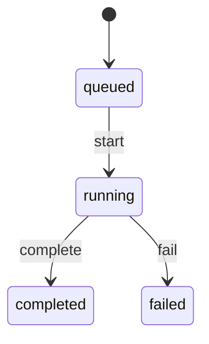

<!-- GENERATED by `npm run gen` from docs/api/modules/search.md. Do not edit: change the spec and regenerate. -->

# Search (`search`)

Finding products: a product index built from catalog, offers, inventory and reviews events; search with misspelling tolerance and corrections, suggestions (queries, categories, brands, stores, products, recent searches), universal and category filters with counts, sorting, sponsored slots from advertising, and guidance for empty or unavailable results.

- **Group:** Catalog and stock · **Launch phase:** 1 · **Plan chapters:** 4, 3, 19
- **Depends on:** [catalog](../catalog/README.md), [offers](../offers/README.md) · **Optional:** [inventory](../inventory/README.md), [reviews](../reviews/README.md), [sellers](../sellers/README.md), [advertising](../advertising/README.md), [promotions](../promotions/README.md), [customers](../customers/README.md), [media](../media/README.md), [reports](../reports/README.md), [wishlist](../wishlist/README.md), [orders](../orders/README.md), [returns](../returns/README.md)

## Owns
- Product search index (Postgres full-text + trigram first; external engine adapter later)
- Search and category listings with universal filters (category, price, brand, rating, seller, condition, availability, delivery) and category attribute filters
- Facets with counts, applied-filter chips with individual removal and clear all
- Sorting: recommended (published ranking policy), price ascending/descending, newest, highest rated; best selling once sales history exists
- Suggestions: queries, categories, brands, seller stores (leading to the store page), products
- Misspelling tolerance and 'Showing results for … / Search instead for …'
- Store match card (sellers are not mixed into product results)
- Empty-result guidance: remove one filter (with counts), nearby categories, tips, popular products
- Recently searched (per customer or guest session) with removal and clear all
- Search synonyms, reindexing, zero-result query reporting, ranking policy

**Not here:**
- Which ads appear and where: advertising (search asks for sponsored slots and marks them)
- Product content and category tree: catalog
- Prices, featured offer and delivery estimates: offers (search indexes them)
- Homepage sections and curated collections: content (uses search for product cards and listings)
- Recently viewed products: customers; back-in-stock alerts: wishlist
- Personalized recommendations and visual search: later projects (plan ch. 4)

## Store API

| Method | Path | Purpose | Auth | Body → Response |
|---|---|---|---|---|
| GET | `/api/store/search/products` | Search results or category listing (product cards with sponsored slots marked) | visitor | Page<SearchHit> |
| GET | `/api/store/search/facets` | Everything around the results for the same query: total, correction, applied filters, facets with counts, sorts, store match, category context, empty guidance | visitor | `SearchContext` |
| GET | `/api/store/search/suggestions` | Suggestions while typing: queries, categories, brands, stores, products and recent searches | visitor | `Suggestions` |
| GET | `/api/store/search/recent-searches` | Recent searches for this customer or guest session (max 10) | shopper | `RecentSearch[]` |
| DELETE | `/api/store/search/recent-searches/{id}` | Remove one recent search | shopper | 204 No content |
| DELETE | `/api/store/search/recent-searches` | Clear all recent searches | shopper | 204 No content |
| GET | `/api/store/search/products/{productId}/similar` | Similar in-stock products (unavailable product alternatives and related products) | visitor | `ProductCard[]` |
| GET | `/api/store/search/cards` | Product cards for a list of product ids (home sections, recently viewed) | visitor | `ProductCard[]` |
| POST | `/api/store/search/searches/{searchId}/clicks` | Record which result was opened (relevance and reports) | visitor | `{ productId: uuid, position: int, sponsored: bool }` → 204 No content |
| GET | `/api/store/search/barcodes/{code}` | Resolve a scanned GTIN/UPC/EAN to a listed product and variant | visitor | `BarcodeMatch` |
| GET | `/api/store/search/ranking-policy` | Published 'How results are ranked' | visitor | `RankingPolicy` |

## Seller API

| Method | Path | Purpose | Auth | Body → Response |
|---|---|---|---|---|
| GET | `/api/seller/search/quick` | Seller Center top-bar search across own orders, offers/SKUs and returns | seller | `LookupResult` |

## Admin API

| Method | Path | Purpose | Auth | Body → Response |
|---|---|---|---|---|
| GET | `/api/admin/search/lookup` | Back-office top-bar quick search across orders, sellers, products and customers | staff | `LookupResult` |
| GET | `/api/admin/search/synonyms` | Search synonyms | staff<br>`search.synonyms.manage` | Page<Synonym> |
| POST | `/api/admin/search/synonyms` | Add a synonym set (takes effect on the next query; no reindex needed) _(audited)_ | staff<br>`search.synonyms.manage` | `SynonymInput` → `Synonym` |
| PATCH | `/api/admin/search/synonyms/{id}` | Edit or deactivate a synonym set _(audited)_ | staff<br>`search.synonyms.manage` | `SynonymInput` → `Synonym` |
| DELETE | `/api/admin/search/synonyms/{id}` | Delete a synonym set _(audited)_ | staff<br>`search.synonyms.manage` | 204 No content |
| GET | `/api/admin/search/index` | Index size, staleness and lag behind events | staff<br>`search.index.manage` | `IndexStatus` |
| POST | `/api/admin/search/reindex-jobs` | Reindex everything or a scope (products, category, brand, seller) _(audited)_ | staff<br>`search.index.manage` | `{ scope: enum(all|products|category|brand|seller), ids: uuid[]?, reason: text }` → `ReindexJob` |
| GET | `/api/admin/search/reindex-jobs/{id}` | Reindex progress | staff<br>`search.index.manage` | `ReindexJob` |
| GET | `/api/admin/search/zero-result-queries` | Searches that found nothing (unavailable searches), most frequent first | staff<br>`search.analytics.view` | Page<ZeroResultQuery> |
| GET | `/api/admin/search/explain` | Why results rank as they do for a query (scores, factors, synonyms, correction) | staff<br>`search.analytics.view` | `SearchExplain[]` |
| POST | `/api/admin/search/ranking-policies` | Publish a new ranking policy version (wording and recommended-sort weights) _(audited)_ | staff<br>`search.ranking.manage` | `RankingPolicyInput` → `RankingPolicy` |

## Types

### ProductCard

| Field | Type |
|---|---|
| productId | `uuid` |
| slug | `string` |
| title | `string` |
| brandName | `string?` |
| image | `MediaRef?` |
| variantId | `uuid?` Variant matched by the filters (e.g. color), else the featured variant |
| variantCue | `string?` e.g. '3 colors' or 'Midnight black' |
| rating | `number?` Null when there are no reviews (never shown as 0 stars) |
| ratingCount | `int` |
| price | `Money` Featured offer's price, or the lowest eligible offer when priceIsFrom |
| priceIsFrom | `bool` 'from' price belongs to one named eligible offer (offerId, sellerName) |
| offerId | `uuid?` |
| sellerName | `string` |
| sellerId | `uuid?` |
| official | `bool` |
| condition | `string` |
| wasPrice | `Money?` |
| discountPct | `int?` |
| dealEndsAt | `datetime?` |
| deliveryCue | `string?` e.g. 'Free delivery Fri, Oct 16' for the default or given postal code |
| freeDelivery | `bool` |
| availability | `enum(in_stock|low_stock|out_of_stock)` |
| offerCount | `int` |
| badges | `string[]` e.g. 'Official Store', 'Deal', 'New listing' |

### SponsoredMark

| Field | Type |
|---|---|
| label | `string` Always visible: 'Sponsored' |
| advertiserName | `string` |
| impressionToken | `string` From advertising; send with impressions and clicks |
| whyUrl | `string?` 'Why these ads?' help article |

### SearchHit

| Field | Type |
|---|---|
| position | `int` |
| kind | `enum(organic|sponsored)` |
| slot | `enum(top_row|inline)?` Sponsored only: a separate labelled row above results (search) or inline grid positions (category). Positions come from advertising. |
| product | `ProductCard` |
| sponsored | `SponsoredMark?` |

### QueryInfo

| Field | Type |
|---|---|
| raw | `string?` |
| normalized | `string?` |
| correctedTo | `string?` 'Showing results for wireless headphones' |
| correctionApplied | `bool` |
| searchInsteadFor | `string?` Original query, to run exactly with exact=true |

### AppliedFilter

| Field | Type |
|---|---|
| key | `string` |
| value | `string` |
| label | `string` e.g. 'Price: $50 to $250', '4 stars and up' |
| removeQuery | `string` Query string for the same search without this filter |

### FacetValue

| Field | Type |
|---|---|
| value | `string` |
| label | `string` |
| count | `int` Results if this value is added to the current filters |
| selected | `bool` |
| note | `string?` e.g. 'Shows company offers at the prices listed' for Official Store |

### PriceRange

| Field | Type |
|---|---|
| min | `Money?` |
| max | `Money?` |
| selectedMin | `Money?` |
| selectedMax | `Money?` |

### Facet

| Field | Type |
|---|---|
| key | `string` Query parameter name, or the attribute key for category facets |
| label | `string` |
| group | `enum(universal|category)` category = attribute filters of the current category, e.g. 'Headphone features' |
| groupLabel | `string?` |
| kind | `enum(category|price|brand|rating|seller|condition|availability|delivery|attribute)` |
| multiSelect | `bool` |
| values | `FacetValue[]` |
| range | `PriceRange?` |
| unit | `string?` |
| moreCount | `int?` 'Show 7 more brands' |
| collapsed | `bool` |

### SortOption

| Field | Type |
|---|---|
| key | `enum(recommended|price_asc|price_desc|newest|rating|best_selling)` |
| label | `string` |
| available | `bool` best_selling stays unavailable until enough sales history exists |
| selected | `bool` |

### StoreMatch

| Field | Type |
|---|---|
| sellerId | `uuid` |
| name | `string` |
| slug | `string` |
| logo | `MediaRef?` |
| verified | `bool` |
| official | `bool` |
| positivePct | `int?` |
| ratingCount | `int?` |
| productCount | `int` |
| location | `string?` |
| note | `string` 'Stores are listed here, not mixed into product results.' |

### CategoryCrumb

| Field | Type |
|---|---|
| id | `uuid` |
| name | `string` |
| slug | `string` |

### CategoryCount

| Field | Type |
|---|---|
| id | `uuid` |
| name | `string` |
| slug | `string` |
| count | `int` |
| comingSoon | `bool` |

### CategoryContext

| Field | Type |
|---|---|
| category | `CategoryCrumb` |
| breadcrumb | `CategoryCrumb[]` |
| subcategories | `CategoryCount[]` |
| sellerCount | `int` |

### RemovableFilter

| Field | Type |
|---|---|
| filter | `AppliedFilter` |
| resultCount | `int` |

### EmptyGuidance

| Field | Type |
|---|---|
| title | `string` e.g. 'Nothing matches all your filters' |
| message | `text` |
| removableFilters | `RemovableFilter[]` Each single filter to remove with the result count it gives |
| clearAllCount | `int?` |
| nearbyCategories | `CategoryCount[]` |
| tips | `string[]` |
| popular | `ProductCard[]` Popular in-stock products in the closest category |

### SearchContext

| Field | Type |
|---|---|
| searchId | `string` Identifies this result set for click logging and returning to results |
| query | `QueryInfo` |
| total | `int` |
| totalLabel | `string` e.g. '128 results from 9 sellers, including the Official Store' |
| appliedFilters | `AppliedFilter[]` |
| clearAllQuery | `string` |
| facets | `Facet[]` |
| sorts | `SortOption[]` |
| storeMatch | `StoreMatch?` |
| category | `CategoryContext?` |
| emptyGuidance | `EmptyGuidance?` |
| fromPriceNote | `string` Explains 'from' prices |
| rankingNote | `string` 'Sponsored items are paid placements and are labeled.' with a link to the ranking policy |

### QuerySuggestion

| Field | Type |
|---|---|
| text | `string` |
| matchedPrefix | `string` |
| categoryScope | `CategoryCrumb?` |

### BrandSuggestion

| Field | Type |
|---|---|
| brandId | `uuid` |
| name | `string` |
| slug | `string` |
| logo | `MediaRef?` |
| productCount | `int` |

### StoreSuggestion

| Field | Type |
|---|---|
| sellerId | `uuid` |
| name | `string` |
| slug | `string` |
| logo | `MediaRef?` |
| verified | `bool` |
| productCount | `int` |
| summary | `string` e.g. 'Seller store · 86 products in audio' |

### ProductSuggestion

| Field | Type |
|---|---|
| productId | `uuid` |
| slug | `string` |
| title | `string` |
| image | `MediaRef?` |
| fromPrice | `Money?` |
| sellerName | `string?` |

### RecentSearch

| Field | Type |
|---|---|
| id | `uuid` |
| query | `string` |
| filtersLabel | `string?` |
| searchedAt | `datetime` |

### Suggestions

| Field | Type |
|---|---|
| query | `string` |
| queries | `QuerySuggestion[]` |
| categories | `QuerySuggestion[]` |
| brands | `BrandSuggestion[]` |
| stores | `StoreSuggestion[]` |
| products | `ProductSuggestion[]` |
| recent | `RecentSearch[]` Only when a customer or guest session is present and recent searches are on |

### RankingFactor

| Field | Type |
|---|---|
| key | `string` |
| label | `string` |
| weight | `number` |

### RankingPolicy

| Field | Type |
|---|---|
| version | `int` |
| text | `text` Published 'How results are ranked' wording |
| factors | `RankingFactor[]` |
| effectiveFrom | `datetime` |
| publishedBy | `Actor` |

### RankingPolicyInput

| Field | Type |
|---|---|
| text | `text` |
| factors | `RankingFactor[]` |
| effectiveFrom | `datetime` |
| reason | `text` |

### Synonym

| Field | Type |
|---|---|
| id | `uuid` |
| terms | `string[]` e.g. ['earbuds', 'earphones', 'in-ear headphones'] |
| kind | `enum(equivalent|one_way)` |
| from | `string?` one_way: the term that expands to terms |
| active | `bool` |
| note | `text?` |
| updatedBy | `Actor` |
| updatedAt | `datetime` |

### SynonymInput

| Field | Type |
|---|---|
| terms | `string[]` |
| kind | `enum(equivalent|one_way)` |
| from | `string?` |
| active | `bool?` |
| note | `text?` |

### ReindexJob

| Field | Type |
|---|---|
| id | `uuid` |
| scope | `enum(all|products|category|brand|seller)` |
| ids | `uuid[]` |
| state | `enum(queued|running|completed|failed)` |
| total | `int` |
| processed | `int` |
| requestedBy | `Actor` |
| reason | `text` |
| startedAt | `datetime?` |
| finishedAt | `datetime?` |
| error | `string?` |

### IndexStatus

| Field | Type |
|---|---|
| engine | `string` e.g. 'postgres-fts' |
| documents | `int` |
| offerRows | `int` |
| staleDocuments | `int` |
| lagSeconds | `int` |
| lastEventAt | `datetime?` |
| lastFullReindexAt | `datetime?` |
| runningJob | `ReindexJob?` |

### ZeroResultQuery

| Field | Type |
|---|---|
| query | `string` |
| normalized | `string` |
| count | `int` |
| lastAt | `datetime` |
| lastFilters | `string?` |
| correctionOffered | `bool` |

### SearchExplain

| Field | Type |
|---|---|
| productId | `uuid` |
| title | `string` |
| position | `int` |
| score | `number` |
| factors | `map<number>` |
| matchedTerms | `string[]` |
| synonymsUsed | `string[]` |
| correctedFrom | `string?` |

### BestSellerRank

| Field | Type |
|---|---|
| rank | `int` |
| categoryId | `uuid` |
| categoryName | `string` |
| label | `string` e.g. #3 in Headphones |
| updatedAt | `datetime` |

### BarcodeMatch

| Field | Type |
|---|---|
| code | `string` Normalized GTIN (UPC-A, EAN-13, GTIN-14; check digit verified) |
| match | `bool` |
| productId | `uuid?` |
| variantId | `uuid?` The variant carrying this GTIN, so the product page opens on it |
| slug | `string?` |
| title | `string?` |
| card | `ProductCard?` |
| fallbackQuery | `string?` When nothing is listed with this code: the code itself, so the app can open search results with the empty guidance |

### LookupHit

| Field | Type |
|---|---|
| kind | `enum(order|seller|product|customer|offer|return)` |
| id | `uuid` |
| ref | `string?` Order or return reference, seller SKU |
| title | `string` Order ref + customer, seller name, product title, customer name |
| subtitle | `string?` Status label, email (masked unless the caller may see contact details), SKU |
| statusLabel | `string?` |
| screen | `string` Screen id to open, e.g. admin/order, admin/seller, admin/product-review, admin/customer, seller/order, seller/offer, seller/return |

### LookupGroup

| Field | Type |
|---|---|
| kind | `enum(orders|sellers|products|customers|offers|returns)` |
| label | `string` |
| items | `LookupHit[]` |
| more | `bool` More matches exist; 'See all' opens the module's list with q |

### LookupResult

| Field | Type |
|---|---|
| query | `string` |
| groups | `LookupGroup[]` Only groups the caller may see and whose module is enabled; empty groups are left out |

## Status flows

### Reindex job (`ReindexJob.state`)



One full reindex at a time (REINDEX_ALREADY_RUNNING). Scoped jobs only mark documents dirty. The live index keeps serving during a full rebuild (new rows swap in per product).

## Data (schema `search`)

**search_documents**: One row per purchasable product: denormalized from catalog, offers, inventory, reviews and promotions events

| Column | Type |
|---|---|
| product_id | uuid pk |
| slug | text |
| title | text |
| brand_id | uuid? |
| brand_name | text? |
| category_id | uuid? |
| category_path_ids | uuid[] |
| attributes | jsonb (filterable attribute key → values) |
| variant_count | int |
| variant_options | jsonb |
| image | jsonb? |
| seller_ids | uuid[] |
| has_official | bool |
| conditions | text[] |
| offer_count | int |
| featured_offer_id | uuid? |
| featured_price | bigint? |
| featured_seller_name | text? |
| featured_official | bool |
| min_price | bigint? |
| max_price | bigint? |
| currency | char(3) |
| was_price | bigint? |
| deal_ends_at | timestamptz? |
| on_sale | bool (an active campaign price from promotions or a verified compare-at on the featured offer) |
| gtins | text[] (variant GTINs from catalog, normalized) |
| variant_gtins | jsonb (GTIN → variantId) |
| badges | jsonb |
| in_stock | bool |
| low_stock | bool |
| free_delivery | bool |
| fastest_dispatch_days | int? |
| same_day_cutoff | time? |
| rating | numeric(2,1)? |
| rating_count | int |
| sales_30d | int |
| first_listed_at | timestamptz |
| popularity | numeric |
| tsv | tsvector (title A, brand A, category B, attributes C, description D) |
| title_norm | text (for trigram) |
| version | bigint |
| indexed_at | timestamptz |
| best_seller_rank | int? (rank in best_seller_category_id by sales_30d; null outside the top 100) |
| best_seller_category_id | uuid? |

Indexes: `gin(tsv)`, `gin(title_norm gin_trgm_ops)`, `gin(seller_ids)`, `gin(category_path_ids)`, `gin(attributes jsonb_path_ops)`, `(in_stock, featured_price)`, `(first_listed_at)`, `(rating, rating_count)`

**search_offers**: Offer-level rows so seller, condition and price filters show the matching seller's price (e.g. Official Store filter shows company offers)

| Column | Type |
|---|---|
| offer_id | uuid pk |
| product_id | uuid → search_documents |
| variant_id | uuid |
| seller_id | uuid? |
| official | bool |
| condition | text |
| price | bigint |
| in_stock | bool |
| free_delivery | bool |
| dispatch_days | int |
| featured_eligible | bool |

Indexes: `(product_id)`, `(seller_id, price)`, `(condition, price)`

**suggestion_terms**: Popular queries, category, brand, store and product names for suggestions and spelling correction

| Column | Type |
|---|---|
| id | uuid pk |
| term | text |
| kind | text (query|category|brand|store|product) |
| target_id | uuid? |
| weight | numeric |
| updated_at | timestamptz |

Indexes: `gin(term gin_trgm_ops)`, `(kind, weight desc)`

**synonyms**

| Column | Type |
|---|---|
| id | uuid pk |
| terms | text[] |
| kind | text |
| from_term | text? |
| active | bool |
| note | text? |
| updated_by | text |
| updated_at | timestamptz |

**recent_searches**

| Column | Type |
|---|---|
| id | uuid pk |
| owner_kind | text (customer|guest) |
| owner_id | text |
| query | text |
| filters | jsonb |
| searched_at | timestamptz |

Indexes: `(owner_kind, owner_id, searched_at desc)`

**query_log**: Every search (partitioned by month); feeds zero-result reports, suggestions and ranking

| Column | Type |
|---|---|
| id | uuid pk |
| search_id | text |
| raw | text? |
| normalized | text? |
| filters | jsonb |
| sort | text |
| results | int |
| corrected_to | text? |
| session_key | text? |
| at | timestamptz |

Indexes: `(normalized, at)`, `(results, at) where results = 0`

**click_log**

| Column | Type |
|---|---|
| search_id | text |
| product_id | uuid |
| position | int |
| sponsored | bool |
| at | timestamptz |

Indexes: `(search_id)`, `(product_id, at)`

**dirty_documents**: Products waiting to be reindexed

| Column | Type |
|---|---|
| product_id | uuid pk |
| reason | text |
| queued_at | timestamptz |

**reindex_jobs**

| Column | Type |
|---|---|
| id | uuid pk |
| scope | text |
| ids | uuid[] |
| state | text |
| total | int |
| processed | int |
| requested_by | text |
| reason | text |
| started_at | timestamptz? |
| finished_at | timestamptz? |
| error | text? |

**ranking_policies**

| Column | Type |
|---|---|
| version | int pk |
| text | text |
| factors | jsonb |
| effective_from | timestamptz |
| reason | text |
| published_by | text |
| published_at | timestamptz |

## Events

| Publishes | When | Payload | Consumed by |
|---|---|---|---|
| `search.synonym.changed` | A synonym set is created, edited or deleted | `{ synonymId: uuid, action: enum(created|updated|deleted) }` | - |
| `search.index.rebuilt` | A reindex job completes | `{ jobId: uuid, scope: string, documents: int }` | - |
| `search.ranking_policy.published` | A ranking policy version is published | `{ version: int, effectiveFrom: datetime }` | - |

| Consumes | From | Does |
|---|---|---|
| `catalog.product.approved` | catalog | Index the product (it appears once it has an eligible offer) |
| `catalog.product.publication_changed` | catalog | Remove Hidden or Suspended products; re-add on Active |
| `catalog.product.updated` | catalog | Reindex title, brand, category, attributes and images |
| `catalog.product.merged` | catalog | Drop the duplicate; reindex the kept product |
| `offers.offer.created` | offers | Mark the product dirty |
| `offers.offer.price_changed` | offers | Update offer row and the product's from/featured price |
| `offers.offer.status_changed` | offers | Update offer row; drop the product from in-stock results when it has no active offer |
| `offers.featured.changed` | offers | Update featured offer, price and seller on the card |
| `inventory.stock.changed` | inventory | Update in-stock and low-stock flags |
| `reviews.review.published` | reviews | Update rating and rating count |
| `sellers.seller.approved` | sellers | Add the store to store suggestions |
| `sellers.seller.restricted` | sellers | Refresh the seller's offers and store suggestion |
| `sellers.seller.suspended` | sellers | Remove the store from suggestions; offers update through offers events |
| `sellers.seller.reinstated` | sellers | Restore the store suggestion |
| `sellers.seller.closed` | sellers | Remove the store from suggestions |
| `promotions.campaign.started` | promotions | Update deal badges, was prices and deal end times on cards |
| `promotions.campaign.ended` | promotions | Remove deal badges |
| `orders.order.placed` | orders | Count units for best-selling sort and popularity (phase 2 sort) |
| `identity.guest_session.claimed` | identity | Merge the guest session's recent searches into the account (identity calls nothing in search) |
| `catalog.brand.changed` | catalog | Reindex the brand name, slug and status on the brand's product documents and brand suggestions; only active brands are suggested or offered as a facet |
| `customers.marketing_preferences.changed` | customers | recentSearches false: delete the customer's saved recent searches and stop saving new ones; true: start saving again (nothing is restored) |

## In-process API (for other modules)

| Function | Signature | Used by |
|---|---|---|
| searchProducts | `(query: SearchQuery) => { items: ProductCard[], total: int, nextCursor: string|null }`<br>Same engine as the store endpoint, without sponsored slots. Used for collections (new arrivals, best sellers, category picks). | content, promotions |
| getProductCards | `(productIds: uuid[], opts?: { postalCode?: string, sellerId?: uuid }) => ProductCard[]`<br>Cards for any product list (home sections, recently viewed, related products), same shape everywhere | content, wishlist, reviews, advertising |
| zeroResultStats | `(from: date, to: date) => ZeroResultQuery[]`<br>Unavailable searches for the products and discovery report | reports |
| runSearch | `(query: SearchQuery & { exact?: bool, postalCode?: string, searchId?: string }, page: PageInput) => { context: SearchContext, items: { productId: uuid, match: SearchMatch }[], sponsoredSlots: SponsoredSlot[], page: PageInfo }`<br>Store search with spelling correction, facets, store match, empty guidance and sponsored placeholders (ads are filled by advertising) | graphql |
| listCategoryProducts | `(slug: string, query: SearchQuery & { postalCode?: string, searchId?: string }, page: PageInput) => { context: SearchContext, items: { productId: uuid, match: SearchMatch }[], sponsoredSlots: SponsoredSlot[], page: PageInfo } | null`<br>Category page listing with category attribute facets and category context | graphql |
| getSuggestions | `(prefix: string, session?: { customerId?: uuid, guestSessionId?: string }) => Suggestions`<br>Suggestions while typing: queries, categories, brands, stores, products and recent searches | graphql |
| similarProducts | `(productIds: uuid[], limit: int) => map<uuid[]>`<br>Similar in-stock products per product (related products, alternatives for unavailable products) | graphql |
| listSellerProducts | `(sellerId: uuid, query: SearchQuery & { postalCode?: string, searchId?: string }, page: PageInput) => { context: SearchContext, items: { productId: uuid, match: SearchMatch }[], sponsoredSlots: SponsoredSlot[], page: PageInfo }`<br>Storefront product grid: products with a live offer from this seller, with the same filters, facets and sorts as search (query.filters.sellerIds is replaced by the seller). Each result's match.offer is this seller's offer. No store match and no sponsored slots. | graphql |
| sellerCategoryCounts | `(sellerIds: uuid[]) => map<{ categoryId: uuid, name: string, slug: string, count: int, comingSoon: bool }[]>`<br>Storefront category chips: categories in which the seller has live offers, with product counts from the search index (the REST storefront's categories) | sellers, graphql |
| bestSellerRanks | `(productIds: uuid[]) => map<{ rank: int, categoryId: uuid, categoryName: string, label: string, updatedAt: datetime } | null>`<br>Best-seller rank of products in their category by 30-day units sold; null when not ranked (outside the top 100 or below bestSellingMinOrders) | graphql, content |

## Permissions

| Key | Who | Allows |
|---|---|---|
| `search.synonyms.manage` | staff | Create, edit and delete search synonyms |
| `search.index.manage` | staff | View index status and start reindex jobs |
| `search.analytics.view` | staff | Zero-result queries and ranking explanations |
| `search.ranking.manage` | staff | Publish the ranking policy and recommended-sort weights |

## Error codes

| Code | Status | Meaning |
|---|---|---|
| `INVALID_FILTER` | 400 | Unknown filter key or value for this category. details.filter |
| `SORT_NOT_AVAILABLE` | 409 | best_selling is not offered until there is enough sales history |
| `REINDEX_ALREADY_RUNNING` | 409 | A full reindex is already running. details.jobId |
| `SYNONYM_CONFLICT` | 409 | A term is already in another active equivalent set. details.synonymId |

## Background jobs

| Job | Schedule | Does |
|---|---|---|
| `search.process-dirty` | every 30 s | Rebuild documents in dirty_documents from catalog, offers, inventory, reviews and promotions public APIs |
| `search.refresh-delivery-flags` | every 15 min | Recompute 'Ships today' and arrives-by flags as dispatch cutoffs pass |
| `search.refresh-suggestions` | hourly | Rebuild suggestion_terms from popular queries (with results), categories, brands, stores and product names |
| `search.full-reindex` | nightly 03:00 market time | Full rebuild (catches category tree changes, which catalog does not publish as events) |
| `search.sales-counts` | nightly 03:30 market time | 30-day units sold per product for best-selling sort and popularity; enables best_selling once bestSellingMinOrders is reached; ranks the top 100 products per leaf category (best_seller_rank, shown as #3 in Headphones) |
| `search.prune-logs` | daily 04:00 market time | Delete recent searches older than the retention period and query/click logs older than 13 months |

## Settings

| Key | Default | Rules | Meaning |
|---|---|---|---|
| pageSize | `24` | int, 1–100 | Default results per page |
| typoSimilarityThreshold | `0.35` | number, 0–1 | Trigram similarity for misspelling tolerance |
| autoCorrectBelowResults | `3` | int, 0–… | Apply a confident correction when the original query has fewer results |
| recentSearchesMax | `10` | int, 0–… | Recent searches kept per customer or guest |
| recentSearchRetentionDays | `90` | duration, days, 1–… | Recent searches older than this are deleted |
| newArrivalsWindowDays | `30` | duration, days, 1–… | 'New arrivals' = first listed within this window |
| bestSellingMinOrders | `500` | int, 0–… | Platform orders in 30 days before best-selling sort is offered |
| excludeOutOfStockByDefault | `true` | bool | Out-of-stock products appear only with 'Include out of stock' |
| searchEngine | `"postgres"` | enum (postgres \| external), approval: second reviewer | postgres | external (adapter added later) |

## Integrations
- **PostgreSQL full-text search and pg_trgm**: Ranking, misspelling tolerance and suggestions at launch
- **External search engine (later)**: OpenSearch or Meilisearch adapter behind the same API when volume needs it

## Notes
- Quick lookups (seller and admin top bars, GET /quick and GET /lookup) are federated, not indexed: search calls each enabled module's list function with q and a small limit, filters groups by the caller's permissions and links each hit to its screen. A disabled module's group simply disappears. Product hits in the admin lookup also match GTINs and come from search_documents (listed products); unlisted drafts are found through offers SKUs.
- Barcode scanning: GTINs are copied from catalog variants into search_documents.gtins (normalized, check digit verified) on catalog.product.approved / updated; GET /barcodes/{code} and a q that is a full GTIN resolve through them. Codes that match nothing are recorded as unavailable searches.
- onSale: search_documents.on_sale is set from promotions.campaign.started / ended (active campaign price) and from a verified compare-at on the featured offer (offers.offer.price_changed); the category deals teaser is GET /products?category=…&onSale=true.
- Recommended sort (published ranking policy v1): text relevance, then in-stock and featured-offer eligibility, delivery speed to the location, rating with enough reviews, and recent conversion. Sponsored placement never changes organic rank; sponsored hits are separate, labelled and come from advertising.
- 'From' prices always belong to one eligible offer named on the card (plan ch. 4). With a seller filter (e.g. Official Store) the card shows that seller's offer at the price listed.
- Seller names in queries produce a store match card and store suggestions leading to the store page; seller records are never mixed into product results.
- Universal filters always appear; category filters come from catalog attributes marked filterable for the current category (e.g. screen size, capacity, size). Facet counts are computed against the other active filters so each value shows what selecting it would give.
- Empty results: EmptyGuidance lists each applied filter with the result count after removing it, nearby categories, tips and popular products. Product-level unavailability (out of stock, discontinued) is explained by the offers purchase box (store endpoint getPurchaseBox) and catalog; search supplies similar in-stock products.
- Returning to previous results: the query string is the state; searchId plus page/cursor restores the same page after viewing a product.
- Recent searches are stored per customer or guest session and merged on sign-in when search consumes identity.guest_session.claimed. For a customer they are saved to the account only while customers.MarketingPreferences.recentSearches is on (customers.getMarketingConsent at save time). Turning it off deletes the saved history: customers publishes customers.marketing_preferences.changed and search deletes the rows. With customers disabled, nothing is saved to accounts.
- Reports read unavailable searches through zeroResultStats; query logs are not exported directly.
- Optional dependencies: inventory (stock flags), reviews (ratings), sellers (store suggestions), advertising (sponsored slots), promotions (deal badges), customers (recent-search preference). With any of them off, the related fields are simply empty.

## GraphQL (read layer)

This module's fragment of the GraphQL schemas (see [../graphql/README.md](../graphql/README.md)). Writes stay on the REST endpoints above.

```graphql
# search: finding products. Query search (search results) and categoryProducts (category page).
# Results are Product, so fields other modules add (featuredOffer, priceRange, offerCount, reviewSummary, …)
# are selectable on each result. Search adds Product.searchMatch (what the filters matched) and Product.related,
# and the storefront product grid and category chips: Seller.products, Seller.categories (store).
# Sponsored products are not resolved here: results carry placeholders that the client fills from
# REST POST /api/store/advertising/decisions. Sponsored placement never changes organic rank.

"""
One page of search or category results with everything around them: spelling correction, applied filters,
facets with counts, sorts, store match, category context, empty-result guidance and sponsored placeholders.
"""
type SearchResults implements Paged @areas(in: [STORE]) {
  "Identifies this result set for click logging and returning to the same page"
  searchId: String!
  query: SearchQueryInfo!
  "Organic results in ranked order"
  items: [Product!]!
  nextCursor: String
  page: Int
  totalPages: Int
  total: Int
  "e.g. '128 results from 9 sellers, including the Official Store'"
  totalLabel: String!
  appliedFilters: [SearchAppliedFilter!]!
  "Query string for the same search without filters"
  clearAllQuery: String!
  "Universal facets first, then the current category's attribute facets. Counts are computed against the other active filters."
  facets: [SearchFacet!]! @cost(weight: 5)
  sorts: [SearchSortOption!]!
  "A seller whose name matches the query, shown as a separate store card (never mixed into results)"
  storeMatch: SearchStoreMatch
  "Category page header data: breadcrumb, subcategories with counts, seller count"
  category: SearchCategoryContext
  "Set when there are no results"
  emptyGuidance: SearchEmptyGuidance
  "Where sponsored products and banners go; the client asks advertising for them"
  sponsoredSlots: [SearchSponsoredSlot!]!
  "Explains 'from' prices"
  fromPriceNote: String!
  "'Sponsored items are paid placements and are labeled.' with the ranking policy link"
  rankingNote: String!
}

"What was searched and any spelling correction"
type SearchQueryInfo @areas(in: [STORE]) {
  raw: String
  normalized: String
  "'Showing results for wireless headphones'"
  correctedTo: String
  correctionApplied: Boolean!
  "Original query, to run exactly with exact: true ('Search instead for …')"
  searchInsteadFor: String
}

"Per-result context: the variant and offer the card should show for the active filters"
type SearchMatch @areas(in: [STORE]) {
  "1-based position among organic results"
  position: Int!
  "Variant matched by the filters (e.g. color), else the featured variant"
  variantId: UUID
  "e.g. '3 colors' or 'Midnight black'"
  variantCue: String
  """
  Offer whose price the card shows: the featured offer, the lowest eligible offer when priceIsFrom,
  or the filtered seller's offer under a seller filter (e.g. Official Store)
  """
  offer: Offer
  "'from' price; it belongs to the one named offer above"
  priceIsFrom: Boolean!
  "e.g. 'Official Store', 'Deal', 'New listing'"
  badges: [String!]!
}

type SearchAppliedFilter @areas(in: [STORE]) {
  key: String!
  value: String!
  "e.g. 'Price: $50 to $250', '4 stars and up'"
  label: String!
  "Query string for the same search without this filter"
  removeQuery: String!
}

"A filter group with its values and result counts"
type SearchFacet @areas(in: [STORE]) {
  "Query parameter name, or the attribute key for category facets"
  key: String!
  label: String!
  group: SearchFacetGroup!
  "e.g. 'Headphone features'"
  groupLabel: String
  kind: SearchFacetKind!
  multiSelect: Boolean!
  values: [SearchFacetValue!]!
  "Price facet only"
  range: SearchPriceRange
  unit: String
  "'Show 7 more brands'"
  moreCount: Int
  collapsed: Boolean!
}

enum SearchFacetGroup @areas(in: [STORE]) {
  "Always shown"
  UNIVERSAL
  "Attribute filters of the current category"
  CATEGORY
}

enum SearchFacetKind @areas(in: [STORE]) {
  CATEGORY
  PRICE
  BRAND
  RATING
  SELLER
  CONDITION
  AVAILABILITY
  DELIVERY
  ATTRIBUTE
}

type SearchFacetValue @areas(in: [STORE]) {
  value: String!
  label: String!
  "Results if this value is added to the current filters"
  count: Int!
  selected: Boolean!
  "e.g. 'Shows company offers at the prices listed' for Official Store"
  note: String
}

type SearchPriceRange @areas(in: [STORE]) {
  min: Money
  max: Money
  selectedMin: Money
  selectedMax: Money
}

type SearchSortOption @areas(in: [STORE]) {
  key: SearchSort!
  label: String!
  "best_selling stays unavailable until enough sales history exists"
  available: Boolean!
  selected: Boolean!
}

enum SearchSort @areas(in: [STORE]) {
  RECOMMENDED
  PRICE_ASC
  PRICE_DESC
  NEWEST
  RATING
  BEST_SELLING
}

"Seller store matching the query"
type SearchStoreMatch @areas(in: [STORE]) {
  sellerId: UUID!
  name: String!
  slug: String!
  logo: MediaRef
  verified: Boolean!
  official: Boolean!
  "Index copy of reviews' Seller.rating.positivePct (refreshed on reindex) so the store card needs no extra call; reviews owns the figure"
  positivePct: Int
  "Index copy of reviews' Seller.rating.count; reviews owns the figure"
  ratingCount: Int
  productCount: Int!
  location: String
  "'Stores are listed here, not mixed into product results.'"
  note: String!
}

type SearchCategoryContext @areas(in: [STORE]) {
  category: Category!
  "From the root, for breadcrumbs"
  breadcrumb: [Category!]!
  "Subcategory chips with result counts"
  subcategories: [SearchCategoryCount!]!
  sellerCount: Int!
}

type SearchCategoryCount @areas(in: [STORE]) {
  id: UUID!
  name: String!
  slug: String!
  count: Int!
  comingSoon: Boolean!
}

"Guidance when nothing matches: remove one filter (with the count it gives), nearby categories, tips, popular products"
type SearchEmptyGuidance @areas(in: [STORE]) {
  "e.g. 'Nothing matches all your filters'"
  title: String!
  message: String!
  removableFilters: [SearchRemovableFilter!]!
  clearAllCount: Int
  nearbyCategories: [SearchCategoryCount!]!
  tips: [String!]!
  "Popular in-stock products in the closest category"
  popular: [Product!]! @cost(weight: 10)
}

type SearchRemovableFilter @areas(in: [STORE]) {
  filter: SearchAppliedFilter!
  resultCount: Int!
}

"Placeholder for sponsored content. Advertising decides what fills it (REST decisions endpoint)."
type SearchSponsoredSlot @areas(in: [STORE]) {
  "Advertising placement key, e.g. 'search_top_row', 'category_inline', 'category_banner'"
  placement: String!
  kind: SearchSponsoredSlotKind!
  "Inline only: grid positions (1-based) where a labelled sponsored card may be inserted"
  positions: [Int!]!
  maxItems: Int!
}

enum SearchSponsoredSlotKind @areas(in: [STORE]) {
  "Separate labelled row above results (search)"
  TOP_ROW
  "Labelled cards between results (category)"
  INLINE
  "Labelled banner above the grid (category)"
  BANNER
}

"Filters, same meaning as the REST query parameters"
input SearchFilterInput @areas(in: [STORE]) {
  categoryIds: [UUID!]
  "Minor units"
  priceMin: Int
  "Minor units"
  priceMax: Int
  brandIds: [UUID!]
  sellerIds: [UUID!]
  "Official Store offers only"
  official: Boolean
  "1–5: 'N stars and up'"
  minRating: Int
  conditions: [OfferConditionFilter!]
  "Default true: in stock now"
  inStockOnly: Boolean
  freeDelivery: Boolean
  arrivesBy: Date
  shipsToday: Boolean
  "Only products with a deal price now (active campaign price or verified was-price); with categoryIds gives a category's deals teaser"
  onSale: Boolean
  "Category attribute filters, e.g. noise_cancelling = [active]"
  attributes: [SearchAttributeFilter!]
}

input SearchAttributeFilter @areas(in: [STORE]) {
  key: String!
  values: [String!]!
}

"Suggestions while typing"
type SearchSuggestion @areas(in: [STORE]) {
  query: String!
  queries: [SearchQuerySuggestion!]!
  "Query scoped to a category, e.g. 'wireless headphones in Electronics › Headphones'"
  categories: [SearchQuerySuggestion!]!
  brands: [SearchBrandSuggestion!]!
  "Seller stores; they lead to the store page, never into product results"
  stores: [SearchStoreSuggestion!]!
  products: [Product!]!
  "Only when a customer or guest session is present and recent searches are on"
  recent: [SearchRecent!]!
}

type SearchQuerySuggestion @areas(in: [STORE]) {
  text: String!
  matchedPrefix: String!
  categoryScope: Category
}

type SearchBrandSuggestion @areas(in: [STORE]) {
  brand: Brand!
  productCount: Int!
}

type SearchStoreSuggestion @areas(in: [STORE]) {
  sellerId: UUID!
  name: String!
  slug: String!
  logo: MediaRef
  verified: Boolean!
  productCount: Int!
  "e.g. 'Seller store · 86 products in audio'"
  summary: String!
}

type SearchRecent @areas(in: [STORE]) {
  id: UUID!
  query: String!
  filtersLabel: String
  searchedAt: DateTime!
}

# ------------------------------------------------------------------ extensions

"Best-seller rank of a product in its category by units sold in the last 30 days, e.g. #3 in Headphones"
type SearchBestSellerRank @areas(in: [STORE]) {
  "1 = best seller"
  rank: Int!
  categoryName: String!
  category: Category
  "e.g. #3 in Headphones"
  label: String!
  "When the 30-day sales counts were last refreshed"
  updatedAt: DateTime!
}

extend type Product {
  "Best-seller rank in the product's category. Null when the product is not ranked (outside the top 100 or too few orders in the category)."
  bestSellerRank: SearchBestSellerRank @areas(in: [STORE]) @source(module: "search", fn: "bestSellerRanks")

  "Set on products returned by search, categoryProducts and empty-result popular lists; null elsewhere"
  searchMatch: SearchMatch @areas(in: [STORE]) @source(module: "search", fn: "runSearch")

  "Similar in-stock products (related products, alternatives for an unavailable product)"
  related(limit: Int = 10): [Product!]! @areas(in: [STORE]) @source(module: "search", fn: "similarProducts") @cost(weight: 10)
}

extend type Seller {
  """
  Storefront product grid (SellerStorefront): products with a live offer from this seller, with the same filters,
  facets and sorts as search. filters.sellerIds is ignored (always this seller); each result's searchMatch.offer is
  this seller's offer. No storeMatch and no sponsored slots.
  """
  products(filters: SearchFilterInput, sort: SearchSort = RECOMMENDED, postalCode: String, searchId: String, paging: PageInput): SearchResults! @areas(in: [STORE]) @source(module: "search", fn: "listSellerProducts") @cost(weight: 20)

  "Storefront category chips: categories with this seller's live offers and product counts"
  categories: [SearchCategoryCount!]! @areas(in: [STORE]) @source(module: "search", fn: "sellerCategoryCounts") @cost(weight: 3)
}

extend type Query {
  """
  Search results. exact: true runs the original query without spelling correction ('Search instead for').
  postalCode sets delivery filters and cues (default: customer address, then market default).
  Pass searchId with paging to return to the same results after viewing a product.
  """
  search(query: String!, exact: Boolean = false, filters: SearchFilterInput, sort: SearchSort = RECOMMENDED, postalCode: String, searchId: String, paging: PageInput): SearchResults! @areas(in: [STORE]) @source(module: "search", fn: "runSearch") @cost(weight: 20)

  "Category page listing with the category's attribute facets"
  categoryProducts(slug: String!, filters: SearchFilterInput, sort: SearchSort = RECOMMENDED, postalCode: String, searchId: String, paging: PageInput): SearchResults! @areas(in: [STORE]) @source(module: "search", fn: "listCategoryProducts") @cost(weight: 20)

  "Suggestions while typing: queries, categories, brands, stores, products and recent searches"
  searchSuggestions(prefix: String!): SearchSuggestion! @areas(in: [STORE]) @source(module: "search", fn: "getSuggestions") @cost(weight: 5)
}
```
