<!-- GENERATED by `npm run gen` from docs/api/modules/sellers.md. Do not edit: change the spec and regenerate. -->

# Sellers (`sellers`)

Seller admission and the seller account: the Sell with us programme and multi-step application, verification checks and review decisions, seller statuses with account status, product approval and payout readiness kept separate, setup and launch readiness, storefront profile and public storefront, seller members and permissions, performance against targets, warnings, restrictions, suspensions and appeals.

- **Group:** Participants · **Launch phase:** 1 · **Plan chapters:** 2, 10, 11, 17, 18, 21
- **Depends on:** [identity](../identity/README.md), [access](../access/README.md), [media](../media/README.md) · **Optional:** [catalog](../catalog/README.md), [offers](../offers/README.md), [orders](../orders/README.md), [shipping](../shipping/README.md), [returns](../returns/README.md), [support](../support/README.md), [finance](../finance/README.md), [reviews](../reviews/README.md), [trust](../trust/README.md), [content](../content/README.md), [promotions](../promotions/README.md), [search](../search/README.md), [messaging](../messaging/README.md), [workqueues](../workqueues/README.md), [reports](../reports/README.md), [notifications](../notifications/README.md), [audit](../audit/README.md), [settings](../settings/README.md)
- **Required by:** [finance](../finance/README.md), [offers](../offers/README.md), [reviews](../reviews/README.md)

## Owns
- Sell with us programme information: requirements, eligible categories, example fees, payout timing, service targets and agreement versions
- Seller application draft with six steps (account, business, verification, payout, return address, agreement), documents and versioned agreement acceptance
- Verification checks (identity, business registration, tax id, payout account match, return address) and Trust and Risk referral
- Application review: assign, request information with a deadline, approve (optionally with conditions), reject with an explanation, reapply date and appeal
- Seller account status: Applied, Information required, Under review, Approved, Restricted, Suspended, Closed
- Verified seller label: what was checked, what was not, when it lapses
- Setup checklist after approval and the launch readiness review
- Storefront profile (name, logo, banner, introduction, location, contact options, warranty text, featured collections) and staff review of store name changes, public claims and brand affiliation
- Public storefront for customers
- Seller members, invitations, role templates and seller permissions (owner-only staff management and payout destination changes)
- Payout destination entry by the owner (tokenised with the payout provider) and its readiness mirror
- Business details and change requests for legal name and ownership
- Performance metrics against targets (dispatch reliability, cancellations, valid tracking, returns, response time, unresolved cases, policy violations), warnings
- Restrictions (reason, affected activity, scope, what still works, how to resolve, appeal route, review date), suspensions with a second reviewer, reinstatement, closure
- Appeals against restrictions, suspensions and application rejections, decided by someone other than the original decider

**Not here:**
- Sign-in, member accounts, invitation links and seller context switching: identity (sellers writes seller access through grantSellerContext / revokeSessions)
- Payout destination verification (micro-deposits, re-authentication, review), balances, holds and payouts: finance
- Return terms and the seller's return address after approval: returns (the application's return address is handed over on approval)
- Shipping coverage and rates: shipping. Product review: catalog. Offer eligibility: offers (reacts to restriction events)
- Seller support requests (seller/help, CS- references, SLAs): support
- Seller feedback ratings: reviews. Notification preferences per member: notifications
- Agreement texts and their versions: content policies (sellers stores which version was accepted)

## Store API

| Method | Path | Purpose | Auth | Body → Response |
|---|---|---|---|---|
| GET | `/api/store/sellers/program` | Sell with us: requirements, categories, example fees, payout timing, targets, steps | visitor | `SellerProgram` |
| POST | `/api/store/sellers/applications` | Start a seller application (step 1: seller account) | customer | `ApplicationAccountInput` → `SellerApplication` |
| GET | `/api/store/sellers/applications/current` | My application with progress, information requests, decision and timeline | customer | `SellerApplication` |
| PATCH | `/api/store/sellers/applications/{id}` | Save a step (draft saves at any time) | customer | `{ step: enum(account|business|verification|payout|return_address), account: ApplicationAccountInput?, business: ApplicationBusinessInput?, verification: ApplicationVerificationInput?, payout: PayoutDetailsInput?, returnAddress: ReturnAddressInput? }` → `SellerApplication` |
| POST | `/api/store/sellers/applications/{id}/documents` | Attach an uploaded document (ID, registration, W-9, bank letter, certificate) | customer | `{ mediaId: uuid, kind: enum(owner_id|business_registration|tax_form|bank_letter|proof_of_address|category_certificate|authorization_letter|other), ownerId: uuid?, infoRequestItemId: uuid? }` → `ApplicationDocument` |
| DELETE | `/api/store/sellers/applications/{id}/documents/{documentId}` | Remove a document from a draft or an open information request | customer | 204 No content |
| POST | `/api/store/sellers/applications/{id}/submit` | Accept the agreements and submit | customer | `{ acceptances: json[], signedName: string }` → `SellerApplication` |
| POST | `/api/store/sellers/applications/{id}/respond` | Send the requested information for review | customer | `{ items: json[] }` → `SellerApplication` |
| POST | `/api/store/sellers/applications/{id}/withdraw` | Withdraw an application | customer | `{ reason: text? }` → `SellerApplication` |
| POST | `/api/store/sellers/applications/{id}/appeal` | Appeal a rejection before the deadline | customer | `AppealInput` → `Appeal` |
| GET | `/api/store/sellers/stores/{slug}` | Public seller storefront | visitor | `Storefront` |
| GET | `/api/store/sellers/stores/{slug}/collections/{collectionId}` | One featured collection with its offer ids | visitor | `FeaturedCollection` |

## Seller API

| Method | Path | Purpose | Auth | Body → Response |
|---|---|---|---|---|
| GET | `/api/seller/sellers/account` | Account status, verification, product approval, payout readiness and active restrictions | seller | `SellerAccount` |
| GET | `/api/seller/sellers/setup` | Setup checklist and what will go live after the launch review | seller | `SetupChecklist` |
| POST | `/api/seller/sellers/setup/launch-review` | Ask the Seller Manager for the launch readiness review | seller<br>`sellers.account.manage` | `{ note: text? }` → `LaunchReview` |
| GET | `/api/seller/sellers/business` | Legal and contact details | seller<br>`sellers.account.manage` | `BusinessDetails` |
| PATCH | `/api/seller/sellers/business/contact` | Update contact person, email, phone and support hours _(audited)_ | seller<br>`sellers.account.manage` | `{ name: string?, email: email?, phone: string?, supportHours: string? }` → `BusinessDetails` |
| POST | `/api/seller/sellers/business/change-requests` | Request a change to legal name, ownership or business address _(audited, step-up: reauth)_ | seller<br>`sellers.business.change` | `{ kind: enum(legal_name|ownership|business_address), proposed: json, evidenceIds: uuid[], reauthToken: string }` → `ChangeRequest` |
| GET | `/api/seller/sellers/change-requests` | My pending and decided change requests (store name, claims, business) | seller | Page<ChangeRequest> |
| POST | `/api/seller/sellers/change-requests/{id}/withdraw` | Withdraw a pending change request | seller<br>`sellers.store.manage` | `ChangeRequest` |
| GET | `/api/seller/sellers/store-profile` | Storefront editor data with pending reviews and live preview data | seller | `StoreProfile` |
| PATCH | `/api/seller/sellers/store-profile` | Save storefront changes | seller<br>`sellers.store.manage` | `StoreProfileInput` → `StoreProfile` |
| POST | `/api/seller/sellers/store-profile/claims` | Submit a public claim or brand affiliation with evidence | seller<br>`sellers.store.manage` | `{ kind: enum(brand_affiliation|authorized_retailer|certification|award|other), text: string, brandId: uuid?, evidenceIds: uuid[] }` → `PublicClaim` |
| POST | `/api/seller/sellers/brand-requests` | Ask Marketly to add a brand that is not listed, with evidence | seller<br>`sellers.store.manage` | `{ brandName: string, website: url?, relationship: enum(brand_owner|authorized_reseller|retailer), categoryIds: uuid[]?, evidenceIds: uuid[] }` → `ChangeRequest` |
| POST | `/api/seller/sellers/store-profile/claims/{id}/withdraw` | Withdraw a pending or approved claim | seller<br>`sellers.store.manage` | `PublicClaim` |
| POST | `/api/seller/sellers/store-profile/collections` | Add a featured collection | seller<br>`sellers.store.manage` | `CollectionInput` → `FeaturedCollection` |
| PATCH | `/api/seller/sellers/store-profile/collections/{id}` | Edit a featured collection | seller<br>`sellers.store.manage` | `CollectionInput` → `FeaturedCollection` |
| DELETE | `/api/seller/sellers/store-profile/collections/{id}` | Remove a featured collection | seller<br>`sellers.store.manage` | 204 No content |
| PUT | `/api/seller/sellers/store-profile/collections/order` | Set collection order | seller<br>`sellers.store.manage` | `{ collectionIds: uuid[] }` → `FeaturedCollection[]` |
| GET | `/api/seller/sellers/members` | Owner and staff with roles, status and last activity | seller<br>`sellers.staff.manage` | `SellerMember[]` |
| GET | `/api/seller/sellers/roles` | Role templates and the seller permission catalogue (permission matrix) | seller | `{ roles: SellerRoleTemplate[], permissions: PermissionEntry[] }` |
| POST | `/api/seller/sellers/invitations` | Invite a staff member _(audited, phase 2)_ | seller<br>`sellers.staff.manage` | `InviteMemberInput` → `SellerMember` |
| POST | `/api/seller/sellers/invitations/{id}/resend` | Resend an invitation (new expiry) _(phase 2)_ | seller<br>`sellers.staff.manage` | `SellerMember` |
| POST | `/api/seller/sellers/invitations/{id}/revoke` | Cancel an invitation _(audited, phase 2)_ | seller<br>`sellers.staff.manage` | `SellerMember` |
| PATCH | `/api/seller/sellers/members/{id}` | Change a member's role or single permissions _(audited, phase 2)_ | seller<br>`sellers.staff.manage` | `{ role: enum(products_inventory|shipping|customer_service|custom)?, permissions: string[]? }` → `SellerMember` |
| POST | `/api/seller/sellers/members/{id}/suspend` | Temporarily block a member _(audited, phase 2)_ | seller<br>`sellers.staff.manage` | `{ reason: text? }` → `SellerMember` |
| POST | `/api/seller/sellers/members/{id}/remove` | Remove a member _(audited, phase 2)_ | seller<br>`sellers.staff.manage` | `{ reason: text? }` → `SellerMember` |
| GET | `/api/seller/sellers/performance` | Account health: metrics vs targets, warnings and actions | seller | `PerformanceSummary` |
| GET | `/api/seller/sellers/restrictions` | Active and past restrictions and suspensions | seller | Page<Restriction> |
| GET | `/api/seller/sellers/restrictions/{id}` | One restriction: reason, affected activity, what still works, how to resolve, appeal route | seller | `Restriction` |
| POST | `/api/seller/sellers/restrictions/{id}/evidence` | Upload documents that resolve a restriction (e.g. brand authorisation) | seller<br>`sellers.account-health.manage` | `{ evidenceIds: uuid[], note: text? }` → `Restriction` |
| POST | `/api/seller/sellers/restrictions/{id}/appeals` | Appeal a restriction or suspension before the deadline | seller<br>`sellers.account-health.manage` | `AppealInput` → `Appeal` |
| GET | `/api/seller/sellers/appeals` | My appeals and their outcomes | seller | Page<Appeal> |
| POST | `/api/seller/sellers/appeals/{id}/withdraw` | Withdraw an appeal | seller<br>`sellers.account-health.manage` | `Appeal` |
| GET | `/api/seller/sellers/payout-account` | Payout destination label and readiness | seller<br>`sellers.payout-account.manage` | `{ current: PayoutDetails?, pendingChange: PayoutDetails?, readiness: PayoutReadiness }` |
| POST | `/api/seller/sellers/payout-account/change` | Change the payout bank account (owner only) _(idempotent, audited, step-up: reauth)_ | seller<br>`sellers.payout-account.manage` | `{ details: PayoutDetailsInput, reauthToken: string }` → `{ pendingChange: PayoutDetails, readiness: PayoutReadiness }` |
| GET | `/api/seller/sellers/agreements` | Accepted agreement versions and new versions waiting for acceptance | seller | `{ accepted: AgreementAcceptance[], pending: AgreementDocument[] }` |
| POST | `/api/seller/sellers/agreements/{key}/accept` | Accept a new agreement version (owner) _(audited)_ | seller<br>`sellers.agreements.accept` | `{ versionLabel: string, policyVersionId: uuid?, signedName: string }` → `AgreementAcceptance` |
| POST | `/api/seller/sellers/account/close` | Owner asks to close the seller account _(audited, step-up: reauth)_ | seller<br>`sellers.account.close` | `{ reason: text, reauthToken: string }` → `SellerAccount` |

## Admin API

| Method | Path | Purpose | Auth | Body → Response |
|---|---|---|---|---|
| GET | `/api/admin/sellers/sellers` | All sellers with status, verification, rating, on-time dispatch, cases, balance and restrictions | staff<br>`sellers.accounts.view` | Page<SellerRow> |
| GET | `/api/admin/sellers/sellers/stats` | Counts for the sellers header and status tabs | staff<br>`sellers.accounts.view` | `SellerStats` |
| GET | `/api/admin/sellers/sellers/{id}` | Seller detail: account, restrictions, performance, open obligations, appeals, payouts, notes, history | staff<br>`sellers.accounts.view` | `SellerAdminDetail` |
| POST | `/api/admin/sellers/sellers/{id}/notes` | Add a staff-only note _(audited)_ | staff<br>`sellers.notes.write` | `{ body: text }` → `SellerNote` |
| POST | `/api/admin/sellers/sellers/{id}/account-manager` | Set the seller's account manager _(audited)_ | staff<br>`sellers.accounts.manage` | `{ staffId: uuid }` → `SellerAccount` |
| POST | `/api/admin/sellers/sellers/{id}/restrictions` | Restrict a seller (reason, affected activity, scope, appeal route, review date) _(audited)_ | staff<br>`sellers.accounts.restrict` | `RestrictionInput` → `Restriction` |
| PATCH | `/api/admin/sellers/restrictions/{id}` | Edit an active restriction (scope, reason, resolution steps, review date) _(audited)_ | staff<br>`sellers.accounts.restrict` | `{ reason: text?, affectedActivities: enum(new_listings|product_submissions|new_offers|offer_reactivation|sales|advertising|promotions|payout_schedule)[]?, scope: RestrictionScope?, toResolve: text?, reviewDate: date?, changeReason: text }` → `Restriction` |
| POST | `/api/admin/sellers/restrictions/{id}/lift` | Lift a restriction with a reason _(audited)_ | staff<br>`sellers.accounts.restrict` | `{ reason: text }` → `Restriction` |
| GET | `/api/admin/sellers/sellers/{id}/suspension-impact` | What a suspension would do to offers, open orders, returns, cases and payouts | staff<br>`sellers.accounts.suspend` | `SuspensionImpact` |
| POST | `/api/admin/sellers/sellers/{id}/suspend` | Suspend all new sales (always needs a second reviewer) _(audited)_ | staff<br>`sellers.accounts.suspend` | `SuspensionInput` → `{ suspensionId: uuid, state: enum(pending_approval|active), approval: ApprovalInfo, impact: SuspensionImpact }` |
| POST | `/api/admin/sellers/sellers/{id}/reinstate` | End a suspension (optionally keeping restrictions) _(audited)_ | staff<br>`sellers.accounts.suspend` | `{ reason: text, keepRestrictionIds: uuid[]? }` → `SellerAccount` |
| POST | `/api/admin/sellers/sellers/{id}/close` | Close a seller account _(audited)_ | staff<br>`sellers.accounts.close` | `{ reason: text, reasonCode: enum(seller_request|policy|inactive|fraud|other) }` → `SellerAccount` |
| POST | `/api/admin/sellers/sellers/{id}/warnings` | Send a performance or policy warning _(audited)_ | staff<br>`sellers.accounts.restrict` | `{ kind: enum(performance|listing|policy|conduct), title: string, detail: text }` → `SellerWarning` |
| POST | `/api/admin/sellers/warnings/{id}/resolve` | Mark a warning resolved _(audited)_ | staff<br>`sellers.accounts.restrict` | `{ note: text }` → `SellerWarning` |
| POST | `/api/admin/sellers/sellers/{id}/verification` | Grant or revoke the Verified seller label _(audited)_ | staff<br>`sellers.verification.manage` | `{ action: enum(grant|revoke), reason: text }` → `VerificationLabel` |
| POST | `/api/admin/sellers/sellers/{id}/launch-review/decide` | Pass the launch readiness review or ask for changes _(audited)_ | staff<br>`sellers.applications.decide` | `{ outcome: enum(pass|changes_needed), issues: string[]?, note: text? }` → `LaunchReview` |
| GET | `/api/admin/sellers/applications` | Application queue, oldest decision target first | staff<br>`sellers.applications.review` | Page<ApplicationRow> |
| GET | `/api/admin/sellers/applications/{id}` | Application with checks, risk flags, documents, notes and timeline | staff<br>`sellers.applications.review` | `ApplicationAdmin` |
| POST | `/api/admin/sellers/applications/{id}/assign` | Assign a reviewer _(audited)_ | staff<br>`sellers.applications.review` | `{ reviewerId: uuid }` → `ApplicationAdmin` |
| POST | `/api/admin/sellers/applications/{id}/start-review` | Move a submitted application to Under review _(audited)_ | staff<br>`sellers.applications.review` | `ApplicationAdmin` |
| POST | `/api/admin/sellers/applications/{id}/checks/{checkId}/rerun` | Run an automated check again (e.g. after a new document) | staff<br>`sellers.applications.review` | `VerificationCheck` |
| POST | `/api/admin/sellers/applications/{id}/checks/{checkId}/result` | Record a manual check result or accept a 'needs attention' result with a note _(audited)_ | staff<br>`sellers.applications.review` | `{ result: enum(passed|needs_attention|failed), note: text, acceptForApproval: bool? }` → `VerificationCheck` |
| POST | `/api/admin/sellers/applications/{id}/trust-review` | Refer the application to Trust and Risk _(audited)_ | staff<br>`sellers.applications.review` | `{ question: text }` → `RiskReview` |
| POST | `/api/admin/sellers/applications/{id}/request-information` | Ask the applicant for specific items with a deadline _(audited)_ | staff<br>`sellers.applications.review` | `{ items: json[], message: text, dueAt: datetime, reminder: enum(three_days_before|none) }` → `ApplicationAdmin` |
| POST | `/api/admin/sellers/applications/{id}/approve` | Approve the application _(audited)_ | staff<br>`sellers.applications.decide` | `{ note: text?, conditions: RestrictionInput[]?, recommendedHoldDays: int? }` → `ApplicationAdmin` |
| POST | `/api/admin/sellers/applications/{id}/reject` | Reject with an explanation the applicant will read _(audited)_ | staff<br>`sellers.applications.decide` | `{ reasonCode: enum(unverified_identity_or_business|outside_assortment|risk_review_failed|duplicate_account|incomplete|other), explanation: text, ruleRef: string?, reapply: enum(immediately|after_30_days|after_90_days|not_eligible) }` → `ApplicationAdmin` |
| POST | `/api/admin/sellers/applications/{id}/notes` | Add a staff-only note to an application | staff<br>`sellers.applications.review` | `{ body: text }` → `SellerNote` |
| GET | `/api/admin/sellers/appeals` | Appeals waiting for a decision | staff<br>`sellers.appeals.decide` | Page<Appeal> |
| POST | `/api/admin/sellers/appeals/{id}/assign` | Assign an appeal reviewer (not the original decider) _(audited)_ | staff<br>`sellers.appeals.decide` | `{ reviewerId: uuid }` → `Appeal` |
| POST | `/api/admin/sellers/appeals/{id}/decide` | Uphold, overturn or partly overturn _(audited)_ | staff<br>`sellers.appeals.decide` | `{ outcome: enum(uphold|overturn|partly_overturn), explanation: text, changes: json? }` → `Appeal` |
| GET | `/api/admin/sellers/change-requests` | Store names, public claims, brand affiliation and business changes waiting for review | staff<br>`sellers.storefronts.review` | Page<ChangeRequest> |
| POST | `/api/admin/sellers/change-requests/{id}/decide` | Approve or reject a change request or public claim _(audited)_ | staff<br>`sellers.storefronts.review` | `{ approve: bool, reason: text, claimExpiresAt: datetime? }` → `ChangeRequest` |
| POST | `/api/admin/sellers/claims/{id}/revoke` | Remove an approved claim found to be false _(audited)_ | staff<br>`sellers.storefronts.review` | `{ reason: text, recordViolation: bool }` → `PublicClaim` |
| GET | `/api/admin/sellers/performance-targets` | Current and scheduled performance targets | staff<br>`sellers.accounts.view` | `PerformanceTarget[]` |
| PUT | `/api/admin/sellers/performance-targets` | Change targets with an effective date _(audited)_ | staff<br>`sellers.performance.manage` | `{ targets: PerformanceTarget[], reason: text }` → `PerformanceTarget[]` |
| POST | `/api/admin/sellers/seller-invitations` | Invite a business to apply (invite-only launch) _(audited)_ | staff<br>`sellers.invitations.manage` | `{ email: email, businessName: string, message: text? }` → `SellerInvitation` |
| GET | `/api/admin/sellers/seller-invitations` | Invitations sent and whether they applied | staff<br>`sellers.invitations.manage` | Page<SellerInvitation> |
| POST | `/api/admin/sellers/seller-invitations/{id}/revoke` | Revoke an unused invitation _(audited)_ | staff<br>`sellers.invitations.manage` | `SellerInvitation` |
| POST | `/api/admin/sellers/sellers/exports` | Export the filtered seller list _(audited)_ | staff<br>`sellers.accounts.export` | `{ filters: json, format: enum(csv|xlsx)? }` → `reports.ExportJob` |

## Webhooks

| Method | Path | Purpose | Auth | Body → Response |
|---|---|---|---|---|
| POST | `/webhooks/sellers/verification-results` | Identity and business verification results from the provider | provider | `{ eventId: string, providerRef: string, kind: string, result: string, details: json }` → 204 No content |

## Types

### SellerSnapshot

| Field | Type |
|---|---|
| id | `uuid` |
| ref | `string` e.g. SL-20714 |
| slug | `string` |
| storeName | `string` |
| status | `enum(applied|information_required|under_review|approved|restricted|suspended|closed)` |
| verified | `bool` |
| canSellNew | `bool` False when suspended, closed or not yet launch-ready |
| activeRestrictionIds | `uuid[]` |
| launchReady | `bool` |

### SellerSummary

| Field | Type |
|---|---|
| id | `uuid` |
| slug | `string` |
| storeName | `string` |
| logo | `MediaRef?` |
| verified | `bool` |
| location | `string?` |
| positivePct | `number?` |
| ratingCount | `int?` |
| dispatchLabel | `string?` e.g. Ships in 1 business day |

### VerificationLabel

| Field | Type |
|---|---|
| state | `enum(not_verified|verified|lapsed|revoked)` |
| checked | `string[]` Plain-language list, e.g. 'Business identity: Northwind Audio LLC, registered in Oregon' |
| notChecked | `string[]` Always includes that product authenticity is not certified |
| lastCheckedAt | `datetime?` |
| expiresAt | `datetime?` |
| reason | `text?` Why not granted, lapsed or revoked |

### ProductApprovalSummary

| Field | Type |
|---|---|
| approved | `int` |
| inReview | `int` |
| changesRequested | `int` |
| rejected | `int` |
| drafts | `int` |
| activeOffers | `int` |
| hiddenOffers | `int` |
| submissionsBlocked | `bool` |

### PayoutReadiness

| Field | Type |
|---|---|
| state | `enum(not_added|verification_pending|verified|change_under_review|blocked)` |
| destinationLabel | `string?` e.g. Checking •••• 7731 |
| note | `string` What the seller must do, e.g. confirm the 2 small deposits |
| blockedReasons | `string[]` |

### RestrictionSummary

| Field | Type |
|---|---|
| id | `uuid` |
| ref | `string` |
| title | `string` |
| since | `datetime` |
| appealDeadline | `datetime?` |
| reviewDate | `date?` |

### SellerAccount

| Field | Type |
|---|---|
| id | `uuid` |
| ref | `string` |
| storeName | `string` |
| legalName | `string` |
| slug | `string` |
| status | `enum(applied|information_required|under_review|approved|restricted|suspended|closed)` |
| statusSince | `datetime` |
| sellerSince | `date?` |
| verification | `VerificationLabel` |
| productApproval | `ProductApprovalSummary?` From catalog and offers; null when they are off |
| payoutReadiness | `PayoutReadiness` |
| activeRestrictions | `RestrictionSummary[]` |
| launchReview | `LaunchReview` |
| pendingAgreements | `int` New agreement versions waiting for the owner's acceptance |
| accountManager | `json?` { name, replyTarget } |
| me | `json` The calling member: { memberId, role, permissions, isOwner } |

### AgreementDocument

| Field | Type |
|---|---|
| key | `enum(seller_agreement|product_rules|fee_schedule|service_standards)` |
| title | `string` |
| versionLabel | `string` e.g. v1.4 |
| policyVersionId | `uuid?` content policy version when content is enabled |
| effectiveFrom | `date` |
| summary | `string` |
| url | `url` |
| isExample | `bool` Fee schedule shows example rates during the preview |

### AgreementAcceptance

| Field | Type |
|---|---|
| key | `string` |
| versionLabel | `string` |
| policyVersionId | `uuid?` |
| signedName | `string` |
| acceptedBy | `Actor` |
| acceptedAt | `datetime` |

### PerformanceTarget

| Field | Type |
|---|---|
| metric | `enum(dispatch_reliability|cancellation_rate|valid_tracking|return_rate|response_time|unresolved_cases|policy_violations)` |
| comparator | `enum(gte|lte)` |
| threshold | `number` |
| unit | `enum(percent|hours|count)` |
| windowDays | `int` |
| categoryId | `uuid?` |
| display | `string` e.g. At least 95% |
| isExample | `bool` |
| effectiveFrom | `date` |

### SellerProgram

| Field | Type |
|---|---|
| launchCategories | `json[]` { id, name, icon, needsExtraApproval } |
| notAllowed | `string[]` e.g. digital goods, subscriptions, gift cards, perishable food, weapons, recalled items |
| requirements | `json[]` { title, detail } |
| feeExamples | `json[]` { categoryName, ratePct, basis } from finance fee rules when enabled, else settings; marked isExample |
| feeNotes | `string[]` |
| payoutTiming | `json` { holdDaysAfterDelivery, schedule, arrival, isExample } |
| fulfillmentModels | `json[]` { name, availability: launch|later, detail } |
| serviceTargets | `PerformanceTarget[]` |
| agreements | `AgreementDocument[]` |
| steps | `string[]` |
| verificationLabels | `json[]` { label, means, doesNotMean } |
| faq | `json[]` { q, a } |
| contact | `json` { email, phone, hours } |
| estimatedMinutes | `int` |
| applicationsOpen | `bool` False during invite-only launch unless the caller has a seller invitation |

### ApplicationAccountInput

| Field | Type |
|---|---|
| accountMode | `enum(existing_member|new_seller_login)` new_seller_login: the app registers through identity first; this call is then made with that session |
| contactName | `string` |
| contactPhone | `string` |
| workEmail | `email` |
| storeName | `string` |
| sellerType | `enum(business|individual)` |
| market | `string` US only at launch |
| tipsOptIn | `bool?` |
| invitationCode | `string?` |

### BusinessOwner

| Field | Type |
|---|---|
| id | `uuid` |
| name | `string` |
| ownershipPct | `number` |
| isPrimary | `bool` |
| idDocumentIds | `uuid[]` |
| verificationState | `enum(not_started|pending|verified|failed)` |

### ApplicationBusinessInput

| Field | Type |
|---|---|
| kind | `enum(registered_business|individual)` |
| legalName | `string` |
| storeName | `string` |
| businessType | `enum(llc|corporation|partnership|sole_proprietor)` |
| stateOfRegistration | `string` |
| registryNumber | `string?` |
| address | `Address` |
| phone | `string` |
| website | `string?` |
| categoryIds | `uuid[]` |
| plannedProductCount | `enum(1_20|21_100|101_500|over_500)` |
| plannedProducts | `text?` Free text, e.g. lights, locks, tools, e-bike batteries |
| shippingPlan | `text?` |
| supportHours | `string?` |

### ApplicationVerificationInput

| Field | Type |
|---|---|
| owners | `json[]` { name, ownershipPct, isPrimary, idDocumentIds } |
| registrationDocumentIds | `uuid[]?` |
| taxIdType | `enum(ein|ssn)` |
| taxId | `string` Sent once; stored encrypted, only the last 4 digits are ever returned |
| w9Method | `enum(online|uploaded)` |
| w9DocumentId | `uuid?` |

### PayoutDetailsInput

| Field | Type |
|---|---|
| accountHolderName | `string` Must match the legal business name or the owner's name |
| accountType | `enum(business_checking|business_savings|personal_checking)` |
| routingNumber | `string` |
| accountNumber | `string` |
| confirmAccountNumber | `string` |

### PayoutDetails

| Field | Type |
|---|---|
| accountHolderName | `string` |
| accountType | `string` |
| label | `string` e.g. Checking •••• 7731 |
| providerDestinationId | `string` Token from the payout provider; raw numbers are never stored |

### ReturnAddressInput

| Field | Type |
|---|---|
| sameAsBusiness | `bool` |
| contactName | `string` |
| phone | `string` |
| address | `Address?` |

### ApplicationDocument

| Field | Type |
|---|---|
| id | `uuid` |
| kind | `enum(owner_id|business_registration|tax_form|bank_letter|proof_of_address|category_certificate|authorization_letter|other)` |
| file | `MediaRef` |
| fileName | `string` |
| sizeBytes | `int` |
| uploadedAt | `datetime` |
| status | `enum(uploaded|accepted|rejected)` |
| note | `string?` |
| deleteAfter | `date?` ID documents are deleted after the retention period |

### VerificationCheck

| Field | Type |
|---|---|
| id | `uuid` |
| kind | `enum(identity|business_registration|tax_id|payout_account|return_address|sanctions)` |
| result | `enum(pending|passed|needs_attention|failed)` |
| summary | `text` |
| source | `enum(automated|manual)` |
| provider | `string?` |
| checkedAt | `datetime?` |
| checkedBy | `Actor?` |
| acceptedWithNote | `text?` Reviewer accepted a needs_attention result with this note |

### RiskReview

| Field | Type |
|---|---|
| state | `enum(not_needed|requested|completed)` |
| trustReportId | `uuid?` |
| level | `enum(low|medium|high)?` |
| flags | `json[]` { severity: low|medium|high, text } |
| recommendation | `text?` |
| reviewedBy | `Actor?` |
| reviewedAt | `datetime?` |

### InfoRequestItem

| Field | Type |
|---|---|
| id | `uuid` |
| title | `string` |
| detail | `text` |
| neededFor | `enum(account|business|verification|payout|return_address|agreement|category)` |
| documentKind | `string?` |
| status | `enum(open|provided|accepted|rejected)` |
| response | `json?` |

### InformationRequest

| Field | Type |
|---|---|
| id | `uuid` |
| items | `InfoRequestItem[]` |
| message | `text` |
| dueAt | `datetime` |
| reminder | `enum(three_days_before|none)` |
| requestedBy | `Actor` |
| requestedAt | `datetime` |
| respondedAt | `datetime?` |
| deadline | `Deadline` |

### ApplicationDecision

| Field | Type |
|---|---|
| outcome | `enum(approved|rejected)` |
| reasonCode | `enum(unverified_identity_or_business|outside_assortment|risk_review_failed|duplicate_account|incomplete|other)?` |
| explanation | `text` Shown to the applicant: what was checked, why, what would change the outcome |
| ruleRef | `string?` |
| canReapplyFrom | `date?` |
| notEligibleToReapply | `bool` |
| appealDeadline | `datetime?` |
| conditions | `RestrictionSummary[]` Restrictions applied at approval, e.g. batteries excluded until certificates are checked |
| decidedBy | `Actor` |
| decidedAt | `datetime` |

### SellerApplication

| Field | Type |
|---|---|
| id | `uuid` |
| ref | `string` e.g. SA-260929-0412 |
| sellerId | `uuid?` |
| state | `enum(draft|submitted|under_review|information_required|approved|rejected|withdrawn|expired)` |
| sellerStatus | `enum(applied|information_required|under_review|approved|restricted|suspended|closed)?` Plan status shown to the applicant once submitted |
| currentStep | `enum(account|business|verification|payout|return_address|agreement)` |
| completedSteps | `string[]` |
| percentComplete | `int` |
| missing | `map<string[]>` Step → missing fields; submit is blocked until empty |
| account | `json?` |
| business | `json?` |
| verification | `json?` owners (BusinessOwner[]), registrationDocumentIds, taxIdType, taxIdLast4, w9Method |
| payout | `PayoutDetails?` |
| returnAddress | `json?` { sameAsBusiness, contactName, phone, address } |
| agreementsRequired | `AgreementDocument[]` |
| agreementsAccepted | `AgreementAcceptance[]` |
| documents | `ApplicationDocument[]` |
| informationRequest | `InformationRequest?` |
| decision | `ApplicationDecision?` |
| appealId | `uuid?` |
| timeline | `TimelineEvent[]` |
| draftSavedAt | `datetime` |
| submittedAt | `datetime?` |
| decisionTargetAt | `datetime?` |
| setupSummary | `ApplicationSetupSummary?` Only when state = approved: account status, product approval, payout readiness and the finish-setup checklist, from the same sources as GET /api/seller/sellers/setup, so sell/status can show them on the customer session |

### ApplicationSetupSummary

| Field | Type |
|---|---|
| accountStatus | `string` e.g. Approved · restricted for batteries |
| productApproval | `ProductApprovalSummary?` |
| payoutReadiness | `PayoutReadiness` |
| steps | `SetupStep[]` |
| completed | `int` |
| total | `int` |

### RequiredDocument

| Field | Type |
|---|---|
| kind | `enum(owner_id|business_registration|tax_form|bank_letter|proof_of_address|category_certificate|authorization_letter|other)` |
| label | `string` e.g. UL 2271 battery certificates |
| reason | `string` Why it is required, e.g. Product plan includes e-bike batteries (restricted category) |
| requiredFor | `string?` Category or check that needs it |
| uploaded | `bool` |
| documentIds | `uuid[]` |

### ApplicationAdmin

| Field | Type |
|---|---|
| application | `SellerApplication` |
| checks | `VerificationCheck[]` |
| riskReview | `RiskReview` |
| reviewer | `Actor?` |
| notes | `SellerNote[]` |
| duplicateSignals | `string[]` Linked or previously closed accounts found by email, tax id, bank token or address |
| approveBlockedBy | `string[]` Checks still failed or needing attention without an accepted note |
| requiredDocuments | `RequiredDocument[]` Documents required for this applicant (seller type, owners, payout, restricted categories in the product plan from catalog category rules), each marked uploaded or missing |
| deadline | `Deadline?` |

### ApplicationRow

| Field | Type |
|---|---|
| id | `uuid` |
| ref | `string` |
| applicantName | `string` |
| storeName | `string` |
| legalName | `string?` |
| state | `string` |
| submittedAt | `datetime?` |
| deadline | `Deadline?` |
| reviewer | `Actor?` |
| checks | `json` { passed, needsAttention, failed, pending } |
| riskLevel | `string?` |
| categories | `string[]` |
| invited | `bool` |

### LaunchReview

| Field | Type |
|---|---|
| state | `enum(not_started|requested|passed|changes_needed)` |
| requestedAt | `datetime?` |
| decidedAt | `datetime?` |
| decidedBy | `Actor?` |
| issues | `string[]` |
| note | `text?` |

### SetupStep

| Field | Type |
|---|---|
| key | `enum(store_profile|shipping_coverage|return_address|payout_verification|first_submission|launch_review)` |
| title | `string` |
| detail | `text` |
| state | `enum(done|action_needed|pending|locked|not_started)` |
| source | `string` Module that answers it: sellers, shipping, returns, finance, catalog |
| cta | `json?` { label, screen } |

### SetupChecklist

| Field | Type |
|---|---|
| accountStatus | `string` |
| approvedAt | `datetime?` |
| productApproval | `ProductApprovalSummary?` |
| payoutReadiness | `PayoutReadiness` |
| steps | `SetupStep[]` |
| completed | `int` |
| total | `int` |
| launchReview | `LaunchReview` |
| goLivePreview | `json[]` { productId, title, reviewState, outcome: will_go_live|waits_for_approval|stays_unpublished } |
| accountManager | `json?` { name, replyTarget } |
| unavailable | `string[]` |

### BusinessDetails

| Field | Type |
|---|---|
| legalName | `string` |
| businessType | `string` |
| stateOfRegistration | `string?` |
| registryNumber | `string?` |
| address | `Address` |
| phone | `string` |
| website | `string?` |
| taxIdType | `string` |
| taxIdLast4 | `string` |
| owners | `BusinessOwner[]` |
| contact | `json` { name, email, phone, supportHours } — editable without review |

### ChangeRequest

| Field | Type |
|---|---|
| id | `uuid` |
| kind | `enum(store_name|public_claim|legal_name|ownership|business_address|brand_request)` |
| current | `json?` |
| proposed | `json` brand_request: { brandName, website?, relationship, categoryIds } |
| evidence | `MediaRef[]` |
| state | `enum(pending|approved|rejected|withdrawn)` |
| decisionReason | `text?` |
| impact | `string?` Effect on selling or payouts the seller is told about |
| submittedBy | `Actor` |
| submittedAt | `datetime` |
| decidedBy | `Actor?` |
| decidedAt | `datetime?` |
| sellerId | `uuid` |
| storeName | `string` |

### PublicClaim

| Field | Type |
|---|---|
| id | `uuid` |
| kind | `enum(brand_affiliation|authorized_retailer|certification|award|other)` |
| text | `string` |
| brandId | `uuid?` |
| evidence | `MediaRef[]` |
| state | `enum(pending|approved|rejected|withdrawn|expired|revoked)` |
| decisionReason | `text?` |
| submittedAt | `datetime` |
| decidedAt | `datetime?` |
| expiresAt | `datetime?` |

### FeaturedCollection

| Field | Type |
|---|---|
| id | `uuid` |
| title | `string` |
| image | `MediaRef?` |
| offerIds | `uuid[]` |
| offerCount | `int` |
| position | `int` |
| visible | `bool` |

### ContactOptions

| Field | Type |
|---|---|
| orderMessages | `bool` Always on for buyers with an order |
| productQuestions | `bool` |
| showPhone | `bool` |
| phone | `string?` |
| replyTarget | `enum(within_12h|within_24h)` |

### StoreProfile

| Field | Type |
|---|---|
| sellerId | `uuid` |
| slug | `string` |
| storeName | `string` |
| logo | `MediaRef?` |
| banner | `MediaRef?` |
| introduction | `text?` |
| location | `string?` |
| contactOptions | `ContactOptions` |
| warranty | `text?` |
| categories | `json[]` { categoryId, name, state: active|paused, reason? } derived from offers and restrictions |
| collections | `FeaturedCollection[]` |
| claims | `PublicClaim[]` |
| pendingChanges | `ChangeRequest[]` |
| verification | `VerificationLabel` |
| returnTermsSummary | `string?` Read from returns; edited in returns endpoints |
| updatedAt | `datetime` |
| tagline | `string?` One-line store tagline, max 80 characters, reviewed like claims |

### StoreProfileInput

| Field | Type |
|---|---|
| storeName | `string?` Creates a store_name change request; the current name stays until approved |
| logoId | `uuid?` |
| bannerId | `uuid?` |
| introduction | `text?` |
| location | `string?` |
| contactOptions | `ContactOptions?` |
| warranty | `text?` |

### CollectionInput

| Field | Type |
|---|---|
| title | `string` |
| imageId | `uuid?` |
| offerIds | `uuid[]` |
| visible | `bool?` |

### Storefront

| Field | Type |
|---|---|
| seller | `SellerSummary` |
| banner | `MediaRef?` |
| introduction | `text?` |
| sellingSince | `date` |
| sellingNow | `bool` False while suspended; the page explains that existing orders are still looked after |
| highlights | `json` { positivePct, ratingCount, onTimeDispatchPct, repliesWithin24hPct, medianReplyHours } |
| verification | `VerificationLabel` |
| approvedClaims | `json[]` { kind, text } — only staff-approved claims |
| shipping | `json?` From shipping: { shipsFrom, shipsTo, dispatch, carriers, cutoff } |
| returns | `json?` From returns: { window, returnShipping, warranty } |
| contact | `json` { canMessage, productQuestions, replyTarget, phone? } |
| categories | `json[]` { categoryId, name, offerCount } from search when enabled |
| collections | `json[]` { id, title, image, offerIds, itemCount } |
| promotion | `json?` Active seller-funded promotion banner from promotions |
| productCount | `int` |
| unavailable | `string[]` |
| tagline | `string?` One-line store tagline under the store name |

### SellerMember

| Field | Type |
|---|---|
| id | `uuid` |
| accountId | `uuid?` |
| name | `string` |
| email | `email` |
| role | `enum(owner|products_inventory|shipping|customer_service|custom)` |
| permissions | `string[]` |
| isOwner | `bool` |
| status | `enum(invited|active|suspended|removed|expired|revoked)` |
| lastActiveAt | `datetime?` |
| invitedAt | `datetime?` |
| inviteExpiresAt | `datetime?` |
| joinedAt | `datetime?` |

### PermissionEntry

| Field | Type |
|---|---|
| key | `string` Seller-audience permission declared by its owning module, e.g. catalog.products.submit |
| area | `enum(products|inventory|orders_shipping|returns|customers|finance|marketing|store|staff|payouts|account_health)` |
| label | `string` |
| level | `enum(view|manage)` |
| ownerOnly | `bool` Finance view today; staff management and payout changes always |
| delegable | `bool` False for payout destination changes: never given to staff |

### SellerRoleTemplate

| Field | Type |
|---|---|
| key | `enum(owner|products_inventory|shipping|customer_service|custom)` |
| label | `string` |
| description | `string` |
| permissions | `string[]` |

### InviteMemberInput

| Field | Type |
|---|---|
| email | `email` |
| name | `string` |
| role | `enum(products_inventory|shipping|customer_service|custom)` |
| permissions | `string[]?` Overrides the template; owner-only and non-delegable keys are refused |

### PerformanceMetric

| Field | Type |
|---|---|
| key | `enum(dispatch_reliability|cancellation_rate|valid_tracking|return_rate|response_time|unresolved_cases|policy_violations)` |
| label | `string` |
| value | `number` |
| display | `string` e.g. 96.4%, 31 h, 1 |
| target | `PerformanceTarget` |
| status | `enum(meets|watch|below|action_needed)` |
| numerator | `int?` |
| denominator | `int?` |
| detail | `string` e.g. 362 of 376 orders on time |
| definition | `text` How it is calculated, e.g. orders dispatched by their deadline ÷ all dispatched orders |

### SellerWarning

| Field | Type |
|---|---|
| id | `uuid` |
| kind | `enum(performance|listing|policy|conduct)` |
| title | `string` |
| detail | `text` |
| issuedAt | `datetime` |
| issuedBy | `Actor` |
| state | `enum(open|resolved)` |
| resolvedAt | `datetime?` |
| resolutionNote | `text?` |

### PerformanceSummary

| Field | Type |
|---|---|
| period | `DateRange` |
| orderCount | `int` |
| overall | `enum(good|at_risk|action_needed)` |
| metrics | `PerformanceMetric[]` |
| feedback | `json?` { positivePct, ratingCount } from reviews |
| warnings | `SellerWarning[]` |
| history | `TimelineEvent[]` Warnings and actions, last 12 months |
| updatedAt | `datetime` Recomputed daily at 06:00 market time |

### RestrictionScope

| Field | Type |
|---|---|
| categoryIds | `uuid[]?` |
| conditions | `string[]?` |
| offerIds | `uuid[]?` |
| productIds | `uuid[]?` |

### AppealRoute

| Field | Type |
|---|---|
| deadline | `datetime` |
| howTo | `text` |
| reviewer | `string` Role or person, never the original decider |
| secondAppealTo | `string?` |

### Restriction

| Field | Type |
|---|---|
| id | `uuid` |
| ref | `string` e.g. RS-261002-0019 |
| sellerId | `uuid` |
| state | `enum(pending_approval|active|lifted|expired|cancelled)` |
| title | `string` Short label, e.g. New listings in Cameras paused |
| reasonCode | `enum(performance|policy_violation|brand_claim|counterfeit_risk|fraud_risk|unresolved_cases|verification_lapsed|approval_condition|other)` |
| reason | `text` Shown to the seller: facts and the rule |
| ruleRef | `string?` |
| affectedActivities | `enum(new_listings|product_submissions|new_offers|offer_reactivation|sales|advertising|promotions|payout_schedule)[]` What the restriction stops. new_listings/new_offers: no new offers; sales: in-scope offers become ineligible; product_submissions: no new catalog submissions; offer_reactivation: paused or ineligible offers cannot be reactivated |
| scope | `RestrictionScope` Empty lists mean the whole account |
| affectedSummary | `text` |
| stillWorks | `string[]` e.g. existing orders, dispatch and shipping; returns, refunds and cases; messages; payouts |
| toResolve | `text` |
| appealRoute | `AppealRoute` |
| reviewDate | `date` |
| startedAt | `datetime?` |
| endsAt | `datetime?` |
| setBy | `Actor` |
| recommendedBy | `Actor?` |
| trustReportId | `uuid?` |
| trustEnforcementId | `uuid?` |
| approval | `ApprovalInfo?` |
| appeals | `Appeal[]` |
| resolutionEvidence | `MediaRef[]` |
| liftedAt | `datetime?` |
| liftReason | `text?` |

### RestrictionInput

| Field | Type |
|---|---|
| title | `string` |
| reasonCode | `enum(performance|policy_violation|brand_claim|counterfeit_risk|fraud_risk|unresolved_cases|verification_lapsed|approval_condition|other)` |
| reason | `text` |
| ruleRef | `string?` |
| affectedActivities | `enum(new_listings|product_submissions|new_offers|offer_reactivation|sales|advertising|promotions|payout_schedule)[]` |
| scope | `RestrictionScope?` Omitted = the whole account |
| stillWorks | `string[]?` |
| toResolve | `text` |
| appealDays | `int?` Default appealWindowDays |
| reviewDate | `date` |
| endsAt | `datetime?` |
| trustReportId | `uuid?` |
| trustEnforcementId | `uuid?` |

### SuspensionInput

| Field | Type |
|---|---|
| reasonCode | `enum(repeated_late_dispatch|counterfeit_or_unsafe|fraud_or_abuse|unresolved_cases|policy_violation|other)` |
| reason | `text` Shown to the seller: facts and what they can do |
| reviewDate | `date` |
| openOrders | `enum(seller_keeps_fulfilling|cancel_unshipped_and_refund)` |
| secondReviewerId | `uuid` Suspension takes effect only after this reviewer approves (access approval request) |
| trustReportId | `uuid?` |

### SuspensionImpact

| Field | Type |
|---|---|
| offersRemoved | `int` |
| openOrders | `int` |
| openOrdersWithinDeadline | `int` |
| unshippedValue | `Money` |
| openReturns | `int` |
| openCases | `int` |
| balances | `json?` { available, pending } Money from finance; they move to Held with the review date |
| effects | `json[]` { area, effect } rows shown in the suspend dialog |
| unavailable | `string[]` |

### Appeal

| Field | Type |
|---|---|
| id | `uuid` |
| ref | `string` e.g. AP-261004-021 |
| sellerId | `uuid` |
| storeName | `string` |
| subject | `enum(restriction|suspension|application_rejection|warning)` |
| subjectId | `uuid` |
| subjectRef | `string` |
| level | `int` 1 = first appeal, 2 = second appeal to the next reviewer |
| argument | `text` |
| evidence | `MediaRef[]` |
| state | `enum(submitted|under_review|upheld|overturned|partly_overturned|withdrawn)` |
| reviewer | `Actor?` |
| originalDecider | `Actor` |
| decideBy | `Deadline` |
| decision | `json?` { outcome, explanation, changes, decidedBy, decidedAt } |
| submittedAt | `datetime` |
| trustReportId | `uuid?` |

### AppealInput

| Field | Type |
|---|---|
| argument | `text` |
| evidenceIds | `uuid[]?` |

### SellerNote

| Field | Type |
|---|---|
| id | `uuid` |
| body | `text` |
| author | `Actor` |
| createdAt | `datetime` |

### SellerRow

| Field | Type |
|---|---|
| id | `uuid` |
| ref | `string` |
| storeName | `string` |
| logo | `MediaRef?` |
| location | `string?` |
| status | `string` |
| verified | `bool` |
| feedback | `json?` { positivePct, ratingCount } |
| onTimeDispatchPct | `number?` |
| openCases | `int` |
| balance | `Money?` From finance; what is owed to the seller, not yet paid |
| held | `Money?` |
| negativeBalance | `bool` |
| restrictionSummary | `string?` |
| warningNote | `string?` |
| mainCategory | `string?` |

### SellerStats

| Field | Type |
|---|---|
| sellingNow | `int` |
| addedThisMonth | `int` |
| belowDispatchTarget | `int` |
| restrictedOrSuspended | `int` |
| appealsUnderReview | `int` |
| balances | `json?` { total, held, negativeCount } from finance |
| byStatus | `map<int>` |
| applicationsWaiting | `int` |

### SellerAdminDetail

| Field | Type |
|---|---|
| account | `SellerAccount` |
| business | `BusinessDetails` |
| owner | `json` { name, email, phone } |
| restrictions | `Restriction[]` |
| performance | `PerformanceSummary` |
| obligations | `json?` From orders, returns, support: { openOrders, overdueOrders: [{ orderId, orderRef, itemTitle, statusLabel, deadline }], openReturns: [{ id, ref }], openCases: [{ id, ref }] } |
| appeals | `Appeal[]` |
| payouts | `json?` From finance: { pending, available, held, holds: [{ amount, reason, reviewDate, setBy }], nextPayout: { date, amount, destinationLabel, status } } |
| changeRequests | `ChangeRequest[]` |
| notes | `SellerNote[]` |
| history | `TimelineEvent[]` |
| unavailable | `string[]` |

### SellerInvitation

| Field | Type |
|---|---|
| id | `uuid` |
| email | `email` |
| businessName | `string` |
| message | `text?` |
| invitedBy | `Actor` |
| sentAt | `datetime` |
| expiresAt | `datetime` |
| state | `enum(sent|applied|expired|revoked)` |
| applicationId | `uuid?` |

## Status flows

### Seller account status (`SellerAccount.status`)

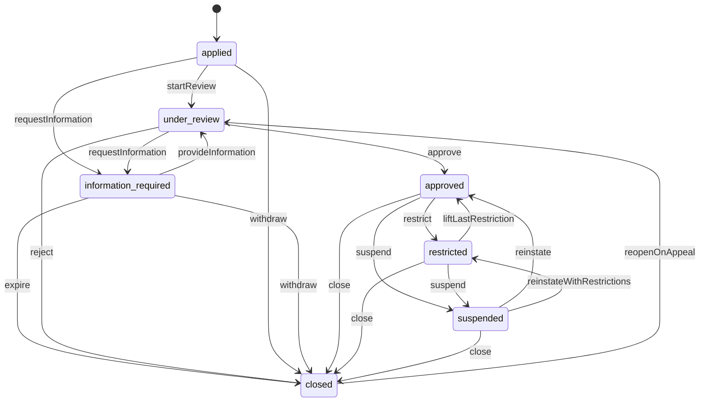

The plan's seven statuses. A seller row is created on submit (applied). Rejection, withdrawal and expiry close the row with closedReason; reopenOnAppeal applies only when closedReason = application_rejected and an appeal is overturned. Restricted = at least one active restriction; adding more keeps it restricted. Suspend takes effect only after the second reviewer approves (access approval request); until then the suspension row is pending_approval and the status does not change. Suspending or restricting never blocks existing orders, returns, cases, messages or (unless finance holds them) payouts (scenario 7). Account status, product approval (catalog) and payout readiness (finance) are separate fields everywhere.

### Seller application (`SellerApplication.state`)

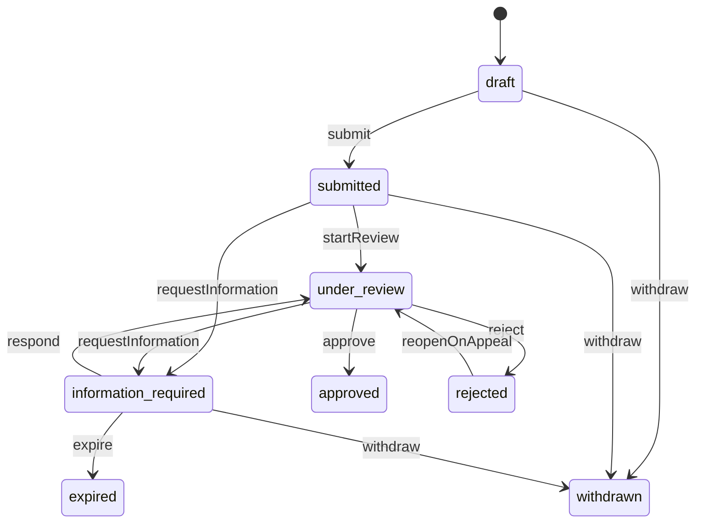

Submit is blocked (APPLICATION_INCOMPLETE, details.missing) until every step is complete and all current agreement versions are accepted. Approve is blocked (CHECKS_UNRESOLVED) while a check is failed or needs attention without an accepted note. Reject requires reasonCode, an explanation the applicant reads and a reapply rule. Approval does not publish products or enable payouts.

### Restriction (`Restriction.state`)

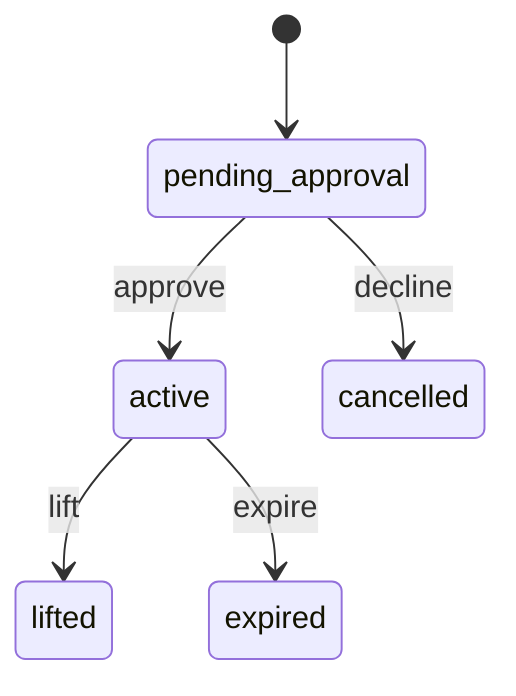

Created directly as active when the caller's limit allows it (access); otherwise pending_approval until a second reviewer decides. Editing an active restriction (scope, reason, review date) is audited and republished as sellers.restriction.updated. Lift needs a reason; an overturned appeal lifts automatically.

### Suspension (`suspensions.state`)

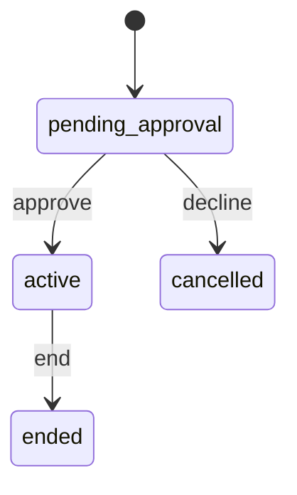

approve/decline come from access.approval.decided for the named second reviewer. Ending (reinstate, overturned appeal) moves the account through reinstate or reinstateWithRestrictions.

### Seller warning (`SellerWarning.state`)

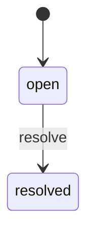

Resolve records a note, e.g. 'resolved after 7 days on time'.

### Seller invitation (`SellerInvitation.state`)

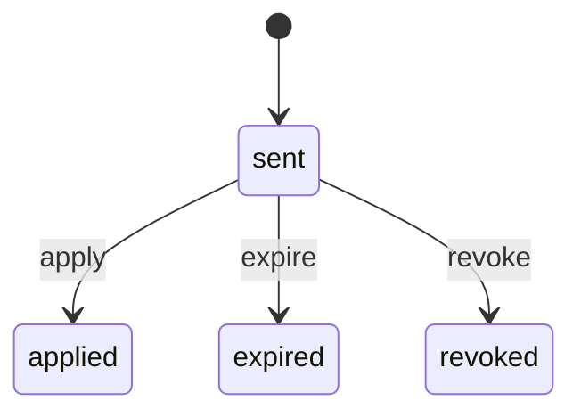

apply happens when startApplication uses the invitation code.

### Appeal (`Appeal.state`)

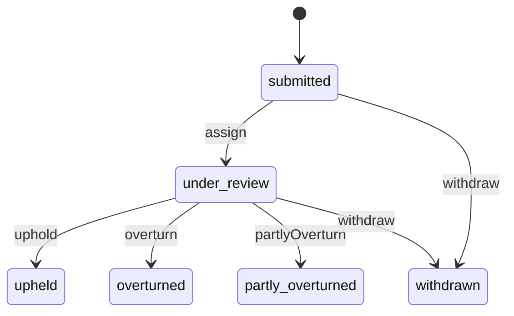

The reviewer can never be the person who made the original decision (SAME_REVIEWER_NOT_ALLOWED). After upheld the seller may file one level-2 appeal, which goes to secondAppealTo. Appeals must be filed before the route's deadline (APPEAL_WINDOW_CLOSED).

### Change request (`ChangeRequest.state`)

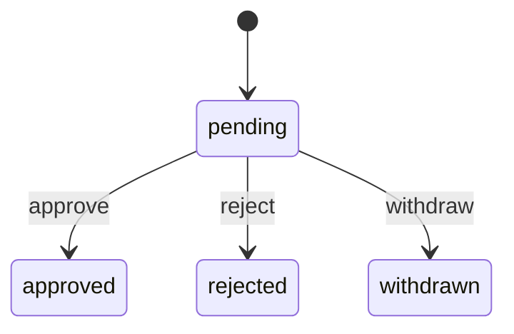

Store name, legal name, ownership and business address. The current value stays live until approval. Ownership changes may also re-run verification checks.

### Public claim (`PublicClaim.state`)

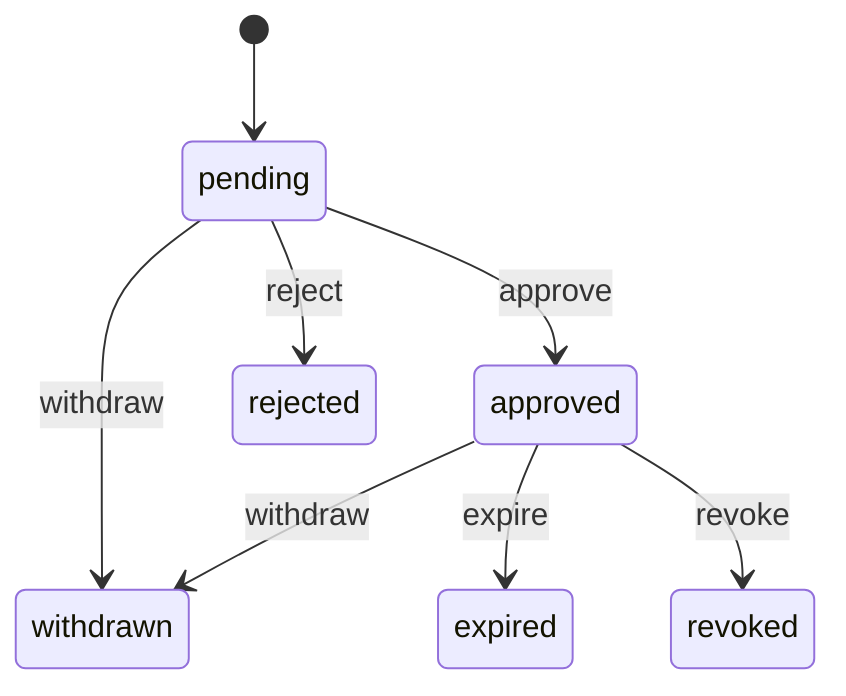

Only approved claims show on the storefront. Revoke is used when trust finds the claim false; it records a policy violation.

### Seller member (`SellerMember.status`)

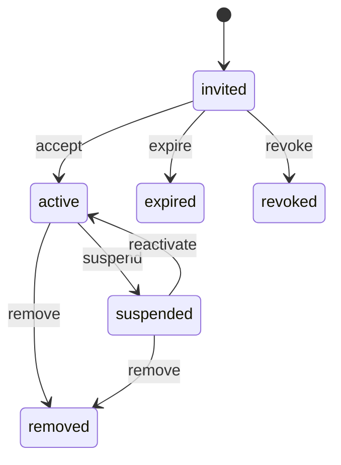

Accept happens in identity (identity.invitation.accepted). The owner cannot be removed or suspended; ownership moves only through an ownership change request.

### Launch readiness review (`LaunchReview.state`)

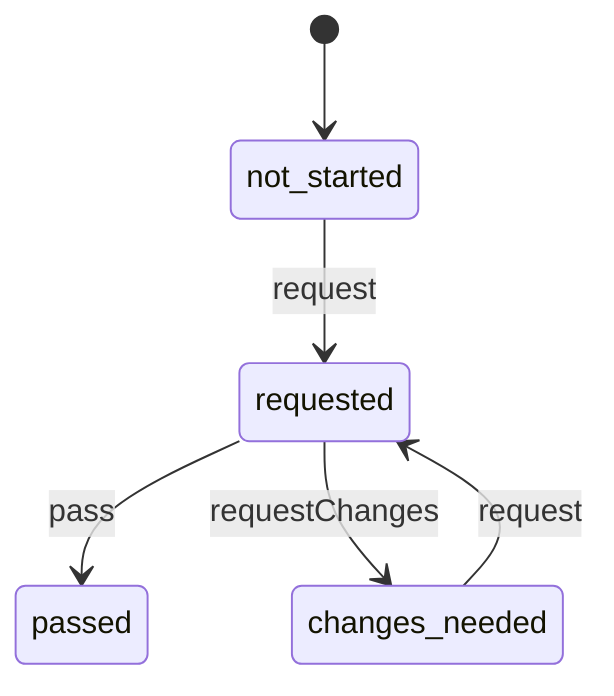

Request unlocks when payout readiness is verified and at least one product or offer is submitted. Passing publishes sellers.launch_review.decided; offers then activates the seller's eligible offers (approved product, complete offer with stock).

### Payout readiness (`PayoutReadiness.state`)

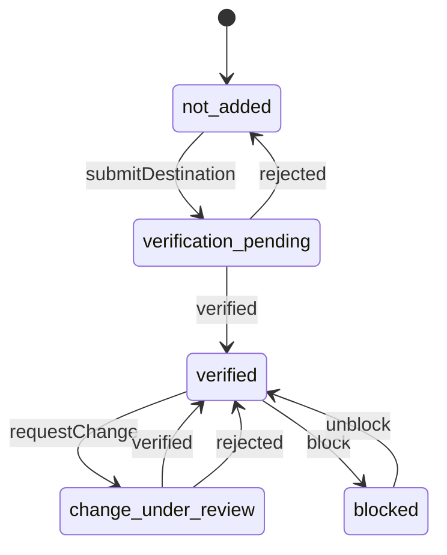

Mirror of finance's destination review: verified/rejected come from finance.destination.verified / finance.destination.rejected. During a change the old verified destination keeps receiving payouts.

### Verified seller label (`VerificationLabel.state`)

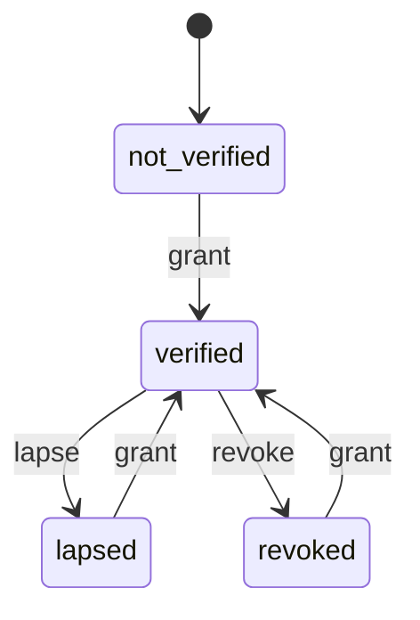

Granted when identity, business registration, payout account and return address checks pass. Lapses when a checked document expires (e.g. business licence renewal). The label always says product authenticity was not checked.

## Data (schema `sellers`)

**sellers**: One row per seller account, created when an application is submitted. The Official Store is not a seller row: other modules use ownerType official with sellerId null

| Column | Type |
|---|---|
| id | uuid pk |
| ref | text unique |
| slug | text unique |
| store_name | text |
| legal_name | text |
| seller_type | text |
| business_type | text |
| state_of_registration | text? |
| registry_number | text? |
| tax_id_type | text |
| tax_id_encrypted | bytea |
| tax_id_last4 | text |
| business_address | jsonb |
| phone | text |
| website | text? |
| contact | jsonb |
| market | text |
| status | text |
| status_since | timestamptz |
| closed_reason | text? |
| verification_state | text |
| verification_checked | jsonb |
| verified_at | timestamptz? |
| verification_expires_at | timestamptz? |
| launch_review | jsonb |
| payout_readiness | text |
| payout_destination_label | text? |
| account_manager_id | uuid? |
| application_id | uuid? |
| approved_at | timestamptz? |
| created_at | timestamptz |
| updated_at | timestamptz |

Indexes: `(status, id)`, `(verification_state)`, `gin(to_tsvector(store_name || ' ' || legal_name))`

**applications**

| Column | Type |
|---|---|
| id | uuid pk |
| ref | text unique |
| applicant_account_id | uuid |
| seller_id | uuid? → sellers |
| invitation_id | uuid? → seller_invitations |
| state | text |
| current_step | text |
| completed_steps | jsonb |
| account | jsonb |
| business | jsonb |
| verification | jsonb (tax id encrypted separately) |
| payout | jsonb (holder, type, label, provider token) |
| return_address | jsonb |
| decision | jsonb? |
| reviewer_id | uuid? |
| submitted_at | timestamptz? |
| decision_target_at | timestamptz? |
| can_reapply_from | date? |
| draft_saved_at | timestamptz |
| created_at | timestamptz |

Indexes: `(state, decision_target_at)`, `(applicant_account_id)`, `(reviewer_id, state)`

**application_documents**

| Column | Type |
|---|---|
| id | uuid pk |
| application_id | uuid → applications |
| seller_id | uuid? |
| kind | text |
| media_id | uuid |
| file_name | text |
| size_bytes | int |
| status | text |
| note | text? |
| delete_after | date? |
| uploaded_at | timestamptz |

Indexes: `(application_id)`, `(delete_after)`

**verification_checks**

| Column | Type |
|---|---|
| id | uuid pk |
| application_id | uuid? → applications |
| seller_id | uuid? → sellers |
| kind | text |
| result | text |
| summary | text |
| source | text |
| provider | text? |
| provider_ref | text? |
| accepted_note | text? |
| checked_by | text? |
| checked_at | timestamptz? |

Indexes: `(application_id)`, `(seller_id, kind)`, `unique(provider, provider_ref)`

**information_requests**

| Column | Type |
|---|---|
| id | uuid pk |
| application_id | uuid → applications |
| items | jsonb |
| message | text |
| due_at | timestamptz |
| reminder | text |
| reminded_at | timestamptz? |
| requested_by | text |
| requested_at | timestamptz |
| responded_at | timestamptz? |
| state | text (open|answered|expired) |

Indexes: `(state, due_at)`

**risk_reviews**

| Column | Type |
|---|---|
| id | uuid pk |
| application_id | uuid → applications |
| trust_report_id | uuid? |
| state | text |
| level | text? |
| flags | jsonb |
| recommendation | text? |
| reviewed_by | text? |
| reviewed_at | timestamptz? |

**agreement_acceptances**: Which agreement version each seller accepted, by whom and when

| Column | Type |
|---|---|
| id | uuid pk |
| seller_id | uuid? → sellers |
| application_id | uuid? → applications |
| policy_key | text |
| version_label | text |
| policy_version_id | uuid? |
| signed_name | text |
| accepted_by | text |
| ip | inet? |
| accepted_at | timestamptz |

Indexes: `(seller_id, policy_key, accepted_at desc)`

**store_profiles**

| Column | Type |
|---|---|
| seller_id | uuid pk → sellers |
| logo_media_id | uuid? |
| banner_media_id | uuid? |
| introduction | text? |
| location | text? |
| contact_options | jsonb |
| warranty | text? |
| updated_at | timestamptz |
| tagline | text? |

**featured_collections**

| Column | Type |
|---|---|
| id | uuid pk |
| seller_id | uuid → sellers |
| title | text |
| image_media_id | uuid? |
| offer_ids | jsonb |
| position | int |
| visible | bool |
| updated_at | timestamptz |

Indexes: `(seller_id, position)`

**public_claims**

| Column | Type |
|---|---|
| id | uuid pk |
| seller_id | uuid → sellers |
| kind | text |
| text | text |
| brand_id | uuid? |
| evidence_media_ids | jsonb |
| state | text |
| decision_reason | text? |
| decided_by | text? |
| submitted_at | timestamptz |
| decided_at | timestamptz? |
| expires_at | timestamptz? |

Indexes: `(state, submitted_at)`, `(seller_id, state)`

**change_requests**: Store name, legal name, ownership, business address changes and new brand requests waiting for staff review

| Column | Type |
|---|---|
| id | uuid pk |
| seller_id | uuid → sellers |
| kind | text |
| current | jsonb? |
| proposed | jsonb |
| evidence_media_ids | jsonb |
| state | text |
| decision_reason | text? |
| impact | text? |
| submitted_by | text |
| submitted_at | timestamptz |
| decided_by | text? |
| decided_at | timestamptz? |

Indexes: `(state, submitted_at)`, `(seller_id)`

**members**

| Column | Type |
|---|---|
| id | uuid pk |
| seller_id | uuid → sellers |
| account_id | uuid? |
| name | text |
| email | text |
| role | text |
| permissions | jsonb |
| is_owner | bool |
| status | text |
| invitation_id | uuid? |
| invited_by | text? |
| invited_at | timestamptz? |
| invite_expires_at | timestamptz? |
| joined_at | timestamptz? |
| last_active_at | timestamptz? |
| removed_at | timestamptz? |

Indexes: `unique(seller_id, email) where status in ('invited','active','suspended')`, `(account_id)`, `unique(seller_id) where is_owner and status = 'active'`

**performance_events**: Raw per-seller facts from other modules' events (append-only, used to recompute windows)

| Column | Type |
|---|---|
| id | uuid pk |
| seller_id | uuid |
| kind | text (order_accepted|dispatched|dispatched_late|tracking_valid|tracking_missing|seller_cancelled|units_sold|return_requested|message_received|first_reply|case_opened|case_resolved|case_overdue|policy_violation) |
| subject_id | uuid? |
| value | numeric? |
| occurred_at | timestamptz |
| category_id | uuid? |

Indexes: `(seller_id, kind, occurred_at)`, `unique(kind, subject_id)`

**performance_snapshots**

| Column | Type |
|---|---|
| id | uuid pk |
| seller_id | uuid → sellers |
| computed_at | timestamptz |
| window_from | date |
| window_to | date |
| order_count | int |
| metrics | jsonb |
| overall | text |

Indexes: `(seller_id, computed_at desc)`

**performance_targets**: Targets with effective dates; category-specific rows override the default

| Column | Type |
|---|---|
| id | uuid pk |
| metric | text |
| category_id | uuid? |
| comparator | text |
| threshold | numeric |
| unit | text |
| window_days | int |
| is_example | bool |
| effective_from | date |
| set_by | text |
| reason | text |

Indexes: `(metric, category_id, effective_from desc)`

**warnings**

| Column | Type |
|---|---|
| id | uuid pk |
| seller_id | uuid → sellers |
| kind | text |
| title | text |
| detail | text |
| state | text |
| issued_by | text |
| issued_at | timestamptz |
| resolved_at | timestamptz? |
| resolution_note | text? |

Indexes: `(seller_id, issued_at desc)`

**restrictions**

| Column | Type |
|---|---|
| id | uuid pk |
| ref | text unique |
| seller_id | uuid → sellers |
| state | text |
| title | text |
| reason_code | text |
| reason | text |
| rule_ref | text? |
| affected_activities | jsonb |
| scope | jsonb |
| affected_summary | text |
| still_works | jsonb |
| to_resolve | text |
| appeal_route | jsonb |
| review_date | date |
| started_at | timestamptz? |
| ends_at | timestamptz? |
| set_by | text |
| recommended_by | text? |
| trust_report_id | uuid? |
| trust_enforcement_id | uuid? |
| approval_request_id | uuid? |
| resolution_evidence | jsonb |
| lifted_at | timestamptz? |
| lift_reason | text? |

Indexes: `(seller_id, state)`, `(state, review_date)`

**suspensions**: Suspension decisions (pending second review, active, ended)

| Column | Type |
|---|---|
| id | uuid pk |
| seller_id | uuid → sellers |
| state | text (pending_approval|active|ended|cancelled) |
| reason_code | text |
| reason | text |
| review_date | date |
| open_orders | text |
| requested_by | text |
| second_reviewer_id | uuid |
| approval_request_id | uuid? |
| trust_report_id | uuid? |
| appeal_route | jsonb |
| started_at | timestamptz? |
| ended_at | timestamptz? |
| end_reason | text? |

Indexes: `(seller_id, state)`

**appeals**

| Column | Type |
|---|---|
| id | uuid pk |
| ref | text unique |
| seller_id | uuid → sellers |
| subject | text |
| subject_id | uuid |
| level | int |
| argument | text |
| evidence_media_ids | jsonb |
| state | text |
| reviewer_id | uuid? |
| original_decider_id | text |
| decide_by | timestamptz |
| decision | jsonb? |
| trust_report_id | uuid? |
| submitted_at | timestamptz |

Indexes: `(state, decide_by)`, `(seller_id)`, `unique(subject, subject_id, level)`

**seller_notes**

| Column | Type |
|---|---|
| id | uuid pk |
| seller_id | uuid? → sellers |
| application_id | uuid? → applications |
| body | text |
| author_id | text |
| author_name | text |
| created_at | timestamptz |

**account_events**: Seller-visible and staff timeline (approved, warnings, restrictions, appeals, holds reported by finance)

| Column | Type |
|---|---|
| id | uuid pk |
| seller_id | uuid → sellers |
| kind | text |
| title | text |
| detail | text? |
| visibility | text (seller|staff) |
| actor_kind | text |
| actor_id | text? |
| ref | text? |
| at | timestamptz |

Indexes: `(seller_id, at desc)`

**seller_invitations**: Invitations to apply (invite-only launch)

| Column | Type |
|---|---|
| id | uuid pk |
| email | text |
| business_name | text |
| message | text? |
| code_hash | text unique |
| invited_by | text |
| sent_at | timestamptz |
| expires_at | timestamptz |
| state | text |
| application_id | uuid? |

Indexes: `(email)`, `(state, expires_at)`

## Events

| Publishes | When | Payload | Consumed by |
|---|---|---|---|
| `sellers.application.submitted` | An applicant submits | `{ applicationId: uuid, sellerId: uuid, categoryIds: uuid[], sellerType: string, invited: bool }` | notifications, trust, workqueues |
| `sellers.application.information_requested` | A reviewer asks for information | `{ applicationId: uuid, sellerId: uuid, dueAt: datetime, itemCount: int }` | notifications |
| `sellers.application.information_provided` | The applicant responds | `{ applicationId: uuid, sellerId: uuid }` | workqueues |
| `sellers.application.withdrawn` | The applicant withdraws | `{ applicationId: uuid, sellerId: uuid? }` | - |
| `sellers.application.expired` | No reply by the information deadline | `{ applicationId: uuid, sellerId: uuid }` | - |
| `sellers.application.decided` | Approved or rejected | `{ applicationId: uuid, sellerId: uuid, outcome: enum(approved|rejected), reasonCode: string?, decidedBy: string }` | notifications, workqueues |
| `sellers.seller.approved` | The seller account is approved | `{ sellerId: uuid, applicationId: uuid, storeName: string, ownerAccountId: uuid, categoryIds: uuid[], returnAddress: Address, returnContact: string, recommendedHoldDays: int? }` | finance, returns, search |
| `sellers.seller.restricted` | A restriction becomes active (also at approval with conditions) | `{ sellerId: uuid, restrictionId: uuid, reasonCode: string, reason: text, affectedActivities: enum(new_listings|product_submissions|new_offers|offer_reactivation|sales|advertising|promotions|payout_schedule)[], scope: RestrictionScope, categoryIds: uuid[], appealRoute: text, appealDeadline: datetime, reviewDate: date, trustReportId: uuid?, trustEnforcementId: uuid? }` | advertising, cart, catalog, notifications, offers, orders, promotions, search, shipping, support, trust |
| `sellers.restriction.updated` | An active restriction's scope, activities or dates change | `{ sellerId: uuid, restrictionId: uuid, affectedActivities: enum(new_listings|product_submissions|new_offers|offer_reactivation|sales|advertising|promotions|payout_schedule)[], scope: RestrictionScope, reviewDate: date }` | offers |
| `sellers.restriction.lifted` | A restriction is lifted, expires or is overturned | `{ sellerId: uuid, restrictionId: uuid, reason: text, trustEnforcementId: uuid? }` | offers |
| `sellers.restriction.evidence_submitted` | A seller uploads documents to resolve a restriction | `{ sellerId: uuid, restrictionId: uuid }` | workqueues |
| `sellers.seller.suspended` | A suspension takes effect after second review | `{ sellerId: uuid, suspensionId: uuid, reasonCode: string, reason: text, reviewDate: date, openOrders: enum(seller_keeps_fulfilling|cancel_unshipped_and_refund), appealDeadline: datetime, trustReportId: uuid? }` | advertising, cart, catalog, content, finance, fulfillment-service, notifications, offers, promotions, returns, search, trust |
| `sellers.seller.reinstated` | A suspension ends or the last restriction is lifted, so the account is back to approved (or restricted with remaining restrictions) | `{ sellerId: uuid, from: enum(restricted|suspended), to: enum(approved|restricted), liftedRestrictionId: uuid?, endedSuspensionId: uuid?, remainingRestrictionIds: uuid[] }` | catalog, notifications, offers, search |
| `sellers.seller.closed` | A seller account closes (seller request, staff, rejection does not use this event) | `{ sellerId: uuid, reasonCode: string, closedBy: Actor }` | finance, fulfillment-service, inventory, media, offers, reviews, search |
| `sellers.warning.issued` | Staff send a warning | `{ sellerId: uuid, warningId: uuid, kind: string, title: string }` | notifications |
| `sellers.appeal.submitted` | A seller appeals a restriction, suspension or rejection | `{ appealId: uuid, sellerId: uuid, subject: string, subjectId: uuid, level: int, decideBy: datetime, trustReportId: uuid? }` | trust, workqueues |
| `sellers.appeal.decided` | An appeal is decided | `{ appealId: uuid, sellerId: uuid, outcome: enum(upheld|overturned|partly_overturned), subject: string, subjectId: uuid, trustReportId: uuid? }` | notifications, trust, workqueues |
| `sellers.payout_account.changed` | The owner adds or changes the payout destination (finance starts verification and review) | `{ sellerId: uuid, changeId: uuid, providerDestinationId: string, label: string, accountHolderName: string, accountType: string, previousLabel: string?, isInitial: bool, requestedBy: Actor }` | finance, notifications |
| `sellers.storefront.updated` | Storefront content, collections or approved claims change | `{ sellerId: uuid, fields: string[] }` | - |
| `sellers.change_request.submitted` | A store name, claim or business change waits for review | `{ changeRequestId: uuid, sellerId: uuid, kind: string }` | workqueues |
| `sellers.change_request.decided` | Staff approve or reject a change request | `{ changeRequestId: uuid, sellerId: uuid, kind: string, approved: bool, brandRequest: json? }` | catalog, notifications, workqueues |
| `sellers.member.invited` | The owner invites staff | `{ sellerId: uuid, memberId: uuid, email: email }` | - |
| `sellers.member.joined` | An invited member accepts | `{ sellerId: uuid, memberId: uuid, accountId: uuid }` | - |
| `sellers.member.permissions_changed` | A member's role or permissions change | `{ sellerId: uuid, memberId: uuid, permissions: string[] }` | - |
| `sellers.member.removed` | A member is suspended or removed | `{ sellerId: uuid, memberId: uuid, accountId: uuid? }` | - |
| `sellers.launch_review.requested` | A seller asks for the launch readiness review | `{ sellerId: uuid }` | workqueues |
| `sellers.launch_review.decided` | The launch review passes or needs changes (offers activates eligible offers on pass) | `{ sellerId: uuid, outcome: enum(passed|changes_needed), decidedAt: datetime }` | notifications, offers, workqueues |
| `sellers.agreement.accepted` | An agreement version is accepted | `{ sellerId: uuid?, applicationId: uuid?, key: string, versionLabel: string }` | - |
| `sellers.verification.changed` | The Verified seller label is granted, lapses or is revoked | `{ sellerId: uuid, state: string }` | notifications |
| `sellers.performance.below_target` | The daily computation finds a metric below target (workqueues and notifications pick it up) | `{ sellerId: uuid, metrics: string[], overall: string }` | workqueues |
| `sellers.invitation.sent` | Staff invite a business to apply | `{ invitationId: uuid, email: email, businessName: string, code: string, expiresAt: datetime }` | notifications |

| Consumes | From | Does |
|---|---|---|
| `identity.invitation.accepted` | identity | Activate the invited member and call identity.grantSellerContext |
| `identity.account.closed` | identity | Remove the account's memberships; if it was an owner, open a Seller Manager work item |
| `access.approval.decided` | access | Finish pending suspensions, restrictions, closures and target changes (approved) or cancel them (declined) |
| `trust.assessment.completed` | trust | Store risk level, flags and recommendation on the application's risk review |
| `trust.enforcement.recorded` | trust | When the action is restrict_seller, warn_seller or suspend_seller, create the restriction or warning from the enforcement parameters (recommendedBy Trust) or start a suspension that still needs its second reviewer |
| `finance.destination.verified` | finance | Payout readiness → verified; setup checklist step done |
| `finance.destination.rejected` | finance | Payout readiness back to not_added (new account) or verified (change rejected, old account stays); tell the owner why |
| `catalog.product.submitted` | catalog | Update product approval summary and the first-submission setup step |
| `catalog.product.approved` | catalog | Update product approval summary |
| `catalog.product.changes_requested` | catalog | Update product approval summary |
| `catalog.product.rejected` | catalog | Update product approval summary |
| `content.policy.effective` | content | When a seller agreement, product rules, fee schedule or service standards version becomes effective, mark it pending for every owner |
| `orders.order.accepted` | orders | Performance: count accepted orders and units per seller group |
| `orders.item.cancelled` | orders | Performance: count seller-caused cancellations |
| `shipping.shipment.dispatched` | shipping | Performance: on-time vs late dispatch and whether tracking is valid |
| `shipping.dispatch.overdue` | shipping | Performance: overdue dispatch counts towards dispatch reliability |
| `shipping.shipment.delivered` | shipping | Performance: confirm carrier-scanned tracking |
| `returns.return.requested` | returns | Performance: return rate |
| `support.case.opened` | support | Performance: open cases per seller |
| `support.case.resolved` | support | Performance: unresolved cases past deadline |
| `messaging.message.sent` | messaging | Performance: buyer message received and first seller reply times |

## In-process API (for other modules)

| Function | Signature | Used by |
|---|---|---|
| getSeller | `(sellerId: uuid) => SellerSnapshot | null`<br>Store name, slug, status, verified label and whether new sales are allowed (marketplace sellers only; the Official Store is ownerType official with sellerId null and has no seller record) | offers, orders, catalog, search, finance, returns, support, reviews, promotions, advertising, trust, reports, graphql |
| getSellers | `(sellerIds: uuid[]) => SellerSnapshot[]`<br>Batch version for lists | offers, search, orders, reports, graphql |
| canSell | `(sellerId: uuid, check: { activity: 'new_offers' | 'new_listings' | 'product_submissions' | 'offer_reactivation' | 'sales' | 'advertising' | 'promotions', categoryId?: uuid, condition?: string, offerId?: uuid }) => { allowed: bool, restrictionId?: uuid, reason?: string, appealRoute?: string }`<br>Single answer to 'does any active restriction or suspension block this?'. Offers, catalog, promotions and advertising call it before accepting new work. | offers, catalog, promotions, advertising |
| getMemberAccess | `(sellerId: uuid, accountId: uuid) => { memberId: uuid, role: string, permissions: string[], isOwner: bool } | null`<br>Seller-area permission check used by the kernel auth guard for every seller endpoint | identity, access |
| listMembers | `(sellerId: uuid) => { memberId: uuid, accountId: uuid, role: string, isOwner: bool }[]`<br>Active members of the seller with their identity account id, role and whether they are the owner | notifications |
| ownerOf | `(sellerId: uuid) => { accountId: uuid, memberId: uuid } | null`<br>The seller owner's identity account (null for an unknown seller) | notifications |
| getPerformance | `(sellerId: uuid) => PerformanceSummary`<br>Latest metrics vs targets; offers uses it for main-offer eligibility, reports for seller dashboards | offers, reports, search |
| getStorefrontCard | `(sellerIds: uuid[]) => SellerSummary[]`<br>Name, logo, verified label, rating and slug for product pages and offer lists | offers, search, content, orders, graphql |
| requestRestriction | `(input: RestrictionInput & { sellerId: uuid, requestedBy: Actor }) => Restriction`<br>Used by trust when a Seller Manager accepts a restriction recommendation in the trust screen; follows the same approval rules as the admin endpoint | trust |
| getStorefrontBySlug | `(slug: string) => Storefront | null`<br>Public storefront by slug, same data as GET /api/store/sellers/stores/{slug}; null for unknown, unapproved or closed stores | graphql |
| searchSellers | `(filter: { search?: string, statuses?: string[], verified?: bool, dispatchBelowPct?: number, mainCategoryId?: uuid }, page: PageInput) => Page<SellerSnapshot>`<br>Admin seller list with the same filters as GET /api/admin/sellers/sellers | graphql, search |
| exportRows | `(dataset: string, filters: json, principal: identity.Principal, cursor?: string) => { rows: json[], nextCursor?: string }`<br>Export rows for reports dataset sellers.admin.accounts (the filtered seller list) | reports |

## Permissions

| Key | Who | Allows |
|---|---|---|
| `sellers.accounts.view` | staff | View sellers, details, performance and targets |
| `sellers.accounts.manage` | staff | Assign account managers |
| `sellers.accounts.restrict` | staff | Warn, restrict, edit and lift restrictions (limits from access) |
| `sellers.accounts.suspend` | staff | Request suspensions (always second reviewer) and reinstate |
| `sellers.accounts.close` | staff | Close seller accounts |
| `sellers.accounts.export` | staff | Export seller lists |
| `sellers.applications.review` | staff | Review applications, checks, notes, request information, refer to Trust and Risk |
| `sellers.applications.decide` | staff | Approve or reject applications, decide launch readiness |
| `sellers.appeals.decide` | staff | Assign and decide appeals (never your own decisions) |
| `sellers.storefronts.review` | staff | Review store names, public claims, brand affiliation and business changes |
| `sellers.verification.manage` | staff | Grant or revoke the Verified seller label |
| `sellers.performance.manage` | staff | Set performance targets |
| `sellers.notes.write` | staff | Staff notes on sellers |
| `sellers.invitations.manage` | staff | Invite businesses to apply |
| `sellers.account.manage` | seller | View business details, update contact details, request the launch review |
| `sellers.store.manage` | seller | Edit the storefront, collections and public claims |
| `sellers.account-health.manage` | seller | Submit resolution evidence and appeals |
| `sellers.staff.manage` | seller | Owner only: invite, change and remove staff |
| `sellers.payout-account.manage` | seller | Owner only, never delegable: change the payout destination |
| `sellers.business.change` | seller | Owner only: request legal name, ownership or address changes |
| `sellers.agreements.accept` | seller | Owner only: accept agreement versions |
| `sellers.account.close` | seller | Owner only: request account closure |

## Approval actions

Checked through the access module (limits per role, second reviewer).

| Action | Limit | Second reviewer | Approvers | Meaning |
|---|---|---|---|---|
| `sellers.sellers.restrict` | none | above-limit | Per role authority in access: Permitted, Permitted with second review (Seller Manager or Business Owner reviews) or Recommend only | Restrict a seller (new listings, offers, sales, advertising, promotions or payout schedule) |
| `sellers.sellers.suspend` | none | always | Seller Manager or Business Owner other than the requester | Suspend all new sales of a seller |
| `sellers.sellers.close` | none | always | Seller Manager or Business Owner other than the requester; not checked when the seller asked for closure | Close a seller account on staff initiative |
| `sellers.performance.targets` | none | above-limit | Per role authority in access (Seller Manager; Business Owner when the role is Permitted with second review) | Change seller performance targets with an effective date |

## Error codes

| Code | Status | Meaning |
|---|---|---|
| `APPLICATION_EXISTS` | 409 | This account already has an open application |
| `APPLICATION_INCOMPLETE` | 400 | Steps are missing information; details.missing lists fields per step |
| `AGREEMENT_VERSION_OUTDATED` | 409 | A newer agreement version is now effective; reload and accept it |
| `REAPPLY_NOT_YET` | 409 | A previous rejection set a reapply date; details.canReapplyFrom |
| `INVITATION_REQUIRED` | 403 | Applications are invite-only right now |
| `CHECKS_UNRESOLVED` | 409 | Verification checks are failed or need attention without an accepted note; details.checks |
| `APPEAL_WINDOW_CLOSED` | 409 | The appeal deadline has passed |
| `APPEAL_ALREADY_OPEN` | 409 | An appeal for this decision and level is already open |
| `SAME_REVIEWER_NOT_ALLOWED` | 409 | The reviewer or second reviewer made the original decision or the request |
| `NOT_DELEGABLE` | 422 | This permission can never be given to staff (payout changes) or is owner-only |
| `MEMBER_EXISTS` | 409 | This email is already a member or invited |
| `LAST_OWNER` | 409 | The owner cannot be removed or suspended |
| `PAYOUT_DETAILS_INVALID` | 422 | Routing number invalid, numbers do not match or the provider refused the account |
| `STORE_NAME_TAKEN` | 409 | Another seller uses this store name |
| `COLLECTION_LIMIT_REACHED` | 409 | maxCollections already exist |
| `LAUNCH_REVIEW_NOT_READY` | 409 | Payout verification and a first submission are needed first; details.missing |

## Background jobs

| Job | Schedule | Does |
|---|---|---|
| `sellers.run-verification-checks` | on submit + every 5 min for pending | Send identity, registration, tax id, payout-name match and return-address checks to providers; refer automatically to trust for riskReviewCategories |
| `sellers.application-deadlines` | hourly | Send reminders before information deadlines; expire applications past due; raise workqueue items for applications past the decision target |
| `sellers.compute-performance` | daily 06:00 market time | Recompute 30-day (and 90-day for violations) metrics from performance_events against effective targets; publish sellers.performance.below_target for new misses |
| `sellers.restriction-reviews` | daily 07:00 market time | Expire restrictions past endsAt; raise workqueue items for restrictions and suspensions reaching their review date |
| `sellers.appeal-deadlines` | hourly | Raise workqueue items for appeals near or past decideBy |
| `sellers.verification-lapse` | daily | Lapse Verified labels whose checked documents expired; tell the seller what to renew |
| `sellers.expire-invitations` | hourly | Expire member invitations and seller invitations past their expiry |
| `sellers.purge-documents` | daily | Delete ID and rejected-application documents after their retention period |
| `sellers.auto-warnings` | daily 06:30 market time | Phase 2 performance controls: issue warnings automatically for repeated misses and propose restrictions to the Seller Manager (never restrict automatically) |

## Settings

| Key | Default | Meaning |
|---|---|---|
| applicationsOpen | `false` | Invite-only at launch; true opens applications to everyone |
| decisionTargetBusinessDays | `5` | Target from submission to decision |
| infoRequestDefaultDays | `14` | Default reply window for information requests |
| infoReminderDaysBefore | `3` | Reminder before the information deadline |
| appealWindowDays | `14` | Days a seller has to appeal |
| appealDecisionBusinessDays | `5` | Target to decide an appeal |
| documentRetentionDays | `90` | ID documents and rejected application documents are deleted after this |
| invitationValidDays | `7` | Seller member invitation lifetime |
| sellerInvitationValidDays | `30` | Invitation to apply lifetime |
| performanceWindowDays | `30` | Window for performance metrics |
| violationWindowDays | `90` | Window for policy violations |
| defaultTargets | `{"dispatch_reliability":95,"cancellation_rate":2.5,"valid_tracking":95,"return_rate":8,"response_time_hours":24,"unresolved_cases_past_deadline":0,"policy_violations":0}` | Example targets until the business confirms them |
| riskReviewCategories | `["e-bike batteries","high-value electronics"]` | Product plans that are referred to Trust and Risk automatically |
| introMaxChars | `400` | Storefront introduction length |
| maxCollections | `6` | Featured collections per storefront |
| claimReviewBusinessDays | `2` | Target to review store name changes and public claims |
| launchReviewBusinessDays | `1` | Target for the launch readiness review |

## Integrations
- **Identity and business verification provider (KYC/KYB)**: Photo ID match, business registry lookup, tax id match and sanctions screening; results arrive by webhook
- **Payout provider tokenisation**: Bank numbers are exchanged for a destination token at entry; verification itself is run by finance
- **Address verification**: Street address and PO box check for return addresses

## Notes
- Seller-area endpoints act on the seller in the caller's identity seller context; no seller id appears in seller paths. The kernel guard checks the member's permissions with getMemberAccess on every request.
- Seller permissions for other areas (catalog.products.submit, orders, returns, finance view and so on) are declared by their owning modules with audience seller; sellers only assigns them through role templates. sellers.staff.manage, sellers.payout-account.manage, sellers.business.change, sellers.agreements.accept and sellers.account.close are owner-only; payout changes are never delegable (plan ch. 11).
- Phase: seller staff invitations and permission edits are phase 2 ('staff access' in plan ch. 20 phase 2); at launch each seller has its owner only. Automatic performance warnings (sellers.auto-warnings) are phase 2 'performance controls'; the metrics, targets, manual warnings, restrictions and appeals are phase 1 because scenario 7 needs them.
- Seller support requests from seller/help (CS- references, topics, reply targets) live in support, not here: they share SLAs, assignment and escalation with customer cases. Sellers links the support entry point and passes the restriction or appeal reference as context.
- Payout destination: sellers collects and tokenises the details (owner only, step-up) and publishes sellers.payout_account.changed; finance runs micro-deposit verification and the recorded review (finance.destination.verified / rejected) and never pays an unverified destination. The deposit-confirmation screen is finance's (seller/finance).
- Return address: collected in the application, then owned by returns. sellers.seller.approved carries it so returns can create the seller's return terms and address (request to the returns owner: consume sellers.seller.approved).
- Agreement texts and versions come from content policies (keys seller_agreement, product_rules, fee_schedule, service_standards). If content is off, the versions come from settings and policyVersionId is null.
- Restriction events carry everything offers, promotions and advertising need (affected activities and scope) so other sellers' offers and existing orders are untouched (scenario 7). Every restriction end publishes sellers.restriction.lifted (restrictionId); when it also changes the account status, sellers.seller.reinstated follows with liftedRestrictionId or endedSuspensionId and the remaining restriction ids, so offers restores exactly what that restriction or suspension removed and keeps what remaining restrictions still cover. affectedActivities uses one enum everywhere (Restriction, events, canSell).
- Trust: application risk checks go through trust.requestAssessment and come back as trust.assessment.completed. When a Seller Manager accepts a 'restrict seller' recommendation in trust, trust records the enforcement and sellers creates the restriction from it (recommendedBy = Trust). Appeals on seller restrictions are always owned here; trust lists linked ones read-only (sellers.appeal.* events).
- The admin seller detail aggregates orders (open and overdue orders), returns (open returns), support (open cases) and finance (balances, holds, next payout) in-process; each is optional and reported in `unavailable` when off.
- Approval actions (see approvalActions; registered with access): sellers.sellers.restrict (authority; per-role 'Permitted', 'Permitted with second review' or 'Recommend only'), sellers.sellers.suspend (always a second reviewer), sellers.sellers.close (second reviewer unless the seller asked) and sellers.performance.targets (authority).
- Applicants use their member account (identity realm member). 'Create a new seller login' in step 1 is an identity registration done by the app before startApplication.

## GraphQL (read layer)

This module's fragment of the GraphQL schemas (see [../graphql/README.md](../graphql/README.md)). Writes stay on the REST endpoints above.

```graphql
# sellers: marketplace seller accounts, the public storefront profile, performance against targets,
# warnings, restrictions and appeals.
#
# Seller is one type in all three schemas:
#   store   public card fields + publicProfile (storefront content). Reached through Offer.seller and sellerStorefront(slug).
#   seller  the caller's own account only, reached through mySeller (Offer.seller is not in the seller schema, so no
#           other seller's account fields can be reached).
#   admin   any seller: sellerAdmin(id) (seller 360), sellers (list), Product.ownerSeller.
# Other modules extend Seller where they own the data: reviews → rating, feedback; messaging → replyStats, inbox;
# finance → balance, finance; returns / support → returns, cases; access → pendingApprovals; audit → auditTrail;
# trust → trustReports; workqueues → openWorkItems.
# SellerStorefront (store): search → products, categories; shipping → shippingSummary; returns → returnTerms;
# promotions → activePromotions. Seller 360 (admin): catalog → catalogCounts; orders → orderCounts (recent orders via
# ordersAdmin(filter: { sellerId })).
# Rating figures belong to reviews (Seller.rating); Seller has no copy of them. dispatchLabel is a card shortcut of
# shipping's dispatch schedule (Seller.shippingSummary owns the full terms).
# The Official Store has no seller record (offers show it as ownerType official, seller null).

"""
Storefront content of a marketplace seller: banner, introduction, what was verified, service figures, approved
claims, contact options and featured collections. Only staff-approved claims and live data appear here.
Shipping, returns, promotion and product sections come from those modules' fields on Seller.
"""
type SellerPublicProfile {
  sellerId: UUID!
  banner: MediaRef
  "One-line store tagline under the store name, e.g. Headphones and speakers, tested before they ship (staff-reviewed like claims)"
  tagline: String
  introduction: String
  "What was checked and what was not (always: product authenticity is not certified)"
  verification: SellerVerification!
  "On-time dispatch, last 90 days (reply figures come from messaging: Seller.replyStats)"
  onTimeDispatchPct: Float
  "Staff-approved public claims, e.g. Authorized Halden retailer"
  approvedClaims: [SellerPublicClaim!]!
  contact: SellerStorefrontContact!
  warranty: String
  "Visible featured collections in the seller's order (offers can add SellerCollection.offers)"
  collections: [SellerCollection!]!
}

type SellerPublicClaim {
  kind: SellerClaimKind!
  text: String!
}

enum SellerClaimKind {
  BRAND_AFFILIATION
  AUTHORIZED_RETAILER
  CERTIFICATION
  AWARD
  OTHER
}

type SellerStorefrontContact {
  "Shopper can message the seller (order messages are always on for buyers with an order)"
  canMessage: Boolean!
  productQuestions: Boolean!
  "e.g. within_24h"
  replyTarget: String!
  "Only when the seller chose to show it"
  phone: String
}

"A seller-curated featured collection on the storefront"
type SellerCollection {
  id: UUID!
  title: String!
  image: MediaRef
  offerIds: [UUID!]!
  itemCount: Int!
}

enum SellerVerificationState {
  NOT_VERIFIED
  VERIFIED
  LAPSED
  REVOKED
}

"The Verified seller label, in plain language"
type SellerVerification {
  state: SellerVerificationState!
  "e.g. Business identity: Northwind Audio LLC, registered in Oregon"
  checked: [String!]!
  "Always includes that product authenticity is not certified"
  notChecked: [String!]!
  lastCheckedAt: DateTime
  expiresAt: DateTime
  "Why not granted, lapsed or revoked"
  reason: String @areas(in: [SELLER, ADMIN])
}

"""
A marketplace seller. Public card fields are in every schema (offer lists, storefront header); account fields only in
Seller Center (own account, `mySeller`) and Admin Center (`sellerAdmin`, `sellers`). Account status, verification,
product approval and payout readiness are separate fields, as the plan requires.
"""
type Seller {
  id: UUID!
  "e.g. SL-20714"
  ref: String!
  slug: String!
  storeName: String!
  logo: MediaRef
  "e.g. Portland, OR"
  location: String
  "Holds the Verified seller label now"
  verified: Boolean!
  "e.g. Ships in 1 business day. Card shortcut copied from shipping's dispatch schedule; full terms: Seller.shippingSummary"
  dispatchLabel: String
  sellingSince: Date
  "False while suspended or closed; the storefront explains that existing orders are still looked after"
  sellingNow: Boolean!
  "Storefront content (SellerStorefront)"
  publicProfile: SellerPublicProfile!

  # ---- Seller Center and Admin Center
  legalName: String @areas(in: [SELLER, ADMIN])
  status: SellerStatus! @areas(in: [SELLER, ADMIN])
  statusSince: DateTime! @areas(in: [SELLER, ADMIN])
  "False when suspended, closed or not yet launch-ready"
  canSellNew: Boolean! @areas(in: [SELLER, ADMIN])
  launchReady: Boolean! @areas(in: [SELLER, ADMIN])
  verification: SellerVerification! @areas(in: [SELLER, ADMIN])
  payoutReadiness: SellerPayoutReadiness! @areas(in: [SELLER, ADMIN])
  "New agreement versions waiting for the owner's acceptance"
  pendingAgreements: Int! @areas(in: [SELLER, ADMIN])
  accountManager: SellerAccountManager @areas(in: [SELLER, ADMIN])
  "Latest metrics vs targets, warnings and the 12-month action history (recomputed daily at 06:00 market time)"
  performance: SellerPerformance @areas(in: [SELLER, ADMIN]) @cost(weight: 3)
  "Restrictions, newest first. Default: pending approval and active."
  restrictions(states: [SellerRestrictionState!]): [SellerRestriction!]! @areas(in: [SELLER, ADMIN])
  "Appeals on restrictions, suspensions, warnings and application decisions, newest first"
  appeals(states: [SellerAppealState!]): [SellerAppeal!]! @areas(in: [SELLER, ADMIN])
  "Store name, public claim and business change requests"
  changeRequests(states: [SellerChangeRequestState!]): [SellerChangeRequest!]! @areas(in: [SELLER, ADMIN])
  "Legal and tax details (seller: needs sellers.account.manage)"
  business: SellerBusiness @areas(in: [SELLER, ADMIN])

  # ---- Seller Center only
  "The calling member: role and permissions, for showing or hiding actions"
  membership: SellerMembership @areas(in: [SELLER])

  # ---- Admin Center only (seller 360)
  "Owner contact"
  owner: SellerContact @areas(in: [ADMIN])
  "Main category by active offers, for lists"
  mainCategory: String @areas(in: [ADMIN])
  "One line for lists, e.g. Refurbished offers removed · appeal under review"
  restrictionSummary: String @areas(in: [ADMIN])
  "Open warning shown in lists, e.g. Dispatch below target"
  warningNote: String @areas(in: [ADMIN])
  notes: [SellerNote!]! @areas(in: [ADMIN]) @auth(requires: STAFF, permission: "sellers.accounts.view")
  "Account actions: approval, warnings, restrictions, suspensions, appeals, label changes (newest first)"
  history: [TimelineEvent!]! @areas(in: [ADMIN]) @auth(requires: STAFF, permission: "sellers.accounts.view")
}

enum SellerStatus @areas(in: [SELLER, ADMIN]) {
  APPLIED
  INFORMATION_REQUIRED
  UNDER_REVIEW
  APPROVED
  RESTRICTED
  SUSPENDED
  CLOSED
}

enum SellerPayoutReadinessState @areas(in: [SELLER, ADMIN]) {
  NOT_ADDED
  VERIFICATION_PENDING
  VERIFIED
  CHANGE_UNDER_REVIEW
  BLOCKED
}

"Whether payouts can be sent to the seller's destination (balances come from finance: Seller.balance)"
type SellerPayoutReadiness @areas(in: [SELLER, ADMIN]) {
  state: SellerPayoutReadinessState!
  "e.g. Checking •••• 7731"
  destinationLabel: String
  "What the seller must do, e.g. confirm the 2 small deposits"
  note: String!
  blockedReasons: [String!]!
}

type SellerAccountManager @areas(in: [SELLER, ADMIN]) {
  name: String!
  "e.g. Replies within 1 business day"
  replyTarget: String
}

type SellerMembership @areas(in: [SELLER]) {
  memberId: UUID!
  "owner, products_inventory, shipping, customer_service or custom"
  role: String!
  permissions: [String!]!
  isOwner: Boolean!
}

type SellerContact @areas(in: [SELLER, ADMIN]) {
  name: String!
  email: Email
  phone: String
  supportHours: String
}

type SellerBusinessOwner @areas(in: [SELLER, ADMIN]) {
  name: String!
  ownershipPct: Float!
  isPrimary: Boolean!
  "not_started, pending, verified or failed"
  verificationState: String!
}

"Business details collected in the application. Tax ids only ever show the last 4 digits."
type SellerBusiness @areas(in: [SELLER, ADMIN]) {
  legalName: String!
  "llc, corporation, partnership or sole_proprietor"
  businessType: String!
  stateOfRegistration: String
  registryNumber: String
  address: Address!
  phone: String!
  website: String
  "ein or ssn"
  taxIdType: String!
  taxIdLast4: String!
  owners: [SellerBusinessOwner!]!
  "Editable without review"
  contact: SellerContact!
}

# ------------------------------------------------------------------ performance

enum SellerMetricKey @areas(in: [SELLER, ADMIN]) {
  DISPATCH_RELIABILITY
  CANCELLATION_RATE
  VALID_TRACKING
  RETURN_RATE
  RESPONSE_TIME
  UNRESOLVED_CASES
  POLICY_VIOLATIONS
}

enum SellerMetricStatus @areas(in: [SELLER, ADMIN]) {
  MEETS
  WATCH
  BELOW
  ACTION_NEEDED
}

enum SellerPerformanceOverall @areas(in: [SELLER, ADMIN]) {
  GOOD
  AT_RISK
  ACTION_NEEDED
}

"A service target, e.g. dispatch reliability at least 95% over 30 days"
type SellerPerformanceTarget @areas(in: [SELLER, ADMIN]) {
  metric: SellerMetricKey!
  "GTE or LTE"
  comparator: String!
  threshold: Float!
  "percent, hours or count"
  unit: String!
  windowDays: Int!
  "Category-specific target, e.g. return rate for Electronics"
  category: Category
  "e.g. At least 95%"
  display: String!
  "Preview targets are marked as examples"
  isExample: Boolean!
  effectiveFrom: Date!
}

"One metric against its target"
type SellerPerformanceMetric @areas(in: [SELLER, ADMIN]) {
  key: SellerMetricKey!
  label: String!
  value: Float!
  "e.g. 96.4%, 31 h, 1"
  display: String!
  target: SellerPerformanceTarget!
  status: SellerMetricStatus!
  numerator: Int
  denominator: Int
  "e.g. 362 of 376 orders on time"
  detail: String!
  "How it is calculated, e.g. orders dispatched by their deadline ÷ all dispatched orders"
  definition: String!
}

"Seller performance summary: Account health in Seller Center, the performance card on the seller 360"
type SellerPerformance @areas(in: [SELLER, ADMIN]) {
  from: Date!
  to: Date!
  orderCount: Int!
  overall: SellerPerformanceOverall!
  metrics: [SellerPerformanceMetric!]!
  "Shortcut for lists and the dispatch filter (same value as the DISPATCH_RELIABILITY metric)"
  onTimeDispatchPct: Float
  "Default: open warnings and those resolved in the last 12 months"
  warnings: [SellerWarning!]!
  "Warnings and actions, last 12 months"
  history: [TimelineEvent!]!
  updatedAt: DateTime!
}

enum SellerWarningKind @areas(in: [SELLER, ADMIN]) {
  PERFORMANCE
  LISTING
  POLICY
  CONDUCT
}

type SellerWarning @areas(in: [SELLER, ADMIN]) {
  id: UUID!
  kind: SellerWarningKind!
  title: String!
  detail: String!
  issuedAt: DateTime!
  issuedBy: Actor!
  "open or resolved"
  state: String!
  resolvedAt: DateTime
  resolutionNote: String
}

# ------------------------------------------------------------------ restrictions and appeals

enum SellerRestrictionState @areas(in: [SELLER, ADMIN]) {
  PENDING_APPROVAL
  ACTIVE
  LIFTED
  EXPIRED
  CANCELLED
}

enum SellerRestrictionReason @areas(in: [SELLER, ADMIN]) {
  PERFORMANCE
  POLICY_VIOLATION
  BRAND_CLAIM
  COUNTERFEIT_RISK
  FRAUD_RISK
  UNRESOLVED_CASES
  VERIFICATION_LAPSED
  APPROVAL_CONDITION
  OTHER
}

"What a restriction stops (one enum everywhere: restriction, events, canSell)"
enum SellerActivity @areas(in: [SELLER, ADMIN]) {
  NEW_LISTINGS
  PRODUCT_SUBMISSIONS
  NEW_OFFERS
  OFFER_REACTIVATION
  SALES
  ADVERTISING
  PROMOTIONS
  PAYOUT_SCHEDULE
}

"Where a restriction applies. All lists empty = the whole account."
type SellerRestrictionScope @areas(in: [SELLER, ADMIN]) {
  wholeAccount: Boolean!
  categories: [Category!]!
  "e.g. refurbished"
  conditions: [String!]!
  offerIds: [UUID!]!
  productIds: [UUID!]!
}

type SellerAppealRoute @areas(in: [SELLER, ADMIN]) {
  deadline: DateTime!
  howTo: String!
  "Role or person, never the original decider"
  reviewer: String!
  secondAppealTo: String
}

"""
A restriction on a seller account with its reason, affected activity, what still works, how to resolve it and the
appeal route. Other sellers' offers and existing orders are never touched.
"""
type SellerRestriction @areas(in: [SELLER, ADMIN]) {
  id: UUID!
  "e.g. RS-261002-0019"
  ref: String!
  state: SellerRestrictionState!
  "e.g. New listings in Cameras paused"
  title: String!
  reasonCode: SellerRestrictionReason!
  "Facts and the rule, shown to the seller"
  reason: String!
  ruleRef: String
  affectedActivities: [SellerActivity!]!
  scope: SellerRestrictionScope!
  affectedSummary: String!
  "e.g. existing orders, dispatch and shipping; returns, refunds and cases; messages; payouts"
  stillWorks: [String!]!
  toResolve: String!
  appealRoute: SellerAppealRoute!
  reviewDate: Date!
  startedAt: DateTime
  endsAt: DateTime
  setBy: Actor!
  "e.g. Trust and Risk, when created from a trust recommendation"
  recommendedBy: Actor
  "Second-review state while PENDING_APPROVAL"
  approval: ApprovalInfo @areas(in: [ADMIN])
  "Trust report behind it (trust adds SellerRestriction.trustReport)"
  trustReportId: UUID @areas(in: [ADMIN])
  appeals: [SellerAppeal!]!
  "Documents the seller sent to resolve it"
  resolutionEvidence: [MediaRef!]!
  liftedAt: DateTime
  liftReason: String
}

enum SellerAppealSubject @areas(in: [SELLER, ADMIN]) {
  RESTRICTION
  SUSPENSION
  APPLICATION_REJECTION
  WARNING
}

enum SellerAppealState @areas(in: [SELLER, ADMIN]) {
  SUBMITTED
  UNDER_REVIEW
  UPHELD
  OVERTURNED
  PARTLY_OVERTURNED
  WITHDRAWN
}

type SellerAppealDecision @areas(in: [SELLER, ADMIN]) {
  "upheld, overturned or partly_overturned"
  outcome: String!
  explanation: String!
  "What changed, e.g. restriction lifted for Cameras"
  changes: [String!]!
  decidedBy: Actor!
  decidedAt: DateTime!
}

"A seller's appeal. Decided by someone other than the original decider; level 2 goes to the next reviewer."
type SellerAppeal @areas(in: [SELLER, ADMIN]) {
  id: UUID!
  "e.g. AP-261004-021"
  ref: String!
  subject: SellerAppealSubject!
  subjectId: UUID!
  "e.g. RS-261002-0019"
  subjectRef: String!
  "1 = first appeal, 2 = second appeal"
  level: Int!
  argument: String!
  evidence: [MediaRef!]!
  state: SellerAppealState!
  reviewer: Actor
  originalDecider: Actor!
  decideBy: Deadline!
  decision: SellerAppealDecision
  submittedAt: DateTime!
}

enum SellerChangeRequestState @areas(in: [SELLER, ADMIN]) {
  PENDING
  APPROVED
  REJECTED
  WITHDRAWN
}

"A store name, public claim, legal name, ownership or address change waiting for or past staff review"
type SellerChangeRequest @areas(in: [SELLER, ADMIN]) {
  id: UUID!
  "store_name, public_claim, legal_name, ownership or business_address"
  kind: String!
  current: JSON
  proposed: JSON!
  evidence: [MediaRef!]!
  state: SellerChangeRequestState!
  decisionReason: String
  "Effect on selling or payouts the seller is told about"
  impact: String
  submittedBy: Actor!
  submittedAt: DateTime!
  decidedAt: DateTime
}

"Staff note on a seller"
type SellerNote @areas(in: [ADMIN]) {
  id: UUID!
  body: String!
  author: Actor!
  createdAt: DateTime!
}

type SellerPage implements Paged @areas(in: [ADMIN]) {
  items: [Seller!]!
  nextCursor: String
  page: Int
  totalPages: Int
  total: Int
}

"Filters for the admin seller list"
input SellerFilterInput @areas(in: [ADMIN]) {
  "Store name, legal name or contact email"
  search: String
  statuses: [SellerStatus!]
  verified: Boolean
  "Sellers whose on-time dispatch is below this percentage, e.g. 95"
  dispatchBelowPct: Float
  mainCategoryId: UUID
}

# ------------------------------------------------------------------ extensions and queries

extend type Offer {
  "The marketplace seller (public card fields; rating from reviews). Null for Official Store offers. Not in the seller schema."
  seller: Seller @areas(in: [STORE, ADMIN]) @source(module: "sellers", fn: "getStorefrontCard")
}

extend type Product {
  "The seller that owns a seller-created product (null for official products)"
  ownerSeller: Seller @areas(in: [ADMIN]) @auth(requires: STAFF) @source(module: "sellers", fn: "getSellers")
}

extend type Query {
  "A seller by storefront slug: header, publicProfile, rating and feedback (the SellerStorefront screen query). Null for unknown or closed stores."
  sellerStorefront(slug: String!): Seller @areas(in: [STORE]) @source(module: "sellers", fn: "getStorefrontBySlug")

  "The caller's own seller account: dashboard, Account health (SellerPerformance), store profile"
  mySeller: Seller @areas(in: [SELLER]) @auth(requires: SELLER) @source(module: "sellers", fn: "getSeller")

  "Seller 360 (Admin Center seller detail)"
  sellerAdmin(id: UUID!): Seller @areas(in: [ADMIN]) @auth(requires: STAFF, permission: "sellers.accounts.view") @source(module: "sellers", fn: "getSeller")

  "Admin seller list"
  sellers(filter: SellerFilterInput, paging: PageInput): SellerPage! @areas(in: [ADMIN]) @auth(requires: STAFF, permission: "sellers.accounts.view") @source(module: "sellers", fn: "searchSellers")
}
```
