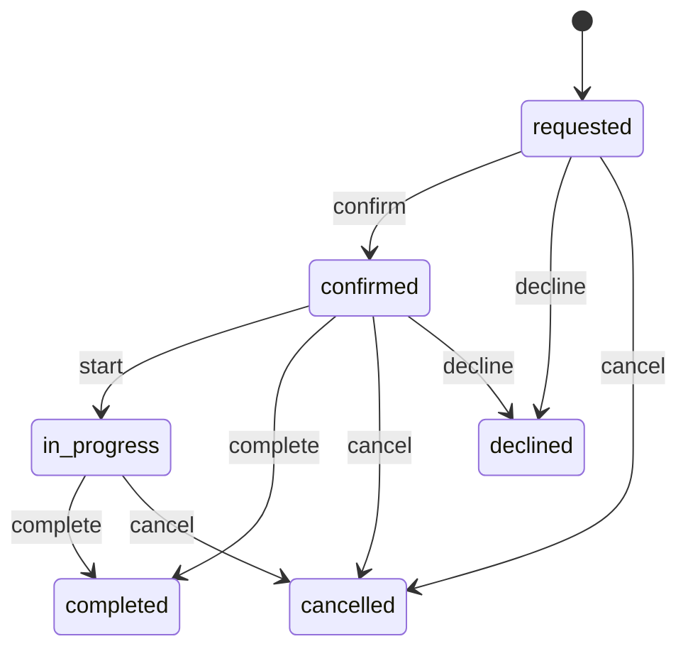

<!-- GENERATED by `npm run gen` from docs/api/modules/services.md. Do not edit: change the spec and regenerate. -->

# Services (`services`)

Services customers request or book in the app's department pages: OS installs and post-sale repairs (Phones), welfare services and time-slot bookings. Staff keep the providers, their services and opening hours, and handle every request in Admin › Departments. No online payment at this phase: customers pay the provider.

- **Group:** Growth · **Launch phase:** 2 · **Plan chapters:** -
- **Depends on:** [media](../media/README.md) · **Optional:** [customers](../customers/README.md), [audit](../audit/README.md), [notifications](../notifications/README.md)

## Owns
- Providers: name, photos, contacts, address, opening hours, staff (stylists, technicians) and the verified mark
- Service categories per area (os_install, post_sale, welfare, booking)
- Services: what is included, requirements, supported models, OS versions, hand-over options, price tables, duration, slot length
- Availability: free time slots from the provider's hours, the service's slot length and the bookings already made
- Requests and bookings with a status customers and staff follow (requested, confirmed, in progress, completed, cancelled, declined)
- Reviews customers leave after a completed request, and the ratings shown on services and providers

**Not here:**
- Payment: customers pay the provider (2026-10-22 decision: no online payment for requests and bookings in v1)
- Product sales (phones, farm machines): catalog, cart and checkout
- Pictures: media (content_image uploads)

## Store API

| Method | Path | Purpose | Auth | Body → Response |
|---|---|---|---|---|
| GET | `/api/store/services/categories` | Visible categories of an area in order | visitor | `ServiceCategory[]` |
| GET | `/api/store/services/services` | Published services of an area | visitor | Page<ServiceCard> |
| GET | `/api/store/services/services/{slug}` | A service with its provider, price table, terms, steps and newest reviews | visitor | `Service` |
| GET | `/api/store/services/services/{id}/reviews` | A service's reviews, newest first | visitor | Page<ServiceReview> |
| GET | `/api/store/services/providers` | Published providers of an area (Booking: Available near you) | visitor | Page<ProviderCard> |
| GET | `/api/store/services/providers/{slug}` | A provider's page with its services, hours and staff | visitor | `Provider` |
| GET | `/api/store/services/services/{id}/availability` | Free time slots of a bookable service, day by day | visitor | `AvailabilityDay[]` |
| POST | `/api/store/services/requests` | Request or book a service _(idempotent)_ | customer | `RequestInput` → `ServiceRequest` |
| GET | `/api/store/services/requests` | My requests and bookings, newest first | customer | Page<ServiceRequest> |
| GET | `/api/store/services/requests/{id}` | One of my requests | customer | `ServiceRequest` |
| POST | `/api/store/services/requests/{id}/cancel` | Cancel my request or booking | customer | `{ reason: string? }` → `ServiceRequest` |
| POST | `/api/store/services/requests/{id}/review` | Rate a completed request | customer | `ReviewInput` → `ServiceRequest` |

## Admin API

| Method | Path | Purpose | Auth | Body → Response |
|---|---|---|---|---|
| GET | `/api/admin/services/categories` | Categories of an area | staff `services.view` | `ServiceCategory[]` |
| POST | `/api/admin/services/categories` | Add a category _(audited)_ | staff `services.manage` | `ServiceCategoryInput` → `ServiceCategory` |
| PATCH | `/api/admin/services/categories/{id}` | Rename, reorder, hide or show a category _(audited)_ | staff `services.manage` | `ServiceCategoryInput` → `ServiceCategory` |
| DELETE | `/api/admin/services/categories/{id}` | Delete a category no service uses _(audited)_ | staff `services.manage` | 204 No content |
| GET | `/api/admin/services/providers` | Providers | staff `services.view` | Page<ProviderAdmin> |
| POST | `/api/admin/services/providers` | Add a provider _(audited)_ | staff `services.manage` | `ProviderInput` → `ProviderAdmin` |
| GET | `/api/admin/services/providers/{id}` | A provider for editing | staff `services.view` | `ProviderAdmin` |
| PATCH | `/api/admin/services/providers/{id}` | Edit, hide or show a provider _(audited)_ | staff `services.manage` | `ProviderInput` → `ProviderAdmin` |
| DELETE | `/api/admin/services/providers/{id}` | Delete a provider without services _(audited)_ | staff `services.manage` | 204 No content |
| GET | `/api/admin/services/services` | Services in staff order | staff `services.view` | Page<ServiceAdmin> |
| POST | `/api/admin/services/services` | Add a service _(audited)_ | staff `services.manage` | `ServiceInput` → `ServiceAdmin` |
| GET | `/api/admin/services/services/{id}` | A service for editing | staff `services.view` | `ServiceAdmin` |
| PATCH | `/api/admin/services/services/{id}` | Edit, hide or show a service _(audited)_ | staff `services.manage` | `ServiceInput` → `ServiceAdmin` |
| DELETE | `/api/admin/services/services/{id}` | Delete a service without open requests _(audited)_ | staff `services.manage` | 204 No content |
| GET | `/api/admin/services/requests` | Requests and bookings, newest first | staff `services.view` | Page<RequestAdmin> |
| GET | `/api/admin/services/requests/{id}` | A request | staff `services.view` | `RequestAdmin` |
| PATCH | `/api/admin/services/requests/{id}` | Confirm, start, complete, decline or cancel a request; move a booking; add notes _(audited)_ | staff `services.requests.manage` | `RequestUpdate` → `RequestAdmin` |
| GET | `/api/admin/services/reviews` | Reviews, newest first | staff `services.view` | Page<ReviewAdmin> |
| PATCH | `/api/admin/services/reviews/{id}` | Hide or show a review _(audited)_ | staff `services.manage` | `{ status: enum(visible|hidden) }` → `ReviewAdmin` |

## Types

### Contacts

| Field | Type |
|---|---|
| phone | `string?` |
| email | `email?` |
| website | `url?` |
| address | `string?` |

### GeoPoint

| Field | Type |
|---|---|
| lat | `number` |
| lng | `number` |

### RequestContact

| Field | Type |
|---|---|
| name | `string` |
| phone | `string` |
| email | `email?` |

### StatusChange

| Field | Type |
|---|---|
| status | `string` |
| at | `datetime` |
| by | `string?` Admin only: who changed it |

### ServiceArea

| Field | Type |
|---|---|
| area | `enum(os_install|post_sale|welfare|booking)` Which department page the record belongs to |

### ServiceCategory

| Field | Type |
|---|---|
| id | `uuid` |
| area | `enum(os_install|post_sale|welfare|booking)` |
| slug | `string` |
| name | `string` |
| icon | `string?` Lucide icon name |
| position | `int` |
| visible | `bool` |
| serviceCount | `int` Published services (providers for booking) |

### ServiceCategoryInput

| Field | Type |
|---|---|
| area | `enum(os_install|post_sale|welfare|booking)` |
| name | `string` |
| slug | `string?` |
| icon | `string?` |
| position | `int?` |
| visible | `bool?` |

### ServiceCategoryRef

| Field | Type |
|---|---|
| id | `uuid` |
| slug | `string` |
| name | `string` |

### OpeningHours

| Field | Type |
|---|---|
| days | `OpeningDay[]` Seven entries, Monday first |
| timeZone | `string` IANA zone, default the market time zone |
| todayLabel | `string?` Read only, e.g. Open today 9:00 AM – 7:00 PM, or Closed today |

### OpeningDay

| Field | Type |
|---|---|
| weekday | `enum(mon|tue|wed|thu|fri|sat|sun)` |
| open | `bool` |
| from | `string?` HH:MM local |
| to | `string?` HH:MM local |

### ProviderStaff

| Field | Type |
|---|---|
| id | `string` |
| name | `string` |
| role | `string?` e.g. Stylist, Technician |

### RatingSummary

| Field | Type |
|---|---|
| average | `number?` Null without reviews |
| count | `int` |
| stars | `int[]` Counts for 5, 4, 3, 2 and 1 stars |

### ProviderCard

| Field | Type |
|---|---|
| id | `uuid` |
| slug | `string` |
| name | `string` |
| logo | `MediaRef?` |
| cover | `MediaRef?` |
| kind | `string?` e.g. Hair salon, Dental clinic, Licensed home care agency |
| category | `ServiceCategoryRef?` |
| city | `string?` |
| verified | `bool` |
| rating | `RatingSummary` |
| fromPrice | `Money?` Lowest price of its published services |
| nextFree | `string?` Booking providers: e.g. Next free: Today 3:30 PM |

### Provider

| Field | Type |
|---|---|
| id | `uuid` |
| slug | `string` |
| name | `string` |
| logo | `MediaRef?` |
| cover | `MediaRef?` |
| kind | `string?` |
| category | `ServiceCategoryRef?` |
| city | `string?` |
| verified | `bool` |
| rating | `RatingSummary` |
| fromPrice | `Money?` |
| nextFree | `string?` |
| photos | `MediaRef[]` |
| description | `text?` |
| since | `int?` Year founded |
| contacts | `Contacts` |
| location | `GeoPoint?` Map pin |
| hours | `OpeningHours` |
| staff | `ProviderStaff[]` |
| replyTime | `string?` e.g. Replies within 1 hour |
| services | `ServiceCard[]` Its published services in order |

### ProviderAdmin

| Field | Type |
|---|---|
| id | `uuid` |
| slug | `string` |
| name | `string` |
| logo | `MediaRef?` |
| cover | `MediaRef?` |
| kind | `string?` |
| categoryId | `uuid?` |
| areas | `enum(os_install|post_sale|welfare|booking)[]` |
| city | `string?` |
| verified | `bool` |
| photos | `MediaRef[]` |
| description | `text?` |
| since | `int?` |
| contacts | `Contacts` |
| location | `GeoPoint?` |
| hours | `OpeningHours` |
| staff | `ProviderStaff[]` |
| replyTime | `string?` |
| status | `enum(published|hidden)` |
| serviceCount | `int` |
| openRequestCount | `int` |
| createdAt | `datetime` |
| updatedAt | `datetime` |

### ProviderInput

| Field | Type |
|---|---|
| name | `string` |
| slug | `string?` |
| logo | `MediaRef?` |
| cover | `MediaRef?` |
| kind | `string?` |
| categoryId | `uuid?` Booking providers: the booking category (Beauty, Health…) |
| city | `string?` |
| verified | `bool?` |
| photos | `MediaRef[]?` |
| description | `text?` |
| since | `int?` |
| contacts | `Contacts?` |
| location | `GeoPoint?` |
| hours | `OpeningHours?` |
| staff | `ProviderStaff[]?` |
| replyTime | `string?` |
| status | `enum(published|hidden)?` |

### PriceRow

| Field | Type |
|---|---|
| label | `string` e.g. Galaxy S26 Ultra, or Weekly |
| detail | `string?` e.g. 3+ visits a week |
| price | `string` Display text, e.g. $229, $24/hr, Free |

### HandoverOption

| Field | Type |
|---|---|
| mode | `enum(dropoff|pickup|at_home|online)` |
| fee | `Money?` |
| note | `string?` e.g. Ready in about 2 hours |

### ServiceStep

| Field | Type |
|---|---|
| title | `string` |
| detail | `string?` |

### ServiceCard

| Field | Type |
|---|---|
| id | `uuid` |
| slug | `string` |
| area | `enum(os_install|post_sale|welfare|booking)` |
| title | `string` |
| summary | `string?` |
| image | `MediaRef?` |
| category | `ServiceCategoryRef?` |
| provider | `{"id":"uuid","slug":"string","name":"string","verified":"bool"}` |
| badge | `string?` e.g. Popular, Genuine parts |
| fromPrice | `Money?` |
| priceUnit | `enum(fixed|hour|visit|night|free)` How fromPrice reads: $29, $24/hr, Free |
| durationLabel | `string?` e.g. About 1–2 hours, Same day, 30 min |
| supportedLabel | `string?` e.g. Samsung, Pixel, Xiaomi |
| coverage | `string?` Where it is offered, e.g. Millbrook and 15 km around |
| tags | `string[]` Short facts on the card, e.g. Free pickup |
| rating | `RatingSummary` |

### Service

| Field | Type |
|---|---|
| id | `uuid` |
| slug | `string` |
| area | `enum(os_install|post_sale|welfare|booking)` |
| title | `string` |
| summary | `string?` |
| image | `MediaRef?` |
| photos | `MediaRef[]` |
| category | `ServiceCategoryRef?` |
| provider | `ProviderCard` |
| badge | `string?` |
| fromPrice | `Money?` |
| priceUnit | `enum(fixed|hour|visit|night|free)` |
| durationLabel | `string?` |
| supportedLabel | `string?` |
| coverage | `string?` |
| tags | `string[]` |
| rating | `RatingSummary` |
| description | `text?` |
| included | `string[]` |
| requirements | `string[]` Eligibility and requirements |
| supported | `string[]` Supported models |
| osVersions | `string[]` OS install: versions to pick from |
| handover | `HandoverOption[]` |
| priceTable | `PriceRow[]` Price by model, or schedule and prices |
| priceTableTitle | `string?` e.g. Price by model, Schedule and prices |
| terms | `string[]` e.g. warranty terms |
| steps | `ServiceStep[]` How it works, in order |
| slotMinutes | `int?` Bookable services: the length of one slot; null when the service is requested without a time |
| durationMinutes | `int?` |
| firstAvailable | `string?` e.g. First visit available Fri, Oct 23 |
| reviews | `ServiceReview[]` The newest three |

### ServiceAdmin

| Field | Type |
|---|---|
| id | `uuid` |
| slug | `string` |
| area | `enum(os_install|post_sale|welfare|booking)` |
| title | `string` |
| summary | `string?` |
| image | `MediaRef?` |
| photos | `MediaRef[]` |
| categoryId | `uuid?` |
| providerId | `uuid` |
| providerName | `string` |
| badge | `string?` |
| fromPrice | `Money?` |
| priceUnit | `enum(fixed|hour|visit|night|free)` |
| durationLabel | `string?` |
| supportedLabel | `string?` |
| coverage | `string?` |
| tags | `string[]` |
| description | `text?` |
| included | `string[]` |
| requirements | `string[]` |
| supported | `string[]` |
| osVersions | `string[]` |
| handover | `HandoverOption[]` |
| priceTable | `PriceRow[]` |
| priceTableTitle | `string?` |
| terms | `string[]` |
| steps | `ServiceStep[]` |
| slotMinutes | `int?` |
| durationMinutes | `int?` |
| status | `enum(published|hidden)` |
| position | `int` |
| rating | `RatingSummary` |
| openRequestCount | `int` |
| createdAt | `datetime` |
| updatedAt | `datetime` |

### ServiceInput

| Field | Type |
|---|---|
| area | `enum(os_install|post_sale|welfare|booking)` |
| title | `string` |
| slug | `string?` |
| summary | `string?` |
| image | `MediaRef?` |
| photos | `MediaRef[]?` |
| categoryId | `uuid?` |
| providerId | `uuid` |
| badge | `string?` |
| fromPrice | `Money?` |
| priceUnit | `enum(fixed|hour|visit|night|free)?` |
| durationLabel | `string?` |
| supportedLabel | `string?` |
| coverage | `string?` |
| tags | `string[]?` |
| description | `text?` |
| included | `string[]?` |
| requirements | `string[]?` |
| supported | `string[]?` |
| osVersions | `string[]?` |
| handover | `HandoverOption[]?` |
| priceTable | `PriceRow[]?` |
| priceTableTitle | `string?` |
| terms | `string[]?` |
| steps | `ServiceStep[]?` |
| slotMinutes | `int?` 15–480; set for services booked at a time |
| durationMinutes | `int?` |
| status | `enum(published|hidden)?` |
| position | `int?` |

### AvailabilitySlot

| Field | Type |
|---|---|
| start | `datetime` |
| end | `datetime` |
| label | `string` e.g. 3:30 PM |
| available | `bool` |

### AvailabilityDay

| Field | Type |
|---|---|
| date | `date` |
| weekdayLabel | `string` e.g. Thu |
| open | `bool` |
| slots | `AvailabilitySlot[]` |

### RequestDetails

| Field | Type |
|---|---|
| deviceModel | `string?` OS install and post-sale |
| osVersion | `string?` OS install |
| handover | `enum(dropoff|pickup|at_home|online)?` How the item or person is reached |
| address | `string?` Pickup or home visit address |
| careFor | `string?` Welfare: who the service is for, e.g. My mother, 78 |
| preferredDate | `date?` Requests without a slot: the day the customer would like |
| plan | `string?` The price row the customer chose, e.g. Weekly |
| notes | `string?` |

### RequestInput

| Field | Type |
|---|---|
| serviceId | `uuid` |
| slotStart | `datetime?` Bookable services: the chosen slot (must still be free) |
| staffId | `string?` A chosen staff member; any free one when omitted |
| contact | `RequestContact` |
| details | `RequestDetails?` |

### ServiceRequest

| Field | Type |
|---|---|
| id | `uuid` |
| ref | `string` Short code shown to the customer, e.g. SR-4K7Q2 |
| area | `enum(os_install|post_sale|welfare|booking)` |
| status | `enum(requested|confirmed|in_progress|completed|cancelled|declined)` |
| statusLabel | `string` e.g. Waiting for the provider to confirm |
| service | `ServiceCard` |
| provider | `ProviderCard` |
| slotStart | `datetime?` |
| slotEnd | `datetime?` |
| whenLabel | `string?` e.g. Sat, Oct 24 · 10:15 AM |
| staff | `ProviderStaff?` |
| contact | `RequestContact` |
| details | `RequestDetails` |
| priceLabel | `string?` e.g. from $29, paid at the shop |
| providerNote | `string?` What the provider or staff said, e.g. a decline reason |
| canCancel | `bool` |
| canReview | `bool` |
| history | `StatusChange[]` Status changes, oldest first |
| createdAt | `datetime` |

### RequestAdmin

| Field | Type |
|---|---|
| id | `uuid` |
| ref | `string` |
| area | `enum(os_install|post_sale|welfare|booking)` |
| status | `enum(requested|confirmed|in_progress|completed|cancelled|declined)` |
| serviceId | `uuid` |
| serviceTitle | `string` |
| providerId | `uuid` |
| providerName | `string` |
| customerId | `uuid` |
| slotStart | `datetime?` |
| slotEnd | `datetime?` |
| staff | `ProviderStaff?` |
| contact | `RequestContact` |
| details | `RequestDetails` |
| providerNote | `string?` |
| staffNote | `string?` |
| history | `StatusChange[]` |
| createdAt | `datetime` |
| updatedAt | `datetime` |

### RequestUpdate

| Field | Type |
|---|---|
| status | `enum(confirmed|in_progress|completed|declined|cancelled)?` |
| providerNote | `string?` Shown to the customer |
| staffNote | `string?` Staff only |
| slotStart | `datetime?` Move a booking to another free slot |

### ServiceReview

| Field | Type |
|---|---|
| id | `uuid` |
| rating | `int` |
| text | `string?` |
| authorName | `string` |
| createdAt | `datetime` |

### ReviewInput

| Field | Type |
|---|---|
| rating | `int` 1–5 |
| text | `string?` At most 1,000 characters |

### ReviewAdmin

| Field | Type |
|---|---|
| id | `uuid` |
| serviceId | `uuid` |
| serviceTitle | `string` |
| requestId | `uuid` |
| rating | `int` |
| text | `string?` |
| authorName | `string` |
| status | `enum(visible|hidden)` |
| createdAt | `datetime` |

## Status flows

### Service request (`ServiceRequest.status`)

Customers cancel while requested or confirmed (a booking up to 2 hours before its slot). Staff confirm, start, complete, decline or cancel on the provider's behalf. A cancelled or declined booking frees its slot.

## Data (schema `services`)

**categories**

| Column | Type |
|---|---|
| id | uuid pk |
| area | text |
| slug | text |
| name | text |
| icon | text? |
| position | int |
| visible | bool |

Indexes: `unique (area, slug)`, `(area, position)`

**providers**

| Column | Type |
|---|---|
| id | uuid pk |
| slug | text unique |
| name | text |
| logo | jsonb? |
| cover | jsonb? |
| kind | text? |
| category_id | uuid? → categories |
| city | text? |
| verified | bool |
| photos | jsonb |
| description | text? |
| since | int? |
| contacts | jsonb |
| location | jsonb? |
| hours | jsonb |
| staff | jsonb |
| reply_time | text? |
| status | text |
| rating_sum | int |
| rating_count | int |
| rating_stars | jsonb |
| created_at | timestamptz |
| updated_at | timestamptz |

Indexes: `(status, name)`, `(category_id, status)`

**services**

| Column | Type |
|---|---|
| id | uuid pk |
| slug | text unique |
| area | text |
| provider_id | uuid → providers |
| category_id | uuid? → categories |
| title | text |
| summary | text? |
| image | jsonb? |
| photos | jsonb |
| badge | text? |
| from_price | bigint? |
| currency | text |
| price_unit | text |
| duration_label | text? |
| supported_label | text? |
| coverage | text? |
| tags | jsonb |
| description | text? |
| included | jsonb |
| requirements | jsonb |
| supported | jsonb |
| os_versions | jsonb |
| handover | jsonb |
| price_table | jsonb |
| price_table_title | text? |
| terms | jsonb |
| steps | jsonb |
| slot_minutes | int? |
| duration_minutes | int? |
| status | text |
| position | int |
| rating_sum | int |
| rating_count | int |
| rating_stars | jsonb |
| created_at | timestamptz |
| updated_at | timestamptz |

Indexes: `(area, status, position)`, `(provider_id, status, position)`, `(category_id, status, position)`

**requests**

| Column | Type |
|---|---|
| id | uuid pk |
| ref | text unique |
| area | text |
| service_id | uuid → services |
| provider_id | uuid → providers |
| customer_id | uuid |
| slot_start | timestamptz? |
| slot_end | timestamptz? |
| staff_id | text? |
| contact | jsonb |
| details | jsonb |
| status | text |
| provider_note | text? |
| staff_note | text? |
| history | jsonb |
| reviewed | bool |
| created_at | timestamptz |
| updated_at | timestamptz |

Indexes: `(customer_id, created_at)`, `(area, status, created_at)`, `(provider_id, slot_start)`, `(service_id, slot_start)`

**reviews**

| Column | Type |
|---|---|
| id | uuid pk |
| service_id | uuid → services |
| provider_id | uuid → providers |
| request_id | uuid unique → requests |
| customer_id | uuid |
| author_name | text |
| rating | int |
| text | text? |
| status | text |
| created_at | timestamptz |

Indexes: `(service_id, status, created_at)`

## Events

| Publishes | When | Payload | Consumed by |
|---|---|---|---|
| `services.request.status_changed` | Staff or the customer change a request's status | `{ requestId: uuid, customerId: uuid, status: string, ref: string }` | notifications |

## Permissions

| Key | Who | Allows |
|---|---|---|
| `services.view` | staff | See providers, services, requests and reviews in Admin › Departments |
| `services.manage` | staff | Providers, categories, services; hide reviews |
| `services.requests.manage` | staff | Confirm, complete, decline and move requests and bookings |

## Error codes

| Code | Status | Meaning |
|---|---|---|
| `SLUG_TAKEN` | 409 | Another record already uses this slug. |
| `IN_USE` | 409 | Services or requests still use it. |
| `SLOT_TAKEN` | 409 | That time was just booked; pick another. |
| `SLOT_REQUIRED` | 400 | Pick a time for this service. |
| `TOO_LATE_TO_CANCEL` | 409 | It is too close to the booking to cancel in the app; call the provider. |
| `ALREADY_REVIEWED` | 409 | You already rated this. |

## Settings

| Key | Default | Rules | Meaning |
|---|---|---|---|
| cancelCutoffMinutes | `120` | int, 0–… | Customers cancel a booking up to this long before its slot |

## Notes
- Areas: os_install and post_sale are the Phones department's OS install and Post-sale services tabs; welfare is Welfare services; booking is Booking. A provider can serve several areas.
- No online payment at this phase (2026-10-22): prices are shown, and customers pay the provider. priceLabel says so.
- Slots: the provider's opening hours of the day, cut into slotMinutes from opening time; a slot is taken when a requested, confirmed or in-progress booking of the same service (and the same staff member when one is chosen; any free staff member otherwise) overlaps it; past slots are not available.
- Ratings come only from reviews of completed requests (one per request). RatingSummary.average is null without reviews.
- Request refs are SR- plus five characters from 23456789ABCDEFGHJKLMNPQRSTUVWXYZ.
- The customer's name on a review is their first name and last initial (customers.getProfile), else Customer.
