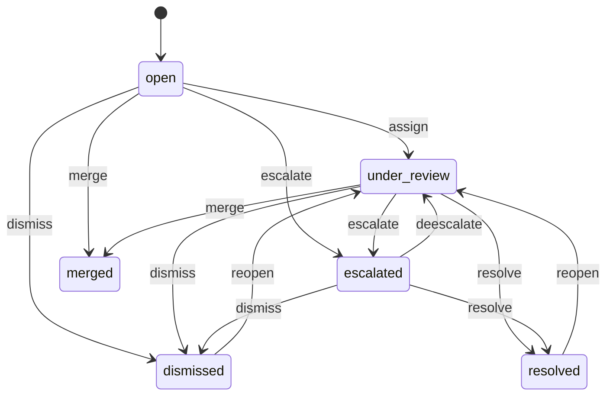
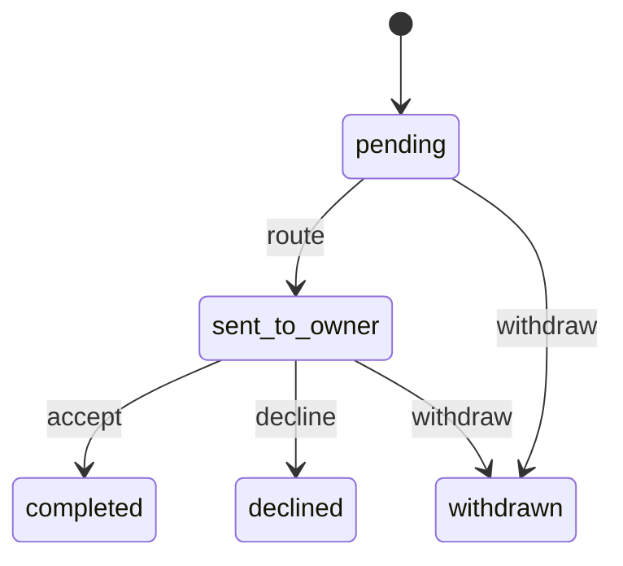
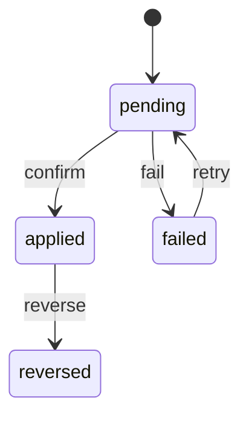
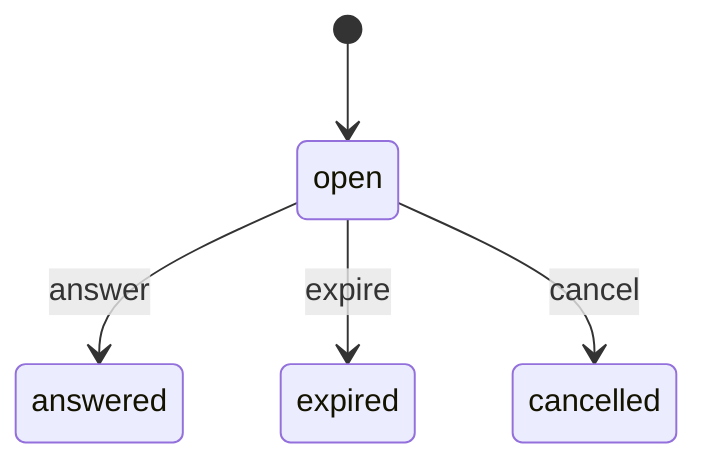
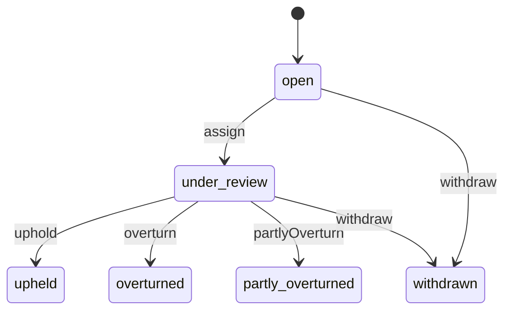

<!-- GENERATED by `npm run gen` from docs/api/modules/trust.md. Do not edit: change the spec and regenerate. -->

# Trust and risk (`trust`)

Trust and Risk's case file: reports of counterfeit goods, suspicious orders, fake reviews and abuse from customers, sellers, staff, brand owners and automated signals, with evidence, a risk score, an investigation workflow, enforcement recommendations routed to the team that owns the action, recorded enforcement with reasons, and appeals decided by someone other than the original decider. Trust recommends; Catalog, Seller Manager, Support, Finance and the other owners act.

- **Group:** After-sales and money · **Launch phase:** 1 · **Plan chapters:** 2, 10, 17, 18
- **Depends on:** [access](../access/README.md) · **Optional:** [media](../media/README.md), [catalog](../catalog/README.md), [offers](../offers/README.md), [sellers](../sellers/README.md), [customers](../customers/README.md), [orders](../orders/README.md), [payments](../payments/README.md), [reviews](../reviews/README.md), [messaging](../messaging/README.md), [support](../support/README.md), [finance](../finance/README.md), [workqueues](../workqueues/README.md), [reports](../reports/README.md), [notifications](../notifications/README.md), [audit](../audit/README.md), [identity](../identity/README.md)

## Owns
- Trust reports (TR- references) with type, source, reporter, subjects (seller, product, offer, order, customer, review, message, application, claim), description and status
- Evidence: automated checks with pass/warn/fail results, documents, photos, notes, linked records, evidence requests to the reported party with deadlines
- Risk score (0–100) with contributing factors and a recorded override
- Investigation workflow: assign, escalate, resolve with an outcome, dismiss with a reason, reopen, merge duplicates
- Enforcement recommendations routed to owner teams (suspend product or offer, restrict or suspend seller, hold payout, inform customers, remove reviews, restrict customer messaging) and the owner's accept or decline with reason
- Recorded enforcement with reason, parameters, effect on open orders and cases, execution confirmation and reversal
- Appeals against trust enforcement (customers and sellers), reviewed by someone other than the decider; read-only mirror of seller restriction appeals that came from a trust report
- Automated detection rules (review bursts, linked new accounts with mismatched payments, brand registry mismatches) that raise reports
- Application risk assessments for Seller Manager (risk level, flags, recommendation)
- What reporters see: status and outcome of reports they made, without revealing their identity to the reported party

**Not here:**
- Executing actions: catalog (products), offers (offers), sellers (restrictions, suspensions and their appeals), customers (customer restrictions), reviews (content removal), finance (holds), orders (dispatch holds), support (customer outreach and cases), messaging (conversation locks)
- Reports on individual reviews, answers and questions for ordinary moderation: reviews (it refers patterns to trust through reviews.content.referred)
- Payment fraud scoring by the provider: payments (trust consumes its signals)

## Store API

| Method | Path | Purpose | Auth | Body → Response |
|---|---|---|---|---|
| POST | `/api/store/trust/reports` | Report a listing, seller, order or message | customer | `StoreReportInput` → `MyReport` |
| GET | `/api/store/trust/reports` | Reports I made, with status and outcome | customer | Page<MyReport> |
| GET | `/api/store/trust/reports/{id}` | One report I made | customer | `MyReport` |
| POST | `/api/store/trust/reports/{id}/evidence` | Add photos or details to a report I made | customer | `{ text: text, mediaIds: uuid[]? }` → `MyReport` |
| GET | `/api/store/trust/enforcements` | Trust actions that affect my account, with appeal route | customer | `MyEnforcement[]` |
| POST | `/api/store/trust/appeals` | Appeal a trust action on my account before the deadline | customer | `{ enforcementId: uuid, argument: text, evidenceIds: uuid[]? }` → `TrustAppeal` |
| GET | `/api/store/trust/appeals` | My appeals | customer | `TrustAppeal[]` |
| GET | `/api/store/trust/evidence-requests` | Proof Trust and Risk asked me for (e.g. confirm an order or explain a message) | customer | `EvidenceRequest[]` |
| POST | `/api/store/trust/evidence-requests/{id}/answer` | Send the requested proof or explanation | customer | `{ answer: text, mediaIds: uuid[]? }` → `EvidenceRequest` |

## Seller API

| Method | Path | Purpose | Auth | Body → Response |
|---|---|---|---|---|
| POST | `/api/seller/trust/reports` | Report abuse by a customer, a counterfeit competitor offer or a listing problem | seller<br>`trust.reports.submit` | `StoreReportInput` → `MyReport` |
| GET | `/api/seller/trust/reports` | Reports this seller made | seller | Page<MyReport> |
| GET | `/api/seller/trust/evidence-requests` | Proof Trust and Risk asked this seller for (e.g. proof of supply) | seller | `EvidenceRequest[]` |
| POST | `/api/seller/trust/evidence-requests/{id}/answer` | Send the requested proof | seller<br>`trust.evidence.submit` | `{ answer: text, mediaIds: uuid[] }` → `EvidenceRequest` |
| GET | `/api/seller/trust/enforcements` | Trust actions on this seller's offers, products or claims, with appeal route | seller | `MyEnforcement[]` |
| POST | `/api/seller/trust/appeals` | Appeal a trust action on an offer, product or claim | seller<br>`trust.appeals.submit` | `{ enforcementId: uuid, argument: text, evidenceIds: uuid[]? }` → `TrustAppeal` |
| GET | `/api/seller/trust/appeals` | This seller's trust appeals | seller | `TrustAppeal[]` |

## Admin API

| Method | Path | Purpose | Auth | Body → Response |
|---|---|---|---|---|
| GET | `/api/admin/trust/overview` | Open reports by type, high risk, appeals waiting | staff<br>`trust.reports.view` | `TrustOverview` |
| GET | `/api/admin/trust/reports` | Trust queue, highest risk first | staff<br>`trust.reports.view` | Page<ReportRow> |
| GET | `/api/admin/trust/reports/{id}` | Report with evidence, linked records, recommendations, enforcement and timeline | staff<br>`trust.reports.view` | `TrustReport` |
| POST | `/api/admin/trust/reports` | Open a report as staff | staff<br>`trust.reports.investigate` | `{ type: string, title: string, description: text, subjects: TrustSubject[], evidence: EvidenceInput[]?, caseRef: string? }` → `TrustReport` |
| POST | `/api/admin/trust/reports/{id}/assign` | Assign an investigator (moves to under review) _(audited)_ | staff<br>`trust.reports.investigate` | `{ staffId: uuid, dueAt: datetime? }` → `TrustReport` |
| POST | `/api/admin/trust/reports/{id}/escalate` | Escalate to the Trust and Risk Manager or Business Owner _(audited)_ | staff<br>`trust.reports.investigate` | `{ reason: text }` → `TrustReport` |
| POST | `/api/admin/trust/reports/{id}/evidence` | Add evidence (check result, document, photo, note, linked record) _(audited)_ | staff<br>`trust.reports.investigate` | `EvidenceInput` → `EvidenceItem` |
| POST | `/api/admin/trust/reports/{id}/evidence-requests` | Ask the seller or customer for proof with a deadline _(audited)_ | staff<br>`trust.reports.investigate` | `{ to: TrustSubject, question: text, dueAt: datetime }` → `EvidenceRequest` |
| POST | `/api/admin/trust/reports/{id}/links` | Link more subjects or a support case | staff<br>`trust.reports.investigate` | `{ subjects: TrustSubject[]?, caseRefs: string[]? }` → `TrustReport` |
| POST | `/api/admin/trust/reports/{id}/risk-score` | Override the risk score with a reason _(audited)_ | staff<br>`trust.reports.investigate` | `{ score: int, reason: text }` → `TrustReport` |
| POST | `/api/admin/trust/reports/{id}/notes` | Internal note | staff<br>`trust.reports.investigate` | `{ body: text }` → `TrustReport` |
| POST | `/api/admin/trust/reports/{id}/assessment` | Record the risk assessment for a seller application or account _(audited)_ | staff<br>`trust.reports.decide` | `{ level: enum(low|medium|high), flags: json[], recommendation: text, recommendedHoldDays: int? }` → `TrustReport` |
| POST | `/api/admin/trust/reports/{id}/recommendations` | Draft an enforcement recommendation for an owner team _(audited)_ | staff<br>`trust.reports.investigate` | `RecommendationInput` → `Recommendation` |
| POST | `/api/admin/trust/recommendations/{id}/route` | Send a recommendation to its owner team _(audited)_ | staff<br>`trust.reports.decide` | `Recommendation` |
| GET | `/api/admin/trust/recommendations` | Recommendations waiting for my team | staff<br>`trust.recommendations.decide` | Page<Recommendation> |
| POST | `/api/admin/trust/recommendations/{id}/decide` | Owner team accepts (records enforcement) or declines with a reason _(audited)_ | staff<br>`trust.recommendations.decide` | `{ accept: bool, reason: text, params: json?, externalRef: string? }` → `{ recommendation: Recommendation, enforcement: Enforcement?, approval: ApprovalInfo? }` |
| POST | `/api/admin/trust/recommendations/{id}/withdraw` | Withdraw a recommendation _(audited)_ | staff<br>`trust.reports.decide` | `{ reason: text }` → `Recommendation` |
| POST | `/api/admin/trust/reports/{id}/resolve` | Resolve with an outcome and what the reporter is told _(audited)_ | staff<br>`trust.reports.decide` | `{ outcome: enum(action_taken|no_violation|insufficient_evidence|referred), summary: text, reporterOutcome: text }` → `TrustReport` |
| POST | `/api/admin/trust/reports/{id}/dismiss` | Dismiss with a reason _(audited)_ | staff<br>`trust.reports.decide` | `{ reason: text, reporterOutcome: text }` → `TrustReport` |
| POST | `/api/admin/trust/reports/{id}/reopen` | Reopen with a reason (new evidence) _(audited)_ | staff<br>`trust.reports.decide` | `{ reason: text }` → `TrustReport` |
| POST | `/api/admin/trust/reports/{id}/merge` | Merge a duplicate report into another _(audited)_ | staff<br>`trust.reports.investigate` | `{ intoReportId: uuid, reason: text }` → `TrustReport` |
| GET | `/api/admin/trust/enforcements` | Recorded enforcement with execution state | staff<br>`trust.reports.view` | Page<Enforcement> |
| POST | `/api/admin/trust/enforcements/{id}/reverse` | Reverse an enforcement (overturned appeal or error) _(audited)_ | staff<br>`trust.enforcements.reverse` | `{ reason: text }` → `Enforcement` |
| GET | `/api/admin/trust/appeals` | Appeals on trust enforcement plus linked seller restriction appeals | staff<br>`trust.reports.view` | Page<TrustAppeal> |
| POST | `/api/admin/trust/appeals/{id}/assign` | Assign a reviewer who did not make the decision _(audited)_ | staff<br>`trust.appeals.decide` | `{ reviewerId: uuid }` → `TrustAppeal` |
| POST | `/api/admin/trust/appeals/{id}/decide` | Uphold, overturn or partly overturn _(audited)_ | staff<br>`trust.appeals.decide` | `{ outcome: enum(uphold|overturn|partly_overturn), explanation: text, changes: json? }` → `TrustAppeal` |
| POST | `/api/admin/trust/reports/exports` | Export the filtered trust queue _(audited)_ | staff<br>`trust.reports.export` | `{ filters: json, format: enum(csv|xlsx)? }` → `reports.ExportJob` |
| GET | `/api/admin/trust/detection-rules` | Automated detection rules with recent hits | staff<br>`trust.rules.manage` | `DetectionRule[]` |
| PATCH | `/api/admin/trust/detection-rules/{key}` | Turn a rule on or off or change its thresholds _(audited)_ | staff<br>`trust.rules.manage` | `{ active: bool?, thresholds: json?, baseScore: int?, reason: text }` → `DetectionRule` |

## Public API

| Method | Path | Purpose | Auth | Body → Response |
|---|---|---|---|---|
| POST | `/api/public/trust/reports` | Brand or rights owner reports counterfeit listings _(phase 2)_ | visitor | `{ brandName: string, contactName: string, contactEmail: email, offerOrProductIds: uuid[], details: text, proofMediaIds: uuid[] }` → `{ ref: string, confirmationSent: bool }` |

## Types

### ReportReporter

| Field | Type |
|---|---|
| kind | `enum(customer|seller|rights_owner)` |
| customerId | `uuid?` |
| sellerId | `uuid?` |
| contactName | `string?` |
| contactEmail | `email?` Rights owners, guests who reported by email, and customer and seller reporters: the signed-in account's email (identity) is stored with the report when it is made, so the outcome reaches the reporter even when customers or sellers no longer know the account |

### StaffRef

| Field | Type |
|---|---|
| staffId | `uuid` |
| name | `string` |
| role | `string?` Role label from access.getStaffRef, e.g. Business Owner, Seller Manager (shown with appeal reviewers and deciders) |

### TrustSubject

| Field | Type |
|---|---|
| type | `enum(seller|product|offer|order|customer|review|question|answer|message|conversation|application|storefront_claim|payment)` |
| id | `uuid` |
| ref | `string?` |
| label | `string` |
| statusLabel | `string?` Current status in the owning module, e.g. Restricted |
| screen | `string?` Admin screen to open, e.g. admin/seller |

### RiskFactor

| Field | Type |
|---|---|
| factor | `string` |
| weight | `int` |
| detail | `string` |

### EvidenceItem

| Field | Type |
|---|---|
| id | `uuid` |
| kind | `enum(check|document|photo|note|record_link|signal|statement)` |
| result | `enum(fail|warn|info|ok)?` For checks, shown as the evidence list icons |
| text | `text` |
| media | `MediaRef[]` |
| source | `enum(reporter|reported_party|staff|automated|brand_owner|other_module)` |
| addedBy | `Actor` |
| addedAt | `datetime` |
| visibility | `enum(internal|shared_with_subject)` Reporter identity and internal notes are never shared |

### EvidenceInput

| Field | Type |
|---|---|
| kind | `enum(check|document|photo|note|record_link|signal|statement)` |
| result | `enum(fail|warn|info|ok)?` |
| text | `text` |
| mediaIds | `uuid[]?` |
| visibility | `enum(internal|shared_with_subject)?` |

### EvidenceRequest

| Field | Type |
|---|---|
| id | `uuid` |
| reportId | `uuid` |
| to | `TrustSubject` |
| question | `text` |
| dueAt | `datetime` |
| deadline | `Deadline` |
| state | `enum(open|answered|expired|cancelled)` |
| answer | `text?` |
| answerMedia | `MediaRef[]` |
| answeredAt | `datetime?` |
| reportRef | `string?` Reference of the report the proof is for, e.g. TR-3391 (never the reporter) |

### RestrictSellerParams

| Field | Type |
|---|---|
| title | `string` |
| reasonCode | `enum(performance|policy_violation|brand_claim|counterfeit_risk|fraud_risk|unresolved_cases|verification_lapsed|approval_condition|other)` |
| reason | `text` |
| ruleRef | `string?` |
| affectedActivities | `enum(new_listings|product_submissions|new_offers|offer_reactivation|sales|advertising|promotions|payout_schedule)[]` |
| scope | `json?` sellers.RestrictionInput scope |
| stillWorks | `string[]?` |
| toResolve | `text` |
| appealDays | `int` |
| reviewDate | `date` |
| endsAt | `datetime?` |

### WarnSellerParams

| Field | Type |
|---|---|
| kind | `enum(performance|listing|policy|conduct)` |
| title | `string` |
| detail | `text` |

### SuspendSellerParams

| Field | Type |
|---|---|
| reasonCode | `enum(performance|policy_violation|brand_claim|counterfeit_risk|fraud_risk|unresolved_cases|verification_lapsed|approval_condition|other)` |
| reason | `text` |
| reviewDate | `date` |
| openOrders | `enum(seller_keeps_fulfilling|cancel_unshipped_and_refund)` |
| secondReviewerId | `uuid?` |

### SuspendOfferParams

| Field | Type |
|---|---|
| mode | `enum(remove|hold)` |
| reviewDate | `date?` |

### CustomerRestrictionParams

| Field | Type |
|---|---|
| endsAt | `datetime?` Null: until lifted |
| customerMessage | `text?` |
| reasonCode | `enum(customer_request|suspected_takeover|abusive_messages|payment_fraud_review|policy_violation|other)` |

### HoldPayoutParams

| Field | Type |
|---|---|
| amount | `Money?` |
| reviewDate | `date` |

### RefundBuyersParams

| Field | Type |
|---|---|
| amount | `Money?` |

### Recommendation

| Field | Type |
|---|---|
| id | `uuid` |
| reportId | `uuid` |
| action | `enum(suspend_offer|suspend_product|remove_reviews|keep_reviews|restrict_seller|suspend_seller|warn_seller|revoke_claim|hold_payout|hold_dispatch|review_payments|refund_buyers|inform_customers|request_identity_confirmation|restrict_customer_messaging|restrict_customer_account|lock_conversation|other)` |
| label | `string` e.g. Suspend the Gadget Grove offer for BRL-S2 |
| ownerTeam | `enum(catalog|sellers|support|finance|orders|reviews|customers|messaging)` suspend_offer and suspend_product belong to catalog: the Catalog Manager accepts offer suspensions with offers.offers.remove (offers executes them) |
| ownerRole | `string` access role key, e.g. catalog_manager |
| owner | `StaffRef?` |
| targets | `TrustSubject[]` |
| params | `json` Action parameters the owner reviews, completed with defaults when the recommendation is accepted: RestrictSellerParams (restrict_seller), WarnSellerParams (warn_seller), SuspendSellerParams (suspend_seller), SuspendOfferParams (suspend_offer), CustomerRestrictionParams (restrict_customer_messaging, restrict_customer_account), HoldPayoutParams (hold_payout), RefundBuyersParams (refund_buyers); {} for the other actions |
| rationale | `text` |
| state | `enum(pending|sent_to_owner|completed|declined|withdrawn)` |
| createdBy | `StaffRef?` Who drafted it (Trust and Risk); never the one who decides it (SEPARATE_DUTIES) |
| routedAt | `datetime?` |
| routedBy | `StaffRef?` Who last sent it to the owner team; never the one who decides it |
| decidedAt | `datetime?` |
| decidedBy | `StaffRef?` |
| decisionReason | `text?` Reason recorded by the owner, e.g. 'Brand registry mismatch on 4 units' |
| enforcementId | `uuid?` |
| approvalRequestId | `uuid?` An accept above the owner's limit waiting for approval (access); the recommendation stays sent_to_owner and is accepted when the request is approved |

### RecommendationInput

| Field | Type |
|---|---|
| action | `enum(suspend_offer|suspend_product|remove_reviews|keep_reviews|restrict_seller|suspend_seller|warn_seller|revoke_claim|hold_payout|hold_dispatch|review_payments|refund_buyers|inform_customers|request_identity_confirmation|restrict_customer_messaging|restrict_customer_account|lock_conversation|other)` |
| label | `string` |
| ownerTeam | `enum(catalog|sellers|support|finance|orders|reviews|customers|messaging)?` Default: the action's owner team |
| ownerRole | `string?` |
| ownerStaffId | `uuid?` |
| targets | `TrustSubject[]` |
| params | `json?` See Recommendation.params |
| rationale | `text` |

### Enforcement

| Field | Type |
|---|---|
| id | `uuid` |
| ref | `string` e.g. EN-261006-0012 |
| reportId | `uuid` |
| reportRef | `string` |
| recommendationId | `uuid?` |
| action | `enum(suspend_offer|suspend_product|remove_reviews|keep_reviews|restrict_seller|suspend_seller|warn_seller|revoke_claim|hold_payout|hold_dispatch|review_payments|refund_buyers|inform_customers|request_identity_confirmation|restrict_customer_messaging|restrict_customer_account|lock_conversation|other)` |
| ownerTeam | `enum(catalog|sellers|support|finance|orders|reviews|customers|messaging)` |
| targets | `TrustSubject[]` |
| reason | `text` Recorded reason (also shown to the affected party where the owning module shows reasons) |
| params | `json` See Recommendation.params |
| effects | `string[]` What changes and what stays, e.g. 'open orders and returns stay active' |
| recordedBy | `Actor` |
| recordedAt | `datetime` |
| executionState | `enum(pending|applied|failed|reversed)` |
| appliedRef | `string?` Record in the owning module, e.g. RS-261002-0019 or a hold id |
| appliedAt | `datetime?` |
| failure | `text?` |
| appealable | `bool` |
| appealDeadline | `datetime?` |
| reversedAt | `datetime?` |
| reversalReason | `text?` |
| reversalRequestId | `uuid?` A reversal waiting for approval (trust.enforcements.reverse); the enforcement stays in place until it is approved |
| approval | `ApprovalInfo?` Set on the reverseEnforcement answer when the reversal was sent for approval |

### TrustAppeal

| Field | Type |
|---|---|
| id | `uuid` |
| ref | `string` |
| source | `enum(trust|sellers)` sellers = read-only mirror of a seller restriction appeal linked to a trust report; decide it in sellers |
| externalAppealId | `uuid?` |
| reportId | `uuid?` |
| reportRef | `string?` |
| enforcementId | `uuid?` |
| appellant | `Actor` |
| appellantName | `string` |
| decisionAppealed | `string` |
| argument | `text` |
| evidence | `MediaRef[]` |
| reviewer | `StaffRef?` |
| originalDecider | `StaffRef` |
| decideBy | `Deadline` |
| state | `enum(open|under_review|upheld|overturned|partly_overturned|withdrawn)` |
| decision | `json?` { outcome, explanation, decidedBy, decidedAt, changes } |
| filedAt | `datetime` |

### TrustReport

| Field | Type |
|---|---|
| id | `uuid` |
| ref | `string` e.g. TR-3391 |
| type | `enum(counterfeit|suspicious_orders|fake_reviews|abuse|prohibited_item|misleading_listing|seller_application|account_risk|other)` |
| title | `string` |
| description | `text` |
| source | `enum(customer|seller|staff|automated|brand_owner|referral)` |
| reporter | `json` { actor: Actor, name?, organization?, contactEmail? } — staff only; never shown to subjects. organization is the brand or rights owner a rights-owner contact reports for |
| reporterCount | `int` Merged duplicate reports, e.g. brand owner and 3 customers |
| detector | `string?` |
| subjects | `TrustSubject[]` |
| status | `enum(open|under_review|escalated|resolved|dismissed|merged)` |
| riskScore | `int` |
| riskLevel | `enum(low|medium|high)` |
| riskFactors | `RiskFactor[]` |
| riskOverride | `json?` { score, reason, by, at } |
| assignee | `StaffRef?` |
| deadline | `Deadline?` |
| evidence | `EvidenceItem[]` |
| evidenceRequests | `EvidenceRequest[]` |
| recommendations | `Recommendation[]` |
| enforcements | `Enforcement[]` |
| linkedCaseRefs | `string[]` |
| mergedReportIds | `uuid[]` |
| notes | `json[]` { id, body, author, at } internal |
| timeline | `TimelineEvent[]` |
| resolution | `json?` { outcome: action_taken|no_violation|insufficient_evidence|duplicate|referred|dismissed, summary, decidedBy, decidedAt }: duplicate when merged into another report, dismissed by dismissReport, referred by recordAssessment |
| reporterOutcome | `text?` Text the reporter sees |
| assessment | `json?` For seller_application and account_risk: { level, flags: [{ severity, text }], recommendation, recommendedHoldDays? } |
| createdAt | `datetime` |
| updatedAt | `datetime` |

### ReportRow

| Field | Type |
|---|---|
| id | `uuid` |
| ref | `string` |
| type | `string` |
| title | `string` |
| status | `string` |
| riskScore | `int` |
| riskLevel | `string` |
| source | `string` |
| reporterLabel | `string` |
| subjects | `TrustSubject[]` |
| assignee | `StaffRef?` |
| recommendations | `json` { total, pending, sentToOwner, completed, declined } |
| deadline | `Deadline?` |
| createdAt | `datetime` |

### TrustOverview

| Field | Type |
|---|---|
| open | `int` |
| highRisk | `int` |
| byType | `map<int>` Open reports per type |
| typeNotes | `map<string>` e.g. suspicious_orders: '6 orders on hold' |
| appealsWaiting | `int` |
| nextAppealDecideBy | `datetime?` |
| recommendationsWaitingOnOwners | `int` |
| queueOwner | `StaffRef?` |

### StoreReportInput

| Field | Type |
|---|---|
| type | `enum(counterfeit|prohibited_item|misleading_listing|abuse|suspicious_order|other)` |
| subject | `json` { type: offer|product|seller|order|message|conversation, id } |
| reason | `string` Reason code from the report form, e.g. may_be_counterfeit |
| details | `text?` |
| evidenceIds | `uuid[]?` |
| orderId | `uuid?` |

### MyReport

| Field | Type |
|---|---|
| id | `uuid` |
| ref | `string` |
| what | `string` e.g. Report on a listing |
| about | `string` e.g. Brightline S2 Robot Vacuum from Gadget Grove |
| youSaid | `string` |
| reportedAt | `datetime` |
| statusLabel | `enum(received|under_review|decision_made|action_taken|no_violation)` |
| outcome | `text?` |
| expectedBy | `date?` |
| caseRef | `string?` |

### MyEnforcement

| Field | Type |
|---|---|
| id | `uuid` |
| ref | `string` |
| title | `string` |
| reason | `text` |
| effects | `string[]` |
| targets | `TrustSubject[]` |
| recordedAt | `datetime` |
| appealable | `bool` |
| appealDeadline | `datetime?` |
| appealId | `uuid?` |
| appealRoute | `string` Where to appeal; restrictions on seller accounts are appealed in Account health (sellers) |

### DetectionRule

| Field | Type |
|---|---|
| key | `string` e.g. reviews.burst, orders.linked_new_accounts, offers.price_far_below_authorized |
| description | `text` |
| type | `string` |
| active | `bool` |
| thresholds | `json` |
| baseScore | `int` |
| lastRunAt | `datetime?` |
| hitsLast30Days | `int` |

## Status flows

### Trust report (`TrustReport.status`)



Resolve needs an outcome and a summary; it is blocked while a recommendation is still sent_to_owner (RECOMMENDATIONS_OPEN) unless the outcome is referred. Dismiss needs a reason and a reporter-facing message. Escalated = high risk or needs the Trust and Risk Manager / Business Owner. Merge moves subjects, evidence and reporters into the kept report.

### Recommendation (`Recommendation.state`)



Route sends it to the owner team's queue (workqueues). Accept is done by someone holding the owner team's permission for that action (e.g. catalog.products.publish for suspend_product, sellers.accounts.restrict for restrict_seller, customers.accounts.act for customer restrictions) and records an Enforcement with the owner's reason. Decline needs a reason. Trust staff cannot accept their own recommendations (separate duties, plan ch. 18). Actions that no module executes on trust.enforcement.recorded (hold_payout, hold_dispatch, review_payments, refund_buyers, inform_customers, revoke_claim, request_identity_confirmation, other) are done by the owner in its own screen first; accepting them requires externalRef, the record the owner created there (hold id, approval ref, case ref, claim id...), otherwise EXTERNAL_REF_REQUIRED (decision D4). keep_reviews needs no externalRef.

### Enforcement execution (`Enforcement.executionState`)



Confirmed when the owning module's event arrives carrying the enforcement id or the report id: suspend_product catalog.product.publication_changed; suspend_offer offers.offer.status_changed; restrict_seller sellers.seller.restricted; suspend_seller sellers.seller.suspended; warn_seller sellers.warning.issued (trustEnforcementId); remove_reviews reviews.moderation.decided (trustEnforcementId); lock_conversation messaging.conversation.locked (trustEnforcementId); restrict_customer_* customers.account.restricted; hold_payout finance.hold.placed (trustReportId, also when the hold was placed after an approval); hold_dispatch and review_payments orders.item.cancelled (trustReportId); refund_buyers returns.refund.approved (trustReportId); inform_customers support.case.opened (trustReportId). Those stay pending until the event arrives even when accepted with externalRef. Actions nothing can confirm (keep_reviews, revoke_claim, request_identity_confirmation, other) are applied when recorded. Reverse (appeal overturned or error) publishes trust.enforcement.reversed, which the executing modules consume to undo the action (customers, catalog, sellers, offers, reviews, messaging, advertising), and raises a enforcement_reversal work item in the owner team's queue so a person checks the undo (stopgap until every owner confirms reversals).

### Evidence request (`EvidenceRequest.state`)



Expiry is noted on the report as missing proof; it is not a decision by itself.

### Trust appeal (`TrustAppeal.state`)



The reviewer must differ from the person who recommended and the person who accepted the enforcement (SAME_REVIEWER_NOT_ALLOWED). Mirrored seller appeals (source sellers) follow the sellers state machine and are read-only here.

## Data (schema `trust`)

**reports**

| Column | Type |
|---|---|
| id | uuid pk |
| ref | text unique |
| type | text |
| title | text |
| description | text |
| source | text |
| reporter_kind | text |
| reporter_id | text? |
| reporter_name | text? (the reporter or, for rights owners, the contact person) |
| reporter_org | text? (rights owner's brand or organisation) |
| reporter_contact | text? |
| reporter_count | int |
| detector | text? |
| dedupe_key | text? |
| status | text |
| risk_score | int |
| risk_factors | jsonb |
| risk_override | jsonb? |
| assignee_staff_id | uuid? |
| due_at | timestamptz? |
| resolution | jsonb? |
| reporter_outcome | text? |
| assessment | jsonb? |
| merged_into_id | uuid? → reports |
| created_at | timestamptz |
| updated_at | timestamptz |

Indexes: `(status, risk_score desc)`, `(type, status)`, `(assignee_staff_id, status)`, `unique(dedupe_key) where status in ('open','under_review','escalated')`, `(reporter_kind, reporter_id, created_at desc)`

**report_subjects**

| Column | Type |
|---|---|
| report_id | uuid → reports |
| subject_type | text |
| subject_id | uuid |
| ref | text? |
| label | text |

Indexes: `(subject_type, subject_id)`, `unique(report_id, subject_type, subject_id)`

**evidence**

| Column | Type |
|---|---|
| id | uuid pk |
| report_id | uuid → reports |
| kind | text |
| result | text? |
| text | text |
| media_ids | jsonb |
| source | text |
| visibility | text |
| added_by_kind | text |
| added_by_id | text? |
| added_at | timestamptz |

Indexes: `(report_id, added_at)`

**evidence_requests**

| Column | Type |
|---|---|
| id | uuid pk |
| report_id | uuid → reports |
| to_type | text |
| to_id | uuid |
| question | text |
| due_at | timestamptz |
| state | text |
| answer | text? |
| answer_media_ids | jsonb |
| answered_at | timestamptz? |

Indexes: `(to_type, to_id, state)`, `(state, due_at)`

**recommendations**

| Column | Type |
|---|---|
| id | uuid pk |
| report_id | uuid → reports |
| action | text |
| label | text |
| owner_team | text |
| owner_role | text |
| owner_staff_id | uuid? |
| targets | jsonb |
| params | jsonb |
| rationale | text |
| state | text |
| created_by | text? (staff id who drafted it) |
| routed_at | timestamptz? |
| routed_by | text? (staff id who last routed it) |
| decided_at | timestamptz? |
| decided_by | text? |
| decision_reason | text? |
| enforcement_id | uuid? |
| approval_request_id | uuid? (pending access approval to accept it) |

Indexes: `(owner_team, state)`, `(report_id)`, `(approval_request_id) where approval_request_id is not null`

**enforcements**

| Column | Type |
|---|---|
| id | uuid pk |
| ref | text unique |
| report_id | uuid → reports |
| recommendation_id | uuid? → recommendations |
| action | text |
| owner_team | text |
| targets | jsonb |
| reason | text |
| params | jsonb |
| effects | jsonb |
| recorded_by | text |
| recorded_at | timestamptz |
| execution_state | text |
| applied_ref | text? |
| applied_at | timestamptz? |
| failure | text? |
| appealable | bool |
| appeal_deadline | timestamptz? |
| reversed_at | timestamptz? |
| reversal_reason | text? |
| reversal_request_id | uuid? (pending access approval to reverse it) |

Indexes: `(execution_state)`, `(owner_team, recorded_at desc)`, `(reversal_request_id) where reversal_request_id is not null`

**enforcement_targets**: Lookup of active enforcement by target

| Column | Type |
|---|---|
| enforcement_id | uuid → enforcements |
| target_type | text |
| target_id | uuid |

Indexes: `(target_type, target_id)`

**appeals**

| Column | Type |
|---|---|
| id | uuid pk |
| ref | text unique |
| source | text (trust|sellers) |
| external_appeal_id | uuid? |
| report_id | uuid? → reports |
| enforcement_id | uuid? → enforcements |
| appellant_kind | text |
| appellant_id | text |
| appellant_name | text |
| decision_appealed | text |
| argument | text |
| evidence_media_ids | jsonb |
| reviewer_staff_id | uuid? |
| original_decider_id | text |
| decide_by | timestamptz |
| state | text |
| decision | jsonb? |
| filed_at | timestamptz |

Indexes: `(state, decide_by)`, `unique(source, external_appeal_id) where external_appeal_id is not null`, `(appellant_kind, appellant_id)`

**report_notes**

| Column | Type |
|---|---|
| id | uuid pk |
| report_id | uuid → reports |
| body | text |
| author_id | text |
| author_name | text |
| at | timestamptz |

**report_events**: Timeline: created, merged, assigned, escalated, evidence added, recommendation routed and decided, enforcement applied, resolved

| Column | Type |
|---|---|
| id | uuid pk |
| report_id | uuid → reports |
| kind | text |
| detail | jsonb |
| actor_kind | text |
| actor_id | text? |
| at | timestamptz |

Indexes: `(report_id, at)`

**detection_rules**

| Column | Type |
|---|---|
| key | text pk |
| description | text |
| type | text |
| active | bool |
| thresholds | jsonb |
| base_score | int |
| updated_by | text |
| updated_at | timestamptz |
| last_run_at | timestamptz? |

**risk_signals**: Raw signals from events used by detection rules (sliding windows)

| Column | Type |
|---|---|
| id | uuid pk |
| kind | text |
| subject_type | text |
| subject_id | uuid |
| features | jsonb |
| at | timestamptz |

Indexes: `(kind, at)`, `(subject_type, subject_id, at)`

## Events

| Publishes | When | Payload | Consumed by |
|---|---|---|---|
| `trust.report.created` | A report is opened by a person, a detector or a referral | `{ reportId: uuid, ref: string, type: string, source: string, riskScore: int, subjects: json[] }` | notifications, workqueues |
| `trust.report.escalated` | A report is escalated | `{ reportId: uuid, reason: text }` | - |
| `trust.report.resolved` | A report is resolved or dismissed (reporters are told the outcome) | `{ reportId: uuid, ref: string, outcome: enum(action_taken|no_violation|insufficient_evidence|duplicate|referred|dismissed), reporterOutcome: text?, reporters: ReportReporter[] }` | notifications, workqueues |
| `trust.rights_report.received` | A rights owner submits a report through the public form | `{ reportId: uuid, ref: string, brandName: string, contactName: string, contactEmail: email }` | notifications |
| `trust.evidence.requested` | Proof is requested from a seller or customer (notifications tells them) | `{ requestId: uuid, reportId: uuid, reportRef: string, toType: string, toId: uuid, customerId: uuid?, sellerId: uuid?, question: text, dueAt: datetime }` | notifications |
| `trust.evidence.received` | The reported party sends proof | `{ requestId: uuid, reportId: uuid }` | - |
| `trust.recommendation.routed` | A recommendation is sent to its owner team | `{ recommendationId: uuid, reportId: uuid, action: enum(suspend_offer|suspend_product|remove_reviews|keep_reviews|restrict_seller|suspend_seller|warn_seller|revoke_claim|hold_payout|hold_dispatch|review_payments|refund_buyers|inform_customers|request_identity_confirmation|restrict_customer_messaging|restrict_customer_account|lock_conversation|other), ownerTeam: enum(catalog|sellers|support|finance|orders|reviews|customers|messaging), ownerRole: string, targets: TrustSubject[] }` | workqueues |
| `trust.recommendation.decided` | The owner team accepts or declines, or Trust withdraws it | `{ recommendationId: uuid, reportId: uuid, state: enum(completed|declined|withdrawn), reason: text }` | workqueues |
| `trust.enforcement.recorded` | An owner accepts a recommendation; the owning module executes it | `{ enforcementId: uuid, reportId: uuid, action: enum(suspend_offer|suspend_product|remove_reviews|keep_reviews|restrict_seller|suspend_seller|warn_seller|revoke_claim|hold_payout|hold_dispatch|review_payments|refund_buyers|inform_customers|request_identity_confirmation|restrict_customer_messaging|restrict_customer_account|lock_conversation|other), ownerTeam: enum(catalog|sellers|support|finance|orders|reviews|customers|messaging), targets: TrustSubject[], reason: text, params: json, appealDeadline: datetime?, alreadyApplied: bool }` | advertising, catalog, customers, messaging, offers, reviews, sellers |
| `trust.enforcement.reversed` | An enforcement is reversed (appeal overturned or error); the executing module undoes it and the owner team gets a enforcement_reversal work item | `{ enforcementId: uuid, ref: string, reportId: uuid, reportRef: string, action: enum(suspend_offer|suspend_product|remove_reviews|keep_reviews|restrict_seller|suspend_seller|warn_seller|revoke_claim|hold_payout|hold_dispatch|review_payments|refund_buyers|inform_customers|request_identity_confirmation|restrict_customer_messaging|restrict_customer_account|lock_conversation|other), ownerTeam: enum(catalog|sellers|support|finance|orders|reviews|customers|messaging), targets: TrustSubject[], params: json, appliedRef: string?, executionState: enum(pending|applied|failed), reason: text, appealId: uuid?, reversedBy: Actor, reversedAt: datetime }` | advertising, catalog, customers, messaging, offers, reviews, sellers |
| `trust.appeal.submitted` | A customer or seller appeals a trust enforcement | `{ appealId: uuid, enforcementId: uuid, decideBy: datetime }` | - |
| `trust.appeal.decided` | A trust appeal is decided (notifications tells the appellant) | `{ appealId: uuid, ref: string, enforcementId: uuid, outcome: enum(upheld|overturned|partly_overturned), explanation: text, customerId: uuid?, sellerId: uuid? }` | notifications |
| `trust.assessment.completed` | A seller application or account assessment is recorded | `{ reportId: uuid, subjectType: string, subjectId: uuid, level: string, flags: json[], recommendation: text, recommendedHoldDays: int? }` | sellers |

| Consumes | From | Does |
|---|---|---|
| `access.approval.decided` | access | Finish an accepted or reversed recommendation that needed approval (approved: apply; otherwise return it to its previous state) |
| `reviews.content.referred` | reviews | Open or extend a fake_reviews report with the referred reviews as subjects |
| `messaging.message.reported` | messaging | Open an abuse report for the conversation |
| `orders.order.placed` | orders | Feed the linked-new-accounts detection rule (accounts, cards, shipping address) |
| `payments.chargeback.opened` | payments | Add a signal to suspicious-order detection and open reports for repeated chargebacks |
| `payments.payment.failed` | payments | Signal for card-testing detection |
| `reviews.review.published` | reviews | Feed the review-burst detection rule |
| `offers.offer.created` | offers | Feed the price-far-below and restricted-brand rules. The price rule compares the offer's price with the median price of the other active offers on the product (offers.listActiveOffersForProduct), not an authorised price list (decision D7) |
| `catalog.product.publication_changed` | catalog | Confirm execution of suspend_product enforcements by trustEnforcementId (or trustReportId) on the payload |
| `offers.offer.status_changed` | offers | Confirm execution of suspend_offer enforcements by trustEnforcementId on the payload |
| `sellers.seller.restricted` | sellers | Confirm restrict_seller enforcements (trustEnforcementId) |
| `sellers.seller.suspended` | sellers | Confirm suspend_seller enforcements (trustEnforcementId) |
| `sellers.warning.issued` | sellers | Confirm warn_seller enforcements (trustEnforcementId) |
| `reviews.moderation.decided` | reviews | Confirm remove_reviews enforcements once every named review, question or answer is removed (trustEnforcementId) |
| `messaging.conversation.locked` | messaging | Confirm lock_conversation enforcements (trustEnforcementId) |
| `sellers.appeal.submitted` | sellers | Mirror appeals of restrictions that came from a trust report into the Appeals tab |
| `sellers.appeal.decided` | sellers | Update the mirrored appeal |
| `customers.account.restricted` | customers | Confirm customer restriction enforcements |
| `customers.account.restriction_lifted` | customers | Record that a customer restriction ended |
| `finance.hold.placed` | finance | Confirm hold_payout enforcements of the report named by trustReportId for the same seller (also holds placed after an approval) |
| `orders.item.cancelled` | orders | When trustReportId is set: record the staff cancellation on the report (confirms hold_dispatch, review_payments or other recommendations that ended in cancellation) |
| `returns.refund.approved` | returns | When trustReportId is set: confirm refund_buyers enforcements |
| `support.case.opened` | support | Confirm inform_customers enforcements of the report named by trustReportId; cases without trustReportId never confirm anything |
| `sellers.application.submitted` | sellers | Run application detection rules (duplicate tax id, bank token or address of a closed account, from taxIdHash, bankTokenHash and addressKey on the payload) and add signals to any assessment |

## In-process API (for other modules)

| Function | Signature | Used by |
|---|---|---|
| raiseSignal | `(input: { type: string, detector: string, title: string, subjects: TrustSubject[], evidence: EvidenceInput[], score?: int, dedupeKey: string }) => TrustReport`<br>Automated signals from other modules' detectors; de-duplicated by dedupeKey (adds evidence to the open report instead of creating a new one) | payments, reviews, orders, messaging |
| requestAssessment | `(input: { subjectType: 'seller_application' | 'seller' | 'customer', subjectId: uuid, sellerId?: uuid, question: string, requestedBy: Actor }) => { reportId: uuid, ref: string }`<br>Seller Manager asks Trust and Risk to assess an application or account; the answer comes back as trust.assessment.completed | sellers |
| reportsAbout | `(subjectType: string, subjectId: uuid) => { filedBy: int, against: int, open: int, reportIds: uuid[] }`<br>Counts for customer and seller detail pages | customers, sellers, support, graphql |
| enforcementsFor | `(subjectType: string, subjectId: uuid) => Enforcement[]`<br>Active enforcement on an offer, product, seller or customer, with appeal route | offers, catalog, sellers, customers |
| subjectIdsWithReports | `(subjectType: 'customer' | 'seller', filter: { role?: 'filed_by' | 'against', openOnly?: bool, ids?: uuid[] }) => uuid[]`<br>Ids of customers or sellers with reports filed by them (filed_by) or about them, their offers, products and claims (against; both when role is left out); openOnly keeps reports that are open, under review or escalated. With ids only those ids are checked; without, every matching id is returned. The customer and seller lists use it to filter hasAbuseReports before paging, so pages are full and totals right | customers, sellers |
| listReportsAbout | `(subjectType: 'customer' | 'seller', subjectId: uuid, filter: { role?: 'filed_by' | 'against', statuses?: string[] }, page: PageInput) => Page<TrustReport>`<br>Reports filed by or about a customer or seller (including its offers, products and claims) for the admin 360 views; reporter identity, evidence and internal notes are left out | graphql |
| getReportSummaries | `(reportIds: uuid[]) => TrustReport[]`<br>Batch lookup of reports by id (e.g. the report behind a restriction) without reporter identity, evidence or internal notes | graphql |
| exportRows | `(dataset: string, filters: json, principal: identity.Principal, cursor?: string) => { rows: json[], nextCursor?: string }`<br>Export rows for reports dataset trust.admin.reports (reporter identities only with trust.reports.export-identities) | reports |

## Permissions

| Key | Who | Allows |
|---|---|---|
| `trust.reports.view` | staff | View the trust queue, reports, enforcement and appeals |
| `trust.reports.investigate` | staff | Assign, add evidence, request proof, override risk, add notes and draft recommendations |
| `trust.reports.decide` | staff | Route recommendations, resolve, dismiss and reopen reports, record assessments |
| `trust.recommendations.decide` | staff | Owner teams (Catalog, Seller Manager, Support, Finance...) accept or decline recommendations; the action's own permission is also checked |
| `trust.enforcements.reverse` | staff | Reverse recorded enforcement |
| `trust.appeals.decide` | staff | Decide appeals on trust enforcement (never your own decision) |
| `trust.rules.manage` | staff | Change automated detection rules |
| `trust.reports.export` | staff | Export the trust queue |
| `trust.reports.export-identities` | staff | Include reporter identities in exports |
| `trust.reports.submit` | seller | Report abuse, counterfeits and listing problems |
| `trust.evidence.submit` | seller | Answer Trust and Risk evidence requests |
| `trust.appeals.submit` | seller | Appeal trust actions on offers, products and claims |

## Approval actions

Checked through the access module (limits per role, second reviewer).

| Action | Limit | Second reviewer | Approvers | Meaning |
|---|---|---|---|---|
| `trust.enforcements.reverse` | none | above-limit | Per role authority in access (Trust and Risk Manager; Business Owner when Permitted with second review) | Reverse a recorded trust enforcement |

## Error codes

| Code | Status | Meaning |
|---|---|---|
| `APPEAL_WINDOW_CLOSED` | 409 | The appeal deadline has passed |
| `APPEAL_ALREADY_OPEN` | 409 | An appeal for this enforcement is already open |
| `NOT_APPEALABLE` | 409 | This action cannot be appealed (e.g. informing customers) |
| `APPEAL_IN_SELLERS` | 409 | Seller account restrictions and suspensions are appealed and decided in sellers |
| `SAME_REVIEWER_NOT_ALLOWED` | 409 | The reviewer recommended or accepted the original action |
| `SEPARATE_DUTIES` | 403 | Trust staff cannot accept their own recommendations; the owner team decides |
| `RECOMMENDATIONS_OPEN` | 409 | Recommendations are still waiting for their owner teams |
| `DATASET_UNAVAILABLE` | 409 | The trust queue cannot be exported: the reports module is off or refused the dataset |
| `EXTERNAL_REF_REQUIRED` | 422 | No module executes this action: do it in the owning module's screen first and accept with externalRef (the hold, case, claim or approval reference) |

## Background jobs

| Job | Schedule | Does |
|---|---|---|
| `trust.run-detection` | every 5 min | Evaluate detection rules over risk_signals windows; raise or extend reports (de-duplicated) |
| `trust.rescore` | every 15 min | Recompute risk scores for open reports when evidence or signals change (overrides are kept) |
| `trust.evidence-deadlines` | hourly | Expire evidence requests past due and note it on the report |
| `trust.execution-check` | every 15 min | Flag enforcement still pending after executionGraceMinutes as failed and raise a workqueue item for the owner team |
| `trust.appeal-deadlines` | hourly | Raise workqueue items for appeals near decideBy |

## Settings

| Key | Default | Rules | Meaning |
|---|---|---|---|
| riskThresholds | `{"medium":40,"high":70}` | json, approval: second reviewer | Score bands for low, medium, high |
| highRiskDeadlineHours | `24` | duration, hours, 1–…, approval: second reviewer | Investigation deadline for high-risk reports |
| defaultDeadlineHours | `72` | duration, hours, 1–…, approval: second reviewer | Investigation deadline for other reports |
| appealWindowDays | `14` | duration, days, 1–…, approval: second reviewer, seller-visible | Days to appeal a trust enforcement |
| appealDecisionDays | `7` | duration, days, 1–…, approval: second reviewer | Target to decide an appeal |
| evidenceRequestDays | `5` | duration, days, 1–…, approval: second reviewer, seller-visible | Default deadline for proof requests |
| executionGraceMinutes | `60` | duration, minutes, 1–… | Time for an owner module to confirm execution |
| reporterRateLimitPerDay | `20` | int, 1–… | Reports per customer or seller per day |
| evidenceRetentionDays | `730` | duration, days, 365–…, approval: business owner | How long evidence is kept after resolution |

## Integrations
- **Brand registry lookups (optional)**: Check serial numbers against brand owner registries for counterfeit reports

## Notes
- Trust recommends, owners act (plan ch. 17): Catalog suspends products, offers handle offer removal, Seller Manager restricts sellers, Support informs customers, Finance holds payouts. The owner's acceptance in trust records the enforcement and publishes trust.enforcement.recorded; catalog, offers, sellers, customers, reviews, messaging and advertising execute it and their own events confirm execution.
- Owner modules that do not consume trust.enforcement.recorded (finance holds, orders dispatch holds, payments reviews, buyer refunds, support outreach, storefront claims, identity confirmation) act in their own screens; the owner then accepts the recommendation with externalRef, which is required for these actions (decision D4; EXTERNAL_REF_REQUIRED), and the event carries alreadyApplied=true so nobody executes it twice. Executing actions take an optional trustReportId so trust can confirm them: catalog setPublication, sellers createRestriction / suspendSeller / warnings (sellers.seller.restricted / suspended, sellers.warning.issued), finance placeHold (finance.hold.placed), orders cancel-items (orders.item.cancelled), customers account actions (customers.account.restricted), returns exception refunds (returns.refund.approved) and support staff cases (support.case.opened).
- Executing modules confirm with the enforcement id they were given: sellers.warning.issued, reviews.moderation.decided and messaging.conversation.locked carry trustEnforcementId; remove_reviews, warn_seller and lock_conversation are no longer applied on record. keep_reviews stays applied on record; reviews closes the open moderation items on the named content as kept.
- Reversals (decision D9): trust.enforcement.reversed carries the action, typed params, targets and the appliedRef so each executing module undoes exactly what it did (customers lifts the restriction, catalog republishes, sellers lifts the restriction or ends the suspension, offers reinstates the offer, reviews reinstates removed content, messaging unlocks, advertising resumes). Until every owner confirms its undo, trust also raises a enforcement_reversal work item in the owner team's queue (dedupe trust_reversal:<enforcementId>), closed by the owner by hand.
- Offer suspension is owned by the Catalog Manager (decision D8): suspend_offer routes to the catalog team, is accepted with offers.offers.remove and is executed by offers.
- Valid order history and access to help are preserved for everyone involved in every enforcement (plan ch. 17); each recorded effect list states what keeps working.
- Reporters are never revealed to reported parties. Reports on reviews, answers and questions stay in reviews; the account/reviews 'Reports you made' tab merges both lists.
- Appeals: trust decides appeals on its enforcement (offers, products, claims, customer restrictions from trust). Seller account restrictions and suspensions are appealed and decided in sellers; trust mirrors linked ones read-only so the Trust and Risk Manager sees them in one Appeals tab.
- Approval actions registered with access: trust.enforcements.reverse (authority). Approval limits for the executed actions (holds, restrictions) belong to the owning module's action and are checked at accept time.
- Phase 2: rights-owner reports through the public form and stronger moderation tooling; automated detection, evidence, recommendations, enforcement and appeals are phase 1 because the admin/trust screen and the launch checklist depend on them.
- Exports: trust registers dataset trust.admin.reports with reports.registerDataset and serves the rows through exportRows; reporter identity columns need trust.reports.export-identities.

## GraphQL (read layer)

This module's fragment of the GraphQL schemas (see [../graphql/README.md](../graphql/README.md)). Writes stay on the REST endpoints above.

```graphql
# trust: Trust and Risk reports (counterfeit, suspicious orders, fake reviews, abuse), their risk score, recorded
# enforcement and outcome. In GraphQL, trust only adds the reports linked to the admin 360 views (customer, seller)
# and the report behind a restriction. Investigating and deciding stay on REST (admin/trust screen).
# Admin Center only. Reporter identities are never exposed here.

enum TrustReportType @areas(in: [ADMIN]) {
  COUNTERFEIT
  SUSPICIOUS_ORDERS
  FAKE_REVIEWS
  ABUSE
  PROHIBITED_ITEM
  MISLEADING_LISTING
  SELLER_APPLICATION
  ACCOUNT_RISK
  OTHER
}

enum TrustReportStatus @areas(in: [ADMIN]) {
  OPEN
  UNDER_REVIEW
  ESCALATED
  RESOLVED
  DISMISSED
  MERGED
}

enum TrustReportSource @areas(in: [ADMIN]) {
  CUSTOMER
  SELLER
  STAFF
  AUTOMATED
  BRAND_OWNER
  REFERRAL
}

enum TrustRiskLevel @areas(in: [ADMIN]) {
  LOW
  MEDIUM
  HIGH
}

enum TrustSubjectType @areas(in: [ADMIN]) {
  SELLER
  PRODUCT
  OFFER
  ORDER
  CUSTOMER
  REVIEW
  QUESTION
  ANSWER
  MESSAGE
  CONVERSATION
  APPLICATION
  STOREFRONT_CLAIM
  PAYMENT
}

"How the 360 subject relates to a report"
enum TrustSubjectRole @areas(in: [ADMIN]) {
  "Reports this customer or seller filed"
  FILED_BY
  "Reports about this customer or seller (or their offers, products, messages)"
  AGAINST
}

"Something a report is about, with its status in the owning module"
type TrustSubject @areas(in: [ADMIN]) {
  type: TrustSubjectType!
  id: UUID!
  ref: String
  label: String!
  "Current status in the owning module, e.g. Restricted"
  statusLabel: String
  "Admin screen to open, e.g. admin/seller"
  screen: String
}

"Counts of recommendations by state on a report"
type TrustRecommendationCounts @areas(in: [ADMIN]) {
  total: Int!
  pending: Int!
  sentToOwner: Int!
  completed: Int!
  declined: Int!
}

enum TrustEnforcementState @areas(in: [ADMIN]) {
  PENDING
  APPLIED
  FAILED
  REVERSED
}

"Enforcement recorded from a report: who decided, why, and what changed (executed by the owning module)"
type TrustEnforcement @areas(in: [ADMIN]) {
  id: UUID!
  "e.g. EN-261006-0012"
  ref: String!
  "e.g. restrict_seller, suspend_offer, restrict_customer_messaging"
  action: String!
  "catalog, sellers, support, finance, orders, reviews, customers or messaging"
  ownerTeam: String!
  reason: String!
  "What changes and what stays, e.g. open orders and returns stay active"
  effects: [String!]!
  recordedBy: Actor!
  recordedAt: DateTime!
  executionState: TrustEnforcementState!
  "Record in the owning module, e.g. RS-261002-0019"
  appliedRef: String
  appealable: Boolean!
  appealDeadline: DateTime
  reversedAt: DateTime
}

type TrustReportResolution @areas(in: [ADMIN]) {
  "action_taken, no_violation, insufficient_evidence, duplicate (merged), referred or dismissed"
  outcome: String!
  summary: String!
  decidedBy: Actor!
  decidedAt: DateTime!
}

"A Trust and Risk report as listed on admin 360 views. The full case file (evidence, notes, reporter) stays on REST."
type TrustReport @areas(in: [ADMIN]) {
  id: UUID!
  "e.g. TR-3391"
  ref: String!
  type: TrustReportType!
  title: String!
  description: String!
  source: TrustReportSource!
  "Merged duplicate reports, e.g. brand owner and 3 customers"
  reporterCount: Int!
  subjects: [TrustSubject!]!
  status: TrustReportStatus!
  riskScore: Int!
  riskLevel: TrustRiskLevel!
  assignee: Actor
  deadline: Deadline
  recommendations: TrustRecommendationCounts!
  enforcements: [TrustEnforcement!]!
  "Support cases linked to the report, e.g. CS-104933"
  linkedCaseRefs: [String!]!
  resolution: TrustReportResolution
  createdAt: DateTime!
  updatedAt: DateTime!
}

type TrustReportPage implements Paged @areas(in: [ADMIN]) {
  items: [TrustReport!]!
  nextCursor: String
  page: Int
  totalPages: Int
  total: Int
}

"Abuse report counts for customer and seller detail pages and lists"
type TrustReportCounts @areas(in: [ADMIN]) {
  filedBy: Int!
  against: Int!
  open: Int!
}

# ------------------------------------------------------------------ extensions

extend type Customer {
  "Abuse reports filed by and against this customer (customer list and 360)"
  trustReportCounts: TrustReportCounts @areas(in: [ADMIN]) @auth(requires: STAFF, permission: "customers.accounts.view") @source(module: "trust", fn: "reportsAbout")
  "Linked Trust and Risk reports, newest first. No role = both."
  trustReports(role: TrustSubjectRole, statuses: [TrustReportStatus!], paging: PageInput): TrustReportPage @areas(in: [ADMIN]) @auth(requires: STAFF, permission: "trust.reports.view") @source(module: "trust", fn: "listReportsAbout") @cost(weight: 5)
}

extend type Seller {
  "Abuse reports filed by and against this seller (seller 360)"
  trustReportCounts: TrustReportCounts @areas(in: [ADMIN]) @auth(requires: STAFF, permission: "sellers.accounts.view") @source(module: "trust", fn: "reportsAbout")
  "Linked Trust and Risk reports (about the seller, its offers, products and claims), newest first. No role = both."
  trustReports(role: TrustSubjectRole, statuses: [TrustReportStatus!], paging: PageInput): TrustReportPage @areas(in: [ADMIN]) @auth(requires: STAFF, permission: "trust.reports.view") @source(module: "trust", fn: "listReportsAbout") @cost(weight: 5)
}

extend type SellerRestriction {
  "The Trust and Risk report the restriction came from"
  trustReport: TrustReport @areas(in: [ADMIN]) @auth(requires: STAFF, permission: "trust.reports.view") @source(module: "trust", fn: "getReportSummaries")
}

extend type CustomerRestriction {
  "The Trust and Risk report the restriction came from"
  trustReport: TrustReport @areas(in: [ADMIN]) @auth(requires: STAFF, permission: "trust.reports.view") @source(module: "trust", fn: "getReportSummaries")
}
```
