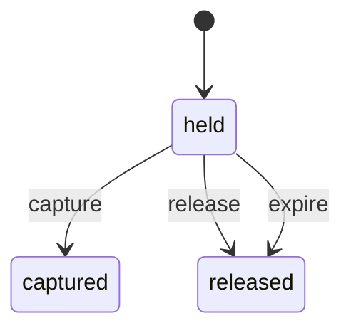
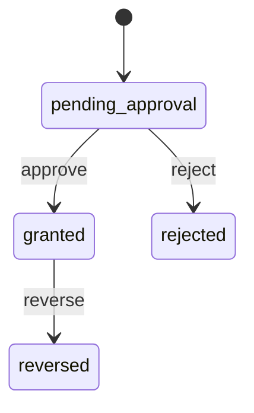
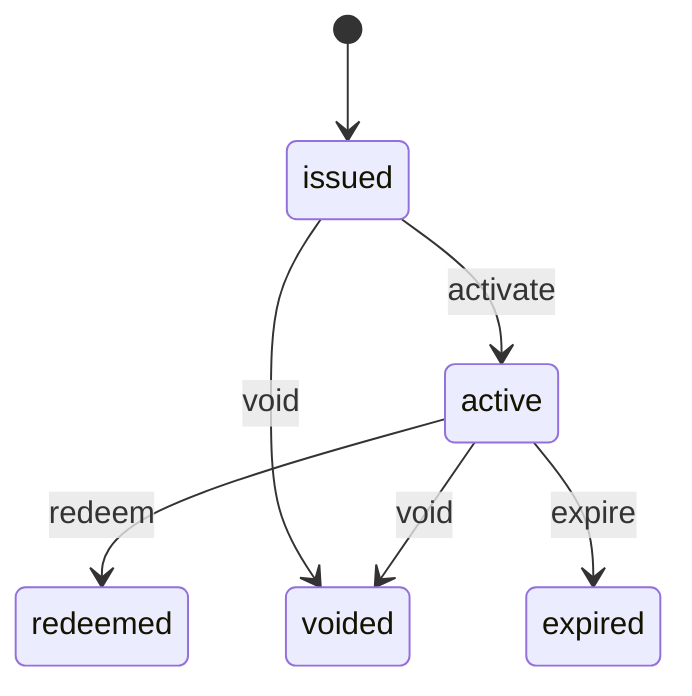

<!-- GENERATED by `npm run gen` from docs/api/modules/wallet.md. Do not edit: change the spec and regenerate. -->

# Wallet (`wallet`)

Customer store credit with an auditable ledger (refunds to credit, goodwill credit within approval limits, price adjustments, use at checkout, expiry), gift cards, and a placeholder for loyalty rewards. Checkout and payments use the balance through the in-process public API.

- **Group:** Later phases · **Launch phase:** 3 · **Plan chapters:** 15, 7, 13, 6
- **Depends on:** [customers](../customers/README.md), [payments](../payments/README.md) · **Optional:** [access](../access/README.md), [support](../support/README.md), [orders](../orders/README.md), [notifications](../notifications/README.md), [finance](../finance/README.md), [audit](../audit/README.md)

## Owns
- Store credit accounts and balance, made of credit lots with their source and expiry
- Credit ledger: refund to credit, goodwill credit, price adjustment, gift card redemption, checkout hold, capture and release, reversal on refund of an order paid with credit, expiry, staff correction
- Goodwill credit grants with reason, linked case or order, and approval above the staff member's limit
- Holds at checkout (reserve while payment runs, capture on order acceptance, release on failure)
- Gift cards: issuance in batches, codes, balance check, redemption into store credit, void and expiry
- Loyalty points ledger (phase 4 experiment; designed, off)

**Not here:**
- Card refunds and the choice of refund destination: payments and returns (they call creditRefund when the customer chose store credit)
- Case decisions and remedies: support (calls grantGoodwill)
- Coupons and discounts: promotions
- Accounting of the credit liability: finance (consumes wallet events)
- Approval limits and second reviewers: access

## Store API

| Method | Path | Purpose | Auth | Body → Response |
|---|---|---|---|---|
| GET | `/api/store/wallet/credit` | Store credit balance, lots with expiry and recent history | customer | `WalletOverview` |
| GET | `/api/store/wallet/credit/entries` | Credit history | customer | Page<LedgerEntry> |
| POST | `/api/store/wallet/gift-cards/redeem` | Add a gift card to store credit _(idempotent)_ | customer | `{ code: string }` → `WalletOverview` |
| POST | `/api/store/wallet/gift-cards/check` | Check a gift card balance | shopper | `{ code: string }` → `{ remaining: Money, expiresAt: datetime?, state: string }` |
| GET | `/api/store/wallet/loyalty` | Loyalty points (experiment; NOT_IMPLEMENTED until a program is defined) _(phase 4)_ | customer | `LoyaltyAccount` |

## Admin API

| Method | Path | Purpose | Auth | Body → Response |
|---|---|---|---|---|
| GET | `/api/admin/wallet/customers/{customerId}` | A customer's credit balance, lots, goodwill in the last 30 days and pending grants | staff<br>`wallet.credit.view` | `CustomerWalletAdmin` |
| GET | `/api/admin/wallet/customers/{customerId}/entries` | A customer's credit ledger | staff<br>`wallet.credit.view` | Page<LedgerEntry> |
| POST | `/api/admin/wallet/goodwill` | Grant goodwill credit with a reason _(idempotent, audited)_ | staff<br>`wallet.goodwill.grant` | `GoodwillInput` → `GoodwillGrant` |
| GET | `/api/admin/wallet/goodwill` | Goodwill grants for review | staff<br>`wallet.credit.view` | Page<GoodwillGrant> |
| POST | `/api/admin/wallet/goodwill/{id}/reverse` | Reverse an unused goodwill grant _(idempotent, audited)_ | staff<br>`wallet.credit.correct` | `{ reason: text }` → `GoodwillGrant` |
| POST | `/api/admin/wallet/customers/{customerId}/corrections` | Correct a balance (positive or negative) with a reason _(idempotent, audited)_ | staff<br>`wallet.credit.correct` | `{ amount: Money, reason: text, reference: string? }` → `LedgerEntry` |
| POST | `/api/admin/wallet/gift-cards` | Issue a batch of gift cards _(idempotent, audited)_ | staff<br>`wallet.gift_cards.manage` | `GiftCardBatchInput` → `{ batchId: uuid, count: int, total: Money, codesFileId: uuid }` |
| GET | `/api/admin/wallet/gift-cards` | Gift cards | staff<br>`wallet.gift_cards.manage` | Page<GiftCard> |
| POST | `/api/admin/wallet/gift-cards/{id}/void` | Void a gift card (lost, fraud) _(idempotent, audited)_ | staff<br>`wallet.gift_cards.manage` | `{ reason: text }` → `GiftCard` |

## Types

### CreditBalance

| Field | Type |
|---|---|
| customerId | `uuid` |
| available | `Money` |
| held | `Money` |
| nextExpiry | `LotExpiry?` |
| usableOn | `string` e.g. Any item from any seller; not on gift cards |

### LotExpiry

| Field | Type |
|---|---|
| amount | `Money` |
| expiresAt | `datetime` |

### CreditLot

| Field | Type |
|---|---|
| id | `uuid` |
| source | `enum(refund|goodwill|price_adjustment|gift_card|correction)` |
| original | `Money` |
| remaining | `Money` |
| expiresAt | `datetime?` |
| createdAt | `datetime` |
| reference | `string?` |

### LedgerEntry

| Field | Type |
|---|---|
| id | `uuid` |
| at | `datetime` |
| kind | `enum(refund_to_credit|goodwill|price_adjustment|gift_card_redeemed|hold|capture|release|order_refund_returned|expiry|correction|reversal)` |
| amount | `Money` Signed: credits positive, uses negative |
| balanceAfter | `Money` |
| label | `string` e.g. Goodwill credit · case CS-260903-1876, late delivery; Used on order MK-260830-11764 |
| orderId | `uuid?` |
| orderRef | `string?` |
| caseRef | `string?` |
| refundId | `uuid?` |
| actor | `Actor?` |
| reason | `text?` |

### CreditHold

| Field | Type |
|---|---|
| id | `uuid` |
| customerId | `uuid` |
| quoteId | `uuid` |
| orderId | `uuid?` |
| amount | `Money` |
| state | `enum(held|captured|released)` |
| expiresAt | `datetime` |

### WalletOverview

| Field | Type |
|---|---|
| balance | `CreditBalance` |
| lots | `CreditLot[]` |
| recent | `LedgerEntry[]` |
| giftCardsEnabled | `bool` |
| howToUse | `string` e.g. Choose to use it at the payment step of checkout. |

### GoodwillInput

| Field | Type |
|---|---|
| customerId | `uuid` |
| amount | `Money` |
| reason | `text` |
| reasonCode | `enum(late_delivery|service_failure|price_adjustment|damaged_item|other)` |
| caseId | `uuid?` |
| orderId | `uuid?` |
| chargedTo | `enum(platform|seller)` Seller-charged goodwill is posted to seller earnings by finance |
| sellerId | `uuid?` |
| expiresInDays | `int?` |

### GoodwillGrant

| Field | Type |
|---|---|
| id | `uuid` |
| customerId | `uuid` |
| customerName | `string?` |
| amount | `Money` |
| reason | `text` |
| reasonCode | `string` |
| caseRef | `string?` |
| orderRef | `string?` |
| chargedTo | `enum(platform|seller)` |
| sellerId | `uuid?` |
| state | `enum(pending_approval|granted|rejected|reversed)` |
| approval | `ApprovalInfo?` |
| requestedBy | `Actor` |
| decidedBy | `Actor?` |
| createdAt | `datetime` |
| grantedAt | `datetime?` |
| ledgerEntryId | `uuid?` |

### GiftCard

| Field | Type |
|---|---|
| id | `uuid` |
| codeLast4 | `string` |
| batchId | `uuid?` |
| initial | `Money` |
| remaining | `Money` |
| state | `enum(issued|active|redeemed|voided|expired)` |
| purpose | `enum(promotional|customer_service|sold)` |
| expiresAt | `datetime?` |
| redeemedBy | `uuid?` |
| redeemedAt | `datetime?` |
| createdBy | `Actor` |
| createdAt | `datetime` |

### GiftCardBatchInput

| Field | Type |
|---|---|
| count | `int` |
| amount | `Money` |
| purpose | `enum(promotional|customer_service|sold)` |
| expiresAt | `datetime?` |
| reason | `text` |
| costCenter | `string?` |

### CustomerWalletAdmin

| Field | Type |
|---|---|
| balance | `CreditBalance` |
| lots | `CreditLot[]` |
| goodwillLast30Days | `Money` |
| goodwillLimitPerCustomer | `Money` |
| pendingGrants | `GoodwillGrant[]` |

### LoyaltyAccount

| Field | Type |
|---|---|
| customerId | `uuid` |
| points | `int` |
| tier | `string?` |
| pendingPoints | `int` |
| programTerms | `string?` |

## Status flows

### Credit hold (`CreditHold.state`)



A hold never outlives holdTtlMinutes; captured credit returns only through creditRefund.

### Goodwill grant (`GoodwillGrant.state`)



Within the requester's goodwill limit the grant is approved immediately (pending_approval → granted in the same call). Above it, an access approval request is raised (e.g. Support limit $50, Finance $2,000). reverse removes unused credit only, with a reason.

### Gift card (`GiftCard.state`)



Redeeming moves the full remaining value into a store credit lot (source gift_card). Expiry follows the law of the service region; default no expiry for sold cards.

## Data (schema `wallet`)

**accounts**

| Column | Type |
|---|---|
| customer_id | uuid pk |
| currency | text |
| available | bigint |
| held | bigint |
| updated_at | timestamptz |
| version | int |

**lots**: Credit in buckets with source and expiry; uses consume earliest-expiring first

| Column | Type |
|---|---|
| id | uuid pk |
| customer_id | uuid → accounts |
| source | text |
| original | bigint |
| remaining | bigint |
| expires_at | timestamptz? |
| reference | text? |
| state | text (active|depleted|expired) |
| created_at | timestamptz |

Indexes: `(customer_id, state, expires_at)`

**ledger**: Append-only; balance is the sum of entries

| Column | Type |
|---|---|
| id | uuid pk |
| customer_id | uuid → accounts |
| kind | text |
| amount | bigint |
| balance_after | bigint |
| lot_allocations | jsonb |
| order_id | uuid? |
| refund_id | uuid? |
| case_id | uuid? |
| hold_id | uuid? |
| idempotency_key | text? |
| actor_kind | text |
| actor_id | text? |
| reason | text? |
| at | timestamptz |

Indexes: `(customer_id, at)`, `unique (idempotency_key)`, `unique (refund_id, kind) where refund_id is not null`

**holds**

| Column | Type |
|---|---|
| id | uuid pk |
| customer_id | uuid → accounts |
| quote_id | uuid |
| order_id | uuid? |
| amount | bigint |
| state | text |
| expires_at | timestamptz |
| idempotency_key | text unique |

**goodwill_grants**

| Column | Type |
|---|---|
| id | uuid pk |
| customer_id | uuid |
| amount | bigint |
| currency | text |
| reason | text |
| reason_code | text |
| case_id | uuid? |
| order_id | uuid? |
| charged_to | text |
| seller_id | uuid? |
| state | text |
| approval_request_id | uuid? |
| requested_by | text |
| decided_by | text? |
| ledger_entry_id | uuid? |
| idempotency_key | text unique |
| created_at | timestamptz |

Indexes: `(state, created_at)`, `(customer_id, created_at)`

**gift_cards**

| Column | Type |
|---|---|
| id | uuid pk |
| code_hash | text unique |
| code_last4 | text |
| batch_id | uuid? |
| initial | bigint |
| remaining | bigint |
| currency | text |
| state | text |
| purpose | text |
| expires_at | timestamptz? |
| redeemed_by | uuid? |
| redeemed_at | timestamptz? |
| created_by | text |
| created_at | timestamptz |

**loyalty_entries**: Phase 4 experiment: points earned and spent

| Column | Type |
|---|---|
| id | uuid pk |
| customer_id | uuid |
| points | int |
| kind | text |
| order_id | uuid? |
| at | timestamptz |

## Events

| Publishes | When | Payload | Consumed by |
|---|---|---|---|
| `wallet.credit.granted` | Credit is added (refund to credit, goodwill, price adjustment, gift card) | `{ customerId: uuid, entryId: uuid, kind: enum(refund_to_credit|order_refund_returned|goodwill|price_adjustment|gift_card_redeemed), amount: Money, chargedTo: enum(platform|seller)?, sellerId: uuid?, caseId: uuid?, orderId: uuid? }` | finance |
| `wallet.credit.used` | A hold is captured on an accepted order | `{ customerId: uuid, orderId: uuid, amount: Money }` | finance |
| `wallet.credit.expired` | A lot expires unused | `{ customerId: uuid, lotId: uuid, amount: Money }` | - |
| `wallet.credit.expiring` | A lot with an unused balance reaches one of expiryReminderDays before it expires | `{ customerId: uuid, lotId: uuid, amount: Money, expiresAt: datetime, daysLeft: int }` | notifications |
| `wallet.credit.reversed` | A goodwill grant is reversed | `{ customerId: uuid, grantId: uuid, amount: Money, reason: text }` | - |
| `wallet.credit.corrected` | Staff correct a balance | `{ customerId: uuid, entryId: uuid, amount: Money, reason: text }` | - |
| `wallet.goodwill.decided` | A goodwill grant waiting for approval is granted or rejected | `{ grantId: uuid, customerId: uuid, status: enum(granted|rejected), amount: Money, caseId: uuid? }` | support |
| `wallet.gift_card.issued` | A gift card batch is issued | `{ batchId: uuid, count: int, total: Money, purpose: string }` | - |
| `wallet.gift_card.redeemed` | A gift card is added to store credit | `{ giftCardId: uuid, customerId: uuid, amount: Money }` | - |

| Consumes | From | Does |
|---|---|---|
| `orders.order.placed` | orders | Capture the quote's credit hold if payments has not already |
| `payments.payment.failed` | payments | Release the quote's credit hold |
| `access.approval.decided` | access | Grant or reject pending goodwill, corrections and gift card batches |
| `identity.user.registered` | identity | Create an empty wallet account lazily on first credit (no-op otherwise) |

## In-process API (for other modules)

| Function | Signature | Used by |
|---|---|---|
| getBalance | `(customerId: uuid) => CreditBalance`<br>Available balance and soonest expiry, for checkout step 4 'Use my Marketly credit'. | checkout, customers, graphql |
| holdCredit | `(customerId: uuid, quoteId: uuid, amount: Money, idempotencyKey: string) => CreditHold`<br>Reserve credit for a quote; earliest-expiring lots first. Fails with INSUFFICIENT_CREDIT. | checkout, payments |
| captureHold | `(holdId: uuid, orderId: uuid) => CreditHold`<br>Turn a hold into a use when the order is accepted. | payments, checkout |
| releaseHold | `(holdId: uuid) => CreditHold`<br>Release a hold on payment failure or quote expiry. | payments, checkout |
| creditRefund | `(input: { customerId: uuid, refundId: uuid, orderId: uuid, amount: Money, reason: string }, idempotencyKey: string) => LedgerEntry`<br>Refund to store credit (customer's choice) or return the credit part of a refunded order. Called by returns for return refunds to store credit and by payments for the refunds it executes (other origins with destination store_credit, and the credit part of a mixed tender). Idempotent per refundId; the payment tender split decides how much goes back to credit. | payments, returns |
| grantGoodwill | `(input: GoodwillInput, actor: Actor, idempotencyKey: string) => GoodwillGrant`<br>Goodwill credit from a support case or order; above the actor's limit it becomes pending approval. | support |
| getCustomerWallet | `(customerId: uuid) => CustomerWalletAdmin`<br>Staff view of a customer's credit: balance, lots, goodwill in the last 30 days against the per-customer limit, and pending grants (GET /admin/wallet/customers/{customerId}). | graphql |

## Permissions

| Key | Who | Allows |
|---|---|---|
| `wallet.credit.view` | staff | View customer credit balances, ledgers and goodwill grants |
| `wallet.goodwill.grant` | staff | Grant goodwill credit within the approval limit |
| `wallet.credit.correct` | staff | Reverse goodwill and correct balances (Finance) |
| `wallet.gift_cards.manage` | staff | Issue, list and void gift cards |

## Approval actions

Checked through the access module (limits per role, second reviewer).

| Action | Limit | Second reviewer | Approvers | Meaning |
|---|---|---|---|---|
| `wallet.goodwill.grant` | money | above-limit | Support up to $50 (example); a Finance member whose limit covers it (e.g. Finance $2,000) above that | Grant goodwill store credit to a customer |
| `wallet.credit.correct` | money | above-limit | Within the caller's adjustment limit; a second Finance reviewer above it | Correct a customer's store credit balance |
| `wallet.gift-cards.issue` | money | above-limit | Within the caller's limit; Finance Manager above it | Issue a batch of gift cards (batch total) |

## Error codes

| Code | Status | Meaning |
|---|---|---|
| `INSUFFICIENT_CREDIT` | 409 | Available credit is lower than requested. |
| `GOODWILL_LIMIT_EXCEEDED` | 409 | The customer's 30-day goodwill limit would be exceeded. |
| `CREDIT_ALREADY_USED` | 409 | The credit was already used and cannot be reversed. |
| `GIFT_CARD_INVALID` | 422 | Unknown, voided, expired or already redeemed gift card. |

## Background jobs

| Job | Schedule | Does |
|---|---|---|
| `wallet.expire-lots` | daily 00:30 market time | Expire lots past expiresAt (wallet.credit.expired); publish wallet.credit.expiring for lots expiryReminderDays (30 and 7) days before expiry, once per lot and reminder |
| `wallet.release-stale-holds` | every 1 min | Release holds past expiresAt |
| `wallet.balance-check` | daily | Verify every account balance equals the ledger sum; flag differences to Finance checks |

## Settings

| Key | Default | Rules | Meaning |
|---|---|---|---|
| creditExpiryMonths | `12` | duration, months, 1–…, approval: business owner | Default expiry of goodwill and price-adjustment credit (refund credit follows local rules; default none) |
| expiryReminderDays | `[30,7]` | json | Days before a lot expires when the customer is reminded (wallet.credit.expiring) |
| goodwillMaxPerCustomer30Days | `{"amount":10000,"currency":"USD"}` | money, 0–…, approval: business owner | Goodwill a customer can receive in 30 days before Finance approval is always needed |
| holdTtlMinutes | `30` | duration, minutes, 1–… | Checkout hold lifetime |
| giftCardsEnabled | `false` | bool, approval: business owner | Gift cards are a later service |
| loyaltyEnabled | `false` | bool, approval: business owner | Loyalty experiment (phase 4) |

## Notes
- Phase 3 (plan ch. 15 'later services'; ch. 7 'Coupons, Credits when supported'). The store-credit part of account/coupons and the 'Use my Marketly credit' checkbox in checkout use this module when enabled.
- Money moves only through the ledger; every write is idempotent (refundId, Idempotency-Key) so a retry never credits twice.
- Store credit used at checkout is a payment tender: payments records the tender split, and a later refund returns the credit part through creditRefund before any card refund.
- Goodwill funded by a seller (e.g. late dispatch) is posted to seller earnings by finance from wallet.credit.granted with chargedTo=seller; platform goodwill is a company cost.
- Granting access is not financial authority: goodwill and corrections use approval limits from access, never the permission alone.
- dependsOn follows the architecture doc (customers, payments); access is optional only so the module can boot alone in tests — production requires it for limits.

## GraphQL (read layer)

This module's fragment of the GraphQL schemas (see [../graphql/README.md](../graphql/README.md)). Writes stay on the REST endpoints above.

```graphql
# wallet (phase 3): store credit balance, lots and ledger, and the staff view of a customer's credit.
# Holds, captures, refunds to credit, goodwill grants, corrections and gift cards stay on REST and the
# in-process API (idempotency, approval limits, audit).

"Soonest-expiring credit"
type WalletLotExpiry @areas(in: [STORE, ADMIN]) @phase(n: 3) {
  amount: Money!
  expiresAt: DateTime!
}

enum WalletLotSource @areas(in: [STORE, ADMIN]) {
  REFUND
  GOODWILL
  PRICE_ADJUSTMENT
  GIFT_CARD
  CORRECTION
}

"A credit lot; lots are used earliest-expiring first"
type WalletCreditLot @areas(in: [STORE, ADMIN]) @phase(n: 3) {
  id: UUID!
  source: WalletLotSource!
  original: Money!
  remaining: Money!
  expiresAt: DateTime
  createdAt: DateTime!
  "e.g. case CS-260903-1876"
  reference: String
}

enum WalletEntryKind @areas(in: [STORE, ADMIN]) {
  REFUND_TO_CREDIT
  GOODWILL
  PRICE_ADJUSTMENT
  GIFT_CARD_REDEEMED
  HOLD
  CAPTURE
  RELEASE
  ORDER_REFUND_RETURNED
  EXPIRY
  CORRECTION
  REVERSAL
}

"One line of the credit history"
type WalletLedgerEntry @areas(in: [STORE, ADMIN]) @phase(n: 3) {
  id: UUID!
  at: DateTime!
  kind: WalletEntryKind!
  "Signed: credits positive, uses negative"
  amount: Money!
  balanceAfter: Money!
  "e.g. Goodwill credit · case CS-260903-1876, late delivery; Used on order MK-260830-11764"
  label: String!
  orderRef: String
  caseRef: String
  "Staff who made the entry (admin only)"
  actor: Actor @areas(in: [ADMIN])
  "Internal reason (admin only)"
  reason: String @areas(in: [ADMIN])
}

"Store credit balance (Account overview tile, Coupons and credit, checkout)"
type WalletBalance @areas(in: [STORE, ADMIN]) @phase(n: 3) {
  available: Money!
  "Reserved for a checkout in progress"
  held: Money!
  nextExpiry: WalletLotExpiry
  "e.g. Any item from any seller; not on gift cards"
  usableOn: String!
  lots: [WalletCreditLot!]!
  "Latest credit history entries"
  recentEntries(limit: Int = 5): [WalletLedgerEntry!]!
}

enum WalletGoodwillState @areas(in: [ADMIN]) {
  PENDING_APPROVAL
  GRANTED
  REJECTED
  REVERSED
}

enum WalletChargedTo @areas(in: [ADMIN]) {
  PLATFORM
  SELLER
}

"A goodwill credit grant with its approval"
type WalletGoodwillGrant @areas(in: [ADMIN]) @phase(n: 3) {
  id: UUID!
  amount: Money!
  reason: String!
  reasonCode: String!
  caseRef: String
  orderRef: String
  chargedTo: WalletChargedTo!
  sellerId: UUID
  state: WalletGoodwillState!
  approval: ApprovalInfo
  requestedBy: Actor!
  decidedBy: Actor
  createdAt: DateTime!
  grantedAt: DateTime
}

"Customer 360 credit panel: balance, goodwill in the last 30 days against the limit, pending grants"
type WalletCustomerAdmin @areas(in: [ADMIN]) @phase(n: 3) {
  balance: WalletBalance!
  goodwillLast30Days: Money!
  goodwillLimitPerCustomer: Money!
  pendingGrants: [WalletGoodwillGrant!]!
}

# ------------------------------------------------------------------ fields on other modules' types

extend type Customer {
  "My store credit (Account overview tile)"
  wallet: WalletBalance @areas(in: [STORE]) @phase(n: 3) @source(module: "wallet", fn: "getBalance")
  "Staff view of this customer's credit (Admin customer 360)"
  walletAdmin: WalletCustomerAdmin @areas(in: [ADMIN]) @auth(requires: STAFF, permission: "wallet.credit.view") @phase(n: 3) @source(module: "wallet", fn: "getCustomerWallet")
}
```
