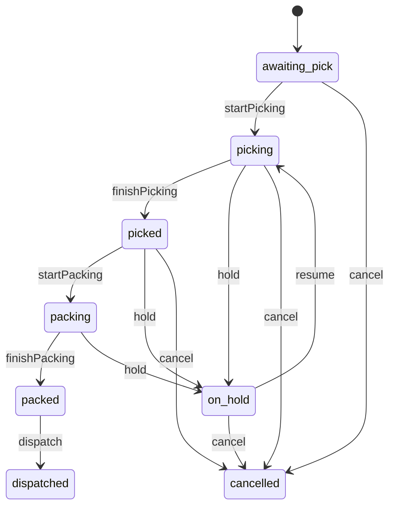
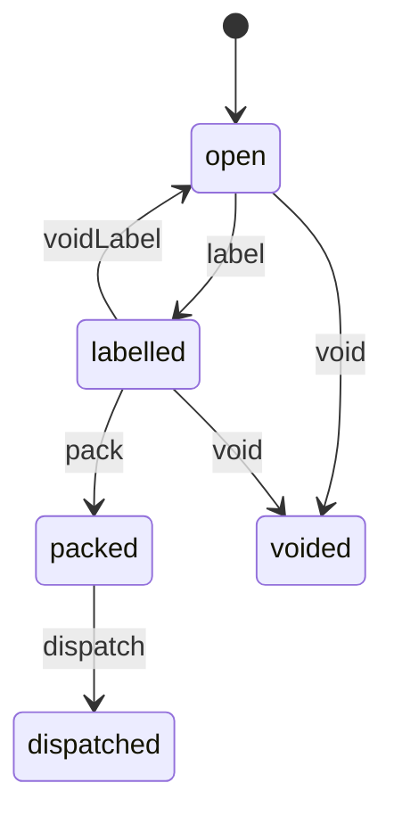
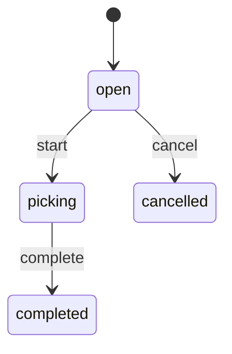
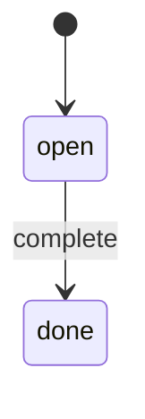
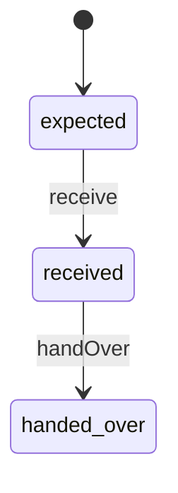

<!-- GENERATED by `npm run gen` from docs/api/modules/warehouse.md. Do not edit: change the spec and regenerate. -->

# Warehouse (`warehouse`)

Physical work for Official Store stock: bins, put-away of received goods, pick waves and pick lists by order with bin locations and scanning, packing stations (item checklist, box and weight, carrier label through shipping, packing slip), shortage and damage reports, and receipt of return parcels handed over to returns inspection.

- **Group:** Catalog and stock · **Launch phase:** 1 · **Plan chapters:** 9, 12, 13
- **Depends on:** [inventory](../inventory/README.md), [orders](../orders/README.md) · **Optional:** [shipping](../shipping/README.md), [returns](../returns/README.md), [purchasing](../purchasing/README.md), [media](../media/README.md), [audit](../audit/README.md), [finance](../finance/README.md), [fulfillment-service](../fulfillment-service/README.md), [workqueues](../workqueues/README.md)
- **Required by:** [fulfillment-service](../fulfillment-service/README.md)

## Owns
- Bins (zone, aisle, shelf; pick, bulk, returns, quarantine) and which stock items live in which bin
- Put-away tasks for received purchase deliveries
- Warehouse fulfillments: one per Official Store seller group of an accepted order, with ship-by deadline
- Pick waves and pick lists grouped by order with bin locations; bin and item scanning
- Packing: packages, item checklist by scan, box type, dimensions and weight, carrier label (through shipping), packing slip
- Shortage and damage reports at pick and pack (resolved by inventory)
- Return parcel receipt at the warehouse and hand-over to returns inspection

**Not here:**
- Stock quantities and stock groups: inventory
- Purchase orders and receiving counts: purchasing
- Carriers, rates, labels' carrier accounts, tracking and dispatch exceptions: shipping
- Return inspection, condition decision and refunds: returns and finance
- Seller packing: sellers pack and ship their own orders at launch (seller fulfilment tasks live in orders and shipping)

## Admin API

| Method | Path | Purpose | Auth | Body → Response |
|---|---|---|---|---|
| GET | `/api/admin/warehouse/summary` | Today's work: to pick, to pack, on hold, at risk, put-away and return parcels | staff<br>`warehouse.view` | `WarehouseSummary` |
| GET | `/api/admin/warehouse/scan` | Resolve a scanned barcode (bin, item, order, package or return label) | staff<br>`warehouse.view` | `ScanResult` |
| GET | `/api/admin/warehouse/bins` | Bins with their kind and assigned items | staff<br>`warehouse.view` | Page<Bin> |
| POST | `/api/admin/warehouse/bins` | Create bins (one or a list of codes) _(audited)_ | staff<br>`warehouse.bins.manage` | `{ locationId: uuid, codes: string[], kind: enum(pick|bulk|returns|quarantine|packing|dock) }` → `Bin[]` |
| PATCH | `/api/admin/warehouse/bins/{id}` | Change kind or deactivate a bin _(audited)_ | staff<br>`warehouse.bins.manage` | `{ kind: enum(pick|bulk|returns|quarantine|packing|dock)?, active: bool? }` → `Bin` |
| PUT | `/api/admin/warehouse/stock-items/{stockItemId}/bins` | Set the bins a company stock item is stored in (one primary) _(audited)_ | staff<br>`warehouse.bins.manage` | `{ bins: BinAssignmentInput[] }` → `BinAssignment[]` |
| GET | `/api/admin/warehouse/fulfillments` | Official Store and Fulfilled by Marketly orders to pick and pack, most urgent first | staff<br>`warehouse.view` | Page<FulfillmentRow> |
| GET | `/api/admin/warehouse/fulfillments/{id}` | One fulfillment with lines, bins, packages, hold reason and mixed-order note | staff<br>`warehouse.view` | `Fulfillment` |
| POST | `/api/admin/warehouse/waves` | Create a pick wave (given orders, or all awaiting pick due before the carrier pickup) | staff<br>`warehouse.waves.manage` | `{ locationId: uuid, fulfillmentIds: uuid[]?, carrierPickupAt: datetime? }` → `Wave` |
| GET | `/api/admin/warehouse/waves` | Pick waves | staff<br>`warehouse.view` | Page<Wave> |
| GET | `/api/admin/warehouse/waves/{id}` | Pick list grouped by order with bins in walking order, progress and next bin | staff<br>`warehouse.view` | `Wave` |
| POST | `/api/admin/warehouse/waves/{id}/start` | Start picking a wave | staff<br>`warehouse.picking.perform` | `Wave` |
| POST | `/api/admin/warehouse/pick-lines/{id}/pick` | Confirm a pick by scanning the bin and the item | staff<br>`warehouse.picking.perform` | `PickConfirm` → `Fulfillment` |
| POST | `/api/admin/warehouse/pick-lines/{id}/report-shortage` | Report a bin shortage; the order is held (not packed partly) and Inventory is asked to resolve it | staff<br>`warehouse.picking.perform` | `ShortageReport` → `Fulfillment` |
| POST | `/api/admin/warehouse/fulfillments/{id}/report-damage` | Report a damaged item at pick or pack (photos required) | staff<br>`warehouse.picking.perform` | `DamageReport` → `Fulfillment` |
| POST | `/api/admin/warehouse/fulfillments/{id}/resume` | Resume a held fulfillment after the shortage or damage is resolved | staff<br>`warehouse.waves.manage` | `{ note: text? }` → `Fulfillment` |
| GET | `/api/admin/warehouse/box-types` | Box and mailer sizes for packing | staff<br>`warehouse.view` | `BoxType[]` |
| PUT | `/api/admin/warehouse/box-types` | Replace the list of box and mailer sizes _(audited)_ | staff<br>`warehouse.settings.manage` | `{ boxTypes: BoxType[] }` → `BoxType[]` |
| POST | `/api/admin/warehouse/fulfillments/{id}/packages` | Open a package at a packing station (defaults to all picked items) | staff<br>`warehouse.packing.perform` | `{ orderItemIds: uuid[]?, station: string? }` → `Package` |
| POST | `/api/admin/warehouse/packages/{id}/scan` | Scan an item into the package checklist | staff<br>`warehouse.packing.perform` | `{ code: string, serialNumber: string? }` → `Package` |
| PATCH | `/api/admin/warehouse/packages/{id}` | Set box, dimensions, weight (from scale), fragile note and service | staff<br>`warehouse.packing.perform` | `PackageUpdate` → `Package` |
| POST | `/api/admin/warehouse/packages/{id}/label` | Buy the carrier label through shipping (service matching the customer's delivery choice) _(idempotent)_ | staff<br>`warehouse.packing.perform` | `{ printer: string?, format: enum(pdf|zpl)? }` → `LabelResult` |
| POST | `/api/admin/warehouse/packages/{id}/void-label` | Void the label (e.g. wrong service) before the package is packed _(audited)_ | staff<br>`warehouse.packing.perform` | `{ reason: text }` → `Package` |
| GET | `/api/admin/warehouse/packages/{id}/label` | Reprint the current label | staff<br>`warehouse.packing.perform` | `FileLink` |
| GET | `/api/admin/warehouse/packages/{id}/service-options` | Carrier services for this package with arrival dates and whether each keeps the customer's promise | staff<br>`warehouse.packing.perform` | `PackageServiceOption[]` |
| GET | `/api/admin/warehouse/packages/{id}/packing-slip` | Packing slip listing only this seller group's items, package n of N, returns note | staff<br>`warehouse.packing.perform` | `FileLink` |
| POST | `/api/admin/warehouse/packages/{id}/pack` | Mark the package packed and hand it to shipping for carrier pickup | staff<br>`warehouse.packing.perform` | `Package` |
| GET | `/api/admin/warehouse/putaway-tasks` | Received units to put away, with suggested bins | staff<br>`warehouse.view` | Page<PutawayTask> |
| GET | `/api/admin/warehouse/putaway-tasks/labels` | Printable item and put-away labels for a receipt's units (SKU barcode, label, suggested bin, quantity) | staff<br>`warehouse.view` | `FileLink` |
| POST | `/api/admin/warehouse/putaway-tasks/{id}/complete` | Confirm put-away by scanning the bin | staff<br>`warehouse.putaway.perform` | `{ binCode: string, quantity: int }` → `PutawayTask` |
| GET | `/api/admin/warehouse/return-parcels` | Return parcels expected, received and handed over | staff<br>`warehouse.view` | Page<ReturnParcel> |
| POST | `/api/admin/warehouse/return-parcels` | Receive a return parcel at the warehouse (scan the return label or reference) | staff<br>`warehouse.returns.receive` | `ReceiveParcelInput` → `ReturnParcel` |
| POST | `/api/admin/warehouse/return-parcels/{id}/hand-over` | Hand a received parcel to returns inspection | staff<br>`warehouse.returns.receive` | `{ inspectorId: uuid?, note: text? }` → `ReturnParcel` |

## Types

### Bin

| Field | Type |
|---|---|
| id | `uuid` |
| locationId | `uuid` inventory location (warehouse site) |
| code | `string` e.g. A-03-2 (zone-aisle-level) |
| zone | `string` |
| kind | `enum(pick|bulk|returns|quarantine|packing|dock)` |
| barcode | `string` |
| active | `bool` |
| assignedItems | `int` |

### BinAssignment

| Field | Type |
|---|---|
| stockItemId | `uuid` |
| sku | `string` |
| label | `string` |
| binId | `uuid` |
| binCode | `string` |
| primary | `bool` |

### BinAssignmentInput

| Field | Type |
|---|---|
| binId | `uuid` |
| primary | `bool` |

### ScanResult

| Field | Type |
|---|---|
| code | `string` |
| kind | `enum(bin|item|order|package|return_label|unknown)` |
| bin | `Bin?` |
| stockItemId | `uuid?` |
| sku | `string?` |
| label | `string?` |
| fulfillmentId | `uuid?` |
| packageId | `uuid?` |
| returnParcelId | `uuid?` |
| message | `string?` Shown on the handheld, e.g. 'Not on this pick list' |

### FulfillmentLine

| Field | Type |
|---|---|
| id | `uuid` |
| orderItemId | `uuid` |
| stockItemId | `uuid` |
| sku | `string` |
| label | `string` |
| image | `MediaRef?` |
| quantity | `int` |
| binCode | `string?` |
| picked | `int` |
| short | `int` |
| state | `enum(pending|picked|short|cancelled)` |
| pickedBy | `Actor?` |
| pickedAt | `datetime?` |

### Fulfillment

| Field | Type |
|---|---|
| id | `uuid` |
| orderId | `uuid` |
| orderRef | `string` |
| sellerGroupId | `uuid` |
| fulfilledBy | `enum(official_warehouse|marketly_service)` official_warehouse: an Official Store group; marketly_service: a seller's group Marketly fulfils from seller-owned stock |
| sellerId | `uuid?` The seller of record of a marketly_service fulfilment; null for the Official Store |
| sellerName | `string?` Shown on the packing slip: 'Sold by <seller> · Fulfilled by Marketly' |
| locationId | `uuid` The service location (fulfillment-service.getServiceLocation) for marketly_service, else the default location |
| status | `enum(awaiting_pick|picking|picked|packing|packed|dispatched|on_hold|cancelled)` |
| shipBy | `datetime` |
| deadline | `Deadline` |
| deliveryChoice | `string` Service the customer chose, e.g. 'UPS Ground · arrives Tue, Oct 13' |
| shipTo | `Address` |
| waveId | `uuid?` |
| lines | `FulfillmentLine[]` |
| packages | `Package[]` |
| holdReason | `string?` e.g. 'Shortage reported: bin F-12-3 empty. Inventory is checking.' |
| dispatchOverdueAt | `datetime?` When shipping reported the dispatch deadline missed (shipping.dispatch.overdue); the order then leads the pick list |
| mixedOrderNote | `string?` e.g. 'This order also has Package 2 of 2 from Pixel & Port. They ship it separately.' |
| totalPackagesInOrder | `int` |
| createdAt | `datetime` |

### FulfillmentRow

| Field | Type |
|---|---|
| id | `uuid` |
| orderRef | `string` |
| fulfilledBy | `enum(official_warehouse|marketly_service)` |
| sellerName | `string?` |
| status | `enum(awaiting_pick|picking|picked|packing|packed|dispatched|on_hold|cancelled)` |
| deadline | `Deadline` |
| shipBy | `datetime` |
| itemCount | `int` |
| pickedCount | `int` |
| waveRef | `string?` |
| holdReason | `string?` |

### WaveOrder

| Field | Type |
|---|---|
| fulfillmentId | `uuid` |
| orderRef | `string` |
| deadline | `Deadline` |
| status | `string` |
| lines | `FulfillmentLine[]` |

### Wave

| Field | Type |
|---|---|
| id | `uuid` |
| ref | `string` e.g. 'Wave 3' |
| locationId | `uuid` |
| status | `enum(open|picking|completed|cancelled)` |
| carrierPickupAt | `datetime?` |
| orderCount | `int` |
| pickedOrderCount | `int` |
| packedOrderCount | `int` |
| progressPct | `int` |
| nextBinCode | `string?` |
| alerts | `string[]` e.g. 'Shortage reported on MK-261008-12688' |
| orders | `WaveOrder[]` Pick list grouped by order, lines in walking order by bin |
| createdBy | `Actor` |
| createdAt | `datetime` |

### PickConfirm

| Field | Type |
|---|---|
| binCode | `string` Scanned bin barcode or code |
| itemCode | `string` Scanned item barcode (GTIN or SKU label) |
| quantity | `int` |

### ShortageReport

| Field | Type |
|---|---|
| quantityFound | `int` |
| note | `text?` |

### DamageReport

| Field | Type |
|---|---|
| lineId | `uuid` |
| quantity | `int` |
| note | `text` |
| photoIds | `uuid[]` |

### Dimensions

| Field | Type |
|---|---|
| length | `number` |
| width | `number` |
| height | `number` |
| unit | `enum(in|cm)` |

### Weight

| Field | Type |
|---|---|
| value | `number` |
| unit | `enum(lb|kg)` |
| fromScale | `bool?` |

### BoxType

| Field | Type |
|---|---|
| id | `uuid` |
| name | `string` e.g. 'M box' |
| dimensions | `Dimensions` |
| maxWeight | `Weight?` |
| kind | `enum(box|mailer)` |
| active | `bool` |

### PackageItem

| Field | Type |
|---|---|
| orderItemId | `uuid` |
| stockItemId | `uuid` |
| sku | `string` |
| label | `string` |
| image | `MediaRef?` |
| quantity | `int` |
| scanned | `int` |
| serialNumbers | `string[]` Serials captured at packing for serialized items |

### Package

| Field | Type |
|---|---|
| id | `uuid` |
| fulfillmentId | `uuid` |
| orderRef | `string` |
| index | `int` Package number within the whole order (all sellers) |
| of | `int` |
| status | `enum(open|labelled|packed|dispatched|voided)` |
| items | `PackageItem[]` |
| allScanned | `bool` |
| boxTypeId | `uuid?` |
| suggestedBoxTypeId | `uuid?` From item dimensions |
| dimensions | `Dimensions?` |
| weight | `Weight?` |
| fragile | `bool` |
| handlingNote | `string?` |
| carrier | `string?` |
| service | `string?` |
| carrierServiceId | `uuid?` Shipping carrier service chosen at packing (PackageUpdate.serviceCode); the label is bought with it |
| trackingNumber | `string?` |
| labelUrl | `url?` |
| packedBy | `Actor?` |
| packedAt | `datetime?` |
| shipmentId | `uuid?` shipping module shipment |

### PackageUpdate

| Field | Type |
|---|---|
| boxTypeId | `uuid?` |
| dimensions | `Dimensions?` |
| weight | `Weight?` |
| fragile | `bool?` |
| handlingNote | `string?` |
| serviceCode | `string?` Only services that keep the customer's promised delivery date |

### LabelResult

| Field | Type |
|---|---|
| trackingNumber | `string` |
| carrier | `string` |
| service | `string` |
| labelUrl | `url` |
| format | `enum(pdf|zpl)` |
| arrivesBy | `date?` |
| package | `Package` |

### FileLink

| Field | Type |
|---|---|
| url | `url` |
| fileName | `string` |
| expiresAt | `datetime` |

### PackageServiceOption

| Field | Type |
|---|---|
| serviceCode | `string` Pass back as PackageUpdate.serviceCode |
| carrierServiceId | `uuid` |
| carrier | `string` |
| service | `string` |
| arrivesBy | `date` Latest estimated arrival if the package leaves today |
| arrivalLabel | `string` e.g. 'Arrives Wed, Oct 14' |
| keepsPromise | `bool` Arrives within the date range promised to the customer at checkout; services that do not are listed but cannot be chosen (SERVICE_BREAKS_PROMISE) |
| matchesCustomerChoice | `bool` The service of the delivery option the customer chose |
| rate | `Money?` Label cost for this box and weight; empty until dimensions and weight are set |
| selected | `bool` |

### PutawayTask

| Field | Type |
|---|---|
| id | `uuid` |
| receiptId | `uuid` |
| receiptRef | `string` |
| stockItemId | `uuid` |
| sku | `string` |
| label | `string` |
| quantity | `int` |
| suggestedBinCode | `string?` |
| binCode | `string?` |
| status | `enum(open|done)` |
| doneBy | `Actor?` |
| doneAt | `datetime?` |

### ReturnParcel

| Field | Type |
|---|---|
| id | `uuid` |
| returnId | `uuid?` |
| returnRef | `string?` e.g. RT-261005-0212 |
| orderRef | `string?` |
| trackingNumber | `string?` |
| status | `enum(expected|received|handed_over)` |
| expectedBy | `date?` |
| expectedItems | `string[]` e.g. 'Halden Aurora ANC Headphones, Black × 1' |
| unexpected | `bool` Parcel with no approved return; support is told |
| parcelCondition | `enum(intact|damaged|opened)?` |
| photos | `MediaRef[]` |
| note | `text?` |
| receivedBy | `Actor?` |
| receivedAt | `datetime?` |
| handedOverTo | `Actor?` |
| handedOverAt | `datetime?` |

### ReceiveParcelInput

| Field | Type |
|---|---|
| code | `string` Return reference, tracking number or return label barcode |
| parcelCondition | `enum(intact|damaged|opened)` |
| photoIds | `uuid[]?` |
| note | `text?` |

### WarehouseSummary

| Field | Type |
|---|---|
| locationId | `uuid` |
| toPick | `int` |
| picking | `int` |
| toPack | `int` |
| packedToday | `int` |
| onHold | `int` |
| atRisk | `int` Not packed and ship-by within the at-risk window |
| nextCarrierPickupAt | `datetime?` |
| openShortages | `int` |
| putawayOpen | `int` |
| returnParcelsExpected | `int` |
| returnParcelsToHandOver | `int` |
| shipToday | `int` All packages with ship-by today, any stage |

## Status flows

### Warehouse fulfillment (`Fulfillment.status`)



startPicking when its wave starts. hold on a shortage or damage report (also one found after every line was picked, before packing starts): the order stays in the wave and is not packed partly. resume goes back to picking; lines already picked stay picked, so finishPicking follows once the replacement unit is picked. resume on inventory.discrepancy.resolved (reallocated) or by staff. cancel only when every line is cancelled (orders.item.cancelled); single cancelled lines are removed and picked units go back to their bin. dispatch on shipping.shipment.dispatched.

### Package (`Package.status`)



label requires every item scanned, a box (or dimensions) and a weight. pack hands the package to shipping for carrier pickup. voidLabel cancels the carrier label through shipping before reprinting a different service.

### Wave (`Wave.status`)



complete when every fulfillment in the wave is packed, on hold or cancelled; on-hold orders move to the next wave.

### Put-away task (`PutawayTask.status`)



Created from purchasing.receipt.recorded per received line (excluding damaged units, which go to a quarantine bin task).

### Return parcel (`ReturnParcel.status`)



Expected parcels come from returns.return.approved for Official Store returns. A parcel with no matching return is created directly as received with unexpected = true. Hand-over moves it to the inspection bench; returns owns inspection from there.

## Data (schema `warehouse`)

**bins**

| Column | Type |
|---|---|
| id | uuid pk |
| location_id | uuid |
| code | text |
| zone | text |
| kind | text |
| barcode | text |
| active | bool |

Indexes: `unique (location_id, code)`, `unique (barcode)`, `(location_id, zone)`

**bin_assignments**: Which stock items are stored in which bins

| Column | Type |
|---|---|
| stock_item_id | uuid |
| bin_id | uuid → bins |
| primary_bin | bool |
| assigned_at | timestamptz |

Indexes: `pk (stock_item_id, bin_id)`, `unique (stock_item_id) where primary_bin`, `(bin_id)`

**fulfillments**: One per Official Store or Fulfilled by Marketly seller group of an accepted order

| Column | Type |
|---|---|
| id | uuid pk |
| order_id | uuid |
| order_ref | text |
| seller_group_id | uuid unique |
| fulfilled_by | text (official_warehouse|marketly_service) |
| seller_id | uuid? (seller of record of a marketly_service group) |
| seller_name | text? |
| location_id | uuid |
| status | text |
| ship_by | timestamptz |
| delivery_choice | text |
| ship_to | jsonb |
| wave_id | uuid? → waves |
| hold_reason | text? |
| dispatch_overdue_at | timestamptz? (shipping.dispatch.overdue: the dispatch deadline was missed) |
| discrepancy_ids | jsonb |
| total_packages_in_order | int |
| created_at | timestamptz |
| updated_at | timestamptz |

Indexes: `(status, ship_by)`, `(wave_id)`, `(order_id)`

**fulfillment_lines**

| Column | Type |
|---|---|
| id | uuid pk |
| fulfillment_id | uuid → fulfillments |
| order_item_id | uuid |
| stock_item_id | uuid |
| sku | text |
| label | text |
| quantity | int |
| bin_code | text? |
| picked | int |
| short | int |
| state | text |
| picked_by | text? |
| picked_at | timestamptz? |

Indexes: `(fulfillment_id)`, `(bin_code)`

**waves**

| Column | Type |
|---|---|
| id | uuid pk |
| ref | text |
| location_id | uuid |
| status | text |
| carrier_pickup_at | timestamptz? |
| created_by | text |
| created_at | timestamptz |
| completed_at | timestamptz? |

Indexes: `(location_id, status)`

**scan_log**: Every scan at pick, pack, put-away and returns (troubleshooting and productivity)

| Column | Type |
|---|---|
| id | uuid pk |
| context | text |
| context_id | uuid? |
| code | text |
| result | text |
| actor_id | text |
| station | text? |
| at | timestamptz |

Indexes: `(context, context_id, at)`

**box_types**

| Column | Type |
|---|---|
| id | uuid pk |
| name | text |
| kind | text |
| dimensions | jsonb |
| max_weight | jsonb? |
| active | bool |

**packages**

| Column | Type |
|---|---|
| id | uuid pk |
| fulfillment_id | uuid → fulfillments |
| index_in_order | int |
| of_in_order | int |
| status | text |
| box_type_id | uuid? → box_types |
| dimensions | jsonb? |
| weight | jsonb? |
| fragile | bool |
| handling_note | text? |
| carrier | text? |
| service | text? |
| carrier_service_id | uuid? (shipping carrier service chosen at packing) |
| tracking_number | text? |
| label_media_id | uuid? |
| label_idempotency_key | text? |
| shipment_id | uuid? |
| packed_by | text? |
| packed_at | timestamptz? |
| station | text? |

Indexes: `(fulfillment_id)`, `unique (tracking_number)`

**package_items**

| Column | Type |
|---|---|
| package_id | uuid → packages |
| order_item_id | uuid |
| stock_item_id | uuid |
| quantity | int |
| scanned | int |
| serial_numbers | text[] |

Indexes: `pk (package_id, order_item_id)`

**putaway_tasks**

| Column | Type |
|---|---|
| id | uuid pk |
| receipt_id | uuid |
| receipt_ref | text |
| location_id | uuid |
| stock_item_id | uuid |
| quantity | int |
| suggested_bin_code | text? |
| bin_code | text? |
| status | text |
| done_by | text? |
| done_at | timestamptz? |

Indexes: `(status, receipt_id)`

**return_parcels**

| Column | Type |
|---|---|
| id | uuid pk |
| location_id | uuid |
| return_id | uuid? |
| return_ref | text? |
| order_ref | text? |
| tracking_number | text? |
| status | text |
| expected_by | date? |
| expected_items | jsonb |
| unexpected | bool |
| parcel_condition | text? |
| photo_media_ids | jsonb |
| note | text? |
| received_by | text? |
| received_at | timestamptz? |
| handed_over_to | text? |
| handed_over_at | timestamptz? |

Indexes: `(status, expected_by)`, `(return_id)`, `(tracking_number)`

## Events

| Publishes | When | Payload | Consumed by |
|---|---|---|---|
| `warehouse.fulfillment.created` | An accepted order's Official Store or Fulfilled by Marketly group reaches the warehouse | `{ fulfillmentId: uuid, orderId: uuid, sellerGroupId: uuid, fulfilledBy: enum(official_warehouse|marketly_service), sellerId: uuid?, shipBy: datetime }` | - |
| `warehouse.fulfillment.status_changed` | Any fulfillment status transition | `{ fulfillmentId: uuid, orderId: uuid, sellerGroupId: uuid, fulfilledBy: enum(official_warehouse|marketly_service), sellerId: uuid?, from: string, to: string, reason: string? }` | fulfillment-service, orders |
| `warehouse.fulfillment.at_risk` | Not packed within the at-risk window before ship-by | `{ fulfillmentId: uuid, orderId: uuid, shipBy: datetime, status: string }` | - |
| `warehouse.shortage.reported` | A picker finds fewer units than expected | `{ fulfillmentId: uuid, orderId: uuid, stockItemId: uuid, binCode: string?, quantityShort: int, discrepancyId: uuid }` | - |
| `warehouse.damage.reported` | A damaged unit is found at pick or pack | `{ fulfillmentId: uuid, orderId: uuid, stockItemId: uuid, quantity: int, discrepancyId: uuid }` | - |
| `warehouse.package.packed` | A package is packed with its label | `{ packageId: uuid, fulfillmentId: uuid, orderId: uuid, sellerGroupId: uuid, ownerType: enum(official|seller), sellerId: uuid?, fulfilledBy: enum(official_warehouse|marketly_service), items: PackageItem[], carrier: string, service: string, trackingNumber: string, weight: Weight, dimensions: Dimensions? }` | shipping |
| `warehouse.bin.assigned` | A stock item's bins change or put-away completes | `{ stockItemId: uuid, binId: uuid, binCode: string, primary: bool }` | inventory |
| `warehouse.return_parcel.received` | A return parcel is scanned in at the warehouse | `{ parcelId: uuid, returnId: uuid?, unexpected: bool, parcelCondition: string, receivedAt: datetime }` | workqueues |
| `warehouse.return_parcel.handed_over` | A parcel is handed to returns inspection | `{ parcelId: uuid, returnId: uuid?, inspectorId: uuid? }` | - |

| Consumes | From | Does |
|---|---|---|
| `orders.order.accepted` | orders | Create a fulfillment for each Official Store group and each Fulfilled by Marketly group (fulfilledBy marketly_service; at fulfillment-service.getServiceLocation, else the default location; seller stored). Lines carry stock item ids from the purchase snapshot and ship-by from shipping |
| `orders.item.split` | orders | A line was split (partial cancel, shipment or return; decision S-D1): split the fulfillment line of itemId so newItemId gets its own line with quantity units (picked units stay on the original line first), so later cancel and dispatch events that name either item find their line. Idempotent per newItemId |
| `orders.item.cancelled` | orders | Cancel the line; if already picked, return units to the bin; if packed, flag the package to be reopened |
| `inventory.discrepancy.resolved` | inventory | Resume a held fulfillment when the shortage or damage was reallocated |
| `purchasing.receipt.recorded` | purchasing | Create put-away tasks for received units (damaged units to a quarantine bin) |
| `fulfillment-service.inbound.received` | fulfillment-service | Create put-away tasks for a Fulfilled by Marketly receiving record like a purchase receipt: sellable units (received − damaged) to the suggested bin, damaged units to quarantine; receipt_id = receiptId, receipt_ref = the IB- ref, location = locationId. Idempotent per receiptId |
| `returns.return.approved` | returns | Expect a return parcel when the return goes to a Marketly warehouse (Official Store returns and Fulfilled by Marketly returns, fulfilledBy marketly_service) |
| `shipping.shipment.dispatched` | shipping | Mark packages and the fulfillment dispatched |
| `shipping.dispatch.overdue` | shipping | Raise the fulfillment to the top of the pick list and flag it |

## In-process API (for other modules)

| Function | Signature | Used by |
|---|---|---|
| getShippedSerials | `(orderItemIds: uuid[]) => map<string[]>`<br>Serial numbers recorded at packing per order item, for the return inspection checklist ('Serial number matches order') | returns |
| getFulfillmentForOrder | `(orderId: uuid) => Fulfillment | null`<br>Warehouse progress for an order's Official Store group (picking, packed, on hold) | orders, support |
| suggestBin | `(stockItemId: uuid, locationId: uuid) => Bin | null`<br>Primary bin, or a free bin in the item's zone, for put-away suggestions on receipts | purchasing |
| getTasksForOrderGroups | `(sellerGroupIds: uuid[]) => map<Fulfillment | null>`<br>Warehouse task per order seller group (null for groups outside sellers ship), batched for the admin order view | graphql |
| getTodaySummary | `(locationId?: uuid) => WarehouseSummary & { date: date, toShip: int, shipToday: int, dispatchedToday: int, late: int, shipByCutoff: datetime | null, pickupsToday: datetime[], urgent: Fulfillment[] }`<br>Today's Official Store warehouse work (OpsQueues): to pick, to pack, packed waiting for pickup, dispatched today, on hold, at risk and late (ship-by passed, not dispatched), the next carrier pickup as the ship-by cutoff, and the most urgent tasks. Same counts as GET /summary. | graphql |

## Permissions

| Key | Who | Allows |
|---|---|---|
| `warehouse.view` | staff | View fulfillments, waves, bins, put-away and return parcels |
| `warehouse.bins.manage` | staff | Create and change bins and bin assignments |
| `warehouse.waves.manage` | staff | Create waves and resume held fulfillments (Warehouse Manager) |
| `warehouse.picking.perform` | staff | Pick, report shortages and damage |
| `warehouse.packing.perform` | staff | Pack, buy and void labels, print slips |
| `warehouse.putaway.perform` | staff | Put away received stock |
| `warehouse.returns.receive` | staff | Receive return parcels and hand them to inspection |
| `warehouse.settings.manage` | staff | Box types and packing settings |

## Error codes

| Code | Status | Meaning |
|---|---|---|
| `SCAN_MISMATCH` | 409 | Scanned bin or item does not match the line. details.expected, details.scanned |
| `FULFILLMENT_ON_HOLD` | 409 | The order is on hold for a shortage or damage; do not pack it partly |
| `DISCREPANCY_OPEN` | 409 | Inventory has not resolved the shortage or damage yet |
| `PACKAGE_INCOMPLETE` | 409 | Not every item is scanned, or box/weight is missing. details.missing |
| `LABEL_REQUIRED` | 409 | The package has no valid label |
| `LABEL_FAILED` | 502 | The carrier did not return a label; retry with the same Idempotency-Key. details.carrierMessage |
| `SERVICE_BREAKS_PROMISE` | 409 | That carrier service arrives after the date the customer was promised |
| `BIN_CODE_TAKEN` | 409 | A bin with this code already exists at the location |
| `BIN_NOT_EMPTY` | 409 | Bin still has stock items assigned |
| `PARCEL_ALREADY_RECEIVED` | 409 | This return parcel was already received. details.parcelId |

## Background jobs

| Job | Schedule | Does |
|---|---|---|
| `warehouse.flag-at-risk` | every 15 min | Publish warehouse.fulfillment.at_risk for fulfillments not packed within atRiskMinutes of ship-by (work queue for the Warehouse and Shipping Managers) |
| `warehouse.auto-wave` | every 30 min during business hours (when enabled) | Create waves from fulfillments awaiting pick ahead of each carrier pickup time |
| `warehouse.overdue-return-parcels` | daily 08:00 market time | List expected return parcels past their expected date for returns follow-up |

## Settings

| Key | Default | Rules | Meaning |
|---|---|---|---|
| requireBinScan | `true` | bool, approval: second reviewer | Pickers must scan the bin before the item |
| requireItemScan | `true` | bool, approval: second reviewer | Every unit is scanned at pick and pack |
| autoWaveEnabled | `false` | bool | Create waves automatically |
| carrierPickupTimes | `["16:00"]` | json | Daily carrier pickups (market time) used for waves and ship-by |
| atRiskMinutes | `60` | duration, minutes, 0–… | Minutes before ship-by when an unpacked order is at risk |
| weightUnit | `"lb"` | enum (lb \| kg) | Scale unit |
| packingSlipShowsPrices | `false` | bool | Packing slips list items and quantities only |

## Integrations
- **Barcode scanners and handhelds**: Keyboard-wedge or camera scanning into the scan fields (no driver integration needed)
- **Label printers (4x6, ZPL or PDF)**: Carrier labels and packing slips per station
- **Shipping scales**: Weight captured at the packing station (fromScale)

## Notes
- Event consumers and once-only jobs are idempotent through the kernel inbox (ctx.inbox), never through scan_log rows: orders.item.cancelled claims item-cancelled:<cancellationId>, shipping.dispatch.overdue claims dispatch-overdue:<exceptionId> and the at-risk job claims at-risk:<fulfillmentId>. scan_log stays a troubleshooting and productivity log.
- Scope is Official Store and Fulfilled by Marketly groups. Other outside sellers pick and pack their own orders; their tasks and shipments are in orders and shipping. Fulfilled by Marketly (fulfillment-service, phase 4) reuses fulfillments, waves and packing for seller-owned stock at the service location: the label is bought from the service location's address and billed to the seller (shipping.createLabel billedTo seller, decision D1), the packing slip reads 'Sold by <seller> · Fulfilled by Marketly', warehouse.package.packed carries the seller as owner, and serials are recorded as for Official lines. Every consumer that used to skip non-official groups (item cancelled, dispatch overdue, shipment dispatched, return parcels) finds its fulfilment by seller_group_id, so a missing row is the only filter. Put-away also covers Fulfilled by Marketly receiving records (fulfillment-service.inbound.received). Physical removal orders stay staff-handled for now (decision D9).
- Mixed orders: a fulfillment covers only one Official Store or Fulfilled by Marketly seller group. The packing slip lists only those items and says which package number it is and that other packages ship separately.
- Labels are bought through shipping (shipping.createLabel with the package, the delivery choice and an idempotency key); warehouse never talks to carriers directly.
- Shortage and damage at pick/pack create inventory discrepancies; inventory decides (reallocate from another bin or Returned, or adjust). Damaged reserved units move to Damaged or held in inventory immediately.
- Return receipt: warehouse scans the parcel in and hands it over; returns owns inspection, condition and outcome proposal; inventory records the stock outcome; finance approves refunds. Receiving calls returns.recordWarehouseReceipt in-process (returns publishes returns.return.received); warehouse.return_parcel.received is for work queues and reports.
- Receiving labels (GET /putaway-tasks/labels) are rendered here from the put-away tasks of a purchasing receipt: SKU barcode, product label and suggested bin. Carrier service options at packing come from shipping.quoteLabelOptions, so the rule 'only services that keep the customer's promise' is the same one updatePackage enforces.
- Bins live here; inventory keeps quantities per location (site) and shows the primary bin code it learns from warehouse.bin.assigned.
- Damage photos (DamageReport.photoIds) and return parcel photos are attached with media.attach (usage kind inspection_photo, refId the fulfillment or parcel id) before they are passed on, so the media orphan sweep never deletes them; inventory attaches the same photos to its discrepancy.
- Item scans match the SKU label or the variant GTIN (inventory.getStockItems returns gtin from catalog).

## GraphQL (read layer)

This module's fragment of the GraphQL schemas (see [../graphql/README.md](../graphql/README.md)). Writes stay on the REST endpoints above.

```graphql
# warehouse: physical pick, pack and dispatch of Official Store stock.
# Adds OrderGroup.warehouseTask (Admin Center order 360). Outside sellers pick and pack their own orders,
# so the field is null for their groups. Query warehouseToday feeds OpsQueues (today's pick, pack and ship work).

"Warehouse work for one order's Official Store package group: pick lines with bins, packages, holds"
type WarehouseTask @areas(in: [ADMIN]) {
  id: UUID!
  orderRef: String!
  status: WarehouseTaskStatus!
  shipBy: DateTime!
  deadline: Deadline!
  "Service the customer chose, e.g. 'UPS Ground · arrives Tue, Oct 13'"
  deliveryChoice: String!
  "Pick wave, e.g. 'Wave 3'"
  waveRef: String
  lines: [WarehouseTaskLine!]!
  packages: [WarehousePackage!]!
  "e.g. 'Shortage reported: bin F-12-3 empty. Inventory is checking.'"
  holdReason: String
  "When shipping reported the dispatch deadline missed; the order then leads the pick list"
  dispatchOverdueAt: DateTime
  "e.g. 'This order also has Package 2 of 2 from Pixel & Port. They ship it separately.'"
  mixedOrderNote: String
  totalPackagesInOrder: Int!
  createdAt: DateTime!
}

enum WarehouseTaskStatus @areas(in: [ADMIN]) {
  AWAITING_PICK
  PICKING
  PICKED
  PACKING
  PACKED
  DISPATCHED
  ON_HOLD
  CANCELLED
}

"One order item to pick"
type WarehouseTaskLine @areas(in: [ADMIN]) {
  id: UUID!
  orderItemId: UUID!
  sku: String!
  label: String!
  image: MediaRef
  quantity: Int!
  binCode: String
  picked: Int!
  short: Int!
  state: WarehouseTaskLineState!
  pickedBy: Actor
  pickedAt: DateTime
}

enum WarehouseTaskLineState @areas(in: [ADMIN]) {
  PENDING
  PICKED
  SHORT
  CANCELLED
}

"A package packed at a packing station"
type WarehousePackage @areas(in: [ADMIN]) {
  id: UUID!
  "Package number within the whole order (all sellers)"
  index: Int!
  of: Int!
  status: WarehousePackageStatus!
  itemCount: Int!
  allScanned: Boolean!
  "e.g. 'M box'"
  boxName: String
  fragile: Boolean!
  carrier: String
  service: String
  trackingNumber: String
  packedBy: Actor
  packedAt: DateTime
  "shipping module shipment (see OrderGroup.shipments)"
  shipmentId: UUID
}

enum WarehousePackageStatus @areas(in: [ADMIN]) {
  OPEN
  LABELLED
  PACKED
  DISPATCHED
  VOIDED
}

# ------------------------------------------------------------------ extensions

extend type OrderGroup {
  "Warehouse progress for an Official Store package group; null for groups outside sellers ship themselves"
  warehouseTask: WarehouseTask @areas(in: [ADMIN]) @auth(requires: STAFF, permission: "warehouse.view") @source(module: "warehouse", fn: "getTasksForOrderGroups")
}

"""
Today's Official Store warehouse work (OpsQueues, pick-pack header): what is left to pick, pack and ship before the
next carrier pickup, and what is late. Same counts as REST GET /api/admin/warehouse/summary.
"""
type WarehouseToday @areas(in: [ADMIN]) {
  locationId: UUID!
  date: Date!
  toPick: Int!
  picking: Int!
  toPack: Int!
  "Packed, waiting for the carrier pickup"
  toShip: Int!
  "All Official Store packages due to ship today (ship-by today, any stage: to pick, picking, to pack, packed, dispatched)"
  shipToday: Int!
  packedToday: Int!
  dispatchedToday: Int!
  onHold: Int!
  "Not packed and ship-by within the at-risk window (settings atRiskMinutes)"
  atRisk: Int!
  "Ship-by passed and not dispatched"
  late: Int!
  "Next carrier pickup: work due today must be packed by then. Null when no pickup is left today."
  shipByCutoff: DateTime
  "Remaining carrier pickups today (settings carrierPickupTimes)"
  pickupsToday: [DateTime!]!
  openShortages: Int!
  putawayOpen: Int!
  returnParcelsExpected: Int!
  returnParcelsToHandOver: Int!
  "Late first, then at risk, then by ship-by"
  urgentTasks(limit: Int = 10): [WarehouseTask!]! @cost(weight: 5)
}

extend type Query {
  "Today's warehouse work for one site (default: the main Official Store warehouse)"
  warehouseToday(locationId: UUID): WarehouseToday @areas(in: [ADMIN]) @auth(requires: STAFF, permission: "warehouse.view") @source(module: "warehouse", fn: "getTodaySummary") @cost(weight: 5)
}
```
