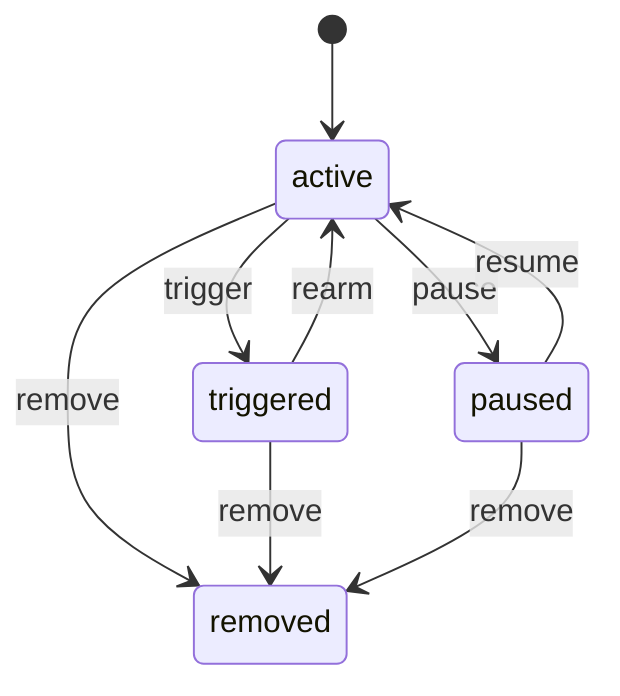

<!-- GENERATED by `npm run gen` from docs/api/modules/wishlist.md. Do not edit: change the spec and regenerate. -->

# Wishlist (`wishlist`)

Saved shopping for customers: saved items in one or more lists, price-drop and back-in-stock alerts, and shareable lists. Alerts are delivered through notifications under the customer's promotional preferences.

- **Group:** Later phases · **Launch phase:** 3 · **Plan chapters:** 3, 7, 19
- **Depends on:** [catalog](../catalog/README.md), [offers](../offers/README.md), [customers](../customers/README.md) · **Optional:** [inventory](../inventory/README.md), [cart](../cart/README.md), [promotions](../promotions/README.md), [notifications](../notifications/README.md), [reports](../reports/README.md), [media](../media/README.md), [search](../search/README.md)

## Owns
- Wishlists: a default list plus named lists, saved products with the variant and preferred offer
- Saved status for product cards (heart icons)
- Price-drop alerts (any drop, or below a target price) and back-in-stock alerts (optionally for one seller or variant)
- Alert state: active, triggered, paused, removed, with the price or stock that triggered it
- Price hints for saved items (lowest in 30 days, typical range), computed from offers.priceRange / offers.lowestPrice (no own price history)
- Move to cart and share a list by link

**Not here:**
- Recently viewed products: customers
- Sending the alert: notifications; the customer's marketing consent (wishlist alerts): customers
- Prices, price history and stock: offers and inventory (read through public APIs and events)
- Cart lines: cart (move to cart calls its public API)

## Store API

| Method | Path | Purpose | Auth | Body → Response |
|---|---|---|---|---|
| GET | `/api/store/wishlist/wishlist` | Wishlist page: lists, first batch of items with price hints and stock, and alerts | customer | `WishlistPage` |
| GET | `/api/store/wishlist/lists/{id}/items` | More items of a list | customer | Page<SavedItem> |
| GET | `/api/store/wishlist/saved` | Which products are saved (for heart icons on cards) | customer | `map<bool>` |
| POST | `/api/store/wishlist/items` | Save a product (optionally with alerts) | customer | `SaveItemInput` → `SavedItem` |
| DELETE | `/api/store/wishlist/items/{id}` | Remove a saved item (its alerts are removed too) | customer | 204 No content |
| POST | `/api/store/wishlist/items/{id}/move` | Move an item to another list | customer | `{ listId: uuid }` → `SavedItem` |
| POST | `/api/store/wishlist/items/{id}/move-to-cart` | Add the item to the cart with an explicit offer | customer | `{ offerId: uuid?, quantity: int, removeFromList: bool? }` → `{ cartLineId: string, cartItemCount: int, item: SavedItem? }` |
| PUT | `/api/store/wishlist/items/{id}/alerts` | Turn price-drop and back-in-stock alerts on or off for an item | customer | `AlertToggle` → `SavedItem` |
| GET | `/api/store/wishlist/lists` | My lists | customer | `WishlistList[]` |
| POST | `/api/store/wishlist/lists` | Create a named list | customer | `{ name: string }` → `WishlistList` |
| PATCH | `/api/store/wishlist/lists/{id}` | Rename a list | customer | `{ name: string }` → `WishlistList` |
| DELETE | `/api/store/wishlist/lists/{id}` | Delete a list (not the default list) | customer | 204 No content |
| POST | `/api/store/wishlist/lists/{id}/share` | Create or revoke a share link | customer | `{ enabled: bool }` → `WishlistList` |
| GET | `/api/store/wishlist/shared/{token}` | View a shared list (read-only, no prices history or alerts) | anyone | `SharedList` |
| GET | `/api/store/wishlist/alerts` | My alerts | customer | Page<Alert> |
| POST | `/api/store/wishlist/alerts` | Create an alert (also for a product not saved, e.g. from an out-of-stock product page) | customer | `AlertInput` → `Alert` |
| POST | `/api/store/wishlist/alerts/{id}/transition` | Pause, resume or rearm an alert | customer | `{ action: enum(pause|resume|rearm) }` → `Alert` |
| DELETE | `/api/store/wishlist/alerts/{id}` | Remove an alert | customer | 204 No content |

## Admin API

| Method | Path | Purpose | Auth | Body → Response |
|---|---|---|---|---|
| GET | `/api/admin/wishlist/insights` | Most saved products and alert counts (aggregates only, no customer data) | staff<br>`wishlist.insights.view` | Page<item> |

## Types

### WishlistList

| Field | Type |
|---|---|
| id | `uuid` |
| name | `string` |
| isDefault | `bool` |
| itemCount | `int` |
| shared | `bool` |
| shareUrl | `string?` |
| createdAt | `datetime` |
| updatedAt | `datetime` |

### PriceHint

| Field | Type |
|---|---|
| kind | `enum(lowest_in_window|typical_range|unchanged|none)` |
| label | `string` e.g. Lowest in 30 days; Typical price $139–$165; Same price for 30 days |
| low | `Money?` |
| high | `Money?` |
| windowDays | `int` |

### SavedItem

| Field | Type |
|---|---|
| id | `uuid` |
| listId | `uuid` |
| productId | `uuid` |
| variantId | `uuid?` |
| offerId | `uuid?` |
| title | `string` |
| image | `MediaRef?` |
| options | `map<string>` |
| sellerName | `string?` |
| officialStore | `bool` |
| price | `Money?` |
| wasPrice | `Money?` |
| priceWhenSaved | `Money?` |
| priceHint | `PriceHint` |
| availability | `enum(in_stock|low_stock|out_of_stock|unavailable)` |
| availableQty | `int?` |
| stockLabel | `string?` e.g. 9 left |
| alerts | `AlertToggle` Toggle state shown on the item card |
| canMoveToCart | `bool` |
| note | `string?` |
| addedAt | `datetime` |

### AlertToggle

| Field | Type |
|---|---|
| priceDrop | `bool` |
| backInStock | `bool` |

### SaveItemInput

| Field | Type |
|---|---|
| productId | `uuid` |
| variantId | `uuid?` |
| offerId | `uuid?` |
| listId | `uuid?` Default list when omitted |
| note | `string?` |
| priceDropAlert | `bool?` |
| backInStockAlert | `bool?` |

### Alert

| Field | Type |
|---|---|
| id | `uuid` |
| itemId | `uuid?` |
| productId | `uuid` |
| variantId | `uuid?` |
| sellerId | `uuid?` |
| title | `string` |
| image | `MediaRef?` |
| kind | `enum(price_drop|back_in_stock)` |
| condition | `string` e.g. Any drop below $329.00; Olive, from Trailhead Outfitters |
| targetPrice | `Money?` |
| referencePrice | `Money?` |
| state | `enum(active|triggered|paused|removed)` |
| triggeredAt | `datetime?` |
| triggeredPrice | `Money?` |
| pausedReason | `string?` |
| createdAt | `datetime` |

### AlertInput

| Field | Type |
|---|---|
| productId | `uuid` |
| variantId | `uuid?` |
| sellerId | `uuid?` |
| kind | `enum(price_drop|back_in_stock)` |
| targetPrice | `Money?` |

### WishlistPage

| Field | Type |
|---|---|
| list | `WishlistList` |
| lists | `WishlistList[]` |
| items | `SavedItem[]` |
| nextCursor | `string?` |
| alerts | `Alert[]` |
| deliveryNote | `string` e.g. Alerts arrive as notifications and email. Turn alerts off any time. These are separate from order updates. |
| alertsEnabledByPreference | `bool` |

### SharedList

| Field | Type |
|---|---|
| name | `string` |
| ownerFirstName | `string?` |
| items | `SavedItem[]` |
| updatedAt | `datetime` |

## Status flows

### Wishlist alert (`Alert.state`)



trigger fires when a price drop meets the condition or stock returns (debounced; one notice per alert per alertCooldownHours). Price-drop alerts rearm automatically with the new price as reference; back-in-stock alerts stay triggered until the customer rearms or removes them. pause is automatic when the product becomes unavailable for good (merged, suspended) or the customer turns off wishlist alerts in preferences.

## Data (schema `wishlist`)

**lists**

| Column | Type |
|---|---|
| id | uuid pk |
| customer_id | uuid |
| name | text |
| is_default | bool |
| share_token | text? unique |
| created_at | timestamptz |
| updated_at | timestamptz |

Indexes: `(customer_id)`, `unique (customer_id) where is_default`

**items**

| Column | Type |
|---|---|
| id | uuid pk |
| list_id | uuid → lists |
| customer_id | uuid |
| product_id | uuid |
| variant_id | uuid? |
| offer_id | uuid? |
| price_when_saved | bigint? |
| currency | text |
| note | text? |
| added_at | timestamptz |

Indexes: `unique (list_id, product_id, variant_id)`, `(customer_id, product_id)`, `(product_id)`

**alerts**

| Column | Type |
|---|---|
| id | uuid pk |
| customer_id | uuid |
| item_id | uuid? → items |
| product_id | uuid |
| variant_id | uuid? |
| seller_id | uuid? |
| kind | text |
| target_price | bigint? |
| reference_price | bigint? |
| state | text |
| triggered_at | timestamptz? |
| triggered_price | bigint? |
| paused_reason | text? |
| last_notified_at | timestamptz? |
| created_at | timestamptz |

Indexes: `(product_id, kind, state)`, `(customer_id, state)`

## Events

| Publishes | When | Payload | Consumed by |
|---|---|---|---|
| `wishlist.item.saved` | A customer saves a product | `{ customerId: uuid, productId: uuid, variantId: uuid? }` | - |
| `wishlist.item.removed` | A customer removes a saved product | `{ customerId: uuid, productId: uuid }` | - |
| `wishlist.alert.triggered` | A price drop or back-in-stock condition is met (notifications sends it under promotional preferences) | `{ alertId: uuid, customerId: uuid, kind: string, productId: uuid, offerId: uuid?, price: Money?, previousPrice: Money? }` | notifications |

| Consumes | From | Does |
|---|---|---|
| `offers.offer.price_changed` | offers | Evaluate price-drop alerts for saved offers |
| `inventory.stock.changed` | inventory | Evaluate back-in-stock alerts when available goes from 0 to positive |
| `offers.offer.status_changed` | offers | Evaluate back-in-stock alerts for reactivated offers; clear saved offer ids of closed offers |
| `catalog.product.merged` | catalog | Move saved items and alerts to the kept product |
| `catalog.product.publication_changed` | catalog | Pause alerts for suspended products; mark items unavailable |

## In-process API (for other modules)

| Function | Signature | Used by |
|---|---|---|
| savedCount | `(productId: uuid) => int`<br>How many customers saved a product (aggregate only, for reports and Official Store planning). | reports |
| isSaved | `(customerId: uuid, productIds: uuid[]) => map<bool>`<br>Saved state for product cards rendered by other modules. | search, content, graphql |
| listItems | `(customerId: uuid, opts: { listId?: uuid, paging: PageInput }) => Paged<SavedItem>`<br>Saved items of a list (default list when omitted) with price hints and alert toggles (GET /wishlist, GET /lists/{id}/items). | graphql |
| listLists | `(customerId: uuid) => WishlistList[]`<br>The customer's lists with item counts and share state (GET /lists). | graphql |
| listAlerts | `(customerId: uuid) => Alert[]`<br>The customer's price-drop and back-in-stock alerts (GET /alerts). | graphql |

## Permissions

| Key | Who | Allows |
|---|---|---|
| `wishlist.insights.view` | staff | Aggregate wishlist insights |

## Error codes

| Code | Status | Meaning |
|---|---|---|
| `LIST_LIMIT_REACHED` | 409 | Too many lists or items in the list. |
| `ALERT_LIMIT_REACHED` | 409 | Too many active alerts. |
| `OUT_OF_STOCK` | 409 | The item can't be added to the cart because it is out of stock. |
| `OFFER_CHANGED` | 409 | The saved offer's price or availability changed; details carry the current offer to confirm. |

## Background jobs

| Job | Schedule | Does |
|---|---|---|
| `wishlist.evaluate-alerts` | every 10 min | Batch-evaluate alert conditions changed by recent events, apply cooldown, publish wishlist.alert.triggered |

## Settings

| Key | Default | Meaning |
|---|---|---|
| maxLists | `10` | Lists per customer |
| maxItemsPerList | `500` | Items per list |
| maxActiveAlerts | `100` | Active alerts per customer |
| alertCooldownHours | `24` | Minimum time between notices for the same alert |
| priceHintDays | `30` | Window for Lowest in N days |
| minDropPct | `1` | Smallest drop that counts for 'any drop' |

## Notes
- Phase 3 (plan ch. 20 Customer growth): the module ships as a scaffold and stays off at launch; account/wishlist is marked 'coming later'.
- Recently viewed belongs to customers (brief); the wishlist page shows it by calling customers.
- Alerts are promotional: notifications delivers them only if the customer allows wishlist alerts (account/notifications) and never mixes them into essential order updates.
- Price hints are honest: 'Lowest in 30 days' only when the current price is the lowest in the window, from offers.priceRange(offerId, priceHintDays) (offers keeps the only price history); campaign was-prices come from promotions.referencePrice when enabled.

## GraphQL (read layer)

This module's fragment of the GraphQL schemas (see [../graphql/README.md](../graphql/README.md)). Writes stay on the REST endpoints above.

```graphql
# wishlist (phase 3): saved items, lists and price-drop / back-in-stock alerts for the signed-in customer.
# Store only. Saving, moving, alert toggles and share links stay on REST (/api/store/wishlist/...).
# Current price, deal and stock of a saved item are read from its Offer (offers, promotions, inventory);
# wishlist owns what was saved, when, the price when saved, the price hint and the alert settings.

"A named list of saved items"
type WishlistList @areas(in: [STORE]) @phase(n: 3) {
  id: UUID!
  name: String!
  isDefault: Boolean!
  itemCount: Int!
  shared: Boolean!
  shareUrl: URL
  createdAt: DateTime!
  updatedAt: DateTime!
}

enum WishlistPriceHintKind @areas(in: [STORE]) {
  LOWEST_IN_WINDOW
  TYPICAL_RANGE
  UNCHANGED
  NONE
}

"Price history hint, e.g. Lowest in 30 days; Typical price $139–$165"
type WishlistPriceHint @areas(in: [STORE]) @phase(n: 3) {
  kind: WishlistPriceHintKind!
  label: String!
  low: Money
  high: Money
  windowDays: Int!
}

"Alert toggles shown on a saved item card"
type WishlistAlertToggle @areas(in: [STORE]) @phase(n: 3) {
  priceDrop: Boolean!
  backInStock: Boolean!
}

"A saved product in a wishlist"
type WishlistItem @areas(in: [STORE]) @phase(n: 3) {
  id: UUID!
  list: WishlistList!
  product: Product!
  variant: Variant
  "The saved offer, if the customer saved a specific seller's offer; else use product.featuredOffer. Null when that offer is gone."
  offer: Offer
  priceWhenSaved: Money
  priceHint: WishlistPriceHint!
  alerts: WishlistAlertToggle!
  canMoveToCart: Boolean!
  note: String
  addedAt: DateTime!
}

type WishlistItemPage implements Paged @areas(in: [STORE]) @phase(n: 3) {
  items: [WishlistItem!]!
  nextCursor: String
  page: Int
  totalPages: Int
  total: Int
}

enum WishlistAlertKind @areas(in: [STORE]) {
  PRICE_DROP
  BACK_IN_STOCK
}

enum WishlistAlertState @areas(in: [STORE]) {
  ACTIVE
  TRIGGERED
  PAUSED
  REMOVED
}

"A price-drop or back-in-stock alert, delivered through notifications under promotional preferences"
type WishlistAlert @areas(in: [STORE]) @phase(n: 3) {
  id: UUID!
  "The saved item it belongs to (alerts can also exist for products that are not saved)"
  itemId: UUID
  product: Product!
  variant: Variant
  "Seller the alert is limited to, if any"
  seller: SellerPublicProfile
  kind: WishlistAlertKind!
  "e.g. Any drop below $329.00; Olive, from Trailhead Outfitters"
  condition: String!
  targetPrice: Money
  referencePrice: Money
  state: WishlistAlertState!
  triggeredAt: DateTime
  triggeredPrice: Money
  pausedReason: String
  createdAt: DateTime!
}

# ------------------------------------------------------------------ fields on other modules' types

extend type Customer {
  "Saved items of a list (default list when listId is omitted). total = saved item count for Account overview."
  wishlist(listId: UUID, paging: PageInput): WishlistItemPage @areas(in: [STORE]) @phase(n: 3) @cost(weight: 10) @source(module: "wishlist", fn: "listItems")
  "The customer's wishlist lists"
  wishlistLists: [WishlistList!] @areas(in: [STORE]) @phase(n: 3) @source(module: "wishlist", fn: "listLists")
  "Price-drop and back-in-stock alerts"
  wishlistAlerts: [WishlistAlert!] @areas(in: [STORE]) @phase(n: 3) @source(module: "wishlist", fn: "listAlerts")
}

extend type Product {
  "Saved by the signed-in customer (heart icon). Null for guests and before phase 3."
  saved: Boolean @areas(in: [STORE]) @phase(n: 3) @source(module: "wishlist", fn: "isSaved")
}
```
