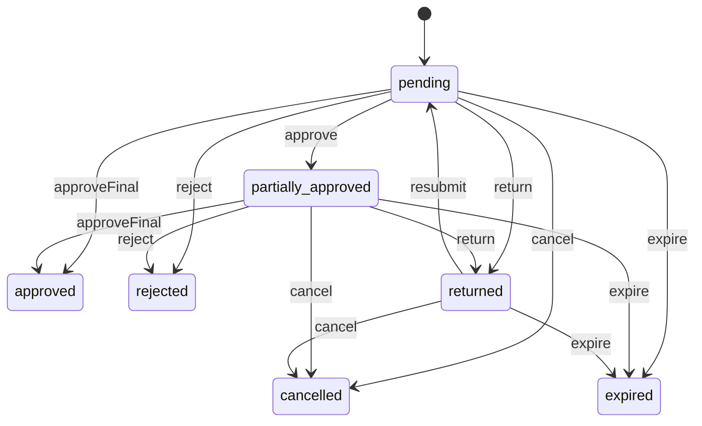
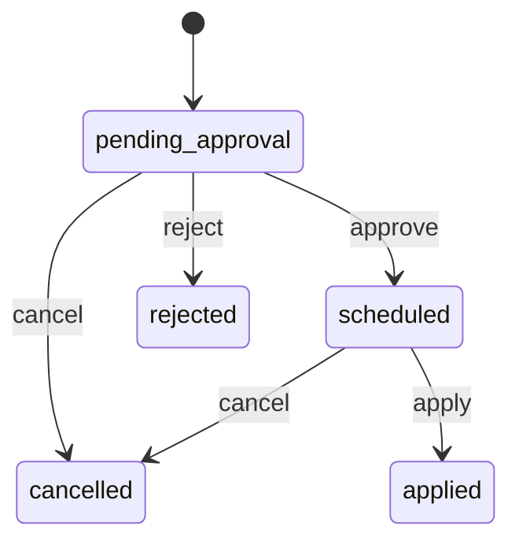
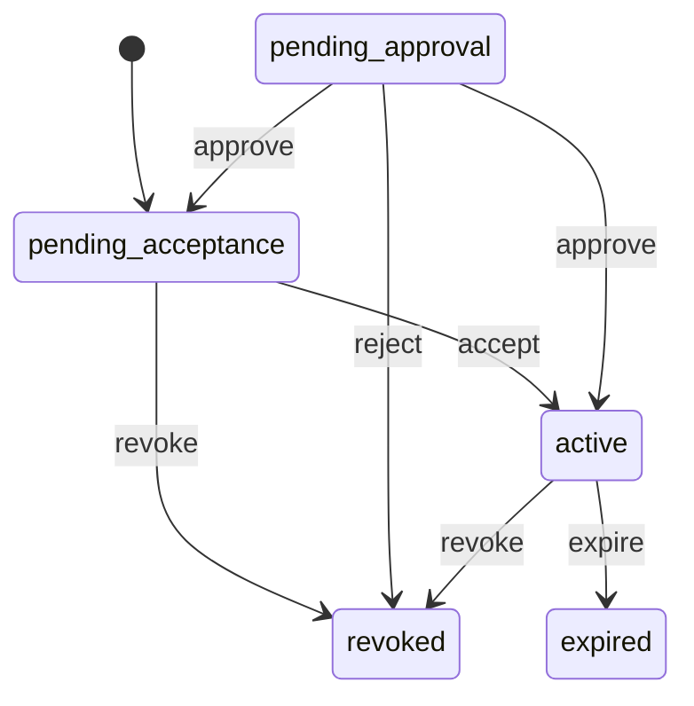
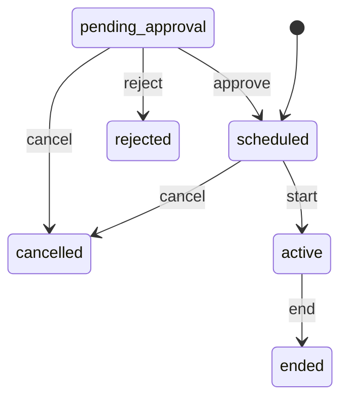

# Access and approvals (`access`)

What staff may do and how much they may approve: staff roles, the permission registry, role assignments, leads and backups per work area, approval limits per role, approval requests with a second reviewer, and cover while someone is away. Granting access never grants financial authority.

- **Group:** Platform · **Launch phase:** 1 · **Plan chapters:** 2, 18
- **Depends on:** [identity](identity.md) · **Optional:** [audit](audit.md), [notifications](notifications.md), [sellers](sellers.md), [finance](finance.md), [returns](returns.md)
- **Required by:** [advertising](advertising.md), [content](content.md), [finance](finance.md), [sellers](sellers.md), [settings](settings.md), [support](support.md), [trust](trust.md), [workqueues](workqueues.md)

## Owns
- Staff roles: Business Owner, the 17 management roles of plan ch. 2 (Official Store, Purchasing, Inventory, Warehouse, Order, Shipping, Returns, Platform Administrator, Catalog, Seller, Customer Support, Finance, Marketing, Advertising, Content, Trust and Risk, Reports Analyst), task roles (warehouse worker, finance staff, support agent) and custom roles
- Permission registry: every staff permission declared by every enabled module, grouped by work area
- Role permissions and role assignments (one person can hold several roles; a role is a responsibility, not a person)
- Lead, ordered backups and escalation role for every role's work area, with coverage gaps
- Approval action registry (payouts, refunds, holds, seller restrictions, price changes, publication overrides, adjustments…) declared by owning modules
- Approval limits per role and action, set by the Business Owner, with effective dates; changes to limits always need Business Owner approval
- Authority checks: allowed, approval required or not permitted, for a principal, action and amount
- Approval requests: one or two approvals, nominated reviewer, return with comment, reject, cancel, expiry, reminders; nobody approves their own request
- Away periods: who covers each role while a lead is away, and (with Business Owner approval) temporary delegation of approval authority

**Not here:**
- Staff accounts, sign-in, invitation links and pass codes, re-authentication and account lock/disable: identity (access calls identity.inviteStaff and reacts to identity.account.disabled)
- Seller member roles and seller permissions (owner-only payout changes, etc.): sellers
- Executing the approved action (releasing the payout, sending the refund, suspending the seller): the module that requested the approval, on access.approval.decided
- The action history itself: audit (access records every role, permission, limit and approval change there)
- Work items, queues, deadlines and escalation timers: workqueues (it uses lead/backup resolution from here)
- Delivering notices to approvers and backups: notifications

## Admin API

| Method | Path | Purpose | Auth | Body → Response |
|---|---|---|---|---|
| GET | `/api/admin/access/roles` | Roles with people, lead, backups and approval-limit summary | staff<br>`access.roles.view` | `Role[]` |
| GET | `/api/admin/access/roles/{id}` | Role editor: permissions by area, approval limits, pending changes | staff<br>`access.roles.view` | `RoleDetail` |
| POST | `/api/admin/access/roles` | Create a task or custom role _(audited)_ | staff<br>`access.roles.manage` | `RoleInput` → `Role` |
| PATCH | `/api/admin/access/roles/{id}` | Rename a role, change its work area or escalation role _(audited)_ | staff<br>`access.roles.manage` | `RoleUpdate` → `Role` |
| POST | `/api/admin/access/roles/{id}/archive` | Archive an unused custom role _(audited)_ | staff<br>`access.roles.manage` | `{ reason: text }` → `Role` |
| PUT | `/api/admin/access/roles/{id}/permissions` | Replace the permissions of a role _(audited, step-up: reauth)_ | staff<br>`access.roles.manage` | `{ permissionKeys: string[], reason: text, reauthToken: string }` → `RoleDetail` |
| PUT | `/api/admin/access/roles/{id}/coverage` | Set the lead, backups and escalation role _(audited)_ | staff<br>`access.roles.manage` | `CoverageInput` → `RoleCoverage` |
| GET | `/api/admin/access/permissions` | Permission registry grouped by work area | staff<br>`access.roles.view` | `PermissionGroup[]` |
| GET | `/api/admin/access/members` | Staff members with roles, lead/backup duties and away status | staff<br>`access.roles.view` | Page<StaffMember> |
| GET | `/api/admin/access/members/{accountId}` | One staff member: assignments, effective permissions and limits, away periods | staff<br>`access.roles.view` | `StaffMemberDetail` |
| POST | `/api/admin/access/staff-invitations` | Invite a staff member with roles _(audited, step-up: reauth)_ | staff<br>`access.roles.manage` | `StaffInvitationInput` → `StaffMember` |
| POST | `/api/admin/access/role-assignments` | Give a staff member a role _(audited, step-up: reauth)_ | staff<br>`access.roles.manage` | `{ accountId: uuid, roleId: uuid, reason: text, expiresAt: datetime?, reauthToken: string }` → `RoleAssignment` |
| POST | `/api/admin/access/role-assignments/{id}/revoke` | Remove a role from a staff member _(audited)_ | staff<br>`access.roles.manage` | `{ reason: text }` → `RoleAssignment` |
| GET | `/api/admin/access/approval-actions` | Actions that can have approval limits | staff<br>`access.roles.view` | `ApprovalAction[]` |
| GET | `/api/admin/access/limits` | Approval limits in force | staff<br>`access.roles.view` | `ApprovalLimit[]` |
| POST | `/api/admin/access/limit-changes` | Propose new approval limits for a role _(audited)_ | staff<br>`access.limits.propose` | `{ roleId: uuid, changes: LimitInput[], reason: text, effectiveFrom: datetime }` → `LimitChange` |
| GET | `/api/admin/access/limit-changes` | Proposed, scheduled and past limit changes | staff<br>`access.roles.view` | Page<LimitChange> |
| POST | `/api/admin/access/limit-changes/{id}/cancel` | Withdraw a pending or scheduled limit change _(audited)_ | staff<br>`access.limits.propose` | `{ reason: text }` → `LimitChange` |
| POST | `/api/admin/access/authority-checks` | Can I do this, or who must approve it? | staff | `{ action: string, amount: AmountInput? }` → `AuthorityCheck` |
| GET | `/api/admin/access/approval-requests` | Approval requests (waiting for me, mine, or all) _(also access.approvals.view-all when not own)_ | staff | Page<ApprovalRequest> |
| GET | `/api/admin/access/approval-requests/{id}` | One approval request with decisions and whether I can decide | staff | `ApprovalRequest` |
| POST | `/api/admin/access/approval-requests/{id}/approve` | Approve (first or second approval) _(audited)_ | staff | `{ note: text?, reauthToken: string? }` → `ApprovalRequest` |
| POST | `/api/admin/access/approval-requests/{id}/reject` | Reject with a reason _(audited)_ | staff | `{ reason: text }` → `ApprovalRequest` |
| POST | `/api/admin/access/approval-requests/{id}/return` | Send back to the requester with a comment _(audited)_ | staff | `{ comment: text }` → `ApprovalRequest` |
| POST | `/api/admin/access/approval-requests/{id}/resubmit` | Requester resubmits after a return _(audited)_ | staff | `{ note: text }` → `ApprovalRequest` |
| POST | `/api/admin/access/approval-requests/{id}/cancel` | Requester withdraws a request _(audited)_ | staff | `{ reason: text }` → `ApprovalRequest` |
| POST | `/api/admin/access/approval-requests/{id}/remind` | Remind eligible reviewers | staff | `{ message: text? }` → `{ notified: StaffRef[] }` |
| GET | `/api/admin/access/away-periods` | Away periods (current and upcoming by default) | staff<br>`access.roles.view` | Page<AwayPeriod> |
| POST | `/api/admin/access/away-periods` | Plan time away and who covers each role _(audited, also access.away.manage when not own)_ | staff | `AwayInput` → `AwayPeriod` |
| POST | `/api/admin/access/away-periods/{id}/end` | End an away period early (back at work) _(audited)_ | staff | `AwayPeriod` |
| POST | `/api/admin/access/away-periods/{id}/cancel` | Cancel a planned away period _(audited)_ | staff | `{ reason: text? }` → `AwayPeriod` |
| GET | `/api/admin/access/coverage` | Who receives each role's work today, and coverage gaps | staff | `Coverage` |
| GET | `/api/admin/access/me` | My roles, permissions, limits and approvals waiting | staff | `MyAccess` |

## Types

### RoleRef

| Field | Type |
|---|---|
| id | `uuid` |
| key | `string` Stable key, e.g. finance_manager, business_owner |
| name | `string` |

### StaffRef

| Field | Type |
|---|---|
| accountId | `uuid` |
| name | `string` |
| email | `email?` |
| away | `bool` |
| roleLabel | `string?` Display name of the member's primary role, e.g. Support Specialist, Finance Manager |

### Role

| Field | Type |
|---|---|
| id | `uuid` |
| key | `string` |
| name | `string` |
| kind | `enum(owner|management|task|custom)` owner = Business Owner; management = the 17 plan roles; task = agents, warehouse workers, finance staff |
| workArea | `string` Finance, Orders, Settings… |
| description | `text?` |
| system | `bool` Seeded roles cannot be archived or have their key changed |
| archived | `bool` |
| people | `StaffRef[]` |
| lead | `StaffRef?` |
| backups | `StaffRef[]` |
| escalationRole | `RoleRef?` |
| permissionCount | `int` |
| limitSummary | `string` Human summary, e.g. 'Refunds up to $2,000; payouts with 2nd review' or 'No financial authority' |

### Permission

| Field | Type |
|---|---|
| key | `string` <module>.<resource>.<action> |
| module | `string` |
| area | `string` Grouping on the role editor: Finance, Orders and shipping, Returns and cases… |
| label | `string` |
| desc | `text` |
| sensitive | `bool` Granting it needs a second reviewer (access.*, identity.staff-accounts.*, finance.*, audit.entries.export, settings.changes.*) |
| available | `bool` False when the declaring module is disabled |

### PermissionGroup

| Field | Type |
|---|---|
| area | `string` |
| permissions | `PermissionGrant[]` |
| grantedCount | `int` |

### PermissionGrant

| Field | Type |
|---|---|
| permission | `Permission` |
| granted | `bool` |

### RoleDetail

| Field | Type |
|---|---|
| role | `Role` |
| permissions | `PermissionGroup[]` |
| limits | `ApprovalLimit[]` |
| pendingLimitChange | `LimitChange?` |
| pendingPermissionApproval | `ApprovalInfo?` |

### RoleInput

| Field | Type |
|---|---|
| name | `string` |
| workArea | `string` |
| kind | `enum(task|custom)?` |
| description | `text?` |
| escalationRoleId | `uuid?` |
| reason | `text` |

### RoleUpdate

| Field | Type |
|---|---|
| name | `string?` |
| workArea | `string?` |
| description | `text?` |
| escalationRoleId | `uuid?` |
| reason | `text` |

### ApprovalAction

| Field | Type |
|---|---|
| key | `string` e.g. finance.payouts.release, returns.refunds.approve, finance.holds.place, sellers.sellers.restrict, offers.prices.change |
| module | `string` |
| label | `string` The manifest's desc |
| limit | `enum(money|units|percent|none)` From the manifest. none = authority only (yes/no actions such as seller restrictions) |
| secondReviewer | `enum(always|above-limit|never)` From the manifest. always: one approver other than the requester is always needed (e.g. seller suspension, payout destination change) |
| approvers | `string?` The manifest's default approvers text, shown when seeding limits |
| defaultEligibleRoleKeys | `string[]` |
| available | `bool` |

### LimitValue

| Field | Type |
|---|---|
| authority | `enum(not_permitted|recommend_only|permitted|permitted_with_second_review)` recommend_only: may create the request but never approve it |
| limitMoney | `Money?` Highest amount this role may approve alone (money actions) |
| limitNumber | `number?` Percent or units for percent/units actions |
| secondReviewerAboveMoney | `Money?` Above this a second, different eligible person must also approve |
| secondReviewerAboveNumber | `number?` |
| secondReviewerRoleKeys | `string[]` Roles that may act as second reviewer (e.g. finance_manager, finance_staff, business_owner) |

### ApprovalLimit

| Field | Type |
|---|---|
| id | `uuid` |
| role | `RoleRef` |
| action | `ApprovalAction` |
| value | `LimitValue` |
| summary | `string` Up to $2,000.00 per refund · second reviewer above $1,000.00 |
| effectiveFrom | `datetime` |
| approvedBy | `Actor?` |

### LimitInput

| Field | Type |
|---|---|
| actionKey | `string` |
| value | `LimitValue` |

### LimitDiff

| Field | Type |
|---|---|
| actionKey | `string` |
| actionLabel | `string` |
| before | `LimitValue?` |
| after | `LimitValue` |

### LimitChange

| Field | Type |
|---|---|
| id | `uuid` |
| role | `RoleRef` |
| changes | `LimitDiff[]` |
| reason | `text` |
| effectiveFrom | `datetime` Requests already waiting keep the limit they were created under |
| status | `enum(pending_approval|scheduled|applied|rejected|cancelled)` |
| proposedBy | `Actor` |
| approval | `ApprovalInfo` |
| createdAt | `datetime` |
| appliedAt | `datetime?` |

### AmountInput

| Field | Type |
|---|---|
| money | `Money?` |
| number | `number?` Percent or units |

### AuthorityCheck

| Field | Type |
|---|---|
| decision | `enum(allowed|approval_required|denied)` |
| action | `string` |
| reason | `string` Within your $2,000.00 refund limit · Above your limit: Business Owner approval · Your role can recommend only |
| callerLimit | `LimitValue?` |
| requiresSecondReviewer | `bool` |
| approvalsNeeded | `int` Approvals by other people still needed if the caller submits now (0 when allowed) |
| eligibleApproverRoles | `RoleRef[]` |
| eligibleApprovers | `StaffRef[]` People who could approve now, backups included |
| stepUpRequired | `bool` The amount is above stepUpAbove: whoever acts or approves must confirm with their password again (a re-auth token, purpose approval). A module acting on an allowed decision asks the caller for it before acting (STEP_UP_REQUIRED); access asks approvers itself. |

### ApprovalTarget

| Field | Type |
|---|---|
| type | `string` payout_run, refund, hold, seller, offer, price_change, setting_change, limit_change, role_permissions, away_period… |
| id | `string` |
| ref | `string?` Human reference: PO-RUN-261009, MK-260930-21877, RT-… |
| label | `string?` |
| sellerId | `uuid?` |
| screen | `string?` Prototype/admin screen that shows the target, e.g. admin/payouts |

### ApprovalDecision

| Field | Type |
|---|---|
| step | `int` |
| decision | `enum(approved|rejected|returned)` |
| by | `Actor` |
| roles | `RoleRef[]` |
| note | `text?` |
| viaDelegationFrom | `StaffRef?` Set when the approver used authority delegated during an away period |
| at | `datetime` |

### ApprovalRequest

| Field | Type |
|---|---|
| id | `uuid` |
| ref | `string` AP-YYMMDD-NNNN |
| action | `ApprovalAction` |
| target | `ApprovalTarget` |
| amount | `Money?` |
| quantity | `number?` |
| summary | `string` One line for lists: 'Payout run of $78,420.55 for 142 sellers' |
| details | `json` Before/after or line items supplied by the requesting module |
| reason | `text` |
| requestedBy | `Actor` |
| requestedByRoles | `RoleRef[]` |
| requesterCountsAsFirst | `bool` The requester had authority up to the second-review threshold, so their request is the first approval |
| status | `enum(pending|partially_approved|approved|rejected|returned|cancelled|expired)` |
| requiredApprovals | `int` Approvals by people other than the requester |
| approvals | `ApprovalDecision[]` |
| eligibleApprovers | `StaffRef[]` |
| nominatedReviewer | `StaffRef?` Requester's choice of second reviewer; others who are eligible may still decide |
| deadline | `Deadline?` |
| limitSnapshot | `json` Limits in force when the request was created |
| timeline | `TimelineEvent[]` |
| createdAt | `datetime` |
| decidedAt | `datetime?` |
| canDecide | `bool` For the caller |
| cannotDecideReason | `string?` Your own request · Above your limit · Already approved by you |

### RequestApprovalInput

| Field | Type |
|---|---|
| action | `string` |
| target | `ApprovalTarget` |
| amount | `Money?` |
| quantity | `number?` |
| summary | `string` |
| details | `json?` |
| reason | `text` |
| requestedBy | `identity.Principal` |
| nominatedReviewerId | `uuid?` |
| dueAt | `datetime?` |

### StaffMember

| Field | Type |
|---|---|
| account | `identity.AccountSummary` |
| roles | `RoleRef[]` |
| leads | `RoleRef[]` Roles this person leads |
| backupFor | `RoleRef[]` |
| coveringNow | `RoleRef[]` Roles received as backup during someone's away period |
| away | `AwayPeriod?` |
| reportsTo | `StaffRef?` |
| status | `enum(invited|active|locked|disabled)` |
| limitReview | `ApprovalInfo?` Open or decided Business Owner review of this member's approval limits (requestLimitReview on the invitation) |

### StaffMemberDetail

| Field | Type |
|---|---|
| member | `StaffMember` |
| assignments | `RoleAssignment[]` |
| effectivePermissions | `string[]` |
| effectiveLimits | `ApprovalLimit[]` |
| awayPeriods | `AwayPeriod[]` |
| approvalsWaiting | `int` Requests this person could decide now |

### RoleAssignment

| Field | Type |
|---|---|
| id | `uuid` |
| accountId | `uuid` |
| role | `RoleRef` |
| status | `enum(pending_acceptance|pending_approval|active|revoked|expired)` |
| grantedBy | `Actor` |
| reason | `text` |
| grantedAt | `datetime` |
| expiresAt | `datetime?` |
| revokedAt | `datetime?` |
| revokedBy | `Actor?` |
| revokeReason | `text?` |
| approval | `ApprovalInfo?` |

### StaffInvitationInput

| Field | Type |
|---|---|
| email | `email` |
| name | `string` |
| roleIds | `uuid[]` |
| reportsToAccountId | `uuid?` |
| reason | `text` |
| reauthToken | `string` Re-auth token for purpose role-grant (POST /api/admin/identity/reauth with the password) |
| requestLimitReview | `bool?` Request approval limits from the Business Owner: opens an access.limits.change approval request asking the Business Owner to confirm or adjust the limits the chosen roles carry before the new member uses them. Until it is decided the member's approval actions stay at no limit (they can prepare but not approve). |

### RoleCoverage

| Field | Type |
|---|---|
| role | `RoleRef` |
| workArea | `string` |
| lead | `StaffRef?` |
| backups | `StaffRef[]` |
| receivingNow | `StaffRef[]` |
| viaBackup | `bool` |
| leadAwayUntil | `datetime?` |
| escalationRole | `RoleRef?` |

### CoverageGap

| Field | Type |
|---|---|
| kind | `enum(no_lead|no_backup|backup_not_in_role|shared_backup|lead_and_backups_away|one_person_leads_several)` |
| roles | `RoleRef[]` |
| people | `StaffRef[]` |
| message | `string` |
| severity | `enum(critical|review|ok)` |

### Coverage

| Field | Type |
|---|---|
| roles | `RoleCoverage[]` |
| gaps | `CoverageGap[]` |

### CoverageInput

| Field | Type |
|---|---|
| leadAccountId | `uuid?` |
| backupAccountIds | `uuid[]` Ordered; the first available backup receives the work |
| escalationRoleId | `uuid?` |
| reason | `text` |

### AwayCoverage

| Field | Type |
|---|---|
| role | `RoleRef` |
| coveredBy | `StaffRef` |

### AwayPeriod

| Field | Type |
|---|---|
| id | `uuid` |
| account | `StaffRef` |
| from | `datetime` |
| to | `datetime` |
| status | `enum(pending_approval|scheduled|active|ended|cancelled|rejected)` |
| coverage | `AwayCoverage[]` |
| delegateApprovals | `bool` Covering people may use the away person's approval limits (never above them) while away |
| approval | `ApprovalInfo?` |
| reason | `text?` |
| createdBy | `Actor` |
| createdAt | `datetime` |

### AwayInput

| Field | Type |
|---|---|
| accountId | `uuid?` Default: the caller. Others need access.away.manage. |
| from | `datetime` |
| to | `datetime` |
| coverage | `AwayCoverageInput[]` |
| delegateApprovals | `bool` |
| reason | `text?` |

### AwayCoverageInput

| Field | Type |
|---|---|
| roleId | `uuid` |
| coveredByAccountId | `uuid` |

### RecipientResolution

| Field | Type |
|---|---|
| roleKey | `string` |
| leadAccountId | `uuid?` |
| accountIds | `uuid[]` Who should act now (lead, or covering backups) |
| ccAccountIds | `uuid[]` Who should also see it (the away lead, on return) |
| viaBackup | `bool` |
| escalationRoleKey | `string?` |

### MyAccess

| Field | Type |
|---|---|
| account | `identity.AccountSummary` |
| roles | `RoleRef[]` |
| coveringNow | `RoleRef[]` |
| permissions | `string[]` |
| limits | `ApprovalLimit[]` |
| approvalsToDecide | `int` |
| myOpenRequests | `int` |
| away | `AwayPeriod?` |

### MyActionLimit

| Field | Type |
|---|---|
| action | `ApprovalAction` |
| value | `LimitValue` |
| needsSecondReviewer | `bool` |
| route | `string[]` Approver roles above the caller's limit, in order, e.g. Finance Manager, Business Owner |
| summary | `string` e.g. Up to $2,000.00 per refund · second reviewer above $1,000.00 |

## Status flows

### Approval request (`ApprovalRequest.status`)



approve moves to partially_approved while approvals < requiredApprovals; approveFinal is the approval that completes it. Each approver must be eligible (a role whose limit covers the amount, or a second-reviewer role above the threshold, or authority delegated during an away period), must not be the requester, and must not have approved the same request already. resubmit clears earlier approvals. approved, rejected, cancelled and expired publish access.approval.decided; the requesting module then acts. Approved is not executed: e.g. a payout shows Paid only after the bank confirms.

### Limit change (`LimitChange.status`)



Every limit change needs Business Owner approval (action access.limits.change). A change proposed by a Business Owner is approved on creation for other roles' limits; a Business Owner cannot approve a change to a role they hold themselves when another Business Owner exists. Platform Administrators can propose but never approve. apply runs at effectiveFrom (job access.apply-limit-changes) and closes the previous rows (effective_to).

### Role assignment (`RoleAssignment.status`)



Assignments to invited staff wait for identity.invitation.accepted. Assigning a role that carries sensitive permissions, or assigning any role to yourself, creates pending_approval with a second reviewer (action access.roles.sensitive-grant). approve is guarded: it leads to active when the person has already accepted their invitation (an existing staff account), otherwise to pending_acceptance until identity.invitation.accepted. Disabling the account (identity.account.disabled) revokes all assignments.

### Away period (`AwayPeriod.status`)



Periods with delegateApprovals start in pending_approval (Business Owner approves the delegation: granting access is not financial authority). start and end run from the job at from/to; end can also be called early. Coverage only re-routes work and notices; covering people use their own permissions and limits unless delegation was approved. With an approved delegation they also get the covered roles' permissions and may approve with the away person's limits (never more; decisions record viaDelegationFrom). Both are read at request time from now in [from, to) for scheduled and active periods, so they start and end on time even when the job is late, and only while the away person still holds the role. A delegation waiting for approval lends nothing.

## Data (schema `access`)

**roles**

| Column | Type |
|---|---|
| id | uuid pk |
| key | text unique |
| name | text |
| kind | text (owner|management|task|custom) |
| work_area | text |
| description | text? |
| system | bool |
| escalation_role_id | uuid? → roles |
| archived_at | timestamptz? |
| created_at | timestamptz |
| updated_at | timestamptz |
| version | int |

**permissions**: Registry synced at boot from every enabled module's manifest

| Column | Type |
|---|---|
| key | text pk |
| module | text |
| area | text |
| label | text |
| description | text |
| sensitive | bool |
| registered_at | timestamptz |
| unavailable_since | timestamptz? |

Indexes: `(module)`

**role_permissions**

| Column | Type |
|---|---|
| role_id | uuid → roles |
| permission_key | text → permissions |
| granted_by | text |
| granted_at | timestamptz |

Indexes: `pk (role_id, permission_key)`, `(permission_key)`

**role_assignments**

| Column | Type |
|---|---|
| id | uuid pk |
| account_id | uuid |
| role_id | uuid → roles |
| status | text |
| granted_by_kind | text |
| granted_by_id | text |
| reason | text |
| granted_at | timestamptz |
| expires_at | timestamptz? |
| revoked_at | timestamptz? |
| revoked_by | text? |
| revoke_reason | text? |
| approval_request_id | uuid? → approval_requests |

Indexes: `(account_id) where status = 'active'`, `(role_id) where status = 'active'`, `unique (account_id, role_id) where status in ('active','pending_acceptance','pending_approval')`

**role_coverage**: Lead, ordered backups and escalation per role

| Column | Type |
|---|---|
| role_id | uuid pk → roles |
| lead_account_id | uuid? |
| backup_account_ids | jsonb (ordered uuid[]) |
| updated_by | text |
| updated_at | timestamptz |

**approval_actions**: Registry synced at boot from module manifests (`approvalActions`)

| Column | Type |
|---|---|
| key | text pk |
| module | text |
| label | text |
| limit_kind | text (money|units|percent|none) |
| second_reviewer | text (always|above-limit|never) |
| approvers | text? |
| default_eligible_role_keys | jsonb |
| unavailable_since | timestamptz? |

**approval_limits**: Effective-dated; the row in force has effective_from <= now < effective_to

| Column | Type |
|---|---|
| id | uuid pk |
| role_id | uuid → roles |
| action_key | text → approval_actions |
| authority | text |
| limit_amount_minor | bigint? |
| limit_currency | text? |
| limit_number | numeric? |
| second_above_amount_minor | bigint? |
| second_above_number | numeric? |
| second_reviewer_role_keys | jsonb |
| effective_from | timestamptz |
| effective_to | timestamptz? |
| limit_change_id | uuid? → limit_changes |

Indexes: `(role_id, action_key, effective_from desc)`

**limit_changes**

| Column | Type |
|---|---|
| id | uuid pk |
| role_id | uuid → roles |
| changes | jsonb |
| reason | text |
| effective_from | timestamptz |
| status | text |
| proposed_by_kind | text |
| proposed_by_id | text |
| approval_request_id | uuid? → approval_requests |
| created_at | timestamptz |
| applied_at | timestamptz? |
| cancel_reason | text? |

Indexes: `(status, effective_from)`

**approval_requests**

| Column | Type |
|---|---|
| id | uuid pk |
| ref | text unique |
| action_key | text |
| module | text |
| target_type | text |
| target_id | text |
| target_ref | text? |
| target_label | text? |
| target_screen | text? |
| seller_id | uuid? |
| amount_minor | bigint? |
| currency | text? |
| quantity | numeric? |
| summary | text |
| details | jsonb |
| reason | text |
| requested_by_kind | text |
| requested_by_id | text |
| requester_roles | jsonb |
| requester_counts_as_first | bool |
| required_approvals | int |
| status | text |
| eligible_role_keys | jsonb |
| nominated_reviewer_id | uuid? |
| limit_snapshot | jsonb |
| due_at | timestamptz? |
| expires_at | timestamptz |
| created_at | timestamptz |
| decided_at | timestamptz? |
| outcome_reason | text? |
| last_reminded_at | timestamptz? |
| version | int |

Indexes: `(status, created_at)`, `(module, target_type, target_id)`, `(requested_by_id, status)`, `unique (action_key, target_type, target_id) where status in ('pending','partially_approved','returned')`

**approval_decisions**

| Column | Type |
|---|---|
| id | uuid pk |
| request_id | uuid → approval_requests |
| step | int |
| decision | text |
| by_account_id | uuid |
| roles | jsonb |
| note | text? |
| via_delegation_from | uuid? |
| at | timestamptz |

Indexes: `(request_id, step)`, `unique (request_id, by_account_id) where decision = 'approved'`

**away_periods**

| Column | Type |
|---|---|
| id | uuid pk |
| account_id | uuid |
| starts_at | timestamptz |
| ends_at | timestamptz |
| status | text |
| delegate_approvals | bool |
| reason | text? |
| approval_request_id | uuid? → approval_requests |
| created_by_kind | text |
| created_by_id | text |
| created_at | timestamptz |
| ended_at | timestamptz? |

Indexes: `(account_id, starts_at)`, `(status, starts_at)`, `(status, ends_at)`

**away_coverage**

| Column | Type |
|---|---|
| away_period_id | uuid → away_periods |
| role_id | uuid → roles |
| covered_by_account_id | uuid |

Indexes: `pk (away_period_id, role_id)`, `(covered_by_account_id)`

## Events

| Publishes | When | Payload | Consumed by |
|---|---|---|---|
| `access.approval.requested` | An approval request is created or resubmitted | `{ requestId: uuid, ref: string, actionKey: string, module: string, target: ApprovalTarget, amount: Money?, summary: string, requestedBy: Actor, eligibleRoleKeys: string[], eligibleAccountIds: uuid[], nominatedReviewerId: uuid?, dueAt: datetime? }` | audit, notifications, workqueues |
| `access.approval.partially_approved` | A first approval is recorded and another is still needed | `{ requestId: uuid, actionKey: string, module: string, target: ApprovalTarget, approvedBy: Actor, remainingApprovals: int, eligibleAccountIds: uuid[] }` | audit, notifications |
| `access.approval.returned` | A reviewer sends a request back with a comment | `{ requestId: uuid, actionKey: string, module: string, target: ApprovalTarget, by: Actor, comment: text, requestedById: string }` | audit, notifications, settings |
| `access.approval.decided` | A request reaches a final outcome | `{ requestId: uuid, ref: string, actionKey: string, module: string, target: ApprovalTarget, outcome: enum(approved|rejected|cancelled|expired), decidedBy: Actor?, reason: text?, amount: Money?, approverIds: uuid[], requestedById: string }` | advertising, audit, catalog, content, customers, finance, fulfillment-service, inventory, notifications, offers, payments, promotions, purchasing, returns, sellers, settings, support, trust, wallet, workqueues |
| `access.approval.reminder_sent` | Someone reminds the eligible reviewers, or the reminder job runs | `{ requestId: uuid, toAccountIds: uuid[], by: Actor, message: text? }` | notifications |
| `access.role.changed` | A role is created, edited, archived, its permissions change, or it is assigned or removed | `{ roleId: uuid, roleKey: string, change: enum(created|updated|archived|permissions_changed|assigned|unassigned), accountId: uuid?, by: Actor }` | - |
| `access.limits.changed` | An approved limit change takes effect | `{ roleId: uuid, roleKey: string, actionKeys: string[], limitChangeId: uuid, effectiveFrom: datetime }` | - |
| `access.coverage.changed` | Who receives a role's work changes (lead/backups edited, away period starts or ends, assignment removed) | `{ roleId: uuid, roleKey: string, leadAccountId: uuid?, receivingAccountIds: uuid[], viaBackup: bool }` | notifications, workqueues |
| `access.away.started` | An away period begins | `{ awayPeriodId: uuid, accountId: uuid, until: datetime, coverage: AwayCoverageInput[], delegateApprovals: bool }` | workqueues |
| `access.away.ended` | An away period ends (on time or early) | `{ awayPeriodId: uuid, accountId: uuid }` | notifications, workqueues |

| Consumes | From | Does |
|---|---|---|
| `identity.invitation.accepted` | identity | Activate pending_acceptance role assignments of a newly accepted staff member (including sensitive grants already approved); assignments still pending_approval wait for their approval and then become active |
| `identity.invitation.revoked` | identity | End the role assignments still waiting for the revoked staff invitation (pending_acceptance revoked, pending_approval rejected and its approval request cancelled), so the roles can be granted again, e.g. a new Business Owner bootstrap |
| `identity.account.disabled` | identity | Revoke all role assignments, remove the person as lead/backup, drop them from eligible approvers of open requests, and publish access.coverage.changed with the gap |
| `identity.account.locked` | identity | Treat a locked staff member as unavailable for routing (backup receives) until unlocked |
| `identity.account.unlocked` | identity | Restore routing to the unlocked staff member |

## In-process API (for other modules)

| Function | Signature | Used by |
|---|---|---|
| hasPermission | `(principal: identity.Principal, permissionKey: string) => bool`<br>Kernel guard for every admin endpoint with a `permission`. Includes roles covered as a backup only where the away period grants them. | kernel |
| permissionsOf | `(accountId: uuid) => string[]`<br>Effective staff permissions (cached, invalidated on access.role.changed) | kernel, reports |
| check | `(principal: identity.Principal, action: string, amount?: AmountInput) => AuthorityCheck`<br>allowed | approval_required | denied for this person, action and amount, with who could approve. Uses the limits in force now. Permissions alone never make a money action allowed. | finance, returns, payments, sellers, offers, catalog, inventory, purchasing, shipping, support, promotions, customers, settings, content, advertising, audit, wallet |
| requestApproval | `(input: RequestApprovalInput) => ApprovalRequest`<br>Create an approval request (or return the open one for the same action and target). The requesting module keeps its record pending and finishes on access.approval.decided. | finance, returns, sellers, offers, catalog, inventory, purchasing, shipping, support, promotions, customers, settings, content, advertising, audit, wallet |
| decide | `(requestId: uuid, principal: identity.Principal, decision: { kind: 'approve' | 'reject' | 'return', note?: string, reauthToken?: string }) => ApprovalRequest`<br>Same rules as the admin approve/reject/return endpoints, for modules that show the decision inside their own screen (payout run approval). An approval above stepUpAbove needs reauthToken: a re-auth token for purpose approval issued to this principal's session (used once; given back when the decision fails) | finance, returns, sellers |
| cancelApproval | `(requestId: uuid, by: Actor, reason: string) => void`<br>The requesting module withdraws a request (record changed or deleted) | finance, returns, sellers, offers, settings |
| getApproval | `(requestId: uuid) => ApprovalRequest | null`<br>Full request with decisions | audit, finance, returns, sellers |
| approvalInfo | `(requestId: uuid) => ApprovalInfo`<br>Compact common.ApprovalInfo for embedding in other modules' responses | finance, returns, sellers, offers, inventory, purchasing, settings, content, promotions |
| resolveRecipients | `(roleKey: string) => RecipientResolution`<br>Who receives a role's work and notices right now: lead, or the covering backup while the lead is away (the lead keeps a copy) | notifications, workqueues, support |
| rolesOf | `(accountId: uuid) => RoleRef[]`<br>Active roles of a staff member (audit stores them with each entry; advertising takes a reviewer's role from here, never from the request body) | audit, notifications, workqueues, advertising |
| membersOfRole | `(roleKey: string) => StaffRef[]`<br>Everyone holding a role (assignment pickers in workqueues and support) | workqueues, support, notifications |
| staffWithPermission | `(permissionKey: string, opts?: { includeCovering?: bool }) => StaffRef[]`<br>Active staff members whose active role assignments grant the permission (same rule as hasPermission; disabled accounts left out, locked ones shown away). includeCovering adds people who hold it only as an away-period backup. For handler pickers and routing to whoever can act (support case handlers, notifications). | support, workqueues, notifications, messaging |
| listApprovalsToDecide | `(principal: identity.Principal, filter: { module?: string, actionKey?: string, overdue?: bool }, page: PageInput) => Page<ApprovalRequest>`<br>Requests the caller may decide now, oldest due first (same rules as GET /approval-requests?view=to_decide). canDecide and steps are computed for the caller. | graphql |
| approvalSummaryFor | `(principal: identity.Principal) => { toDecide: int, overdue: int, dueSoon: int, myOpenRequests: int, returnedToMe: int }`<br>Approval counts for the admin dashboard and inbox | graphql |
| getApprovalForViewer | `(principal: identity.Principal, requestId: uuid) => ApprovalRequest | null`<br>One request with decisions and steps, null unless the caller is the requester, an eligible approver or holds access.approvals.view-all. canDecide and cannotDecideReason are for the caller. | graphql |
| approvalForTargets | `(principal: identity.Principal, targetType: string, targetIds: string[]) => Map<string, ApprovalRequest | null>`<br>Batched: the current approval request per target record (open request first, else the latest decided one), for approval panels embedded in other modules' admin views (payout run, hold, refund request). Visibility follows the parent record; canDecide is for the caller. | graphql |
| approvalsForSellers | `(principal: identity.Principal, sellerIds: uuid[]) => Map<uuid, ApprovalRequest[]>`<br>Batched: open requests whose target belongs to each seller (ApprovalTarget.sellerId), for the admin seller 360 | graphql |
| coverageNow | `(filter: { workArea?: string }) => RoleCoverage[]`<br>Leads, backups and who receives each role's work today (GET /coverage without gaps), for the admin dashboard | graphql |
| myLimitFor | `(principal: identity.Principal, actionKey: string) => MyActionLimit`<br>The caller's own authority, limit, second-review rule and approval route for one action (decision panels) | graphql |
| getStaffRef | `(staffId: uuid) => StaffRef | null`<br>A staff member's display name and role label (roleLabel) for assignee, owner, reviewer and decider columns | support, finance, trust, workqueues, reports |

## Permissions

| Key | Who | Allows |
|---|---|---|
| `access.roles.view` | staff | View roles, staff members, limits, coverage and away periods |
| `access.roles.manage` | staff | Create and edit roles and their permissions, assign and remove roles, set leads and backups, invite staff (Platform Administrator). Does not include approval limits. |
| `access.limits.propose` | staff | Propose approval-limit changes (Platform Administrator, Business Owner) |
| `access.limits.approve` | staff | Decide approval-limit changes and delegations of approval authority (Business Owner only) |
| `access.approvals.view-all` | staff | See every approval request, not only those I requested or may decide |
| `access.away.manage` | staff | Plan away periods for other staff members |

## Approval actions

Checked through the access module (limits per role, second reviewer).

| Action | Limit | Second reviewer | Approvers | Meaning |
|---|---|---|---|---|
| `access.limits.change` | none | always | Business Owner (never the proposer; Platform Administrators can propose but never approve) | Change an approval limit or second-review threshold of a role (applies at effectiveFrom) |
| `access.roles.sensitive-grant` | none | always | A second staff member with access.roles.manage; Business Owner when the Business Owner role or the requester's own roles are involved | Grant sensitive permissions to a role, assign a role carrying them, assign the Business Owner role, or assign any role to yourself |
| `access.delegations.approve` | none | always | Business Owner | Temporary delegation of approval authority during an away period (granting access is not financial authority) |

## Error codes

| Code | Status | Meaning |
|---|---|---|
| `SELF_APPROVAL_NOT_ALLOWED` | 403 | You cannot approve or reject your own request. |
| `NOT_ELIGIBLE_APPROVER` | 403 | Your roles' limits do not cover this action or amount. details.eligibleRoles lists who can. |
| `ALREADY_APPROVED_BY_YOU` | 409 | The second approval must come from a different person. |
| `SYSTEM_ROLE` | 409 | Seeded roles cannot be archived or have their key changed. |
| `ROLE_IN_USE` | 409 | Remove the role from all staff before archiving it. |
| `LAST_BUSINESS_OWNER` | 409 | At least one active Business Owner must remain. |
| `COVERAGE_INVALID` | 400 | Lead and backups must hold the role, a backup cannot be the lead, and every led role needs cover. details.issues. |
| `AWAY_OVERLAP` | 409 | This person already has an away period in that time. |
| `UNKNOWN_PERMISSION` | 400 | details.keys are not in the permission registry (or their module is disabled). |
| `UNKNOWN_APPROVAL_ACTION` | 400 | The action key is not registered by any enabled module. |
| `REMINDER_TOO_SOON` | 429 | Reviewers were reminded recently; try again after details.nextAllowedAt. |

## Background jobs

| Job | Schedule | Does |
|---|---|---|
| `access.sync-registry` | on boot | Upsert permissions and approval actions from enabled module manifests; mark those of disabled modules unavailable (kept for history); seed the system roles on first boot |
| `access.apply-limit-changes` | every minute | Apply scheduled limit changes whose effectiveFrom has passed; publish access.limits.changed |
| `access.run-away-periods` | every 5 min | Start scheduled away periods and end active ones at their time; publish access.away.started/ended and access.coverage.changed |
| `access.expire-approval-requests` | every 15 min | Expire open requests past expires_at (dueAt + grace, or approvalRequestTtlHours) and publish access.approval.decided with outcome expired |
| `access.remind-approvals` | every 30 min | Remind eligible reviewers of requests due within reminderHoursBeforeDue or waiting longer than reminderAfterHours; escalate to the role's escalation role when overdue |
| `access.expire-assignments` | hourly | Expire role assignments past expiresAt (temporary access) |

## Settings

| Key | Default | Rules | Meaning |
|---|---|---|---|
| approvalRequestTtlHours | `72` | duration, hours, 1–…, approval: second reviewer | Open requests without a due date expire after this |
| reminderHoursBeforeDue | `4` | duration, hours, 0–… | Remind reviewers this long before dueAt |
| reminderAfterHours | `24` | duration, hours, 1–… | Remind reviewers of undated requests waiting this long |
| reminderMinIntervalMinutes | `60` | duration, minutes, 1–… | Manual reminders per request |
| stepUpAbove | `{"amount":1000000,"currency":"USD"}` | money, 0–…, approval: business owner | Money approvals above this need the approver's password again (a re-auth token, purpose approval) |
| sensitivePermissionPrefixes | `["access.","identity.staff-accounts.","finance.","audit.entries.export","settings.changes."]` | json, approval: business owner | Granting these needs a second reviewer |

## Notes
- Granting access is not financial authority. Permissions decide which screens and actions a person can open; approval limits decide how much they may approve. A permission such as finance.payouts.approve is necessary but never sufficient: check() also needs a limit covering the amount. Platform Administrators (access.roles.manage) can grant permissions but cannot set or approve limits, and cannot approve their own requests.
- Approval actions are declared by the owning module in its spec and manifest (`approvalActions`: key, desc, limit money|units|percent|none, secondReviewer always|above-limit|never, approvers; see FORMAT.md), next to its permissions, and registered at boot. Every endpoint `approval` rule names its action key. Declared actions include finance.payouts.release, finance.holds.place / finance.holds.release, finance.adjustments.record, returns.refunds.approve, sellers.sellers.restrict / sellers.sellers.suspend (always second reviewer) / sellers.sellers.close, offers.prices.change (percent), inventory.adjustments.apply (units), purchasing.orders.send, shipping.claims.open, support.remedies.approve, wallet.goodwill.grant, promotions.budgets.approve, advertising.rules.change, customers.accounts.close-with-obligations, trust.enforcements.reverse, settings.changes.apply and settings.changes.apply-owner. access declares access.limits.change, access.roles.sensitive-grant and access.delegations.approve. A catalog publication override action (catalog.products.publication-override) is not declared yet; catalog is owned by the lead.
- Second reviewer logic: if the requester's own limit covers the amount but it is above the second-review threshold, the request starts with requesterCountsAsFirst = true and needs one more approver from secondReviewerRoleKeys. If the amount is above the requester's limit, it needs approvers whose limits cover it (and a second one above their threshold). Actions declared with secondReviewer = always need one approver other than the requester whatever the amount.
- Modules follow one pattern: call check(); if allowed, act; if approval_required, call requestApproval(), keep their record pending and answer their normal success status with the approval (approvalInfo()) in the body; 409 APPROVAL_REQUIRED with details.approvalRequestId only when nothing could be saved (FORMAT.md, Approval responses). They finish on access.approval.decided (approved: execute; rejected/cancelled/expired: revert the pending record). denied is only for people who may not even propose the action.
- Seeded limits must let proposers propose: every approval action whose approvers are only the Business Owner is seeded recommend_only for the roles that prepare it, so check() answers approval_required (not denied) and the proposal becomes a Business Owner request: advertising.rules.change (advertising_manager), finance.fees.change (finance_manager), returns.baseline.change and returns.policies.shorten-window (returns_manager), content.policies.approve and content.policies.short-notice (content_manager), settings.changes.apply-owner and audit.retention.change (platform_administrator), access.limits.change and access.delegations.approve (platform_administrator). The Business Owner role holds audit.retention.manage (and the Platform Administrator may propose shortening through it).
- Lead and backups: notices and work for a role go to its lead; while the lead is away (or locked) they go to the first available backup and the lead sees them on return. notifications and workqueues use resolveRecipients(); routing changes are announced with access.coverage.changed.
- Seeded system roles (keys): business_owner, platform_administrator, official_store_manager, purchasing_manager, inventory_manager, warehouse_manager, order_manager, shipping_manager, returns_manager, catalog_manager, seller_manager, customer_support_manager, finance_manager, marketing_manager, advertising_manager, content_manager, trust_and_risk_manager, reports_analyst, plus task roles warehouse_worker, finance_staff, support_agent. Seeded limits are example values from the prototype and must be confirmed by the Business Owner.
- Fulfilled by Marketly staff permissions (seeded, and added to existing installs by a permissions migration): seller_manager holds fulfillment-service.enrollment.review; warehouse_manager holds fulfillment-service.inbound.receive and fulfillment-service.operations.view; warehouse_worker holds fulfillment-service.inbound.receive; inventory_manager and order_manager hold fulfillment-service.operations.view; returns_manager holds fulfillment-service.inbound.receive; finance_manager holds fulfillment-service.fees.manage. The approval actions fulfillment-service.reimbursements.approve, fulfillment-service.fees.change and fulfillment-service.charges.reverse keep their seeded limits.
- Every write here is recorded through audit.record with before/after (permission sets, limit values, coverage) and the approval request id.

## GraphQL (read layer)

This module's fragment of the GraphQL schemas (see [../graphql/README.md](../graphql/README.md)). Writes stay on the REST endpoints above.

```graphql
# access: staff roles, approval limits and approval requests. Admin Center only.
# Writes (approve, reject, return, remind, limit changes) stay on REST /api/admin/access/*.
# Adds the full approval request to the records that wait for one (payout run, hold, refund request, seller),
# so approval panels (AdminPayoutRun, AdminOrder refunds, AdminSeller) need no second request.

"""
A request for someone else's approval: a money or authority decision another module is waiting on
(payout run, refund, hold, price change, seller restriction, setting change…). The requesting module keeps its record
pending until the request is decided.
"""
type ApprovalRequest @areas(in: [ADMIN]) {
  id: UUID!
  "AP-YYMMDD-NNNN"
  ref: String!
  action: ApprovalActionRef!
  "The record waiting for the decision, with the screen that opens it"
  target: ApprovalTarget!
  amount: Money
  "Percent or units for percent/units actions"
  quantity: Float
  "One line for lists: 'Payout run of $78,420.55 for 142 sellers'"
  summary: String!
  "Before/after or line items supplied by the requesting module"
  details: JSON
  reason: String!
  requestedBy: Actor!
  requestedByRoles: [AccessRoleRef!]!
  "The requester had authority up to the second-review threshold, so their request counts as the first approval"
  requesterCountsAsFirst: Boolean!
  status: ApprovalStatus!
  "Approvals by people other than the requester"
  requiredApprovals: Int!
  "Approvals still missing before the request is approved (0 once decided)"
  approvalsRemaining: Int!
  approvals: [ApprovalDecision!]!
  """
  The approval panel, one row per required approval: done rows name who decided,
  waiting rows name the nominated reviewer or the eligible role, with the deadline.
  """
  steps: [ApprovalStep!]!
  "People who could decide now, backups included"
  eligibleApprovers: [AccessStaffRef!]!
  "Requester's choice of second reviewer; others who are eligible may still decide"
  nominatedReviewer: AccessStaffRef
  deadline: Deadline
  "Limits in force when the request was created"
  limitSnapshot: JSON @auth(requires: STAFF, permission: "access.roles.view")
  timeline: [TimelineEvent!]!
  createdAt: DateTime!
  decidedAt: DateTime
  "Whether the caller may approve, reject or return it now"
  canDecide: Boolean!
  "Your own request · Above your limit · Already approved by you · Your role has no payout authority"
  cannotDecideReason: String
}

"The approval action from the module manifests, e.g. finance.payouts.release"
type ApprovalActionRef @areas(in: [ADMIN]) {
  key: String!
  module: String!
  label: String!
}

"The record an approval request is about"
type ApprovalTarget @areas(in: [ADMIN]) {
  "payout_run, refund_request, hold, seller, offer, price_change, setting_change, limit_change, role_permissions, away_period…"
  type: String!
  id: String!
  "Human reference: PO-RUN-261009, RF-261006-0193, MK-…"
  ref: String
  label: String
  sellerId: UUID
  "Admin screen that shows the target, e.g. admin/payouts"
  screen: String
}

type ApprovalDecision @areas(in: [ADMIN]) {
  step: Int!
  decision: ApprovalDecisionKind!
  by: Actor!
  roles: [AccessRoleRef!]!
  note: String
  "Set when the approver used authority delegated during an away period"
  viaDelegationFrom: AccessStaffRef
  at: DateTime!
}

"One row of the approval panel (e.g. 1 · Priya Nair · Finance Manager · Approved; 2 · Second Finance reviewer · Owen Price · due Oct 9, 9:30 AM)"
type ApprovalStep @areas(in: [ADMIN]) {
  step: Int!
  state: ApprovalStepState!
  "Priya Nair · Finance Manager, or Second Finance reviewer while waiting"
  label: String!
  "Who decided (done, rejected or returned steps)"
  decidedBy: Actor
  decidedAt: DateTime
  "Nominated reviewer for a waiting step"
  assignedTo: AccessStaffRef
  deadline: Deadline
  note: String
}

"Counts for the approval tiles on the admin dashboard and the inbox"
type ApprovalSummary @areas(in: [ADMIN]) {
  "Requests the caller may decide now"
  toDecide: Int!
  "Of those, past their deadline"
  overdue: Int!
  "Of those, due within the next business day"
  dueSoon: Int!
  "Open requests the caller made"
  myOpenRequests: Int!
  "The caller's requests returned for changes"
  returnedToMe: Int!
}

"Who receives a role's work today: lead, or the covering backup while the lead is away"
type AccessRoleCoverage @areas(in: [ADMIN]) {
  role: AccessRoleRef!
  "Finance, Orders and shipping, Customer support…"
  workArea: String!
  lead: AccessStaffRef
  backups: [AccessStaffRef!]!
  "People who act on the role's work now"
  receivingNow: [AccessStaffRef!]!
  "Work goes to a backup because the lead is away"
  viaBackup: Boolean!
  leadAwayUntil: DateTime
}

type AccessRoleRef @areas(in: [ADMIN]) {
  id: UUID!
  "Stable key, e.g. finance_manager, business_owner"
  key: String!
  name: String!
}

type AccessStaffRef @areas(in: [ADMIN]) {
  accountId: UUID!
  name: String!
  "Away now (an away period is active)"
  away: Boolean!
}

enum ApprovalStatus @areas(in: [ADMIN]) {
  PENDING
  PARTIALLY_APPROVED
  APPROVED
  REJECTED
  RETURNED
  CANCELLED
  EXPIRED
}

enum ApprovalDecisionKind @areas(in: [ADMIN]) {
  APPROVED
  REJECTED
  RETURNED
}

enum ApprovalStepState @areas(in: [ADMIN]) {
  DONE
  WAITING
  REJECTED
  RETURNED
  "Not reached: the request was cancelled or expired first"
  SKIPPED
}

type ApprovalRequestPage implements Paged @areas(in: [ADMIN]) {
  items: [ApprovalRequest!]!
  nextCursor: String
  page: Int
  totalPages: Int
  total: Int
}

"""
The caller's own authority for one approval action, for decision panels: how much they may approve alone, whether a
second reviewer is needed and who the request goes to above the limit.
"""
type ApprovalLimitView @areas(in: [ADMIN]) {
  "e.g. returns.refunds.approve"
  actionKey: String!
  "e.g. Approve refunds"
  actionLabel: String!
  authority: ApprovalAuthority!
  "Highest amount the caller may approve alone (MONEY actions)"
  limit: Money
  "Percent or units the caller may approve alone (PERCENT and UNITS actions)"
  limitValue: Float
  unit: ApprovalLimitUnit!
  "A second, different person must also approve (always, or above secondReviewerAbove)"
  needsSecondReviewer: Boolean!
  secondReviewerAbove: Money
  "Approval route above the caller's limit, in order, e.g. [Finance Manager, Business Owner]"
  route: [String!]!
  "e.g. Up to $2,000.00 per refund · second reviewer above $1,000.00"
  summary: String!
}

enum ApprovalAuthority @areas(in: [ADMIN]) {
  NOT_PERMITTED
  "May create the request but never approve it"
  RECOMMEND_ONLY
  PERMITTED
  PERMITTED_WITH_SECOND_REVIEW
}

enum ApprovalLimitUnit @areas(in: [ADMIN]) {
  MONEY
  PERCENT
  UNITS
  "Yes/no authority, no amount"
  NONE
}

extend type Query {
  "The caller's approval limit and route for one action (e.g. returns.refunds.approve) on decision panels"
  myApprovalLimit(actionKey: String!): ApprovalLimitView @areas(in: [ADMIN]) @auth(requires: STAFF) @source(module: "access", fn: "myLimitFor")

  "Requests the caller may decide now, oldest due first (dashboard tile, inbox, approvals list)"
  approvalsWaitingForMe(module: String, actionKey: String, overdue: Boolean, paging: PageInput): ApprovalRequestPage @areas(in: [ADMIN]) @auth(requires: STAFF) @source(module: "access", fn: "listApprovalsToDecide")

  "Counts for the dashboard and inbox: waiting for me, overdue, my open requests"
  myApprovalSummary: ApprovalSummary @areas(in: [ADMIN]) @auth(requires: STAFF) @source(module: "access", fn: "approvalSummaryFor")

  "One request with decisions and steps. Visible to the requester, eligible approvers and holders of access.approvals.view-all."
  approvalRequest(id: UUID!): ApprovalRequest @areas(in: [ADMIN]) @auth(requires: STAFF) @source(module: "access", fn: "getApprovalForViewer")

  "Leads, backups and who receives each role's work today (dashboard 'Team on shift')"
  teamOnShift(workArea: String): [AccessRoleCoverage!] @areas(in: [ADMIN]) @auth(requires: STAFF) @source(module: "access", fn: "coverageNow")
}

# ---- Approval requests on the records that wait for them (visible to whoever can read the parent record)

extend type PayoutRun {
  "The run's release approval with steps, for the approval panel on AdminPayoutRun"
  approvalRequest: ApprovalRequest @areas(in: [ADMIN]) @auth(requires: STAFF) @source(module: "access", fn: "approvalForTargets")
}

extend type Hold {
  "Approval for placing or releasing this hold, when one is needed"
  approvalRequest: ApprovalRequest @areas(in: [ADMIN]) @auth(requires: STAFF) @source(module: "access", fn: "approvalForTargets")
}

extend type RefundRequest {
  "Finance approval of this refund (returns.refunds.approve), shown in the AdminOrder refunds panel"
  approvalRequest: ApprovalRequest @areas(in: [ADMIN]) @auth(requires: STAFF) @source(module: "access", fn: "approvalForTargets")
}

extend type Seller {
  "Open requests about this seller (restriction, suspension, payout destination change, holds) for AdminSeller"
  pendingApprovals: [ApprovalRequest!] @areas(in: [ADMIN]) @auth(requires: STAFF) @cost(weight: 5) @source(module: "access", fn: "approvalsForSellers")
}
```
