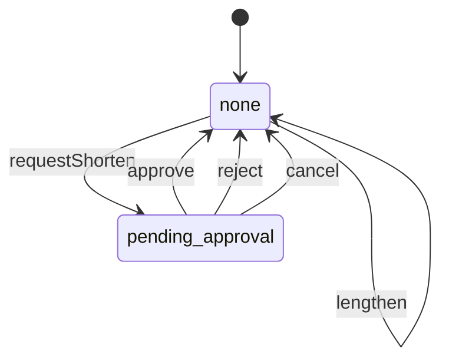

# Action history (`audit`)

The tamper-evident action history: who did what, in which role, to which record, why, what changed (before and after), which approvals applied and the request id. Every module writes to it through record(); staff read it with filters and authorized exports; retention is a governed setting.

- **Group:** Platform · **Launch phase:** 1 · **Plan chapters:** 2, 18
- **Depends on:** nothing · **Optional:** [access](access.md), [media](media.md), [identity](identity.md), [notifications](notifications.md), [orders](orders.md), [sellers](sellers.md), [customers](customers.md), [finance](finance.md), [reports](reports.md)

## Owns
- Append-only action history entries (cannot be edited or deleted by anyone; only purged after retention)
- Actor, actor roles at the time, action, module, target and related targets, reason, before/after (structured and human text), approval state, request id, IP
- Approval state of each entry (not required / pending / approved / rejected …), kept current from access events without changing the entry
- Search and filters (staff, role, target, action, category, approval state, date range) and per-record history for detail pages
- Authorized exports of the action history (CSV, JSON lines; reason required and recorded), run as reports export jobs (dataset audit.admin.entries)
- Retention setting with a legal minimum, purge job, and hash-chain integrity checks
- Seller-visible history of actions on the seller's own account (seller staff changes, payout destination changes)

**Not here:**
- Account security activity shown to customers (sign-ins, password changes): identity.security_events
- Approval requests, limits and decisions: access (audit stores the request id and a projection of its state)
- Record timelines shown to customers and sellers (order timeline, return progress): owning modules
- Business reports and their exports: reports

## Seller API

| Method | Path | Purpose | Auth | Body → Response |
|---|---|---|---|---|
| GET | `/api/seller/audit/entries` | Changes made on this seller account | seller<br>`audit.own-history.view` | Page<SellerAuditEntry> |

## Admin API

| Method | Path | Purpose | Auth | Body → Response |
|---|---|---|---|---|
| GET | `/api/admin/audit/entries` | Action history with filters | staff<br>`audit.entries.view` | Page<AuditEntry> |
| GET | `/api/admin/audit/entries/{id}` | One entry with evidence and approval history | staff<br>`audit.entries.view` | `AuditEntry` |
| GET | `/api/admin/audit/summary` | Counts for the filter chips (pending second review, financial, enforcement, settings) | staff<br>`audit.entries.view` | `AuditSummary` |
| GET | `/api/admin/audit/targets/{type}/{id}` | History of one record (order, seller, payout, product, setting…) | staff<br>`audit.entries.view` | Page<AuditEntry> |
| POST | `/api/admin/audit/exports` | Export filtered history (authorized, recorded) _(audited)_ | staff<br>`audit.entries.export` | `{ filters: AuditFilters, format: enum(csv|jsonl), reason: text }` → `reports.ExportJob` |
| GET | `/api/admin/audit/exports` | My exports (all exports with audit.retention.manage) | staff<br>`audit.entries.export` | Page<reports.ExportJob> |
| GET | `/api/admin/audit/exports/{id}` | Export status and a fresh download link _(audited)_ | staff<br>`audit.entries.export` | `reports.ExportJob` |
| GET | `/api/admin/audit/retention` | Retention setting and last purge | staff<br>`audit.entries.view` | `RetentionPolicy` |
| PUT | `/api/admin/audit/retention` | Change how long history is kept _(audited)_ | staff<br>`audit.retention.manage` | `{ retainYears: int, reason: text }` → `RetentionPolicy` |
| GET | `/api/admin/audit/integrity` | Hash-chain check result | staff<br>`audit.entries.view` | `IntegrityStatus` |

## Types

### RoleName

| Field | Type |
|---|---|
| key | `string` |
| name | `string` |

### AuditTarget

| Field | Type |
|---|---|
| type | `string` order, order_item, seller, product, offer, payout, payout_run, hold, refund, return, case, setting, role, staff, customer, campaign… |
| id | `string` |
| ref | `string?` Human reference shown in the list: MK-261002-55410, PO-261009-0418, PLR-CI26 |
| label | `string?` Casa Verde Home · Pellar Cast Iron Skillet |
| sellerId | `uuid?` |
| screen | `string?` Admin screen that opens the target, e.g. admin/payouts |

### ChangeText

| Field | Type |
|---|---|
| before | `string?` |
| after | `string?` |

### AuditApproval

| Field | Type |
|---|---|
| state | `enum(not_required|pending|partially_approved|approved|rejected|returned|cancelled|expired)` |
| note | `string?` Why none was needed or who is awaited: 'Within $50 limit', 'Waiting for Morgan Hale' |
| approvalRequestId | `uuid?` |
| approvers | `string[]` |
| decidedAt | `datetime?` |
| steps | `TimelineEvent[]` |

### AuditEntry

| Field | Type |
|---|---|
| id | `uuid` |
| seq | `int` Monotonic sequence used by the hash chain |
| at | `datetime` |
| actor | `Actor` |
| actorRoles | `RoleName[]` |
| action | `string` Key, e.g. finance.hold.released |
| actionLabel | `string` Released payout hold |
| module | `string` |
| category | `enum(financial|seller_enforcement|catalog|orders|returns|customers|settings|access|security|content|advertising|support|trust|inventory|shipping|other)` |
| target | `AuditTarget` |
| relatedTargets | `AuditTarget[]` |
| reason | `text?` |
| change | `ChangeText` |
| before | `json?` |
| after | `json?` |
| evidence | `string[]` References: UPS proof of delivery, case CS-260930-1172, media ids |
| approval | `AuditApproval` |
| requestId | `string?` X-Request-Id of the HTTP call |
| ip | `string?` |
| visibleToSeller | `bool` |

### RecordInput

| Field | Type |
|---|---|
| actor | `Actor` |
| actorRoles | `RoleName[]?` |
| action | `string` |
| actionLabel | `string` |
| module | `string` |
| category | `enum(financial|seller_enforcement|catalog|orders|returns|customers|settings|access|security|content|advertising|support|trust|inventory|shipping|other)` |
| target | `AuditTarget` |
| relatedTargets | `AuditTarget[]?` |
| reason | `text?` |
| before | `json?` |
| after | `json?` |
| beforeText | `string?` |
| afterText | `string?` |
| evidence | `string[]?` |
| approvalRequestId | `uuid?` |
| approvalNote | `string?` Shown when no approval was needed, e.g. 'Within 30% limit' |
| requestId | `string?` |
| ip | `string?` |
| visibleToSeller | `bool?` Show in the seller's own history (seller member changes, payout destination, restrictions) |
| at | `datetime?` |

### AuditFilters

| Field | Type |
|---|---|
| q | `string?` Order, seller, SKU, payout reference, staff name or reason text |
| actorId | `string?` |
| roleKey | `string?` |
| module | `string?` |
| category | `enum(financial|seller_enforcement|catalog|orders|returns|customers|settings|access|security|content|advertising|support|trust|inventory|shipping|other)?` |
| targetType | `string?` |
| targetId | `string?` |
| sellerId | `uuid?` |
| action | `string?` |
| approvalState | `enum(not_required|pending|partially_approved|approved|rejected|returned|cancelled|expired)?` |
| from | `datetime?` |
| to | `datetime?` |

### AuditSummary

| Field | Type |
|---|---|
| range | `DateRange` |
| total | `int` |
| pendingSecondReview | `int` |
| financial | `int` |
| sellerEnforcement | `int` |
| settings | `int` |
| byActor | `map<int>` Staff name → count, top 10 |

### RetentionPolicy

| Field | Type |
|---|---|
| retainYears | `int` |
| minimumYears | `int` Legal floor; cannot be lowered from the API |
| oldestEntryAt | `datetime?` |
| nextPurgeAt | `datetime?` |
| lastPurge | `PurgeResult?` |
| updatedBy | `Actor?` |
| updatedAt | `datetime?` |
| pendingChange | `RetentionChange?` Shortening waits for Business Owner approval |

### RetentionChange

| Field | Type |
|---|---|
| retainYears | `int` |
| reason | `text` |
| approval | `ApprovalInfo` |
| requestedBy | `Actor` |
| requestedAt | `datetime` |

### PurgeResult

| Field | Type |
|---|---|
| at | `datetime` |
| removedEntries | `int` |
| removedThrough | `datetime` |

### IntegrityStatus

| Field | Type |
|---|---|
| ok | `bool` |
| lastVerifiedAt | `datetime?` |
| lastVerifiedSeq | `int?` |
| brokenAtSeq | `int?` |
| lastCheckpointSeq | `int?` Newest signed checkpoint |
| lastCheckpointAt | `datetime?` |
| checkpointSignatureOk | `bool?` False when a checkpoint's HMAC does not verify (someone rewrote the chain and its hashes) |
| message | `string?` |

### SellerAuditEntry

| Field | Type |
|---|---|
| id | `uuid` |
| at | `datetime` |
| actor | `Actor` Seller members by name; Marketly staff shown as 'Marketly' with no personal name |
| actionLabel | `string` |
| target | `AuditTarget` |
| reason | `text?` |
| change | `ChangeText` |

## Status flows

### Retention change (`RetentionPolicy.pendingChange`)



Lengthening applies at once. Shortening needs Business Owner approval (action audit.retention.change) and never goes below minimumYears; the next purge uses the new value.

## Data (schema `audit`)

**entries**: Append-only (no UPDATE/DELETE grants for the app role). Partitioned by month on at. hash = sha256(prev_hash || canonical row).

| Column | Type |
|---|---|
| id | uuid pk |
| seq | bigint unique (identity) |
| at | timestamptz |
| actor_kind | text |
| actor_id | text? |
| actor_name | text? |
| actor_roles | jsonb |
| action | text |
| action_label | text |
| module | text |
| category | text |
| target_type | text |
| target_id | text |
| target_ref | text? |
| target_label | text? |
| target_screen | text? |
| seller_id | uuid? |
| reason | text? |
| before | jsonb? |
| after | jsonb? |
| before_text | text? |
| after_text | text? |
| evidence | jsonb |
| approval_request_id | uuid? |
| approval_note | text? |
| request_id | text? |
| ip | inet? |
| visible_to_seller | bool |
| search | tsvector (generated: refs, labels, reason, names) |
| prev_hash | bytea |
| hash | bytea |

Indexes: `(at desc, id)`, `(target_type, target_id, at desc)`, `(actor_id, at desc)`, `(category, at desc)`, `(seller_id, at desc) where visible_to_seller`, `(approval_request_id)`, `gin(search)`

**entry_targets**: Related targets for history lookups (an order item entry also appears under its order and seller)

| Column | Type |
|---|---|
| entry_id | uuid → entries |
| target_type | text |
| target_id | text |
| at | timestamptz |

Indexes: `(target_type, target_id, at desc)`

**approval_states**: Projection of access approval requests referenced by entries; updated from access events, so entries stay immutable

| Column | Type |
|---|---|
| approval_request_id | uuid pk |
| state | text |
| approvers | jsonb |
| steps | jsonb |
| awaiting | text? |
| decided_at | timestamptz? |
| updated_at | timestamptz |

Indexes: `(state)`

**retention**: Single row

| Column | Type |
|---|---|
| id | int pk (1) |
| retain_years | int |
| pending_years | int? |
| pending_reason | text? |
| pending_approval_request_id | uuid? |
| pending_requested_by | text? |
| updated_by | text? |
| updated_at | timestamptz? |
| last_purge_at | timestamptz? |
| last_purge_removed | bigint? |
| last_purge_through | timestamptz? |

**checkpoints**: Signed chain checkpoints: written after each successful verification and before a purge, so verification continues across purged ranges and a rewritten chain is detected even if every hash was recomputed

| Column | Type |
|---|---|
| id | uuid pk |
| seq | bigint unique |
| hash | bytea |
| mac | text (hex HMAC-SHA256 of seq || hash) |
| key_id | text (secret derivation label, e.g. audit.checkpoint.v1) |
| kind | text (verified|purge) |
| created_at | timestamptz |

Indexes: `(created_at desc)`

**integrity_checks**

| Column | Type |
|---|---|
| id | uuid pk |
| started_at | timestamptz |
| finished_at | timestamptz? |
| from_seq | bigint |
| to_seq | bigint |
| ok | bool? |
| broken_at_seq | bigint? |

Indexes: `(started_at desc)`

## Events

| Publishes | When | Payload | Consumed by |
|---|---|---|---|
| `audit.retention.changed` | The retention period changes (after approval when shortened) | `{ retainYears: int, previousYears: int, by: Actor }` | - |
| `audit.integrity.failed` | The hash-chain check finds a broken link | `{ brokenAtSeq: int, detectedAt: datetime }` | notifications |

| Consumes | From | Does |
|---|---|---|
| `access.approval.requested` | access | Create or reset the approval_states row (pending, awaiting the eligible reviewers) |
| `access.approval.partially_approved` | access | Add the first approval to approval_states (still pending a second reviewer) |
| `access.approval.returned` | access | Mark the approval state returned with the comment |
| `access.approval.decided` | access | Set the final approval state and decision time; for audit.retention.change apply or drop the pending retention change |

## In-process API (for other modules)

| Function | Signature | Used by |
|---|---|---|
| record | `(entry: RecordInput) => uuid`<br>Append one entry. Call it inside the same transaction as the change (outbox once introduced), so a change is never saved without its history. Roles are resolved through access.rolesOf when the actor is staff and actorRoles is omitted. | identity, access, settings, media, notifications, customers, sellers, catalog, offers, inventory, purchasing, warehouse, orders, payments, shipping, returns, finance, promotions, advertising, reviews, messaging, support, trust, content, workqueues, reports, wallet |
| recordMany | `(entries: RecordInput[]) => uuid[]`<br>Bulk actions (bulk catalog edit, payout run items) in one call | catalog, offers, inventory, finance |
| historyOf | `(targetType: string, targetId: string, limit?: int) => AuditEntry[]`<br>Staff history for a record, embedded in other modules' admin detail responses (order, seller, payout) | orders, sellers, finance, returns, customers, catalog, settings |
| trailOf | `(targetType: string, targetIds: string[], opts: { includeRelated?: bool, category?: string, page?: PageInput }) => Map<string, Page<AuditEntry>>`<br>Batched, paged history per record for the Action history card on admin 360 views (order, seller, customer, payout run). includeRelated also matches entries where the record is one of relatedTargets. Newest first. | graphql |
| searchEntries | `(filters: AuditFilters, page: PageInput) => Page<AuditEntry>`<br>The action history with filters, newest first (same as GET /entries) | graphql |
| getEntry | `(entryId: uuid) => AuditEntry | null`<br>One entry with before/after and approval | graphql |
| exportRows | `(dataset: string, filters: json, principal: identity.Principal, cursor?: string) => { rows: json[], nextCursor?: string }`<br>Export rows for reports dataset audit.admin.entries (filters are AuditFilters; values are already redacted at record time) | reports |

## Permissions

| Key | Who | Allows |
|---|---|---|
| `audit.entries.view` | staff | Read the action history (Platform Administrator, Business Owner, Finance Manager, Reports Analyst) |
| `audit.entries.export` | staff | Export action history (sensitive; every export is recorded) |
| `audit.retention.manage` | staff | Change the retention period (shortening still needs Business Owner approval). Seeded to the Business Owner and Platform Administrator roles |
| `audit.own-history.view` | seller | See changes made on the seller's own account (owner by default) |

## Approval actions

Checked through the access module (limits per role, second reviewer).

| Action | Limit | Second reviewer | Approvers | Meaning |
|---|---|---|---|---|
| `audit.retention.change` | none | always | Business Owner | Shorten the action-history retention period (never below the legal minimum; lengthening needs no approval) |

## Error codes

| Code | Status | Meaning |
|---|---|---|
| `EXPORT_TOO_LARGE` | 422 | The filters match more than reports.maxExportRows; narrow the date range. details.matched, details.max. |
| `BELOW_LEGAL_MINIMUM` | 400 | Retention cannot be shorter than details.minimumYears. |

## Background jobs

| Job | Schedule | Does |
|---|---|---|
| `audit.verify-chain` | daily 03:00 market time | Verify the newest checkpoint's HMAC, recompute hashes from it; on success write a new signed checkpoint at the last seq; on a hash or signature mismatch publish audit.integrity.failed (Platform Administrator and Business Owner are notified) |
| `audit.purge-expired` | monthly | Drop month partitions entirely older than retainYears (never below minimumRetentionYears), keep a signed checkpoint hash so the chain still verifies, record the purge as an entry |

## Settings

| Key | Default | Rules | Meaning |
|---|---|---|---|
| retainYears | `7` | duration, years, 7–…, approval: business owner | Years entries are kept (example value on the prototype) |
| minimumRetentionYears | `7` | duration, years, 1–…, read-only | Legal floor; changed only by configuration, not the API |
| redactKeys | `["password","token","secret","accountNumber","cardNumber"]` | json, approval: second reviewer | Keys masked in before/after JSON at record time |

## Notes
- Material actions: every endpoint marked audited in any module calls audit.record (the kernel provides a helper that fills actor, roles, requestId and IP from the request). Modules pass before/after as structured JSON plus short human text ('Held $1,240.00' → 'Available $1,240.00') for the list.
- audit has no hard dependencies so every module can use it. It is optional for others (ctx.tryUse('audit')); if disabled, modules still work and the kernel logs a warning that material actions are not being recorded. It should stay enabled in every real deployment.
- Entries are never updated. The approval column comes from approval_states, which follows access events (requested → partially approved → approved), so an entry created with 'Pending · waiting for Morgan Hale' later shows 'Approved'.
- Tamper evidence: entries form a hash chain by seq; the app's database role has INSERT and SELECT only on entries. Checkpoints (table checkpoints) carry an HMAC-SHA256 over seq and hash keyed with secretFor(config, 'audit.checkpoint'), a key the database never holds, so rewriting entries and recomputing every hash is still detected. Purges write a checkpoint first so verification continues across purged ranges. Month partitions are a later infrastructure step; until then purge deletes by at.
- Categories: support (cases, remedies, goodwill decisions), trust (reports, recommendations, enforcements, appeals), inventory (adjustments, transfers, counts, discrepancies), shipping (labels, claims, carrier services, holidays, exceptions) join the earlier ones; modules that recorded these as other switch to their own category (old entries keep theirs).
- Secrets are never stored: redactKeys are masked at record time; payout account numbers appear only as last 4 digits.
- Retention 7 years is the prototype's example; the legal requirement is a business decision to confirm.
- Exports: audit registers dataset audit.admin.entries with reports.registerDataset and serves the rows through exportRows; the job, file, link expiry and link logging are reports' (requestExport, getExport, listExports). reports is an optional dependency checked at call time; while it is disabled the audit Export button is hidden (DATASET_UNAVAILABLE).

## GraphQL (read layer)

This module's fragment of the GraphQL schemas (see [../graphql/README.md](../graphql/README.md)). Writes stay on the REST endpoints above.

```graphql
# audit: the tamper-evident action history (who did what, in which role, to which record, why, before/after, approvals).
# Admin Center only. Exports, retention and integrity stay on REST /api/admin/audit/*.
# Adds `auditTrail` to the admin 360 views (order, seller, customer, payout run): the "Action history" card with a
# "Full log" link to admin/audit.

"""
One recorded action. Entries are append-only; staff see them with audit.entries.view.
"""
type AuditEntry @areas(in: [ADMIN]) {
  id: UUID!
  "Monotonic sequence used by the hash chain"
  seq: Int!
  at: DateTime!
  actor: Actor!
  "Roles the actor held when acting, e.g. Seller Manager"
  actorRoles: [AuditRoleName!]!
  "Key, e.g. finance.hold.released"
  action: String!
  "Released payout hold"
  actionLabel: String!
  module: String!
  category: AuditCategory!
  target: AuditTarget!
  "Other records the action touched (e.g. the return and case of an order refund)"
  relatedTargets: [AuditTarget!]!
  reason: String
  "Human before/after, e.g. Ships by Sep 22 → Ships by Oct 12"
  change: AuditChange!
  "Structured values before the change"
  before: JSON @cost(weight: 2)
  "Structured values after the change"
  after: JSON @cost(weight: 2)
  "References: UPS proof of delivery, case CS-260930-1172, media ids"
  evidence: [String!]!
  approval: AuditApproval!
  "X-Request-Id of the HTTP call"
  requestId: String
  ip: String
  "Also shown in the seller's own history"
  visibleToSeller: Boolean!
}

type AuditRoleName @areas(in: [ADMIN]) {
  key: String!
  name: String!
}

"The record an entry is about"
type AuditTarget @areas(in: [ADMIN]) {
  "order, order_item, seller, product, offer, payout, payout_run, hold, refund, return, case, setting, role, staff, customer, campaign…"
  type: String!
  id: String!
  "Human reference shown in lists: MK-261002-55410, PO-261009-0418"
  ref: String
  "Casa Verde Home · Pellar Cast Iron Skillet"
  label: String
  sellerId: UUID
  "Admin screen that opens the target, e.g. admin/payouts"
  screen: String
}

type AuditChange @areas(in: [ADMIN]) {
  before: String
  after: String
}

"Which approval applied to the action"
type AuditApproval @areas(in: [ADMIN]) {
  state: AuditApprovalState!
  "Why none was needed or who is awaited: 'Within $50 limit', 'Waiting for Morgan Hale'"
  note: String
  approvalRequestId: UUID
  approvers: [String!]!
  decidedAt: DateTime
  steps: [TimelineEvent!]!
}

enum AuditCategory @areas(in: [ADMIN]) {
  FINANCIAL
  SELLER_ENFORCEMENT
  CATALOG
  ORDERS
  RETURNS
  CUSTOMERS
  SETTINGS
  ACCESS
  SECURITY
  CONTENT
  ADVERTISING
  SUPPORT
  TRUST
  INVENTORY
  SHIPPING
  OTHER
}

enum AuditApprovalState @areas(in: [ADMIN]) {
  NOT_REQUIRED
  PENDING
  PARTIALLY_APPROVED
  APPROVED
  REJECTED
  RETURNED
  CANCELLED
  EXPIRED
}

"Filters of the admin/audit list (same as REST GET /api/admin/audit/entries)"
input AuditFilterInput @areas(in: [ADMIN]) {
  "Order, seller, SKU, payout reference, staff name or reason text"
  q: String
  actorId: String
  roleKey: String
  module: String
  category: AuditCategory
  targetType: String
  targetId: String
  sellerId: UUID
  action: String
  approvalState: AuditApprovalState
  from: DateTime
  to: DateTime
}

type AuditEntryPage implements Paged @areas(in: [ADMIN]) {
  items: [AuditEntry!]!
  nextCursor: String
  page: Int
  totalPages: Int
  total: Int
}

extend type Query {
  "The action history with filters, newest first"
  auditEntries(filter: AuditFilterInput, paging: PageInput): AuditEntryPage! @areas(in: [ADMIN]) @auth(requires: STAFF, permission: "audit.entries.view") @cost(weight: 10) @source(module: "audit", fn: "searchEntries")

  auditEntry(id: UUID!): AuditEntry @areas(in: [ADMIN]) @auth(requires: STAFF, permission: "audit.entries.view") @source(module: "audit", fn: "getEntry")
}

# ---- "Action history" on admin 360 views. includeRelated also returns entries where the record is a related target
# (an order's returns, cases and packages; a seller's restrictions and holds). Newest first.

extend type Order {
  "Staff and system actions on this order, its items, packages, returns, refunds and cases"
  auditTrail(category: AuditCategory, includeRelated: Boolean = true, paging: PageInput): AuditEntryPage! @areas(in: [ADMIN]) @auth(requires: STAFF, permission: "audit.entries.view") @cost(weight: 5) @source(module: "audit", fn: "trailOf")
}

extend type Seller {
  "Approval, restrictions, holds, payout destination and member changes for this seller"
  auditTrail(category: AuditCategory, includeRelated: Boolean = true, paging: PageInput): AuditEntryPage! @areas(in: [ADMIN]) @auth(requires: STAFF, permission: "audit.entries.view") @cost(weight: 5) @source(module: "audit", fn: "trailOf")
}

extend type Customer {
  "Account actions by staff (restrictions, password resets, closures) and their reasons"
  auditTrail(category: AuditCategory, includeRelated: Boolean = true, paging: PageInput): AuditEntryPage! @areas(in: [ADMIN]) @auth(requires: STAFF, permission: "audit.entries.view") @cost(weight: 5) @source(module: "audit", fn: "trailOf")
}

extend type PayoutRun {
  "Run creation, holds applied, approvals and release"
  auditTrail(category: AuditCategory, includeRelated: Boolean = true, paging: PageInput): AuditEntryPage! @areas(in: [ADMIN]) @auth(requires: STAFF, permission: "audit.entries.view") @cost(weight: 5) @source(module: "audit", fn: "trailOf")
}
```
