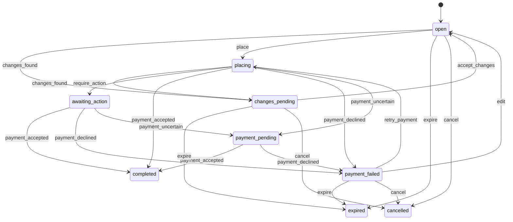

# Checkout (`checkout`)

Turns a cart (or a Buy now offer) into an accepted order: identify the customer or guest, choose an address with a per-item shippability check, pick delivery options per package, apply coupons or credit with reasons and item coverage, choose payment, review sellers, return terms and totals, revalidate into a change set the customer must accept, and place the order idempotently with clear payment results.

- **Group:** Buying · **Launch phase:** 1 · **Plan chapters:** 5, 6, 14
- **Depends on:** [cart](cart.md), [orders](orders.md), [payments](payments.md), [shipping](shipping.md), [customers](customers.md), [offers](offers.md), [inventory](inventory.md) · **Optional:** [promotions](promotions.md), [wallet](wallet.md), [returns](returns.md), [content](content.md), [identity](identity.md), [fulfillment-service](fulfillment-service.md), [settings](settings.md)

## Owns
- Checkout sessions (the quote): source cart or Buy now, lines, packages, selections, totals and quote version
- Customer or guest identification (guest email and phone, optional account after checkout)
- Delivery address selection and the per-item shippability check
- Delivery options per package with separate arrival estimates
- Coupons and store credit in the quote: applied amounts, which items each discount covers, rejection reasons
- Payment method selection for the quote
- Full review: seller, return terms and seller support per package, purchase terms, totals per package and for the order, tax
- Revalidation before charging: change sets (price, stock, delivery date, delivery option, coupon, shippability) with per-change choices, alternatives from other sellers shown explicitly, and partial-order consent
- Idempotent Place order: one order and one charge per checkout whatever the number of taps, refreshes or retries
- Payment results: accepted (confirmation), failed (retry or another method, cart kept, stock held for a window), pending check (no second payment, order status)
- Order confirmation view

**Not here:**
- Cart contents and change detection between visits: cart
- The order record, items and documents: orders
- Authorization, capture, payment status checks and saved methods: payments
- Delivery options and arrival estimates: shipping
- Coupon rules, budgets and redemption: promotions; store credit balances: wallet (phase 3)
- Stock holds: inventory; saved addresses and address validation: customers

## Store API

| Method | Path | Purpose | Auth | Body → Response |
|---|---|---|---|---|
| POST | `/api/store/checkout/sessions` | Start checkout from the cart or Buy now | shopper | `{ source: enum(cart|buy_now), cartItemIds: uuid[]?, offerId: uuid?, quantity: int? }` → `CheckoutView` |
| GET | `/api/store/checkout/sessions/{id}` | The whole checkout: steps, contact, address, packages with options, coupons, payment, review and totals | shopper | `CheckoutView` |
| PUT | `/api/store/checkout/sessions/{id}/contact` | Guest contact details (email, optional phone) and the account-after-checkout choice | shopper | `GuestContactInput` → `CheckoutView` |
| PUT | `/api/store/checkout/sessions/{id}/address` | Choose a saved address or enter one; checks every item can ship there | shopper | `AddressSelection` → `CheckoutView` |
| PUT | `/api/store/checkout/sessions/{id}/delivery` | Pick a delivery option for each package | shopper | `{ selections: DeliverySelection[] }` → `CheckoutView` |
| POST | `/api/store/checkout/sessions/{id}/coupons` | Apply a coupon code | shopper | `{ code: string }` → `{ result: CouponResult, checkout: CheckoutView }` |
| DELETE | `/api/store/checkout/sessions/{id}/coupons/{code}` | Remove a coupon | shopper | `CheckoutView` |
| PUT | `/api/store/checkout/sessions/{id}/credit` | Use store credit for part or all of the total _(phase 3)_ | customer | `{ use: bool, amount: Money? }` → `CheckoutView` |
| PUT | `/api/store/checkout/sessions/{id}/payment-method` | Choose a saved card, a new card (provider token) or a digital wallet | shopper | `payments.MethodSelection` → `CheckoutView` |
| PUT | `/api/store/checkout/sessions/{id}/preferences` | Gift note and hide prices on packing slips | shopper | `{ giftNote: string?, hidePricesOnSlip: bool? }` → `CheckoutView` |
| POST | `/api/store/checkout/sessions/{id}/revalidate` | Check price, stock, delivery, coupons and shippability again | shopper | `RevalidationResult` |
| GET | `/api/store/checkout/sessions/{id}/changes/{changeSetId}` | The changes found, with choices, alternatives and the revised total | shopper | `ChangeSet` |
| POST | `/api/store/checkout/sessions/{id}/changes/{changeSetId}/accept` | Apply the customer's choice for every change and continue | shopper | `{ decisions: ChangeDecision[], acceptPartialOrder: bool }` → `CheckoutView` |
| POST | `/api/store/checkout/sessions/{id}/place` | Place the order and pay _(idempotent)_ | shopper | `PlaceOrderInput` → `PlaceOrderResult` |
| POST | `/api/store/checkout/sessions/{id}/complete-action` | Finish Place order after a bank challenge or wallet confirmation _(idempotent)_ | shopper | `{ resultToken: string }` → `PlaceOrderResult` |
| POST | `/api/store/checkout/sessions/{id}/retry-payment` | Pay again with the same or another method after a decline _(idempotent)_ | shopper | `RetryPaymentInput` → `PlaceOrderResult` |
| GET | `/api/store/checkout/sessions/{id}/confirmation` | Order confirmation (only after the payment is accepted) | shopper | `ConfirmationView` |
| DELETE | `/api/store/checkout/sessions/{id}` | Leave checkout (releases holds, voids any authorization) | shopper | 204 No content |

## Admin API

| Method | Path | Purpose | Auth | Body → Response |
|---|---|---|---|---|
| GET | `/api/admin/checkout/sessions` | Checkouts with payment problems or open changes (support view) | staff<br>`checkout.sessions.view` | Page<CheckoutSessionAdminRow> |
| GET | `/api/admin/checkout/sessions/{id}` | One checkout with place attempts, idempotency keys, change sets and history | staff<br>`checkout.sessions.view` | `CheckoutSessionAdminDetail` |

## Types

### CheckoutAccount

| Field | Type |
|---|---|
| kind | `enum(customer|guest)` |
| customerId | `uuid?` |
| name | `string?` |
| email | `email` |
| phone | `string?` |
| createAccountAfter | `bool` |
| marketingOptIn | `bool` |
| note | `string?` Guests: 'We'll email a link to view and manage this order.' |

### GuestContactInput

| Field | Type |
|---|---|
| email | `email` |
| phone | `string?` Only for delivery updates about this order |
| createAccountAfter | `bool?` |
| marketingOptIn | `bool?` |

### AddressSelection

| Field | Type |
|---|---|
| addressId | `uuid?` Saved address (customers); the order stores a copy |
| address | `Address?` |
| saveToAddressBook | `bool?` |
| label | `string?` |

### ShippabilityLine

| Field | Type |
|---|---|
| lineId | `string` |
| title | `string` |
| sellerName | `string` |
| shippable | `bool` |
| reason | `enum(excluded_area|po_box|military|outside_seller_coverage|item_too_large)?` |
| message | `string?` |

### AddressStep

| Field | Type |
|---|---|
| address | `Address` |
| addressId | `uuid?` |
| allShippable | `bool` |
| message | `string` 'All 4 items can ship to this address.' |
| lines | `ShippabilityLine[]` |
| locationNote | `string` 'Delivery dates below are for Portland, OR 97205.' |
| addressBookNote | `string` |

### DiscountShare

| Field | Type |
|---|---|
| code | `string?` |
| label | `string` |
| amount | `Money` |
| fundedBy | `enum(platform|seller|shared)` |

### CheckoutLine

| Field | Type |
|---|---|
| id | `string` Session line id |
| cartItemId | `uuid?` |
| offerId | `uuid` |
| productId | `uuid` |
| variantId | `uuid` |
| stockItemId | `uuid` |
| title | `string` |
| variantLabel | `string` |
| condition | `string` |
| image | `MediaRef?` |
| quantity | `int` |
| unitPrice | `Money` |
| lineTotal | `Money` |
| discounts | `DiscountShare[]` |
| status | `enum(included|removed|not_shippable|unavailable)` |
| note | `string?` |

### DeliverySelection

| Field | Type |
|---|---|
| packageKey | `string` |
| optionId | `string` shipping DeliveryOption id from the package options |

### PackageTotals

| Field | Type |
|---|---|
| items | `Money` |
| discounts | `Money` |
| shipping | `Money` |
| tax | `Money` |
| total | `Money` |

### CheckoutPackage

| Field | Type |
|---|---|
| key | `string` |
| label | `string` 'Package 2 of 3' |
| seller | `cart.SellerLabel` |
| soldAndShippedBy | `string` 'Sold and shipped by Northwind Audio' |
| shipsFrom | `string` |
| lines | `CheckoutLine[]` |
| options | `shipping.DeliveryOption[]` |
| selectedOptionId | `string?` |
| returnTerms | `string` |
| sellerSupport | `string` 'Seller support replies within 1 business day' |
| totals | `PackageTotals` |

### CouponCoverage

| Field | Type |
|---|---|
| lineId | `string` |
| title | `string` |
| amount | `Money` |

### CouponExclusion

| Field | Type |
|---|---|
| lineId | `string` |
| title | `string` |
| reason | `string` |

### CouponResult

| Field | Type |
|---|---|
| code | `string` |
| status | `enum(applied|rejected|needs_sign_in)` |
| amount | `Money?` |
| label | `string` '$20 off your first order over $100' |
| fundedBy | `enum(platform|seller|shared)?` |
| fundingNote | `string?` 'Funded by Marketly, so sellers receive their full price.' |
| rejectionCode | `string?` promotions RejectedCode reason, e.g. no_eligible_items |
| reason | `string?` 'Applies only to Home & Kitchen items from the Official Store. None in your cart qualify.' |
| coverage | `CouponCoverage[]` |
| notCovered | `CouponExclusion[]` |
| otherDiscountsNote | `string?` 'Your other discount is unchanged.' |

### CreditStep

| Field | Type |
|---|---|
| available | `Money` |
| sourceNote | `string` 'from a refund on Aug 18' |
| use | `bool` |
| applied | `Money` |

### PaymentSelectionView

| Field | Type |
|---|---|
| kind | `enum(saved_card|new_card|digital_wallet)` |
| label | `string` |
| savedMethodId | `uuid?` |
| billingSummary | `string?` |

### PaymentStep

| Field | Type |
|---|---|
| selected | `PaymentSelectionView?` |
| options | `payments.PaymentOptions` |
| chargeNote | `string` |

### TaxLine

| Field | Type |
|---|---|
| jurisdiction | `string` |
| label | `string` 'Tax (Oregon has no sales tax)' |
| rate | `number` |
| amount | `Money` |

### DiscountLine

| Field | Type |
|---|---|
| code | `string?` |
| label | `string` |
| amount | `Money` |
| fundedBy | `enum(platform|seller|shared)` |

### PackageShipping

| Field | Type |
|---|---|
| packageKey | `string` |
| sellerName | `string` |
| amount | `Money` |
| free | `bool` |

### QuoteTotals

| Field | Type |
|---|---|
| itemCount | `int` |
| items | `Money` |
| discounts | `DiscountLine[]` |
| discountTotal | `Money` |
| shippingByPackage | `PackageShipping[]` |
| shippingTotal | `Money` |
| tax | `TaxLine[]` |
| taxTotal | `Money` |
| taxNote | `string?` |
| creditApplied | `Money` |
| total | `Money` Full payable total; what Place order charges |
| perPackage | `PackageTotals[]` |

### StepState

| Field | Type |
|---|---|
| key | `enum(account|address|delivery|coupons|payment|review)` |
| status | `enum(todo|done|needs_attention)` |
| message | `string?` |

### LegalInfo

| Field | Type |
|---|---|
| purchaseTermsVersionId | `uuid?` |
| policyVersions | `orders.AcceptedPolicyVersion[]` Returns, shipping and purchase-terms versions in force, shown on the review step and stored on the order |
| purchaseTermsUrl | `url?` |
| text | `string` 'By placing your order you agree to the Purchase terms and the return terms shown for each package.' |

### CheckoutView

| Field | Type |
|---|---|
| id | `uuid` |
| status | `enum(open|changes_pending|placing|awaiting_action|payment_pending|payment_failed|completed|expired|cancelled)` |
| source | `enum(cart|buy_now)` |
| quoteVersion | `int` Increments whenever anything that changes the total changes; Place order must send the version it showed |
| currency | `string` |
| steps | `StepState[]` |
| account | `CheckoutAccount?` |
| address | `AddressStep?` |
| packages | `CheckoutPackage[]` |
| packagesNote | `string` 'Your items ship in 3 packages from different places, so each has its own options and arrival date.' |
| excludedLines | `CheckoutLine[]` Cart lines not in this checkout (unavailable, not shippable); they stay in the cart |
| coupons | `CouponResult[]` |
| credit | `CreditStep?` Phase 3 (wallet) |
| payment | `PaymentStep` |
| totals | `QuoteTotals` |
| legal | `LegalInfo` |
| giftNote | `string?` |
| readyToPlace | `bool` |
| blockers | `string[]` |
| doubleSubmitNote | `string` 'Tapping twice or refreshing won't create two orders or charge you twice.' |
| openChangeSetId | `uuid?` |
| holdUntil | `datetime?` After a failed payment: prices and stock held until this time |
| expiresAt | `datetime` |
| orderId | `uuid?` |
| orderRef | `string?` |
| lastPayment | `payments.PaymentStatusView?` |

### AlternativeOffer

| Field | Type |
|---|---|
| offerId | `uuid` |
| seller | `cart.SellerLabel` |
| conditionLabel | `string` |
| price | `Money` |
| shipping | `Money?` |
| arrivalLabel | `string` |
| available | `int` |
| returnTerms | `string` |
| differentSeller | `bool` |
| note | `string` 'Different seller. Only switched if you pick this.' |

### Change

| Field | Type |
|---|---|
| id | `uuid` |
| kind | `enum(price_increased|price_decreased|quantity_reduced|out_of_stock|offer_ended|delivery_date_changed|delivery_option_unavailable|shipping_cost_changed|coupon_no_longer_applies|coupon_amount_changed|not_shippable|purchase_limit)` |
| lineId | `string?` |
| packageKey | `string?` |
| headline | `string` 'Price went up', 'Less stock available', 'Delivery date moved', 'Coupon no longer covers this item' |
| title | `string` |
| image | `MediaRef?` |
| sellerName | `string` |
| previous | `string` |
| current | `string` |
| previousAmount | `Money?` |
| currentAmount | `Money?` |
| availableQuantity | `int?` |
| detail | `string?` e.g. 'Casa Verde Home now ships in 4 business days because of a restock.' |
| alternatives | `AlternativeOffer[]` |
| choices | `enum(accept|remove|choose_offer|reduce_quantity|keep_without_discount|choose_other_option)[]` |
| defaultChoice | `enum(accept|remove|choose_offer|reduce_quantity|keep_without_discount|choose_other_option)` |
| effectOnTotal | `Money` Signed amount with the default choice |

### TotalDelta

| Field | Type |
|---|---|
| label | `string` |
| amount | `Money` Signed |

### ChangeSet

| Field | Type |
|---|---|
| id | `uuid` |
| sessionId | `uuid` |
| detectedAt | `datetime` |
| status | `enum(open|accepted|superseded)` |
| intro | `string` 'We checked your order again before charging you. Nothing has been charged yet.' |
| changes | `Change[]` |
| previousTotal | `Money` |
| newTotal | `Money` With the default choices |
| deltas | `TotalDelta[]` |
| partialOrder | `bool` Some items cannot be bought; the rest can go through with explicit consent |
| partialNote | `string?` 'If you remove an item, the rest of your order can still go through. You'll only be charged for the items you keep.' |

### ChangeDecision

| Field | Type |
|---|---|
| changeId | `uuid` |
| choice | `enum(accept|remove|choose_offer|reduce_quantity|keep_without_discount|choose_other_option)` |
| offerId | `uuid?` Required for choose_offer; must be one of the listed alternatives |
| quantity | `int?` |
| optionId | `string?` |

### RevalidationResult

| Field | Type |
|---|---|
| outcome | `enum(no_changes|changes_found)` |
| changeSet | `ChangeSet?` |
| checkout | `CheckoutView` |

### PlaceOrderInput

| Field | Type |
|---|---|
| quoteVersion | `int` |
| expectedTotal | `Money` The total the customer saw on the button |
| acceptTerms | `bool` |
| channel | `enum(web|android)` |
| returnUrl | `url` Where the bank challenge returns |

### PlaceOrderResult

| Field | Type |
|---|---|
| outcome | `enum(accepted|payment_pending|payment_failed|requires_action|changes_required)` |
| next | `enum(confirmation|payment_result|review_changes|complete_action)` Screen to show: store/confirmation, store/payment-result, store/checkout-review-changes, or the bank challenge |
| orderId | `uuid?` |
| orderRef | `string?` |
| payment | `payments.PaymentStatusView?` |
| changeSet | `ChangeSet?` |
| retryUntil | `datetime?` Payment failed: cart, delivery choices and coupons kept; prices and stock held until this time |
| checkout | `CheckoutView` |

### RetryPaymentInput

| Field | Type |
|---|---|
| method | `payments.MethodSelection` |
| quoteVersion | `int` |
| expectedTotal | `Money` |
| returnUrl | `url` |

### ConfirmationItem

| Field | Type |
|---|---|
| title | `string` |
| variantLabel | `string` |
| condition | `string` |
| quantity | `int` |
| price | `Money` |
| image | `MediaRef?` |
| status | `string` |

### ConfirmationPackage

| Field | Type |
|---|---|
| label | `string` |
| seller | `cart.SellerLabel` |
| shipsFrom | `string` |
| arrivalLabel | `string` |
| shippingLabel | `string` |
| items | `ConfirmationItem[]` |

### NextStep

| Field | Type |
|---|---|
| title | `string` |
| when | `string` |
| body | `string` |

### ConfirmationView

| Field | Type |
|---|---|
| orderId | `uuid` |
| orderRef | `string` |
| greetingName | `string?` |
| email | `email` |
| charged | `Money` |
| paymentLabel | `string` |
| paymentState | `enum(accepted)` |
| deliveryAddress | `Address` |
| packages | `ConfirmationPackage[]` |
| packagesNote | `string` 'Your 4 items ship in 3 packages that may arrive on different days.' |
| totals | `QuoteTotals` |
| nextSteps | `NextStep[]` |
| termsNote | `string` 'Your order keeps the purchase terms and each seller's return terms as they were when you ordered.' |
| receiptDocumentId | `uuid?` |
| offerAccountCreation | `bool` Guest who ticked 'create an account after checkout' |

### CheckoutSessionAdminRow

| Field | Type |
|---|---|
| id | `uuid` |
| status | `string` |
| customerName | `string` |
| email | `email` |
| guest | `bool` |
| total | `Money` |
| packageCount | `int` |
| paymentAttempts | `int` |
| lastDecline | `string?` |
| orderRef | `string?` |
| createdAt | `datetime` |
| updatedAt | `datetime` |

### PlaceAttempt

| Field | Type |
|---|---|
| at | `datetime` |
| idempotencyKey | `string` |
| outcome | `string` |
| paymentIntentId | `uuid?` |
| quoteVersion | `int` |
| total | `Money` |

### CheckoutSessionAdminDetail

| Field | Type |
|---|---|
| checkout | `CheckoutView` |
| attempts | `PlaceAttempt[]` |
| changeSets | `ChangeSet[]` |
| history | `TimelineEvent[]` |

## Status flows

### Checkout session (`CheckoutView.status`)



placing is held under a row lock; a second Place order (any key) while placing, payment_pending or completed returns the current result instead of a new attempt. payment_failed keeps lines, delivery choices, coupons, the stock hold and the promotion reservation until holdUntil (retry window). After a pending payment is finally declined the order is cancelled by orders, the lines are restored to the cart and the session returns to payment_failed; a retry then creates a new order. expire releases holds and voids any authorization.

## Data (schema `checkout`)

**sessions**: One checkout (quote) per Buy now or cart checkout

| Column | Type |
|---|---|
| id | uuid pk |
| source | text |
| cart_id | uuid? |
| customer_id | uuid? |
| guest_session_id | uuid? |
| account | jsonb |
| address | jsonb? |
| address_id | uuid? |
| status | text |
| quote_version | int |
| currency | text |
| totals | jsonb |
| coupon_codes | jsonb |
| credit | jsonb? |
| payment_selection | jsonb? |
| gift_note | text? |
| promotion_evaluation_id | uuid? |
| redemption_reservation_id | uuid? |
| stock_reservation_id | uuid? |
| credit_hold_id | uuid? |
| hold_until | timestamptz? |
| attempt_count | int |
| order_id | uuid? |
| order_ref | text? |
| channel | text? |
| expires_at | timestamptz |
| created_at | timestamptz |
| updated_at | timestamptz |

Indexes: `(customer_id, status)`, `(guest_session_id, status)`, `(status, expires_at)`, `unique (order_id)`

**session_lines**

| Column | Type |
|---|---|
| id | text pk |
| session_id | uuid → sessions |
| cart_item_id | uuid? |
| offer_id | uuid |
| owner_type | text |
| seller_id | uuid? |
| product_id | uuid |
| variant_id | uuid |
| stock_item_id | uuid |
| profile_id | uuid |
| package_key | text |
| quantity | int |
| unit_price | int |
| terms_version | int |
| discounts | jsonb |
| tax | int |
| status | text |

Indexes: `(session_id)`

**session_packages**

| Column | Type |
|---|---|
| session_id | uuid → sessions |
| package_key | text |
| owner_type | text |
| seller_id | uuid? |
| ships_from | text |
| options | jsonb |
| selected_option_id | text? |
| selected_option | jsonb? |
| return_terms | text |

Indexes: `unique (session_id, package_key)`

**change_sets**

| Column | Type |
|---|---|
| id | uuid pk |
| session_id | uuid → sessions |
| status | text |
| changes | jsonb |
| previous_total | int |
| new_total | int |
| decisions | jsonb? |
| created_at | timestamptz |
| decided_at | timestamptz? |

Indexes: `(session_id, created_at desc)`

**place_requests**: Idempotency record for Place order and payment retries

| Column | Type |
|---|---|
| id | uuid pk |
| session_id | uuid → sessions |
| idempotency_key | text |
| request_hash | text |
| kind | text (place|retry|complete_action) |
| outcome | text? |
| response | jsonb? |
| payment_intent_id | uuid? |
| created_at | timestamptz |
| completed_at | timestamptz? |

Indexes: `unique (session_id, idempotency_key)`

**session_log**

| Column | Type |
|---|---|
| id | uuid pk |
| session_id | uuid → sessions |
| label | text |
| detail | text? |
| at | timestamptz |

## Events

| Publishes | When | Payload | Consumed by |
|---|---|---|---|
| `checkout.session.started` | A checkout starts | `{ sessionId: uuid, source: string, customerId: uuid?, guest: bool, lineCount: int, total: Money }` | - |
| `checkout.changes.detected` | Revalidation finds changes before payment | `{ sessionId: uuid, changeSetId: uuid, kinds: string[], previousTotal: Money, newTotal: Money }` | - |
| `checkout.changes.accepted` | The customer decides every change | `{ sessionId: uuid, changeSetId: uuid, removedLines: int, switchedOffers: int, partialOrder: bool }` | - |
| `checkout.payment.retried` | A payment is retried after a decline | `{ sessionId: uuid, attemptNo: int, methodKind: string }` | - |
| `checkout.session.completed` | An order exists for the session (accepted or payment pending) | `{ sessionId: uuid, orderId: uuid, orderRef: string, paymentState: enum(accepted|pending_check), total: Money, guest: bool, createAccountAfter: bool, email: email }` | - |
| `checkout.session.abandoned` | The customer leaves checkout or a session expires | `{ sessionId: uuid, lastStatus: string, reason: enum(left|expired|retry_window_closed) }` | - |

| Consumes | From | Does |
|---|---|---|
| `payments.payment.authorized` | payments | A payment_pending or awaiting_action session becomes completed (orders accepts the order on the same event) |
| `payments.payment.failed` | payments | A payment_pending or awaiting_action session becomes payment_failed; when the order had been created, restore the lines to the cart (cart.restoreItems) so the customer can pay another way |
| `orders.order.cancelled` | orders | If the cancelled order came from a pending payment, keep the session in payment_failed and point the customer to a new attempt |
| `identity.guest_session.claimed` | identity | Attach open guest sessions to the customer who signed in (account step switches to the customer) |

## In-process API (for other modules)

| Function | Signature | Used by |
|---|---|---|
| getSessionForOrder | `(sessionId: uuid) => { orderId: uuid | null, status: string, customerId: uuid | null } | null`<br>Whether a checkout produced an order (used by payments' orphan check) | payments |
| getSessionView | `(owner: { customerId?: uuid, guestSessionId?: uuid }, sessionId: uuid) => CheckoutView | null`<br>A checkout session of this shopper (same as GET /sessions/{id}); null when it belongs to someone else | graphql |
| getConfirmation | `(owner: { customerId?: uuid, guestSessionId?: uuid }, sessionId: uuid) => ConfirmationView | null`<br>Order confirmation once the payment is accepted (same as GET /sessions/{id}/confirmation); null before | graphql |

## Permissions

| Key | Who | Allows |
|---|---|---|
| `checkout.sessions.view` | staff | See checkouts, payment attempts and change sets for support |

## Error codes

| Code | Status | Meaning |
|---|---|---|
| `CART_EMPTY` | 409 | The cart has no lines. |
| `NOTHING_TO_CHECK_OUT` | 409 | Every cart line is unavailable or needs attention in the cart first. details.lines. |
| `OFFER_UNAVAILABLE` | 409 | The offer cannot be bought now (Buy now or a chosen alternative). details.reason. |
| `PURCHASE_LIMIT_EXCEEDED` | 422 | The quantity plus recent purchases exceeds the per-customer limit. details.max. |
| `GUEST_CHECKOUT_DISABLED` | 403 | Guest checkout is turned off; sign in or create an account. |
| `ORDERING_RESTRICTED` | 403 | The account cannot place orders now (suspended, closed or restricted). details.reason. |
| `ADDRESS_INVALID` | 422 | The address could not be validated. details.issues and a suggested correction when available. |
| `DELIVERY_OPTION_UNAVAILABLE` | 409 | The option no longer exists for the package (cutoff passed, notice, coverage). The response lists current options. |
| `CHECKOUT_INCOMPLETE` | 422 | A step is missing. details.missingSteps (account, address, delivery, payment). |
| `TERMS_NOT_ACCEPTED` | 422 | acceptTerms must be true. |
| `QUOTE_OUTDATED` | 409 | quoteVersion or expectedTotal differs from the current quote; reload the checkout and show the new total. |
| `CHANGESET_STALE` | 409 | A newer change set replaced this one; show the latest. |
| `DECISION_MISSING` | 422 | Every change needs a choice. details.changeIds. |
| `PARTIAL_ORDER_NOT_ACCEPTED` | 422 | Some items will not be bought; the customer must accept the revised order and charge. |
| `SESSION_EXPIRED` | 410 | The checkout expired; start again from the cart (nothing was charged). |
| `RETRY_WINDOW_EXPIRED` | 409 | The hold after the failed payment ended; start checkout again from the cart. |
| `PAYMENT_METHOD_INVALID` | 422 | The payment method cannot be used (removed, expired or invalid token). |
| `INSUFFICIENT_CREDIT` | 409 | Store credit is lower than the amount requested. |

## Background jobs

| Job | Schedule | Does |
|---|---|---|
| `checkout.expire-sessions` | every 5 min | Expire idle open sessions (sessionTtlMinutes) and payment_failed sessions past holdUntil: release stock and promotion reservations, release credit holds, void authorizations; publish checkout.session.abandoned |
| `checkout.extend-pending-holds` | every 10 min | Keep stock holds alive for payment_pending sessions (inventory.extendHold) up to pendingHoldHours |
| `checkout.purge-idempotency` | daily 03:30 PT | Delete place_requests older than idempotencyRetentionDays |

## Settings

| Key | Default | Meaning |
|---|---|---|
| guestCheckoutEnabled | `true` | Allow guest purchases. Market-level value owned by the settings module (checkout.guestCheckoutEnabled, changed in admin/settings with business-owner approval); read here |
| offerAccountAfterGuestPurchase | `true` | Offer to create an account after a guest purchase (owned by settings, checkout.offerAccountAfterGuestPurchase) |
| sessionTtlMinutes | `60` | Idle time before an open checkout expires |
| stockHoldMinutes | `15` | Stock hold created at Place order |
| retryWindowMinutes | `30` | After a decline, prices, stock and coupons are held this long ('held until 3:15 PM PT') |
| pendingHoldHours | `24` | Stock stays reserved while a payment result is being checked |
| maxPaymentAttempts | `5` | Payment attempts per checkout |
| couponAttemptsPerHour | `20` | Coupon codes tried per session per hour |
| purchaseLimitWindowDays | `30` | Window for per-customer purchase limits that count earlier orders |
| idempotencyRetentionDays | `7` | How long Place order keys are kept |

## Integrations
- **Sales tax rates**: Tax per item and shipping by destination state; a rate table in settings at launch, a tax service adapter later

## Notes
- Dependencies: architecture lists cart, orders, payments, shipping and customers. offers (revalidate, snapshots, alternatives) and inventory (stock holds) are added because Place order calls them directly; both are already required by cart, so this adds no new load-time constraint. Optional: promotions (coupons, markdown allocation), wallet (credit, phase 3), returns (resolveTerms for return terms per package), content (purchase terms version), identity (guest order access grant).
- Steps (plan ch. 6): 1 account or guest (email required, phone optional, create account later), 2 address with shippability per item, 3 delivery option per package with separate arrival dates, 4 coupons and credit with item coverage and rejection reasons, 5 payment method and full review (seller, return terms, seller support per package, purchase terms), 6 Place order and payment result. Confirmation is only shown when the payment is accepted.
- Quote version: any change to lines, address, options, coupons, credit, tax or prices increments quoteVersion. Place order compares quoteVersion and expectedTotal with the current quote, so the customer is never charged a total they did not see.
- Revalidation sources: offers.revalidate (price, availability, terms version, seller restriction; never substitutes a seller), inventory.getAvailability, shipping.quoteOptions for the selected options (date moved, option gone, shipping cost), shipping.checkCoverage, promotions.evaluateCart (coupon ended or changed, budget, limits), tax. Each difference becomes one Change with choices; alternatives come from offers for the same variant and are applied only when chosen.
- Partial orders: removing items or unavailable items leaves a smaller order; acceptChanges requires acceptPartialOrder=true and the review step shows the revised packages and total before Place order.
- Idempotency (scenario 3): place_requests stores each Idempotency-Key with a hash of the body; the same key and body return the stored result (refreshed with the current status), a different body returns IDEMPOTENCY_KEY_REUSED. The session lock and status guard mean even a new key cannot start a second order or charge while placing, pending or completed. payments.authorize uses sessionId + attempt number as its key.
- Accepted path: payments.authorize → orders.createOrder (order created and accepted; dispatch deadlines from the selected options; policyVersions from content.currentPolicyVersions read at placement) → payments.linkOrder → inventory.attachOrder → promotions.commitRedemption → cart.removePurchasedItems (other cart lines stay) → identity grants the guest session access to the order → confirmation.
- Failed path: no order; status payment_failed; the decline reason and retry choices are shown; lines, delivery choices, coupons, the stock hold and the promotion reservation are kept until holdUntil; the customer can retry with the same card, another card or a wallet, or go back to checkout.
- Pending path: the order is created with payment checking and its reference is shown; the customer is told not to pay again and is directed to the order status; payments' check job resolves it, and the session completes or returns to payment_failed (lines restored to the cart).
- Buy now creates a session from one offer; it never changes the cart and still requires the review and Place order steps (plan ch. 5).
- Per-customer purchase limits count units in this checkout plus orders.countPurchased within purchaseLimitWindowDays.

## GraphQL (read layer)

This module's fragment of the GraphQL schemas (see [../graphql/README.md](../graphql/README.md)). Writes stay on the REST endpoints above.

```graphql
# checkout: the checkout session (CheckoutReview), the change set found on revalidation and the confirmation.
# All steps (contact, address, delivery, coupons, payment, revalidate, place) are REST writes on
# /api/store/checkout/sessions; this fragment only reads the session as the screens show it.
# Uses cart's CartSellerLabel / CartFundedBy / CartCouponStatus, payments' PaymentOptions / PaymentStatus
# and orders' OrderPolicyVersion (checkout depends on cart, payments and orders).

"One checkout: steps, contact, address, packages with delivery options, coupons, payment, totals and legal text"
type CheckoutSession @areas(in: [STORE]) {
  id: UUID!
  status: CheckoutStatus!
  source: CheckoutSource!
  "Increments whenever anything that changes the total changes; Place order (REST) must send the version shown"
  quoteVersion: Int!
  currency: String!
  steps: [CheckoutStep!]!
  account: CheckoutAccount
  address: CheckoutAddressStep
  packages: [CheckoutPackage!]!
  "'Your items ship in 3 packages from different places, so each has its own options and arrival date.'"
  packagesNote: String!
  "Cart lines not in this checkout (unavailable, not shippable); they stay in the cart"
  excludedLines: [CheckoutLine!]!
  coupons: [CheckoutCoupon!]!
  credit: CheckoutCredit @phase(n: 3)
  payment: CheckoutPaymentStep!
  "Accepted brands, saved methods and wallets (from payments.listOptions for this session's total)"
  paymentOptions: PaymentOptions!
  "Result of the latest payment attempt (after a decline or while pending), from payments.getIntentStatus"
  lastPayment: PaymentStatus
  totals: CheckoutTotals!
  legal: CheckoutLegal!
  giftNote: String
  hidePricesOnSlip: Boolean!
  readyToPlace: Boolean!
  blockers: [String!]!
  "'Tapping twice or refreshing won't create two orders or charge you twice.'"
  doubleSubmitNote: String!
  "Changes found on revalidation that the customer must review (checkout-review-changes screen)"
  openChangeSet: CheckoutChangeSet
  "After a failed payment: prices and stock held until this time"
  holdUntil: DateTime
  expiresAt: DateTime!
  orderId: UUID
  orderRef: String
  "Order confirmation; null until the payment is accepted (OrderConfirmation screen)"
  confirmation: CheckoutConfirmation @source(module: "checkout", fn: "getConfirmation")
}

type CheckoutStep @areas(in: [STORE]) {
  key: CheckoutStepKey!
  status: CheckoutStepStatus!
  message: String
}

type CheckoutAccount @areas(in: [STORE]) {
  kind: CheckoutAccountKind!
  customerId: UUID
  name: String
  email: String!
  phone: String
  createAccountAfter: Boolean!
  marketingOptIn: Boolean!
  "Guests: 'We'll email a link to view and manage this order.'"
  note: String
}

type CheckoutAddressStep @areas(in: [STORE]) {
  address: Address!
  addressId: UUID
  allShippable: Boolean!
  "'All 4 items can ship to this address.'"
  message: String!
  lines: [CheckoutShippability!]!
  "'Delivery dates below are for Portland, OR 97205.'"
  locationNote: String!
  addressBookNote: String!
}

type CheckoutShippability @areas(in: [STORE]) {
  lineId: String!
  title: String!
  sellerName: String!
  shippable: Boolean!
  reason: CheckoutShippabilityReason
  message: String
}

"One seller package with its delivery options and totals"
type CheckoutPackage @areas(in: [STORE]) {
  key: String!
  "'Package 2 of 3'"
  label: String!
  seller: CartSellerLabel!
  "'Sold and shipped by Northwind Audio'"
  soldAndShippedBy: String!
  shipsFrom: String!
  lines: [CheckoutLine!]!
  options: [DeliveryOption!]!
  selectedOptionId: String
  "The selected option (also in options)"
  selectedOption: DeliveryOption
  returnTerms: String!
  "'Seller support replies within 1 business day'"
  sellerSupport: String!
  totals: CheckoutPackageTotals!
}

type CheckoutLine @areas(in: [STORE]) {
  "Session line id"
  id: String!
  cartItemId: UUID
  offerId: UUID!
  productId: UUID!
  variantId: UUID!
  title: String!
  variantLabel: String!
  "e.g. 'New' or 'Used, like new'"
  condition: String!
  image: MediaRef
  quantity: Int!
  unitPrice: Money!
  lineTotal: Money!
  discounts: [CheckoutDiscount!]!
  status: CheckoutLineStatus!
  note: String
}

type CheckoutDiscount @areas(in: [STORE]) {
  code: String
  label: String!
  amount: Money!
  fundedBy: CartFundedBy!
}

"A delivery method for one package, priced and dated by shipping for the chosen address"
type DeliveryOption @areas(in: [STORE]) {
  "Opaque option id (profile version + method + service); sent back on REST PUT /sessions/{id}/delivery"
  id: String!
  methodCode: String!
  "Standard"
  methodName: String!
  "'UPS Ground' or 'UPS Ground or USPS Ground Advantage'"
  carrierService: String
  price: Money!
  free: Boolean!
  "Who pays the shipping when it is free to the customer"
  fundedBy: DeliveryOptionFundedBy!
  "'Free over $35'"
  freeReason: String
  arrivalFrom: Date!
  arrivalTo: Date!
  "'Arrives Wed, Oct 14'"
  arrivalLabel: String!
  dispatchBy: DateTime!
  "'Ships today from Reno, NV'"
  dispatchLabel: String!
  "Order before this time to keep the date"
  cutoffAt: DateTime
  notices: [String!]!
  isDefault: Boolean!
}

type CheckoutPackageTotals @areas(in: [STORE]) {
  items: Money!
  discounts: Money!
  shipping: Money!
  tax: Money!
  total: Money!
}

type CheckoutCoupon @areas(in: [STORE]) {
  code: String!
  status: CartCouponStatus!
  amount: Money
  "'$20 off your first order over $100'"
  label: String
  fundedBy: CartFundedBy
  "'Funded by Marketly, so sellers receive their full price.'"
  fundingNote: String
  "promotions rejection code, e.g. no_eligible_items"
  rejectionCode: String
  "Plain-words reason for a rejection"
  reason: String
  coverage: [CheckoutCouponCoverage!]!
  notCovered: [CheckoutCouponExclusion!]!
  "'Your other discount is unchanged.'"
  otherDiscountsNote: String
}

type CheckoutCouponCoverage @areas(in: [STORE]) {
  lineId: String!
  title: String!
  amount: Money!
}

type CheckoutCouponExclusion @areas(in: [STORE]) {
  lineId: String!
  title: String!
  reason: String!
}

"Store credit (wallet, phase 3)"
type CheckoutCredit @areas(in: [STORE]) {
  available: Money!
  "'from a refund on Aug 18'"
  sourceNote: String!
  use: Boolean!
  applied: Money!
}

type CheckoutPaymentStep @areas(in: [STORE]) {
  selected: CheckoutPaymentSelection
  chargeNote: String!
}

type CheckoutPaymentSelection @areas(in: [STORE]) {
  kind: CheckoutPaymentKind!
  "e.g. 'Visa •••• 4417'"
  label: String!
  savedMethodId: UUID
  billingSummary: String
}

type CheckoutTotals @areas(in: [STORE]) {
  itemCount: Int!
  items: Money!
  discounts: [CheckoutDiscount!]!
  discountTotal: Money!
  shippingByPackage: [CheckoutPackageShipping!]!
  shippingTotal: Money!
  tax: [CheckoutTaxLine!]!
  taxTotal: Money!
  taxNote: String
  creditApplied: Money!
  "Full payable total; what Place order charges"
  total: Money!
}

type CheckoutPackageShipping @areas(in: [STORE]) {
  packageKey: String!
  sellerName: String!
  amount: Money!
  free: Boolean!
}

type CheckoutTaxLine @areas(in: [STORE]) {
  jurisdiction: String!
  "'Tax (Oregon has no sales tax)'"
  label: String!
  rate: Float!
  amount: Money!
}

type CheckoutLegal @areas(in: [STORE]) {
  purchaseTermsVersionId: UUID
  "Returns, shipping and purchase-terms versions in force; stored on the order"
  policyVersions: [OrderPolicyVersion!]!
  purchaseTermsUrl: URL
  "'By placing your order you agree to the Purchase terms and the return terms shown for each package.'"
  text: String!
}

"Changes found when checkout re-checked the order before charging"
type CheckoutChangeSet @areas(in: [STORE]) {
  id: UUID!
  detectedAt: DateTime!
  status: CheckoutChangeSetStatus!
  "'We checked your order again before charging you. Nothing has been charged yet.'"
  intro: String!
  changes: [CheckoutChange!]!
  previousTotal: Money!
  "With the default choices"
  newTotal: Money!
  deltas: [CheckoutTotalDelta!]!
  "Some items cannot be bought; the rest can go through with explicit consent"
  partialOrder: Boolean!
  partialNote: String
}

type CheckoutChange @areas(in: [STORE]) {
  id: UUID!
  kind: CheckoutChangeKind!
  lineId: String
  packageKey: String
  "'Price went up', 'Less stock available', 'Delivery date moved'"
  headline: String!
  title: String!
  image: MediaRef
  sellerName: String!
  previous: String!
  current: String!
  previousAmount: Money
  currentAmount: Money
  availableQuantity: Int
  "e.g. 'Casa Verde Home now ships in 4 business days because of a restock.'"
  detail: String
  "Other offers the customer may pick; never switched automatically"
  alternatives: [CheckoutAlternativeOffer!]!
  choices: [CheckoutChangeChoice!]!
  defaultChoice: CheckoutChangeChoice!
  "Signed amount with the default choice"
  effectOnTotal: Money!
}

type CheckoutAlternativeOffer @areas(in: [STORE]) {
  offerId: UUID!
  seller: CartSellerLabel!
  conditionLabel: String!
  price: Money!
  shipping: Money
  arrivalLabel: String!
  available: Int!
  returnTerms: String!
  differentSeller: Boolean!
  "'Different seller. Only switched if you pick this.'"
  note: String!
}

type CheckoutTotalDelta @areas(in: [STORE]) {
  label: String!
  "Signed"
  amount: Money!
}

"Order confirmation, available once the payment is accepted"
type CheckoutConfirmation @areas(in: [STORE]) {
  orderId: UUID!
  orderRef: String!
  greetingName: String
  email: String!
  charged: Money!
  paymentLabel: String!
  deliveryAddress: Address!
  packages: [CheckoutConfirmationPackage!]!
  "'Your 4 items ship in 3 packages that may arrive on different days.'"
  packagesNote: String!
  totals: CheckoutTotals!
  nextSteps: [CheckoutNextStep!]!
  "'Your order keeps the purchase terms and each seller's return terms as they were when you ordered.'"
  termsNote: String!
  receiptDocumentId: UUID
  "Guest who ticked 'create an account after checkout'"
  offerAccountCreation: Boolean!
}

type CheckoutConfirmationPackage @areas(in: [STORE]) {
  label: String!
  seller: CartSellerLabel!
  shipsFrom: String!
  arrivalLabel: String!
  shippingLabel: String!
  items: [CheckoutConfirmationItem!]!
}

type CheckoutConfirmationItem @areas(in: [STORE]) {
  title: String!
  variantLabel: String!
  condition: String!
  quantity: Int!
  price: Money!
  image: MediaRef
  status: String!
}

type CheckoutNextStep @areas(in: [STORE]) {
  title: String!
  when: String!
  body: String!
}

# ------------------------------------------------------------------ enums

enum CheckoutStatus @areas(in: [STORE]) {
  OPEN
  CHANGES_PENDING
  PLACING
  AWAITING_ACTION
  PAYMENT_PENDING
  PAYMENT_FAILED
  COMPLETED
  EXPIRED
  CANCELLED
}

enum CheckoutSource @areas(in: [STORE]) {
  CART
  BUY_NOW
}

enum CheckoutStepKey @areas(in: [STORE]) {
  ACCOUNT
  ADDRESS
  DELIVERY
  COUPONS
  PAYMENT
  REVIEW
}

enum CheckoutStepStatus @areas(in: [STORE]) {
  TODO
  DONE
  NEEDS_ATTENTION
}

enum CheckoutAccountKind @areas(in: [STORE]) {
  CUSTOMER
  GUEST
}

enum CheckoutShippabilityReason @areas(in: [STORE]) {
  EXCLUDED_AREA
  PO_BOX
  MILITARY
  OUTSIDE_SELLER_COVERAGE
  ITEM_TOO_LARGE
}

enum CheckoutLineStatus @areas(in: [STORE]) {
  INCLUDED
  REMOVED
  NOT_SHIPPABLE
  UNAVAILABLE
}

enum DeliveryOptionFundedBy @areas(in: [STORE]) {
  CUSTOMER
  SELLER
  COMPANY
  PLATFORM
}

enum CheckoutPaymentKind @areas(in: [STORE]) {
  SAVED_CARD
  NEW_CARD
  DIGITAL_WALLET
}

enum CheckoutChangeSetStatus @areas(in: [STORE]) {
  OPEN
  ACCEPTED
  SUPERSEDED
}

enum CheckoutChangeKind @areas(in: [STORE]) {
  PRICE_INCREASED
  PRICE_DECREASED
  QUANTITY_REDUCED
  OUT_OF_STOCK
  OFFER_ENDED
  DELIVERY_DATE_CHANGED
  DELIVERY_OPTION_UNAVAILABLE
  SHIPPING_COST_CHANGED
  COUPON_NO_LONGER_APPLIES
  COUPON_AMOUNT_CHANGED
  NOT_SHIPPABLE
  PURCHASE_LIMIT
}

enum CheckoutChangeChoice @areas(in: [STORE]) {
  ACCEPT
  REMOVE
  CHOOSE_OFFER
  REDUCE_QUANTITY
  KEEP_WITHOUT_DISCOUNT
  CHOOSE_OTHER_OPTION
}

# ------------------------------------------------------------------ queries

extend type Query {
  "A checkout session of the current shopper (CheckoutReview, review changes, OrderConfirmation via confirmation)"
  checkoutSession(id: UUID!): CheckoutSession @areas(in: [STORE]) @auth(requires: SHOPPER) @source(module: "checkout", fn: "getSessionView")
}
```
