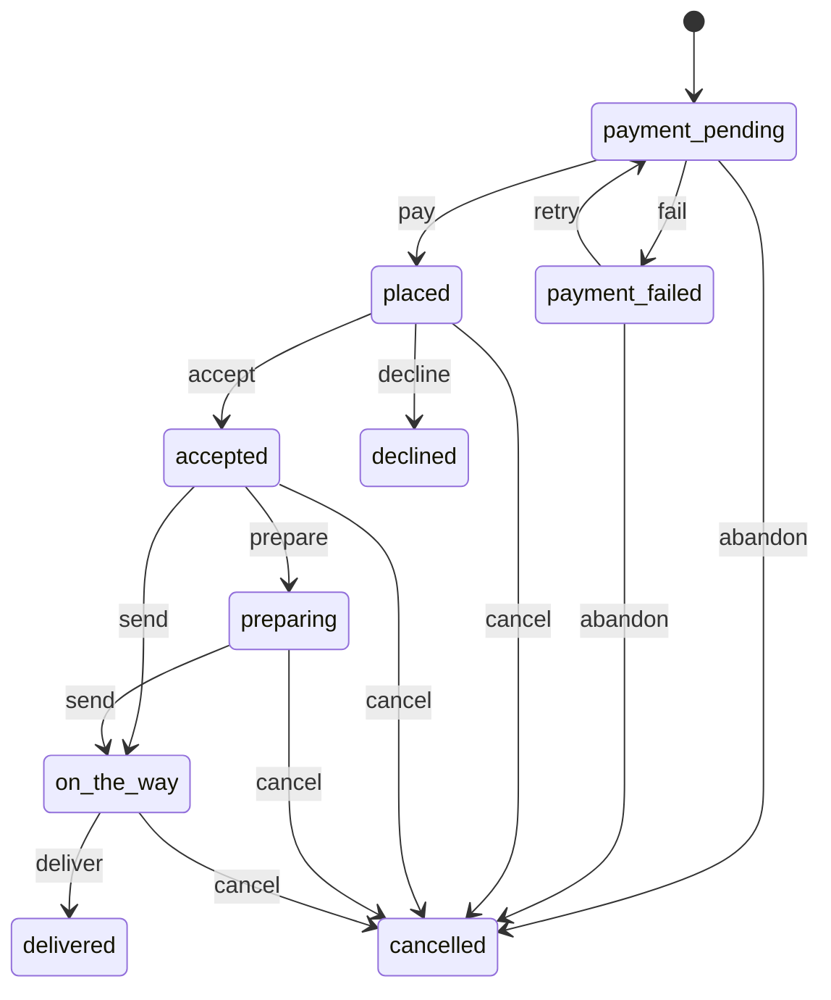

# Food delivery (`food`)

The app's Food delivery department: restaurants staff keep in Admin › Departments › Food delivery, their menus with sizes and extras, a basket that holds one restaurant's food, and food orders paid by card in their own payment flow (payments purchase intents, not cart and checkout). Staff move each order through accepted, preparing, on the way and delivered on the restaurant's behalf; the card is charged on delivery.

- **Group:** Growth · **Launch phase:** 2 · **Plan chapters:** -
- **Depends on:** [media](media.md), [payments](payments.md), [customers](customers.md) · **Optional:** [audit](audit.md), [notifications](notifications.md)

## Owns
- Food categories (Pizza, Burgers, Asian, …)
- Restaurants: name, photos, cuisine, address, opening hours, delivery time, delivery fee, free-delivery threshold, minimum order, promotion line, status
- Menus: sections and items with photos, description, price, was-price, diet tags, option groups (sizes, extras) and availability
- The customer's basket (one restaurant at a time)
- Food orders (FD- references) with their status, delivery estimate and payment
- Ratings and reviews of delivered orders, shown on restaurants and items
- Customers' saved restaurants (the heart on a restaurant, Account › Saved)
- Restaurant points (geocoded from the address, or a pin staff set) and the distance labels on restaurant cards

**Not here:**
- Card payments: payments purchase intents (authorizePurchase, completeAction, capturePurchase, voidIntent)
- Delivery addresses: customers (getAddressForOrder)
- Where the customer is and turning addresses into points: customers (customerLocation, geocodeAddress)
- Pictures: media (content_image uploads)
- Ads above the restaurants: advertising placement food_top
- Cart, checkout and orders of the main store: food never goes there (2026-10-22 decision)

## Store API

| Method | Path | Purpose | Auth | Body → Response |
|---|---|---|---|---|
| GET | `/api/store/food/categories` | Visible food categories in order | visitor | `FoodCategory[]` |
| GET | `/api/store/food/restaurants` | Published restaurants, open ones first | visitor | Page<RestaurantCard> |
| GET | `/api/store/food/restaurants/{slug}` | A restaurant with its menu | visitor | `Restaurant` |
| GET | `/api/store/food/restaurants/{slug}/reviews` | A restaurant's reviews, newest first | visitor | Page<RestaurantReview> |
| GET | `/api/store/food/restaurants/{slug}/ratings` | A restaurant's rating summary: average, count and count per star | visitor | `RestaurantRatings` |
| GET | `/api/store/food/saved-restaurants` | My saved restaurants, last saved first | customer | Page<RestaurantCard> |
| PUT | `/api/store/food/saved-restaurants/{slug}` | Save a restaurant (the heart) | customer | 204 No content |
| DELETE | `/api/store/food/saved-restaurants/{slug}` | Remove a restaurant from my saved ones | customer | 204 No content |
| GET | `/api/store/food/items` | Menu items across restaurants | visitor | Page<MenuItemCard> |
| GET | `/api/store/food/items/{id}` | A menu item with its photos, sizes and extras | visitor | `MenuItem` |
| GET | `/api/store/food/basket` | My food basket with prices worked out now | customer | `Basket` |
| POST | `/api/store/food/basket/lines` | Add an item with its options | customer | `BasketLineInput` → `Basket` |
| PATCH | `/api/store/food/basket/lines/{lineId}` | Change a line's quantity or note; 0 removes it | customer | `BasketLineUpdate` → `Basket` |
| DELETE | `/api/store/food/basket` | Empty the basket | customer | `Basket` |
| GET | `/api/store/food/payment-options` | Saved cards and a new-card session for the basket total | customer | `payments.PaymentOptions` |
| POST | `/api/store/food/orders` | Order the basket _(idempotent)_ | customer | `PlaceOrderInput` → `FoodOrder` |
| GET | `/api/store/food/orders` | My food orders, newest first | customer | Page<FoodOrder> |
| GET | `/api/store/food/orders/{id}` | A food order with its status and payment | customer | `FoodOrder` |
| POST | `/api/store/food/orders/{id}/complete-action` | Finish the bank challenge of a food order _(idempotent)_ | customer | `CompleteActionInput` → `FoodOrder` |
| POST | `/api/store/food/orders/{id}/retry` | Pay a failed food order again _(idempotent)_ | customer | `RetryPaymentInput` → `FoodOrder` |
| POST | `/api/store/food/orders/{id}/cancel` | Cancel an order the restaurant hasn't accepted | customer | `CancelInput` → `FoodOrder` |
| POST | `/api/store/food/orders/{id}/review` | Rate a delivered order | customer | `ReviewInput` → `FoodOrder` |

## Admin API

| Method | Path | Purpose | Auth | Body → Response |
|---|---|---|---|---|
| GET | `/api/admin/food/categories` | All food categories in order | staff `food.view` | `FoodCategory[]` |
| POST | `/api/admin/food/categories` | Add a food category _(audited)_ | staff `food.manage` | `FoodCategoryInput` → `FoodCategory` |
| PATCH | `/api/admin/food/categories/{id}` | Change a food category _(audited)_ | staff `food.manage` | `FoodCategoryInput` → `FoodCategory` |
| DELETE | `/api/admin/food/categories/{id}` | Delete a food category _(audited)_ | staff `food.manage` | 204 No content |
| GET | `/api/admin/food/restaurants` | Restaurants with filters | staff `food.view` | Page<RestaurantAdmin> |
| POST | `/api/admin/food/restaurants` | Add a restaurant _(audited)_ | staff `food.manage` | `RestaurantInput` → `RestaurantAdmin` |
| GET | `/api/admin/food/restaurants/{id}` | A restaurant for editing | staff `food.view` | `RestaurantAdmin` |
| PATCH | `/api/admin/food/restaurants/{id}` | Change a restaurant, pause or hide it _(audited)_ | staff `food.manage` | `RestaurantInput` → `RestaurantAdmin` |
| DELETE | `/api/admin/food/restaurants/{id}` | Delete a restaurant with no orders _(audited)_ | staff `food.manage` | 204 No content |
| GET | `/api/admin/food/restaurants/{id}/menu` | A restaurant's sections and items | staff `food.view` | `MenuSectionAdmin[]` |
| POST | `/api/admin/food/restaurants/{id}/sections` | Add a menu section _(audited)_ | staff `food.manage` | `MenuSectionInput` → `MenuSectionAdmin` |
| PATCH | `/api/admin/food/sections/{id}` | Rename or reorder a menu section _(audited)_ | staff `food.manage` | `MenuSectionInput` → `MenuSectionAdmin` |
| DELETE | `/api/admin/food/sections/{id}` | Delete an empty menu section _(audited)_ | staff `food.manage` | 204 No content |
| POST | `/api/admin/food/restaurants/{id}/items` | Add a menu item _(audited)_ | staff `food.manage` | `MenuItemInput` → `MenuItemAdmin` |
| PATCH | `/api/admin/food/items/{id}` | Change a menu item or mark it unavailable _(audited)_ | staff `food.manage` | `MenuItemInput` → `MenuItemAdmin` |
| DELETE | `/api/admin/food/items/{id}` | Delete a menu item _(audited)_ | staff `food.manage` | 204 No content |
| GET | `/api/admin/food/orders` | Food orders, newest first | staff `food.view` | Page<FoodOrderAdmin> |
| GET | `/api/admin/food/orders/{id}` | A food order with its history | staff `food.view` | `FoodOrderAdmin` |
| POST | `/api/admin/food/orders/{id}/status` | Accept, decline, prepare, send, deliver or cancel an order _(audited)_ | staff `food.orders.manage` | `OrderAction` → `FoodOrderAdmin` |
| GET | `/api/admin/food/reviews` | Food reviews, newest first | staff `food.view` | Page<ReviewAdmin> |
| POST | `/api/admin/food/reviews/{id}/moderate` | Hide or show a food review _(audited)_ | staff `food.manage` | `ReviewModeration` → `ReviewAdmin` |

## Types

### FoodCategory

| Field | Type |
|---|---|
| id | `uuid` |
| slug | `string` |
| name | `string` |
| icon | `string?` Lucide icon name |
| image | `MediaRef?` |
| position | `int` |
| visible | `bool` |
| restaurantCount | `int` |

### FoodCategoryInput

| Field | Type |
|---|---|
| name | `string` |
| slug | `string?` |
| icon | `string?` |
| imageId | `uuid?` |
| position | `int?` |
| visible | `bool?` |

### OpeningDay

| Field | Type |
|---|---|
| weekday | `enum(mon|tue|wed|thu|fri|sat|sun)` |
| open | `bool` |
| from | `string?` HH:MM local |
| to | `string?` HH:MM local; earlier than from means past midnight |

### RatingSummary

| Field | Type |
|---|---|
| average | `number?` Null without reviews |
| count | `int` |
| stars | `int[]` Counts for 5, 4, 3, 2 and 1 stars |

### RestaurantCard

| Field | Type |
|---|---|
| id | `uuid` |
| slug | `string` |
| name | `string` |
| cuisine | `string` e.g. Pizza · Italian |
| image | `MediaRef?` |
| logo | `MediaRef?` |
| city | `string?` |
| rating | `number?` |
| ratingCount | `int` |
| deliveryLabel | `string` e.g. 20–30 min |
| feeLabel | `string` e.g. $1.99 delivery, or Free delivery |
| promoBadge | `string?` Short badge on the card, e.g. Free delivery |
| open | `bool` |
| openLabel | `string` e.g. Open until 11 PM, or Closed · opens 5 PM |
| distanceLabel | `string?` e.g. 1.2 mi from the customer's default delivery address; null for visitors, customers without a geocoded default address and restaurants without a point (the card shows city instead) |
| saved | `bool` The signed-in customer saved this restaurant; false for visitors |

### OptionChoice

| Field | Type |
|---|---|
| id | `string` |
| name | `string` |
| priceDelta | `Money` Added to the item price; negative for a smaller size |
| default | `bool` |
| available | `bool` |

### OptionGroup

| Field | Type |
|---|---|
| id | `string` |
| name | `string` e.g. Size, Extras |
| required | `bool` |
| min | `int` |
| max | `int` 1 for a single choice |
| choices | `OptionChoice[]` |

### MenuItemCard

| Field | Type |
|---|---|
| id | `uuid` |
| restaurantId | `uuid` |
| restaurantName | `string` |
| restaurantSlug | `string` |
| name | `string` |
| description | `string?` |
| image | `MediaRef?` |
| price | `Money` |
| priceLabel | `string` |
| wasLabel | `string?` |
| badge | `string?` e.g. -15% |
| tag | `string?` e.g. Most ordered |
| dietTags | `string[]` |
| rating | `number?` |
| ratingCount | `int` |
| available | `bool` |
| hasOptions | `bool` Opens the item page instead of adding straight away |

### MenuSection

| Field | Type |
|---|---|
| id | `uuid` |
| name | `string` |
| items | `MenuItemCard[]` |

### Restaurant

| Field | Type |
|---|---|
| id | `uuid` |
| slug | `string` |
| name | `string` |
| cuisine | `string` |
| image | `MediaRef?` |
| logo | `MediaRef?` |
| photos | `MediaRef[]` |
| address | `string?` |
| city | `string?` |
| phone | `string?` |
| ratings | `RatingSummary` |
| deliveryLabel | `string` |
| deliveryFee | `Money` |
| feeLabel | `string` |
| freeDeliveryOver | `Money?` |
| minOrder | `Money?` |
| minOrderLabel | `string?` |
| promoText | `string?` e.g. Free delivery on orders over $25 this week |
| promoBadge | `string?` |
| open | `bool` |
| openLabel | `string` |
| hours | `OpeningDay[]` |
| distanceLabel | `string?` e.g. 1.2 mi, shown after the address in the meta line (Pizza · Italian · 118 Bay Rd · 1.2 mi); null as on RestaurantCard |
| saved | `bool` The heart in the top bar: the signed-in customer saved it; false for visitors |
| sections | `MenuSection[]` Popular first (items marked popular), then the restaurant's sections in order |

### MenuItem

| Field | Type |
|---|---|
| id | `uuid` |
| restaurant | `RestaurantCard` |
| name | `string` |
| description | `string?` |
| photos | `MediaRef[]` |
| price | `Money` |
| priceLabel | `string` |
| wasLabel | `string?` |
| badge | `string?` |
| tag | `string?` |
| dietTags | `string[]` |
| rating | `number?` |
| ratingCount | `int` |
| available | `bool` |
| optionGroups | `OptionGroup[]` |
| instructionsHint | `string?` e.g. The restaurant will do its best; allergy needs should be confirmed by phone. |

### LineOptionInput

| Field | Type |
|---|---|
| groupId | `string` |
| choiceIds | `string[]` |

### BasketLineInput

| Field | Type |
|---|---|
| itemId | `uuid` |
| quantity | `int` 1 to 20 |
| options | `LineOptionInput[]?` |
| note | `string?` Special instructions, up to 200 characters |
| replace | `bool?` Empty a basket from another restaurant first |

### BasketLineUpdate

| Field | Type |
|---|---|
| quantity | `int` 0 removes the line |
| note | `string?` |

### BasketLine

| Field | Type |
|---|---|
| id | `string` |
| itemId | `uuid` |
| name | `string` |
| image | `MediaRef?` |
| optionsLabel | `string?` e.g. 12" regular · Extra mozzarella |
| options | `LineOptionInput[]` |
| note | `string?` |
| unitPrice | `Money` |
| quantity | `int` |
| total | `Money` |
| available | `bool` |

### Basket

| Field | Type |
|---|---|
| restaurant | `RestaurantCard?` |
| lines | `BasketLine[]` |
| itemCount | `int` |
| subtotal | `Money` |
| deliveryFee | `Money` |
| total | `Money` |
| minOrder | `Money?` |
| missingForMinimum | `Money?` How much more to reach the minimum order |
| canOrder | `bool` |
| problems | `string[]` e.g. Napoli Corner is closed now · opens 5 PM; Tiramisu is no longer available |

### OrderLine

| Field | Type |
|---|---|
| itemId | `uuid` |
| name | `string` |
| image | `MediaRef?` |
| optionsLabel | `string?` |
| note | `string?` |
| unitPrice | `Money` |
| quantity | `int` |
| total | `Money` |

### StatusChange

| Field | Type |
|---|---|
| status | `string` |
| at | `datetime` |
| by | `string?` Admin only: who changed it |
| note | `string?` |

### FoodReview

| Field | Type |
|---|---|
| id | `uuid` |
| name | `string` First name and last initial |
| stars | `int` |
| text | `string?` |
| date | `datetime` |

### RestaurantReview

| Field | Type |
|---|---|
| id | `uuid` |
| name | `string` First name and last initial, e.g. Maya R. |
| stars | `int` 1 to 5 |
| text | `string?` |
| date | `datetime` |
| items | `string[]` What the reviewer ordered, from the order: e.g. 2 × Margherita pizza 12", Tiramisu; empty when the order is gone |

### RestaurantRatings

| Field | Type |
|---|---|
| restaurantId | `uuid` |
| slug | `string` |
| name | `string` |
| ratings | `RatingSummary` Average, count and the count per star (5 to 1) of the visible reviews |

### ReviewInput

| Field | Type |
|---|---|
| stars | `int` 1 to 5 |
| text | `string?` Up to 1,000 characters |

### FoodOrder

| Field | Type |
|---|---|
| id | `uuid` |
| ref | `string` e.g. FD-9QX3M |
| status | `enum(payment_pending|payment_failed|placed|accepted|preparing|on_the_way|delivered|cancelled|declined)` |
| statusLabel | `string` e.g. Waiting for Napoli Corner to accept |
| restaurant | `RestaurantCard` |
| lines | `OrderLine[]` |
| itemCount | `int` |
| subtotal | `Money` |
| deliveryFee | `Money` |
| total | `Money` |
| address | `Address` |
| courierNote | `string?` |
| contactPhone | `string?` |
| etaLabel | `string?` e.g. Arrives 7:40–7:50 PM (from acceptance plus the delivery time) |
| placedAt | `datetime?` |
| deliveredAt | `datetime?` |
| history | `StatusChange[]` Oldest first |
| restaurantNote | `string?` e.g. a decline reason |
| payment | `payments.PurchasePaymentStatus?` |
| canCancel | `bool` |
| canReview | `bool` |
| review | `FoodReview?` |
| createdAt | `datetime` |

### PlaceOrderInput

| Field | Type |
|---|---|
| addressId | `uuid` One of the customer's saved addresses |
| expectedTotal | `Money` The total the customer saw; PRICE_CHANGED when it differs |
| courierNote | `string?` e.g. Ring twice, 3rd floor |
| contactPhone | `string?` |
| method | `payments.MethodSelection` |
| returnUrl | `url` |

### RetryPaymentInput

| Field | Type |
|---|---|
| method | `payments.MethodSelection` |
| returnUrl | `url` |

### CompleteActionInput

| Field | Type |
|---|---|
| resultToken | `string` |

### CancelInput

| Field | Type |
|---|---|
| reason | `string?` |

### RestaurantAdmin

| Field | Type |
|---|---|
| id | `uuid` |
| slug | `string` |
| name | `string` |
| cuisine | `string` |
| categoryIds | `uuid[]` |
| image | `MediaRef?` |
| logo | `MediaRef?` |
| photos | `MediaRef[]` |
| address | `string?` |
| city | `string?` |
| region | `string?` State code, e.g. OR |
| postalCode | `string?` |
| phone | `string?` |
| hours | `OpeningDay[]` |
| timeZone | `string` |
| point | `customers.GeoPoint?` Where the restaurant is on the map; distances on cards are measured from it |
| pointSource | `enum(geocoded|staff)?` geocoded: from the address (customers.geocodeAddress); staff: a pin staff set. Null: no point yet (the geocoder could not place the address) |
| deliveryMinMinutes | `int` |
| deliveryMaxMinutes | `int` |
| deliveryFee | `Money` |
| freeDeliveryOver | `Money?` |
| minOrder | `Money?` |
| promoText | `string?` |
| promoBadge | `string?` |
| status | `enum(draft|published|paused|hidden)` |
| position | `int` |
| ratings | `RatingSummary` |
| itemCount | `int` |
| openOrders | `int` |
| updatedAt | `datetime` |

### RestaurantInput

| Field | Type |
|---|---|
| name | `string` |
| slug | `string?` |
| cuisine | `string` |
| categoryIds | `uuid[]?` |
| imageId | `uuid?` |
| logoId | `uuid?` |
| photoIds | `uuid[]?` |
| address | `string?` Street line, e.g. 118 Bay Rd |
| city | `string?` e.g. Portland (Portland, OR is read as city and state when region is empty) |
| region | `string?` State code, e.g. OR |
| postalCode | `string?` |
| phone | `string?` |
| hours | `OpeningDay[]?` |
| timeZone | `string?` |
| point | `customers.GeoPoint?` A pin staff set on the map, kept until staff send null. Null drops the pin and the point is geocoded from the address again; left out keeps a staff pin, else the address is geocoded when it changed or has no point yet |
| deliveryMinMinutes | `int` |
| deliveryMaxMinutes | `int` |
| deliveryFee | `Money` |
| freeDeliveryOver | `Money?` |
| minOrder | `Money?` |
| promoText | `string?` |
| promoBadge | `string?` |
| status | `enum(draft|published|paused|hidden)?` paused: shown as closed, no new orders |
| position | `int?` |

### MenuItemAdmin

| Field | Type |
|---|---|
| id | `uuid` |
| restaurantId | `uuid` |
| sectionId | `uuid` |
| name | `string` |
| description | `string?` |
| photos | `MediaRef[]` |
| price | `Money` |
| wasPrice | `Money?` |
| tag | `string?` |
| dietTags | `string[]` |
| popular | `bool` |
| recommended | `bool` Shown in Recommended foods on the department home |
| optionGroups | `OptionGroup[]` |
| available | `bool` |
| position | `int` |
| ratings | `RatingSummary` |
| updatedAt | `datetime` |

### MenuItemInput

| Field | Type |
|---|---|
| sectionId | `uuid` |
| name | `string` |
| description | `string?` |
| photoIds | `uuid[]?` Up to 5 content_image uploads |
| price | `Money` |
| wasPrice | `Money?` Above price: shows a discount badge |
| tag | `string?` |
| dietTags | `string[]?` |
| popular | `bool?` |
| recommended | `bool?` |
| optionGroups | `OptionGroup[]?` |
| available | `bool?` |
| position | `int?` |

### MenuSectionAdmin

| Field | Type |
|---|---|
| id | `uuid` |
| restaurantId | `uuid` |
| name | `string` |
| position | `int` |
| items | `MenuItemAdmin[]` |

### MenuSectionInput

| Field | Type |
|---|---|
| name | `string` |
| position | `int?` |

### FoodOrderAdmin

| Field | Type |
|---|---|
| id | `uuid` |
| ref | `string` |
| status | `enum(payment_pending|payment_failed|placed|accepted|preparing|on_the_way|delivered|cancelled|declined)` |
| statusLabel | `string` |
| restaurant | `RestaurantCard` |
| lines | `OrderLine[]` |
| subtotal | `Money` |
| deliveryFee | `Money` |
| total | `Money` |
| customer | `{"id":"uuid","name":"string?","email":"email?"}` |
| address | `Address` |
| courierNote | `string?` |
| contactPhone | `string?` |
| etaLabel | `string?` |
| history | `StatusChange[]` |
| restaurantNote | `string?` |
| staffNote | `string?` |
| methodLabel | `string?` |
| paymentState | `string?` |
| intentId | `uuid?` |
| placedAt | `datetime?` |
| createdAt | `datetime` |
| actions | `enum(accept|decline|prepare|send|deliver|cancel)[]` Moves allowed now |

### OrderAction

| Field | Type |
|---|---|
| action | `enum(accept|decline|prepare|send|deliver|cancel)` |
| note | `string?` Shown to the customer (decline and cancel reasons) |
| staffNote | `string?` |

### ReviewAdmin

| Field | Type |
|---|---|
| id | `uuid` |
| orderRef | `string` |
| restaurant | `RestaurantCard` |
| name | `string` |
| customerId | `uuid` |
| stars | `int` |
| text | `string?` |
| hidden | `bool` |
| date | `datetime` |

### ReviewModeration

| Field | Type |
|---|---|
| hidden | `bool` |
| reason | `string?` |

## Status flows

### Food order (`FoodOrder.status`)

pay: the card is authorized (payments.authorizePurchase), the basket is emptied and the restaurant is told. Customers cancel only while placed; staff accept, decline, move and cancel on the restaurant's behalf. deliver captures the payment (payments.capturePurchase); decline and cancel void it (payments.voidIntent). Placed orders not accepted within acceptMinutes are declined automatically.

## Data (schema `food`)

**categories**

| Column | Type |
|---|---|
| id | uuid pk |
| slug | text unique |
| name | text |
| icon | text? |
| image_id | uuid? |
| position | int |
| visible | bool |
| created_at | timestamptz |
| updated_at | timestamptz |

Indexes: `(position)`

**restaurants**

| Column | Type |
|---|---|
| id | uuid pk |
| slug | text unique |
| name | text |
| cuisine | text |
| category_ids | jsonb |
| image_id | uuid? |
| logo_id | uuid? |
| photo_ids | jsonb |
| address | text? |
| city | text? |
| region | text? |
| postal_code | text? |
| lat | numeric(9,6)? (WGS84 latitude) |
| lng | numeric(9,6)? (WGS84 longitude) |
| point_source | text? (geocoded|staff) |
| phone | text? |
| hours | jsonb |
| time_zone | text |
| delivery_min | int |
| delivery_max | int |
| delivery_fee | bigint |
| free_delivery_over | bigint? |
| min_order | bigint? |
| currency | text |
| promo_text | text? |
| promo_badge | text? |
| status | text (draft|published|paused|hidden) |
| position | int |
| rating_sum | int |
| rating_count | int |
| rating_stars | jsonb |
| search_text | text |
| created_at | timestamptz |
| updated_at | timestamptz |

Indexes: `(status, position)`

**sections**

| Column | Type |
|---|---|
| id | uuid pk |
| restaurant_id | uuid → restaurants |
| name | text |
| position | int |

Indexes: `(restaurant_id, position)`

**items**

| Column | Type |
|---|---|
| id | uuid pk |
| restaurant_id | uuid → restaurants |
| section_id | uuid → sections |
| name | text |
| description | text? |
| photo_ids | jsonb |
| price | bigint |
| was_price | bigint? |
| currency | text |
| tag | text? |
| diet_tags | jsonb |
| popular | bool |
| recommended | bool |
| option_groups | jsonb (OptionGroup[]) |
| available | bool |
| position | int |
| rating_sum | int |
| rating_count | int |
| rating_stars | jsonb |
| search_text | text |
| created_at | timestamptz |
| updated_at | timestamptz |

Indexes: `(restaurant_id, section_id, position)`, `(recommended, available)`

**baskets**

| Column | Type |
|---|---|
| id | uuid pk |
| customer_id | uuid unique |
| restaurant_id | uuid? |
| lines | jsonb (stored lines: id, itemId, quantity, options, note) |
| updated_at | timestamptz |

**orders**

| Column | Type |
|---|---|
| id | uuid pk |
| ref | text unique |
| customer_id | uuid |
| restaurant_id | uuid → restaurants |
| restaurant | jsonb (name, slug, cuisine, image at order time) |
| lines | jsonb (OrderLine[]) |
| subtotal | bigint |
| delivery_fee | bigint |
| total | bigint |
| currency | text |
| address | jsonb (Address) |
| courier_note | text? |
| contact_phone | text? |
| status | text (payment_pending|payment_failed|placed|accepted|preparing|on_the_way|delivered|cancelled|declined) |
| history | jsonb |
| restaurant_note | text? |
| staff_note | text? |
| intent_id | uuid? |
| attempts | int |
| method_label | text? |
| eta_from | timestamptz? |
| eta_to | timestamptz? |
| placed_at | timestamptz? |
| accepted_at | timestamptz? |
| delivered_at | timestamptz? |
| reviewed | bool |
| idempotency_key | text unique |
| created_at | timestamptz |
| updated_at | timestamptz |

Indexes: `(customer_id, created_at)`, `(status, created_at)`, `(restaurant_id, status, created_at)`, `(intent_id)`

**saved_restaurants**: A customer's saved restaurants (one row per customer and restaurant)

| Column | Type |
|---|---|
| id | uuid pk |
| customer_id | uuid |
| restaurant_id | uuid → restaurants |
| created_at | timestamptz |

Indexes: `(customer_id, restaurant_id) unique`, `(customer_id, created_at)`, `(restaurant_id)`

**reviews**

| Column | Type |
|---|---|
| id | uuid pk |
| order_id | uuid unique → orders |
| restaurant_id | uuid → restaurants |
| item_ids | jsonb |
| customer_id | uuid |
| name | text |
| stars | int |
| text | text? |
| hidden | bool |
| hidden_reason | text? |
| created_at | timestamptz |

Indexes: `(restaurant_id, hidden, created_at)`

## Events

| Publishes | When | Payload | Consumed by |
|---|---|---|---|
| `food.order.status_changed` | A food order is placed or moves (accepted, preparing, on the way, delivered, cancelled, declined, payment failed) | `{ orderId: uuid, ref: string, customerId: uuid, restaurantName: string, status: string, note: string? }` | notifications |

| Consumes | From | Does |
|---|---|---|
| `payments.purchase.authorized` | payments | module food: a pending or challenged payment went through — place the order and empty the basket |
| `payments.purchase.failed` | payments | module food: mark the order payment_failed |

## In-process API (for other modules)

| Function | Signature | Used by |
|---|---|---|
| exportCustomerData | `(input: { customerId: uuid, accountId: uuid }) => CustomerDataSection[]` The customer's food orders (reference, restaurant, items, amounts, address, status, dates), reviews and saved restaurants for the personal data export | customers |

## Permissions

| Key | Who | Allows |
|---|---|---|
| `food.view` | staff | See restaurants, menus, food orders and reviews in Admin › Departments › Food delivery |
| `food.manage` | staff | Categories, restaurants, menus; hide reviews |
| `food.orders.manage` | staff | Accept, decline, move, deliver and cancel food orders |

## Error codes

| Code | Status | Meaning |
|---|---|---|
| `SLUG_TAKEN` | 409 | Another record already uses this slug. |
| `IN_USE` | 409 | Items or orders still use it. |
| `OTHER_RESTAURANT` | 409 | Your basket has food from another restaurant. details.restaurantName; add again with replace to start a new basket. |
| `OPTIONS_INVALID` | 422 | Pick the required options (details.groupId) within their limits. |
| `ITEM_UNAVAILABLE` | 409 | An item is no longer available. details.itemIds. |
| `RESTAURANT_UNAVAILABLE` | 409 | This restaurant isn't taking orders. |
| `RESTAURANT_CLOSED` | 409 | The restaurant is closed now. details.opensLabel. |
| `BELOW_MINIMUM` | 409 | Add more to reach the minimum order. details.missing. |
| `BASKET_EMPTY` | 409 | Your basket is empty. |
| `PRICE_CHANGED` | 409 | Prices changed; details.total is the new total. |
| `ALREADY_REVIEWED` | 409 | You already rated this order. |
| `PAYMENT_CAPTURE_FAILED` | 502 | The card couldn't be charged; the order stays on the way. Try again or cancel it. |

## Background jobs

| Job | Schedule | Does |
|---|---|---|
| `food.geocode-restaurants` | on boot | Backfill: geocode restaurants that have an address but no point (restaurants added before points existed, or while the geocoder could not place them) through customers.geocodeAddress. Staff pins are never touched |
| `food.expire-unaccepted` | every 5 min | Decline placed orders not accepted within acceptMinutes (void the payment, tell the customer); cancel payment_pending orders left in a bank challenge for 30 minutes |

## Settings

| Key | Default | Rules | Meaning |
|---|---|---|---|
| acceptMinutes | `15` | duration, minutes, 5–120 | A placed order the restaurant hasn't accepted in this time is declined automatically and the payment released |

## Notes
- 2026-10-22 (user): Food delivery has its own basket and orders instead of the store's cart and checkout. Restaurants are admin-managed records; staff handle every order on the restaurant's behalf.
- Payment: the card is authorized when the order is placed and captured when it is delivered, so declined and cancelled orders are only voided and never need a refund.
- Prices: an item's price plus the chosen options' priceDelta, times the quantity. The delivery fee is waived when the subtotal reaches freeDeliveryOver. Order refs are FD- plus five characters from 23456789ABCDEFGHJKLMNPQRSTUVWXYZ.
- Open: from the restaurant's hours in its time zone (default the market time zone); paused restaurants show as closed. openLabel: Open until 11 PM, Closes soon · 10:45 PM (within 30 minutes), Closed · opens 5 PM, Closed today.
- ETA: from acceptance plus the delivery minutes (deliveryMin–deliveryMax); before acceptance etaLabel shows the delivery time, e.g. Usually 20–30 min.
- Ratings: one review per delivered order; it counts for the restaurant and for every item in the order. The reviewer's name is their first name and last initial (customers.getCustomer), else Customer.
- Customers are customers-module ids (the store principal's customerId), as payments uses.
- Distances (owner decision 2026-10-22): from the customer's geocoded default delivery address (customers.customerLocation) to the restaurant's point, labelled by kernel/lib/geo.ts (0.3 mi, 1.2 mi, 14 mi). Shown on restaurant cards (lists, saved, the item page, the basket) and in the restaurant's meta line. Visitors and customers without a location get distanceLabel null and the card shows the city. Order cards show no distance.
- Restaurant points: geocoded from address, city, region and postal code (customers.geocodeAddress) when a restaurant is added or its address changes, unless staff set a pin (point). A failed geocode never fails the save; the food.geocode-restaurants job tries again on the next deploy.
- Saved restaurants: PUT and DELETE /saved-restaurants/{slug} are safe to repeat. Reviews screen (store/food-reviews): GET /restaurants/{slug}/ratings for the summary on top, GET /restaurants/{slug}/reviews for the list.
