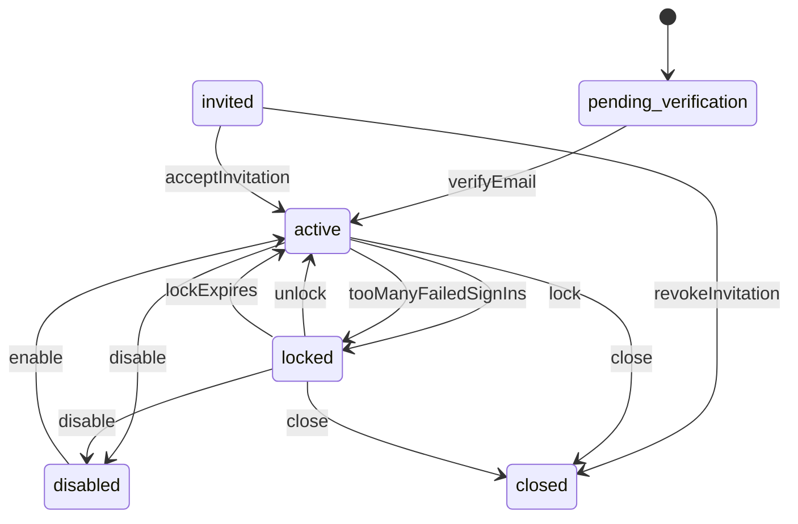
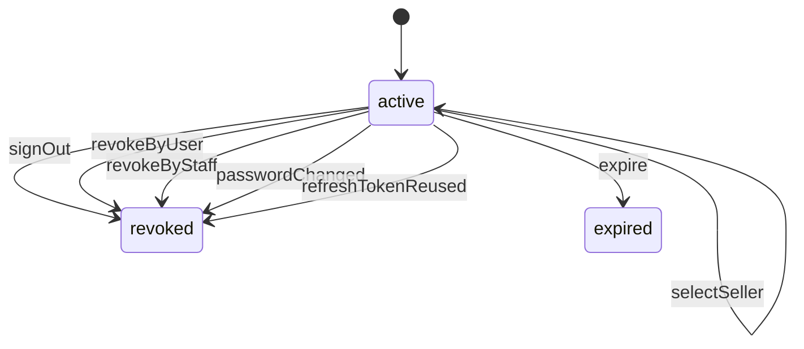
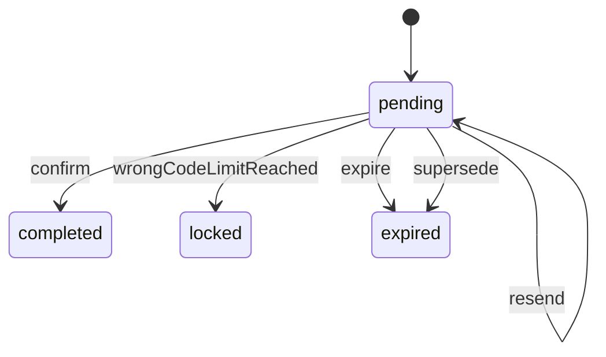
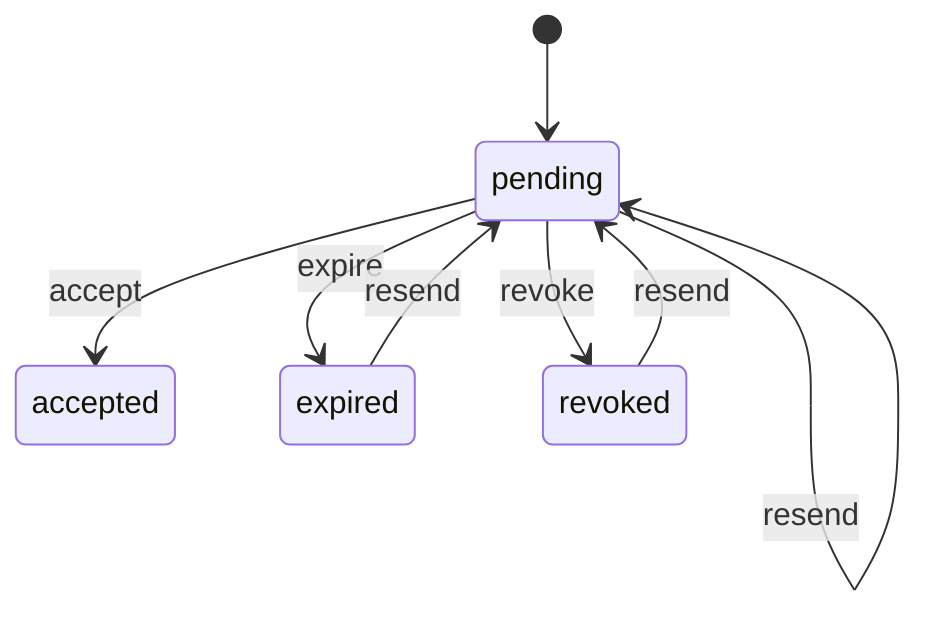

# Identity (`identity`)

Who someone is and how they prove it: accounts for customers, seller members and staff, credentials, email verification, sessions and refresh tokens for the website and the Android app, password recovery, 2-step verification, signed-in devices, guest sessions and the security activity log.

- **Group:** Platform · **Launch phase:** 1 · **Plan chapters:** 6, 7, 10, 18
- **Depends on:** nothing · **Optional:** [audit](audit.md), [sellers](sellers.md), [customers](customers.md), [access](access.md)
- **Required by:** [access](access.md), [customers](customers.md), [notifications](notifications.md), [sellers](sellers.md)

## Owns
- Accounts in two realms: member (customers and seller members share one account) and staff (invite-only: an invitation link plus a pass code; email and password sign-in, no 2-step)
- Registration with email verification codes (6 digits, 10 minutes, resend timer)
- Phone number verification codes (requested by customers when the mobile number changes)
- Sign-in for the store, Seller Center and Admin Center; access tokens plus rotating refresh tokens; keep me signed in
- Failed sign-in counting and temporary lockout (attempts left shown to the user)
- Password recovery links (single use, 30 minutes) that never reveal whether an account exists; password change; forced reset by staff
- Optional 2-step verification for members (authenticator app at launch, text message later), recovery codes, trusted devices
- Signed-in devices with sign-out of one device or everywhere
- Seller context: which seller accounts a member may act for, and switching between them
- Invitations for staff and seller members (accept link, password set-up; staff also enter the invitation pass code)
- Guest sessions (X-Guest-Session) for cart, recently viewed and guest checkout; guest order access grants on a guest session; emailed order links
- Security activity log per account (sign-ins, failures, password and 2-step changes, staff actions on the account)
- Staff tools to lock, unlock, force a password reset, reset 2-step, sign out and disable accounts
- Recent re-authentication (re-auth tokens) before sensitive actions such as account closure or payout destination changes

**Not here:**
- Customer profile, phone number on the profile, addresses, marketing consent and account closure rules (open orders, returns, cases): customers. identity closes the credential when customers calls closeAccount
- Guest order lookup form (order reference + checkout email) and 'email me my order links': customers. It verifies the order with orders, then calls grantGuestOrderAccess / issueOrderLink here
- Seller members, seller roles and seller permissions (who may change payouts, etc.): sellers. identity only stores which sellers an account may act for (grantSellerContext)
- Staff roles, permissions, approval limits and the combined 'invite staff with roles' action: access (it calls inviteStaff here)
- Sending emails and texts (codes, reset links, security alerts): notifications, which consumes identity events
- Notification channel preferences: notifications; promotional (marketing) consent: customers
- Material staff action history: audit (identity also keeps its own security activity log per account)

## Store API

| Method | Path | Purpose | Auth | Body → Response |
|---|---|---|---|---|
| GET | `/api/store/identity/security` | Sign-in and security page in one call | account | `SecurityOverview` |
| PUT | `/api/store/identity/password` | Change password | account | `ChangePasswordRequest` → 204 No content |
| POST | `/api/store/identity/email-changes` | Change sign-in email (sends a code to the new address) _(step-up: reauth)_ | account | `{ newEmail: email, reauthToken: string }` → `VerificationChallenge` |
| POST | `/api/store/identity/reauth` | Confirm it's you before a sensitive action | customer | `ReauthRequest` → `ReauthToken` |
| POST | `/api/store/identity/two-step/setups` | Start turning on 2-step verification | account | `TwoStepSetupRequest` → `TwoStepSetup` |
| POST | `/api/store/identity/two-step/setups/{id}/confirm` | Confirm the first code; returns recovery codes once | account | `{ code: string }` → `RecoveryCodes` |
| POST | `/api/store/identity/two-step/methods/{id}/remove` | Turn off a 2-step method _(step-up: reauth)_ | account | `{ reauthToken: string, code: string }` → `TwoStepStatus` |
| POST | `/api/store/identity/two-step/recovery-codes` | Replace recovery codes _(step-up: reauth)_ | account | `{ reauthToken: string }` → `RecoveryCodes` |
| GET | `/api/store/identity/devices` | Where you're signed in | account | `Device[]` |
| POST | `/api/store/identity/devices/{id}/sign-out` | Sign out one device | account | 204 No content |
| POST | `/api/store/identity/devices/sign-out-all` | Sign out everywhere | account | `{ keepThisDevice: bool }` → `{ sessionsRevoked: int }` |
| GET | `/api/store/identity/security-activity` | Recent security activity | account | Page<SecurityEvent> |

## Seller API

| Method | Path | Purpose | Auth | Body → Response |
|---|---|---|---|---|
| POST | `/api/seller/identity/reauth` | Confirm it is you before a sensitive Seller Center action _(audited, before seller is chosen)_ | seller | `ReauthRequest` → `ReauthToken` |
| GET | `/api/seller/identity/session/sellers` | Sellers this member can act for (seller switcher) _(before seller is chosen)_ | seller | `SellerContext[]` |
| POST | `/api/seller/identity/session/seller-context` | Choose or switch the seller this session acts for _(before seller is chosen)_ | seller | `{ sellerId: uuid }` → `SessionTokens` |

## Admin API

| Method | Path | Purpose | Auth | Body → Response |
|---|---|---|---|---|
| POST | `/api/admin/identity/reauth` | Confirm it is you before a sensitive Admin Center action _(audited)_ | staff | `ReauthRequest` → `ReauthToken` |
| GET | `/api/admin/identity/accounts` | Find accounts (staff or members) | staff<br>`identity.accounts.view` | Page<AccountListItem> |
| GET | `/api/admin/identity/accounts/{id}` | Account security detail (devices, lockout, recent activity) | staff<br>`identity.accounts.view` | `AccountAdmin` |
| POST | `/api/admin/identity/accounts/{id}/lock` | Lock an account (suspected compromise, offboarding) _(audited)_ | staff<br>`identity.accounts.manage` | `LockRequest` → `AccountAdmin` |
| POST | `/api/admin/identity/accounts/{id}/unlock` | Unlock an account _(audited)_ | staff<br>`identity.accounts.manage` | `{ reason: text }` → `AccountAdmin` |
| POST | `/api/admin/identity/accounts/{id}/force-password-reset` | Require a new password at next sign-in _(audited)_ | staff<br>`identity.accounts.manage` | `{ reason: text, sendLink: bool }` → `AccountAdmin` |
| POST | `/api/admin/identity/accounts/{id}/reset-two-step` | Remove 2-step methods after an identity check (lost phone) _(audited)_ | staff<br>`identity.accounts.manage` | `{ reason: text, identityCheck: text }` → `AccountAdmin` |
| POST | `/api/admin/identity/accounts/{id}/sign-out-all` | Sign an account out everywhere _(audited)_ | staff<br>`identity.accounts.manage` | `{ reason: text }` → `{ sessionsRevoked: int }` |
| POST | `/api/admin/identity/accounts/{id}/disable` | Disable a staff account (offboarding) _(audited, step-up: reauth)_ | staff<br>`identity.staff-accounts.manage` | `{ reason: text, reauthToken: string }` → `AccountAdmin` |
| POST | `/api/admin/identity/accounts/{id}/enable` | Re-enable a disabled staff account _(audited, step-up: reauth)_ | staff<br>`identity.staff-accounts.manage` | `{ reason: text, reauthToken: string }` → `AccountAdmin` |
| GET | `/api/admin/identity/accounts/{id}/security-activity` | Security activity of one account | staff<br>`identity.accounts.view` | Page<SecurityEvent> |
| GET | `/api/admin/identity/invitations` | Staff invitations | staff<br>`identity.staff-accounts.manage` | Page<Invitation> |
| POST | `/api/admin/identity/invitations/{id}/resend` | Resend a staff invitation (new 7-day link) _(audited, step-up: reauth)_ | staff<br>`identity.staff-accounts.manage` | `{ reauthToken: string }` → `StaffInvitationIssued` |
| POST | `/api/admin/identity/invitations/{id}/revoke` | Cancel a staff invitation _(audited, step-up: reauth)_ | staff<br>`identity.staff-accounts.manage` | `{ reason: text, reauthToken: string }` → `Invitation` |

## Public API

| Method | Path | Purpose | Auth | Body → Response |
|---|---|---|---|---|
| POST | `/api/public/identity/registrations` | Create a customer account and send an email code | visitor | `RegistrationRequest` → `VerificationChallenge` |
| POST | `/api/public/identity/verifications/{id}/confirm` | Confirm an email or phone code (registration, email change, phone change) | visitor | `VerifyCodeRequest` → `VerifyResult` |
| POST | `/api/public/identity/verifications/{id}/resend` | Send a new code | visitor | `VerificationChallenge` |
| POST | `/api/public/identity/sessions` | Sign in with email and password | visitor | `SignInRequest` → `SignInResult` |
| POST | `/api/public/identity/sign-in-challenges/{id}/verify` | Complete sign-in with a 2-step code or recovery code | visitor | `SecondFactorRequest` → `SignInResult` |
| POST | `/api/public/identity/sign-in-challenges/{id}/send-sms` | Text the 2-step code to the saved phone _(phase 2)_ | visitor | `SignInChallenge` |
| POST | `/api/public/identity/sessions/refresh` | Exchange a refresh token for new tokens | refresh | `{ audience: enum(store|seller|admin)?, refreshToken: string? }` → `SessionTokens` |
| POST | `/api/public/identity/sessions/sign-out` | Sign out this device | refresh | `{ audience: enum(store|seller|admin)?, refreshToken: string? }` → 204 No content |
| POST | `/api/public/identity/password-resets` | Email a password reset link | visitor | `{ email: email }` → `{ emailMasked: string, expiresInMinutes: int, resendAvailableAt: datetime }` |
| POST | `/api/public/identity/password-resets/lookups` | Check a reset link before showing the new-password form | visitor | `{ token: string }` → `PasswordResetStatus` |
| POST | `/api/public/identity/password-resets/complete` | Set a new password from a reset link | visitor | `CompleteResetRequest` → 204 No content |
| GET | `/api/public/identity/password-policy` | Password rules for the live checklist | visitor | `PasswordPolicy` |
| POST | `/api/public/identity/app-sessions` | Start an app session: the visitor token every request needs | bootstrap | `{ audience: enum(store|seller|admin), device: DeviceInfo }` → `SessionTokens` |
| POST | `/api/public/identity/order-links/redeem` | Open an order from an emailed link | visitor | `{ token: string }` → `OrderLinkRedemption` |
| POST | `/api/public/identity/invitations/lookups` | Show an invitation (staff or seller member) | visitor | `{ token: string }` → `InvitationView` |
| POST | `/api/public/identity/invitations/accept` | Accept an invitation and set a password | visitor | `AcceptInvitationRequest` → `AcceptInvitationResult` |
| POST | `/api/public/identity/external-sign-ins` | Continue with Google or Apple _(phase 2)_ | visitor | `{ provider: enum(google|apple), idToken: string, audience: enum(store|seller), device: DeviceInfo, guestSessionId: uuid?, marketingOptIn: bool? }` → `SignInResult` |

## Types

### Principal

| Field | Type |
|---|---|
| kind | `enum(customer|seller|staff|visitor)` |
| accountId | `uuid?` |
| sessionId | `uuid?` |
| sellerId | `uuid?` Seller the session acts for (seller audience only) |
| sellerMemberId | `uuid?` |
| guestSessionId | `uuid?` Visitor session id (also the guest session in the store) |
| authenticatedAt | `datetime?` |
| twoStepVerifiedAt | `datetime?` Set when this member session passed 2-step verification. Staff sessions never have it (staff sign in with email and password; nothing requires it) |

### AccountSummary

| Field | Type |
|---|---|
| id | `uuid` |
| realm | `enum(member|staff)` |
| email | `email` |
| displayName | `string` |
| status | `enum(invited|pending_verification|active|locked|disabled|closed)` |
| emailVerified | `bool` |
| twoStepEnabled | `bool` |
| lastActiveAt | `datetime?` |

### DeviceInfo

| Field | Type |
|---|---|
| kind | `enum(web|android)` |
| name | `string?` Client label, e.g. 'Marketly app on Pixel 8'. The website sends nothing; the server derives 'Chrome on Windows 11' from the User-Agent. |
| appVersion | `string?` Android versionName, e.g. 1.4.2 |
| installationId | `string?` Stable per app install; lets the app keep one device record across sign-ins |

### SessionTokens

| Field | Type |
|---|---|
| sessionId | `uuid` |
| audience | `enum(store|seller|admin)` |
| accessToken | `string` Short-lived bearer token (15 min) |
| accessTokenExpiresAt | `datetime` |
| refreshToken | `string` Rotates on every refresh; reuse of an old one revokes the whole session |
| refreshTokenExpiresAt | `datetime` |
| sellerId | `uuid?` |

### SellerContext

| Field | Type |
|---|---|
| sellerId | `uuid` |
| sellerName | `string` |
| memberId | `uuid` |
| roleLabel | `string` Owner, Shipping, Customer service, Custom permissions… |
| isOwner | `bool` |
| lastUsedAt | `datetime?` |

### SignInRequest

| Field | Type |
|---|---|
| email | `email` |
| password | `string` |
| audience | `enum(store|seller|admin)` store = customer account; seller = Seller Center; admin = Admin and Operations Center (staff realm) |
| keepSignedIn | `bool` Long refresh token (30 days) instead of 24 hours; ignored for staff (12 h max) |
| device | `DeviceInfo` |
| guestSessionId | `uuid?` Guest cart and guest orders to attach to the account after sign-in |
| sellerId | `uuid?` Preferred seller for seller audience (e.g. last used on this device) |

### SignInChallenge

| Field | Type |
|---|---|
| id | `uuid` |
| methods | `enum(totp|sms|recovery_code)[]` |
| smsPhoneMasked | `string?` |
| expiresAt | `datetime` |

### SignInResult

| Field | Type |
|---|---|
| status | `enum(signed_in|second_factor_required|seller_context_required|password_reset_required)` seller_context_required: signed in, but the member belongs to several sellers and must pick one (POST /api/seller/identity/session/seller-context) |
| tokens | `SessionTokens?` |
| account | `AccountSummary?` |
| challenge | `SignInChallenge?` |
| sellerContexts | `SellerContext[]` |
| passwordResetToken | `string?` Only when staff forced a reset: continue at the set-new-password step |

### SecondFactorRequest

| Field | Type |
|---|---|
| method | `enum(totp|sms|recovery_code)` |
| code | `string` |
| rememberDevice | `bool` Skip 2-step on this device for 30 days (members only) |

### RegistrationRequest

| Field | Type |
|---|---|
| email | `email` |
| password | `string` |
| firstName | `string` |
| lastName | `string` |
| marketingOptIn | `bool` Unchecked by default. Forwarded to notifications as promotional email consent. |
| acceptedTermsVersion | `string` Purchase terms / privacy version shown on the form (content module) |
| guestSessionId | `uuid?` |
| device | `DeviceInfo` |

### VerificationChallenge

| Field | Type |
|---|---|
| id | `uuid` |
| purpose | `enum(email_verification|email_change|phone_verification)` |
| emailMasked | `string` Masked destination: j••••••••@example.com or (503) •••-0148 |
| codeLength | `int` |
| expiresAt | `datetime` |
| resendAvailableAt | `datetime` |
| attemptsLeft | `int` |

### VerifyCodeRequest

| Field | Type |
|---|---|
| code | `string` 6 digits |
| keepSignedIn | `bool?` |
| device | `DeviceInfo?` |

### VerifyResult

| Field | Type |
|---|---|
| verified | `bool` |
| account | `AccountSummary` |
| tokens | `SessionTokens?` Registration verification signs the customer in |

### PasswordPolicy

| Field | Type |
|---|---|
| minLength | `int` 10 for members, 12 for staff |
| requireNumber | `bool` |
| requireUppercase | `bool` |
| disallowNameOrEmail | `bool` |
| rejectBreached | `bool` Checked against a breached-password list |

### PasswordResetStatus

| Field | Type |
|---|---|
| valid | `bool` |
| emailMasked | `string?` |
| expiresAt | `datetime?` |
| policy | `PasswordPolicy` |
| forced | `bool` Staff required this reset |

### CompleteResetRequest

| Field | Type |
|---|---|
| newPassword | `string` |
| signOutOtherDevices | `bool` Default true on the screen |
| token | `string` From the reset link (sent in the body, never in the URL path) |

### ChangePasswordRequest

| Field | Type |
|---|---|
| currentPassword | `string` |
| newPassword | `string` |
| signOutOtherDevices | `bool` |

### TwoStepMethod

| Field | Type |
|---|---|
| id | `uuid` |
| method | `enum(totp|sms)` |
| label | `string` Authenticator app, Text message to (503) •••-0148 |
| phoneMasked | `string?` |
| addedAt | `datetime` |
| lastUsedAt | `datetime?` |

### TwoStepStatus

| Field | Type |
|---|---|
| enabled | `bool` |
| required | `bool` Always false: 2-step is optional for members, and staff accounts have none (they sign in with email and password) |
| methods | `TwoStepMethod[]` |
| recoveryCodesRemaining | `int` |

### TwoStepSetupRequest

| Field | Type |
|---|---|
| method | `enum(totp|sms)` |
| phone | `string?` E.164, sms only (phase 2) |
| currentPassword | `string` |

### TwoStepSetup

| Field | Type |
|---|---|
| setupId | `uuid` |
| method | `enum(totp|sms)` |
| otpauthUri | `string?` otpauth://totp/… for the QR code |
| manualEntryKey | `string?` Base32 secret grouped for typing |
| phoneMasked | `string?` |
| expiresAt | `datetime` |

### RecoveryCodes

| Field | Type |
|---|---|
| codes | `string[]` 10 single-use codes, shown once |
| generatedAt | `datetime` |

### Device

| Field | Type |
|---|---|
| id | `uuid` |
| kind | `enum(web|android)` |
| label | `string` Chrome on Windows 11 · Marketly app on Pixel 8 |
| location | `string?` Approximate, from IP: Portland, OR |
| current | `bool` The device making this request |
| audiences | `enum(store|seller|admin)[]` |
| firstSeenAt | `datetime` |
| lastActiveAt | `datetime` |
| twoStepTrustedUntil | `datetime?` |

### SecurityEvent

| Field | Type |
|---|---|
| id | `uuid` |
| at | `datetime` |
| kind | `enum(signed_in|signed_in_new_device|sign_in_failed|sign_in_blocked|signed_out|signed_out_everywhere|session_revoked|refresh_token_reused|password_changed|password_reset_requested|password_reset_completed|forced_password_reset|email_verified|email_changed|two_step_enabled|two_step_disabled|recovery_codes_regenerated|account_locked|account_unlocked|account_disabled|account_enabled|seller_context_switched|seller_access_granted|seller_access_revoked)` |
| label | `string` Human text: '3 wrong passwords, sign-in blocked for 15 min' |
| device | `string?` |
| location | `string?` |
| audience | `enum(store|seller|admin)?` |
| result | `enum(completed|failed|blocked)` |
| actor | `Actor?` Staff member when the change was made by staff |
| reason | `text?` |

### SecurityOverview

| Field | Type |
|---|---|
| account | `AccountSummary` |
| passwordChangedAt | `datetime?` |
| hasPassword | `bool` False for accounts that sign in with Google or Apple only; password actions (change password, confirm with password) answer PASSWORD_NOT_SET |
| email | `EmailStatus` |
| twoStep | `TwoStepStatus` |
| devices | `Device[]` |
| recentActivity | `SecurityEvent[]` Last 30 days, newest first, max 10 |
| warnings | `SecurityWarning[]` e.g. 2-step verification is off |

### EmailStatus

| Field | Type |
|---|---|
| address | `email` |
| verifiedAt | `datetime?` |
| pendingChangeTo | `email?` |

### SecurityWarning

| Field | Type |
|---|---|
| code | `enum(two_step_off|recovery_codes_low|password_old|unrecognised_sign_in)` |
| message | `string` |

### GuestSession

| Field | Type |
|---|---|
| id | `uuid` Send as X-Guest-Session |
| createdAt | `datetime` |
| expiresAt | `datetime` |
| orderIds | `uuid[]` Orders this guest session may open |

### Invitation

| Field | Type |
|---|---|
| id | `uuid` |
| realm | `enum(member|staff)` |
| purpose | `enum(staff|seller_member)` |
| email | `email` |
| name | `string` |
| status | `enum(pending|accepted|expired|revoked)` |
| contextRef | `string?` sellerId for seller members |
| contextLabel | `string?` Seller name shown on the accept page |
| invitedBy | `Actor` |
| sentAt | `datetime` |
| expiresAt | `datetime` |
| acceptedAt | `datetime?` |
| accountId | `uuid?` |

### InvitationView

| Field | Type |
|---|---|
| purpose | `enum(staff|seller_member)` |
| emailMasked | `string` |
| name | `string` |
| contextLabel | `string?` |
| existingAccount | `bool` True: confirm with the current password instead of creating one |
| requiresPassCode | `bool` True for staff invitations: the accept form asks for the pass code the server operator handed over with the link |
| policy | `PasswordPolicy` |
| expiresAt | `datetime` |

### AcceptInvitationRequest

| Field | Type |
|---|---|
| password | `string?` New accounts |
| currentPassword | `string?` Existing member accounts |
| passCode | `string?` Staff invitations: the 8-character pass code handed over with the link (XXXX-XXXX; letters in any case, the dash and spaces are ignored) |
| name | `string?` |
| device | `DeviceInfo` |
| token | `string` From the invitation link (sent in the body, never in the URL path) |

### AcceptInvitationResult

| Field | Type |
|---|---|
| status | `enum(signed_in)` Always signed_in: the invitation is accepted and the person is signed in |
| account | `AccountSummary` |
| tokens | `SessionTokens?` |

### StaffInvitationIssued

| Field | Type |
|---|---|
| invitation | `Invitation` |
| acceptUrl | `url` SENSITIVE: the accept link (also in identity.invitation.created) |
| passCode | `string` SENSITIVE: the pass code, shown once as XXXX-XXXX (to the inviter in the invite or resend response, or printed by the server tools). Only its hash is stored; it is never in an event or a log |

### AccountListItem

| Field | Type |
|---|---|
| account | `AccountSummary` |
| lockedUntil | `datetime?` |
| mustResetPassword | `bool` |
| sellerCount | `int` Sellers this member may act for |
| createdAt | `datetime` |
| lastSignInAt | `datetime?` |

### AccountAdmin

| Field | Type |
|---|---|
| account | `AccountSummary` |
| lockedUntil | `datetime?` |
| lockReason | `text?` |
| mustResetPassword | `bool` |
| failedSignInsInWindow | `int` |
| createdAt | `datetime` |
| lastSignInAt | `datetime?` |
| passwordChangedAt | `datetime?` |
| twoStep | `TwoStepStatus` |
| devices | `Device[]` |
| sellerContexts | `SellerContext[]` |
| invitation | `Invitation?` |
| recentActivity | `SecurityEvent[]` |

### LockRequest

| Field | Type |
|---|---|
| reason | `text` |
| until | `datetime?` Empty = until unlocked by staff |

### ReauthRequest

| Field | Type |
|---|---|
| purpose | `enum(account-closure|email-change|two-step-removal|recovery-codes|business-change|payout-account|seller-closure|role-grant|staff-account|payout-destination|approval)` The reauth step-up purpose of the endpoint that will consume the token: account-closure (customers.requestClosure), email-change, two-step-removal and recovery-codes (identity), business-change, payout-account and seller-closure (sellers); for staff, role-grant (access roles and invitations), staff-account (identity staff accounts and invitations), payout-destination (finance) and approval (approving a request above access stepUpAbove). A token works only for that purpose. |
| password | `string?` |
| code | `string?` Members: a 2-step code instead of the password. Staff always use the password (they have no 2-step) |

### ReauthToken

| Field | Type |
|---|---|
| reauthToken | `string` |
| expiresAt | `datetime` |

### OrderLinkRedemption

| Field | Type |
|---|---|
| guestSession | `GuestSession?` The guest session that may now open the order; null for a signed-in customer (no guest access is created: the order opens in their account when it is theirs) |
| orderId | `uuid` |
| orderRef | `string?` The order's reference, as screens show it; null for links issued before it was recorded or by an issuer that did not pass it |
| emailMasked | `string` |

## Status flows

### Account status (`AccountSummary.status`)



Staff accounts start as invited (initial state for that realm); member accounts start pending_verification and cannot sign in until the email code is confirmed (sign-in returns EMAIL_NOT_VERIFIED with a fresh challenge). Automatic locks (failed sign-ins) expire after lockoutMinutes; staff locks have an optional end date. Every move writes a security_events row; staff-initiated moves are also audited. Unverified accounts older than 7 days are deleted by identity.purge-expired.

### Session (`SessionTokens.sessionId (sessions.revoked_at / expires_at)`)



refresh rotates the refresh token; presenting the previous token again (reuse) revokes the session and records refresh_token_reused. passwordChanged revokes other sessions only when signOutOtherDevices is chosen (always for forced resets). Staff sessions have an absolute limit of 12 hours.

### Verification challenge (`challenges.status`)



Codes are 6 digits, stored hashed, valid 10 minutes, 5 attempts. Resend issues a new code on the same challenge after resendAvailableAt (60 s). A new email change supersedes the previous one.

### Invitation (`Invitation.status`)



Links are valid 7 days. Resend issues a new token (and, for staff, a new pass code) and invalidates the old one. The 5th wrong pass code revokes a staff invitation but keeps its account invited and its roles waiting, so a resend (npm run staff-link) can give a new link; a revoked invitation whose account was closed (a cancelled invitation) cannot be resent.

## Data (schema `identity`)

**accounts**: One row per account. Email is unique per realm (the same person can have a member account and a staff account).

| Column | Type |
|---|---|
| id | uuid pk |
| realm | text (member|staff) |
| email | text |
| email_normalized | text |
| email_verified_at | timestamptz? |
| display_name | text |
| status | text |
| password_hash | text? (argon2id) |
| password_changed_at | timestamptz? |
| must_reset_password | bool |
| failed_sign_ins | int |
| failed_window_started_at | timestamptz? |
| locked_until | timestamptz? |
| lock_reason | text? |
| locked_by | text? |
| closed_at | timestamptz? |
| accepted_terms_version | text? |
| created_at | timestamptz |
| last_sign_in_at | timestamptz? |
| last_active_at | timestamptz? |
| version | int |
| tokens_valid_after | timestamptz? |

Indexes: `unique (realm, email_normalized)`, `(status, id)`, `(realm, created_at)`, `(tokens_valid_after) where tokens_valid_after is not null`

**password_history**: Last N hashes to block reuse

| Column | Type |
|---|---|
| id | uuid pk |
| account_id | uuid → accounts |
| password_hash | text |
| created_at | timestamptz |

Indexes: `(account_id, created_at desc)`

**two_step_methods**

| Column | Type |
|---|---|
| id | uuid pk |
| account_id | uuid → accounts |
| method | text (totp|sms) |
| secret_encrypted | bytea? |
| phone_e164_encrypted | bytea? |
| phone_masked | text? |
| confirmed_at | timestamptz? |
| last_used_at | timestamptz? |
| last_used_step | bigint? (TOTP replay guard) |
| removed_at | timestamptz? |

Indexes: `(account_id) where removed_at is null`

**recovery_codes**

| Column | Type |
|---|---|
| id | uuid pk |
| account_id | uuid → accounts |
| code_hash | text |
| batch_id | uuid |
| used_at | timestamptz? |

Indexes: `(account_id, batch_id)`

**challenges**: Email verification, email change, phone verification, 2-step sign-in and 2-step setup challenges

| Column | Type |
|---|---|
| id | uuid pk |
| account_id | uuid? → accounts |
| purpose | text (email_verification|email_change|phone_verification|sign_in_second_factor|two_step_setup) |
| target_email | text? |
| code_hash | text? |
| payload | jsonb (setup secret, pending session request) |
| attempts | int |
| max_attempts | int |
| status | text |
| expires_at | timestamptz |
| resend_available_at | timestamptz? |
| created_at | timestamptz |
| completed_at | timestamptz? |
| target_phone_encrypted | bytea? |

Indexes: `(account_id, purpose, status)`, `(expires_at)`

**password_resets**

| Column | Type |
|---|---|
| id | uuid pk |
| account_id | uuid → accounts |
| token_hash | text unique |
| forced_by | text? |
| forced_reason | text? |
| expires_at | timestamptz |
| used_at | timestamptz? |
| requested_ip | inet? |
| created_at | timestamptz |

Indexes: `(account_id, created_at desc)`

**devices**: A browser or app install seen for an account

| Column | Type |
|---|---|
| id | uuid pk |
| account_id | uuid → accounts |
| kind | text (web|android) |
| label | text |
| installation_id | text? |
| user_agent | text? |
| app_version | text? |
| last_ip | inet? |
| last_location | text? |
| two_step_trusted_until | timestamptz? |
| first_seen_at | timestamptz |
| last_active_at | timestamptz |

Indexes: `(account_id, last_active_at desc)`, `unique (account_id, installation_id) where installation_id is not null`

**sessions**: One per sign-in. Refresh tokens rotate inside a session (family); reuse of a rotated token revokes the session.

| Column | Type |
|---|---|
| id | uuid pk |
| account_id | uuid → accounts |
| device_id | uuid → devices |
| audience | text (store|seller|admin) |
| seller_id | uuid? |
| seller_member_id | uuid? |
| refresh_token_hash | text unique |
| previous_token_hash | text? |
| keep_signed_in | bool |
| two_step_verified_at | timestamptz? |
| created_at | timestamptz |
| last_refreshed_at | timestamptz |
| last_active_at | timestamptz |
| expires_at | timestamptz |
| absolute_expires_at | timestamptz |
| revoked_at | timestamptz? |
| revoke_reason | text? |

Indexes: `(account_id) where revoked_at is null`, `(device_id)`, `(seller_id) where revoked_at is null`, `(previous_token_hash) where previous_token_hash is not null`, `(revoked_at) where revoked_at is not null`

**seller_access**: Sellers an account may act for. Written only by the sellers module through grantSellerContext / revokeSellerContext.

| Column | Type |
|---|---|
| account_id | uuid → accounts |
| seller_id | uuid |
| seller_member_id | uuid |
| seller_name | text |
| role_label | text |
| is_owner | bool |
| granted_at | timestamptz |
| revoked_at | timestamptz? |
| last_used_at | timestamptz? |

Indexes: `pk (account_id, seller_id)`, `(seller_id)`

**invitations**

| Column | Type |
|---|---|
| id | uuid pk |
| realm | text |
| purpose | text (staff|seller_member) |
| email | text |
| name | text |
| account_id | uuid? → accounts |
| context_ref | text? |
| context_label | text? |
| token_hash | text unique |
| pass_code_hash | text? (staff invitations: hash of the pass code handed over with the link) |
| pass_code_attempts | int (wrong pass codes on this link; at 5 the link is revoked) |
| invited_by_kind | text |
| invited_by_id | text |
| status | text |
| sent_at | timestamptz |
| expires_at | timestamptz |
| accepted_at | timestamptz? |
| revoked_at | timestamptz? |
| revoke_reason | text? |

Indexes: `(status, expires_at)`, `(email)`, `(account_id) where account_id is not null`

**guest_sessions**: Visitor sessions (auth v3): one per app install before sign-in; in the store also the guest session

| Column | Type |
|---|---|
| id | uuid pk |
| device_kind | text |
| created_at | timestamptz |
| last_seen_at | timestamptz |
| expires_at | timestamptz |
| claimed_by_account_id | uuid? |
| claimed_at | timestamptz? |
| audience | text (store|seller|admin) |
| refresh_token_hash | text unique |
| previous_token_hash | text? |
| rotated_at | timestamptz? |

Indexes: `(expires_at)`, `(previous_token_hash) where previous_token_hash is not null`, `(claimed_at) where claimed_at is not null`

**guest_order_grants**: Orders a guest session may open

| Column | Type |
|---|---|
| guest_session_id | uuid → guest_sessions |
| order_id | uuid |
| email_normalized | text |
| via | text (checkout|lookup|link) |
| granted_at | timestamptz |
| expires_at | timestamptz |

Indexes: `pk (guest_session_id, order_id)`, `(email_normalized)`

**order_links**: Emailed order links (token hash only)

| Column | Type |
|---|---|
| id | uuid pk |
| token_hash | text unique |
| order_id | uuid |
| order_ref | text? (the order's reference, given by the issuer, returned on redemption) |
| email_normalized | text |
| expires_at | timestamptz |
| last_redeemed_at | timestamptz? |
| redeem_count | int |

Indexes: `(order_id)`

**security_events**: Per-account security activity (append-only)

| Column | Type |
|---|---|
| id | uuid pk |
| account_id | uuid → accounts |
| kind | text |
| result | text |
| audience | text? |
| device_id | uuid? |
| device_label | text? |
| ip | inet? |
| location | text? |
| actor_kind | text? |
| actor_id | text? |
| reason | text? |
| detail | jsonb |
| at | timestamptz |

Indexes: `(account_id, at desc)`, `(kind, at)`

**sign_in_attempts**: Rate limiting by email and IP, including unknown emails

| Column | Type |
|---|---|
| id | bigserial pk |
| email_normalized | text |
| ip | inet |
| succeeded | bool |
| at | timestamptz |

Indexes: `(email_normalized, at)`, `(ip, at)`

**reauth_tokens**: Short-lived proof of a recent password or 2-step check

| Column | Type |
|---|---|
| token_hash | text pk |
| account_id | uuid → accounts |
| session_id | uuid → sessions |
| purpose | text |
| expires_at | timestamptz |
| used_at | timestamptz? |

Indexes: `(expires_at)`

## Events

| Publishes | When | Payload | Consumed by |
|---|---|---|---|
| `identity.user.registered` | A customer account is created (before email verification) | `{ accountId: uuid, email: email, firstName: string, lastName: string, marketingOptIn: bool, acceptedTermsVersion: string, guestSessionId: uuid?, at: datetime }` | customers, wallet |
| `identity.user.verified` | The registration email code, or a new phone number's code, is confirmed | `{ accountId: uuid, channel: enum(email|phone), email: email, phone: string?, guestSessionId: uuid?, at: datetime }` | customers, notifications, orders |
| `identity.password.changed` | A password is changed, reset or force-reset | `{ accountId: uuid, realm: enum(member|staff), via: enum(change|reset|forced_reset), otherSessionsRevoked: bool, at: datetime }` | notifications |
| `identity.verification.code_issued` | An email or SMS code is issued (registration, email change, 2-step SMS) | `{ challengeId: uuid, accountId: uuid?, purpose: enum(email_verification|email_change|phone_verification|sign_in_second_factor), channel: enum(email|sms), to: string, code: string, existingAccount: bool, expiresAt: datetime }` | notifications |
| `identity.password_reset.requested` | A reset link is issued (self-service or forced by staff) | `{ accountId: uuid, email: email, resetUrl: url, expiresAt: datetime, forcedBy: Actor? }` | notifications |
| `identity.session.new_device` | Someone signs in from a device not seen before for this account | `{ accountId: uuid, realm: enum(member|staff), deviceLabel: string, location: string?, at: datetime }` | notifications |
| `identity.account.locked` | An account is locked by failed sign-ins, refresh-token reuse or staff | `{ accountId: uuid, realm: enum(member|staff), cause: enum(failed_sign_ins|refresh_token_reused|staff_action), until: datetime?, by: Actor?, reason: text? }` | access, notifications |
| `identity.account.unlocked` | Staff unlock an account | `{ accountId: uuid, by: Actor }` | access |
| `identity.account.disabled` | A staff account is disabled | `{ accountId: uuid, realm: enum(member|staff), reason: text, by: Actor }` | access |
| `identity.account.enabled` | A disabled account is enabled again | `{ accountId: uuid, by: Actor }` | - |
| `identity.account.closed` | The member credential is closed after customers completes an account closure | `{ accountId: uuid, at: datetime }` | customers, sellers |
| `identity.email.changed` | A sign-in email change is confirmed | `{ accountId: uuid, oldEmail: email, newEmail: email }` | customers, notifications |
| `identity.two_step.changed` | 2-step verification is turned on, a method removed, or reset by staff | `{ accountId: uuid, enabled: bool, method: enum(totp|sms)?, by: Actor }` | notifications |
| `identity.invitation.created` | A staff or seller-member invitation is sent or resent | `{ invitationId: uuid, purpose: enum(staff|seller_member), email: email, name: string, acceptUrl: url, contextRef: string?, contextLabel: string?, invitedBy: Actor, expiresAt: datetime }` | notifications |
| `identity.invitation.accepted` | An invitation is accepted | `{ invitationId: uuid, accountId: uuid, purpose: enum(staff|seller_member), contextRef: string? }` | access, sellers |
| `identity.invitation.revoked` | An invitation is cancelled | `{ invitationId: uuid, purpose: enum(staff|seller_member), contextRef: string?, accountId: uuid? }` | access |
| `identity.guest_session.claimed` | A guest session is attached to an account at sign-in or registration | `{ guestSessionId: uuid, accountId: uuid }` | cart, checkout, customers, search |

| Consumes | From | Does |
|---|---|---|
| `customers.account.closed` | customers | Backstop for closeAccount (idempotent): make sure the member credential is closed and sessions revoked |

## In-process API (for other modules)

| Function | Signature | Used by |
|---|---|---|
| getAccount | `(accountId: uuid) => AccountSummary | null`<br>Email, display name, status, 2-step state | customers, sellers, access, notifications, audit, support |
| getAccounts | `(accountIds: uuid[]) => AccountSummary[]`<br>Batch lookup for lists (staff directory, seller members, audit names) | access, sellers, audit, notifications |
| findAccountByEmail | `(email: string, realm: 'member' | 'staff') => AccountSummary | null`<br>Used when inviting someone who may already have an account | sellers, access |
| inviteStaff | `(input: { email: string, name: string, invitedBy: Actor }) => StaffInvitationIssued`<br>Create an invited staff account and send the accept link (event identity.invitation.created). Returns the invitation with its link and pass code (never in the event or a log; the inviter sees them once in the invite response, the server tools print them). access assigns the roles. | access |
| inviteSellerMember | `(input: { email: string, name: string, sellerId: uuid, sellerName: string, invitedBy: Actor }) => Invitation`<br>Invite a person to act for a seller. Reuses an existing member account when the email has one. | sellers |
| revokeInvitation | `(invitationId: uuid, input: { reason: string, by: Actor, contextRef?: string }) => Invitation`<br>Cancel a pending invitation (the accept link stops working at once) and publish identity.invitation.revoked. contextRef, when given, must match the invitation's (sellers passes its sellerId so a seller can only revoke its own member invitations; NOT_FOUND otherwise). Revoking an invitation that is already revoked returns it unchanged; an accepted or expired one fails with ILLEGAL_TRANSITION. | sellers, access |
| grantSellerContext | `(input: { accountId: uuid, sellerId: uuid, memberId: uuid, sellerName: string, roleLabel: string, isOwner: bool }) => void`<br>Allow a member account to sign in to Seller Center for this seller (NOT_FOUND for other accounts). Idempotent: called again to refresh the seller name, role label or owner flag, and to grant access again after revokeSellerContext (a reactivated member). A different memberId (a re-invited member) ends the sessions bound to the old membership. Only sellers writes these grants. | sellers |
| revokeSellerContext | `(accountId: uuid, sellerId: uuid, reason: string) => void`<br>Remove seller access and revoke sessions bound to that seller | sellers |
| revokeSessions | `(accountId: uuid, reason: string, audience?: 'store' | 'seller' | 'admin') => int`<br>Sign an account out everywhere (or in one area). Returns the number of sessions revoked. | access, sellers, trust |
| grantGuestOrderAccess | `(guestSessionId: uuid, orderId: uuid, email: string, via: 'checkout' | 'lookup' | 'link') => GuestSession`<br>Let a guest session open one order (after guest checkout, a successful lookup in customers, or an emailed link) | checkout, customers |
| hasGuestOrderAccess | `(guestSessionId: uuid, orderId: uuid) => bool`<br>Gate guest access to order detail, tracking, returns and help | orders, shipping, returns, support, customers, media |
| issueOrderLink | `(orderId: uuid, email: string, orderRef?: string) => { url: url, expiresAt: datetime }`<br>Signed link for confirmation and 'email me my order links' emails; redeemed at POST /api/public/identity/order-links/redeem. Pass orderRef so the redemption can return it (the screen shows the ref). | checkout, customers, notifications |
| closeAccount | `(accountId: uuid, reason: string) => void`<br>Close the member credential after customers completes a closure. Revokes all sessions; keeps Seller Center access if the account still belongs to a seller. | customers |
| sendPasswordReset | `(accountId: uuid, input: { reason: string, by: Actor, revokeSessions: bool }) => void`<br>Staff-initiated reset from another module's screen (customers account actions) | customers |
| startPhoneVerification | `(accountId: uuid, phone: string) => VerificationChallenge`<br>Text a 6-digit code to a new mobile number (needs SMS, phase 2; until then the number stays unverified). Confirmed at POST /api/public/identity/verifications/{id}/confirm; publishes identity.user.verified with channel phone. | customers |
| verifyReauthToken | `(principal: Principal, token: string, purpose: string) => bool`<br>True only when the re-auth token was issued for this purpose (the endpoint's step-up purpose) to this account, session, audience and seller, and is unused and unexpired. A token issued for another purpose is refused. Does not consume it. access and returns check approvals above stepUpAbove with it (purpose approval). | access, customers, sellers, finance, returns |
| accountSecurityOf | `(accountIds: uuid[], opts?: { activityLimit?: int }) => Map<uuid, AccountSecurity>`<br>Batched staff view of sign-in security for customer 360 views: AccountAdmin (lock, forced reset, 2-step, devices, recent security activity) plus email status, warnings and a one-line sign-in summary. Callers pass identity account ids (Customer.userId). | graphql |
| consumeReauthToken | `(token: string) => bool`<br>Claims a verified re-auth token for one request: marks it used only if it is still unused, and returns true when this call marked it (a second request with the same token gets false and is refused). Called by the kernel after verifying the token, before the handler runs, and by access and returns for approvals above stepUpAbove. | kernel, access, returns |
| releaseReauthToken | `(token: string) => void`<br>Puts back a re-auth token claimed by a request that then failed, so the person can retry without confirming again; called by the kernel, access and returns. | kernel, access, returns |
| revocationsSince | `(cursor?: string) => { sessions: { sessionId: uuid, at: datetime }[], accounts: { accountId: uuid, validAfter: datetime }[], cursor: string }`<br>Revoked sessions and account-wide revocations (tokens issued before validAfter) since a cursor; every server polls this every few seconds and loads the last access-token lifetime on startup. | kernel |
| verifyRefreshToken | `(refreshToken: string) => { sessionId: uuid, accountId?: uuid, audience: string, kind: string } | null`<br>Middleware check for refresh and sign-out: the session the refresh token belongs to (also during the reuse grace window), or null when it is unknown, expired, revoked or reused. | kernel |
| touchStaffSession | `(sessionId: uuid) => { live: bool, reason?: 'revoked' | 'expired' | 'idle' | 'unknown' }`<br>Middleware check on every admin request (each server caches the answer 5 s per session): whether the staff session is still live (not revoked, not past its expiry or absolute limit, and active within staffIdleMinutes), recording the activity (sessions.last_active_at, at most once a minute) that keeps it from going idle. | kernel |

## Permissions

| Key | Who | Allows |
|---|---|---|
| `identity.accounts.view` | staff | Look up accounts, devices and security activity (support, Platform Administrator) |
| `identity.accounts.manage` | staff | Lock, unlock, force password reset, reset 2-step and sign out member accounts (reason required) |
| `identity.staff-accounts.manage` | staff | Same actions on staff accounts, plus disable/enable and staff invitations (Platform Administrator) |

## Error codes

| Code | Status | Meaning |
|---|---|---|
| `LAST_BUSINESS_OWNER` | 409 | At least one active Business Owner must remain: the last one cannot be disabled (access.disableCheck). |
| `INVALID_CREDENTIALS` | 401 | Email and password don't match. details.attemptsLeft before a temporary lock of details.lockoutMinutes minutes. |
| `ACCOUNT_LOCKED` | 423 | Sign-in is paused. details.lockedUntil (null = until staff unlock) and details.cause. |
| `ACCOUNT_DISABLED` | 403 | The account is disabled or closed. |
| `EMAIL_NOT_VERIFIED` | 403 | Confirm the email first. details.challenge is a fresh VerificationChallenge. |
| `CODE_INVALID` | 400 | The code is wrong. details.attemptsLeft. |
| `CODE_EXPIRED` | 410 | The code or challenge has expired; request a new one. |
| `CHALLENGE_LOCKED` | 429 | Too many wrong codes; start again. |
| `RESEND_TOO_SOON` | 429 | Wait until details.resendAvailableAt. |
| `WEAK_PASSWORD` | 400 | The password breaks a rule. details.failed lists the rules (min_length, number, uppercase, personal_info, breached). |
| `PASSWORD_REUSED` | 400 | The password was used recently on this account. |
| `CURRENT_PASSWORD_WRONG` | 400 | The current password is incorrect. |
| `PASSWORD_NOT_SET` | 409 | The account has no password (it signs in with Google or Apple), so it cannot confirm with one. Not counted as a failed attempt; confirm with a 2-step code where the endpoint accepts one. |
| `RESET_LINK_INVALID` | 410 | The reset link was used, replaced or has expired. |
| `REFRESH_TOKEN_INVALID` | 401 | Refresh token unknown, expired, revoked or reused; sign in again. |
| `EMAIL_IN_USE` | 409 | Another account in this realm uses that email. |
| `METHOD_NOT_AVAILABLE` | 400 | That 2-step method is not enabled yet (SMS is phase 2). |
| `TWO_STEP_NOT_FOR_STAFF` | 403 | Staff accounts sign in with email and password only; they cannot add a 2-step method. |
| `INVITATION_INVALID` | 410 | The invitation was accepted, revoked or has expired. |
| `PASS_CODE_INVALID` | 400 | The invitation pass code is missing or wrong. details.attemptsLeft; the 5th wrong pass code revokes the link (ask the server operator for a new link and pass code). |
| `SELF_ACTION_NOT_ALLOWED` | 403 | Staff cannot lock, disable or reset their own account. |
| `ORDER_LINK_INVALID` | 410 | The order link has expired; use Guest order lookup. |
| `APP_PROOF_INVALID` | 401 | The app proof (Play Integrity or bot challenge) is missing or failed. |

## Background jobs

| Job | Schedule | Does |
|---|---|---|
| `identity.purge-expired` | hourly | Delete expired challenges, reset tokens, re-auth tokens, order links and guest sessions past their TTL (keeping grants for orders still open), and member accounts never verified after 7 days |
| `identity.expire-invitations` | hourly | Move pending invitations past expires_at to expired |
| `identity.expire-sessions` | every 15 min | Mark sessions past expires_at or absolute_expires_at as expired; prune revoked sessions older than 90 days |
| `identity.prune-security-events` | daily | Delete security events older than securityEventRetentionDays and sign-in attempts older than 30 days |

## Settings

| Key | Default | Rules | Meaning |
|---|---|---|---|
| accessTokenTtlMinutes | `15` | duration, minutes, 5–60, approval: second reviewer | Access token lifetime |
| refreshTtlHours | `24` | duration, hours, 1–…, approval: second reviewer | Refresh lifetime without 'keep me signed in' |
| keepSignedInDays | `30` | duration, days, 1–90, approval: second reviewer | Refresh lifetime with 'keep me signed in' (members) |
| staffSessionMaxHours | `12` | duration, hours, 1–24, approval: second reviewer | Absolute limit for staff sessions |
| maxFailedSignIns | `5` | int, 3–20, approval: second reviewer | Wrong passwords before a temporary lock |
| lockoutMinutes | `15` | duration, minutes, 1–…, approval: second reviewer | Length of the automatic lock |
| verificationCodeTtlMinutes | `10` | duration, minutes, 1–60, approval: second reviewer | Email and SMS code lifetime |
| codeResendSeconds | `60` | duration, seconds, 10–…, approval: second reviewer | Wait before a code or reset link can be resent |
| maxCodeAttempts | `5` | int, 1–10, approval: second reviewer | Wrong codes before a challenge locks |
| passwordResetTtlMinutes | `30` | duration, minutes, 5–120, approval: second reviewer | Reset link lifetime |
| memberMinPasswordLength | `10` | int, characters, 8–64, approval: second reviewer | Members (register screen: at least 10 characters, one number, one uppercase) |
| staffMinPasswordLength | `12` | int, characters, 12–64, approval: second reviewer | Staff accounts |
| passwordHistoryCount | `5` | int, 0–24, approval: second reviewer | Recent passwords that cannot be reused |
| trustedDeviceDays | `30` | duration, days, 0–90, approval: second reviewer | Members can skip 2-step on a remembered device |
| invitationTtlDays | `7` | duration, days, 1–30, approval: second reviewer | Invitation link lifetime |
| guestSessionTtlDays | `30` | duration, days, 1–…, approval: second reviewer | Guest session lifetime after last activity |
| maxDevicesPerAccount | `20` | int, 1–…, approval: second reviewer | Oldest sessions are revoked beyond this |
| securityEventRetentionDays | `400` | duration, days, 30–…, approval: second reviewer | Security activity kept per account (screen shows 30 days) |
| reauthTokenMinutes | `5` | duration, minutes, 1–15, approval: second reviewer | Re-auth token lifetime |
| guestOrderAccessDays | `90` | duration, days, 1–…, approval: second reviewer | How long a guest order grant on a session lasts |
| orderLinkTtlDays | `180` | duration, days, 1–…, approval: second reviewer | Emailed order link lifetime |
| staffIdleMinutes | `30` | duration, minutes, 5–240, approval: second reviewer | Staff sessions end after this long without activity |
| maxStaffSessions | `3` | int, 1–10, approval: second reviewer | Concurrent staff sessions per account; the oldest is signed out |
| refreshReuseGraceSeconds | `20` | duration, seconds, 0–120, approval: second reviewer | A just-rotated refresh token presented again within this window returns the same new tokens (parallel refresh) |
| visitorRefreshDays | `30` | duration, days, 1–…, approval: second reviewer | Visitor refresh token lifetime after last activity |

## Integrations
- **Password hashing**: argon2id with per-account salt; parameters upgraded on next sign-in
- **Breached password list**: k-anonymity range check (e.g. Have I Been Pwned) when setting a password; skipped if unreachable
- **IP geolocation (offline database)**: Approximate city/region for devices and security activity
- **Google / Apple sign-in**: Phase 2: verify ID tokens for 'Continue with Google / Apple'

## Notes
- Realms: a member account serves both the store and Seller Center; seller access comes from seller_access rows that only the sellers module writes. Staff accounts are separate and invite-only; the same email may exist once in each realm.
- Staff sign-in without an authenticator (owner decision 2026-10-14: the server runs offline and only staff use it). A staff invitation comes with a pass code (8 characters, XXXX-XXXX, no 0/O/1/I/L) that is shown once to whoever invites the person (the invite and resend responses in the Admin Center) or printed by the server operator with npm run bootstrap-owner or npm run staff-link, and handed over with the link; only its hash is stored, and it is never in identity.invitation.created or a log. Accepting takes the link token, the pass code and a new password and signs the person in. Staff then sign in with email and password, have no 2-step methods (they cannot add one), and confirm sensitive actions by re-entering the password (POST /api/admin/identity/reauth → reauthToken). Members keep their optional 2-step unchanged.
- Audience is chosen at sign-in (store | seller | admin). A token for one audience is rejected by the other API areas with UNAUTHORIZED, except that the store-area security endpoints (/security, /password, /two-step/*, /devices, /security-activity) accept any member session, so seller staff manage their own sign-in security with the same endpoints.
- Seller context: a seller-audience session acts for exactly one seller at a time. With one seller the context is set at sign-in; with several, sign-in returns seller_context_required and the app calls POST /api/seller/identity/session/seller-context. Seller-area paths never contain a seller id; the token carries it.
- Account discovery is prevented: registration, password reset and sign-in respond the same way (and with similar timing) whether or not the email exists.
- Events marked SENSITIVE (codes, reset and invitation links) are delivered in-process to notifications only. When the outbox is introduced these events are excluded from it and from logs; notifications must not store the code or link in the delivery log (it stores the template version and a redacted body).
- Guest flow: a guest session (X-Guest-Session) is created on the first add to cart and carries the cart, recently viewed and guest checkout. After guest checkout, checkout calls grantGuestOrderAccess (via checkout) and issueOrderLink (link in the confirmation email). The lookup form and 'email me my order links' are served by customers, which verifies the order with orders and then calls grantGuestOrderAccess (via lookup) or issueOrderLink. orders, shipping, returns and support check hasGuestOrderAccess. When a customer verifies an email (identity.user.verified) or signs in with a guest session (identity.guest_session.claimed), customers, orders, cart and search attach the guest data by consuming the event; identity calls none of them in-process.
- Staff 'invite with roles' is one action in access (POST /api/admin/access/staff-invitations) which calls inviteStaff here; identity's admin endpoints cover resend, revoke and account security only.
- Every security-relevant change writes a security_events row (shown to the account owner). Staff actions on accounts are also recorded in audit via audit.record (optional dependency: if audit is disabled they are still in security_events).
- Rate limits: sign-in 10/min per IP and 5/15 min per email; registration and password reset 5/hour per email and 20/hour per IP; guest sessions 30/hour per IP.
- Business values (lockout length, password rules, token lifetimes) are defaults to confirm; screen copy differs (register says 10 characters, the security page says 12): proposal is 10 for members and 12 for staff.
- Every request carries a token (auth design v3, docs/03-auth-middleware.md). Visitor tokens come from POST /api/public/identity/app-sessions (bootstrap, app proof) and have the same JWT format as access tokens with kind visitor. The store visitor session is the guest session (guest_sessions table); X-Guest-Session is retired. Sign-in and registration called with a visitor token claim that session.
- Access and visitor tokens are EdDSA JWTs: typ at+jwt, iss marketly-identity, aud store|seller|admin, kind, sub, sid, sellerId, memberId, authAt, twoStepAt, name (the display name recorded with what the person does, at most 80 characters; a name change shows after the next refresh), iat, exp, jti; public keys published by kid (AUTH_JWKS). Re-auth, reset, invitation and order-link tokens are opaque and travel in request bodies, never in URL paths.

## GraphQL (read layer)

This module's fragment of the GraphQL schemas (see [../graphql/README.md](../graphql/README.md)). Writes stay on the REST endpoints above.

```graphql
# identity: sign-in security of an account, for the admin customer 360 (Sign-in row, lock state, 2-step, devices,
# recent security activity). Sign-in, sessions, password and 2-step flows stay on REST /api/<area>/identity/*;
# account actions (lock, unlock, force password reset, sign out everywhere) stay on REST /api/admin/identity/*.

"""
How an account signs in and how safe it is right now. Staff view (identity.accounts.view); never in the store or Seller Center.
"""
type AccountSecurity @areas(in: [ADMIN]) {
  accountId: UUID!
  status: AccountSecurityStatus!
  "Sign-in email (may differ from a pending change)"
  email: Email!
  emailVerified: Boolean!
  emailVerifiedAt: DateTime
  "Email change waiting for verification"
  pendingEmailChange: Email
  "One line for the 360 view, e.g. Password + two-step code"
  signInSummary: String!
  createdAt: DateTime!
  lastSignInAt: DateTime
  lastActiveAt: DateTime
  passwordChangedAt: DateTime
  "Staff required a password reset at next sign-in"
  mustResetPassword: Boolean!
  "Set while locked (manual or after repeated failed sign-ins)"
  lockedUntil: DateTime
  lockReason: String
  "Failed sign-ins in the current lockout window"
  failedSignInsInWindow: Int!
  twoStep: AccountSecurityTwoStep!
  "Signed-in devices, most recently active first"
  devices: [AccountSecurityDevice!]!
  "two_step_off, recovery_codes_low, password_old, unrecognised_sign_in"
  warnings: [AccountSecurityWarning!]!
  "Security activity, newest first (max 50)"
  recentActivity(limit: Int = 10): [AccountSecurityEvent!]! @cost(weight: 2)
}

type AccountSecurityTwoStep @areas(in: [ADMIN]) {
  enabled: Boolean!
  "Always false: 2-step is optional for members (staff accounts have none)"
  required: Boolean!
  methods: [AccountSecurityTwoStepMethod!]!
  recoveryCodesRemaining: Int!
}

type AccountSecurityTwoStepMethod @areas(in: [ADMIN]) {
  id: UUID!
  "TOTP or SMS"
  method: String!
  "Authenticator app, Text message to (503) •••-0148"
  label: String!
  addedAt: DateTime!
  lastUsedAt: DateTime
}

type AccountSecurityDevice @areas(in: [ADMIN]) {
  id: UUID!
  "web or android"
  kind: String!
  "Chrome on Windows 11 · Marketly app on Pixel 8"
  label: String!
  "Approximate, from IP: Portland, OR"
  location: String
  "store, seller, admin"
  audiences: [String!]!
  firstSeenAt: DateTime!
  lastActiveAt: DateTime!
  twoStepTrustedUntil: DateTime
}

type AccountSecurityWarning @areas(in: [ADMIN]) {
  code: String!
  message: String!
}

type AccountSecurityEvent @areas(in: [ADMIN]) {
  id: UUID!
  at: DateTime!
  "signed_in, sign_in_failed, password_reset_completed, account_locked…"
  kind: String!
  "Human text: '3 wrong passwords, sign-in blocked for 15 min'"
  label: String!
  device: String
  location: String
  result: AccountSecurityEventResult!
  "Staff member when the change was made by staff"
  actor: Actor
  reason: String
}

enum AccountSecurityStatus @areas(in: [ADMIN]) {
  INVITED
  PENDING_VERIFICATION
  ACTIVE
  LOCKED
  DISABLED
  CLOSED
}

enum AccountSecurityEventResult @areas(in: [ADMIN]) {
  COMPLETED
  FAILED
  BLOCKED
}

extend type Customer {
  "Sign-in security for the admin customer 360 (resolved from the customer's identity account)"
  security: AccountSecurity @areas(in: [ADMIN]) @auth(requires: STAFF, permission: "identity.accounts.view") @source(module: "identity", fn: "accountSecurityOf")
}
```
