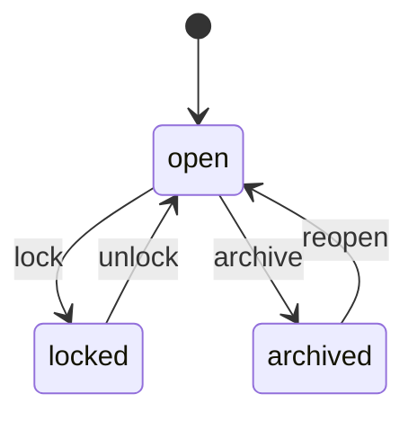
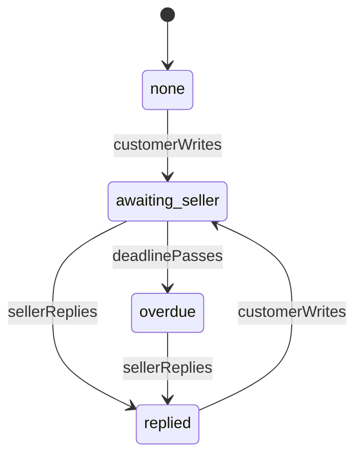
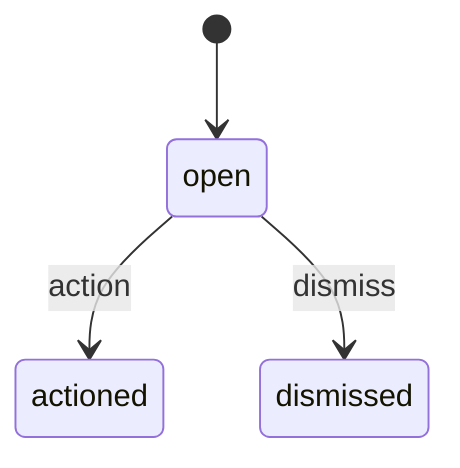

# Messaging (`messaging`)

Private service conversations linked to an order, item, return or case: customer with seller (or the Official Store), which Marketly support can join from a case, with attachments, read state, seller reply targets and overdue flags, and staff moderation. No promotional messages.

- **Group:** After-sales and money · **Launch phase:** 1 · **Plan chapters:** 7, 11, 17
- **Depends on:** [orders](orders.md) · **Optional:** [media](media.md), [sellers](sellers.md), [support](support.md), [returns](returns.md), [notifications](notifications.md), [trust](trust.md), [audit](audit.md), [customers](customers.md), [shipping](shipping.md), [identity](identity.md), [workqueues](workqueues.md), [settings](settings.md), [offers](offers.md), [catalog](catalog.md)

## Owns
- Conversations between a customer and a seller (or the Official Store) about an order, item or return, or about a product before purchase (decision G4)
- Marketly support joining a customer-seller conversation from a case (participant and system note); the customer-Marketly case thread itself is the support case
- Messages with attachments, system notes (e.g. support joined from a case) and read state per participant
- Seller reply target (e.g. 24 hours), awaiting-reply and overdue flags, seller response statistics
- Contact-detail and link masking, message reports and staff moderation (hide, lock)
- Seller reply templates (phase 2)

**Not here:**
- Public product questions and answers: reviews (a private pre-sale message to the seller about a product is here)
- Customer-Marketly support conversations, formal case threads, evidence and decisions: support (support can join an order conversation and post into it)
- Promotional messages: notifications; marketing consent: customers (promotions never appear here)
- Email and push delivery of new-message notices: notifications (reads messaging.message.sent)

## Store API

| Method | Path | Purpose | Auth | Body → Response |
|---|---|---|---|---|
| GET | `/api/store/messaging/conversations` | Inbox: conversations with sellers and Marketly support | shopper | Page<ConversationSummary> |
| GET | `/api/store/messaging/conversations/{id}` | Conversation header: counterparty, response time, linked order or item and its status | shopper | `Conversation` |
| GET | `/api/store/messaging/conversations/{id}/messages` | Messages, newest first (cursor for older) | shopper | Page<Message> |
| POST | `/api/store/messaging/product-conversations` | Message the seller about one of its products before buying | customer | `ProductConversationInput` → `{ conversation: Conversation, message: Message }` |
| POST | `/api/store/messaging/conversations` | Message a seller, the Official Store or Marketly support about an order, item or return | shopper | `StartConversationInput` → `{ conversation: Conversation, message: Message }` |
| POST | `/api/store/messaging/conversations/{id}/messages` | Send a message with optional photos or files | shopper | `MessageInput` → `Message` |
| POST | `/api/store/messaging/conversations/{id}/read` | Mark messages read up to a message | shopper | `{ upToMessageId: uuid }` → 204 No content |
| GET | `/api/store/messaging/unread-count` | Unread conversations for the header and account menu | shopper | `{ conversations: int, messages: int }` |
| POST | `/api/store/messaging/messages/{id}/report` | Report an abusive, promotional or off-platform message | shopper | `{ reason: enum(abusive|spam_or_promotion|off_platform_contact|fraud|other), note: text? }` → `{ reportId: uuid, status: string }` |

## Seller API

| Method | Path | Purpose | Auth | Body → Response |
|---|---|---|---|---|
| GET | `/api/seller/messaging/conversations` | Order messages with reply deadlines; overdue first | seller<br>`messaging.conversations.reply` | Page<ConversationSummary> |
| GET | `/api/seller/messaging/conversations/{id}` | Conversation with order status and dispatch warning | seller<br>`messaging.conversations.reply` | `Conversation` |
| GET | `/api/seller/messaging/conversations/{id}/messages` | Messages, newest first | seller<br>`messaging.conversations.reply` | Page<Message> |
| POST | `/api/seller/messaging/conversations` | Message the buyer of one of the seller's orders, optionally about an item or a return | seller<br>`messaging.conversations.reply` | `SellerStartInput` → `{ conversation: Conversation, message: Message }` |
| POST | `/api/seller/messaging/conversations/{id}/messages` | Reply to the buyer | seller<br>`messaging.conversations.reply` | `MessageInput` → `Message` |
| POST | `/api/seller/messaging/conversations/{id}/read` | Mark read | seller<br>`messaging.conversations.reply` | `{ upToMessageId: uuid }` → 204 No content |
| GET | `/api/seller/messaging/response-stats` | Reply target, average reply time this month, awaiting and overdue counts | seller | `ResponseStats` |
| POST | `/api/seller/messaging/messages/{id}/report` | Report an abusive buyer message | seller<br>`messaging.conversations.reply` | `{ reason: enum(abusive|spam_or_promotion|off_platform_contact|fraud|other), note: text? }` → `{ reportId: uuid, status: string }` |
| GET | `/api/seller/messaging/templates` | Reply templates _(phase 2)_ | seller<br>`messaging.conversations.reply` | `ReplyTemplate[]` |
| POST | `/api/seller/messaging/templates` | Create a reply template _(phase 2)_ | seller<br>`messaging.conversations.reply` | `ReplyTemplateInput` → `ReplyTemplate` |
| PATCH | `/api/seller/messaging/templates/{id}` | Edit a reply template _(phase 2)_ | seller<br>`messaging.conversations.reply` | `ReplyTemplateInput` → `ReplyTemplate` |
| DELETE | `/api/seller/messaging/templates/{id}` | Delete a reply template _(phase 2)_ | seller<br>`messaging.conversations.reply` | 204 No content |

## Admin API

| Method | Path | Purpose | Auth | Body → Response |
|---|---|---|---|---|
| GET | `/api/admin/messaging/conversations` | Find conversations by order, customer or seller | staff<br>`messaging.conversations.read` | Page<AdminConversationRow> |
| GET | `/api/admin/messaging/conversations/{id}/messages` | Read a private conversation (reason required, logged) _(audited)_ | staff<br>`messaging.conversations.read` | Page<Message> |
| POST | `/api/admin/messaging/conversations` | Start a Marketly staff conversation with a seller or seller applicant, optionally about an order, items or a return _(audited)_ | staff<br>`messaging.conversations.participate` | `StaffStartInput` → `Conversation` |
| POST | `/api/admin/messaging/conversations/{id}/messages` | Post as Marketly Support (joins the conversation) _(audited)_ | staff<br>`messaging.conversations.participate` | `{ body: text, mediaIds: uuid[]?, caseId: uuid? }` → `Message` |
| POST | `/api/admin/messaging/messages/{id}/hide` | Hide a message that breaks the rules _(audited)_ | staff<br>`messaging.conversations.moderate` | `{ reason: text }` → `Message` |
| POST | `/api/admin/messaging/conversations/{id}/lock` | Lock or unlock a conversation _(audited)_ | staff<br>`messaging.conversations.moderate` | `{ locked: bool, reason: text }` → `Conversation` |
| GET | `/api/admin/messaging/reports` | Reported messages | staff<br>`messaging.conversations.moderate` | Page<MessageReport> |
| POST | `/api/admin/messaging/reports/{id}/decide` | Action or dismiss a report _(audited)_ | staff<br>`messaging.conversations.moderate` | `{ action: enum(hide_message|lock_conversation|refer_to_trust|dismiss), reason: text }` → `MessageReport` |
| GET | `/api/admin/messaging/sellers/{sellerId}/response-stats` | A seller's reply performance | staff<br>`messaging.conversations.read` | `ResponseStats` |

## Types

### Subject

| Field | Type |
|---|---|
| kind | `enum(order|order_item|return|case|seller_account|application|product)` product: a pre-sale message about one of the seller's products (no order) |
| orderId | `uuid?` |
| orderRef | `string?` |
| orderItemId | `uuid?` |
| returnId | `uuid?` |
| returnRef | `string?` |
| caseId | `uuid?` |
| caseRef | `string?` |
| productId | `uuid?` kind product: the product asked about |
| title | `string` e.g. Linen duvet cover |
| itemSummary | `string?` Order conversations: the items concerned, e.g. Linen duvet cover, or Linen duvet cover + 2 more items (the seller's package, or the one item). Null on conversations started before it was kept, until the conversation is opened |
| imageUrl | `url?` |
| packageLabel | `string?` e.g. Package 3 of 3 |
| statusLabel | `string?` Live item or return status, e.g. Delayed |

### Counterparty

| Field | Type |
|---|---|
| kind | `enum(seller|official_store|marketplace_support|customer)` |
| id | `string?` |
| name | `string` |
| logoUrl | `url?` |
| verified | `bool?` |
| responseTimeLabel | `string?` e.g. Usually replies within 4 hours |
| location | `string?` |

### Participant

| Field | Type |
|---|---|
| kind | `enum(customer|guest|seller|staff)` guest: the buyer of a guest order; any guest session with access to the order acts as this participant |
| id | `string` customer: customers-module id; guest: order:<orderId>; seller: seller id (OFFICIAL_STORE_ID for the Official Store); staff: staff account id |
| name | `string` |
| label | `string` e.g. Marketly Support |
| joinedAt | `datetime` |
| joinedFromCaseId | `uuid?` |
| lastReadMessageId | `uuid?` |

### Conversation

| Field | Type |
|---|---|
| id | `uuid` |
| kind | `enum(order|support|staff_seller)` order: customer with a seller or the Official Store (about an order, item, return, or a product before purchase: subject.kind product); staff_seller: started by Marketly staff with a seller or seller applicant |
| counterparty | `Counterparty` From the caller's point of view |
| participants | `Participant[]` |
| subject | `Subject` |
| status | `enum(open|locked|archived)` |
| lockedReason | `string?` |
| replyState | `enum(none|awaiting_seller|replied|overdue)` |
| replyDue | `Deadline?` |
| dispatchWarning | `string?` Seller view, e.g. Dispatch deadline was Oct 8, 12:00 PM. It is now overdue. |
| privacyNote | `string` e.g. Only you, the buyer and Marketly support can see it |
| rulesNote | `string` e.g. Keep payments and contact details on Marketly. No promotional messages. |
| canSend | `bool` |
| createdAt | `datetime` |
| lastMessageAt | `datetime` |

### ConversationSummary

| Field | Type |
|---|---|
| id | `uuid` |
| counterparty | `Counterparty` |
| subject | `Subject` |
| lastMessagePreview | `string` |
| lastMessageAt | `datetime` |
| lastFromMe | `bool` |
| unread | `bool` |
| unreadCount | `int` |
| replyState | `enum(none|awaiting_seller|replied|overdue)` |
| replyDue | `Deadline?` |
| replyLabel | `string?` Seller view, e.g. Overdue 2 h / Reply by Oct 9, 8:15 AM / Replied in 1 h |
| status | `enum(open|locked|archived)` |

### Message

| Field | Type |
|---|---|
| id | `uuid` |
| conversationId | `uuid` |
| kind | `enum(text|system)` system: a note from Marketly (e.g. support joined from a case): unread for every participant, no author, no reply-state change and no messaging.message.sent (no notice is sent) |
| author | `Actor?` |
| authorLabel | `string` e.g. Marisol, Casa Verde Home / You |
| fromMe | `bool` |
| body | `text` |
| attachments | `MediaRef[]` |
| redactions | `enum(contact_details|link)[]` Parts masked by the content filter |
| hidden | `bool` |
| hiddenReason | `string?` |
| clientMessageId | `string?` |
| viewerReported | `bool` The caller already reported this message (any report status; staff reads: false) |
| at | `datetime` |

### MessageInput

| Field | Type |
|---|---|
| body | `text` |
| mediaIds | `uuid[]?` |
| clientMessageId | `string?` App-generated id; a resend with the same id returns the first message instead of a duplicate |

### StartConversationInput

| Field | Type |
|---|---|
| with | `enum(seller|official_store|marketplace_support)` official_store: about Official Store items in the order (answered by Marketly staff for the Official Store) |
| orderId | `uuid` |
| sellerId | `uuid?` Required for with = seller; must be a seller in the order. Ignored for official_store (OFFICIAL_STORE_ID is used) |
| orderItemId | `uuid?` |
| returnId | `uuid?` |
| caseId | `uuid?` |
| body | `text` |
| mediaIds | `uuid[]?` |
| clientMessageId | `string?` |

### StaffStartInput

| Field | Type |
|---|---|
| sellerId | `uuid?` Exactly one of sellerId or applicationId |
| applicationId | `uuid?` Seller application (sellers); the message reaches the applicant's account before a seller account exists |
| orderId | `uuid?` About an order of this seller (admin/order Contact seller) |
| orderItemIds | `uuid[]?` |
| returnId | `uuid?` |
| caseId | `uuid?` |
| subject | `string` |
| body | `text` |
| mediaIds | `uuid[]?` |
| clientMessageId | `string?` |

### SellerStartInput

| Field | Type |
|---|---|
| orderId | `uuid` |
| orderItemId | `uuid?` |
| returnId | `uuid?` A return on the seller's items of the order: the conversation is about the return (Return.conversation shows it; G55b) |
| body | `text` |
| mediaIds | `uuid[]?` |
| clientMessageId | `string?` |

### ProductConversationInput

| Field | Type |
|---|---|
| offerId | `uuid` The offer the customer asks about (its seller and product); the Official Store's offers reach the Official Store team |
| body | `text` |
| mediaIds | `uuid[]?` |
| clientMessageId | `string?` |

### ResponseStats

| Field | Type |
|---|---|
| targetHours | `int` |
| averageReplyMinutes | `int?` |
| medianReplyMinutes | `int?` Median first reply time in the period (reports' first_reply_minutes_p50, support's seller stats) |
| repliedWithinTargetPct | `number?` |
| awaitingReply | `int` |
| overdue | `int` |
| period | `DateRange` |

### DailyReplyStats

| Field | Type |
|---|---|
| date | `date` Market day the customer's message that waits for a reply was sent |
| sellerId | `uuid` OFFICIAL_STORE_ID for Official Store conversations |
| waiting | `int` Customer messages that started a wait for the seller's reply (a reply round) |
| replied | `int` |
| replyMinutesTotal | `int` Minutes from the customer's message to the seller's reply, summed over replied (wall-clock time) |
| repliedWithinTarget | `int` Replies within the reply target (targetHours) |
| targetHours | `int` |

### ReplyTemplate

| Field | Type |
|---|---|
| id | `uuid` |
| name | `string` |
| body | `text` |
| updatedAt | `datetime` |

### ReplyTemplateInput

| Field | Type |
|---|---|
| name | `string` |
| body | `text` |

### MessageReport

| Field | Type |
|---|---|
| id | `uuid` |
| message | `Message` |
| conversationId | `uuid` |
| subject | `Subject` |
| reporter | `Actor` |
| reason | `enum(abusive|spam_or_promotion|off_platform_contact|fraud|other)` |
| note | `text?` |
| status | `enum(open|actioned|dismissed)` |
| outcome | `text?` |
| decidedBy | `Actor?` |
| decidedAt | `datetime?` |
| createdAt | `datetime` |

### AdminConversationRow

| Field | Type |
|---|---|
| id | `uuid` |
| customerName | `string` |
| counterparty | `Counterparty` |
| subject | `Subject` |
| status | `enum(open|locked|archived)` |
| replyState | `enum(none|awaiting_seller|replied|overdue)` |
| reportCount | `int` |
| lastMessageAt | `datetime` |

### CustomerConversationSummary

| Field | Type |
|---|---|
| conversationCount | `int` |
| openCount | `int` |
| reportedCount | `int` |
| lastMessageAt | `datetime?` |
| counterparties | `json[]` { kind: seller|official_store, sellerId?, name, conversationCount, lastMessageAt }, most recent first |

## Status flows

### Conversation (`Conversation.status`)



lock is a staff action with a reason (abuse, fraud), or trust's lock_conversation enforcement (only that action; restrict_customer_messaging is executed by customers and checked when the customer writes); the thread stays readable. Reversing the enforcement unlocks the conversations it locked (locked_by_enforcement_id). archive happens archiveAfterDays after the order completes; a new message about the same subject reopens it. A seller restriction never locks customer conversations about existing orders.

### Seller reply (`Conversation.replyState`)



Customer–seller and customer–Official Store conversations have a reply state (decision D-M1). reply_due_at = first unanswered customer message + sellerReplyTargetHours. Overdue seller conversations are highlighted in Seller Center and count in seller performance. For the Official Store, sellerReplies is a staff message, and while a conversation is awaiting_seller or overdue messaging keeps an official_store_reply work item open in workqueues (dedupe official_store_reply:<conversationId>, due at reply_due_at), resolved with resolveBySource when staff reply.

### Message report (`MessageReport.status`)



Actioning hides the message or locks the conversation; serious cases are referred to trust.

## Data (schema `messaging`)

**conversations**

| Column | Type |
|---|---|
| id | uuid pk |
| kind | text (order|support|staff_seller) |
| customer_id | uuid? |
| guest_session_id | text? |
| seller_id | uuid? |
| order_id | uuid? |
| order_item_id | uuid? |
| return_id | uuid? |
| case_id | uuid? |
| application_id | uuid? |
| product_id | uuid? (pre-sale conversations: the product asked about; part of the key) |
| started_by_staff_id | uuid? |
| subject | jsonb |
| status | text |
| locked_reason | text? |
| locked_by_enforcement_id | uuid? (trust enforcement that locked it; unlocked when that enforcement is reversed) |
| reply_state | text |
| reply_due_at | timestamptz? |
| awaiting_since | timestamptz? |
| created_at | timestamptz |
| last_message_at | timestamptz |
| archive_after | timestamptz? |

Indexes: `(customer_id, last_message_at desc)`, `(guest_session_id)`, `(seller_id, reply_state, reply_due_at)`, `(reply_state, reply_due_at)`, `(status, archive_after)`, `(order_id)`, `(order_item_id)`, `(return_id)`, `(case_id)`, `unique nulls not distinct (kind, customer_id, seller_id, application_id, order_id, order_item_id, return_id, product_id) where kind <> 'support'`, `unique nulls not distinct (kind, customer_id, order_id, case_id) where kind = 'support'`

**participants**

| Column | Type |
|---|---|
| conversation_id | uuid → conversations |
| kind | text |
| participant_id | text |
| name | text |
| label | text |
| joined_at | timestamptz |
| joined_from_case_id | uuid? |
| last_read_message_id | uuid? |
| unread_count | int |

Indexes: `(conversation_id, kind, participant_id) unique`, `(kind, participant_id, unread_count)`

**messages**

| Column | Type |
|---|---|
| id | uuid pk |
| conversation_id | uuid → conversations |
| kind | text |
| author_kind | text? |
| author_id | text? |
| author_label | text |
| body | text |
| original_body | text? (staff only, before masking) |
| media_ids | jsonb |
| redactions | jsonb |
| hidden | bool |
| hidden_reason | text? |
| client_message_id | text? |
| at | timestamptz |

Indexes: `(conversation_id, at desc)`, `(conversation_id, author_id, client_message_id) unique`

**message_reports**

| Column | Type |
|---|---|
| id | uuid pk |
| message_id | uuid → messages |
| conversation_id | uuid → conversations |
| reporter_kind | text |
| reporter_id | text |
| reason | text |
| note | text? |
| status | text |
| outcome | text? |
| decided_by | text? |
| decided_at | timestamptz? |
| created_at | timestamptz |

Indexes: `(status, created_at)`, `(message_id)`, `(conversation_id)`

**reply_templates**

| Column | Type |
|---|---|
| id | uuid pk |
| seller_id | uuid |
| name | text |
| body | text |
| updated_at | timestamptz |

Indexes: `(seller_id)`

**conversation_aliases**: Ids of duplicate conversations merged into another (dedupe migration); lookups by an old id (notifications links, support case links) resolve to the kept conversation

| Column | Type |
|---|---|
| old_id | uuid pk |
| conversation_id | uuid → conversations |
| merged_at | timestamptz |

Indexes: `(conversation_id)`

**staff_access_log**: Each time staff open a private conversation, with the reason

| Column | Type |
|---|---|
| id | uuid pk |
| conversation_id | uuid → conversations |
| staff_id | uuid |
| reason | text |
| case_id | uuid? |
| at | timestamptz |

Indexes: `(conversation_id, at)`

**seller_reply_stats**: 30-day reply figures per seller, rolled up by messaging.response-stats (behind 'Usually replies within …' on conversations and Seller.replyStats); computed on first use for a seller without a row

| Column | Type |
|---|---|
| seller_id | uuid pk |
| period_from | date |
| period_to | date |
| average_reply_minutes | int? |
| median_reply_minutes | int? |
| replied | int (reply rounds answered) |
| replied_within_target | int |
| decided | int (rounds answered or past the reply target) |
| computed_at | timestamptz |

Indexes: `(computed_at)`

### Views

Read-only join shapes over this module's own tables, created on MySQL as `<module>_v_<name>` (docs/10-mysql-migration.md §9.2).

| View | Reads | SQL |
|---|---|---|
| `messaging_v_participant_conversations` | A participant with their conversation: inboxes, unread counts and the guest view | `SELECT p.*, c.kind AS conversation_kind, c.customer_id, c.guest_session_id, c.seller_id, c.order_id, c.order_item_id, c.return_id, c.case_id, c.subject, c.status, c.locked_reason, c.reply_state, c.reply_due_at, c.awaiting_since, c.created_at AS conversation_created_at, c.last_message_at, c.archive_after FROM messaging_participants p JOIN messaging_conversations c ON c.id = p.conversation_id` |

## Events

| Publishes | When | Payload | Consumed by |
|---|---|---|---|
| `messaging.message.sent` | A participant sends a message (notifications sends the in-app and email notice) | `{ messageId: uuid, conversationId: uuid, conversationKind: enum(order|support|staff_seller), authorKind: enum(customer|guest|seller|staff|system), recipientKinds: enum(customer|guest|seller|official_store|staff)[], customerId: uuid?, contactEmail: email?, applicantAccountId: uuid?, sellerId: uuid?, officialStore: bool, staffIds: uuid[], orderId: uuid?, caseId: uuid? }` | notifications, reports, sellers, workqueues |
| `messaging.conversation.started` | A new conversation is created | `{ conversationId: uuid, kind: string, orderId: uuid?, customerId: uuid?, sellerId: uuid?, officialStore: bool, applicationId: uuid? }` | - |
| `messaging.reply.overdue` | A seller or the Official Store misses the reply target | `{ conversationId: uuid, sellerId: uuid, officialStore: bool, orderId: uuid?, dueAt: datetime }` | workqueues |
| `messaging.message.reported` | A message is reported | `{ reportId: uuid, messageId: uuid, reason: string }` | trust |
| `messaging.conversation.locked` | Staff lock a conversation, a message report is actioned with a lock, or a trust lock_conversation enforcement is executed | `{ conversationId: uuid, reason: text, lockedBy: Actor, trustEnforcementId: uuid?, customerId: uuid?, sellerId: uuid? }` | trust |
| `messaging.conversation.unlocked` | Staff unlock a conversation or the trust enforcement that locked it is reversed | `{ conversationId: uuid, reason: text, unlockedBy: Actor, trustEnforcementId: uuid? }` | - |

| Consumes | From | Does |
|---|---|---|
| `support.case.opened` | support | If the case concerns an order conversation, add Marketly Support as a participant (the case owner, ownerStaffId, when set) and post a system note |
| `orders.order.completed` | orders | Schedule archiving of the order's conversations after archiveAfterDays |
| `trust.enforcement.recorded` | trust | Only action lock_conversation: lock the conversations named in targets (conversation, or the conversation of a message), record the enforcement id and publish messaging.conversation.locked with trustEnforcementId. Other actions (restrict_customer_messaging is customers') are ignored |
| `trust.enforcement.reversed` | trust | Action lock_conversation: unlock the conversations that enforcement locked (locked_by_enforcement_id) unless staff locked them again since; publish messaging.conversation.unlocked |
| `notifications.email_reply.received` | notifications | module messaging: append the reply to the conversation (refId = conversation id) as a message from the participant whose email matches fromEmail (customer, guest order contact or seller member); other senders are dropped. Attachments come as media assets. Locked conversations refuse it |
| `customers.account.closed` | customers | Anonymise the customer's side: participant name and message author labels become Former customer; message text stays for the seller's service record, contact details already masked; the customer's own attachments are released |

## In-process API (for other modules)

| Function | Signature | Used by |
|---|---|---|
| findOrStartForOrder | `(input: { orderId: uuid, sellerId: uuid, orderItemId?: uuid, returnId?: uuid }) => Conversation`<br>One conversation per customer, seller and subject; reused when it exists. sellerId is OFFICIAL_STORE_ID for the Official Store | orders, returns |
| postSystemNote | `(conversationId: uuid, text: string) => Message`<br>A system note (Message.kind system), e.g. Marketly Support joined from case CS-261005-3381: unread for every participant, no reply-state change, no messaging.message.sent (nobody is notified) | support, returns |
| addStaffParticipant | `(conversationId: uuid, staff: Actor, caseId: uuid) => Conversation`<br>Support joins an order conversation when a case is opened | support |
| sellerResponseStats | `(sellerId: uuid, range: DateRange) => ResponseStats`<br>Response time for seller performance and reports | sellers, reports, graphql |
| replyStatsByDay | `(range: DateRange, sellerId?: uuid) => DailyReplyStats[]`<br>Seller reply rounds in order and product conversations per market day and seller: customer messages waiting for a reply, replies, total reply minutes and replies within the target. Reports' Response time and case backlog. | reports |
| unreadCount | `(participant: Actor) => int`<br>Badge counts for the account and Seller Center | notifications, customers |
| listForOrder | `(orderId: uuid, participant: Actor) => ConversationSummary[]`<br>Conversations about an order or its items that the participant takes part in (Order.conversations) | graphql |
| getForSubject | `(subject: { kind: 'return' | 'case' | 'order_item', id: uuid }, participant: Actor) => Conversation | null`<br>The conversation linked to a return, case or item, batched (Return.conversation) | graphql |
| unreadSummary | `(participant: Actor) => { conversations: int, messages: int, fromNames: string[] }`<br>Unread counts and who wrote, for the account overview tile and header badge | graphql |
| sellerInboxSummary | `(sellerId: uuid) => { awaitingReply: int, overdue: int, oldestWaitingSince: datetime | null, unreadConversations: int, targetHours: int }`<br>Unanswered and overdue customer messages for the seller dashboard | graphql, reports |
| listInbox | `(participant: Actor, filter: { unreadOnly?: bool, replyState?: string }, page: PageInput) => Page<ConversationSummary>`<br>Inbox of a customer or seller; the seller inbox lists overdue first | graphql |
| getConversation | `(participant: Actor, conversationId: uuid) => Conversation | null`<br>Conversation header and messages for a participant | graphql, trust |
| customerConversationSummaries | `(customerIds: uuid[]) => map<CustomerConversationSummary>`<br>Counts, last message time and counterparties of each customer's conversations for the customer 360; never message content | customers, graphql |
| exportCustomerData | `(input: { customerId: uuid, accountId: uuid }) => CustomerDataSection[]`<br>The customer's conversations and the messages they can see (no hidden messages, internal notes or other parties' contact details) for the personal data export. Export hook called by customers.build-data-exports | customers |

## Permissions

| Key | Who | Allows |
|---|---|---|
| `messaging.conversations.read` | staff | Find and read private conversations (each read is logged with a reason) |
| `messaging.conversations.participate` | staff | Post into conversations as Marketly Support |
| `messaging.conversations.moderate` | staff | Hide messages, lock conversations and decide message reports |
| `messaging.conversations.reply` | seller | Read and answer the seller's order messages (customer service duty) |

## Error codes

| Code | Status | Meaning |
|---|---|---|
| `CONVERSATION_LOCKED` | 409 | The conversation takes no new messages: locked by Marketly (details.reason = the lock reason) or archived (details.reason = archived; starting a conversation on the same subject reopens an archived one, replying inside it does not). |
| `TRUST_UNAVAILABLE` | 422 | refer_to_trust needs the Trust and Risk module, which is off; hide the message or lock the conversation instead. |
| `MESSAGING_RESTRICTED` | 403 | The customer's account is restricted from messaging sellers (replies inside a case stay possible). details.reason, details.endsAt. |
| `ORDER_NOT_ELIGIBLE` | 422 | The caller cannot message about this order (not their order, or seller not in the order). |

## Background jobs

| Job | Schedule | Does |
|---|---|---|
| `messaging.reply-deadlines` | every 10 min | Move awaiting conversations past their due time to overdue and publish messaging.reply.overdue |
| `messaging.archive` | daily 04:00 PT | Archive conversations past archiveAfterDays |
| `messaging.response-stats` | hourly | Roll up 30-day seller reply times into seller_reply_stats for sellers with messages in the last 2 hours and rows older than a day (bounded batches) |

## Settings

| Key | Default | Rules | Meaning |
|---|---|---|---|
| sellerReplyTargetHours | `24` | duration, hours, 1–…, seller-visible | Seller reply target shown to sellers (example) |
| maskContactDetails | `true` | bool, approval: second reviewer | Mask phone numbers, emails and outside links in messages |
| maxAttachments | `5` | int, 0–20 | Files per message |
| maxAttachmentMb | `10` | int, MB, 1–… | Size per file |
| presaleConversationsPerDay | `10` | int, 1–100 | New pre-sale conversations (about a product, no order) a customer can start per day (G4) |
| messageMaxLength | `4000` | int, characters, 1–… | Characters per message |
| archiveAfterDays | `180` | duration, days, 30–… | Days after order completion |

## Notes
- Public API participants (participant: Actor): a customer actor carries the customers-module id (the customer participant id), never the account id; a guest session is a visitor actor (its session id), a seller actor the seller id, staff the staff account id.
- Conversations are private to the customer, the seller and Marketly support. Sellers never see other sellers' conversations; staff reads are logged with a reason.
- One conversation per customer + seller + subject (order, item or return); starting again appends to it, so history stays linked to the transaction.
- Promotional messages are not allowed here; marketing goes through notifications with separate preferences (plan ch. 15, 19).
- Product questions and answers are public and live in reviews; order-specific questions belong here. A signed-in customer may also message a seller privately about one of its products before buying (decision G4: POST /product-conversations, rate limited, same content filter): an order-kind conversation with subject.kind product, keyed by customer, seller and product.
- clientMessageId makes sends safe to retry from the Android app without duplicates.
- Guests can message about orders reached through guest order access (auth shopper). The key is the order, not the session (decision D-M2): a conversation on a guest order has customer_id null and a guest participant (id order:<orderId>) created with the conversation, so any later session with identity.hasGuestOrderAccess to the order sees it with its read state; guest_session_id only records the session that started it.
- Official Store conversations (decision D-M1): customers reach the Official Store with with = official_store; seller_id is OFFICIAL_STORE_ID, the reply state and reply target apply as for sellers, staff answer from admin (sendStaffMessage, filter official_awaiting), messaging keeps an official_store_reply work item per waiting conversation, and messaging.message.sent with officialStore=true drives the staff notification topic for Official Store messages.
- Personal data: exportForCustomer supplies the Messages section of the customer data export; customers.account.closed anonymises the customer's side of their conversations.
- Conversation identity: case_id is a link, not part of the key, for order and staff conversations (a case can be opened on an existing conversation later); only support-kind conversations are keyed by case. Merging duplicates keeps the oldest conversation, moves messages and participants, recomputes reply_state, reply_due_at and unread counts from the merged messages, and records each removed id in conversation_aliases.

## GraphQL (read layer)

This module's fragment of the GraphQL schemas (see [../graphql/README.md](../graphql/README.md)). Writes stay on the REST endpoints above.

```graphql
# messaging: private service conversations about an order, item, return or case (customer with seller or the Official Store,
# Marketly Support can join from a case). No promotional messages.
# Adds Order.conversations, Return.conversation, Customer.unreadMessages (store), Seller.inbox (seller) and Seller.replyStats.
# Store and Seller Center only: staff read private conversations through REST, with a logged reason. The admin
# screens (AdminCustomer, AdminCase, AdminOrder) load conversations with that REST call, never through GraphQL.
# Admin gets only Customer.conversationSummary: counts, last message time and counterparties, never message content.
# Seller area: Order.conversations and Return.conversation return only the caller's own conversations.

"A conversation as one participant sees it (counterparty, subject, reply state and messages)"
type Conversation @areas(in: [STORE, SELLER]) {
  id: UUID!
  kind: ConversationKind!
  "The other side, from the caller's point of view"
  counterparty: ConversationCounterparty!
  participants: [ConversationParticipant!]!
  "Linked order, item, return or case with its live status"
  subject: ConversationSubject!
  status: ConversationStatus!
  lockedReason: String
  replyState: ConversationReplyState!
  replyDue: Deadline
  "e.g. Only you, the buyer and Marketly support can see it"
  privacyNote: String!
  "e.g. Keep payments and contact details on Marketly. No promotional messages."
  rulesNote: String!
  canSend: Boolean!
  createdAt: DateTime!
  lastMessageAt: DateTime!
  lastMessagePreview: String!
  lastFromMe: Boolean!
  unreadCount: Int!
  "Messages, newest first (cursor for older)"
  messages(paging: PageInput): MessagePage! @cost(weight: 5)

  # ---- Seller Center only
  "e.g. Overdue 2 h / Reply by Oct 9, 8:15 AM / Replied in 1 h"
  replyLabel: String @areas(in: [SELLER])
  "e.g. Dispatch deadline was Oct 8, 12:00 PM. It is now overdue."
  dispatchWarning: String @areas(in: [SELLER])
}

enum ConversationKind @areas(in: [STORE, SELLER]) {
  ORDER
  SUPPORT
  "Started by Marketly staff with a seller or seller applicant"
  STAFF_SELLER
}

enum ConversationStatus @areas(in: [STORE, SELLER]) {
  OPEN
  LOCKED
  ARCHIVED
}

"Only customer–seller conversations have a reply state"
enum ConversationReplyState @areas(in: [STORE, SELLER]) {
  NONE
  AWAITING_SELLER
  REPLIED
  OVERDUE
}

type ConversationCounterparty @areas(in: [STORE, SELLER]) {
  kind: ConversationPartyKind!
  id: String
  name: String!
  logoUrl: URL
  verified: Boolean
  "e.g. Usually replies within 4 hours"
  responseTimeLabel: String
  location: String
}

enum ConversationPartyKind @areas(in: [STORE, SELLER]) {
  SELLER
  OFFICIAL_STORE
  MARKETPLACE_SUPPORT
  CUSTOMER
}

type ConversationParticipant @areas(in: [STORE, SELLER]) {
  kind: ConversationParticipantKind!
  "CUSTOMER: customers-module id; GUEST: order:<orderId>; SELLER: seller id (OFFICIAL_STORE_ID for the Official Store); STAFF: staff account id"
  id: String!
  name: String!
  "e.g. Marketly Support"
  label: String!
  joinedAt: DateTime!
  joinedFromCaseId: UUID
}

enum ConversationParticipantKind @areas(in: [STORE, SELLER]) {
  CUSTOMER
  "The buyer of a guest order (participant id order:<orderId>)"
  GUEST
  SELLER
  STAFF
}

"What the conversation is about"
type ConversationSubject @areas(in: [STORE, SELLER]) {
  kind: ConversationSubjectKind!
  orderId: UUID
  orderRef: String
  orderItemId: UUID
  returnId: UUID
  returnRef: String
  caseId: UUID
  caseRef: String
  "PRODUCT: the product asked about before purchase"
  productId: UUID
  "e.g. Linen duvet cover"
  title: String!
  "Order conversations: the items concerned, e.g. Linen duvet cover + 2 more items"
  itemSummary: String
  imageUrl: URL
  "e.g. Package 3 of 3"
  packageLabel: String
  "Live item or return status, e.g. Delayed"
  statusLabel: String
}

enum ConversationSubjectKind @areas(in: [STORE, SELLER]) {
  ORDER
  ORDER_ITEM
  RETURN
  CASE
  SELLER_ACCOUNT
  APPLICATION
  "A pre-sale message about one of the seller's products (no order)"
  PRODUCT
}

type ConversationPage implements Paged @areas(in: [STORE, SELLER]) {
  items: [Conversation!]!
  nextCursor: String
  page: Int
  totalPages: Int
  total: Int
}

"One message. Contact details and links are masked by the content filter."
type Message @areas(in: [STORE, SELLER]) {
  id: UUID!
  conversationId: UUID!
  kind: MessageKind!
  author: Actor
  "e.g. Marisol, Casa Verde Home / You"
  authorLabel: String!
  fromMe: Boolean!
  body: String!
  attachments: [MediaRef!]!
  "Parts masked by the content filter"
  redactions: [MessageRedaction!]!
  "Hidden by moderation; body is empty"
  hidden: Boolean!
  "The caller already reported this message"
  viewerReported: Boolean!
  at: DateTime!
}

enum MessageKind @areas(in: [STORE, SELLER]) {
  TEXT
  "e.g. Marketly Support joined from case CS-261005-3381"
  SYSTEM
}

enum MessageRedaction @areas(in: [STORE, SELLER]) {
  CONTACT_DETAILS
  LINK
}

type MessagePage implements Paged @areas(in: [STORE, SELLER]) {
  items: [Message!]!
  nextCursor: String
  page: Int
  totalPages: Int
  total: Int
}

"Unread badge for the account header and overview tile"
type MessagingUnread @areas(in: [STORE]) {
  "Conversations with unread messages"
  conversations: Int!
  messages: Int!
  "Who wrote, e.g. Casa Verde Home, Marketly Support"
  fromNames: [String!]!
}

"Seller inbox tiles for the dashboard"
type MessagingSellerInbox @areas(in: [SELLER]) {
  "Customer conversations waiting for the seller's reply"
  awaitingReply: Int!
  overdue: Int!
  oldestWaitingSince: DateTime
  unreadConversations: Int!
  targetHours: Int!
}

"How quickly a seller replies to customer messages"
type MessagingReplyStats {
  targetHours: Int!
  "e.g. 94 (% replied within the target)"
  repliedWithinTargetPct: Float
  averageReplyMinutes: Int
  "e.g. Usually replies within 4 hours"
  label: String!
  periodDays: Int!
}

# ---------------------------------------------------------------- fields on other modules' types

extend type Order {
  "Conversations about this order or its items. Store: the customer's; seller: the caller's own with this buyer."
  conversations: [Conversation!]! @areas(in: [STORE, SELLER]) @source(module: "messaging", fn: "listForOrder")
}

extend type Return {
  "The conversation linked to this return (customer and the seller or Official Store)"
  conversation: Conversation @areas(in: [STORE, SELLER]) @source(module: "messaging", fn: "getForSubject")
}

extend type Customer {
  "Unread messages for the account overview tile and header badge"
  unreadMessages: MessagingUnread! @areas(in: [STORE]) @source(module: "messaging", fn: "unreadSummary")
}

"""
Who a customer has been messaging and how recently, for the customer 360. Never includes message content: staff read a
conversation through REST GET /api/admin/messaging/conversations/{id}/messages with a logged reason.
"""
type MessagingCustomerSummary @areas(in: [ADMIN]) {
  conversationCount: Int!
  openCount: Int!
  "Conversations with a message report or a lock"
  reportedCount: Int!
  lastMessageAt: DateTime
  "Sellers (and the Official Store) the customer has talked to, most recent first"
  counterparties: [MessagingCounterpartySummary!]!
}

type MessagingCounterpartySummary @areas(in: [ADMIN]) {
  "SELLER or OFFICIAL_STORE"
  kind: String!
  "Null for the Official Store"
  sellerId: UUID
  name: String!
  conversationCount: Int!
  lastMessageAt: DateTime!
}

extend type Customer {
  "Conversation counts, last message time and counterparties (no message content)"
  conversationSummary: MessagingCustomerSummary @areas(in: [ADMIN]) @auth(requires: STAFF, permission: "messaging.conversations.read") @source(module: "messaging", fn: "customerConversationSummaries") @cost(weight: 2)
}

extend type Seller {
  "Unanswered and overdue customer messages for the seller dashboard"
  inbox: MessagingSellerInbox @areas(in: [SELLER]) @auth(requires: SELLER, permission: "messaging.conversations.reply") @source(module: "messaging", fn: "sellerInboxSummary")
  "Reply performance, last 30 days (storefront, offer comparison, seller 360)"
  replyStats: MessagingReplyStats @source(module: "messaging", fn: "sellerResponseStats")
}

extend type Query {
  "Inbox: conversations with sellers and Marketly Support, newest first"
  conversations(unreadOnly: Boolean, paging: PageInput): ConversationPage @areas(in: [STORE]) @auth(requires: CUSTOMER) @source(module: "messaging", fn: "listInbox")

  "One conversation with its messages"
  conversation(id: UUID!): Conversation @areas(in: [STORE]) @auth(requires: CUSTOMER) @source(module: "messaging", fn: "getConversation")

  "Order messages with reply deadlines, overdue first"
  sellerConversations(replyState: ConversationReplyState, paging: PageInput): ConversationPage @areas(in: [SELLER]) @auth(requires: SELLER, permission: "messaging.conversations.reply") @source(module: "messaging", fn: "listInbox")

  "One conversation with the buyer, order status and dispatch warning"
  sellerConversation(id: UUID!): Conversation @areas(in: [SELLER]) @auth(requires: SELLER, permission: "messaging.conversations.reply") @source(module: "messaging", fn: "getConversation")
}
```
