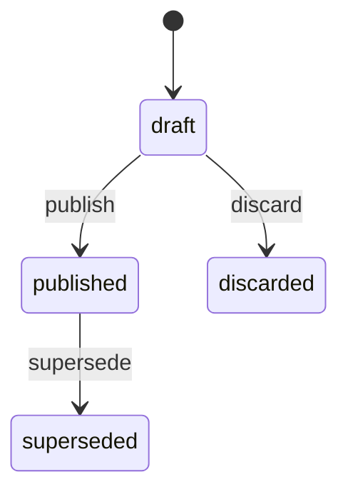
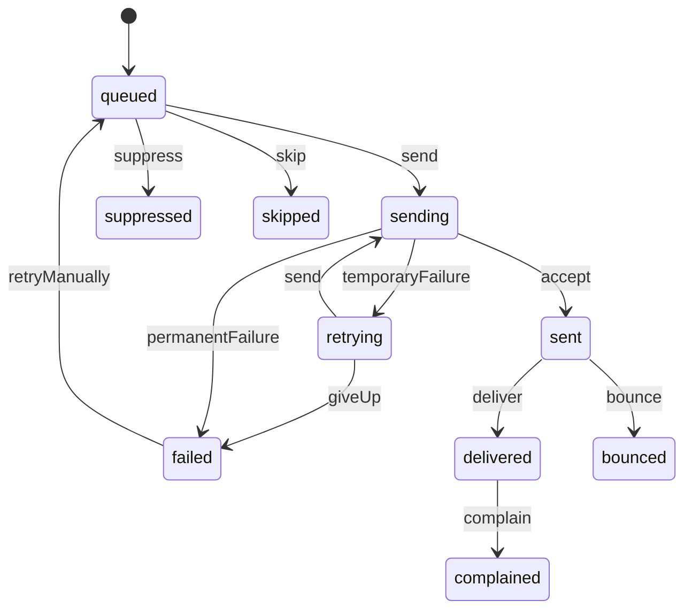
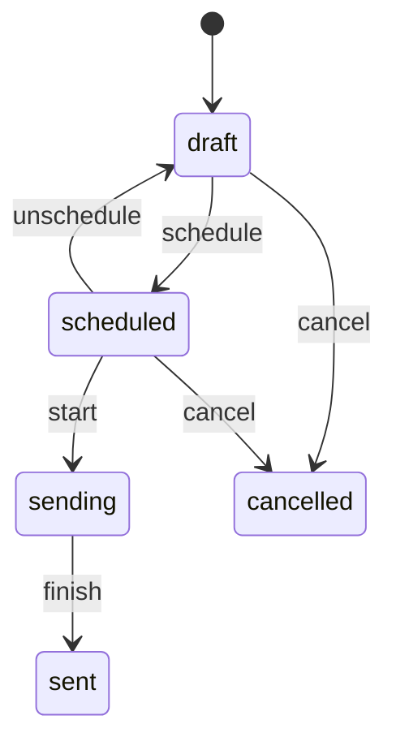
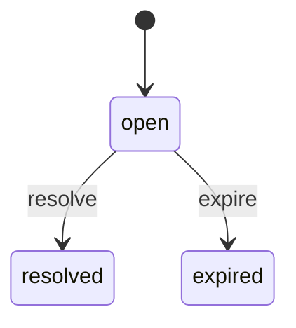

# Notifications (`notifications`)

Who is told what, on which channel: notification topics for customers, sellers and staff, routing from platform events to recipients (staff by role, with backups), templates with versions and preview, in-app inboxes for the store, Seller Center and Admin Center, email delivery with retries and suppression, seller and staff channel preferences, promotional broadcasts under consent, and Android push devices (phase 3).

- **Group:** Platform · **Launch phase:** 1 · **Plan chapters:** 7, 11, 15, 19
- **Depends on:** [identity](identity.md) · **Optional:** [access](access.md), [customers](customers.md), [sellers](sellers.md), [media](media.md), [settings](settings.md), [audit](audit.md), [messaging](messaging.md)

## Owns
- Topic catalogue: every notice per audience with category (essential, optional, promotional), inbox group, link target, deadline and channels (in-app and email at launch; SMS phase 2; push phase 3)
- Routing rules from platform events to topics and recipients: customers, guests by checkout email, seller members by permission and preference, staff by role through access (lead, or backup while the lead is away)
- Templates per topic and channel with variables, drafts, preview on desktop and phone, test sends, published versions and restore
- In-app inboxes: customer (account/notifications), seller (seller/notifications), staff (admin/inbox) with read state, action-required notices and deadlines
- Scheduled notices (e.g. dispatch deadline reminder 4 hours before) and resolution of action notices when the work is done
- Delivery log per channel with provider ids, retries with backoff, bounce and complaint handling and the suppression list
- Seller member notification preferences (set by the owner; essential notices always reach the owner) and staff email preferences
- Promotional broadcasts (newsletter, seller tips) only to people who opted in, with one-click unsubscribe tokens
- Android push device tokens (phase 3)
- Inbound email replies to case and message emails, handed to support and messaging

**Not here:**
- Customer promotional consent per channel (email, SMS, push promotions, wishlist alerts) and the unsubscribe endpoint: customers (notifications reads getMarketingConsent, consumes customers.marketing_preferences.changed and signs the unsubscribe tokens customers verifies)
- Order, return, case and payout facts shown in notices: the publishing modules (notices link to their records and never become the source of truth)
- Who leads or backs up a role, and away periods: access
- Work items, overdue timers and escalation routes: workqueues (it publishes workqueues.item.overdue/escalated; notifications delivers them)
- Conversations and case threads: messaging and support (notifications only announces new messages and forwards email replies)
- Campaign content and audiences for marketing: promotions (a broadcast references a promotional template and a consent channel)
- Policy and help texts: content

## Store API

| Method | Path | Purpose | Auth | Body → Response |
|---|---|---|---|---|
| GET | `/api/store/notifications/inbox` | Customer notifications | customer | Page<Notice> |
| GET | `/api/store/notifications/inbox/summary` | Unread badge and counts per group | customer | `InboxSummary` |
| POST | `/api/store/notifications/inbox/{id}/read` | Mark one notice as read | customer | `Notice` |
| POST | `/api/store/notifications/inbox/read-all` | Mark all (or one group) as read | customer | `{ group: string? }` → `{ updated: int }` |
| GET | `/api/store/notifications/preferences` | What we send and where to change it | customer | `CustomerNotificationPreferences` |
| PUT | `/api/store/notifications/preferences/push` | Turn order-update push notices on or off _(phase 3)_ | customer | `{ orderUpdates: bool }` → `PushPreference` |
| POST | `/api/store/notifications/push-devices` | Register the Android app for push notices _(phase 3)_ | customer | `PushDeviceInput` → `PushDevice` |
| DELETE | `/api/store/notifications/push-devices/{id}` | Stop push notices on a device (sign-out) _(phase 3)_ | customer | 204 No content |

## Seller API

| Method | Path | Purpose | Auth | Body → Response |
|---|---|---|---|---|
| GET | `/api/seller/notifications/inbox` | Seller workspace notifications | seller | Page<Notice> |
| GET | `/api/seller/notifications/inbox/summary` | Unread, needs action (sorted by deadline) | seller | `InboxSummary` |
| POST | `/api/seller/notifications/inbox/{id}/read` | Mark one notice as read (for me) | seller | `Notice` |
| POST | `/api/seller/notifications/inbox/read-all` | Mark all as read (for me) | seller | `{ group: string? }` → `{ updated: int }` |
| GET | `/api/seller/notifications/preferences` | Who hears about what (all members) | seller | `SellerPreferences` |
| PUT | `/api/seller/notifications/preferences/members/{memberId}` | Set one member's topics and channel _(audited, also notifications.preferences.manage when not own)_ | seller | `MemberPreferenceInput` → `MemberPreference` |
| POST | `/api/seller/notifications/push-devices` | Register the Android app for seller push notices _(phase 3)_ | seller | `PushDeviceInput` → `PushDevice` |
| DELETE | `/api/seller/notifications/push-devices/{id}` | Stop seller push notices on a device _(phase 3)_ | seller | 204 No content |

## Admin API

| Method | Path | Purpose | Auth | Body → Response |
|---|---|---|---|---|
| GET | `/api/admin/notifications/inbox` | My staff notices (routed by role, including roles I cover as backup) | staff | Page<Notice> |
| GET | `/api/admin/notifications/inbox/summary` | Counts and today's routing for my roles | staff | `StaffInboxSummary` |
| POST | `/api/admin/notifications/inbox/{id}/read` | Mark one notice as read (for me) | staff | `Notice` |
| POST | `/api/admin/notifications/inbox/read-all` | Mark all as read (for me) | staff | `{ area: string? }` → `{ updated: int }` |
| GET | `/api/admin/notifications/my-preferences` | My email preferences for staff notices | staff | `StaffPreferences` |
| PUT | `/api/admin/notifications/my-preferences` | Change my email preferences | staff | `{ emailByArea: map<bool>, emailForMentions: bool, dailyDigest: bool }` → `StaffPreferences` |
| GET | `/api/admin/notifications/topics` | Audience × event × channel matrix with delivery stats | staff<br>`notifications.templates.view` | `TopicMatrix` |
| PUT | `/api/admin/notifications/topics/{key}/channels` | Turn channels on or off for a topic _(audited)_ | staff<br>`notifications.routing.manage` | `{ channels: ChannelSetting[], reason: text }` → `Topic` |
| GET | `/api/admin/notifications/templates` | Templates | staff<br>`notifications.templates.view` | Page<Template> |
| GET | `/api/admin/notifications/templates/{id}` | Template editor: topic, variables, live and draft versions, history | staff<br>`notifications.templates.view` | `TemplateDetail` |
| POST | `/api/admin/notifications/templates/{id}/versions` | Start a draft (from the live version, or restore an older one) | staff<br>`notifications.templates.edit` | `{ fromVersionId: uuid? }` → `TemplateVersion` |
| PATCH | `/api/admin/notifications/templates/{id}/versions/{versionId}` | Edit a draft (returns validation) | staff<br>`notifications.templates.edit` | `{ content: TemplateContent, note: text? }` → `TemplateVersion` |
| POST | `/api/admin/notifications/templates/{id}/versions/{versionId}/preview` | Render with sample or real data on desktop or phone | staff<br>`notifications.templates.view` | `{ device: enum(desktop|phone)?, sampleContext: json?, linkedRef: string? }` → `RenderPreview` |
| POST | `/api/admin/notifications/templates/{id}/versions/{versionId}/test-send` | Send a test to my own email (or an allowed staff address) | staff<br>`notifications.templates.edit` | `{ to: email?, sampleContext: json? }` → `Delivery` |
| POST | `/api/admin/notifications/templates/{id}/versions/{versionId}/publish` | Publish a draft as the live version _(audited)_ | staff<br>`notifications.templates.publish` | `{ note: text? }` → `TemplateVersion` |
| POST | `/api/admin/notifications/templates/{id}/versions/{versionId}/discard` | Discard a draft | staff<br>`notifications.templates.edit` | `TemplateVersion` |
| GET | `/api/admin/notifications/deliveries` | Delivery log | staff<br>`notifications.deliveries.view` | Page<Delivery> |
| GET | `/api/admin/notifications/deliveries/{id}` | One delivery with provider events | staff<br>`notifications.deliveries.view` | `DeliveryDetail` |
| POST | `/api/admin/notifications/deliveries/{id}/retry` | Retry a failed delivery _(audited)_ | staff<br>`notifications.deliveries.retry` | `{ reason: text }` → `Delivery` |
| GET | `/api/admin/notifications/stats` | Delivery rate, bounces, failures, queue size | staff<br>`notifications.templates.view` | `DeliveryStats` |
| GET | `/api/admin/notifications/suppressions` | Bounced, complained or blocked addresses | staff<br>`notifications.suppressions.manage` | Page<Suppression> |
| POST | `/api/admin/notifications/suppressions/{id}/remove` | Allow sending again (address fixed or confirmed by the person) _(audited)_ | staff<br>`notifications.suppressions.manage` | `{ reason: text }` → `Suppression` |
| GET | `/api/admin/notifications/broadcasts` | Promotional broadcasts | staff<br>`notifications.broadcasts.manage` | Page<Broadcast> |
| POST | `/api/admin/notifications/broadcasts` | Draft a broadcast to opted-in customers or sellers | staff<br>`notifications.broadcasts.manage` | `BroadcastInput` → `Broadcast` |
| POST | `/api/admin/notifications/broadcasts/{id}/schedule` | Schedule a broadcast _(audited)_ | staff<br>`notifications.broadcasts.manage` | `{ scheduledAt: datetime }` → `Broadcast` |
| POST | `/api/admin/notifications/broadcasts/{id}/cancel` | Cancel a draft or scheduled broadcast _(audited)_ | staff<br>`notifications.broadcasts.manage` | `{ reason: text }` → `Broadcast` |

## Webhooks

| Method | Path | Purpose | Auth | Body → Response |
|---|---|---|---|---|
| POST | `/webhooks/notifications/email-events` | Delivery, bounce, complaint and open events from the email provider | provider | `{ events: ProviderEmailEvent[] }` → 204 No content |
| POST | `/webhooks/notifications/sms-events` | SMS delivery receipts and STOP replies _(phase 2)_ | provider | `{ providerEventId: string, providerMessageId: string?, type: enum(delivered|failed|stop|start), phone: string, at: datetime }` → 204 No content |
| POST | `/webhooks/notifications/inbound-email` | Replies to case and message emails | provider | `InboundEmail` → 204 No content |

## Types

### Recipient

| Field | Type |
|---|---|
| kind | `enum(customer|guest_email|seller|seller_member|staff_role|staff_member|external_email)` external_email: a contact outside Marketly (supplier, rights owner, scheduled-report address); email only, essential topics only |
| accountId | `uuid?` Identity account (seller member, staff member; a customer only when no customerId is known) |
| customerId | `uuid?` customer: the customers-module id (preferred over accountId; never an account id). notifications resolves the identity account and email through customers.getCustomer, so modules that only know an order's customerId (shipping, returns, payments) address the customer directly instead of the order email |
| email | `email?` Guests (checkout email) and external_email recipients |
| sellerId | `uuid?` seller: all members who should get this topic; seller_member: one member |
| memberId | `uuid?` |
| roleKey | `string?` staff_role: resolved through access (lead, or covering backup) |

### NoticeLink

| Field | Type |
|---|---|
| kind | `string` order, order_item, shipment, return, refund, case, conversation, product, seller_order, payout, statement, hold, restriction, approval, queue, setting_change, account, campaign |
| id | `string` |
| ref | `string?` MK-260914-48213, RT-261002-0520, CS-261005-3381, PO-261005-3381 |
| label | `string?` Button text, e.g. Open dispatch queue |
| screen | `string` App route / prototype screen id (design/prototype catalogue), the screen where the publishing module shows the record (its endpoint screens), e.g. account/tracking, seller/order, ops/dispatch. Invitation emails carry url and use accept-invitation (identity lists no screen for it) |
| url | `url?` |

### NotifyInput

| Field | Type |
|---|---|
| topic | `string` |
| recipients | `Recipient[]` |
| context | `json` Template variables, e.g. { order: { ref }, seller: { name }, package: { label, items } } |
| link | `NoticeLink` |
| dedupeKey | `string?` Same key + recipient within dedupeWindowMinutes is sent once; also used by resolve and cancelScheduled |
| actionRequired | `bool?` |
| deadline | `datetime?` |
| sellerId | `uuid?` |

### RoutingInfo

| Field | Type |
|---|---|
| roleKey | `string` |
| roleName | `string` |
| reason | `enum(lead|backup|member|direct|requester|approver|mention)` |
| coveringFor | `string?` Name of the away lead when received as backup |
| recipients | `RoutingRecipient[]` Who receives the notice now for this role, e.g. Theo Grant (lead); from notice_recipients |

### RoutingRecipient

| Field | Type |
|---|---|
| staffId | `uuid` |
| name | `string` |
| as | `enum(lead|backup|member)` |

### Notice

| Field | Type |
|---|---|
| id | `uuid` |
| topicKey | `string` |
| category | `enum(essential|optional|promotional)` |
| group | `string` Inbox filter: customer orders|returns_refunds|cases|account|promotions; seller orders|returns_cases|products|account_finance; staff = work area |
| title | `string` |
| body | `text` |
| icon | `string?` Icon name from the design system, e.g. truck |
| tone | `enum(info|success|warning|danger|brand|deal|neutral)` |
| link | `NoticeLink` |
| createdAt | `datetime` |
| readAt | `datetime?` |
| actionRequired | `bool` |
| deadline | `Deadline?` |
| resolvedAt | `datetime?` The work was done (shows 'Resolved Oct 7') |
| state | `enum(open|resolved|expired)?` Action notices only (null for information notices): open; resolved = the work was done; expired = no longer needed (the record closed another way or the notice aged out), shown as 'No longer needed', never as Resolved |
| expiredAt | `datetime?` |
| routedTo | `RoutingInfo?` Staff notices only |

### InboxSummary

| Field | Type |
|---|---|
| unread | `int` |
| byGroup | `map<int>` Unread per group |
| total | `int` All notices in the inbox (read and unread), for the All chip |
| totalByGroup | `map<int>` All notices per group (read and unread), for the category chips, e.g. Returns & cases 4 |
| actionRequired | `int` |
| needsAction | `Notice[]` Open action notices sorted by deadline, max 10 |

### RoutingRow

| Field | Type |
|---|---|
| roleKey | `string` |
| roleName | `string` |
| receivingNow | `string[]` |
| lead | `string?` |
| leadAway | `bool` |
| note | `string?` |

### StaffInboxSummary

| Field | Type |
|---|---|
| unread | `int` |
| byArea | `map<int>` |
| needsMyAction | `int` |
| mentions | `int` |
| routingToday | `RoutingRow[]` Roles the caller leads, backs up or covers, and who receives their notices today (from access) |
| coveringNote | `string?` Backup Seller Manager on Oct 8–9 |

### ChannelSetting

| Field | Type |
|---|---|
| channel | `enum(in_app|email|sms|push)` |
| enabled | `bool` |
| available | `bool` False until the channel's phase (SMS 2, push 3) |
| locked | `bool` In-app for essential topics is always on |

### TemplateVariable

| Field | Type |
|---|---|
| name | `string` order.ref, seller.name, tracking.url… |
| desc | `string` |
| example | `string` |
| required | `bool` e.g. the link variable: every notice must link to its record |

### Topic

| Field | Type |
|---|---|
| key | `string` customer.shipment.dispatched, seller.dispatch.reminder, staff.approval.waiting… |
| audience | `enum(customer|seller|staff|external)` external: suppliers and rights owners, by email only |
| category | `enum(essential|optional|promotional)` |
| group | `string` |
| label | `string` |
| description | `text` |
| triggers | `string[]` Event names that produce it (or 'scheduled', 'direct') |
| opens | `string` What the link opens: Order details, Tracking, Seller order, Payout record… |
| channels | `ChannelSetting[]` |
| actionRequired | `bool` |
| staffRoleKeys | `string[]` Staff topics: roles it is routed to |
| sellerPermission | `string?` Seller topics: members need this permission to receive it |
| ownerOnly | `bool` Seller topics only for the owner (payouts and holds) |
| frequencyLabel | `string?` Promotional topics: how often it is sent, e.g. Weekly, Monthly; null for event-driven topics |
| variables | `TemplateVariable[]` |
| phase | `int` |

### DeliveryStats

| Field | Type |
|---|---|
| essentialTopics | `int` |
| channelsLive | `string[]` |
| emailDeliveryRate7d | `number` 0–1 |
| emailDeliveryRateDelta | `number?` |
| bouncedOrBlocked | `int` |
| failedLast24h | `int` |
| queued | `int` |

### TopicMatrix

| Field | Type |
|---|---|
| customer | `Topic[]` |
| seller | `Topic[]` |
| staff | `Topic[]` |
| promotional | `Topic[]` |
| external | `Topic[]` Email-only topics for contacts outside Marketly (suppliers, rights owners) |
| stats | `DeliveryStats` |

### TemplateContent

| Field | Type |
|---|---|
| subject | `string?` Email; keep under 60 characters |
| preheader | `string?` |
| title | `string?` In-app and push title |
| body | `text` Plain text with {{variables}}; email HTML is rendered from the layout |
| button | `TemplateButton?` |
| sender | `string?` Marketly Orders <orders@marketly.example> |
| allowPromotionalContent | `bool` Always false for essential topics |

### TemplateButton

| Field | Type |
|---|---|
| label | `string` |
| url | `string` Usually a variable such as {{tracking.url}} |

### ValidationIssue

| Field | Type |
|---|---|
| severity | `enum(blocking|warning)` |
| field | `string?` |
| message | `string` |

### TemplateValidation

| Field | Type |
|---|---|
| ok | `bool` |
| issues | `ValidationIssue[]` |

### TemplateVersionSummary

| Field | Type |
|---|---|
| id | `uuid` |
| version | `int` |
| status | `enum(draft|published|superseded|discarded)` |
| by | `Actor` |
| at | `datetime` |
| note | `text?` |

### TemplateVersion

| Field | Type |
|---|---|
| id | `uuid` |
| templateId | `uuid` |
| version | `int` |
| status | `enum(draft|published|superseded|discarded)` |
| content | `TemplateContent` |
| note | `text?` |
| validation | `TemplateValidation` |
| createdBy | `Actor` |
| createdAt | `datetime` |
| publishedBy | `Actor?` |
| publishedAt | `datetime?` |

### Template

| Field | Type |
|---|---|
| id | `uuid` |
| topicKey | `string` |
| audience | `enum(customer|seller|staff|external)` external: email templates for suppliers and rights owners |
| channel | `enum(email|in_app|sms|push)` |
| language | `string` en-US (only locale at launch) |
| live | `TemplateVersionSummary?` |
| draft | `TemplateVersionSummary?` |
| updatedAt | `datetime` |

### TemplateDetail

| Field | Type |
|---|---|
| template | `Template` |
| topic | `Topic` |
| live | `TemplateVersion?` |
| draft | `TemplateVersion?` |
| versions | `TemplateVersionSummary[]` |
| otherChannels | `Template[]` Same topic in other channels (Email / In-app tabs) |

### RenderPreview

| Field | Type |
|---|---|
| channel | `enum(email|in_app|sms|push)` |
| device | `enum(desktop|phone)` |
| subject | `string?` |
| preheader | `string?` |
| html | `text?` |
| text | `text` |
| title | `string?` |
| footer | `string` Essential: 'You can't unsubscribe from order updates…'; promotional: unsubscribe line |
| sampleContext | `json` |
| validation | `TemplateValidation` |

### Delivery

| Field | Type |
|---|---|
| id | `uuid` |
| noticeId | `uuid?` |
| topicKey | `string` |
| channel | `enum(email|sms|push)` |
| recipientKind | `enum(customer|guest_email|seller_member|staff_member|external_email)` |
| accountId | `uuid?` |
| addressMasked | `string` |
| status | `enum(queued|sending|sent|delivered|retrying|failed|bounced|complained|suppressed|skipped)` |
| skipReason | `string?` no_consent, preference_off, account_closed, duplicate |
| attempts | `int` |
| lastError | `string?` |
| providerMessageId | `string?` |
| templateVersionId | `uuid?` |
| linkedRef | `string?` |
| createdAt | `datetime` |
| sentAt | `datetime?` |
| deliveredAt | `datetime?` |
| nextAttemptAt | `datetime?` |

### DeliveryDetail

| Field | Type |
|---|---|
| delivery | `Delivery` |
| subject | `string?` Rendered subject (bodies are not stored; sensitive topics store no subject variables) |
| events | `TimelineEvent[]` |

### Suppression

| Field | Type |
|---|---|
| id | `uuid` |
| channel | `enum(email|sms|push)` |
| addressMasked | `string` |
| accountId | `uuid?` |
| reason | `enum(hard_bounce|complaint|invalid|manual)` |
| source | `string` |
| createdAt | `datetime` |
| removedAt | `datetime?` |
| removedBy | `Actor?` |

### TopicGroupInfo

| Field | Type |
|---|---|
| key | `string` |
| label | `string` |
| ownerOnly | `bool` |
| essentialForOwner | `bool` |
| permission | `string?` |

### MemberPreference

| Field | Type |
|---|---|
| memberId | `uuid` |
| accountId | `uuid` |
| name | `string` |
| roleLabel | `string` |
| isOwner | `bool` |
| groups | `map<bool>` Topic group key → receives (new_orders, dispatch_overdue, returns_cases, customer_messages, payouts_holds, products, promotions) |
| channel | `enum(in_app|in_app_and_email|email)` |
| lockedGroups | `string[]` Owner: essential groups always on; staff: owner-only groups cannot be enabled |

### SellerPreferences

| Field | Type |
|---|---|
| groups | `TopicGroupInfo[]` |
| members | `MemberPreference[]` |
| essentialNote | `string` |

### MemberPreferenceInput

| Field | Type |
|---|---|
| groups | `map<bool>` |
| channel | `enum(in_app|in_app_and_email|email)` |

### CustomerNotificationPreferences

| Field | Type |
|---|---|
| essential | `EssentialSummary` Always on, in the account and by email |
| promotional | `PromotionalPointer` Promotional consent lives in customers |
| push | `PushPreference` |

### EssentialSummary

| Field | Type |
|---|---|
| channels | `string[]` |
| topics | `string[]` |
| note | `string` |

### PromotionalPointer

| Field | Type |
|---|---|
| managedBy | `string` |
| path | `string` /api/store/customers/marketing-preferences |

### PushPreference

| Field | Type |
|---|---|
| available | `bool` |
| orderUpdates | `bool` |
| devices | `PushDevice[]` |

### StaffPreferences

| Field | Type |
|---|---|
| accountId | `uuid` |
| emailByArea | `map<bool>` Work area → also send by email (in-app is always on) |
| emailForMentions | `bool` |
| dailyDigest | `bool` One summary email at the start of business hours instead of individual emails for non-urgent notices |

### PushDevice

| Field | Type |
|---|---|
| id | `uuid` |
| platform | `enum(android)` |
| tokenSuffix | `string` Last 6 characters, for display |
| appVersion | `string` |
| installationId | `string?` |
| createdAt | `datetime` |
| lastSeenAt | `datetime` |
| enabled | `bool` |

### PushDeviceInput

| Field | Type |
|---|---|
| token | `string` |
| platform | `enum(android)` |
| appVersion | `string` |
| installationId | `string?` |

### BroadcastSegment

| Field | Type |
|---|---|
| consentChannel | `enum(email|sms|push)` |
| filters | `json` Audience filters, e.g. { customersSince: date, purchasedCategories: uuid[] } or { sellerCategories: uuid[] } |

### BroadcastStats

| Field | Type |
|---|---|
| recipients | `int` |
| sent | `int` |
| delivered | `int` |
| bounced | `int` |
| unsubscribed | `int` |

### Broadcast

| Field | Type |
|---|---|
| id | `uuid` |
| name | `string` |
| audience | `enum(customers|sellers)` |
| topicKey | `string` A promotional topic, e.g. customer.promotions.newsletter |
| templateVersionId | `uuid` |
| segment | `BroadcastSegment` |
| status | `enum(draft|scheduled|sending|sent|cancelled)` |
| scheduledAt | `datetime?` |
| sentAt | `datetime?` |
| recipientEstimate | `int` |
| stats | `BroadcastStats` |
| campaignId | `uuid?` Promotions campaign it belongs to |
| createdBy | `Actor` |
| createdAt | `datetime` |

### BroadcastInput

| Field | Type |
|---|---|
| name | `string` |
| audience | `enum(customers|sellers)` |
| topicKey | `string` |
| templateVersionId | `uuid` |
| segment | `BroadcastSegment` |
| campaignId | `uuid?` |

### ProviderEmailEvent

| Field | Type |
|---|---|
| providerEventId | `string` |
| type | `enum(delivered|bounced|complained|opened|deferred|rejected)` |
| providerMessageId | `string` |
| recipient | `email` |
| bounceType | `enum(hard|soft)?` |
| at | `datetime` |
| detail | `string?` |

### InboundEmail

| Field | Type |
|---|---|
| providerEventId | `string` |
| to | `string` reply+<signed token>@reply.marketly.example |
| from | `email` |
| subject | `string` |
| text | `text` |
| attachments | `InboundAttachment[]` |
| receivedAt | `datetime` |

### InboundAttachment

| Field | Type |
|---|---|
| fileName | `string` |
| contentType | `string` |
| sizeBytes | `int` |
| downloadUrl | `url` |

## Status flows

### Template version (`TemplateVersion.status`)



One draft per template at a time. publish is blocked while validation has blocking issues (missing required variable such as the record link, promotional content in an essential topic, unknown variable). Publishing supersedes the previous live version. Restore = start a new draft from an old version.

### Delivery (`Delivery.status`)



skip: promotional without consent, member preference off, account closed, duplicate dedupeKey. suppress: address on the suppression list (hard bounce, complaint). Retries back off (1, 5, 15, 60, 240 min) up to maxDeliveryAttempts, then failed and notifications.delivery.failed. A hard bounce adds a suppression and publishes notifications.address.suppressed. In-app notices are written in the same transaction as the triggering event handling and never depend on email delivery.

### Broadcast (`Broadcast.status`)



Recipients are resolved at start from consent (customers.getMarketingConsent, seller member promotions group) minus suppressions; quiet hours apply to SMS and push.

### Action notice (`Notice.state`)



Only notices with actionRequired. resolve comes from the owning module (resolve(dedupeKey)) when the work is done and sets resolvedAt; expire (purge job, daily) sets expiredAt and never resolvedAt: an open action notice expires actionNoticeExpiryDays after its deadline, or, when it has no deadline, actionNoticeExpiryDays after it was created (the owning module never resolved it, so the record closed another way). Read state is separate and per person.

## Data (schema `notifications`)

**topics**: Topic catalogue seeded from module code; staff toggle channels

| Column | Type |
|---|---|
| key | text pk |
| audience | text |
| category | text |
| group_key | text |
| label | text |
| description | text |
| triggers | jsonb |
| opens | text |
| channels | jsonb (channel → enabled) |
| action_required | bool |
| staff_role_keys | jsonb |
| seller_permission | text? |
| owner_only | bool |
| frequency_label | text? |
| variables | jsonb |
| phase | int |
| updated_by | text? |
| updated_at | timestamptz? |

**templates**

| Column | Type |
|---|---|
| id | uuid pk |
| topic_key | text → topics |
| channel | text |
| language | text |
| live_version_id | uuid? → template_versions |
| updated_at | timestamptz |

Indexes: `unique (topic_key, channel, language)`

**template_versions**

| Column | Type |
|---|---|
| id | uuid pk |
| template_id | uuid → templates |
| version | int |
| status | text |
| content | jsonb |
| note | text? |
| created_by | text |
| created_at | timestamptz |
| published_by | text? |
| published_at | timestamptz? |

Indexes: `unique (template_id, version)`, `(template_id) where status = 'draft'`

**notices**: In-app notices (one per addressed audience: a customer, a seller workspace, a staff role or member)

| Column | Type |
|---|---|
| id | uuid pk |
| topic_key | text |
| audience | text |
| address_kind | text (customer|seller|role|staff) |
| address_id | text |
| seller_id | uuid? |
| group_key | text |
| title | text |
| body | text |
| icon | text? |
| tone | text |
| link | jsonb |
| linked_ref | text? |
| action_required | bool |
| deadline_at | timestamptz? |
| dedupe_key | text? |
| resolved_at | timestamptz? |
| resolve_note | text? |
| expired_at | timestamptz? (action notices that ended without being resolved) |
| created_at | timestamptz |
| expires_at | timestamptz |

Indexes: `(address_kind, address_id, created_at desc)`, `(dedupe_key)`, `(expires_at)`

**notice_recipients**: Fan-out with per-person read state (seller members, staff lead/backup)

| Column | Type |
|---|---|
| notice_id | uuid → notices |
| account_id | uuid |
| reason | text |
| covering_for | text? |
| read_at | timestamptz? |
| created_at | timestamptz |

Indexes: `pk (notice_id, account_id)`, `(account_id, read_at, created_at desc)`

**scheduled_notifications**

| Column | Type |
|---|---|
| id | uuid pk |
| dedupe_key | text |
| send_at | timestamptz |
| input | jsonb |
| status | text (pending|sent|cancelled) |
| created_by_module | text |
| created_at | timestamptz |

Indexes: `(status, send_at)`, `(dedupe_key)`

**deliveries**

| Column | Type |
|---|---|
| id | uuid pk |
| notice_id | uuid? → notices |
| topic_key | text |
| channel | text |
| recipient_kind | text |
| account_id | uuid? |
| address_hash | text |
| address_masked | text |
| status | text |
| skip_reason | text? |
| attempts | int |
| last_error | text? |
| provider_message_id | text? |
| template_version_id | uuid? |
| subject | text? |
| linked_ref | text? |
| dedupe_key | text? |
| broadcast_id | uuid? |
| created_at | timestamptz |
| sent_at | timestamptz? |
| delivered_at | timestamptz? |
| next_attempt_at | timestamptz? |

Indexes: `(status, next_attempt_at)`, `(provider_message_id)`, `(account_id, created_at desc)`, `(address_hash, created_at desc)`, `(topic_key, created_at desc)`, `(linked_ref)`

**delivery_events**

| Column | Type |
|---|---|
| id | uuid pk |
| delivery_id | uuid → deliveries |
| type | text |
| provider_event_id | text? unique |
| detail | text? |
| at | timestamptz |

Indexes: `(delivery_id, at)`

**member_preferences**: Seller member preferences, set by the owner or the member

| Column | Type |
|---|---|
| seller_id | uuid |
| member_id | uuid |
| account_id | uuid |
| groups | jsonb |
| channel | text |
| updated_by | text |
| updated_at | timestamptz |

Indexes: `pk (seller_id, member_id)`, `(account_id)`

**staff_preferences**

| Column | Type |
|---|---|
| account_id | uuid pk |
| email_by_area | jsonb |
| email_for_mentions | bool |
| daily_digest | bool |
| updated_at | timestamptz |

**push_devices**

| Column | Type |
|---|---|
| id | uuid pk |
| account_id | uuid |
| audience | text (customer|seller) |
| seller_id | uuid? |
| platform | text |
| token_encrypted | bytea |
| token_hash | text unique |
| app_version | text |
| installation_id | text? |
| enabled | bool |
| created_at | timestamptz |
| last_seen_at | timestamptz |
| invalidated_at | timestamptz? |

Indexes: `(account_id) where invalidated_at is null`

**suppressions**

| Column | Type |
|---|---|
| id | uuid pk |
| channel | text |
| address_hash | text |
| address_masked | text |
| account_id | uuid? |
| reason | text |
| source | text |
| created_at | timestamptz |
| removed_at | timestamptz? |
| removed_by | text? |
| remove_reason | text? |

Indexes: `unique (channel, address_hash) where removed_at is null`, `(account_id)`

**broadcasts**

| Column | Type |
|---|---|
| id | uuid pk |
| name | text |
| audience | text |
| topic_key | text |
| template_version_id | uuid → template_versions |
| segment | jsonb |
| status | text |
| scheduled_at | timestamptz? |
| sent_at | timestamptz? |
| recipient_estimate | int |
| stats | jsonb |
| campaign_id | uuid? |
| created_by | text |
| created_at | timestamptz |

Indexes: `(status, scheduled_at)`

## Events

| Publishes | When | Payload | Consumed by |
|---|---|---|---|
| `notifications.delivery.failed` | A delivery gives up after retries or fails permanently | `{ deliveryId: uuid, topicKey: string, channel: string, recipientKind: string, accountId: uuid?, linkedRef: string?, error: string }` | - |
| `notifications.address.suppressed` | An address is suppressed (hard bounce, complaint, SMS STOP) | `{ channel: enum(email|sms|push), accountId: uuid?, addressMasked: string, reason: enum(hard_bounce|complaint|invalid|manual|stop) }` | - |
| `notifications.suppression.removed` | Staff allow an address again | `{ suppressionId: uuid, accountId: uuid?, channel: string }` | - |
| `notifications.template.published` | A template version goes live | `{ templateId: uuid, topicKey: string, channel: string, version: int, by: Actor }` | - |
| `notifications.topic.changed` | Channels of a topic are switched | `{ topicKey: string, channels: ChannelSetting[], by: Actor }` | - |
| `notifications.broadcast.scheduled` | A broadcast is scheduled | `{ broadcastId: uuid, audience: string, scheduledAt: datetime, campaignId: uuid? }` | - |
| `notifications.broadcast.sent` | A broadcast finishes sending | `{ broadcastId: uuid, stats: BroadcastStats, campaignId: uuid? }` | - |
| `notifications.email_reply.received` | A valid email reply arrives for a case or conversation | `{ module: enum(support|messaging), refId: uuid, fromEmail: email, accountId: uuid?, text: text, attachmentAssetIds: uuid[], receivedAt: datetime }` | messaging, support |

| Consumes | From | Does |
|---|---|---|
| `identity.verification.code_issued` | identity | Email (or text, phase 2) the code: registration, email change, phone, 2-step. 'You already have an account' email when existingAccount. Code never stored in the delivery log. |
| `identity.password_reset.requested` | identity | Email the reset link (customer.account.password_reset / staff variant) |
| `identity.password.changed` | identity | Security alert: password changed (email + in-app, account group) |
| `identity.session.new_device` | identity | Security alert: new sign-in on a device |
| `identity.email.changed` | identity | Alert to the old and new address |
| `identity.two_step.changed` | identity | Security alert: 2-step verification turned on/off or reset |
| `identity.account.locked` | identity | Alert the account owner; staff accounts also notify the Platform Administrator role |
| `identity.invitation.created` | identity | Email the staff or seller-member invitation link |
| `identity.user.verified` | identity | Welcome notice in the new customer's inbox |
| `customers.marketing_preferences.changed` | customers | Refresh the consent cache used for promotional sends and broadcasts |
| `customers.account.closed` | customers | Stop all promotional sends, remove push devices, keep essential notices for open obligations only |
| `customers.data_export.ready` | customers | Email the customer the export download link |
| `orders.order.accepted` | orders | Customer: order accepted (confirmation only after acceptance). Seller: new order per seller group (orders group, members with order permission) |
| `orders.item.cancelled` | orders | Customer: cancellation update for the item, skipped when the payload's notifyCustomer is false (staff cancelled without telling the customer); seller: item cancelled (always) |
| `orders.item.delayed` | orders | Customer: delay notice with the new estimate and options (wait, cancel, contact support) |
| `orders.cancellation.decided` | orders | Customer: result of a cancellation request |
| `payments.payment.captured` | payments | Customer: payment accepted (combined with order accepted when simultaneous); for orders paid fully with store credit (amount 0, creditAmount set) the notice says paid with store credit |
| `payments.payment.failed` | payments | Customer: payment failed, retry link |
| `payments.payment.pending_check` | payments | Customer: payment result is being checked; link to order status |
| `payments.refund.sent` | payments | Customer: refund sent, with destination and expected timing |
| `payments.refund.failed` | payments | Customer: refund problem and next steps; staff: Finance Manager notice |
| `payments.chargeback.opened` | payments | Staff: unusual financial activity notice to Finance Manager; seller: dispute opened on an order |
| `shipping.shipment.dispatched` | shipping | Customer: package dispatched with contents, carrier and tracking; cancels the seller dispatch reminder |
| `shipping.shipment.delivered` | shipping | Customer: package delivered |
| `shipping.shipment.exception` | shipping | Customer: delivery problem with next steps; staff: Shipping Manager |
| `shipping.dispatch.overdue` | shipping | Seller: dispatch overdue (action required); staff: overdue shipping to Shipping Manager (lead or backup) |
| `returns.return.requested` | returns | Seller: new return request with response deadline |
| `returns.return.info_requested` | returns | Customer: more information needed for the return |
| `returns.return.approved` | returns | Customer: return approved with label or drop-off instructions |
| `returns.return.rejected` | returns | Customer: return declined with the reason and how to ask for help |
| `returns.label.created` | returns | Customer: return label ready; schedules a drop-off reminder |
| `returns.return.received` | returns | Customer: return received; seller: inspect by deadline |
| `returns.return.inspected` | returns | Customer: inspection outcome |
| `returns.return.escalated` | returns | Staff: Returns Manager; seller: platform support stepped in |
| `returns.refund.approved` | returns | Customer: refund approved and processing (never says the money has arrived) |
| `returns.replacement.created` | returns | Customer: replacement on its way (its own shipment) |
| `support.case.opened` | support | Customer: acknowledgment with expected reply time; seller: case opened on an order |
| `support.case.message_added` | support | Customer or seller: case reply (email carries a reply-to token) |
| `support.case.escalated` | support | Staff: escalated case to Customer Support Manager (or Returns Manager by category) |
| `support.case.overdue` | support | Staff: case past its response target to the queue lead and backup |
| `support.case.decided` | support | Customer and seller: decision and remedy, with the appeal deadline. Nothing is sent when the payload's notified is false (staff decided without notifying the parties) |
| `support.case.resolved` | support | Customer: case resolved |
| `messaging.message.sent` | messaging | Recipient (customer or seller members with customer permission): new message, reply-to token in email. When the recipient seller is the Official Store (OFFICIAL_STORE_ID) the notice goes to staff instead (topic staff.official_store.message_received, Official Store Manager role through access, action required until the conversation is answered) |
| `sellers.invitation.sent` | sellers | Email the invited business its invitation code and how to apply (code never stored in the delivery log) |
| `sellers.application.submitted` | sellers | Staff: new application to Seller Manager |
| `sellers.application.information_requested` | sellers | Applicant: information required, with deadline |
| `sellers.application.decided` | sellers | Applicant: application result (approved with next steps, or reasons) |
| `sellers.seller.restricted` | sellers | Seller owner: restriction with reason, affected activity and appeal route |
| `sellers.seller.suspended` | sellers | Seller owner: suspension with reason, what stays open and appeal route |
| `sellers.seller.reinstated` | sellers | Seller owner: account reinstated |
| `sellers.warning.issued` | sellers | Seller owner: performance or policy warning |
| `sellers.appeal.decided` | sellers | Seller owner: appeal result |
| `sellers.payout_account.changed` | sellers | Seller owner: security notice that the payout destination changed (always email) |
| `sellers.change_request.decided` | sellers | Seller owner (essential, account_finance group, topic seller.change_request.decided): the requested change (legal details, bank, brand, category, return terms) was approved or rejected, with the reason and any impact on selling or payouts (e.g. new legal name shown from today; category opens for listings) |
| `sellers.verification.changed` | sellers | Seller owner (essential, topic seller.verification.changed): the Verified seller label was granted, lapsed or revoked, what it changes on the storefront and what to submit to get it back |
| `sellers.launch_review.decided` | sellers | Seller owner (essential, topic seller.launch_review.decided): launch review passed (eligible offers are now live) or needs changes (what to fix; offers stay inactive until it passes) |
| `finance.destination.verified` | finance | Seller owner (essential, owner-only, always email, topic seller.payout_destination.verified): the new payout destination is verified and the next payout goes there |
| `finance.destination.rejected` | finance | Seller owner (essential, owner-only, always email, topic seller.payout_destination.rejected): the payout destination was rejected with the reason; payouts continue to the previous verified account or stay held until one is added |
| `catalog.product.changes_requested` | catalog | Seller: requested corrections with field comments and resubmit deadline |
| `catalog.product.approved` | catalog | Seller: product approved |
| `catalog.product.rejected` | catalog | Seller: product rejected with reason |
| `inventory.stock.low` | inventory | Seller: low stock (own offers); staff: stock shortage to Inventory Manager for the Official Store |
| `finance.payout.paid` | finance | Seller owner: payout paid (after bank confirmation) |
| `finance.payout.failed` | finance | Seller owner: payout failed and what to fix; staff: failed payout to Finance Manager |
| `finance.hold.placed` | finance | Seller owner: hold with amount, reason and review date |
| `finance.hold.released` | finance | Seller owner: hold released |
| `finance.balance.negative` | finance | Seller owner: amount owed; staff: Finance Manager |
| `finance.statement.issued` | finance | Seller owner: statement available |
| `finance.reconciliation.mismatch_found` | finance | Staff: unusual financial activity to Finance Manager |
| `promotions.participation.invited` | promotions | Seller: invitation to join a campaign with expected earnings impact |
| `advertising.campaign.status_changed` | advertising | Seller: sponsored campaign approved, rejected, live, paused or finished; staff: waiting approvals to Advertising/Content roles |
| `reviews.invite.due` | reviews | Customer: review invitation (optional category, can be turned off) |
| `reviews.report.created` | reviews | Staff: reported content to the moderation queue role |
| `trust.report.created` | trust | Staff: new risk report to Trust and Risk Manager |
| `wishlist.alert.triggered` | wishlist | Customer: price drop or back in stock (promotional, consent required) |
| `access.approval.requested` | access | Staff: waiting approval to eligible approvers (nominated reviewer first), action required with due date |
| `access.approval.partially_approved` | access | Staff: second approval needed, to remaining eligible approvers |
| `access.approval.returned` | access | Staff: request sent back to the requester with the comment |
| `access.approval.decided` | access | Staff: outcome to the requester; resolves the approvers' action notices |
| `access.approval.reminder_sent` | access | Staff: reminder to the listed reviewers |
| `access.coverage.changed` | access | Re-route open staff action notices of that role to the new receivers |
| `access.away.ended` | access | Give the returning lead the notices received by the backup while away |
| `workqueues.item.overdue` | workqueues | Staff: overdue work item to the queue lead and backup |
| `workqueues.item.escalated` | workqueues | Staff: escalated item to the next role on the escalation route |
| `workqueues.item.resolved` | workqueues | Resolve the action notices for that work item |
| `settings.change.scheduled` | settings | Sellers (seller-visible changes): upcoming platform change with its effective date |
| `audit.integrity.failed` | audit | Staff: urgent notice to Platform Administrator and Business Owner |
| `reports.export.ready` | reports | Export ready to the requester (staff or seller member), including audit, orders and module list exports |
| `reports.scheduled_report.ready` | reports | Phase 2: each staff recipient (staff_member, topic staff.report.scheduled, in-app and email): the scheduled report with a link to its export in the Admin Center (scheduled reports go to staff only; no outside addresses) |
| `purchasing.purchase_order.sent` | purchasing | Supplier (external_email, topic supplier.purchase_order.sent, email only) when emailSupplier is true and supplierEmail is set: the purchase order with its lines, the delivery address from the payload's shipTo (location name and address) and the buyer's message; in-app copy to the Purchasing Manager role |
| `wallet.credit.expiring` | wallet | Customer (account group, topic customer.credit.expiring): unused store credit amount and expiry date, with a link to shop |
| `workqueues.day_end.prepared` | workqueues | Staff (topic staff.day_end.summary, to roleKeys): reminder that today's day-end review is open, with open and overdue counts and the due time; action required (resolved when the review is completed). workqueues does not publish it once the review is completed |
| `advertising.campaign.ending_soon` | advertising | Seller (members with advertising permission, topic seller.campaign.ending_soon) for seller campaigns; staff (ownerStaffId, else the Advertising Manager role; topic staff.campaign.ending_soon) for own and brand campaigns: ends on endsAt, renew or let it finish |
| `content.article.review_due` | content | Staff (ownerStaffId, else the Content Manager role; topic staff.article.review_due): help article due for review, action required |
| `reviews.moderation.decided` | reviews | Reporters (topic customer.review_report.decided, seller variant for sellers): reporterOutcome; author (topic customer.review.moderated, seller.content.moderated for responses and answers): kept, edited or removed with the reason and appealUntil |
| `trust.report.resolved` | trust | Each reporter (customers and sellers in-app and email, rights owners by external_email; topic trust.report.resolved): the reporterOutcome text, never the reported party's details |
| `trust.rights_report.received` | trust | Rights owner (external_email, topic rights_owner.report.received): confirmation with the TR reference and what happens next |
| `trust.evidence.requested` | trust | The asked party: customer (topic customer.trust.evidence_requested, cases group) or seller owner (topic seller.trust.evidence_requested): Trust and Risk needs proof, what to send and by when; action required until trust records the answer (resolve by the request's dedupe key) |
| `trust.appeal.decided` | trust | The appellant: customer (topic customer.trust.appeal_decided) or seller owner (topic seller.trust.appeal_decided): the appeal outcome and what changes (restriction lifted or kept) |
| `payments.refund.destination_requested` | payments | Customer (by the payload's customerId, else the order email; topic customer.refund.destination_needed, returns_refunds group): the refund could not go back to the original payment method; choose where to receive it, with the deadline; action required |
| `customers.closure.delayed` | customers | Customer (topic customer.account.closure_delayed, account group): the account closure is waiting because new obligations appeared (blockers listed), and when it is checked again |
| `offers.offer.missing_items_stale` | offers | Ask the seller to review the offer's missing-items list after the product's box contents changed (topic seller.offer.missing_items_review, members with offers.offers.manage); Official Store offers go to staff (topic staff.offer.missing_items_review, Catalog Manager role). Information notices, not action notices: offers publishes nothing when the seller confirms the list unchanged, so an action could never be resolved |
| `inventory.stock.low_digest` | inventory | Daily digest of items at or below their reorder point: Official Store items to staff (topic staff.inventory.low_stock_digest, Inventory Manager role); each seller's own items to that seller (topic seller.stock.low_digest, members with the stock permission). Replaces one notice per item for non-urgent low stock |
| `sellers.application.information_reminder` | sellers | Applicant (topic seller.application.information_reminder, owner only): reminder that requested information is still missing, with the deadline; same action notice as the original request |
| `workqueues.day_end.completed` | workqueues | Staff (topic staff.day_end.completed, to the payload's roleKeys): the day-end summary (who completed it, open and overdue counts, items with notes); resolves the staff.day_end.summary action notices |

## In-process API (for other modules)

| Function | Signature | Used by |
|---|---|---|
| notify | `(input: NotifyInput) => { noticeIds: uuid[], deliveryIds: uuid[] }`<br>Send a topic to recipients now (for cases not covered by the event routing rules, e.g. mentions, test notices, guest order links). Essential topics ignore promotional consent; promotional topics check it. | customers, support, messaging, sellers, finance, returns, workqueues, access, reports, audit |
| schedule | `(input: NotifyInput, sendAt: datetime) => uuid`<br>Send later (deadline reminders). Requires a dedupeKey so it can be cancelled. | shipping, orders, returns, sellers, support, access |
| cancelScheduled | `(dedupeKey: string) => int`<br>Cancel scheduled notices (e.g. order dispatched before the reminder) | shipping, orders, returns, sellers, support, access |
| resolve | `(dedupeKey: string, note?: string) => int`<br>Mark action-required notices as done for every recipient (the queue item was handled), so inboxes stop showing them as needing action | workqueues, support, access, finance, sellers, shipping, returns |
| canSendPromotional | `(recipient: Recipient, channel: 'email' | 'sms' | 'push') => bool`<br>Consent, suppression and account status check before any promotional send | promotions, advertising, wishlist, reviews |
| verifyUnsubscribeToken | `(token: string) => { audience: 'customer' | 'seller', accountId: uuid | null, email: string, channel: 'email' | 'sms' | 'push', topicGroup: string } | null`<br>Tokens in promotional footers are signed here; customers' public unsubscribe endpoint verifies them | customers |
| unreadCount | `(principal: identity.Principal) => int`<br>Badge count for navigation responses of other modules | customers, sellers, graphql |
| listInbox | `(principal: identity.Principal, filter: { group?: string, unreadOnly?: bool, actionRequired?: bool, category?: 'essential' | 'optional' | 'promotional', view?: 'all' | 'needs_my_action' | 'mentions' }, page: PageInput) => Page<Notice>`<br>The caller's own inbox, newest first: customer (store), seller member within the current seller (Seller Center), staff member including notices received as backup (Admin Center). Same rules as GET /inbox in each area. | graphql |
| inboxSummary | `(principal: identity.Principal) => InboxSummary & Partial<StaffInboxSummary>`<br>Unread per group, open action notices (max 10, by deadline) and, for staff, needs-my-action, mentions and routing today. Same data as GET /inbox/summary in each area. | graphql |

## Permissions

| Key | Who | Allows |
|---|---|---|
| `notifications.templates.view` | staff | View the notification matrix, templates, previews and delivery stats |
| `notifications.templates.edit` | staff | Draft templates, preview and test-send |
| `notifications.templates.publish` | staff | Publish template versions (Content Manager) |
| `notifications.routing.manage` | staff | Turn channels on or off per topic (Platform Administrator) |
| `notifications.deliveries.view` | staff | Read the delivery log (support, Platform Administrator) |
| `notifications.deliveries.retry` | staff | Retry failed deliveries |
| `notifications.suppressions.manage` | staff | View and remove suppressed addresses |
| `notifications.broadcasts.manage` | staff | Create, schedule and cancel promotional broadcasts (Marketing Manager) |
| `notifications.preferences.manage` | seller | Set notification preferences for every seller member (owner by default) |

## Error codes

| Code | Status | Meaning |
|---|---|---|
| `GROUP_LOCKED` | 409 | That topic group cannot be changed for this member (essential for the owner, or owner-only). |
| `CHANNEL_LOCKED` | 409 | In-app cannot be turned off for essential topics. |
| `CHANNEL_NOT_AVAILABLE` | 409 | The channel is planned for a later phase (SMS 2, push 3). |
| `DRAFT_EXISTS` | 409 | This template already has a draft (details.versionId). |
| `TEMPLATE_INVALID` | 422 | Blocking validation issues, e.g. missing required link variable. details.issues. |
| `TEST_RECIPIENT_NOT_ALLOWED` | 403 | Test sends only go to staff addresses (testSendDomains). |
| `ADDRESS_SUPPRESSED` | 409 | The address is suppressed; remove the suppression first. |
| `NOT_RETRYABLE` | 409 | Sensitive content (codes, links) expired; the person must request a new one. |
| `TOPIC_NOT_PROMOTIONAL` | 400 | Broadcasts can only use promotional topics. |

## Background jobs

| Job | Schedule | Does |
|---|---|---|
| `notifications.dispatch` | every minute | Also started at once after notices are queued. Render and send queued deliveries per channel with provider rate limits; mark sent |
| `notifications.retry` | every minute | Re-send retrying deliveries whose nextAttemptAt passed; give up after maxDeliveryAttempts (notifications.delivery.failed) |
| `notifications.send-scheduled` | every minute | Send scheduled notices due now (dispatch deadline reminders 4 h before, drop-off reminders, approval due reminders) |
| `notifications.send-broadcasts` | every minute | Start scheduled broadcasts, resolve consenting recipients, respect quiet hours for SMS and push, publish notifications.broadcast.sent |
| `notifications.staff-digest` | daily 08:00 market time | Email the daily digest to staff who chose it (08:00 is the start of business hours; on closed days it waits for the next open day) |
| `notifications.purge` | daily | Delete notices older than noticeRetentionMonths and delivery rows older than deliveryLogRetentionDays; mark unresolved action notices expired (expired_at, not resolved_at) actionNoticeExpiryDays after their deadline, or after they were created when they have no deadline |

## Settings

| Key | Default | Rules | Meaning |
|---|---|---|---|
| actionNoticeExpiryDays | `30` | duration, days, 1–365 | An unresolved action notice is marked expired (No longer needed) this many days after its deadline, or after it was created when it has no deadline |
| noticeRetentionMonths | `12` | duration, months, 1–… | Notices are kept for 12 months (seller inbox copy) |
| deliveryLogRetentionDays | `180` | duration, days, 30–… | Delivery log retention |
| maxDeliveryAttempts | `6` | int, 1–20 | Attempts before a delivery fails |
| retryBackoffMinutes | `[1,5,15,60,240]` | json | Delay before each retry |
| dedupeWindowMinutes | `30` | duration, minutes, 0–… | Same dedupeKey and recipient is sent once in this window |
| senders | `{"orders":"Marketly Orders <orders@marketly.example>","account":"Marketly <no-reply@marketly.example>","sellers":"Marketly Seller Center <sellers@marketly.example>","promotions":"Marketly Deals <deals@marketly.example>"}` | json, approval: second reviewer | From addresses per topic family |
| replyDomain | `"reply.marketly.example"` | string, approval: second reviewer | Domain for reply-to tokens on case and message emails |
| testSendDomains | `["marketly.example"]` | json, approval: second reviewer | Test sends only to these domains |
| sellerDispatchReminderHours | `4` | duration, hours, 1–…, seller-visible | Hours before the dispatch deadline for the seller reminder (scheduled when shipping or orders call schedule) |
| promotionalQuietHours | `{"from":"21:00","to":"08:00"}` | json, approval: second reviewer | No promotional SMS or push in this local window |

## Integrations
- **Transactional email provider (e.g. Amazon SES, Postmark)**: Send email, delivery/bounce/complaint webhooks, inbound parse for replies; DKIM/SPF/DMARC on the sending domains; List-Unsubscribe headers on promotional mail
- **SMS provider (e.g. Twilio)**: Phase 2: 2-step codes, delivery problems and opted-in SMS promotions; STOP handling
- **Firebase Cloud Messaging**: Phase 3: Android push for customers and sellers; invalid tokens are dropped
- **Template rendering**: Mustache-style variables with escaping; MJML layout for responsive email; plain-text alternative always generated

## Notes
- Coverage (plan ch. 19). Customer essential: order accepted, payment result, dispatch with tracking, delays, delivery, cancellation, return updates, refund updates, case replies, security alerts. Seller essential: application result, requested corrections, new orders, dispatch deadline reminder and overdue, returns, cases, restrictions, payout results (plus holds, negative balance, payout destination change and its verification result, change-request decisions, Verified seller label changes and the launch review result: plan ch. 10 material changes with their impact on selling or payouts). Staff essential: overdue shipping, stock shortages, waiting approvals, escalated cases, failed payouts, unusual financial activity (plus overdue work items, integrity alerts). Promotional: customer newsletter and coupons (weekly), price-drop and back-in-stock alerts (phase 3 with wishlist), seller tips and campaigns (monthly).
- Essential vs promotional: essential notices cannot be turned off (in-app always, email always for customers and seller owners); they never carry promotional content (template validation blocks it). Promotional sends check consent (customers for customers, the member's promotions group for sellers), suppression and account status, and carry a one-click unsubscribe token verified by customers' public unsubscribe endpoint (seller members change it in Seller Center preferences).
- Staff routing: staff topics name roles, not people. access.resolveRecipients(role) returns the lead, or the first available backup while the lead is away or locked; the away lead also gets a copy to see on return (reason backup / coveringFor shown on the notice). Approvals go to the eligible approvers listed by access. Email to staff follows each person's preferences; urgent topics always email.
- Seller routing: seller topics are addressed to the seller workspace and fanned out to members who hold the topic's seller permission (from sellers.getMemberAccess) and have the group on; owner-only groups (payouts and holds) reach only the owner; essential groups always reach the owner by email.
- Every notice links to its record (NoticeLink.screen + id); templates must include the link variable (validation). Notices say what happened and what to do next with the deadline; they never claim more than the event says (e.g. 'refund approved' never says the money has arrived; 'dispatched' never says 'in transit' before a carrier scan).
- Guests: notices for guest orders go by email only (recipient kind guest_email) and include the guest order link minted by customers.
- Default templates: install seeds version 1 of every topic and channel from the built-in defaults. A template nobody edited (every version written by the system) follows the defaults: when a default changes (e.g. the purchase order email gained the Deliver to line), the boot seed publishes a new system version (note Default template updated) and supersedes the old one. A template with any staff version is never touched.
- Sensitive events (codes, reset links, invitation links) are rendered and sent without storing the secret: the delivery row keeps the template version and a redacted subject; such deliveries are not retryable from the log.
- Android: push arrives in phase 3; until then the app polls GET /inbox/summary on resume. Push payloads carry only the title, a short body and the NoticeLink, never personal details beyond the order reference.

## GraphQL (read layer)

This module's fragment of the GraphQL schemas (see [../graphql/README.md](../graphql/README.md)). Writes stay on the REST endpoints above.

```graphql
# notifications: in-app inboxes for the store (customer), Seller Center (seller member) and Admin Center (staff).
# Every field reads the caller's own inbox: the signed-in customer, the seller member within the current seller,
# or the staff member (including notices received as a backup). Guests have no inbox.
# Writes (mark read, read all, preferences, templates, broadcasts) stay on REST /api/<area>/notifications/*.

"""
One in-app notice (REST type Notice). Every notice links to the record it is about.
"""
type Notification {
  id: UUID!
  "customer.shipment.dispatched, seller.dispatch.reminder, staff.approval.waiting…"
  topicKey: String!
  "Essential updates are always on; promotional notices show in their own section"
  category: NotificationCategory!
  """
  Inbox filter group. Store: orders, returns_refunds, cases, account, promotions.
  Seller: orders, returns_cases, products, account_finance. Admin: the work area (Shipping, Finance…).
  """
  group: String!
  title: String!
  body: String!
  "Icon name from the design system, e.g. truck"
  icon: String
  tone: NotificationTone!
  link: NotificationLink!
  createdAt: DateTime!
  readAt: DateTime
  read: Boolean!
  actionRequired: Boolean!
  "Due date for action notices, e.g. Dispatch by 5:00 PM, Evidence due Oct 9"
  deadline: Deadline
  "The work was done (shows 'Resolved Oct 7')"
  resolvedAt: DateTime
  "Which role it was routed to and why (lead, backup for an away lead, mention…)"
  routedTo: NotificationRouting @areas(in: [ADMIN])
}

"Where a notice leads"
type NotificationLink {
  "order, order_item, shipment, return, refund, case, conversation, product, seller_order, payout, statement, hold, restriction, approval, queue, setting_change, account, campaign"
  kind: String!
  id: String!
  "MK-260914-48213, RT-261002-0520, CS-261005-3381"
  ref: String
  "Button text, e.g. Open dispatch queue"
  label: String
  "App route / prototype screen id, e.g. account/tracking, seller/order, ops/dispatch"
  screen: String!
  url: URL
}

type NotificationRouting @areas(in: [ADMIN]) {
  roleKey: String!
  roleName: String!
  reason: NotificationRoutingReason!
  "Name of the away lead when received as backup"
  coveringFor: String
  "Who receives the notice now for this role, e.g. Theo Grant (lead)"
  recipients: [NotificationRecipient!]!
}

"A staff member receiving a routed notice"
type NotificationRecipient @areas(in: [ADMIN]) {
  staffId: UUID!
  name: String!
  as: NotificationRecipientRole!
}

enum NotificationRecipientRole @areas(in: [ADMIN]) {
  LEAD
  BACKUP
  MEMBER
}

"Header badge and inbox tabs"
type NotificationInboxSummary {
  unread: Int!
  "Unread per group (store and seller groups; work areas for staff)"
  byGroup: [NotificationGroupCount!]!
  "Open action notices"
  actionRequired: Int!
  "Open action notices sorted by deadline, max 10 (dashboard 'Needs action' lists)"
  needsAction: [Notification!]!

  # ---- Admin Center only
  "Action notices for the caller personally (own roles and roles covered as backup)"
  needsMyAction: Int @areas(in: [ADMIN])
  mentions: Int @areas(in: [ADMIN])
  "Roles the caller leads, backs up or covers, and who receives their notices today"
  routingToday: [NotificationRoutingRow!] @areas(in: [ADMIN])
  "e.g. Backup Seller Manager on Oct 8–9"
  coveringNote: String @areas(in: [ADMIN])
}

type NotificationGroupCount {
  group: String!
  unread: Int!
  "All notices in the group, read and unread (category chips)"
  total: Int!
}

"One row of 'Routing today' in the staff inbox"
type NotificationRoutingRow @areas(in: [ADMIN]) {
  roleKey: String!
  roleName: String!
  "Names of the people receiving the role's notices now"
  receivingNow: [String!]!
  lead: String
  leadAway: Boolean!
  note: String
}

enum NotificationCategory {
  ESSENTIAL
  OPTIONAL
  PROMOTIONAL
}

enum NotificationTone {
  INFO
  SUCCESS
  WARNING
  DANGER
  BRAND
  DEAL
  NEUTRAL
}

enum NotificationRoutingReason @areas(in: [ADMIN]) {
  LEAD
  BACKUP
  MEMBER
  DIRECT
  REQUESTER
  APPROVER
  MENTION
}

"Staff inbox tabs (Admin Center; ignored in the store and Seller Center)"
enum NotificationView {
  ALL
  NEEDS_MY_ACTION
  MENTIONS
}

"Inbox filters. `view` is used by the Admin Center only and ignored elsewhere."
input NotificationFilterInput {
  "A group key (see Notification.group); for staff, a work area"
  group: String
  unreadOnly: Boolean
  actionRequired: Boolean
  category: NotificationCategory
  view: NotificationView
}

type NotificationPage implements Paged {
  items: [Notification!]!
  nextCursor: String
  page: Int
  totalPages: Int
  total: Int
}

extend type Query {
  "The caller's inbox, newest first. Signed-in customers, seller members and staff only."
  notifications(filter: NotificationFilterInput, paging: PageInput): NotificationPage! @source(module: "notifications", fn: "listInbox")

  "Unread count for the header bell (all three areas)"
  unreadNotificationCount: Int! @source(module: "notifications", fn: "unreadCount")

  "Unread per group, open action notices and, for staff, routing today"
  notificationInbox: NotificationInboxSummary! @source(module: "notifications", fn: "inboxSummary")
}
```
