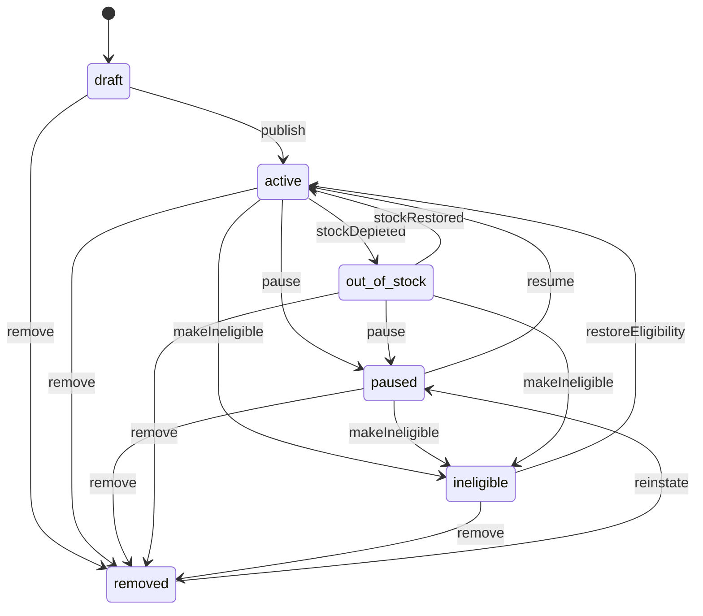
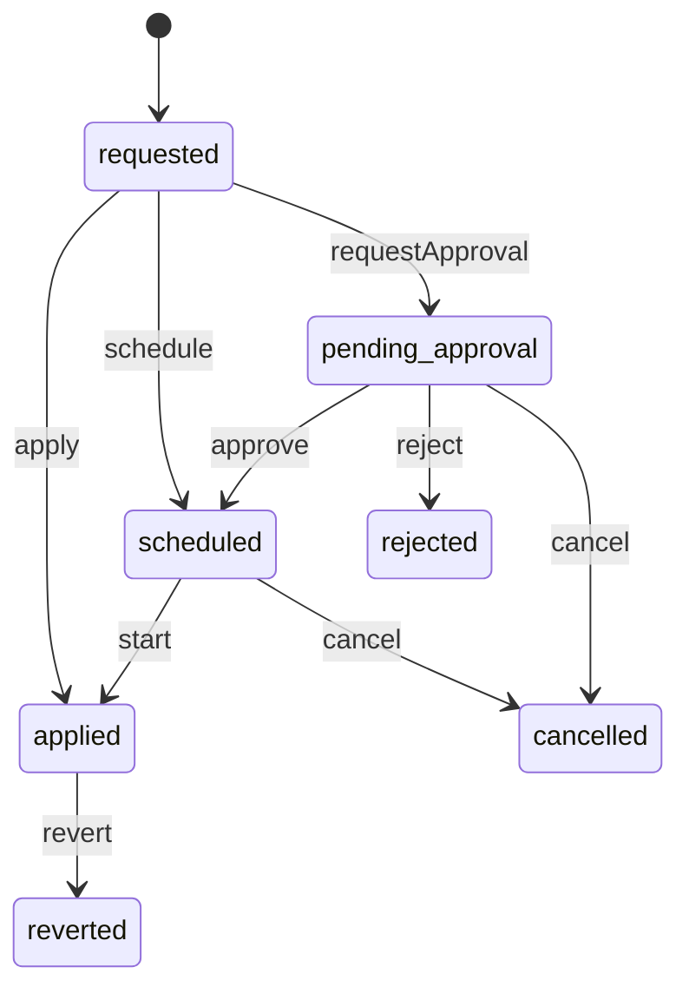
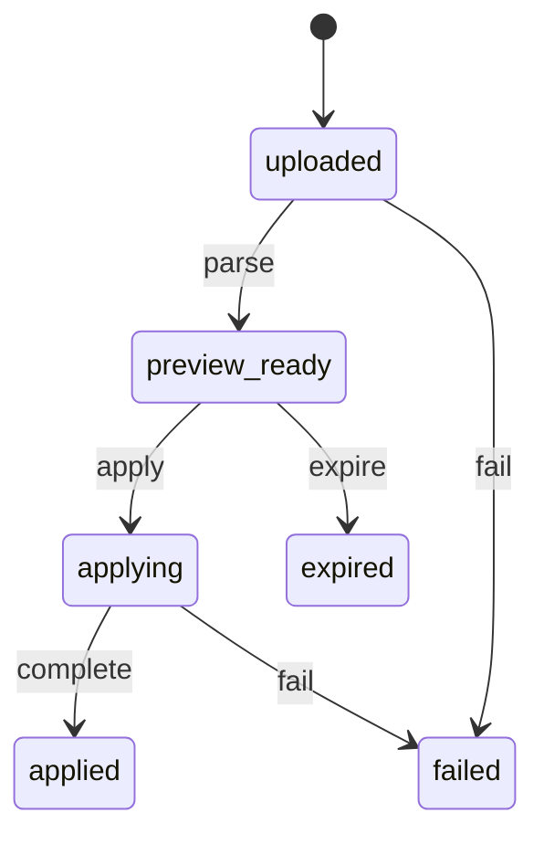

# Offers (`offers`)

How one seller (or the Official Store) sells one variant in one condition: price and authentic was-price, purchase limit, seller SKU, dispatch, shipping profile, return and warranty terms, offer status, and the published featured-offer rule that picks the main offer for a delivery location.

- **Group:** Catalog and stock · **Launch phase:** 1 · **Plan chapters:** 5, 8, 9, 2
- **Depends on:** [catalog](catalog.md), [sellers](sellers.md), [inventory](inventory.md) · **Optional:** [shipping](shipping.md), [returns](returns.md), [promotions](promotions.md), [access](access.md), [audit](audit.md), [cart](cart.md), [finance](finance.md), [fulfillment-service](fulfillment-service.md), [media](media.md), [purchasing](purchasing.md), [reviews](reviews.md), [trust](trust.md), [reports](reports.md)
- **Required by:** [cart](cart.md), [checkout](checkout.md), [orders](orders.md), [promotions](promotions.md), [search](search.md), [wishlist](wishlist.md)

## Owns
- Offers: seller (or Official Store) × variant × condition, with condition notes and stated missing accessories
- Price, compare-at (was) price with a verified basis, sale end time, purchase limit, seller SKU
- Offer terms: dispatch time, shipping profile reference, return terms (platform baseline or more generous), warranty
- Offer status: Draft, Active, Paused, Out of stock, Ineligible, Removed (with reason)
- Price history and price changes (scheduled, approval-gated for the Official Store)
- Featured-offer rule (versioned, published), eligibility and ineligibility reasons, featured-offer selection per variant and delivery zone
- Comparable totals per delivery location for the purchase box and the all-offers page
- Seller and Official Store bulk price and quantity file updates with preview and correction report
- Frozen offer snapshots for order items (seller, condition, price, terms accepted at purchase)

**Not here:**
- Shared product content (title, specs, included items, variants): catalog
- Stock quantities, reservations and adjustments: inventory (offers reads availability and passes bulk quantity rows to inventory)
- Shipping rates, delivery estimates and seller shipping profiles: shipping (offers stores the profile id and asks shipping for quotes)
- Return policy baseline and category exceptions: returns (offers validates against it)
- Seller status, restrictions and performance figures: sellers
- Discounts, coupons and campaign prices: promotions (offers only shows the automatic discount promotions reports for an offer)
- Company trading summary (sales, margin, discounts, returns): finance and reports
- Fee previews on the offer form: finance fee rules

## Store API

| Method | Path | Purpose | Auth | Body → Response |
|---|---|---|---|---|
| GET | `/api/store/offers/products/{productId}/offers` | All offers for a product variant with comparable totals to a delivery location | visitor | `OfferComparison` |
| GET | `/api/store/offers/products/{productId}/purchase-box` | Purchase box for the selected variant: featured or chosen offer, delivery, quantity options, variant availability | visitor | `PurchaseBox` |
| GET | `/api/store/offers/offers/{id}` | One offer as the customer sees it (used by cart and review-changes) | visitor | `OfferView` |
| GET | `/api/store/offers/featured-offer-rule` | Published featured-offer rule ('How we choose the featured offer') | visitor | `FeaturedRule` |

## Seller API

| Method | Path | Purpose | Auth | Body → Response |
|---|---|---|---|---|
| GET | `/api/seller/offers/offers` | This seller's offers with review state, publication and stock as separate columns | seller | Page<SellerOfferRow> |
| GET | `/api/seller/offers/offers/counts` | Counts for the list tabs and the page heading | seller | `{ all: int, active: int, draft: int, paused: int, outOfStock: int, ineligible: int, removed: int, productSubmitted: int, productChangesRequested: int, productRejected: int, hiddenOrSuspended: int, productCount: int, productDraft: int, productPublication: object }` |
| GET | `/api/seller/offers/offers/{id}` | One own offer with product, stock, price history, status log and featured eligibility | seller | `SellerOfferDetail` |
| POST | `/api/seller/offers/offers/preview` | Check an offer before saving: delivery a customer would see, price context, was-price check, return baseline | seller | `OfferInput` → `OfferPreview` |
| POST | `/api/seller/offers/offers` | Create an offer on a catalog product (draft or published) | seller<br>`offers.offers.manage` | `OfferInput` → `SellerOfferDetail` |
| PATCH | `/api/seller/offers/offers/{id}` | Edit offer terms or price | seller<br>`offers.offers.manage` | `OfferUpdate` → `SellerOfferDetail` |
| POST | `/api/seller/offers/offers/{id}/publish` | Publish a draft offer | seller<br>`offers.offers.manage` | `SellerOfferDetail` |
| POST | `/api/seller/offers/offers/{id}/pause` | Hide an offer from customers (stock is kept) | seller<br>`offers.offers.manage` | `{ reason: text? }` → `SellerOfferDetail` |
| POST | `/api/seller/offers/offers/bulk-pause` | Hide several own offers at once (up to 100) | seller<br>`offers.offers.manage` | `{ offerIds: uuid[], reason: text? }` → `{ results: json[] }` |
| POST | `/api/seller/offers/offers/{id}/resume` | Show a paused offer again | seller<br>`offers.offers.manage` | `SellerOfferDetail` |
| POST | `/api/seller/offers/offers/{id}/end` | End an offer permanently (Removed, reason ended_by_seller) | seller<br>`offers.offers.manage` | `{ reason: text? }` → `SellerOfferDetail` |
| DELETE | `/api/seller/offers/offers/{id}` | Delete a draft offer that was never published | seller<br>`offers.offers.manage` | 204 No content |
| POST | `/api/seller/offers/price-changes` | Change prices of selected offers (up to 100) | seller<br>`offers.prices.manage` | `{ items: SellerPriceItem[], confirmLargeChange: bool? }` → `{ results: PriceChangeResult[] }` |
| POST | `/api/seller/offers/offers/exports` | Export own offers (selected rows or the current filters) as CSV _(audited)_ | seller<br>`offers.offers.export` | `{ offerIds: uuid[]?, filters: json?, format: enum(csv|xlsx)? }` → `reports.ExportJob` |
| GET | `/api/seller/offers/offers/exports/{id}` | Offer export status and download link (requesting member only) | seller<br>`offers.offers.export` | `reports.ExportJob` |
| GET | `/api/seller/offers/bulk-updates/template` | Download a CSV template prefilled with this seller's SKUs, prices and quantities _(phase 2)_ | seller<br>`offers.bulk.update` | `FileLink` |
| POST | `/api/seller/offers/bulk-updates` | Upload a price and quantity file for preview _(phase 2)_ | seller<br>`offers.bulk.update` | `{ fileId: uuid }` → `BulkUpdateJob` |
| GET | `/api/seller/offers/bulk-updates` | Upload history _(phase 2)_ | seller<br>`offers.bulk.update` | Page<BulkUpdateJob> |
| GET | `/api/seller/offers/bulk-updates/{id}` | Job state and totals (rows, ready, errors, unchanged) _(phase 2)_ | seller<br>`offers.bulk.update` | `BulkUpdateJob` |
| GET | `/api/seller/offers/bulk-updates/{id}/rows` | Row-by-row preview with before → after and the error for each failed row _(phase 2)_ | seller<br>`offers.bulk.update` | Page<BulkUpdateRow> |
| POST | `/api/seller/offers/bulk-updates/{id}/apply` | Apply the valid rows _(phase 2)_ | seller<br>`offers.bulk.update` | `{ confirmLargeChanges: bool? }` → `BulkUpdateJob` |
| GET | `/api/seller/offers/bulk-updates/{id}/correction-report` | CSV of skipped rows with what to fix _(phase 2)_ | seller<br>`offers.bulk.update` | `FileLink` |

## Admin API

| Method | Path | Purpose | Auth | Body → Response |
|---|---|---|---|---|
| GET | `/api/admin/offers/offers` | All offers with filters (seller, product, status, eligibility) | staff<br>`offers.offers.view` | Page<OfferAdminRow> |
| GET | `/api/admin/offers/offers/{id}` | Offer with status log, price history and price changes | staff<br>`offers.offers.view` | `OfferAdminDetail` |
| POST | `/api/admin/offers/offers/{id}/remove` | Remove an offer with a reason (seller is told the reason and appeal route) _(audited)_ | staff<br>`offers.offers.remove` | `RemoveOfferRequest` → `OfferAdminDetail` |
| POST | `/api/admin/offers/offers/{id}/hold` | Hold an offer during an investigation (Ineligible, staff_hold) with a reason and review date _(audited)_ | staff<br>`offers.offers.remove` | `HoldOfferRequest` → `OfferAdminDetail` |
| POST | `/api/admin/offers/offers/{id}/release-hold` | Release a staff hold _(audited)_ | staff<br>`offers.offers.remove` | `{ reason: text }` → `OfferAdminDetail` |
| POST | `/api/admin/offers/offers/{id}/reinstate` | Reinstate a removed offer as Paused (e.g. after a successful appeal) _(audited)_ | staff<br>`offers.offers.remove` | `{ reason: text }` → `OfferAdminDetail` |
| GET | `/api/admin/offers/official/offers` | Official Store offers with price, cost, margin and sellable stock | staff<br>`offers.official.view` | Page<OfficialOfferRow> |
| POST | `/api/admin/offers/official/offers` | Create an Official Store offer linked to a company stock item _(audited)_ | staff<br>`offers.official.manage` | `OfficialOfferInput` → `OfferAdminDetail` |
| PATCH | `/api/admin/offers/official/offers/{id}` | Edit Official Store offer terms (not price; use price changes) _(audited)_ | staff<br>`offers.official.manage` | `OfferUpdate` → `OfferAdminDetail` |
| POST | `/api/admin/offers/official/offers/{id}/publish` | Publish an Official Store offer _(audited)_ | staff<br>`offers.official.manage` | `OfferAdminDetail` |
| POST | `/api/admin/offers/official/offers/{id}/pause` | Hide an Official Store offer _(audited)_ | staff<br>`offers.official.manage` | `{ reason: text }` → `OfferAdminDetail` |
| POST | `/api/admin/offers/official/offers/{id}/resume` | Show a hidden Official Store offer again _(audited)_ | staff<br>`offers.official.manage` | `OfferAdminDetail` |
| POST | `/api/admin/offers/official/offers/{id}/price-changes` | Change an Official Store price (now or scheduled) with a reason _(audited)_ | staff<br>`offers.official.price` | `PriceChangeRequest` → `PriceChange` |
| GET | `/api/admin/offers/price-changes` | Pending, scheduled and recent price changes | staff<br>`offers.official.view` | Page<PriceChange> |
| POST | `/api/admin/offers/price-changes/{id}/cancel` | Cancel a scheduled or pending price change _(audited)_ | staff<br>`offers.official.price` | `{ reason: text }` → `PriceChange` |
| POST | `/api/admin/offers/official/bulk-updates` | Upload an Official Store price file for preview _(audited, phase 2)_ | staff<br>`offers.official.price` | `{ fileId: uuid, reason: text }` → `BulkUpdateJob` |
| GET | `/api/admin/offers/official/bulk-updates/{id}` | Official Store bulk job state and totals _(phase 2)_ | staff<br>`offers.official.view` | `BulkUpdateJob` |
| GET | `/api/admin/offers/official/bulk-updates/{id}/rows` | Official Store bulk preview rows _(phase 2)_ | staff<br>`offers.official.view` | Page<BulkUpdateRow> |
| POST | `/api/admin/offers/official/bulk-updates/{id}/apply` | Apply valid rows; rows above the price-change limit become approval requests _(audited, phase 2)_ | staff<br>`offers.official.price` | `BulkUpdateJob` |
| GET | `/api/admin/offers/featured-rule` | Current, scheduled and past versions of the featured-offer rule | staff<br>`offers.offers.view` | `{ current: FeaturedRule, scheduled: FeaturedRule?, history: FeaturedRule[] }` |
| POST | `/api/admin/offers/featured-rule/versions` | Publish a new version of the featured-offer rule with an effective date _(audited)_ | staff<br>`offers.featured-rule.manage` | `FeaturedRuleInput` → `FeaturedRule` |
| GET | `/api/admin/offers/products/{productId}/featured-decision` | Why an offer is (or is not) featured for a variant and location | staff<br>`offers.offers.view` | `FeaturedDecision` |
| POST | `/api/admin/offers/featured-decisions/recompute` | Recompute featured decisions for a product (or everything) _(audited)_ | staff<br>`offers.featured-rule.manage` | `{ productId: uuid? }` → `{ queued: int }` |

## Types

### Offer

| Field | Type |
|---|---|
| id | `uuid` |
| ownerType | `enum(official|seller)` |
| sellerId | `uuid?` Null for the Official Store |
| sellerName | `string` |
| productId | `uuid` |
| variantId | `uuid` |
| title | `string` Product title with the variant label (e.g. 'Aurora Headphones – Black'), copied from catalog when the offer is created and kept current from catalog.product.updated / catalog.product.merged. Used for admin and seller title search and by modules that list offers without catalog (shipping profile usage). |
| condition | `enum(new|used_like_new|used_good|used_acceptable|refurbished)` |
| conditionNotes | `text?` Required for used and refurbished; shown beside the price |
| includedItems | `string[]` What is in this seller's box (defaults to the product's included items) |
| missingItems | `string[]` Product's standard included items that this offer does not include. Must be stated; shown as 'Missing: …' |
| complete | `bool` True when nothing is missing |
| missingItemsStale | `bool` True when the product's box changed (catalog.product.updated) and missingItems names items no longer in it, or no longer lists everything absent. The seller is asked to review (offers.offer.missing_items_stale); cleared when the seller saves missingItems again, changed or confirmed as is (offers.offer.missing_items_reviewed). The offer stays on sale meanwhile. |
| sellerSku | `string` Seller's own code; customers do not see it |
| stockItemId | `uuid` inventory stock item that holds this offer's quantities |
| price | `Money` |
| compareAt | `CompareAtPrice?` |
| saleEndsAt | `datetime?` |
| purchaseLimit | `int?` Maximum units per customer |
| dispatch | `DispatchTerms` The seller's own dispatch terms as saved. For a Marketly-fulfilled offer they are kept but have no customer effect; read shipping for what customers get |
| shippingProfileId | `uuid` shipping module profile (rates, services, coverage) as saved by the seller; see shipping for the effective one |
| fulfilledBy | `enum(official_warehouse|seller|marketly_service)` Who ships it: official_warehouse for Official Store offers, marketly_service while fulfillment-service fulfils the offer (fulfillment-service.offer.service_changed), else seller |
| shipping | `OfferShipping` Effective customer-facing fulfilment: seller offers = their own shippingProfileId and dispatch; Official Store as today; marketly_service = fulfillment-service.getServiceTerms (Marketly's profile, dispatch and ships-from). Cart, checkout, delivery estimates and the featured rule read this, never shippingProfileId and dispatch directly |
| returnTerms | `ReturnTerms` |
| warranty | `WarrantyTerms` |
| status | `enum(draft|active|paused|out_of_stock|ineligible|removed)` |
| statusReason | `StatusReason?` |
| featuredEligibility | `FeaturedEligibility` |
| publishOnApproval | `bool` Draft on a product still in catalog review goes live when the product is approved |
| termsVersion | `int` Increments on any customer-visible change; carts compare it to detect changes |
| publishedAt | `datetime?` |
| createdAt | `datetime` |
| updatedAt | `datetime` |

### CompareAtPrice

| Field | Type |
|---|---|
| amount | `Money` |
| basis | `enum(lowest_30_days|list_price)` lowest_30_days: this offer's lowest price in the 30 days before the sale; list_price: manufacturer list price on file |
| verified | `bool` Checked against price history or the list price on file. Unverified was-prices are never shown. |
| explanation | `string` e.g. 'Was price is the Official Store's lowest price in the 30 days before the sale.' |

### DispatchTerms

| Field | Type |
|---|---|
| businessDays | `int` 0 = same business day |
| sameDayCutoff | `string?` Local cutoff HH:mm for same-day dispatch, market time zone |
| shipsFrom | `string` City and region, e.g. 'Reno, NV'. Official Store offers: the inventory default location (inventory.getDefaultLocation), set at save and refreshed by the hourly offers.reevaluate-eligibility job when that location changes (inventory publishes no location event; the refresh does not bump termsVersion); seller offers: the seller's ships-from address from shipping seller settings. Never empty: falls back to the market default location label (kernel config). |
| label | `string` e.g. 'Ships today', 'Ships in 1 business day' |

### OfferShipping

| Field | Type |
|---|---|
| fulfilledBy | `enum(official_warehouse|seller|marketly_service)` |
| profileId | `uuid` Shipping profile customers are quoted with: the offer's own, or the service profile (fulfillment-service ServiceTerms.shippingProfileId) for marketly_service |
| dispatch | `DispatchTerms` Dispatch promise and ships-from customers see; for marketly_service the service dispatch and shipsFrom from fulfillment-service ServiceTerms |

### ReturnTerms

| Field | Type |
|---|---|
| kind | `enum(baseline|extended)` extended = more generous than the platform baseline for the category |
| windowDays | `int` |
| freeReturnShipping | `bool` |
| categoryException | `string?` Category exception text shown before purchase: returns' summary when resolveTerms answered source category_exception at save (column return_category_exception); null otherwise |
| summary | `string` e.g. '30-day returns. You pay return shipping unless the item is faulty.' |
| policyVersion | `string?` returns policy version (EffectiveTerms.policyVersion, e.g. '1.0') the terms were validated against at save; null when returns was off |

### WarrantyTerms

| Field | Type |
|---|---|
| kind | `enum(manufacturer|seller|none)` |
| months | `int?` |
| handledBy | `enum(manufacturer|seller|official_store)?` |
| summary | `string` e.g. '2-year manufacturer warranty' |

### FeaturedEligibility

| Field | Type |
|---|---|
| eligible | `bool` |
| reasons | `IneligibilityReason[]` |
| evaluatedAt | `datetime` |

### IneligibilityReason

| Field | Type |
|---|---|
| code | `enum(offer_not_active|out_of_stock|seller_restricted|seller_suspended|delivery_performance_under_review|on_time_dispatch_below_standard|product_not_purchasable|does_not_ship_to_location|condition_not_competing|staff_hold)` |
| message | `string` Customer-safe text, e.g. 'Not eligible for featured offer: delivery performance under review' |
| howToFix | `string?` Seller-facing next step |

### StatusReason

| Field | Type |
|---|---|
| code | `enum(awaiting_launch_review|seller_restricted|seller_suspended|seller_closed|product_hidden|product_suspended|product_merged|staff_hold|removed_by_staff|ended_by_seller|enforcement|fulfillment_service_suspended)` fulfillment_service_suspended: the seller's Fulfilled by Marketly enrollment is suspended or offboarding, so the offer stops selling (it never switches to seller shipping); restored when the enrollment is reinstated or the SKU leaves the service |
| text | `text` |
| affectedActivity | `string?` For restrictions: what is stopped, e.g. 'Refurbished offers and new listings' |
| appealRoute | `string?` For restrictions and removals: how to appeal |
| reviewDate | `date?` For holds |
| actor | `Actor?` |
| at | `datetime` |

### OfferInput

| Field | Type |
|---|---|
| productId | `uuid` |
| variantId | `uuid` |
| condition | `enum(new|used_like_new|used_good|used_acceptable|refurbished)` |
| conditionNotes | `text?` |
| missingItems | `string[]?` |
| price | `Money` |
| compareAt | `CompareAtInput?` |
| saleEndsAt | `datetime?` |
| purchaseLimit | `int?` |
| sellerSku | `string` |
| quantity | `int` Initial available quantity; recorded in inventory as 'Initial stock' |
| lowStockThreshold | `int?` |
| dispatchBusinessDays | `int` |
| shippingProfileId | `uuid` |
| returnTerms | `ReturnTermsInput` |
| warranty | `WarrantyInput` |
| publish | `bool?` Publish immediately when the product is purchasable; otherwise saved as draft |
| publishOnApproval | `bool?` |

### OfficialOfferInput

| Field | Type |
|---|---|
| productId | `uuid` |
| variantId | `uuid` |
| condition | `enum(new|used_like_new|used_good|used_acceptable|refurbished)` |
| conditionNotes | `text?` |
| missingItems | `string[]?` |
| price | `Money` |
| compareAt | `CompareAtInput?` |
| purchaseLimit | `int?` |
| sku | `string` Company SKU, e.g. HAL-AUR-BLK-LN |
| stockItemId | `uuid?` Existing company stock item; omitted = create one at the default warehouse |
| dispatchBusinessDays | `int` |
| shippingProfileId | `uuid` |
| returnTerms | `ReturnTermsInput` |
| warranty | `WarrantyInput` |
| publish | `bool?` |

### OfferUpdate

| Field | Type |
|---|---|
| variantId | `uuid?` Draft only |
| condition | `enum(new|used_like_new|used_good|used_acceptable|refurbished)?` Draft only; afterwards end the offer and create a new one |
| conditionNotes | `text?` |
| missingItems | `string[]?` |
| price | `Money?` Sellers only; Official Store prices change through price-changes |
| compareAt | `CompareAtInput?` |
| saleEndsAt | `datetime?` |
| purchaseLimit | `int?` |
| sellerSku | `string?` |
| dispatchBusinessDays | `int?` |
| shippingProfileId | `uuid?` |
| returnTerms | `ReturnTermsInput?` |
| warranty | `WarrantyInput?` |
| publishOnApproval | `bool?` |
| confirmLargeChange | `bool?` The seller confirms a price change above largeSellerPriceChangePct. Without it such a PATCH returns LARGE_PRICE_CHANGE_UNCONFIRMED (details.offers) and nothing is saved; with it the change applies like any other edit. |

### CompareAtInput

| Field | Type |
|---|---|
| amount | `Money` |
| basis | `enum(lowest_30_days|list_price)` |

### ReturnTermsInput

| Field | Type |
|---|---|
| kind | `enum(baseline|extended)` |
| windowDays | `int?` Required for extended; at least the category baseline |
| freeReturnShipping | `bool?` |

### WarrantyInput

| Field | Type |
|---|---|
| kind | `enum(manufacturer|seller|none)` |
| months | `int?` |

### SellerCue

| Field | Type |
|---|---|
| sellerId | `uuid?` |
| name | `string` |
| official | `bool` |
| verified | `bool` |
| storeSlug | `string?` |
| positivePct | `int?` |
| ratingCount | `int?` |
| onTimeDispatchPct | `int?` Last 90 days, from sellers performance |
| location | `string?` |

### DeliveryEstimate

| Field | Type |
|---|---|
| shipsToLocation | `bool` |
| arrivesFrom | `date?` |
| arrivesTo | `date?` |
| label | `string` e.g. 'Free delivery Thu, Oct 15' or 'Arrives Fri, Oct 16 – Mon, Oct 19' |
| shippingCost | `Money?` |
| free | `bool` |
| freeOver | `Money?` Free-shipping threshold for this seller, if any |
| carrier | `string?` |
| service | `string?` |
| shipsFrom | `string` Effective ships-from (Offer.shipping.dispatch.shipsFrom): for marketly_service the Marketly warehouse, e.g. 'Reno, NV (Marketly warehouse)' |
| fulfilledByLabel | `string?` 'Ships from Marketly' for marketly_service offers (the seller stays named in seller); null otherwise |
| dispatchLabel | `string` |
| orderWithinMinutes | `int?` Countdown to the cutoff that keeps this date |
| serviceNotice | `string?` Holiday or known interruption (from shipping) |
| locationLabel | `string?` The delivery location this estimate is for (DeliverTo.label), e.g. 'Portland 97205' |

### Availability

| Field | Type |
|---|---|
| state | `enum(in_stock|low_stock|out_of_stock)` |
| quantity | `int?` Shown when low (e.g. '9 left') or to the seller |
| maxPerOrder | `int` min(available, purchase limit); drives the quantity selector |
| purchaseLimit | `int?` |
| label | `string` e.g. 'In stock', '2 left', 'Limit 3 per customer' |

### OfferView

| Field | Type |
|---|---|
| offerId | `uuid` |
| seller | `SellerCue` |
| condition | `enum(new|used_like_new|used_good|used_acceptable|refurbished)` |
| conditionLabel | `string` e.g. 'Used – Like new' |
| conditionNotes | `text?` |
| missingItems | `string[]` |
| complete | `bool` |
| price | `Money` Price the customer pays now: the campaign price from promotions.priceOffers when a markdown or flash sale applies, else the offer price |
| regularPrice | `Money?` Offer price when a campaign price applies (shown separately when deal stock ends) |
| compareAt | `CompareAtPrice?` |
| discountPct | `int?` |
| saleEndsAt | `datetime?` |
| promotion | `PromotionCue?` |
| automaticDiscount | `AutomaticDiscount?` Seller or platform discount the customer qualifies for without a code (from promotions) |
| delivery | `DeliveryEstimate` |
| total | `Money` Item price + shipping − automatic discount, before tax. The comparable total. |
| availability | `Availability` |
| returns | `ReturnTerms` |
| warranty | `WarrantyTerms` |
| featured | `bool` |
| featuredEligible | `bool` |
| ineligibleNote | `string?` Shown under ineligible offers on the all-offers page |
| status | `enum(draft|active|paused|out_of_stock|ineligible|removed)` |
| fulfilledBy | `enum(official_warehouse|seller|marketly_service)` |
| termsVersion | `int` |

### AutomaticDiscount

| Field | Type |
|---|---|
| label | `string` |
| amount | `Money` |
| fundedBy | `string` |

### PromotionCue

| Field | Type |
|---|---|
| campaignId | `uuid?` |
| label | `string` e.g. 'Home Week deal', 'Flash sale' |
| endsAt | `datetime?` |
| badges | `string[]` |
| purchaseLimit | `int?` |
| wasPriceRule | `string?` From promotions, e.g. 'Was price is the seller's lowest price in the 30 days before Oct 6' |

### DeliverTo

| Field | Type |
|---|---|
| postalCode | `string` |
| label | `string` e.g. 'Portland 97205' |
| source | `enum(customer_address|entered|market_default)` |

### OfferComparison

| Field | Type |
|---|---|
| product | `catalog.ProductSummary` |
| variant | `catalog.Variant` |
| deliverTo | `DeliverTo` |
| sort | `enum(total_cost|fastest_delivery)` |
| featuredOfferId | `uuid?` |
| offers | `OfferView[]` |
| conditionCounts | `map<int>` { all, new, used, refurbished } |
| rule | `FeaturedRuleSummary` |
| taxNote | `string` 'Totals include shipping; sales tax is added at checkout.' |

### FeaturedRuleSummary

| Field | Type |
|---|---|
| version | `int` |
| steps | `string[]` |
| notes | `string[]` |

### PurchaseBox

| Field | Type |
|---|---|
| product | `catalog.ProductSummary` |
| variantId | `uuid` |
| deliverTo | `DeliverTo` |
| selected | `OfferView?` |
| selectedBy | `enum(featured|customer_choice|only_offer)` customer_choice keeps the seller the customer picked; never switched silently |
| featured | `OfferView?` Present when the customer chose a different offer, so both are visible |
| otherOffers | `OtherOffersCue` |
| variants | `VariantAvailability[]` |
| quantityOptions | `int[]` |
| unavailable | `UnavailableInfo?` |
| officialStore | `OfficialStoreCue?` Present when the Official Store has an offer for this variant that can't be bought at this location while another seller's offer is selected (the 'Official Store out of stock, other sellers have it' state); null otherwise |

### OfficialStoreCue

| Field | Type |
|---|---|
| offerId | `uuid` |
| state | `enum(out_of_stock|not_shippable|unavailable)` out_of_stock: no stock now; not_shippable: does not ship to the delivery location; unavailable: paused or not eligible |
| title | `string` e.g. 'Out of stock at the Official Store' |
| message | `text` e.g. 'Expected back around 2026-10-28 (estimate). Other sellers have it now.' |
| expectedRestockDate | `date?` From inventory incoming stock; an estimate |
| price | `Money` The Official Store's price for the variant |

### OtherOffersCue

| Field | Type |
|---|---|
| count | `int` |
| lowestPrice | `Money?` |
| lowestTotal | `Money?` |
| label | `string` e.g. '3 offers from $129.00' |

### VariantAvailability

| Field | Type |
|---|---|
| variantId | `uuid` |
| options | `map<string>` |
| label | `string` |
| offerCount | `int` |
| lowestPrice | `Money?` |
| inStock | `bool` |
| summary | `string` e.g. '$189.00 · In stock' or '2 offers from $184.00' |

### UnavailableInfo

| Field | Type |
|---|---|
| reason | `enum(out_of_stock|no_offers|not_shippable|product_unavailable)` |
| title | `string` e.g. 'Out of stock at the Official Store' |
| message | `text` |
| expectedRestockDate | `date?` From inventory incoming stock; stated as an estimate |
| alternatives | `OfferView[]` Other sellers' offers for the same variant |

### OfferPreview

| Field | Type |
|---|---|
| delivery | `DeliveryEstimate` |
| lowestNewPrice | `Money?` |
| officialStorePrice | `Money?` |
| compareAtCheck | `CompareAtPrice?` |
| returnBaseline | `ReturnTerms` Category baseline the terms must meet |
| featuredEligibility | `FeaturedEligibility` |
| warnings | `string[]` |

### OfferSummary

| Field | Type |
|---|---|
| id | `uuid` |
| productId | `uuid` |
| variantId | `uuid` |
| productTitle | `string` |
| variantLabel | `string` |
| image | `MediaRef?` |
| ownerType | `enum(official|seller)` |
| condition | `enum(new|used_like_new|used_good|used_acceptable|refurbished)` |
| sellerSku | `string` |
| price | `Money` |
| compareAt | `Money?` |
| status | `enum(draft|active|paused|out_of_stock|ineligible|removed)` |
| statusReason | `StatusReason?` |
| featured | `bool` |
| featuredEligible | `bool` |
| stockItemId | `uuid` The inventory stock item the offer sells from (for stock pages and bulk stock updates) |

### StockCue

| Field | Type |
|---|---|
| available | `int` |
| reserved | `int` |
| incoming | `int` |
| lowStockThreshold | `int?` |
| state | `enum(in_stock|low_stock|out_of_stock)` |

### SellerOfferRow

| Field | Type |
|---|---|
| offer | `OfferSummary` |
| productReviewState | `string` From catalog; shown as a separate column |
| productPublication | `string` |
| reviewNote | `text?` Reviewer reason when changes were requested on the seller's own product |
| stock | `StockCue` |
| contentGaps | `enum(images|identifiers)[]` Missing product content shown under the name (e.g. 'Missing images and identifiers'); empty when complete |

### SellerOfferDetail

| Field | Type |
|---|---|
| offer | `Offer` |
| product | `catalog.ProductSummary` |
| variant | `catalog.Variant` |
| productIncludedItems | `string[]` |
| productReviewState | `string` |
| productPublication | `string` |
| stock | `StockCue` |
| priceHistory | `PricePoint[]` |
| statusLog | `OfferStatusEntry[]` |
| otherOfferCount | `int` |
| lowestNewPrice | `Money?` |
| officialStorePrice | `Money?` |
| fulfillmentNote | `string?` For marketly_service offers: 'Fulfilled by Marketly: customers see Marketly's delivery terms. Your dispatch time and shipping profile are saved but apply only if you leave the service.' |

### PricePoint

| Field | Type |
|---|---|
| price | `Money` |
| compareAt | `Money?` |
| from | `datetime` |
| to | `datetime?` |
| changedBy | `Actor` |
| changeId | `uuid?` |

### OfferStatusEntry

| Field | Type |
|---|---|
| from | `string?` |
| to | `string` |
| event | `string` |
| reasonCode | `string?` |
| reason | `text?` |
| actor | `Actor` |
| at | `datetime` |

### PriceChangeRequest

| Field | Type |
|---|---|
| price | `Money` |
| compareAt | `CompareAtInput?` |
| startsAt | `datetime?` Null = now |
| endsAt | `datetime?` Price reverts to the previous price at this time (e.g. end of an event) |
| reason | `text` Required; recorded in action history |

### PriceChange

| Field | Type |
|---|---|
| id | `uuid` |
| offerId | `uuid` |
| offer | `OfferSummary` |
| from | `Money` |
| to | `Money` |
| changePct | `number` Signed, e.g. -31.7 |
| compareAt | `Money?` |
| startsAt | `datetime?` |
| endsAt | `datetime?` |
| revertTo | `Money?` |
| marginBeforePct | `number?` Official Store only, from inventory unit cost |
| marginAfterPct | `number?` |
| reason | `text?` |
| source | `enum(seller|seller_bulk|official|official_bulk)` |
| state | `enum(requested|pending_approval|scheduled|applied|reverted|rejected|cancelled)` |
| approval | `ApprovalInfo?` |
| requestedBy | `Actor` |
| createdAt | `datetime` |
| appliedAt | `datetime?` |

### SellerPriceItem

| Field | Type |
|---|---|
| offerId | `uuid` |
| price | `Money` |
| compareAt | `CompareAtInput?` |
| saleEndsAt | `datetime?` |

### PriceChangeResult

| Field | Type |
|---|---|
| offerId | `uuid` |
| ok | `bool` |
| change | `PriceChange?` |
| error | `ErrorBody?` |

### BulkUpdateJob

| Field | Type |
|---|---|
| id | `uuid` |
| ownerType | `enum(official|seller)` |
| fileName | `string` |
| uploadedBy | `Actor` |
| uploadedAt | `datetime` |
| state | `enum(uploaded|preview_ready|applying|applied|failed|expired)` |
| totals | `BulkUpdateTotals` |
| appliedBy | `Actor?` |
| appliedAt | `datetime?` |
| expiresAt | `datetime` Preview must be applied before this; prices may have moved after |
| failure | `string?` |

### BulkUpdateTotals

| Field | Type |
|---|---|
| rows | `int` |
| ready | `int` |
| errors | `int` |
| unchanged | `int` |
| priceChanges | `int` |
| stockChanges | `int` |
| pendingApproval | `int` |
| applied | `int` |
| skipped | `int` |

### BulkUpdateRow

| Field | Type |
|---|---|
| row | `int` |
| sellerSku | `string` |
| offerId | `uuid?` |
| productLabel | `string?` |
| priceFrom | `Money?` |
| priceTo | `Money?` |
| quantityFrom | `int?` |
| quantityTo | `int?` |
| result | `enum(ready|error|unchanged|applied|skipped|pending_approval)` |
| error | `BulkRowError?` |
| changePct | `number?` Signed price change in percent when the row changes the price |
| largeChange | `bool` Seller files: the row changes a published offer's price by more than largeSellerPriceChangePct, so apply needs confirmLargeChanges. Draft offers are exempt; always false on Official Store files (those go through price-change approval) |

### BulkRowError

| Field | Type |
|---|---|
| code | `enum(unknown_sku|negative_quantity|price_below_minimum|price_missing|price_change_too_large|offer_removed|not_a_number|duplicate_row)` Stable code |
| message | `string` What is wrong and how to fix it, e.g. 'Price $2.40 is below the $5.00 minimum for Cables and adapters. Did you mean $24.00?' |

### FileLink

| Field | Type |
|---|---|
| url | `url` |
| fileName | `string` |
| expiresAt | `datetime` |

### OfficialOfferRow

| Field | Type |
|---|---|
| offer | `OfferSummary` |
| unitCost | `Money?` Weighted average buying cost from inventory |
| marginPct | `number?` |
| stock | `StockCue` |
| note | `string?` e.g. 'Incoming 120 on PUR-2610-0042' or 'Product changes requested' |
| pendingPriceChange | `PriceChange?` |

### OfferAdminRow

| Field | Type |
|---|---|
| offer | `OfferSummary` |
| seller | `SellerCue` |
| sellerStatus | `string?` |
| ineligibleReasons | `string[]` |

### OfferAdminDetail

| Field | Type |
|---|---|
| offer | `Offer` |
| product | `catalog.ProductSummary` |
| seller | `SellerCue` |
| stock | `StockCue` |
| statusLog | `OfferStatusEntry[]` |
| priceHistory | `PricePoint[]` |
| priceChanges | `PriceChange[]` |

### RemoveOfferRequest

| Field | Type |
|---|---|
| reasonCode | `enum(wrong_product|misleading_condition|counterfeit_report|pricing_error|policy_violation|other)` |
| reason | `text` |
| appealRoute | `string?` Defaults to the seller appeal route from sellers |
| notifySeller | `bool?` |

### HoldOfferRequest

| Field | Type |
|---|---|
| reason | `text` |
| reviewDate | `date` |
| reference | `string?` e.g. trust report TR-261007-004 |

### FeaturedRule

| Field | Type |
|---|---|
| version | `int` |
| effectiveFrom | `datetime` |
| text | `text` Published wording, linked from the store and Seller rules |
| steps | `string[]` |
| parameters | `FeaturedRuleParameters` |
| publishedBy | `Actor` |
| publishedAt | `datetime` |

### FeaturedRuleParameters

| Field | Type |
|---|---|
| minOnTimeDispatchPct | `int` Seller on-time dispatch at or above this over the window |
| performanceWindowDays | `int` |
| deliveryDayAdjustmentPct | `number` Added to the total, as % of item price, per business day slower than the fastest eligible offer |
| competingConditions | `string[]` Conditions that compete by default, e.g. ['new']; others compete only within their condition filter |
| tieBreakers | `string[]` Applied in order when adjusted totals are exactly equal: official_store (the Official Store's offer first), on_time_dispatch (better record first), earliest_publication. Offer id decides last. Version 2 (owner decision G17b): ['official_store', 'on_time_dispatch', 'earliest_publication'] |

### FeaturedRuleInput

| Field | Type |
|---|---|
| text | `text` |
| steps | `string[]` |
| parameters | `FeaturedRuleParameters` |
| effectiveFrom | `datetime` |
| reason | `text` |

### FeaturedDecision

| Field | Type |
|---|---|
| productId | `uuid` |
| variantId | `uuid` |
| deliverTo | `DeliverTo` |
| ruleVersion | `int` |
| winnerOfferId | `uuid?` |
| candidates | `FeaturedCandidate[]` |
| computedAt | `datetime` |

### FeaturedCandidate

| Field | Type |
|---|---|
| offerId | `uuid` |
| sellerName | `string` |
| condition | `string` |
| eligible | `bool` |
| reasons | `IneligibilityReason[]` |
| total | `Money` |
| arrivesTo | `date?` |
| adjustedTotal | `Money` Total + delivery adjustment used for ranking |
| rank | `int?` |

### OfferChange

| Field | Type |
|---|---|
| offerId | `uuid` |
| kind | `enum(price|availability|delivery|terms|removed|seller_restricted)` One change per line, checked in this order: removed, seller_restricted, availability, delivery, price, terms (terms only when the price did not change) |
| before | `string?` Display text of the old value: price '$94.99', availability the quantity asked for ('3'), terms 'v2'; null for delivery, removed and seller_restricted. Read previous for the typed value. |
| after | `string?` Display text of the new value: price '$99.99', availability the units that can be bought now ('1', '0'), delivery the location label that is not served, terms 'v3'; null for removed and seller_restricted. Read current for the typed value. |
| previous | `OfferChangeValues?` Typed old value, by kind: price → price (the line's price), availability → quantity (asked for), terms → termsVersion (the line's). Null for delivery, removed and seller_restricted |
| current | `OfferChangeValues?` Typed new value, by kind: price → price (now), availability → quantity (units that can be bought now, 0 when the offer is not active), delivery → postalCode (the location not served), terms → termsVersion (now). Null for removed and seller_restricted |
| message | `string` Customer-facing explanation |
| alternatives | `OfferView[]` Other offers for the same variant the customer may choose explicitly |

### OfferChangeValues

| Field | Type |
|---|---|
| price | `Money?` |
| quantity | `int?` |
| termsVersion | `int?` |
| postalCode | `string?` |

### OfferSnapshot

| Field | Type |
|---|---|
| offerId | `uuid` |
| termsVersion | `int` |
| ownerType | `enum(official|seller)` |
| sellerId | `uuid?` |
| sellerName | `string` |
| sellerSku | `string` Seller's own code (Official Store: company SKU) at purchase, for packing slips, seller order search and exports |
| title | `string` Offer title at purchase (product title with variant label) |
| condition | `string` |
| conditionNotes | `text?` |
| missingItems | `string[]` |
| price | `Money` Offer (regular) price at purchase. Campaign markdowns, flash prices, coupons and automatic discounts are not in it: the price the customer paid per unit comes from checkout (promotions evaluation) on the order item. |
| compareAt | `Money?` |
| dispatch | `DispatchTerms` Effective dispatch terms at purchase (Offer.shipping.dispatch): Marketly's for marketly_service offers |
| fulfilledBy | `enum(official_warehouse|seller|marketly_service)?` Offer.fulfilledBy at purchase; offers always sets it (optional only so snapshots built elsewhere, e.g. test fixtures, stay valid) |
| returnTerms | `ReturnTerms` |
| warranty | `WarrantyTerms` |
| stockItemId | `uuid` |
| takenAt | `datetime` |

## Status flows

### Offer status (`Offer.status`)



publish requires an approved, Active product (catalog.isPurchasable), an approved seller whose launch review has passed (before that, publish keeps the offer in draft with publish_on_approval and statusReason awaiting_launch_review; sellers.launch_review.decided with outcome passed publishes them), no restriction covering new listings, verified compare-at and return terms at or above the baseline. publish, resume and restoreEligibility land on out_of_stock straight away when inventory available = 0 (stockDepleted follows in the same transaction). restoreEligibility returns to the status held before (status_before_ineligible): a paused offer stays paused. makeIneligible is system-driven (seller restricted or suspended, product hidden or suspended) or a staff hold; it stops new sales of this offer only, never other sellers' offers. remove is staff (reason required) or the seller ending the offer (ended_by_seller). Removed offers stay readable for past orders, carts and audit. stockDepleted / stockRestored come from inventory.stock.changed.

### Price change (`PriceChange.state`)



requestApproval when the change exceeds the caller's price-change limit from access (example: Official Store Manager ±30%); approve comes from access.approval.decided and goes to scheduled, which starts immediately when startsAt is past. revert runs at endsAt and restores revertTo. Seller price changes over the large-change threshold need confirmLargeChange, not an approval. A new change on an offer cancels its older scheduled change only if the caller says so; otherwise PRICE_CHANGE_PENDING.

### Bulk update job (`BulkUpdateJob.state`)



Nothing changes until apply. Only rows marked ready are applied; error rows are skipped and listed in the correction report. Official Store rows above the price-change limit become pending_approval price changes.

## Data (schema `offers`)

**offers**: One row per offer; product and seller are referenced by id only

| Column | Type |
|---|---|
| id | uuid pk |
| owner_type | text (official|seller) |
| seller_id | uuid? |
| product_id | uuid |
| variant_id | uuid |
| title | text (product title with variant label, denormalised from catalog for title search) |
| condition | text |
| condition_notes | text? |
| included_items | jsonb |
| missing_items | jsonb |
| missing_items_stale | bool (product box changed since missingItems was saved) |
| seller_sku | text |
| stock_item_id | uuid |
| price_amount | bigint |
| currency | char(3) |
| compare_at_amount | bigint? |
| compare_at_basis | text? |
| compare_at_verified | bool |
| sale_ends_at | timestamptz? |
| purchase_limit | int? |
| dispatch_business_days | int |
| same_day_cutoff | time? |
| ships_from | text |
| shipping_profile_id | uuid |
| fulfilled_by | text (official_warehouse|seller|marketly_service) |
| return_kind | text |
| return_window_days | int |
| free_return_shipping | bool |
| return_policy_version | text? (returns EffectiveTerms.policyVersion at save) |
| return_category_exception | text? (returns category exception summary at save) |
| warranty_kind | text |
| warranty_months | int? |
| warranty_handled_by | text? |
| status | text (draft|active|paused|out_of_stock|ineligible|removed) |
| status_before_ineligible | text? |
| ineligible_source | jsonb? ({ kind: restriction|suspension|product|staff|fulfillment_service, id }) |
| status_reason | jsonb? |
| publish_on_approval | bool |
| content_gaps | text[] |
| terms_version | int |
| published_at | timestamptz? |
| removed_at | timestamptz? |
| created_at | timestamptz |
| updated_at | timestamptz |

Indexes: `unique nulls not distinct (owner_type, seller_id, seller_sku)`, `unique nulls not distinct (owner_type, seller_id, variant_id) where condition = 'new' and status <> 'removed'`, `unique (stock_item_id) where status <> 'removed'`, `(product_id, variant_id, status)`, `(seller_id, status, id)`, `(status, id)`, `(stock_item_id)`, `(shipping_profile_id, status)`, `gin(title gin_trgm_ops)`

**offer_price_history**: Every price in force and when; basis for 'lowest price in the last 30 days' was-price checks

| Column | Type |
|---|---|
| id | uuid pk |
| offer_id | uuid → offers |
| price_amount | bigint |
| compare_at_amount | bigint? |
| valid_from | timestamptz |
| valid_to | timestamptz? |
| price_change_id | uuid? → price_changes |
| actor_kind | text |
| actor_id | text? |

Indexes: `(offer_id, valid_from)`

**price_changes**: Requested, scheduled, approval-gated and applied price changes

| Column | Type |
|---|---|
| id | uuid pk |
| offer_id | uuid → offers |
| from_amount | bigint |
| to_amount | bigint |
| change_pct | numeric(6,2) |
| compare_at_amount | bigint? |
| compare_at_basis | text? |
| starts_at | timestamptz? |
| ends_at | timestamptz? |
| revert_to_amount | bigint? |
| reason | text? |
| source | text |
| bulk_job_id | uuid? → bulk_update_jobs |
| state | text |
| approval_request_id | uuid? |
| requested_by_kind | text |
| requested_by_id | text? |
| decided_at | timestamptz? |
| applied_at | timestamptz? |
| created_at | timestamptz |

Indexes: `(state, starts_at)`, `(state, ends_at)`, `(offer_id, created_at)`, `(approval_request_id)`

**offer_status_log**: Every status change with reason and actor

| Column | Type |
|---|---|
| id | uuid pk |
| offer_id | uuid → offers |
| from_status | text? |
| to_status | text |
| event | text |
| reason_code | text? |
| reason | text? |
| affected_activity | text? |
| appeal_route | text? |
| review_date | date? |
| actor_kind | text |
| actor_id | text? |
| at | timestamptz |

Indexes: `(offer_id, at)`

**offer_eligibility**: Featured-offer eligibility per offer (location-independent part)

| Column | Type |
|---|---|
| offer_id | uuid pk → offers |
| eligible | bool |
| reasons | jsonb |
| seller_on_time_pct | numeric(5,2)? |
| seller_restriction_ref | text? |
| evaluated_at | timestamptz |

**featured_offers**: Cached featured-offer decision per variant, condition group and delivery zone

| Column | Type |
|---|---|
| variant_id | uuid |
| condition_group | text (new|used|refurbished) |
| zone_key | text |
| product_id | uuid |
| offer_id | uuid? |
| rule_version | int |
| candidates | jsonb |
| dirty | bool |
| computed_at | timestamptz |

Indexes: `pk (variant_id, condition_group, zone_key)`, `(product_id)`, `(dirty) where dirty`

**featured_rules**: Published versions of the featured-offer rule

| Column | Type |
|---|---|
| version | int pk |
| text | text |
| steps | jsonb |
| parameters | jsonb |
| effective_from | timestamptz |
| reason | text |
| published_by | text |
| published_at | timestamptz |

**bulk_update_jobs**: Uploaded price/quantity files (seller or Official Store)

| Column | Type |
|---|---|
| id | uuid pk |
| owner_type | text |
| seller_id | uuid? |
| file_media_id | uuid |
| file_name | text |
| state | text |
| totals | jsonb |
| report_media_id | uuid? |
| uploaded_by | text |
| uploaded_at | timestamptz |
| applied_by | text? |
| applied_at | timestamptz? |
| expires_at | timestamptz |
| failure | text? |

Indexes: `(seller_id, uploaded_at)`, `(state, expires_at)`

**bulk_update_rows**

| Column | Type |
|---|---|
| job_id | uuid → bulk_update_jobs |
| row_no | int |
| seller_sku | text |
| offer_id | uuid? |
| price_from | bigint? |
| price_to | bigint? |
| qty_from | int? |
| qty_to | int? |
| result | text |
| error_code | text? |
| error_message | text? |

Indexes: `pk (job_id, row_no)`, `(job_id, result)`

## Events

| Publishes | When | Payload | Consumed by |
|---|---|---|---|
| `offers.offer.created` | An offer is created (draft or published) | `{ offerId: uuid, productId: uuid, variantId: uuid, ownerType: string, sellerId: uuid?, condition: string, stockItemId: uuid, price: Money? }` | catalog, search, trust |
| `offers.offer.updated` | Customer-visible terms change (termsVersion bumped) | `{ offerId: uuid, productId: uuid, termsVersion: int, fields: string[] }` | - |
| `offers.offer.price_changed` | A new price takes effect (direct, scheduled start, revert or bulk) | `{ offerId: uuid, productId: uuid, variantId: uuid, sellerId: uuid?, ownerType: string, from: Money, to: Money, compareAt: Money?, priceChangeId: uuid?, termsVersion: int }` | cart, catalog, promotions, search, wishlist |
| `offers.offer.status_changed` | Any offer status transition | `{ offerId: uuid, productId: uuid, variantId: uuid, sellerId: uuid?, ownerType: string, from: string, to: string, reasonCode: string?, reason: text?, stockItemId: uuid, trustEnforcementId: uuid? }` | advertising, cart, catalog, content, inventory, promotions, search, trust, wishlist |
| `offers.offer.missing_items_stale` | catalog.product.updated changed the product's box so an offer's missingItems no longer matches it (flag set; not repeated while the flag stays set) | `{ offerId: uuid, productId: uuid, variantId: uuid, ownerType: enum(official|seller), sellerId: uuid?, title: string, staleItems: string[], newBoxItems: string[] }` | notifications |
| `offers.offer.missing_items_reviewed` | The seller (or Official Store staff) saves the missing-items list of an offer flagged missingItemsStale, changed or confirmed as is: the flag is cleared | `{ offerId: uuid, productId: uuid, ownerType: enum(official|seller), sellerId: uuid?, missingItems: string[], changed: bool, reviewedBy: Actor }` | notifications |
| `offers.offer.eligibility_changed` | An offer becomes eligible or ineligible to be featured | `{ offerId: uuid, sellerId: uuid?, eligible: bool, reasons: string[] }` | - |
| `offers.featured.changed` | The featured offer for a variant and zone changes | `{ productId: uuid, variantId: uuid, conditionGroup: string, zoneKey: string, fromOfferId: uuid?, toOfferId: uuid? }` | search |
| `offers.featured_rule.published` | A new featured-offer rule version is published | `{ version: int, effectiveFrom: datetime }` | - |
| `offers.bulk_update.applied` | A bulk file is applied | `{ jobId: uuid, ownerType: string, sellerId: uuid?, applied: int, skipped: int, pendingApproval: int }` | - |

| Consumes | From | Does |
|---|---|---|
| `sellers.seller.restricted` | sellers | Read affectedActivities and scope (categoryIds, conditions, offerIds, productIds; empty = whole account). sales: make the in-scope offers Ineligible (reason, affected activity and appeal route copied to statusReason; ineligible_source = restrictionId). new_listings / new_offers: refuse new in-scope offers and publishing drafts (SELLER_RESTRICTED). offer_reactivation: refuse resume and reactivation. Other sellers' offers are untouched (scenario 7). |
| `sellers.restriction.updated` | sellers | Re-apply the changed activities and scope: restore offers no longer covered, make newly covered offers Ineligible |
| `sellers.restriction.lifted` | sellers | restoreEligibility on offers whose ineligible_source is this restriction and that no remaining restriction covers |
| `sellers.seller.suspended` | sellers | Make all the seller's offers Ineligible (ineligible_source = suspensionId); new sales stop while open orders keep their snapshots |
| `sellers.seller.reinstated` | sellers | restoreEligibility on offers made ineligible by liftedRestrictionId or endedSuspensionId, except offers still covered by remainingRestrictionIds |
| `sellers.launch_review.decided` | sellers | outcome passed: publish the seller's drafts waiting with publish_on_approval (approved product, complete offer; out_of_stock when available = 0) and clear statusReason awaiting_launch_review. changes_needed: keep them in draft |
| `sellers.seller.closed` | sellers | Remove all the seller's offers (reason seller_closed) |
| `catalog.product.publication_changed` | catalog | Hidden or Suspended → offers Ineligible (product_hidden / product_suspended); Active → restoreEligibility |
| `catalog.product.approved` | catalog | Publish draft offers with publishOnApproval on that product; refresh content_gaps |
| `catalog.product.merged` | catalog | Move offers from the duplicate to the kept product, mapping variants by options; unmatched variants are paused and the seller told. Each moved offer's stock item follows it (inventory.updateStockItem with the kept productId / variantId) and its title is refreshed |
| `catalog.product.updated` | catalog | Set missing_items_stale on offers whose missingItems name items no longer in the product's box (or miss new box items) and publish offers.offer.missing_items_stale once per flag; seller asked to review; refresh title and content_gaps on the product's offers from catalog.getProductAdmin (missing images / identifiers) |
| `inventory.stock.changed` | inventory | available 0 → stockDepleted; available > 0 → stockRestored; mark featured decisions dirty |
| `access.approval.decided` | access | Approve or reject pending price changes (and pending bulk rows) |
| `trust.enforcement.recorded` | trust | Remove or hold offers named in an enforcement (counterfeit, abuse); status_reason keeps the enforcementId so a reversal can find them |
| `trust.enforcement.reversed` | trust | Undo what trust.enforcement.recorded did for that enforcementId (inbox-claimed per event): offers it removed go back to Paused (same path as reinstateOffer, stock item unarchived by inventory, seller told and asked to resume); offers it held are released to their previous status; offers since changed by someone else (seller ended, staff removed for another reason) are left alone (noted in offer_status_log; trust's owner work item covers the rest). Publishes offers.offer.status_changed with trustEnforcementId |
| `promotions.campaign.started` | promotions | Mark featured decisions dirty for offers whose automatic discount changes the comparable total |
| `promotions.campaign.ended` | promotions | Same as started |
| `fulfillment-service.offer.service_changed` | fulfillment-service | Inbox-claimed per event: set fulfilled_by (marketly_service or seller), bump terms_version and mark featured decisions dirty. With sellable false make the offer Ineligible (statusReason fulfillment_service_suspended, ineligible_source { kind: fulfillment_service, id: skuEnrollmentId }); with sellable true (or fulfilledBy seller) restoreEligibility on offers whose ineligible_source is fulfillment_service |

## In-process API (for other modules)

| Function | Signature | Used by |
|---|---|---|
| getOffer | `(offerId: uuid) => Offer | null`<br>Current offer with terms and status | cart, checkout, orders, promotions, advertising, wishlist, search, graphql |
| quoteOffer | `(offerId: uuid, quantity: int, postalCode?: string) => OfferView`<br>Price, availability, delivery estimate and comparable total for one offer at a location | cart, checkout, graphql |
| revalidate | `(lines: { offerId: uuid, quantity: int, termsVersion: int, price: Money }[], postalCode: string) => { ok: bool, changes: OfferChange[] }`<br>Scenario 2: reports price, stock, delivery or terms changes since the cart line was added. Never substitutes another seller. | cart, checkout |
| snapshotForOrder | `(offerId: uuid) => OfferSnapshot`<br>Frozen seller, condition, notes, missing items, price, compare-at and terms stored on the order item (plan ch. 8) | orders |
| getFeaturedOffer | `(variantId: uuid, postalCode?: string) => OfferView | null`<br>Featured offer under the published rule; null when no eligible offer | search, wishlist, content, advertising |
| listActiveOffersForProduct | `(productId: uuid) => OfferSummary[]`<br>Active offers for indexing (from price, sellers, conditions, delivery flags) | search, promotions |
| isPromotable | `(offerId: uuid) => bool`<br>Active, in stock and featured-eligible. Sponsored products may only promote such offers (plan ch. 16). | advertising |
| lowestPrice | `(offerId: uuid, sinceDays: int, before?: datetime) => Money | null`<br>Lowest offer price in force in the window, from offer_price_history. The single source for honest was-prices. | promotions, wishlist |
| priceRange | `(offerId: uuid, sinceDays: int) => { lowest: Money, highest: Money, current: Money, unchanged: bool } | null`<br>Lowest, highest and current price in force in the window, from offer_price_history (wishlist price hints). | wishlist |
| compareOffers | `(productId: uuid, opts: { variantId?: uuid, condition?: 'all'|'new'|'used'|'refurbished', postalCode?: string, sort?: 'total_cost'|'fastest_delivery' }) => OfferComparison`<br>All offers for a product variant with comparable totals to a delivery location (all-offers page). Same as GET /products/{productId}/offers; primes the quoteOffer loader. | graphql |
| getFeaturedOfferForProduct | `(items: { productId: uuid, variantId?: uuid }[], postalCode?: string) => map<Offer | null>`<br>Featured offer per product (default variant when variantId is omitted) under the published rule, batched for product cards and the purchase box | graphql |
| getOfferStats | `(productIds: uuid[], opts?: { condition?: 'all'|'new'|'used'|'refurbished' }) => map<{ count: int, lowest: Money, highest: Money, lowestOfferId: uuid, lowestSellerName: string } | null>`<br>Active offer count and price range per product; the lowest price always names its eligible offer | graphql |
| getVariantOfferSummaries | `(variantIds: uuid[], postalCode?: string) => map<VariantAvailability>`<br>Variant chooser cues: offer count, lowest price, in stock, summary label | graphql |
| listOwnOffersForProduct | `(sellerId: uuid, productIds: uuid[]) => map<Offer[]>`<br>The seller's own offers on each product, any status (Seller Center product detail) | graphql, catalog |
| getOwnOffer | `(sellerId: uuid, offerId: uuid) => Offer | null`<br>One of the seller's own offers; null for another seller's offer | graphql |
| searchOwnOffers | `(sellerId: uuid, q: string, limit: int) => { items: OfferSummary[], more: bool }`<br>Own offers matching title, seller SKU or GTIN, for the Seller Center top-bar search | search |
| getOfferAdmin | `(offerId: uuid) => Offer | null`<br>Any offer with status reason, eligibility, price history, status log and price changes (staff) | graphql |
| listOffersAdmin | `(filter: { sellerId?: uuid, official?: bool, productId?: uuid, status?: string[], featuredEligible?: bool, ineligibilityCode?: string, q?: string }, page: PageInput) => Page<Offer>`<br>All offers with filters, including featured-ineligible offers by reason (staff) | graphql, search, catalog |
| getFeaturedDecision | `(productId: uuid, variantId?: uuid, postalCode?: string) => FeaturedDecision`<br>Why each offer is or is not featured for a variant and location (staff) | graphql |
| getPurchaseBoxOffer | `(items: { productId: uuid, offerId?: uuid, variantId?: uuid }[], postalCode?: string) => map<Offer | null>`<br>The offer for the purchase box: the requested offer when it is active on the product, otherwise the featured offer for the variant and location (ProductPage with a nullable offer id) | graphql |
| listActiveOffersByIds | `(offerIds: uuid[], limit?: int) => Offer[]`<br>Active offers for a list of ids in the given order, inactive ones left out (storefront featured collections) | sellers, graphql |
| getOffers | `(offerIds: uuid[]) => map<Offer | null>`<br>Batch read by id in any status (draft, removed and ineligible included), with sellerId (null for the Official Store: callers that need a seller id use OFFICIAL_STORE_ID) and title. Unknown ids map to null. Replaces per-line getOffer loops in cart revalidation, promotions evaluation and advertising checks. catalog.refresh-counts fills offer_index prices it does not have yet. | cart, promotions, advertising, catalog |
| countActiveOffersByProfile | `(shippingProfileId: uuid) => int`<br>Offers that still use a shipping profile: every status except removed (drafts and paused offers count, because they can be published again). One count query on (shipping_profile_id, status); shipping refuses to delete or deactivate a profile in use (PROFILE_IN_USE) without paging through listOffersAdmin. | shipping |
| exportRows | `(dataset: string, filters: json, principal: identity.Principal, cursor?: string) => { rows: json[], nextCursor?: string }`<br>Export rows for reports datasets offers.admin.offers and offers.seller.offers (seller rows scoped to the principal's seller) | reports |

## Permissions

| Key | Who | Allows |
|---|---|---|
| `offers.offers.manage` | seller | Create, edit, publish, pause and end own offers |
| `offers.offers.export` | seller | Export own offer lists |
| `offers.prices.manage` | seller | Change own offer prices |
| `offers.bulk.update` | seller | Upload and apply bulk price and quantity files |
| `offers.offers.view` | staff | View all offers, featured decisions and the featured rule |
| `offers.offers.remove` | staff | Remove, hold, release and reinstate offers (reason required) |
| `offers.official.view` | staff | View Official Store offers, price changes and price files (read only) |
| `offers.official.manage` | staff | Create and edit Official Store offers |
| `offers.official.price` | staff | Change Official Store prices within the approval limit set in access |
| `offers.featured-rule.manage` | staff | Publish featured-offer rule versions and force recomputation |

## Approval actions

Checked through the access module (limits per role, second reviewer).

| Action | Limit | Second reviewer | Approvers | Meaning |
|---|---|---|---|---|
| `offers.prices.change` | percent | above-limit | Official Store Manager within ±30% of the current price (example); Business Owner above it | Change an Official Store offer price (single change, scheduled change or bulk-file row) |

## Error codes

| Code | Status | Meaning |
|---|---|---|
| `PRODUCT_NOT_PURCHASABLE` | 409 | The product is not approved and Active. Save as draft with publishOnApproval, or wait for review. |
| `VARIANT_NOT_IN_PRODUCT` | 400 | variantId does not belong to productId |
| `DUPLICATE_OFFER` | 409 | This seller already has a New offer for this variant, or the seller SKU is in use. details.offerId |
| `SELLER_RESTRICTED` | 409 | A restriction covers this activity. details.reason, details.affectedActivity, details.appealRoute |
| `MISSING_ITEMS_REQUIRED` | 400 | Used or refurbished offers need condition notes, and items absent from the product's box must be listed in missingItems |
| `RETURN_TERMS_BELOW_BASELINE` | 400 | Return terms are less generous than the platform baseline for this category. details.baseline |
| `PRICE_BELOW_MINIMUM` | 400 | Price is below the category minimum. details.minimum |
| `WAS_PRICE_NOT_VERIFIED` | 400 | The compare-at price is not supported by this offer's price history or the list price on file |
| `SHIPPING_PROFILE_INVALID` | 400 | The shipping profile does not exist, is not the seller's, or does not cover the variant's size |
| `LARGE_PRICE_CHANGE_UNCONFIRMED` | 409 | Price changes above the large-change threshold need confirmLargeChange. details.offers |
| `PRICE_CHANGE_PENDING` | 409 | Another price change is scheduled or awaiting approval for this offer. Cancel it first. details.priceChangeId |
| `OFFER_UNAVAILABLE` | 409 | The offer can no longer be bought (removed, ineligible or out of stock). details.alternatives lists other offers to choose explicitly |
| `BULK_FILE_INVALID` | 400 | Not a readable CSV, wrong columns or over the row limit. details.issues |
| `BULK_JOB_EXPIRED` | 409 | The preview is older than the allowed window; upload again |

## Background jobs

| Job | Schedule | Does |
|---|---|---|
| `offers.apply-price-schedule` | every 1 min | Start scheduled price changes whose startsAt has passed; revert applied changes whose endsAt has passed; publish offers.offer.price_changed |
| `offers.recompute-featured` | every 2 min (dirty rows) + nightly full | Recompute featured_offers rows marked dirty for each delivery zone; publish offers.featured.changed when the winner changes |
| `offers.reevaluate-eligibility` | hourly | Read seller performance (on-time dispatch over the window, delivery reviews, open restrictions) from sellers and update offer_eligibility; publish offers.offer.eligibility_changed. Also: refresh Official Store ships-from from inventory.getDefaultLocation (no location event exists), fill titles of offers created before titles existed, and fill the return policy version and category exception of offers saved before those columns existed (only while returns is on; a bounded batch per run) |
| `offers.verify-compare-at` | daily 02:00 market time | Drop compare-at prices whose basis no longer holds (e.g. no longer the 30-day low before the sale) and tell the owner |
| `offers.expire-bulk-previews` | hourly | Expire preview_ready jobs past expiresAt |
| `offers.parse-bulk-file` | every 1 min | Parse uploaded CSVs still waiting (normally parsed right after upload), resolve seller SKUs, validate rows, build preview. Reads the file bytes through media.readFile, not the signed URL |

## Settings

| Key | Default | Rules | Meaning |
|---|---|---|---|
| featuredZoneGranularity | `"postal3"` | enum (postal3 \| postal5) | Delivery zone key used to cache featured decisions (first 3 digits of the postal code) |
| wasPriceLookbackDays | `30` | duration, days, 1–…, approval: business owner, seller-visible | Window for the lowest_30_days compare-at basis |
| largeSellerPriceChangePct | `50` | number, %, 1–…, seller-visible | Seller price changes above this need explicit confirmation |
| minimumPriceByCategory | `{}` | json, approval: second reviewer, seller-visible | Category id → minimum price in minor units (e.g. Cables and adapters 500) |
| maxPurchaseLimit | `null` | int, 1–…, seller-visible | Platform cap on per-customer purchase limits, if any |
| bulkMaxRows | `5000` | int, 1–…, seller-visible | Rows per bulk file |
| bulkPreviewHours | `24` | duration, hours, 1–… | How long a preview can be applied |
| maxSelectedPriceChanges | `100` | int, 1–…, seller-visible | Items per changeOwnPrices call |

## Integrations
- **Media storage**: Bulk CSV uploads, generated templates and correction reports (through media)

## Notes
- Product vs offer (plan ch. 5, 8): offers never edit shared content; corrections go through catalog suggestCorrection from the offer form.
- Featured-offer rule (published, versioned, default v1): (1) Eligible: offer Active, seller in good standing with no open restriction, on-time dispatch ≥ minOnTimeDispatchPct over performanceWindowDays, not under delivery review, product purchasable. (2) Available: available > 0 and ships to the delivery location. (3) Delivery: each business day slower than the fastest eligible offer adds deliveryDayAdjustmentPct of the item price to the ranking total. (4) Total price: item + shipping − automatic discounts. Lowest adjusted total wins; exact ties go through the version's tieBreakers in order (official_store, on_time_dispatch, earliest_publication; a version listing none uses on-time dispatch, then earlier publication). Owner decision G17b (2026-10-16): the lowest delivered total wins and the Official Store wins an exact tie: new installs start with that rule (deliveryDayAdjustmentPct 0, tieBreakers official_store first); installs that had rule versions get it as a new version from the 2026-10-16 data migration, and decisions made earlier keep their version. Only competingConditions (New) compete by default; used/refurbished compete within their condition filter. Advertising never affects it.
- A customer's explicit offer choice is passed as offerId; the purchase box and cart keep that seller. revalidate reports changes but never substitutes another seller (scenario 2).
- Comparable totals need a delivery location: postalCode query → customer default address → market default (settings). Shipping estimates come from shipping.quote(profileId, postalCode, variant dimensions); when shipping is off, delivery shows the dispatch label only.
- Was-price authenticity: compareAt is shown only when verified (price history or list price on file) and carries its explanation; the nightly job drops stale ones.
- Prices and promotions: offers owns the offer (regular) price, its history and direct price changes (seller edits, Official Store price changes with start/end and approval). Campaign markdowns, flash prices and coupons are promotions; store views call promotions.priceOffers and show the campaign price with regularPrice beside it. promotions.referencePrice reads offers.lowestPrice, so there is one price history.
- Return terms: the effective terms come from returns.resolveTerms(sellerId, categoryId, condition); an offer may only choose terms at least as generous (kind = extended), never less (RETURN_TERMS_BELOW_BASELINE).
- Seller stock lives in inventory with one stock item per seller offer; Official Store offers link to company stock items (one per company SKU, e.g. HAL-AUR-BLK-LN for a used-like-new unit created from a return outcome). Seller stock is never mixed with company stock.
- The seller bulk file covers price and quantity together because both are keyed by seller SKU, which offers owns; offers validates every row and applies quantities through inventory.applyBulkQuantities (recorded as 'Bulk update' adjustments). Bulk file tools are plan phase 2; selected-row price changes are phase 1.
- Official Store price-change limits are approval limits in access (a role limit, not a setting here). Granting someone offers.official.price does not raise their limit.
- Company trading figures on admin/official (sales, margin, discounts, returns) come from finance/reports; offers supplies per-offer margin using inventory unit cost.
- Dependencies differ from the architecture table only by optional ones: shipping (delivery quotes), returns (baseline validation), promotions (automatic discounts in comparable totals), access (approval requests), audit.
- Seller list support: content_gaps is a copy of the product's missing images / identifiers (catalog ProductAdmin.missing), kept on each offer row so GET /offers can filter by missingContent without a cross-module join. Tab counts combine offer status with the product review state copied from catalog.
- Exports: seller offer exports run through reports (registerDataset / requestExport) like every other module's exports. Offers registers dataset offers.seller.offers (seller audience; columns: product, variant, seller SKU, condition, price, compare-at, available, review state, publication, status, updated at) and serves it from POST /api/seller/offers/offers/exports. Bulk hide of selected rows (POST /offers/bulk-pause) is phase 1 like selected-row price changes.
- Uniqueness is enforced by the database for the Official Store too (seller_id null): unique nulls not distinct on (owner_type, seller_id, seller_sku) and on (owner_type, seller_id, variant_id) for live New offers, and one live offer per stock item (unique stock_item_id where status <> 'removed'). The service checks stay for friendly DUPLICATE_OFFER details; a 23505 from these indexes maps to DUPLICATE_OFFER too.
- Stock item follows the offer: a draft's variant change and a catalog merge move the stock item with inventory.updateStockItem(stockItemId, { productId, variantId }); removal archives and reinstatement unarchives it (inventory on offers.offer.status_changed). No stale stock item is left on the old variant.
- Official Store ships-from (decision O3): DispatchTerms.shipsFrom of Official Store offers is the inventory default location (inventory.getDefaultLocation(): 'City, Region', else its name), not a constant. It is set when the offer is saved and refreshed on every Official Store offer by the hourly offers.reevaluate-eligibility job; inventory publishes no event when the default location changes, so a change shows within the hour.
- Offer title (decision O4): the title column of the offers table is denormalised from catalog so admin q search and shipping's profile usage lists need no catalog join.
- Trust enforcements on offers (decision D8): suspend_offer / remove_offer recommendations are owned by the Catalog Manager, who holds offers.offers.remove. Reversals arrive as trust.enforcement.reversed and are undone here (see consumes).
- Shipping profile ownership: create, update and bulk rows that set shippingProfileId check the owner with shipping.getProfileOwners([profileId]) (seller id, or official); a profile of another seller is SHIPPING_PROFILE_INVALID.
- Fulfilled by Marketly (fulfillment-service, phase 4): offers.fulfilled_by is official_warehouse for Official Store offers and seller for seller offers (backfilled), and follows fulfillment-service.offer.service_changed. Read paths (getOffer, getOffers, quoteOffer, getOfferView, compareOffers, storefront views, revalidate, snapshotForOrder) resolve Offer.shipping for marketly_service rows with one batched fulfillment-service.getServiceTerms call. If the fulfillment service is off or returns null for such a row, the offer is treated as not sellable (Ineligible view), never as seller-shipped (decision D5). The delivery estimate and the featured rule use the effective profile and dispatch; SellerCue keeps the seller name while DeliveryEstimate.shipsFrom and fulfilledByLabel say Marketly. Seller edits of dispatch or shipping profile on a service offer are saved but have no customer effect while it is a service offer (SellerOfferDetail.fulfillmentNote).

## GraphQL (read layer)

This module's fragment of the GraphQL schemas (see [../graphql/README.md](../graphql/README.md)). Writes stay on the REST endpoints above.

```graphql
# offers: how one seller (or the Official Store) sells one variant in one condition.
# Adds Product.offers (all offers with comparable totals), Product.featuredOffer, Product.offerCount,
# Product.priceRange, Product.offer(id) (purchase box), Variant.offerSummary, Product.myOffers (seller),
# Product.featuredDecision (admin) and SellerCollection.offers (storefront featured collections).
# Other modules hang fields on Offer: sellers → Offer.seller, inventory → Offer.availability / Offer.stock,
# shipping → Offer.deliveryEstimate(postalCode), promotions → Offer.deal.

"""
One seller's (or the Official Store's) offer for one variant in one condition: price, terms and status.
Location-dependent numbers (comparable total, featured flag) are on `quote(postalCode)`.
"""
type Offer {
  id: UUID!
  ownerType: OfferOwnerType!
  "Null for the Official Store"
  sellerId: UUID
  sellerName: String!
  "True for the Official Store"
  official: Boolean!
  "Resolved by reference (catalog)"
  product: Product!
  variant: Variant!
  condition: OfferCondition!
  "e.g. Used – Like new"
  conditionLabel: String!
  "Required for used and refurbished; shown beside the price"
  conditionNotes: String
  "What is in this seller's box (defaults to the product's included items)"
  includedItems: [String!]!
  "Standard items this offer does not include, shown as 'Missing: …'"
  missingItems: [String!]!
  "True when nothing is missing"
  complete: Boolean!
  "Offer (regular) price. The price a customer pays now, with campaign markdowns, is quote.price."
  price: Money!
  "Was-price. Only verified was-prices are returned."
  compareAt: OfferCompareAt
  saleEndsAt: DateTime
  "Maximum units per customer"
  purchaseLimit: Int
  "Dispatch customers get (REST Offer.shipping.dispatch): Marketly's dispatch and ships-from for Fulfilled by Marketly offers"
  dispatch: OfferDispatch!
  "Who ships it; MARKETLY_SERVICE shows 'Ships from Marketly' (the seller stays named)"
  fulfilledBy: OfferFulfilledBy!
  "Offer-level view of returns.resolveTerms (seller, category, condition); returns owns the terms. Storefront: Seller.returnTerms."
  returnTerms: OfferReturnTerms!
  warranty: OfferWarranty!
  status: OfferStatus!
  "Increments on any customer-visible change; carts compare it to detect changes"
  termsVersion: Int!
  publishedAt: DateTime

  """
  Comparable total for a delivery location: item price (campaign price when a markdown applies)
  + shipping − automatic discount, before tax. Postal code: argument → customer default address → market default.
  Pass the same postalCode as Product.offers / Product.featuredOffer; their results are primed into this loader.
  """
  quote(postalCode: String, quantity: Int = 1): OfferQuote! @source(module: "offers", fn: "quoteOffer")

  # ---- Seller Center and Admin Center only
  "Seller's own code; customers never see it"
  sellerSku: String @areas(in: [SELLER, ADMIN])
  "Why the offer is paused, ineligible or removed (with appeal route)"
  statusReason: OfferStatusReason @areas(in: [SELLER, ADMIN])
  "Featured-offer eligibility with reason codes and how to fix them"
  featuredEligibility: OfferEligibility! @areas(in: [SELLER, ADMIN])
  "shipping module profile (rates, services, coverage)"
  shippingProfileId: UUID @areas(in: [SELLER, ADMIN])
  "Draft on a product still in catalog review goes live when the product is approved"
  publishOnApproval: Boolean @areas(in: [SELLER, ADMIN])
  "Price context shown on the offer form: lowest New offer and Official Store price for the same variant"
  priceContext: OfferPriceContext @areas(in: [SELLER, ADMIN]) @cost(weight: 3)
  "Prices in force over time, newest first"
  priceHistory(limit: Int = 20): [OfferPricePoint!]! @areas(in: [SELLER, ADMIN])
  "Status changes with reasons and who made them, newest first"
  statusLog(limit: Int = 20): [OfferStatusEntry!]! @areas(in: [SELLER, ADMIN])
  "Requested, pending, scheduled and recent price changes (Official Store approvals)"
  priceChanges: [OfferPriceChange!] @areas(in: [ADMIN]) @auth(requires: STAFF, permission: "offers.offers.view")
  createdAt: DateTime! @areas(in: [SELLER, ADMIN])
  updatedAt: DateTime! @areas(in: [SELLER, ADMIN])
}

enum OfferOwnerType {
  OFFICIAL
  SELLER
}

enum OfferFulfilledBy {
  OFFICIAL_WAREHOUSE
  SELLER
  "Fulfilled by Marketly (fulfillment-service)"
  MARKETLY_SERVICE
}

enum OfferCondition {
  NEW
  USED_LIKE_NEW
  USED_GOOD
  USED_ACCEPTABLE
  REFURBISHED
}

"Condition filter on the all-offers page and product cards. USED covers the three used grades."
enum OfferConditionFilter {
  ALL
  NEW
  USED
  REFURBISHED
}

enum OfferStatus {
  DRAFT
  ACTIVE
  PAUSED
  OUT_OF_STOCK
  INELIGIBLE
  REMOVED
}

enum OfferSort {
  "Item + shipping − automatic discount, lowest first"
  TOTAL_COST
  FASTEST_DELIVERY
}

"Was-price with its basis. Unverified was-prices are never shown."
type OfferCompareAt {
  amount: Money!
  basis: OfferCompareAtBasis!
  verified: Boolean!
  "e.g. 'Was price is the Official Store's lowest price in the 30 days before the sale.'"
  explanation: String!
}

enum OfferCompareAtBasis {
  LOWEST_30_DAYS
  LIST_PRICE
}

"When the seller dispatches"
type OfferDispatch {
  "0 = same business day"
  businessDays: Int!
  "Local cutoff HH:mm for same-day dispatch, market time zone"
  sameDayCutoff: String
  "City and region, e.g. 'Reno, NV'"
  shipsFrom: String!
  "e.g. 'Ships today', 'Ships in 1 business day'"
  label: String!
}

"Return terms the offer promises (platform baseline or more generous)"
type OfferReturnTerms {
  kind: OfferReturnTermsKind!
  windowDays: Int!
  freeReturnShipping: Boolean!
  "Category exception text shown before purchase"
  categoryException: String
  "e.g. '30-day returns. You pay return shipping unless the item is faulty.'"
  summary: String!
}

enum OfferReturnTermsKind {
  BASELINE
  "More generous than the platform baseline for the category"
  EXTENDED
}

type OfferWarranty {
  kind: OfferWarrantyKind!
  months: Int
  handledBy: OfferWarrantyHandler
  "e.g. '2-year manufacturer warranty'"
  summary: String!
}

enum OfferWarrantyKind {
  MANUFACTURER
  SELLER
  NONE
}

enum OfferWarrantyHandler {
  MANUFACTURER
  SELLER
  OFFICIAL_STORE
}

"Location-dependent price view of one offer: the comparable total used on the all-offers page and the purchase box"
type OfferQuote {
  "Delivery location the numbers are for"
  deliverTo: OfferDeliverTo!
  quantity: Int!
  "Price the customer pays now: the campaign price when a markdown or flash sale applies, else the offer price"
  price: Money!
  "Offer price when a campaign price applies (badges, was-price and countdown: Offer.deal from promotions)"
  regularPrice: Money
  "Seller or platform discount the customer qualifies for without a code"
  automaticDiscount: OfferAutomaticDiscount
  "Null when the offer does not ship to the location"
  shippingCost: Money
  freeShipping: Boolean!
  "Free-shipping threshold for this seller, if any"
  freeShippingOver: Money
  "Item price × quantity + shipping − automatic discount, before tax. The comparable total."
  total: Money!
  "Featured offer for this variant and location under the published rule"
  featured: Boolean!
  featuredEligible: Boolean!
  "Customer-safe note under ineligible offers, e.g. 'Not eligible for featured offer: delivery performance under review'"
  ineligibleNote: String
}

type OfferAutomaticDiscount {
  label: String!
  amount: Money!
  fundedBy: String!
}

"Where comparable totals are computed for"
type OfferDeliverTo {
  postalCode: String!
  "e.g. 'Portland 97205'"
  label: String!
  source: OfferDeliverToSource!
}

enum OfferDeliverToSource {
  CUSTOMER_ADDRESS
  ENTERED
  MARKET_DEFAULT
}

"All offers for one product variant compared by total cost (all-offers page)"
type OfferComparison {
  productId: UUID!
  variantId: UUID!
  deliverTo: OfferDeliverTo!
  sort: OfferSort!
  condition: OfferConditionFilter!
  "Featured offer for this variant and location; null when no offer is eligible"
  featuredOfferId: UUID
  "Offers in the requested order; ineligible offers are listed with quote.ineligibleNote. Bounded (max 100)."
  items: [Offer!]!
  "Counts for the condition chips: All (4), New (2), Used (1), Refurbished (1)"
  conditionCounts: OfferConditionCounts!
  "'How we choose the featured offer'"
  rule: OfferFeaturedRuleSummary!
  "'Totals include shipping; sales tax is added at checkout.'"
  taxNote: String!
}

type OfferConditionCounts {
  all: Int!
  new: Int!
  used: Int!
  refurbished: Int!
}

"Published featured-offer rule in customer wording"
type OfferFeaturedRuleSummary {
  version: Int!
  steps: [String!]!
  notes: [String!]!
}

"'From' price of a product: the lowest eligible offer, always named"
type OfferPriceRange {
  lowest: Money!
  highest: Money!
  "The eligible offer that has the lowest price"
  lowestOfferId: UUID!
  lowestSellerName: String!
  offerCount: Int!
}

"Variant chooser cue on the product page, e.g. '$189.00 · In stock' or '2 offers from $184.00'"
type VariantOfferSummary {
  variantId: UUID!
  offerCount: Int!
  lowestPrice: Money
  inStock: Boolean!
  summary: String!
}

"Customer-safe eligibility for the featured offer, with seller-facing next steps"
type OfferEligibility @areas(in: [SELLER, ADMIN]) {
  eligible: Boolean!
  reasons: [OfferIneligibilityReason!]!
  evaluatedAt: DateTime!
}

type OfferIneligibilityReason @areas(in: [SELLER, ADMIN]) {
  code: OfferIneligibilityCode!
  "e.g. 'Not eligible for featured offer: delivery performance under review'"
  message: String!
  "Seller-facing next step"
  howToFix: String
}

enum OfferIneligibilityCode @areas(in: [SELLER, ADMIN]) {
  OFFER_NOT_ACTIVE
  OUT_OF_STOCK
  SELLER_RESTRICTED
  SELLER_SUSPENDED
  DELIVERY_PERFORMANCE_UNDER_REVIEW
  ON_TIME_DISPATCH_BELOW_STANDARD
  PRODUCT_NOT_PURCHASABLE
  DOES_NOT_SHIP_TO_LOCATION
  CONDITION_NOT_COMPETING
  STAFF_HOLD
}

type OfferStatusReason @areas(in: [SELLER, ADMIN]) {
  code: OfferStatusReasonCode!
  text: String!
  "For restrictions: what is stopped, e.g. 'Refurbished offers and new listings'"
  affectedActivity: String
  "For restrictions and removals: how to appeal"
  appealRoute: String
  "For holds"
  reviewDate: Date
  actor: Actor
  at: DateTime!
}

enum OfferStatusReasonCode @areas(in: [SELLER, ADMIN]) {
  AWAITING_LAUNCH_REVIEW
  SELLER_RESTRICTED
  SELLER_SUSPENDED
  SELLER_CLOSED
  PRODUCT_HIDDEN
  PRODUCT_SUSPENDED
  PRODUCT_MERGED
  STAFF_HOLD
  REMOVED_BY_STAFF
  ENDED_BY_SELLER
  ENFORCEMENT
  "The seller's Fulfilled by Marketly enrollment is suspended or offboarding (never switched to seller shipping)"
  FULFILLMENT_SERVICE_SUSPENDED
}

"Market price context for one variant, shown on the seller offer form"
type OfferPriceContext @areas(in: [SELLER, ADMIN]) {
  lowestNewPrice: Money
  officialStorePrice: Money
  "Other active offers on the same product"
  otherOfferCount: Int!
}

type OfferPricePoint @areas(in: [SELLER, ADMIN]) {
  price: Money!
  compareAt: Money
  from: DateTime!
  to: DateTime
  changedBy: Actor!
}

type OfferStatusEntry @areas(in: [SELLER, ADMIN]) {
  from: OfferStatus
  to: OfferStatus!
  event: String!
  reasonCode: String
  reason: String
  actor: Actor!
  at: DateTime!
}

"A direct price change (seller edit or Official Store change with start/end and approval)"
type OfferPriceChange @areas(in: [ADMIN]) {
  id: UUID!
  from: Money!
  to: Money!
  "Signed, e.g. -31.7"
  changePct: Float!
  compareAt: Money
  startsAt: DateTime
  endsAt: DateTime
  revertTo: Money
  "Official Store only, from inventory unit cost"
  marginBeforePct: Float
  marginAfterPct: Float
  reason: String
  source: OfferPriceChangeSource!
  state: OfferPriceChangeState!
  approval: ApprovalInfo
  requestedBy: Actor!
  createdAt: DateTime!
  appliedAt: DateTime
}

enum OfferPriceChangeSource @areas(in: [ADMIN]) {
  SELLER
  SELLER_BULK
  OFFICIAL
  OFFICIAL_BULK
}

enum OfferPriceChangeState @areas(in: [ADMIN]) {
  REQUESTED
  PENDING_APPROVAL
  SCHEDULED
  APPLIED
  REVERTED
  REJECTED
  CANCELLED
}

"Why an offer is (or is not) featured for a variant and delivery location"
type OfferFeaturedDecision @areas(in: [ADMIN]) {
  productId: UUID!
  variantId: UUID!
  deliverTo: OfferDeliverTo!
  ruleVersion: Int!
  winnerOfferId: UUID
  candidates: [OfferFeaturedCandidate!]!
  computedAt: DateTime!
}

type OfferFeaturedCandidate @areas(in: [ADMIN]) {
  offer: Offer!
  eligible: Boolean!
  reasons: [OfferIneligibilityReason!]!
  total: Money!
  arrivesTo: Date
  "Total + delivery-day adjustment used for ranking"
  adjustedTotal: Money!
  rank: Int
}

"Paged offers (staff list with filters)"
type OfferPage implements Paged @areas(in: [SELLER, ADMIN]) {
  items: [Offer!]!
  nextCursor: String
  page: Int
  totalPages: Int
  total: Int
}

input OfferAdminFilter @areas(in: [ADMIN]) {
  sellerId: UUID
  "Official Store offers only"
  official: Boolean
  productId: UUID
  status: [OfferStatus!]
  "false = featured-ineligible offers only"
  featuredEligible: Boolean
  ineligibilityCode: OfferIneligibilityCode
  "Seller SKU, product title or offer id"
  q: String
}

# ------------------------------------------------------------------ extensions

extend type Product {
  """
  All offers for one variant compared by comparable total to a delivery location (all-offers page).
  variantId omitted = the product's default variant. Postal code: argument → customer default address → market default.
  """
  offers(variantId: UUID, condition: OfferConditionFilter = ALL, postalCode: String, sort: OfferSort = TOTAL_COST): OfferComparison @areas(in: [STORE, ADMIN]) @source(module: "offers", fn: "compareOffers") @cost(weight: 10)

  """
  Featured offer under the published rule for the variant and location (purchase box, product cards).
  Null when no offer is eligible; the product page then explains why (out of stock, no offers, not shippable).
  """
  featuredOffer(variantId: UUID, postalCode: String): Offer @areas(in: [STORE, ADMIN]) @source(module: "offers", fn: "getFeaturedOfferForProduct")

  """
  The offer shown in the purchase box: the offer with this id when it is an active offer on this product, otherwise
  (id null, or the offer is no longer available) the featured offer for the variant and location, as featuredOffer.
  Lets ProductPage pass a nullable $offerId for the seller the shopper picked without loading every offer.
  """
  offer(id: UUID, variantId: UUID, postalCode: String): Offer @areas(in: [STORE, ADMIN]) @source(module: "offers", fn: "getPurchaseBoxOffer")

  "Active offers across all variants, e.g. '4 offers'"
  offerCount(condition: OfferConditionFilter = ALL): Int! @source(module: "offers", fn: "getOfferStats")

  "Lowest and highest active offer price; 'from' prices name the offer they belong to"
  priceRange(condition: OfferConditionFilter = ALL): OfferPriceRange @source(module: "offers", fn: "getOfferStats")

  "This seller's own offers on the product, any status (Seller Center product detail)"
  myOffers: [Offer!] @areas(in: [SELLER]) @auth(requires: SELLER) @source(module: "offers", fn: "listOwnOffersForProduct")

  "Why each offer is or is not featured for a variant and location"
  featuredDecision(variantId: UUID, postalCode: String): OfferFeaturedDecision @areas(in: [ADMIN]) @auth(requires: STAFF, permission: "offers.offers.view") @source(module: "offers", fn: "getFeaturedDecision") @cost(weight: 5)
}

extend type SellerCollection {
  "Active offers of a storefront featured collection in the seller's order (inactive ones are left out), for the collection cards"
  offers(limit: Int = 8): [Offer!]! @areas(in: [STORE, ADMIN]) @source(module: "offers", fn: "listActiveOffersByIds") @cost(weight: 5)
}

extend type Variant {
  "Variant chooser cue: offer count, lowest price and whether any offer is in stock"
  offerSummary(postalCode: String): VariantOfferSummary @areas(in: [STORE, ADMIN]) @source(module: "offers", fn: "getVariantOfferSummaries")
}

extend type Query {
  "One offer as the customer sees it (chosen seller in the purchase box, review changes)"
  offer(id: UUID!): Offer @areas(in: [STORE]) @source(module: "offers", fn: "getOffer")

  "One of this seller's own offers with price history, status log and eligibility"
  myOffer(id: UUID!): Offer @areas(in: [SELLER]) @auth(requires: SELLER) @source(module: "offers", fn: "getOwnOffer")

  "Any offer with status log, price history, price changes and eligibility reasons (staff)"
  offerAdmin(id: UUID!): Offer @areas(in: [ADMIN]) @auth(requires: STAFF, permission: "offers.offers.view") @source(module: "offers", fn: "getOfferAdmin")

  "All offers with filters (seller, product, status, featured eligibility and reason)"
  offersAdmin(filter: OfferAdminFilter, paging: PageInput): OfferPage @areas(in: [ADMIN]) @auth(requires: STAFF, permission: "offers.offers.view") @source(module: "offers", fn: "listOffersAdmin")
}
```
