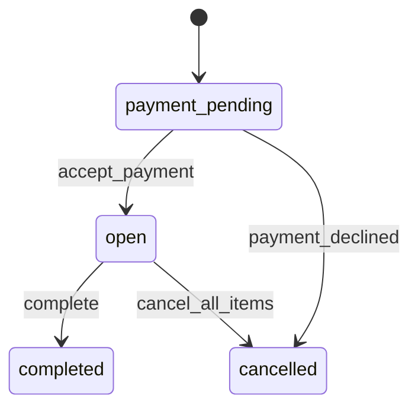
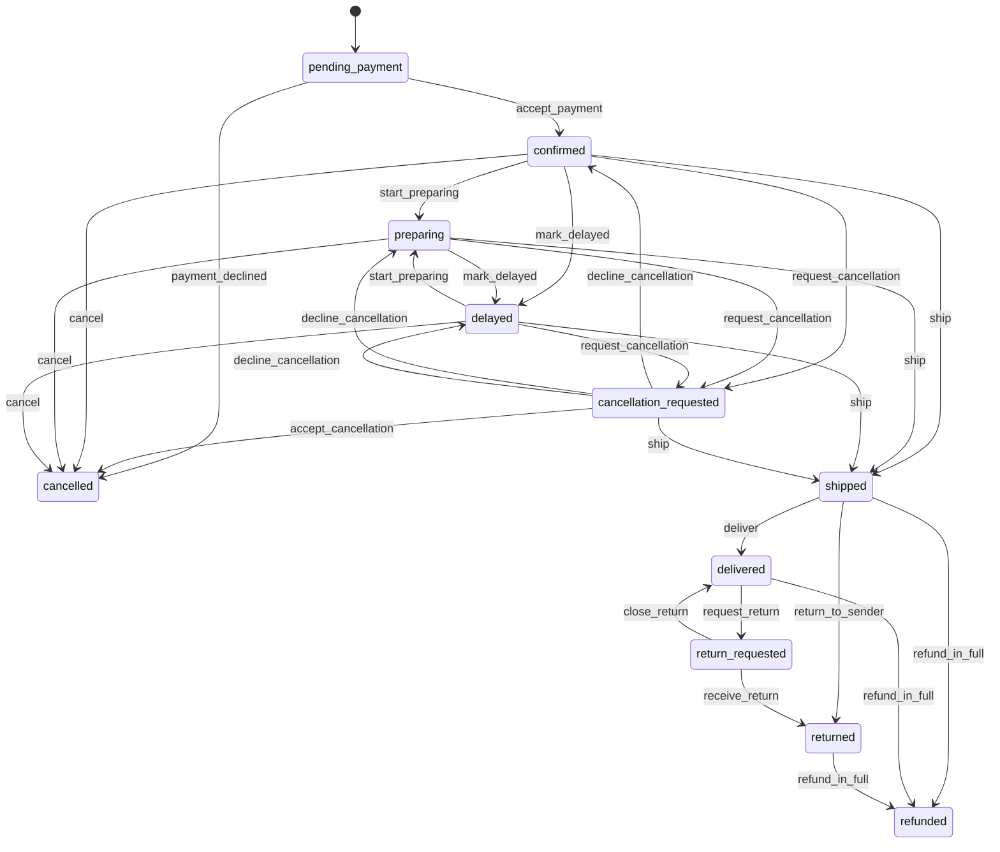
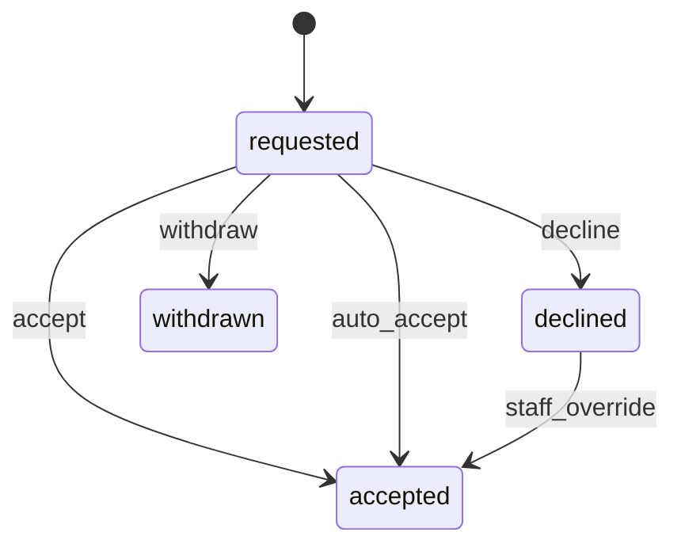

# Orders (`orders`)

The accepted purchase: one order per checkout, one seller group per seller package, and items with their own state (Confirmed, Preparing, Delayed, Shipped, Delivered, cancellation, return, refund). Keeps frozen purchase snapshots, derives the overall status from the items, tracks payment, delivery and returns progress separately, and runs item-level cancellations, seller fulfillment tasks with dispatch deadlines, timelines and purchase documents.

- **Group:** Buying · **Launch phase:** 1 · **Plan chapters:** 7, 8, 11, 12
- **Depends on:** [catalog](catalog.md), [offers](offers.md) · **Optional:** [identity](identity.md), [finance](finance.md), [support](support.md), [returns](returns.md), [promotions](promotions.md), [messaging](messaging.md), [content](content.md), [audit](audit.md), [customers](customers.md), [fulfillment-service](fulfillment-service.md), [inventory](inventory.md), [media](media.md), [notifications](notifications.md), [payments](payments.md), [reports](reports.md), [sellers](sellers.md), [settings](settings.md), [trust](trust.md), [warehouse](warehouse.md), [workqueues](workqueues.md)
- **Required by:** [checkout](checkout.md), [finance](finance.md), [messaging](messaging.md), [payments](payments.md), [returns](returns.md), [reviews](reviews.md), [shipping](shipping.md), [support](support.md), [warehouse](warehouse.md)

## Owns
- Orders with human references (MK-YYMMDD-NNNNN), delivery address copy, contact (customer or guest email/phone) and the policy versions accepted at purchase (returns, shipping, purchase terms)
- Seller groups: one per seller package, with the delivery promise, dispatch deadline and return terms accepted at checkout; each group is the seller's fulfillment task
- Order items with item-level states and frozen purchase snapshots (product, variant, offer condition and terms, price, discount, shipping and tax allocations)
- Overall order status derived from the items (e.g. Partly delivered) and separate payment, delivery and returns progress
- Cancellations item by item: customer before the cutoff (seller confirms or auto-accepts), seller cannot fulfill, staff; each with a refund preview
- Order timeline (customer-visible) and action history (staff, with reasons) and internal notes
- Receipts and per-seller invoices rendered from the frozen order
- Guest order access checks (lookup is served by customers; access grants by identity)
- Seller order lists and detail limited to the seller's own groups, with dispatch deadlines and next actions
- Admin order list across sellers with flags, saved filters and authorized, logged exports

**Not here:**
- Charging, captures and refund execution: payments (orders shows their progress from events)
- Refund approval for returns, cases and exceptions: returns (refund requests); orders only creates cancellation refunds under the cancellation policy
- Shipments, tracking, labels and delivery exceptions: shipping (orders mirrors shipment state on the items)
- Return requests, inspections and replacements: returns
- Picking and packing of Official Store groups: warehouse
- Seller earnings and fees: finance
- Guest order lookup form and emailed order links: customers

## Store API

| Method | Path | Purpose | Auth | Body → Response |
|---|---|---|---|---|
| GET | `/api/store/orders/orders` | Order history with search, date range and status tab | customer | Page<OrderSummary> |
| GET | `/api/store/orders/orders/counts` | Counts per status tab | customer | `{ all: int, inProgress: int, delivered: int, returns: int, cancelled: int }` |
| GET | `/api/store/orders/orders/{id}` | Order detail by seller group, with item states and separate payment, delivery and returns progress | shopper | `OrderDetail` |
| GET | `/api/store/orders/orders/{id}/cancellation-options` | Which items can be cancelled now and why others cannot | shopper | `CancellationOptions` |
| POST | `/api/store/orders/orders/{id}/cancellation-preview` | Refund estimate for the selected items and quantities | shopper | `{ items: CancellationLineInput[] }` → `RefundPreview` |
| POST | `/api/store/orders/orders/{id}/cancellations` | Request cancellation of selected items _(idempotent)_ | shopper | `{ items: CancellationLineInput[], reasonCode: enum(changed_mind|ordered_by_mistake|found_better_price|delivery_too_slow|other), note: text? }` → `{ requests: CancellationRequest[] }` |
| GET | `/api/store/orders/orders/{id}/cancellations/{cancellationId}` | A cancellation request with seller deadline and refund status | shopper | `CancellationRequest` |
| POST | `/api/store/orders/orders/{id}/cancellations/{cancellationId}/withdraw` | Withdraw a pending cancellation request | shopper | `CancellationRequest` |
| GET | `/api/store/orders/orders/{id}/documents` | Receipt and per-seller invoices | shopper | `OrderDocument[]` |
| GET | `/api/store/orders/orders/{id}/documents/{documentId}` | Short-lived download link for a receipt or invoice PDF | shopper | `DocumentLink` |

## Seller API

| Method | Path | Purpose | Auth | Body → Response |
|---|---|---|---|---|
| GET | `/api/seller/orders/orders` | The seller's fulfillment tasks by stage, with dispatch deadlines and next action | seller<br>`orders.fulfillment.view` | Page<SellerOrderRow> |
| GET | `/api/seller/orders/orders/counts` | Tab counts plus overdue and due today | seller<br>`orders.fulfillment.view` | `SellerOrderCounts` |
| GET | `/api/seller/orders/orders/{id}` | One fulfillment task: own items, dispatch countdown, ship-to, money, shipments, cancellation requests and timeline | seller<br>`orders.fulfillment.view` | `SellerOrderDetail` |
| POST | `/api/seller/orders/orders/{id}/start-preparing` | Mark the task as preparing (tells the buyer it is being packed) | seller<br>`orders.fulfillment.manage` | `SellerOrderDetail` |
| POST | `/api/seller/orders/orders/bulk-start-preparing` | Mark several new tasks as preparing | seller<br>`orders.fulfillment.manage` | `{ orderIds: uuid[] }` → `BulkResult` |
| POST | `/api/seller/orders/orders/{id}/report-delay` | Report that items will ship late, with a new dispatch date | seller<br>`orders.fulfillment.manage` | `{ itemIds: uuid[]?, reason: enum(supplier_delay|restock|carrier_pickup_missed|other), expectedDispatchBy: datetime, note: text? }` → `SellerOrderDetail` |
| POST | `/api/seller/orders/orders/{id}/cancel-items` | Cancel items the seller cannot fulfill _(idempotent)_ | seller<br>`orders.fulfillment.cancel` | `{ items: CancellationLineInput[], reasonCode: enum(out_of_stock|damaged_in_storage|pricing_error|cannot_ship_to_address|other), note: text? }` → `CancellationRequest` |
| POST | `/api/seller/orders/orders/{id}/cancellation-requests/{requestId}/accept` | Accept the buyer's cancellation and refund _(idempotent)_ | seller<br>`orders.fulfillment.cancel` | `CancellationRequest` |
| POST | `/api/seller/orders/orders/{id}/cancellation-requests/{requestId}/decline` | Decline because the items already shipped | seller<br>`orders.fulfillment.cancel` | `{ reason: enum(already_shipped|other), note: text? }` → `CancellationRequest` |
| GET | `/api/seller/orders/orders/{id}/packing-slip` | Packing slip for this task (only this seller's items) | seller<br>`orders.fulfillment.view` | `DocumentLink` |
| POST | `/api/seller/orders/packing-slips` | One PDF with packing slips for several tasks | seller<br>`orders.fulfillment.view` | `{ orderIds: uuid[], hidePrices: bool? }` → `DocumentLink` |
| POST | `/api/seller/orders/exports` | Export the seller's orders (own items only) _(audited)_ | seller<br>`orders.fulfillment.export` | `{ filters: json, format: enum(csv) }` → `reports.ExportJob` |
| GET | `/api/seller/orders/exports/{id}` | Export status and download link | seller<br>`orders.fulfillment.export` | `reports.ExportJob` |

## Admin API

| Method | Path | Purpose | Auth | Body → Response |
|---|---|---|---|---|
| GET | `/api/admin/orders/orders` | Company and seller orders with payment and fulfillment columns and flags | staff<br>`orders.orders.view` | Page<AdminOrderRow> |
| GET | `/api/admin/orders/orders/{id}` | Order with item states per seller group, money by seller, after-sales per item, payment, notes and history | staff<br>`orders.orders.view` | `AdminOrderDetail` |
| GET | `/api/admin/orders/orders/{id}/history` | Full action history and timeline (customer, seller and staff entries) | staff<br>`orders.orders.view` | Page<TimelineEvent> |
| POST | `/api/admin/orders/orders/{id}/notes` | Add an internal note (never shown to customers or sellers) _(audited)_ | staff<br>`orders.orders.manage` | `{ text: text }` → `InternalNote` |
| POST | `/api/admin/orders/orders/{id}/cancel-items` | Cancel unshipped items as staff, with a reason _(idempotent, audited)_ | staff<br>`orders.orders.cancel` | `{ items: CancellationLineInput[], reasonCode: enum(seller_cannot_fulfill|overdue_dispatch|customer_request|risk_review|address_problem|other), reason: text, notifyCustomer: bool, trustReportId: uuid? }` → `{ requests: CancellationRequest[] }` |
| POST | `/api/admin/orders/orders/{id}/cancellation-requests/{requestId}/decide` | Decide a customer's cancellation request for the seller (or override a decline) _(idempotent, audited)_ | staff<br>`orders.cancellations.decide` | `{ accept: bool, reason: text }` → `CancellationRequest` |
| POST | `/api/admin/orders/orders/{id}/groups/{groupId}/dispatch-deadline` | Set a final dispatch date for an overdue group _(audited)_ | staff<br>`orders.orders.manage` | `{ dueAt: datetime, reason: text, notifyCustomer: bool }` → `AdminOrderDetail` |
| POST | `/api/admin/orders/orders/{id}/resend-confirmation` | Send the order confirmation again _(audited)_ | staff<br>`orders.orders.manage` | `{ email: email? }` → 202 No content |
| GET | `/api/admin/orders/saved-filters` | My and shared saved filters with current counts | staff<br>`orders.orders.view` | `SavedFilter[]` |
| POST | `/api/admin/orders/saved-filters` | Save the current filters | staff<br>`orders.orders.view` | `{ name: string, query: json, shared: bool? }` → `SavedFilter` |
| DELETE | `/api/admin/orders/saved-filters/{id}` | Delete a saved filter (own, or shared with orders.orders.manage) | staff<br>`orders.orders.view` | 204 No content |
| POST | `/api/admin/orders/exports` | Export the filtered order list _(audited)_ | staff<br>`orders.orders.export` | `{ filters: json, columns: string[]?, format: enum(csv) }` → `reports.ExportJob` |
| GET | `/api/admin/orders/exports/{id}` | Export status and download link (download is logged) | staff<br>`orders.orders.export` | `reports.ExportJob` |

## Types

### SellerLabel

| Field | Type |
|---|---|
| ownerType | `enum(official|seller)` |
| id | `uuid?` Seller id; null for the Official Store |
| name | `string` |
| slug | `string` |
| verified | `bool` |
| logo | `MediaRef?` |

### Contact

| Field | Type |
|---|---|
| kind | `enum(customer|guest)` |
| customerId | `uuid?` |
| name | `string` |
| email | `string` Contact email (a valid address on createOrder). Order reads for staff without orders.customers.view-contact show it masked (a***@example.com), so it is a plain string; sellers never see it |
| phone | `string?` |

### DiscountAllocation

| Field | Type |
|---|---|
| code | `string?` |
| label | `string` e.g. 'WELCOME20' or 'Fall Home Sale' |
| amount | `Money` |
| fundedBy | `enum(platform|seller|shared)` |
| campaignId | `uuid?` |

### OfferTermsSnapshot

| Field | Type |
|---|---|
| offerId | `uuid` |
| termsVersion | `int` |
| condition | `enum(new|used_like_new|used_good|used_acceptable|refurbished)` |
| conditionLabel | `string` |
| conditionNotes | `text?` |
| missingItems | `string[]` |
| sellerSku | `string?` Shown to the seller and staff only |
| compareAtPrice | `Money?` |
| dispatchLabel | `string` |
| warranty | `string?` |

### ReturnTermsSnapshot

| Field | Type |
|---|---|
| summary | `string` e.g. '30-day returns. Buyer pays return shipping for change of mind.' |
| windowDays | `int` |
| returnShippingPaidBy | `enum(seller|customer|depends_on_reason)` |
| policyVersionId | `uuid?` content policy version in force at purchase |

### ItemAfterSales

| Field | Type |
|---|---|
| cancellationId | `uuid?` |
| returnId | `uuid?` |
| returnRef | `string?` |
| refundStatus | `enum(none|requested|under_review|approved|processing|sent|failed)` Mirrored from returns and payments; 'approved' is never shown as money arrived |
| refundedAmount | `Money` |
| caseRef | `string?` |

### OrderItem

| Field | Type |
|---|---|
| id | `uuid` |
| groupId | `uuid` |
| product | `catalog.ProductSnapshot` |
| offer | `OfferTermsSnapshot` |
| returnTerms | `ReturnTermsSnapshot` |
| stockItemId | `uuid` |
| categoryId | `uuid?` Product category at purchase (from the catalog snapshot); finance uses it for category fee rates |
| title | `string` |
| variantLabel | `string` |
| image | `MediaRef?` |
| quantity | `int` |
| unitPrice | `Money` |
| lineSubtotal | `Money` |
| discounts | `DiscountAllocation[]` |
| shippingShare | `Money` |
| taxShare | `Money` |
| paidAmount | `Money` lineSubtotal − discounts + shippingShare + taxShare |
| state | `enum(pending_payment|confirmed|preparing|delayed|shipped|delivered|cancellation_requested|cancelled|return_requested|returned|refunded)` |
| stateLabel | `string` |
| stateNote | `string?` e.g. 'Not shipped yet. You can cancel it until Casa Verde ships it.' |
| shipmentId | `uuid?` |
| deliveredAt | `datetime?` |
| returnWindowEndsAt | `datetime?` |
| splitFromItemId | `uuid?` Set when a partial cancel, shipment or return split the line |
| replacementOfItemId | `uuid?` |
| checkoutLineId | `string?` Checkout session line the item came from (OrderItemInput.checkoutLineId); checkout maps its lines to order items by it, not by offer id. Split lines keep it; replacement lines have none |
| afterSales | `ItemAfterSales` |
| actions | `enum(cancel|return|track|view_return|review|report_problem|contact_seller|buy_again)[]` What the viewer can do now |

### DeliveryPromise

| Field | Type |
|---|---|
| methodName | `string` |
| carrier | `string?` |
| service | `string?` |
| price | `Money` |
| free | `bool` |
| fundedBy | `enum(customer|seller|company|platform)` Who pays the shipping when it is free to the customer |
| arrival | `DateRange` |
| dispatchBy | `datetime` |

### ShipmentRef

| Field | Type |
|---|---|
| shipmentId | `uuid` |
| packageLabel | `string` |
| carrier | `string?` |
| service | `string?` |
| trackingNumber | `string?` |
| trackingUrl | `url?` |
| status | `enum(label_created|shipped|in_transit|out_for_delivery|delivered|delivery_failed|held_for_pickup|returning|returned_to_sender|lost|cancelled)` |
| statusLabel | `string` 'Shipped, tracking pending' until a carrier scan; never implies delivery |
| estimatedArrival | `DateRange?` |
| shippedAt | `datetime?` |
| deliveredAt | `datetime?` |
| itemIds | `uuid[]` |

### GroupAlert

| Field | Type |
|---|---|
| tone | `enum(info|warning|danger)` |
| title | `string` |
| message | `text` |
| caseRef | `string?` |

### SellerGroup

| Field | Type |
|---|---|
| id | `uuid` |
| packageLabel | `string` 'Package 3 of 3' |
| seller | `SellerLabel` |
| shipsFrom | `string` |
| fulfilledBy | `enum(official_warehouse|seller|marketly_service)` |
| delivery | `DeliveryPromise` |
| dispatchDeadline | `Deadline` |
| status | `enum(new|preparing|delayed|partly_shipped|shipped|partly_delivered|delivered|partly_cancelled|cancelled)` |
| statusLabel | `string` |
| estimateLabel | `string` 'Arrives Mon, Oct 12' or 'Delivered Tue, Oct 6' |
| items | `OrderItem[]` |
| shipments | `ShipmentRef[]` |
| totals | `AmountBreakdown` |
| returnTermsSummary | `string` |
| handlingNote | `string` 'Official Store item. Marketly handles returns.' or 'Casa Verde Home handles this package. Marketly support can step in.' |
| alert | `GroupAlert?` |

### AmountBreakdown

| Field | Type |
|---|---|
| items | `Money` |
| discounts | `Money` |
| shipping | `Money` |
| tax | `Money` |
| total | `Money` |

### OrderTotals

| Field | Type |
|---|---|
| itemCount | `int` |
| items | `Money` |
| discounts | `DiscountAllocation[]` |
| discountTotal | `Money` |
| shippingTotal | `Money` |
| shippingLabel | `string` 'Shipping (3 packages)' |
| tax | `Money` |
| taxLabel | `string` e.g. 'Sales tax (OR)' |
| total | `Money` |
| paidWith | `string` e.g. 'Visa •••• 4417' |
| refundedSoFar | `Money` |
| expectedRefunds | `ExpectedRefund[]` |

### ExpectedRefund

| Field | Type |
|---|---|
| label | `string` |
| ref | `string?` |
| amount | `Money` |
| status | `string` |

### OrderProgress

| Field | Type |
|---|---|
| payment | `PaymentProgress` |
| delivery | `DeliveryProgress` |
| returns | `ReturnsProgress` |

### PaymentProgress

| Field | Type |
|---|---|
| state | `enum(pending|accepted|failed|partly_refunded|refunded)` |
| label | `string` |
| amountCharged | `Money` |
| chargedAt | `datetime?` |
| methodLabel | `string` |
| note | `string` e.g. 'Visa •••• 4417 charged Sep 14. No refunds sent yet.' |

### DeliveryProgress

| Field | Type |
|---|---|
| state | `enum(not_shipped|partly_shipped|shipped|partly_delivered|delivered|delivery_issue|cancelled)` |
| label | `string` |
| packagesTotal | `int` |
| packagesDelivered | `int` |
| packageStates | `string[]` |

### ReturnsProgress

| Field | Type |
|---|---|
| state | `enum(none|requested|in_progress|completed)` |
| label | `string` |
| openReturns | `int` |
| note | `string?` |

### OrderDocument

| Field | Type |
|---|---|
| id | `uuid` |
| kind | `enum(receipt|invoice|credit_note)` |
| label | `string` 'Order receipt' or 'Invoice, Pixel & Port' |
| groupId | `uuid?` |
| number | `string` |
| format | `enum(pdf)` |
| issuedAt | `datetime` |

### DocumentLink

| Field | Type |
|---|---|
| url | `url` |
| fileName | `string` |
| expiresAt | `datetime` |

### CaseRef

| Field | Type |
|---|---|
| caseId | `uuid` |
| ref | `string` |
| status | `string` |
| itemIds | `uuid[]` |
| nextUpdateBy | `datetime?` |

### OrderSummary

| Field | Type |
|---|---|
| id | `uuid` |
| ref | `string` |
| placedAt | `datetime` |
| status | `OrderDisplayStatus` |
| statusLabel | `string` |
| total | `Money` |
| itemCount | `int` |
| sellerCount | `int` |
| packageCount | `int` |
| packages | `PackageLine[]` |
| thumbnails | `MediaRef[]` |
| note | `string?` |
| actions | `enum(view|track|return|cancel|review|buy_again)[]` |

### OrderDisplayStatus

| Field | Type |
|---|---|
| value | `enum(payment_pending|confirmed|preparing|delayed|partly_shipped|shipped|partly_delivered|delivered|partly_cancelled|cancelled|partly_refunded|refunded|completed)` Derived from the items; see notes |
| flags | `enum(cancellation_requested|return_open|delivery_issue|case_open|payment_checking)[]` |

### PackageLine

| Field | Type |
|---|---|
| label | `string` |
| sellerName | `string` |
| status | `string` |
| note | `string` |

### OrderDetail

| Field | Type |
|---|---|
| id | `uuid` |
| ref | `string` |
| placedAt | `datetime` |
| acceptedAt | `datetime?` |
| channel | `enum(web|android)` |
| contact | `Contact` |
| lifecycle | `enum(payment_pending|open|completed|cancelled)` |
| status | `OrderDisplayStatus` |
| statusLabel | `string` |
| summaryLine | `string` '4 items from 3 sellers · $513.98' |
| progress | `OrderProgress` |
| groups | `SellerGroup[]` |
| totals | `OrderTotals` |
| deliveryAddress | `Address` |
| addressNote | `string` 'To change where a package goes, contact the seller before it ships. Address book changes don't affect this order.' |
| policyVersions | `AcceptedPolicyVersion[]` Policy versions accepted at purchase (returns, shipping, purchase terms), from content.currentPolicyVersions at placement |
| documents | `OrderDocument[]` |
| cases | `CaseRef[]` |
| timeline | `TimelineEvent[]` |
| canCancelSomething | `bool` |
| paymentIntentId | `uuid?` |

### DelayedItemAlert

| Field | Type |
|---|---|
| orderId | `uuid` |
| orderRef | `string` |
| groupId | `uuid` |
| title | `string` |
| sellerName | `string` |
| newDispatchBy | `datetime?` |
| newArrival | `DateRange?` |
| options | `enum(wait|cancel|contact_support)[]` |
| caseRef | `string?` |

### CancellableItem

| Field | Type |
|---|---|
| itemId | `uuid` |
| title | `string` |
| variantLabel | `string` |
| image | `MediaRef?` |
| sellerName | `string` |
| quantity | `int` |
| maxQuantity | `int` |
| state | `string` |
| eligible | `bool` |
| reason | `string` 'Not shipped yet. Free to cancel.' or 'Already shipped. You can return it after delivery.' |
| alternative | `enum(return|refuse_delivery|view_return|track)?` |
| refundEstimate | `Money?` |

### CancellationOptions

| Field | Type |
|---|---|
| orderId | `uuid` |
| orderRef | `string` |
| cutoffRule | `string` 'You can cancel an item until its seller marks it shipped.' |
| items | `CancellableItem[]` |
| refundDestination | `string` |

### CancellationLineInput

| Field | Type |
|---|---|
| itemId | `uuid` |
| quantity | `int` |

### RefundPreviewLine

| Field | Type |
|---|---|
| itemId | `uuid` |
| title | `string` |
| quantity | `int` |
| itemAmount | `Money` |
| discountShare | `Money` |
| shippingRefund | `Money` |
| taxRefund | `Money` |
| refund | `Money` |

### RefundPreview

| Field | Type |
|---|---|
| lines | `RefundPreviewLine[]` |
| itemAmount | `Money` |
| discountShare | `Money` Coupon share deducted (coupons are split across items by value) |
| shippingRefund | `Money` |
| taxRefund | `Money` |
| total | `Money` |
| destination | `string` e.g. 'Visa •••• 4417' |
| timingNote | `string` 'Refunds are sent within 1 business day of confirmation; banks usually show them 3–5 business days after they are sent.' |
| statusNote | `string` 'Requested means no money has moved yet.' |

### CancellationRequest

| Field | Type |
|---|---|
| id | `uuid` |
| orderId | `uuid` |
| orderRef | `string` |
| groupId | `uuid` |
| seller | `SellerLabel` |
| initiatedBy | `enum(customer|seller|staff|system)` |
| reasonCode | `string` |
| reason | `text?` |
| items | `CancellationLine[]` |
| status | `enum(requested|accepted|declined|withdrawn)` |
| respondBy | `Deadline?` Seller confirmation deadline for customer requests |
| decidedBy | `Actor?` |
| decidedAt | `datetime?` |
| declineReason | `string?` |
| refundPreview | `RefundPreview` |
| refundStatus | `enum(none|requested|processing|sent|failed)` |
| paymentRefundId | `uuid?` |
| createdAt | `datetime` |
| timeline | `TimelineEvent[]` |

### CancellationLine

| Field | Type |
|---|---|
| itemId | `uuid` |
| title | `string` |
| variantLabel | `string` |
| quantity | `int` |
| shipped | `bool` |

### FulfillmentTask

| Field | Type |
|---|---|
| groupId | `uuid` |
| orderId | `uuid` |
| orderRef | `string` |
| seller | `SellerLabel` |
| fulfilledBy | `enum(official_warehouse|seller|marketly_service)` |
| shipTo | `Address` |
| delivery | `DeliveryPromise` |
| dispatchDeadline | `Deadline` |
| giftNote | `string?` |
| hidePricesOnSlip | `bool` |
| openLines | `FulfillmentLine[]` |

### FulfillmentLine

| Field | Type |
|---|---|
| orderItemId | `uuid` |
| stockItemId | `uuid` |
| offerId | `uuid` |
| title | `string` |
| variantLabel | `string` |
| sellerSku | `string?` |
| quantityToShip | `int` |

### ItemPaidAmount

| Field | Type |
|---|---|
| orderItemId | `uuid` |
| groupId | `uuid` |
| ownerType | `enum(official|seller)` |
| sellerId | `uuid?` |
| quantity | `int` |
| itemAmount | `Money` |
| discountShare | `Money` |
| shippingShare | `Money` |
| taxShare | `Money` |
| paid | `Money` |

### SellerOrderRow

| Field | Type |
|---|---|
| id | `uuid` Seller group id (the seller's fulfillment task) |
| orderId | `uuid` |
| ref | `string` |
| placedAt | `datetime` |
| buyerName | `string` First name and last initial, e.g. 'Sam R.' |
| itemsSummary | `string` |
| units | `int` |
| total | `Money` |
| status | `enum(new|preparing|delayed|partly_shipped|shipped|in_transit|out_for_delivery|delivered|completed|cancelled|partly_refunded|cancellation_requested)` |
| statusLabel | `string` |
| dispatchDeadline | `Deadline` |
| deadlineLabel | `string` 'Due today 5:00 PM', 'Overdue 3 h', 'Shipped Oct 6 · 1 day late' |
| fulfilledBy | `enum(official_warehouse|seller|marketly_service)` |
| nextAction | `enum(prepare|record_shipment|ship_remaining|view_tracking|respond_cancellation|view|marketly_fulfils)` marketly_fulfils for Fulfilled by Marketly groups: Marketly picks, packs and ships; the seller only views |
| note | `string?` e.g. '1 of 2 items shipped' |

### SellerOrderCounts

| Field | Type |
|---|---|
| new | `int` |
| preparing | `int` |
| shipped | `int` |
| completed | `int` |
| cancellationRequests | `int` |
| overdue | `int` |
| dueToday | `int` |
| fulfilledByMarketly | `int` Open Fulfilled by Marketly groups; they are left out of new, preparing, cancellationRequests, overdue and dueToday |

### SellerOrderItem

| Field | Type |
|---|---|
| itemId | `uuid` |
| title | `string` |
| variantLabel | `string` |
| condition | `string` |
| sellerSku | `string?` |
| image | `MediaRef?` |
| quantity | `int` |
| unitPrice | `Money` |
| lineTotal | `Money` |
| state | `string` |
| shippedQuantity | `int` |
| cancelledQuantity | `int` |

### SellerOrderMoney

| Field | Type |
|---|---|
| itemSubtotal | `Money` |
| sellerDiscounts | `Money` |
| shippingCharged | `Money` |
| shippingLabel | `string` |
| platformFeeEstimate | `Money?` From finance.calculateFee when finance is on |
| earningsEstimate | `Money?` |
| earningsNote | `string` 'Earnings stay pending until delivery and the hold period end.' |

### SellerOrderDetail

| Field | Type |
|---|---|
| id | `uuid` |
| orderId | `uuid` |
| ref | `string` |
| placedAt | `datetime` |
| buyerName | `string` |
| paymentAccepted | `bool` |
| status | `string` |
| statusLabel | `string` For Fulfilled by Marketly groups 'Fulfilled by Marketly · <warehouse stage>', e.g. 'Fulfilled by Marketly · Picking' |
| fulfilledBy | `enum(official_warehouse|seller|marketly_service)` |
| dispatchDeadline | `Deadline` |
| timeLeftMinutes | `int?` |
| dispatchResult | `string?` 'Shipped on time' after shipment |
| items | `SellerOrderItem[]` |
| mixedOrderNote | `string?` 'The customer's order also has items from other sellers. You only see and handle your own items.' |
| money | `SellerOrderMoney` |
| shipTo | `Address` Full address and phone for the carrier, only while the task is open plus the return window. Fulfilled by Marketly groups: city and region only (decision D10) |
| delivery | `DeliveryPromise` |
| giftNote | `string?` |
| hidePricesOnSlip | `bool` |
| shipments | `ShipmentRef[]` |
| cancellationRequests | `CancellationRequest[]` |
| timeline | `TimelineEvent[]` |
| allowedActions | `enum(start_preparing|report_delay|record_shipment|cancel_items|respond_cancellation|print_packing_slip)[]` Empty for Fulfilled by Marketly groups |

### BulkResult

| Field | Type |
|---|---|
| updated | `int` |
| failed | `BulkFailure[]` |

### BulkFailure

| Field | Type |
|---|---|
| id | `uuid` |
| code | `string` |
| message | `string` |

### OrderFlag

| Field | Type |
|---|---|
| kind | `enum(payment_failed|payment_checking|overdue_dispatch|due_soon|cancellation_requested|return_requested|case_open|seller_restricted|chargeback|delivery_issue)` |
| tone | `enum(danger|warning|info)` |
| label | `string` |

### AdminOrderRow

| Field | Type |
|---|---|
| id | `uuid` |
| ref | `string` |
| placedAt | `datetime` |
| customerName | `string` |
| customerCity | `string` |
| guest | `bool` |
| sellers | `SellerLabel[]` |
| itemCount | `int` |
| total | `Money` |
| paymentState | `enum(pending_check|authorized|captured|failed|partly_refunded|refunded)` |
| fulfillmentStatus | `string` |
| fulfillmentNote | `string` |
| lateBy | `string?` 'Overdue 16 d' |
| owner | `string?` Who handles the overdue group (warehouse, seller or a named manager) |
| flags | `OrderFlag[]` |

### GroupMoney

| Field | Type |
|---|---|
| groupId | `uuid` |
| seller | `SellerLabel` |
| items | `Money` |
| platformFunded | `Money` |
| sellerFunded | `Money` |
| customerPaid | `Money` |
| marketplaceFee | `Money?` From finance; null for Official Store (company sales) |
| sellerEarnings | `Money?` |
| companySale | `bool` |

### AdminItemAfterSales

| Field | Type |
|---|---|
| itemId | `uuid` |
| title | `string` |
| sellerName | `string` |
| request | `string` |
| amount | `Money?` |
| status | `string` |
| owner | `string?` |

### AdminPaymentPanel

| Field | Type |
|---|---|
| state | `string` |
| methodLabel | `string` |
| authorizedAt | `datetime?` |
| capturedAt | `datetime?` |
| processorRef | `string?` |
| captured | `Money` |
| refunded | `Money` |

### InternalNote

| Field | Type |
|---|---|
| id | `uuid` |
| text | `text` |
| author | `Actor` |
| at | `datetime` |

### AdminCustomerPanel

| Field | Type |
|---|---|
| customerId | `uuid?` |
| guest | `bool` |
| name | `string` |
| email | `string` Masked unless orders.customers.view-contact |
| phone | `string?` |
| customerSince | `date?` |
| orderCount | `int?` |

### AdminOrderDetail

| Field | Type |
|---|---|
| order | `OrderDetail` |
| customer | `AdminCustomerPanel` |
| flags | `OrderFlag[]` |
| alerts | `GroupAlert[]` |
| afterSales | `AdminItemAfterSales[]` |
| moneyBySeller | `GroupMoney[]` |
| couponFundingNote | `string?` |
| payment | `AdminPaymentPanel` |
| notes | `InternalNote[]` |
| history | `TimelineEvent[]` Staff action history with names and reasons (latest 20; full list via timeline endpoint) |
| allowedActions | `enum(cancel_items|issue_refund|contact_seller|open_case|add_note|extend_deadline|resend_confirmation)[]` |

### SavedFilter

| Field | Type |
|---|---|
| id | `uuid` |
| name | `string` |
| query | `json` Same keys as GET /orders query |
| shared | `bool` |
| owner | `Actor` |
| count | `int?` Current match count, refreshed every 5 minutes |
| createdAt | `datetime` |

### OrderItemInfo

| Field | Type |
|---|---|
| id | `uuid` |
| orderId | `uuid` |
| orderRef | `string` |
| groupId | `uuid` |
| ownerType | `enum(official|seller)` |
| sellerId | `uuid?` |
| customerId | `uuid?` |
| offerId | `uuid` |
| productId | `uuid` |
| variantId | `uuid` |
| stockItemId | `uuid` |
| categoryId | `uuid?` |
| quantity | `int` |
| state | `enum(pending_payment|confirmed|preparing|delayed|shipped|delivered|cancellation_requested|cancelled|return_requested|returned|refunded)` |
| deliveredAt | `datetime?` |
| returnWindowEndsAt | `datetime?` |

### AcceptedItem

| Field | Type |
|---|---|
| orderItemId | `uuid` |
| offerId | `uuid` |
| stockItemId | `uuid` |
| quantity | `int` |

### PlacedGroup

| Field | Type |
|---|---|
| groupId | `uuid` |
| ownerType | `enum(official|seller)` |
| sellerId | `uuid?` |
| fulfilledBy | `enum(official_warehouse|seller|marketly_service)` |
| dispatchBy | `datetime` |
| itemIds | `uuid[]` |
| total | `Money` |

### RefundBreakdownPayload

| Field | Type |
|---|---|
| itemAmount | `Money` |
| discountShare | `Money` |
| shippingRefund | `Money` |
| taxRefund | `Money` |
| total | `Money` |

### AcceptedPolicyVersion

| Field | Type |
|---|---|
| policyKey | `enum(returns|shipping|purchase_terms)` |
| versionId | `uuid` |
| version | `string` |
| effectiveAt | `datetime` |

### OrderCreateInput

| Field | Type |
|---|---|
| checkoutSessionId | `uuid` |
| attemptNo | `int?` Payment attempt that this order belongs to (default 1). createOrder is idempotent per (checkoutSessionId, attemptNo); checkout passes the next number when the customer retries after a pending payment was finally declined |
| reservationId | `uuid?` Checkout's inventory stock hold for this order; carried on orders.order.accepted so inventory can allocate from it |
| deliveryAddressId | `uuid?` Saved customer address the delivery address came from (customers module); null for guests and one-off addresses |
| visitorId | `string?` Visitor id of the shopper's app session, set only when the shopper allowed personalization (advertising attributes guest orders to ad clicks by it). Null otherwise |
| contact | `Contact` |
| channel | `enum(web|android)` |
| currency | `string` |
| deliveryAddress | `Address` |
| giftNote | `string?` |
| hidePricesOnSlip | `bool` |
| policyVersions | `AcceptedPolicyVersion[]` From content.currentPolicyVersions(['returns', 'shipping', 'purchase_terms']) read by checkout at placement; empty when content is off |
| couponCodes | `string[]` |
| paymentIntentId | `uuid` |
| paymentState | `enum(accepted|pending_check)` The authorize result: accepted when the payment is already authorized (or nothing is left to pay by card), pending_check only when the provider is still checking |
| paymentMethodLabel | `string` |
| groups | `OrderGroupInput[]` |
| totals | `AmountBreakdown` |

### OrderGroupInput

| Field | Type |
|---|---|
| key | `string` |
| ownerType | `enum(official|seller)` |
| sellerId | `uuid?` |
| shipsFrom | `string` |
| fulfilledBy | `enum(official_warehouse|seller|marketly_service)` |
| delivery | `DeliveryPromise` |
| returnTermsSummary | `string` |
| items | `OrderItemInput[]` |
| totals | `AmountBreakdown` |

### OrderItemInput

| Field | Type |
|---|---|
| offerId | `uuid` |
| variantId | `uuid` |
| stockItemId | `uuid` |
| quantity | `int` |
| unitPrice | `Money` |
| discounts | `DiscountAllocation[]` |
| shippingShare | `Money` |
| taxShare | `Money` |
| returnTerms | `ReturnTermsSnapshot` |
| checkoutLineId | `string` |

## Status flows

### Order lifecycle (`OrderDetail.lifecycle`)



An order exists only after a payment was authorized or its result is uncertain; a declined first attempt creates no order. With an accepted payment the order is created and accepted in one transaction. complete: every item is in a final state (delivered past its return window, cancelled, returned or refunded) and no return, case or refund is open (job orders.complete-orders). The overall display status is derived separately (see notes).

### Order item (`OrderItem.state`)



Plan ch. 7 and 12 item states. decline_cancellation (or withdraw) restores the state held before the request (stored in state_before_request); ship from cancellation_requested happens when the seller declines because it already shipped. return_to_sender: a failed delivery the customer chose not to retry. refund_in_full only when the line's whole refundable amount is Sent (payments.refund.sent); partial amounts keep the state and raise refundedAmount, so a partial refund never marks every item refunded. Partial quantities split the line first: e.g. cancelling 1 of 2 creates a cancelled line of 1 and keeps a line of 1, with discount, shipping and tax shares re-allocated by largest remainder in cents. A replacement from returns adds a new confirmed line with replacementOfItemId.

### Cancellation request (`CancellationRequest.status`)



Customer requests start as requested; the seller confirms by respondBy (end of the next business day by default) or the request is auto-accepted if nothing has shipped. Official Store and Fulfilled by Marketly requests (any group whose fulfilledBy is not seller) are accepted at once while warehouse picking has not started; after that they wait for the Order Manager (decideCancellationAdmin, orders.cancellations.decide) and the seller endpoints refuse them with FULFILLED_BY_MARKETLY (decision D6). Seller ('cannot fulfill') and staff cancellations are created directly as accepted. accepted publishes orders.item.cancelled per item with the refund breakdown; payments sends the refund under the cancellation policy (no Finance approval).

## Data (schema `orders`)

**orders**: One per checkout

| Column | Type |
|---|---|
| id | uuid pk |
| ref | text unique (MK-YYMMDD-NNNNN) |
| checkout_session_id | uuid |
| attempt_no | int |
| reservation_id | uuid? |
| delivery_address_id | uuid? |
| customer_id | uuid? |
| contact_email | text |
| contact_phone | text? |
| contact_name | text |
| channel | text |
| lifecycle | text (payment_pending|open|completed|cancelled) |
| display_status | text |
| flag_kinds | text[] (OrderFlag kinds in force, recomputed on every change and by orders.refresh-flags) |
| currency | text |
| items_total | int |
| discount_total | int |
| shipping_total | int |
| tax_total | int |
| total | int |
| delivery_address | jsonb |
| gift_note | text? |
| hide_prices | bool |
| policy_versions | jsonb (AcceptedPolicyVersion[]) |
| coupon_codes | jsonb |
| payment_intent_id | uuid |
| payment_state | text |
| payment_method_label | text |
| captured_total | int |
| refunded_total | int |
| placed_at | timestamptz |
| accepted_at | timestamptz? |
| completed_at | timestamptz? |

Indexes: `unique (checkout_session_id, attempt_no)`, `(customer_id, placed_at desc)`, `(lower(contact_email)) where customer_id is null`, `(display_status, placed_at desc)`, `(lifecycle)`, `gin(contact_name gin_trgm_ops)`, `gin(contact_email gin_trgm_ops)`, `gin(flag_kinds)`

**order_facts**: Event-fed facts about an order, one row per source record: payment captures, chargebacks, support cases, refunds sent, approved return refunds not sent yet, delivery exceptions, seller restrictions and resent confirmations. The flags, alerts, expected refunds and case references are derived from them

| Column | Type |
|---|---|
| id | uuid pk |
| order_id | uuid → orders |
| kind | text (capture|chargeback|case|refund_sent|refund_approval|delivery_issue|seller_restricted|confirmation_resent) |
| source_id | uuid (the capture, dispute, case, refund, refund request, exception or seller group id; a new id for a resent confirmation) |
| group_id | uuid? |
| shipment_id | uuid? |
| ref | text? (case ref, return ref, dispute ref) |
| status | text? (case: open|resolved|closed…; refund_approval: approved|sent) |
| subkind | text? (dispute kind, exception kind) |
| customer_action | text? (delivery issue: what the customer is asked to do) |
| amount | int? (capture, approved refund) |
| item_ids | uuid[]? (case and approved refund items) |
| due_at | timestamptz? (delivery issue due, case next update) |
| at | timestamptz |

Indexes: `unique (order_id, kind, source_id)`, `(kind, source_id)`

**seller_groups**: One per seller package; the seller's fulfillment task

| Column | Type |
|---|---|
| id | uuid pk |
| order_id | uuid → orders |
| position | int |
| owner_type | text |
| seller_id | uuid? |
| seller_name | text |
| ships_from | text |
| fulfilled_by | text |
| delivery | jsonb (DeliveryPromise) |
| dispatch_by | timestamptz |
| dispatch_by_history | jsonb |
| status | text |
| return_terms_summary | text |
| items_total | int |
| discount_total | int |
| shipping_total | int |
| tax_total | int |
| total | int |
| shipped_at | timestamptz? |
| delivered_at | timestamptz? |

Indexes: `(seller_id, status, dispatch_by)`, `(order_id)`, `(status, dispatch_by)`

**order_items**: Item lines with state and frozen snapshots; partial actions split lines

| Column | Type |
|---|---|
| id | uuid pk |
| order_id | uuid → orders |
| group_id | uuid → seller_groups |
| offer_id | uuid |
| product_id | uuid |
| variant_id | uuid |
| stock_item_id | uuid |
| category_id | uuid? |
| product_snapshot | jsonb (catalog.ProductSnapshot) |
| offer_snapshot | jsonb (offers.OfferSnapshot) |
| return_terms | jsonb |
| quantity | int |
| unit_price | int |
| discounts | jsonb |
| shipping_share | int |
| tax_share | int |
| paid_amount | int |
| refunded_amount | int |
| refund_status | text |
| state | text |
| state_before_request | text? |
| shipment_id | uuid? |
| return_id | uuid? |
| return_ref | text? |
| delivered_at | timestamptz? |
| return_window_ends_at | timestamptz? |
| split_from_item_id | uuid? → order_items |
| replacement_of_item_id | uuid? → order_items |
| checkout_line_id | text? |

Indexes: `(order_id)`, `(group_id, state)`, `(offer_id)`, `(product_id)`, `(split_from_item_id)`

**item_state_log**: Every item state change

| Column | Type |
|---|---|
| id | uuid pk |
| item_id | uuid → order_items |
| from_state | text |
| to_state | text |
| event | text |
| reason | text? |
| actor_kind | text |
| actor_id | text? |
| at | timestamptz |

Indexes: `(item_id, at)`

**cancellations**: Cancellation requests and direct cancellations

| Column | Type |
|---|---|
| id | uuid pk |
| order_id | uuid → orders |
| group_id | uuid → seller_groups |
| initiated_by | text |
| reason_code | text |
| reason | text? |
| items | jsonb |
| status | text |
| respond_by | timestamptz? |
| decided_by | jsonb? |
| decided_at | timestamptz? |
| decline_reason | text? |
| refund_preview | jsonb |
| refund_status | text |
| payment_refund_id | uuid? |
| idempotency_key | text? |
| created_at | timestamptz |

Indexes: `(group_id, status)`, `(status, respond_by)`, `unique (order_id, idempotency_key)`

**shipment_refs**: Projection of shipping events for display, search by tracking number and flags

| Column | Type |
|---|---|
| shipment_id | uuid pk |
| order_id | uuid → orders |
| group_id | uuid → seller_groups |
| package_label | text |
| carrier | text? |
| service | text? |
| tracking_number | text? |
| tracking_url | text? |
| status | text |
| estimated_arrival | jsonb? |
| shipped_at | timestamptz? |
| delivered_at | timestamptz? |
| item_ids | jsonb |

Indexes: `(order_id)`, `(tracking_number)`

**timeline**: Customer-visible events and staff action history

| Column | Type |
|---|---|
| id | uuid pk |
| order_id | uuid → orders |
| group_id | uuid? |
| item_id | uuid? |
| visibility | text (customer|seller|staff) |
| label | text |
| detail | text? |
| reason | text? |
| actor_kind | text |
| actor_id | text? |
| actor_name | text? |
| at | timestamptz |

Indexes: `(order_id, at desc)`

**notes**: Internal staff notes

| Column | Type |
|---|---|
| id | uuid pk |
| order_id | uuid → orders |
| text | text |
| author_id | uuid |
| author_name | text |
| at | timestamptz |

**documents**: Issued receipt and invoice numbers; PDFs render from the frozen order on request

| Column | Type |
|---|---|
| id | uuid pk |
| order_id | uuid → orders |
| group_id | uuid? |
| kind | text |
| number | text unique |
| issued_at | timestamptz |

**saved_filters**

| Column | Type |
|---|---|
| id | uuid pk |
| owner_staff_id | uuid |
| name | text |
| query | jsonb |
| shared | bool |
| cached_count | int? |
| counted_at | timestamptz? |
| created_at | timestamptz |

**ref_sequences**: Daily counters for MK-YYMMDD-NNNNN

| Column | Type |
|---|---|
| day | date pk |
| last_value | int |

## Events

| Publishes | When | Payload | Consumed by |
|---|---|---|---|
| `orders.order.placed` | An order is created after an authorized or pending payment | `{ orderId: uuid, ref: string, checkoutSessionId: uuid, customerId: uuid?, guestEmail: email?, paymentIntentId: uuid, paymentState: enum(accepted|pending_check), total: Money, couponCodes: string[], groups: PlacedGroup[], placedAt: datetime, attemptNo: int, deliveryAddressId: uuid?, contactName: string, visitorId: string? }` | advertising, customers, payments, promotions, reports, search, trust, wallet |
| `orders.order.accepted` | Payment accepted: fulfillment tasks start, confirmation is sent | `{ orderId: uuid, ref: string, customerId: uuid?, contactEmail: email, total: Money, groups: PlacedGroup[], items: AcceptedItem[], reservationId: uuid?, acceptedAt: datetime }` | finance, fulfillment-service, inventory, notifications, payments, reports, sellers, shipping, warehouse |
| `orders.order.cancelled` | A pending payment was declined, or every item was cancelled | `{ orderId: uuid, ref: string, reason: enum(payment_declined|all_items_cancelled), checkoutSessionId: uuid }` | checkout, fulfillment-service, payments, search |
| `orders.order.completed` | Every item is final and no return, case or refund is open | `{ orderId: uuid, ref: string, completedAt: datetime }` | messaging, reports |
| `orders.item.state_changed` | Any item state change (for timelines, notifications and reports) | `{ orderId: uuid, groupId: uuid, itemId: uuid, from: string, to: string, actor: Actor, at: datetime }` | - |
| `orders.item.cancelled` | Items are cancelled (customer request accepted, seller cannot fulfill, staff) | `{ orderId: uuid, ref: string, customerId: uuid?, contactEmail: email?, groupId: uuid, ownerType: enum(official|seller), sellerId: uuid?, fulfilledBy: enum(official_warehouse|seller|marketly_service), itemId: uuid, offerId: uuid, stockItemId: uuid, quantity: int, cancellationId: uuid, initiatedBy: enum(customer|seller|staff|system), reasonCode: string, beforeDispatch: bool, countsAgainstSeller: bool, refund: RefundBreakdownPayload, paymentIntentId: uuid, trustReportId: uuid?, notifyCustomer: bool }` | advertising, finance, fulfillment-service, inventory, notifications, payments, promotions, reports, returns, reviews, sellers, shipping, support, trust, warehouse, workqueues |
| `orders.item.split` | A partial cancellation, shipment or return splits an item line: the original line keeps its id with the remaining quantity and a new line takes the split-off quantity (splitFromItemId = original) | `{ orderId: uuid, groupId: uuid, itemId: uuid, newItemId: uuid, rootItemId: uuid, offerId: uuid, stockItemId: uuid, quantity: int, remainingQuantity: int, reason: enum(cancellation|shipment|return|replacement), at: datetime }` | fulfillment-service, inventory, promotions, warehouse |
| `orders.item.delayed` | Items become Delayed (seller report or overdue dispatch) | `{ orderId: uuid, customerId: uuid?, contactEmail: email?, groupId: uuid, itemIds: uuid[], source: enum(seller|overdue), expectedDispatchBy: datetime?, reason: string }` | notifications |
| `orders.item.delivered` | Items in a delivered shipment become Delivered | `{ orderId: uuid, groupId: uuid, ownerType: enum(official|seller), sellerId: uuid?, itemId: uuid, quantity: int, deliveredAt: datetime, returnWindowEndsAt: datetime, customerId: uuid?, contactEmail: email? }` | finance, reports, returns, reviews |
| `orders.cancellation.requested` | A customer asks to cancel items that need the seller's confirmation (or, for Official Store and Fulfilled by Marketly groups already being picked, the Order Manager's decision) | `{ cancellationId: uuid, orderId: uuid, groupId: uuid, sellerId: uuid?, fulfilledBy: enum(official_warehouse|seller|marketly_service), itemIds: uuid[], respondBy: datetime }` | notifications |
| `orders.cancellation.decided` | A request is accepted, auto-accepted, declined or withdrawn | `{ cancellationId: uuid, orderId: uuid, customerId: uuid?, contactEmail: email?, outcome: enum(accepted|auto_accepted|declined|withdrawn), by: Actor }` | notifications |
| `orders.dispatch_deadline.changed` | A group's dispatch deadline is recalculated or extended by staff | `{ orderId: uuid, groupId: uuid, dueAt: datetime, previousDueAt: datetime, reason: string, by: Actor }` | shipping |
| `orders.confirmation.requested` | Staff resend the order confirmation | `{ orderId: uuid, email: email }` | - |

| Consumes | From | Does |
|---|---|---|
| `payments.payment.authorized` | payments | Accept a payment_pending order when its uncertain payment is confirmed (acceptOrder) |
| `payments.payment.failed` | payments | Cancel a payment_pending order whose payment was finally declined (no refund needed) |
| `payments.payment.captured` | payments | Update payment progress (charged amount and date) |
| `payments.refund.status_changed` | payments | Mirror refund progress on the items (processing, sent, failed) and the order's refunded total |
| `payments.refund.sent` | payments | Add to refundedAmount; move a line to refunded when its whole refundable amount is sent |
| `payments.chargeback.opened` | payments | Flag the order (chargeback) |
| `shipping.shipment.created` | shipping | Add the shipment to the group projection (carrier, tracking, contents) for display and tracking-number search |
| `shipping.shipment.dispatched` | shipping | Items in the shipment become Shipped (splitting lines for partial quantities) |
| `shipping.shipment.status_changed` | shipping | Update the shipment projection and the delivery progress |
| `shipping.shipment.delivered` | shipping | Items become Delivered; publish orders.item.delivered with the return window end |
| `shipping.shipment.exception` | shipping | Flag delivery issues on the group (failed delivery, lost or damaged, missing tracking) |
| `shipping.dispatch.overdue` | shipping | Unshipped items of the group become Delayed; publish orders.item.delayed (customer is told and offered support) |
| `shipping.tracking.corrected` | shipping | Update the projection and add a timeline entry |
| `warehouse.fulfillment.status_changed` | warehouse | Official Store items become Preparing when picking starts (and close the window for instant cancellation) |
| `returns.return.requested` | returns | Items become Return requested |
| `returns.return.received` | returns | Items become Returned |
| `returns.return.cancelled` | returns | Items go back to Delivered |
| `returns.return.rejected` | returns | Items go back to Delivered |
| `returns.refund.approved` | returns | Item refund status Approved (shown as not yet sent) |
| `returns.replacement.created` | returns | Add a replacement line (confirmed) linked to the original item; the original keeps its history |
| `support.case.opened` | support | Flag the order and link the case to its items |
| `support.case.resolved` | support | Unlink the case (payload orderId); clear the case_open flag when no other case on the order is open |
| `support.case.reopened` | support | Link the case again and set the case_open flag (payload orderId) |
| `sellers.seller.restricted` | sellers | Flag open groups of the seller (seller_restricted); orders stay accessible and fulfillable |
| `identity.user.verified` | identity | Attach guest orders placed with the verified email to the new customer account |

## In-process API (for other modules)

| Function | Signature | Used by |
|---|---|---|
| createOrder | `(input: OrderCreateInput) => OrderDetail`<br>Create the order from an authorized or pending payment. Freezes catalog.snapshotForOrder and offers.snapshotForOrder per item. Fulfilled by Marketly check: with fulfillment-service on, a marketly_service group must hold only offers where fulfillment-service.isServiceOffer is true and a seller group none (VALIDATION_FAILED); with it off a marketly_service group is refused. Status open when paymentState=accepted (publishes orders.order.placed and orders.order.accepted in one transaction), payment_pending otherwise (publishes orders.order.placed only). Idempotent per (checkoutSessionId, attemptNo): a second call with the same pair returns the existing order; a retry after a finally declined pending payment passes the next attemptNo and gets a new order (the declined one stays cancelled). paymentState is the real authorize result: accepted creates the order open in one step; only pending_check creates it payment_pending. Attaches each item's snapshot image to the order (media.attach, usage kind order_evidence, ref the order id) so the image outlives catalog changes. | checkout |
| acceptOrder | `(orderId: uuid, paymentIntentId: uuid) => OrderDetail`<br>payment_pending → open when the payment result arrives (also done on payments.payment.authorized). Idempotent. | checkout |
| cancelForDeclinedPayment | `(orderId: uuid) => void`<br>payment_pending → cancelled when a pending payment is finally declined (also done on payments.payment.failed). | checkout |
| getOrder | `(orderId: uuid) => OrderDetail | null`<br>Full order for other modules (no access check) | payments, shipping, returns, support, finance, messaging, warehouse, reviews |
| getFulfillmentTask | `(groupId: uuid) => FulfillmentTask`<br>Seller group with ship-to address, delivery promise, dispatch deadline and items still to ship | shipping, warehouse |
| canShipItems | `(groupId: uuid, lines: { orderItemId: uuid, quantity: int }[]) => { ok: bool, problems: string[] }`<br>Items belong to the group, are not cancelled or already shipped, and quantities fit | shipping, warehouse |
| setDispatchDeadline | `(groupId: uuid, dueAt: datetime, reason: string, actor: Actor) => void`<br>Recalculated deadline (e.g. a payment accepted late) or a staff extension; publishes orders.dispatch_deadline.changed | shipping |
| getPaidAmounts | `(orderId: uuid) => ItemPaidAmount[]`<br>Per item: paid amount split into item, discount share, shipping share and tax share, for refund caps | payments, returns, support |
| findGuestOrder | `(orderRef: string, email: string) => { orderId: uuid } | null`<br>Match a guest order by reference and checkout email (case-insensitive); used by the guest lookup | customers |
| listGuestOrdersByEmail | `(email: string) => { orderId: uuid, ref: string, placedAt: datetime }[]`<br>Guest orders for emailed order links | customers |
| countInProgress | `(customerId: uuid) => { inProgress: int, delayedPackages: int }`<br>Account overview tile | customers |
| listRecentForCustomer | `(customerId: uuid, limit: int) => OrderSummary[]`<br>Account overview recent orders | customers |
| listDelayedItemsForCustomer | `(customerId: uuid) => DelayedItemAlert[]`<br>Account overview delay alerts with new estimate and options | customers |
| countPurchased | `(customerId: uuid, offerId: uuid, sinceDays: int) => int`<br>Units bought recently, for per-customer purchase limits | checkout, promotions |
| hasPlacedOrder | `(who: { customerId?: uuid, email?: string }) => bool`<br>True when the customer (or, for guests, the normalised contact email) has an order that was accepted (lifecycle open, completed, or cancelled after acceptance). Orders still payment_pending or cancelled for a declined payment do not count. Promotions new_customers audience. | promotions |
| isVerifiedPurchase | `(customerId: uuid, productId: uuid) => { orderItemId: uuid, deliveredAt: datetime } | null`<br>Delivered purchase of the product for Verified Purchase labels | reviews |
| getOrderForViewer | `(viewer: { customerId?: uuid, guestSessionId?: uuid }, ref: string) => OrderDetail | null`<br>Store order detail by reference. Returns the order only when it belongs to the signed-in customer or the guest session has access (identity.hasGuestOrderAccess); otherwise null (NOT_FOUND). | graphql |
| listOrdersForCustomer | `(customerId: uuid, filter: { q?: string, range?: string, from?: date, to?: date, tab?: string }, page: PageInput) => Page<OrderDetail>`<br>Order history with search, date range and status tab (same filters as GET /orders); fields are resolved lazily so list cards stay cheap | graphql |
| countOrdersByTab | `(customerId: uuid, range?: string) => { all: int, inProgress: int, delivered: int, returns: int, cancelled: int, delayedPackages: int }`<br>Counts per status tab plus delayed packages (account overview tiles, order list tabs, customer 360) | graphql |
| getOrderForSeller | `(sellerId: uuid, ref: string) => { order: OrderDetail, groups: SellerOrderDetail[] } | null`<br>One order as a seller sees it: only the seller's own groups (items, money, ship-to while needed, cancellations, timeline) and seller-safe order fields. Null (NOT_FOUND) when the order has no group of this seller. | graphql |
| listOrdersForSeller | `(sellerId: uuid, filter: { tab?: string, tabs?: string[], q?: string, placedFrom?: date, placedTo?: date, overdueOnly?: bool, sort?: string, fulfilledBy?: string }, page: PageInput) => Page<{ order: OrderDetail, groups: SellerOrderDetail[] }>`<br>The seller's orders by stage with dispatch deadlines (same filters as seller GET /orders); own groups only | graphql, search |
| countSellerOrders | `(sellerId: uuid) => SellerOrderCounts`<br>Seller tab counts plus overdue and due today | graphql |
| getOrderAdmin | `(ref: string, principal?: identity.Principal) => AdminOrderDetail | null`<br>Order 360 across sellers for staff: groups, items, money by seller, after-sales, flags, notes and staff history. Contact details masked unless the principal holds orders.customers.view-contact (masked when no principal is given). | graphql |
| listOrdersAdmin | `(filter: { q?: string, sellerType?: string, sellerId?: uuid, customerId?: uuid, fulfillmentStatus?: string, paymentState?: string, placedFrom?: date, placedTo?: date, flag?: string, savedFilterId?: uuid, fulfilledBy?: string }, page: PageInput) => Page<AdminOrderDetail>`<br>Staff order list (same filters as admin GET /orders plus customerId) for the customer and seller 360 views | graphql, search |
| getOrdersByIds | `(viewer: { area: 'store'|'seller'|'admin', customerId?: uuid, guestSessionId?: uuid, sellerId?: uuid }, orderIds: uuid[]) => map<OrderDetail | { order: OrderDetail, groups: SellerOrderDetail[] } | AdminOrderDetail | null>`<br>Batched order lookup for order fields on other modules' records (Case.order, Return.order, RefundRequest.order). Same visibility as order / sellerOrder / orderAdmin: store → only orders of the signed-in customer or a guest session with access; seller → only the caller's own groups and seller-safe fields (null when the order has no group of this seller); admin → order 360 (contact masked unless orders.customers.view-contact). Not visible → null (never an error that reveals the order exists). | graphql |
| countOrdersForSellers | `(sellerIds: uuid[]) => map<{ open: int, overdueDispatch: int, dueToday: int, cancellationRequests: int, cancellations30d: int }>`<br>Seller 360 order tiles (staff): open orders (a group of the seller not yet delivered or cancelled), groups past their dispatch deadline, due today, pending customer cancellation requests and cancellations in the last 30 days. Recent orders use listOrdersAdmin with filter.sellerId. | graphql |
| exportRows | `(dataset: string, filters: json, principal: identity.Principal, cursor?: string) => { rows: json[], nextCursor?: string }`<br>Export rows for reports datasets orders.admin.orders and orders.seller.orders (seller rows are the seller's own groups; customer email and phone masked without orders.customers.view-contact) | reports |
| countOrderItemsForProducts | `(productIds: uuid[]) => map<{ open: int, past: int }>`<br>Order items per product from the purchase snapshots: open (not yet delivered, cancelled or refunded) and past (everything else). Catalog publication-impact and merge previews. | catalog |
| getOrderItem | `(orderItemId: uuid) => OrderItemInfo | null`<br>One order item with its order, seller group, owner, customer, state and delivery time (no access check) | reviews |
| listDeliveredItems | `(customerId: uuid, since?: datetime) => OrderItemInfo[]`<br>Items delivered to the customer (optionally since a time), for review eligibility | reviews |
| countOpenOrdersInCategory | `(categoryId: uuid, placedBefore: datetime) => { orders: int, items: int }`<br>Orders placed before the date with at least one item in the category (snapshot category, subcategories included) that is not yet delivered, cancelled or refunded. Returns category-exception preview. | returns |
| exportCustomerData | `(input: { customerId: uuid, accountId: uuid }) => CustomerDataSection[]`<br>The customer's orders for the personal data export: one record per order with its ref, dates, status, contact and delivery details they gave, items (title, options, seller, quantity, price paid, state, refunds), totals, the payment method label and the customer-visible timeline. No staff notes, staff-only timeline entries or seller internals. Export hook called by customers.build-data-exports | customers |

## Permissions

| Key | Who | Allows |
|---|---|---|
| `orders.orders.view` | staff | See all orders, saved filters and order history |
| `orders.orders.manage` | staff | Internal notes, dispatch deadline extensions, resend confirmation |
| `orders.orders.cancel` | staff | Cancel unshipped items with a reason |
| `orders.cancellations.decide` | staff | Decide or override customer cancellation requests |
| `orders.orders.export` | staff | Export order lists (logged) |
| `orders.customers.view-contact` | staff | See unmasked customer email and phone in orders and exports |
| `orders.fulfillment.view` | seller | See the seller's orders, packing slips and buyer messages |
| `orders.fulfillment.manage` | seller | Mark preparing and report delays |
| `orders.fulfillment.cancel` | seller | Cancel items the seller cannot fulfill and answer cancellation requests |
| `orders.fulfillment.export` | seller | Export the seller's orders |

## Error codes

| Code | Status | Meaning |
|---|---|---|
| `CANCELLATION_NOT_ALLOWED` | 409 | One or more items cannot be cancelled now (shipped, delivered, already in a return). details.items lists each item with the reason and the alternative (return, refuse delivery). |
| `QUANTITY_EXCEEDS_REMAINING` | 422 | The quantity is more than the line's remaining uncancelled, unshipped quantity. details.max. |
| `CANCELLATION_ALREADY_REQUESTED` | 409 | A pending cancellation request already covers the item. details.cancellationId. |
| `SHIPMENT_REQUIRED` | 409 | Declining because the items shipped needs a recorded shipment with tracking first. |
| `EXPORT_TOO_LARGE` | 422 | More than reports.maxExportRows rows; narrow the filters. details.max. |
| `FULFILLED_BY_MARKETLY` | 409 | Marketly ships this package; you can't prepare, delay, cancel, answer cancellations or print packing slips for it. The Order Manager handles its cancellations. |

## Background jobs

| Job | Schedule | Does |
|---|---|---|
| `orders.auto-accept-cancellations` | every 5 min | Accept customer cancellation requests past respondBy when nothing has shipped; publishes orders.cancellation.decided (auto_accepted) and orders.item.cancelled |
| `orders.refresh-flags` | every 5 min | Recompute order flags (due soon, overdue, payment checking) and saved filter counts |
| `orders.complete-orders` | daily 02:00 PT | Move open orders to completed when every item is final, return windows have closed and nothing is open; publishes orders.order.completed |

## Settings

| Key | Default | Rules | Meaning |
|---|---|---|---|
| orderRefPrefix | `"MK"` | string, read-only | Prefix of MK-YYMMDD-NNNNN (date in market time zone) |
| sellerCancellationResponse | `"next_business_day_17:00"` | string, approval: second reviewer, seller-visible | When a seller must answer a customer cancellation request before it is auto-accepted |
| officialCancelUntil | `"picking_started"` | string | Official Store items are cancelled instantly until warehouse picking starts |
| dueSoonMinutes | `120` | duration, minutes, 0–…, seller-visible | Flag 'Due soon' this long before a dispatch deadline |
| sellerAddressVisibleDays | `30` | duration, days, 0–…, approval: second reviewer, seller-visible | Days after delivery the seller still sees the full ship-to address |

## Notes
- Order shape (plan ch. 7, 12): Order → seller groups (one per seller package; Official Store is its own group) → items → shipments (from shipping). A group can ship in several packages (partial shipments); shipment references live on items.
- Overall status derivation, first match wins: payment_pending → payment_pending; every item cancelled → cancelled; every item refunded → refunded; every remaining item delivered/returned/refunded with some cancelled → partly_cancelled; every item delivered/returned/refunded → delivered (completed after the lifecycle completes); some items delivered → partly_delivered; some shipped → partly_shipped (all shipped → shipped); any delayed → delayed; any preparing → preparing; else confirmed. Some refunded amount with any item not refunded → partly_refunded shows as a flag on the payment progress, not as the order status. Flags add cancellation_requested, return_open, delivery_issue, case_open, payment_checking.
- Payment, delivery and returns progress are separate fields and are fed by payments, shipping and returns events; none of them changes another (e.g. a refund approval never shows as delivered or paid back).
- Purchase snapshots: createOrder stores catalog.ProductSnapshot and the offers snapshot (condition, notes, missing items, terms version, warranty), the return terms from returns.resolveTerms as accepted at checkout, the price, discount allocations with funding, shipping and tax shares and the policy versions accepted at purchase (policyVersions: returns, shipping and purchase terms, read by checkout from content.currentPolicyVersions). Documents and the order page read only these copies.
- Money per item: paidAmount = lineSubtotal − discounts + shippingShare + taxShare. Cancellation refunds = paid amount of the cancelled quantity (shipping share refunded only when the whole group is cancelled before dispatch). payments caps every refund at the remaining refundable amount per item.
- Seller access: seller endpoints resolve the seller from the session and only return groups with that seller id; another seller's group returns NOT_FOUND. Buyer contact goes through messaging; sellers see the ship-to address and carrier phone only while needed (sellerAddressVisibleDays).
- Dispatch deadlines: checkout passes the promise from shipping (dispatchBy) into createOrder. When a pending payment is accepted later, shipping recalculates and calls setDispatchDeadline. Overdue detection and exception tasks are shipping's (shipping.dispatch.overdue); orders turns the items Delayed.
- Guest orders: customers serves the lookup form and emailed links (findGuestOrder, listGuestOrdersByEmail); identity grants order access to a guest session; orders only checks identity.hasGuestOrderAccess. The session that placed the order is granted access at placement by checkout.
- Dependencies follow the architecture (catalog, offers). Optional: identity (guest access checks), finance (fee and earnings estimates in seller and admin views), support (case links), returns (return state), promotions (funding split display), messaging (seller contact links), content (policy version links). Shipping, payments, returns and warehouse depend on orders and talk back through events or orders' public API.
- Line splits: every split publishes orders.item.split in the same transaction, so inventory (reservations and allocations) and promotions (redemption lines) split their per-item rows and later events on the new id (cancellation, shipment, refund) find them.
- Order search (decision S-D2): no tsvector column. q matches ref exactly or by prefix, contact name and email through trigram indexes, and tracking numbers through shipment_refs.
- Admin exports and saved filters cover plan ch. 18 'saved filters and authorized exports'. Bulk actions on overdue orders (remind sellers, assign owner, escalate) are shipping exception actions. Exports run through reports (requestExport, getExport): orders registers datasets orders.admin.orders (staff, orders.orders.export) and orders.seller.orders (seller, orders.fulfillment.export, own groups only) and serves the rows through exportRows, which masks customer email and phone unless the requester has orders.customers.view-contact.
- Fulfilled by Marketly groups (fulfilledBy marketly_service; fulfillment-service, phase 4): the seller stays the seller of record but Marketly's warehouse picks, packs and ships. Seller views show nextAction marketly_fulfils, no allowedActions, statusLabel 'Fulfilled by Marketly · <warehouse stage>' and only the city and region of the address (decision D10); the group is left out of the seller's new, preparing, cancellation, overdue and due-today counts and counted in fulfilledByMarketly. Seller actions on it (start preparing, delay, cancel items, answer cancellations, packing slips) answer 409 FULFILLED_BY_MARKETLY (decision D6). Cancellations work like Official Store groups (instant until picking starts, then the Order Manager decides). Warehouse status and shipping events move its items exactly as for Official Store groups. Customers read 'Sold by <seller> · Shipped by Marketly' and the handling note 'Marketly ships this package and handles its returns'.

## GraphQL (read layer)

This module's fragment of the GraphQL schemas (see [../graphql/README.md](../graphql/README.md)). Writes stay on the REST endpoints above.

```graphql
# orders: the accepted purchase. Order → seller groups (one per seller package) → items with their own state.
# Purchase snapshots are frozen at placement; payment, delivery and returns progress are separate.
# Other modules add fields: payments → Order.payment / Order.refunds, shipping → OrderGroup.shipments,
# returns → Order.returns / OrderItem.returnEligibility, support → Order.cases, messaging → Order.conversations,
# reviews → OrderItem.reviewStatus, audit → Order.auditTrail, warehouse → OrderGroup.warehouseTask.
#
# Orders adds: Customer.orderCounts / delayedItems, Case.order, Return.order, RefundRequest.order (admin),
# Seller.orderCounts (admin). Seller 360 recent orders and customer 360 recent orders use
# ordersAdmin(filter: { sellerId }) and ordersAdmin(filter: { customerId }); no extra field is needed.
#
# Areas: the store sees the customer's (or guest's) own orders; the seller area sees the same Order type
# with only the caller's own groups and seller-safe fields; the admin area sees everything.
#
# Viewer scoping of sub-lists: order sub-lists resolved by other modules (Order.returns, Order.cases,
# Order.conversations, OrderGroup.shipments, …) receive the viewer (area + customer or guest session id, or seller id)
# with the order ids, not just the ids. In the seller area they return only the caller's own records (its groups'
# returns, cases and conversations), never another seller's. The same applies in reverse: Case.order, Return.order and
# RefundRequest.order resolve through getOrdersByIds with the viewer, so a seller gets only its own groups.

"""
One accepted purchase (one checkout). In the seller area `groups` holds only the caller's own groups
and the order-wide fields (totals, progress, other sellers) are not in the schema.
"""
type Order {
  id: UUID!
  "Human reference, e.g. MK-260914-48213"
  ref: String!
  placedAt: DateTime!
  "When the payment was accepted (null while payment_pending)"
  acceptedAt: DateTime
  "One group per seller package. Seller area: only the caller's own groups."
  groups: [OrderGroup!]!
  "False while the payment is still being checked; sellers must not ship before it is true"
  paymentAccepted: Boolean!

  # ---- Seller Center only
  "First name and last initial, e.g. Sam R."
  buyerName: String @areas(in: [SELLER])
  "'The customer's order also has items from other sellers. You only see and handle your own items.' Null for single-seller orders."
  mixedOrderNote: String @areas(in: [SELLER])

  # ---- Store and Admin Center
  contact: OrderContact! @areas(in: [STORE, ADMIN])
  lifecycle: OrderLifecycle! @areas(in: [STORE, ADMIN])
  "Overall status derived from the items (first match wins, see the REST spec notes)"
  status: OrderStatus! @areas(in: [STORE, ADMIN])
  statusFlags: [OrderStatusFlag!]! @areas(in: [STORE, ADMIN])
  statusLabel: String! @areas(in: [STORE, ADMIN])
  "'4 items from 3 sellers · $513.98'"
  summaryLine: String! @areas(in: [STORE, ADMIN])
  itemCount: Int! @areas(in: [STORE, ADMIN])
  sellerCount: Int! @areas(in: [STORE, ADMIN])
  packageCount: Int! @areas(in: [STORE, ADMIN])
  "Item images for order lists (first few items)"
  thumbnails: [MediaRef!]! @areas(in: [STORE, ADMIN])
  "List note, e.g. '1 package delayed'"
  note: String @areas(in: [STORE, ADMIN])
  "Payment, delivery and returns progress, kept separate (none changes another)"
  progress: OrderProgress! @areas(in: [STORE, ADMIN])
  totals: OrderTotals! @areas(in: [STORE, ADMIN])
  "Copy taken at placement; address book changes don't affect it"
  deliveryAddress: Address! @areas(in: [STORE, ADMIN])
  "'To change where a package goes, contact the seller before it ships…'"
  addressNote: String! @areas(in: [STORE, ADMIN])
  "Returns, shipping and purchase-terms versions accepted at purchase"
  policyVersions: [OrderPolicyVersion!]! @areas(in: [STORE, ADMIN])
  "Receipt and per-seller invoices. Download links come from REST GET /orders/{id}/documents/{documentId}."
  documents: [OrderDocument!]! @areas(in: [STORE, ADMIN])
  "Customer-visible timeline"
  timeline: [TimelineEvent!]! @areas(in: [STORE, ADMIN])
  canCancelSomething: Boolean! @areas(in: [STORE, ADMIN])
  "Order-level actions for the order list card"
  actions: [OrderAction!]! @areas(in: [STORE])

  # ---- Admin Center only
  channel: OrderChannel! @areas(in: [ADMIN])
  "Customer panel. Email and phone are masked unless the staff member has orders.customers.view-contact."
  customer: OrderAdminCustomer! @areas(in: [ADMIN])
  flags: [OrderFlag!]! @areas(in: [ADMIN])
  "Banners, e.g. 'Package 3 is 16 days past its dispatch deadline'"
  alerts: [OrderAlert!]! @areas(in: [ADMIN])
  "Cancellations, returns and refunds per item with owner"
  afterSales: [OrderAdminAfterSales!]! @areas(in: [ADMIN])
  "Money split per seller group: who funded discounts, fee and earnings"
  moneyBySeller: [OrderGroupMoney!]! @areas(in: [ADMIN]) @auth(requires: STAFF, permission: "orders.orders.view")
  "e.g. 'WELCOME20 is platform-funded; sellers receive their full price.'"
  couponFundingNote: String @areas(in: [ADMIN])
  "Internal notes, never shown to customers or sellers"
  notes: [OrderInternalNote!]! @areas(in: [ADMIN]) @auth(requires: STAFF, permission: "orders.orders.view")
  "Staff action history with names and reasons (latest 20; full list via REST GET /orders/{id}/history)"
  history: [TimelineEvent!]! @areas(in: [ADMIN]) @auth(requires: STAFF, permission: "orders.orders.view") @cost(weight: 5)
  allowedActions: [OrderAdminAction!]! @areas(in: [ADMIN])
}

"One seller package of an order (the seller's fulfillment task). The Official Store is its own group."
type OrderGroup {
  id: UUID!
  "'Package 3 of 3'"
  packageLabel: String!
  "Seller as shown at purchase"
  seller: OrderSellerLabel!
  "e.g. 'Reno, NV warehouse'"
  shipsFrom: String!
  fulfilledBy: OrderFulfilledBy!
  "Delivery method, price and arrival range promised at checkout"
  delivery: OrderDeliveryPromise!
  dispatchDeadline: Deadline!
  status: OrderGroupStatus!
  statusLabel: String!
  items: [OrderItem!]!
  "Items, discounts, shipping, tax and total for this group"
  totals: OrderAmounts!
  "Cancellation requests on this group's items (customer, seller or staff)"
  cancellations: [OrderCancellation!]!

  # ---- Store and Admin Center
  "'Arrives Mon, Oct 12' or 'Delivered Tue, Oct 6'"
  estimateLabel: String! @areas(in: [STORE, ADMIN])
  returnTermsSummary: String! @areas(in: [STORE, ADMIN])
  "'Official Store item. Marketly handles returns.' or 'Casa Verde Home handles this package. Marketly support can step in.'"
  handlingNote: String! @areas(in: [STORE, ADMIN])
  "Late or problem banner for this package"
  alert: OrderAlert @areas(in: [STORE, ADMIN])

  # ---- Seller Center and Admin Center
  "'Due today 5:00 PM', 'Overdue 3 h', 'Shipped Oct 6 · 1 day late'"
  deadlineLabel: String! @areas(in: [SELLER, ADMIN])
  "'Shipped on time' once dispatched"
  dispatchResult: String @areas(in: [SELLER, ADMIN])
  "Full ship-to address and carrier phone. Seller area: only while the task is open plus the return window, null after."
  shipTo: Address @areas(in: [SELLER, ADMIN])
  giftNote: String @areas(in: [SELLER, ADMIN])
  hidePricesOnSlip: Boolean! @areas(in: [SELLER, ADMIN])
  "e.g. 'Halden Pocket Bluetooth Speaker, Teal × 2'"
  itemsSummary: String! @areas(in: [SELLER, ADMIN])
  units: Int! @areas(in: [SELLER, ADMIN])
  "Item subtotal, seller-funded discounts, shipping charged, fee and earnings estimate"
  money: OrderSellerMoney! @areas(in: [SELLER, ADMIN])
  "Seller-visible timeline of this group"
  timeline: [TimelineEvent!]! @areas(in: [SELLER, ADMIN])

  # ---- Seller Center only
  nextAction: OrderSellerNextAction! @areas(in: [SELLER])
  "What the seller can do now (writes stay on REST)"
  allowedActions: [OrderSellerAction!]! @areas(in: [SELLER])
}

"One order line with its own state. Partial cancels, shipments and returns split a line (splitFromItemId)."
type OrderItem {
  id: UUID!
  productId: UUID!
  variantId: UUID!
  offerId: UUID!
  title: String!
  "e.g. 'Queen · Sage'"
  variantLabel: String!
  image: MediaRef
  quantity: Int!
  unitPrice: Money!
  lineSubtotal: Money!
  state: OrderItemState!
  stateLabel: String!
  "Product as it was at purchase (catalog snapshot frozen on the order)"
  product: OrderProductSnapshot!
  "Offer terms as accepted at purchase: condition, notes, missing items, warranty"
  offerTerms: OrderOfferTerms!
  "Return terms as accepted at purchase"
  returnTerms: OrderReturnTerms!
  "Shipment carrying this line (see OrderGroup.shipments)"
  shipmentId: UUID
  deliveredAt: DateTime
  returnWindowEndsAt: DateTime
  splitFromItemId: UUID
  replacementOfItemId: UUID
  "Cancellation, return, refund and case references mirrored onto the item"
  afterSales: OrderItemAfterSales!

  # ---- Store and Admin Center
  "Discount allocations with who funded them"
  discounts: [OrderDiscount!]! @areas(in: [STORE, ADMIN])
  shippingShare: Money! @areas(in: [STORE, ADMIN])
  taxShare: Money! @areas(in: [STORE, ADMIN])
  "lineSubtotal − discounts + shippingShare + taxShare; the refund cap starts here"
  paidAmount: Money! @areas(in: [STORE, ADMIN])
  "e.g. 'Not shipped yet. You can cancel it until Casa Verde ships it.'"
  stateNote: String @areas(in: [STORE, ADMIN])

  # ---- Store only
  "What the customer can do with this item now"
  actions: [OrderItemAction!]! @areas(in: [STORE])

  # ---- Seller Center and Admin Center
  shippedQuantity: Int! @areas(in: [SELLER, ADMIN])
  cancelledQuantity: Int! @areas(in: [SELLER, ADMIN])
}

type OrderPage implements Paged {
  items: [Order!]!
  nextCursor: String
  page: Int
  totalPages: Int
  total: Int
}

"Seller as shown on the order (snapshot of the label at purchase)"
type OrderSellerLabel {
  "Seller id; null for the Official Store"
  id: UUID
  name: String!
  slug: String!
  "Marketly Official Store"
  official: Boolean!
  verified: Boolean!
  logo: MediaRef
}

type OrderProductSnapshot {
  productId: UUID!
  variantId: UUID!
  productVersion: Int!
  title: String!
  brandName: String
  "Variant options at purchase, e.g. color → Sage"
  options: [OrderOption!]!
  modelNumber: String
  imageUrl: URL
  takenAt: DateTime!
}

type OrderOption {
  name: String!
  value: String!
}

type OrderOfferTerms {
  offerId: UUID!
  termsVersion: Int!
  condition: OrderItemCondition!
  "e.g. 'Used, like new'"
  conditionLabel: String!
  conditionNotes: String
  missingItems: [String!]!
  compareAtPrice: Money
  "e.g. 'Ships in 1 business day'"
  dispatchLabel: String!
  warranty: String
  sellerSku: String @areas(in: [SELLER, ADMIN])
}

type OrderReturnTerms {
  "'30-day returns. Buyer pays return shipping for change of mind.'"
  summary: String!
  windowDays: Int!
  returnShippingPaidBy: OrderReturnShippingPayer!
  "Content policy version in force at purchase"
  policyVersionId: UUID
}

type OrderItemAfterSales {
  cancellationId: UUID
  returnId: UUID
  returnRef: String
  "Mirrored from returns and payments; APPROVED never means money arrived"
  refundStatus: OrderItemRefundStatus!
  refundedAmount: Money!
  caseRef: String
}

type OrderDiscount {
  code: String
  "e.g. 'WELCOME20' or 'Fall Home Sale'"
  label: String!
  amount: Money!
  fundedBy: OrderFundedBy!
}

type OrderDeliveryPromise {
  methodName: String!
  carrier: String
  service: String
  price: Money!
  free: Boolean!
  "Who pays the shipping when it is free to the customer"
  fundedBy: OrderShippingFundedBy!
  arrivalFrom: Date!
  arrivalTo: Date!
  dispatchBy: DateTime!
}

"Items, discounts, shipping, tax and total"
type OrderAmounts {
  items: Money!
  discounts: Money!
  shipping: Money!
  tax: Money!
  total: Money!
}

type OrderAlert @areas(in: [STORE, ADMIN]) {
  tone: OrderTone!
  title: String!
  message: String!
  caseRef: String
}

type OrderContact @areas(in: [STORE, ADMIN]) {
  kind: OrderContactKind!
  customerId: UUID
  name: String!
  "Admin area: masked unless orders.customers.view-contact"
  email: String!
  phone: String
}

type OrderProgress @areas(in: [STORE, ADMIN]) {
  payment: OrderPaymentProgress!
  delivery: OrderDeliveryProgress!
  returns: OrderReturnsProgress!
}

type OrderPaymentProgress @areas(in: [STORE, ADMIN]) {
  state: OrderPaymentState!
  label: String!
  amountCharged: Money!
  chargedAt: DateTime
  "e.g. 'Visa •••• 4417'"
  methodLabel: String!
  "'Visa •••• 4417 charged Sep 14. No refunds sent yet.'"
  note: String!
}

type OrderDeliveryProgress @areas(in: [STORE, ADMIN]) {
  state: OrderDeliveryState!
  label: String!
  packagesTotal: Int!
  packagesDelivered: Int!
  "Per package, in package order, e.g. ['Delivered', 'In transit', 'Delayed']"
  packageStates: [String!]!
}

type OrderReturnsProgress @areas(in: [STORE, ADMIN]) {
  state: OrderReturnsState!
  label: String!
  openReturns: Int!
  note: String
}

type OrderTotals @areas(in: [STORE, ADMIN]) {
  itemCount: Int!
  items: Money!
  discounts: [OrderDiscount!]!
  discountTotal: Money!
  shippingTotal: Money!
  "'Shipping (3 packages)'"
  shippingLabel: String!
  tax: Money!
  "e.g. 'Sales tax (OR)'"
  taxLabel: String!
  total: Money!
  "e.g. 'Visa •••• 4417'"
  paidWith: String!
  refundedSoFar: Money!
  "Refunds requested or approved but not sent yet"
  expectedRefunds: [OrderExpectedRefund!]!
}

type OrderExpectedRefund @areas(in: [STORE, ADMIN]) {
  label: String!
  ref: String
  amount: Money!
  status: String!
}

type OrderPolicyVersion @areas(in: [STORE, ADMIN]) {
  policyKey: OrderPolicyKey!
  versionId: UUID!
  version: String!
  effectiveAt: DateTime!
}

type OrderDocument @areas(in: [STORE, ADMIN]) {
  id: UUID!
  kind: OrderDocumentKind!
  "'Order receipt' or 'Invoice, Pixel & Port'"
  label: String!
  groupId: UUID
  number: String!
  "Always pdf at launch"
  format: String!
  issuedAt: DateTime!
}

"A cancellation request for some items of one group"
type OrderCancellation {
  id: UUID!
  groupId: UUID!
  initiatedBy: OrderCancellationInitiator!
  reasonCode: String!
  reason: String
  items: [OrderCancellationLine!]!
  status: OrderCancellationStatus!
  "Seller confirmation deadline for customer requests"
  respondBy: Deadline
  decidedBy: Actor
  decidedAt: DateTime
  declineReason: String
  refundPreview: OrderRefundPreview!
  refundStatus: OrderCancellationRefundStatus!
  createdAt: DateTime!
  timeline: [TimelineEvent!]!
}

type OrderCancellationLine {
  itemId: UUID!
  title: String!
  variantLabel: String!
  quantity: Int!
  shipped: Boolean!
}

"Refund estimate for cancelled items: item amount minus coupon share, plus shipping and tax refunds"
type OrderRefundPreview {
  lines: [OrderRefundPreviewLine!]!
  itemAmount: Money!
  "Coupon share deducted (coupons are split across items by value)"
  discountShare: Money!
  shippingRefund: Money!
  taxRefund: Money!
  total: Money!
  "e.g. 'Visa •••• 4417'"
  destination: String!
  timingNote: String!
  "'Requested means no money has moved yet.'"
  statusNote: String!
}

type OrderRefundPreviewLine {
  itemId: UUID!
  title: String!
  quantity: Int!
  itemAmount: Money!
  discountShare: Money!
  shippingRefund: Money!
  taxRefund: Money!
  refund: Money!
}

"Seller's money for one group. Fee and earnings come from finance when it is on, else null."
type OrderSellerMoney @areas(in: [SELLER, ADMIN]) {
  itemSubtotal: Money!
  sellerDiscounts: Money!
  shippingCharged: Money!
  "'Shipping charged (Standard, free over $49)'"
  shippingLabel: String!
  platformFeeEstimate: Money
  earningsEstimate: Money
  "'Earnings stay pending until delivery and the hold period end.'"
  earningsNote: String!
}

"Customer account tile and status-tab counts"
type OrderCounts @areas(in: [STORE, ADMIN]) {
  all: Int!
  inProgress: Int!
  delivered: Int!
  returns: Int!
  cancelled: Int!
  "Packages past their dispatch deadline or promised arrival ('1 package delayed')"
  delayedPackages: Int!
}

"Account overview delay alert with the new estimate and the customer's options"
type OrderDelayedItem @areas(in: [STORE]) {
  orderId: UUID!
  orderRef: String!
  groupId: UUID!
  title: String!
  sellerName: String!
  newDispatchBy: DateTime
  newArrivalFrom: Date
  newArrivalTo: Date
  options: [OrderDelayOption!]!
  caseRef: String
}

"Seller Center order tab counts"
type OrderSellerCounts @areas(in: [SELLER]) {
  new: Int!
  preparing: Int!
  shipped: Int!
  completed: Int!
  cancellationRequests: Int!
  overdue: Int!
  dueToday: Int!
}

type OrderAdminCustomer @areas(in: [ADMIN]) {
  customerId: UUID
  guest: Boolean!
  name: String!
  "Masked unless orders.customers.view-contact"
  email: String!
  phone: String
  customerSince: Date
  orderCount: Int
}

type OrderFlag @areas(in: [ADMIN]) {
  kind: OrderFlagKind!
  tone: OrderTone!
  label: String!
}

type OrderAdminAfterSales @areas(in: [ADMIN]) {
  itemId: UUID!
  title: String!
  sellerName: String!
  "e.g. 'Return RT-261006-0193 · refund without return proposed'"
  request: String!
  amount: Money
  status: String!
  owner: String
}

type OrderGroupMoney @areas(in: [ADMIN]) {
  groupId: UUID!
  seller: OrderSellerLabel!
  items: Money!
  platformFunded: Money!
  sellerFunded: Money!
  customerPaid: Money!
  "From finance; null for the Official Store (company sales)"
  marketplaceFee: Money
  sellerEarnings: Money
  companySale: Boolean!
}

type OrderInternalNote @areas(in: [ADMIN]) {
  id: UUID!
  text: String!
  author: Actor!
  at: DateTime!
}

# ------------------------------------------------------------------ inputs

input OrderListFilter @areas(in: [STORE]) {
  "Order reference or product title"
  q: String
  range: OrderDateRange
  from: Date
  to: Date
  tab: OrderTab
}

input OrderSellerFilter @areas(in: [SELLER]) {
  tab: OrderSellerTab
  "Several tabs at once, e.g. [NEW, PREPARING] for the dashboard's next dispatches (combined with tab when both are given)"
  tabs: [OrderSellerTab!]
  "Order reference, buyer name or seller SKU"
  q: String
  placedFrom: Date
  placedTo: Date
  overdueOnly: Boolean
  sort: OrderSellerSort
}

input OrderAdminFilter @areas(in: [ADMIN]) {
  q: String
  sellerType: OrderSellerType
  sellerId: UUID
  "For the customer 360 view"
  customerId: UUID
  fulfillmentStatus: OrderFulfillmentFilter
  paymentState: OrderPaymentFilter
  placedFrom: Date
  placedTo: Date
  flag: OrderFlagKind
  savedFilterId: UUID
}

# ------------------------------------------------------------------ enums

enum OrderStatus @areas(in: [STORE, ADMIN]) {
  PAYMENT_PENDING
  CONFIRMED
  PREPARING
  DELAYED
  PARTLY_SHIPPED
  SHIPPED
  PARTLY_DELIVERED
  DELIVERED
  PARTLY_CANCELLED
  CANCELLED
  PARTLY_REFUNDED
  REFUNDED
  COMPLETED
}

enum OrderStatusFlag @areas(in: [STORE, ADMIN]) {
  CANCELLATION_REQUESTED
  RETURN_OPEN
  DELIVERY_ISSUE
  CASE_OPEN
  PAYMENT_CHECKING
}

enum OrderLifecycle @areas(in: [STORE, ADMIN]) {
  PAYMENT_PENDING
  OPEN
  COMPLETED
  CANCELLED
}

enum OrderChannel @areas(in: [ADMIN]) {
  WEB
  ANDROID
}

enum OrderContactKind @areas(in: [STORE, ADMIN]) {
  CUSTOMER
  GUEST
}

enum OrderAction @areas(in: [STORE]) {
  VIEW
  TRACK
  RETURN
  CANCEL
  REVIEW
  BUY_AGAIN
}

enum OrderItemState {
  PENDING_PAYMENT
  CONFIRMED
  PREPARING
  DELAYED
  SHIPPED
  DELIVERED
  CANCELLATION_REQUESTED
  CANCELLED
  RETURN_REQUESTED
  RETURNED
  REFUNDED
}

enum OrderItemAction @areas(in: [STORE]) {
  CANCEL
  RETURN
  TRACK
  VIEW_RETURN
  REVIEW
  REPORT_PROBLEM
  CONTACT_SELLER
  BUY_AGAIN
}

enum OrderItemCondition {
  NEW
  USED_LIKE_NEW
  USED_GOOD
  USED_ACCEPTABLE
  REFURBISHED
}

enum OrderReturnShippingPayer {
  SELLER
  CUSTOMER
  DEPENDS_ON_REASON
}

enum OrderItemRefundStatus {
  NONE
  REQUESTED
  UNDER_REVIEW
  APPROVED
  PROCESSING
  SENT
  FAILED
}

enum OrderFundedBy {
  PLATFORM
  SELLER
  SHARED
}

enum OrderShippingFundedBy {
  CUSTOMER
  SELLER
  COMPANY
  PLATFORM
}

enum OrderFulfilledBy {
  OFFICIAL_WAREHOUSE
  SELLER
  MARKETLY_SERVICE
}

enum OrderGroupStatus {
  NEW
  PREPARING
  DELAYED
  PARTLY_SHIPPED
  SHIPPED
  PARTLY_DELIVERED
  DELIVERED
  PARTLY_CANCELLED
  CANCELLED
}

enum OrderTone @areas(in: [STORE, ADMIN]) {
  INFO
  WARNING
  DANGER
}

enum OrderPaymentState @areas(in: [STORE, ADMIN]) {
  PENDING
  ACCEPTED
  FAILED
  PARTLY_REFUNDED
  REFUNDED
}

enum OrderDeliveryState @areas(in: [STORE, ADMIN]) {
  NOT_SHIPPED
  PARTLY_SHIPPED
  SHIPPED
  PARTLY_DELIVERED
  DELIVERED
  DELIVERY_ISSUE
  CANCELLED
}

enum OrderReturnsState @areas(in: [STORE, ADMIN]) {
  NONE
  REQUESTED
  IN_PROGRESS
  COMPLETED
}

enum OrderPolicyKey @areas(in: [STORE, ADMIN]) {
  RETURNS
  SHIPPING
  PURCHASE_TERMS
}

enum OrderDocumentKind @areas(in: [STORE, ADMIN]) {
  RECEIPT
  INVOICE
  CREDIT_NOTE
}

enum OrderCancellationInitiator {
  CUSTOMER
  SELLER
  STAFF
  SYSTEM
}

enum OrderCancellationStatus {
  REQUESTED
  ACCEPTED
  DECLINED
  WITHDRAWN
}

enum OrderCancellationRefundStatus {
  NONE
  REQUESTED
  PROCESSING
  SENT
  FAILED
}

enum OrderDelayOption @areas(in: [STORE]) {
  WAIT
  CANCEL
  CONTACT_SUPPORT
}

enum OrderTab @areas(in: [STORE]) {
  ALL
  IN_PROGRESS
  DELIVERED
  RETURNS
  CANCELLED
}

enum OrderDateRange @areas(in: [STORE, ADMIN]) {
  LAST_30_DAYS
  LAST_3_MONTHS
  LAST_6_MONTHS
  THIS_YEAR
  ALL
}

enum OrderSellerNextAction @areas(in: [SELLER]) {
  PREPARE
  RECORD_SHIPMENT
  SHIP_REMAINING
  VIEW_TRACKING
  RESPOND_CANCELLATION
  VIEW
}

enum OrderSellerAction @areas(in: [SELLER]) {
  START_PREPARING
  REPORT_DELAY
  RECORD_SHIPMENT
  CANCEL_ITEMS
  RESPOND_CANCELLATION
  PRINT_PACKING_SLIP
}

enum OrderSellerTab @areas(in: [SELLER]) {
  NEW
  PREPARING
  SHIPPED
  COMPLETED
  CANCELLATION_REQUESTS
}

enum OrderSellerSort @areas(in: [SELLER]) {
  DISPATCH_DEADLINE
  NEWEST
  OLDEST
}

enum OrderFlagKind @areas(in: [ADMIN]) {
  PAYMENT_FAILED
  PAYMENT_CHECKING
  OVERDUE_DISPATCH
  DUE_SOON
  CANCELLATION_REQUESTED
  RETURN_REQUESTED
  CASE_OPEN
  SELLER_RESTRICTED
  CHARGEBACK
  DELIVERY_ISSUE
}

enum OrderAdminAction @areas(in: [ADMIN]) {
  CANCEL_ITEMS
  ISSUE_REFUND
  CONTACT_SELLER
  OPEN_CASE
  ADD_NOTE
  EXTEND_DEADLINE
  RESEND_CONFIRMATION
}

enum OrderSellerType @areas(in: [ADMIN]) {
  ALL
  OFFICIAL
  MARKETPLACE
}

enum OrderFulfillmentFilter @areas(in: [ADMIN]) {
  NEW
  PREPARING
  OVERDUE
  SHIPPED
  PARTLY_DELIVERED
  DELIVERED
  CANCELLATION_REQUESTED
  CANCELLED
}

enum OrderPaymentFilter @areas(in: [ADMIN]) {
  PENDING_CHECK
  CAPTURED
  FAILED
  PARTLY_REFUNDED
  REFUNDED
}

# ------------------------------------------------------------------ queries and extensions

extend type Query {
  "Order detail for the signed-in customer, or a guest session with access to this order (identity.hasGuestOrderAccess)"
  order(ref: String!): Order @areas(in: [STORE]) @auth(requires: SHOPPER) @source(module: "orders", fn: "getOrderForViewer")

  "Order history with search, date range and status tab (OrderList, AccountOverview recent orders with paging.limit)"
  orders(filter: OrderListFilter, paging: PageInput): OrderPage! @areas(in: [STORE]) @auth(requires: CUSTOMER) @source(module: "orders", fn: "listOrdersForCustomer")

  "One order as the calling seller sees it: only its own groups, items, money and timeline. Another seller's order returns null (NOT_FOUND)."
  sellerOrder(ref: String!): Order @areas(in: [SELLER]) @auth(requires: SELLER, permission: "orders.fulfillment.view") @source(module: "orders", fn: "getOrderForSeller")

  "The seller's orders by stage with dispatch deadlines (dashboard 'to ship' list, Orders page)"
  sellerOrders(filter: OrderSellerFilter, paging: PageInput): OrderPage! @areas(in: [SELLER]) @auth(requires: SELLER, permission: "orders.fulfillment.view") @source(module: "orders", fn: "listOrdersForSeller")

  "Tab counts plus overdue and due today"
  sellerOrderCounts: OrderSellerCounts! @areas(in: [SELLER]) @auth(requires: SELLER, permission: "orders.fulfillment.view") @source(module: "orders", fn: "countSellerOrders")

  "Order 360 across all sellers (staff)"
  orderAdmin(ref: String!): Order @areas(in: [ADMIN]) @auth(requires: STAFF, permission: "orders.orders.view") @source(module: "orders", fn: "getOrderAdmin")

  "Order list for staff; also feeds the customer 360 (filter.customerId) and seller 360 (filter.sellerId)"
  ordersAdmin(filter: OrderAdminFilter, paging: PageInput): OrderPage! @areas(in: [ADMIN]) @auth(requires: STAFF, permission: "orders.orders.view") @source(module: "orders", fn: "listOrdersAdmin") @cost(weight: 20)
}

extend type Customer {
  "Status-tab counts and delayed packages (AccountOverview tiles, OrderList tabs, customer 360)"
  orderCounts(range: OrderDateRange): OrderCounts! @areas(in: [STORE, ADMIN]) @source(module: "orders", fn: "countOrdersByTab") @cost(weight: 3)

  "Delay alerts with the new estimate and options (AccountOverview)"
  delayedItems: [OrderDelayedItem!]! @areas(in: [STORE]) @source(module: "orders", fn: "listDelayedItemsForCustomer")
}

"Seller 360 order tiles (staff)"
type OrderAdminSellerCounts @areas(in: [ADMIN]) {
  "Orders with a group of this seller not yet delivered or cancelled"
  open: Int!
  "Groups past their dispatch deadline and not shipped"
  overdueDispatch: Int!
  dueToday: Int!
  "Customer cancellation requests waiting for the seller"
  cancellationRequests: Int!
  "Items cancelled in the last 30 days (any initiator)"
  cancellations30d: Int!
}

extend type Seller {
  "Open, overdue-dispatch and cancellation counts (seller 360). Recent orders: ordersAdmin(filter: { sellerId })."
  orderCounts: OrderAdminSellerCounts @areas(in: [ADMIN]) @auth(requires: STAFF, permission: "orders.orders.view") @source(module: "orders", fn: "countOrdersForSellers") @cost(weight: 3)
}

# ---- The order behind a case, return or refund request. One batched call (getOrdersByIds) with the viewer;
# ---- each area keeps the same visibility as order / sellerOrder / orderAdmin. Null when not visible.

extend type Case {
  "The customer's own order behind the case (CaseDetail). Null for cases without an order."
  order: Order @areas(in: [STORE]) @auth(requires: SHOPPER) @source(module: "orders", fn: "getOrdersByIds")
}

extend type Return {
  "The customer's own order behind the return (ReturnDetail)"
  order: Order @areas(in: [STORE]) @auth(requires: SHOPPER) @source(module: "orders", fn: "getOrdersByIds")
}

extend type Case {
  "The order as the calling seller sees it: only its own groups (like sellerOrder)"
  order: Order @areas(in: [SELLER]) @auth(requires: SELLER, permission: "orders.fulfillment.view") @source(module: "orders", fn: "getOrdersByIds")
}

extend type Return {
  "The order as the calling seller sees it: only its own groups (SellerReturnDetail)"
  order: Order @areas(in: [SELLER]) @auth(requires: SELLER, permission: "orders.fulfillment.view") @source(module: "orders", fn: "getOrdersByIds")
}

extend type Case {
  "Order 360 behind the dispute: groups, items, money by seller; shipments via OrderGroup.shipments (AdminCase)"
  order: Order @areas(in: [ADMIN]) @auth(requires: STAFF, permission: "orders.orders.view") @source(module: "orders", fn: "getOrdersByIds")
}

extend type Return {
  "Order 360 behind the return (staff)"
  order: Order @areas(in: [ADMIN]) @auth(requires: STAFF, permission: "orders.orders.view") @source(module: "orders", fn: "getOrdersByIds")
}

extend type RefundRequest {
  "Order 360 behind the refund request (Finance approval view)"
  order: Order @areas(in: [ADMIN]) @auth(requires: STAFF, permission: "orders.orders.view") @source(module: "orders", fn: "getOrdersByIds")
}
```
