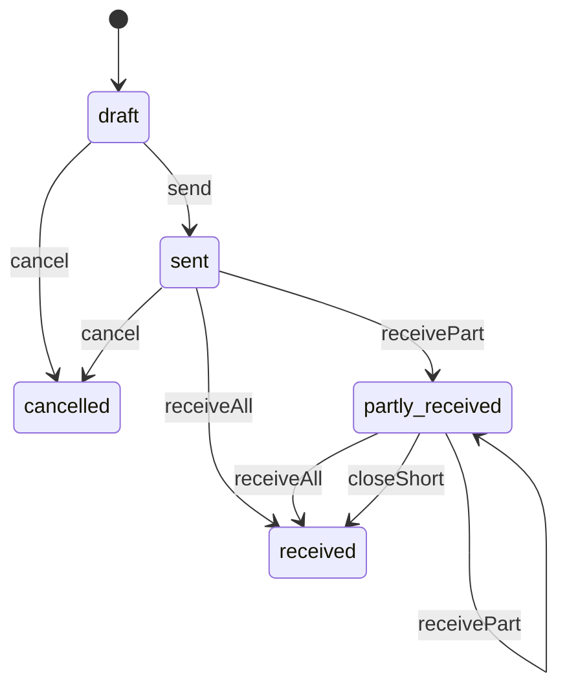
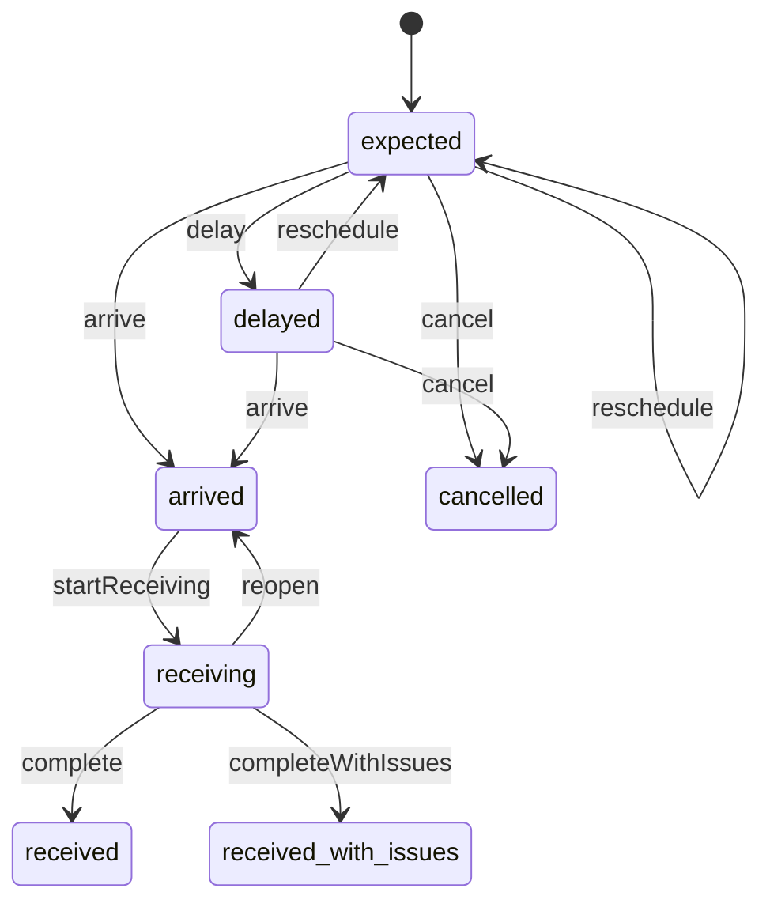
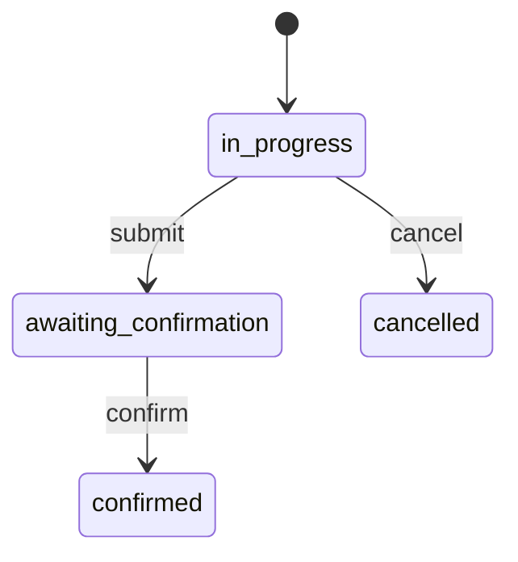
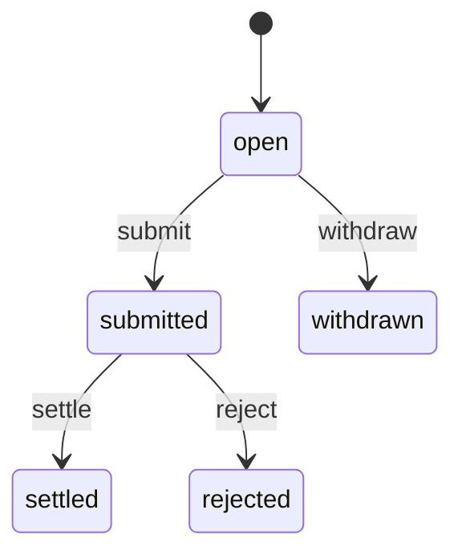

# Purchasing (`purchasing`)

Buying stock for the Official Store: suppliers and their price lists, purchase orders (Draft, Sent, Partly received, Received, Cancelled) with buying costs and expected deliveries, receiving records (expected vs received, shortages, damage) that feed inventory, and supplier claims.

- **Group:** Catalog and stock · **Launch phase:** 1 · **Plan chapters:** 9, 2
- **Depends on:** [inventory](inventory.md) · **Optional:** [access](access.md), [audit](audit.md), [media](media.md), [notifications](notifications.md), [finance](finance.md), [warehouse](warehouse.md), [reports](reports.md)

## Owns
- Suppliers: contacts, payment terms, lead time, on-time and accuracy performance
- Supplier price lists (supplier SKU, unit cost, minimum order, lead time)
- Purchase orders (PUR-YYMM-NNNN) with lines, buying costs, freight and approval above the buyer's limit
- Expected deliveries: carrier, reference, arrival window, delays and reschedules
- Receiving records (REC-YYMMDD-NN): expected vs received, shortages, damaged units with photos, put-away bin
- Supplier claims for shortages and damage
- Reorder suggestions from low stock and incoming quantities

**Not here:**
- Stock quantities and making received units sellable: inventory (Inventory Manager confirms)
- Bins and put-away tasks: warehouse
- Paying supplier invoices and company cost accounting: finance
- Seller stock: sellers buy their own stock outside the platform

## Admin API

| Method | Path | Purpose | Auth | Body → Response |
|---|---|---|---|---|
| GET | `/api/admin/purchasing/summary` | Open purchase orders, committed cost, incoming units, late or short, low-stock items | staff `purchasing.orders.view` | `PurchasingSummary` |
| GET | `/api/admin/purchasing/suppliers` | Suppliers with lead time, on-time rate and open POs | staff `purchasing.orders.view` | Page<Supplier> |
| POST | `/api/admin/purchasing/suppliers` | Add a supplier _(audited)_ | staff `purchasing.suppliers.manage` | `SupplierInput` → `Supplier` |
| GET | `/api/admin/purchasing/suppliers/{id}` | Supplier with price list, performance, recent POs and open claims | staff `purchasing.orders.view` | `SupplierDetail` |
| PATCH | `/api/admin/purchasing/suppliers/{id}` | Edit or deactivate a supplier _(audited)_ | staff `purchasing.suppliers.manage` | `SupplierInput` → `Supplier` |
| PUT | `/api/admin/purchasing/suppliers/{id}/items` | Replace a supplier's price list (buying costs per SKU) _(audited)_ | staff `purchasing.suppliers.manage` | `{ items: SupplierItemInput[] }` → `SupplierItem[]` |
| GET | `/api/admin/purchasing/purchase-orders` | Purchase orders with status, cost and expected arrival | staff `purchasing.orders.view` | Page<PurchaseOrderRow> |
| POST | `/api/admin/purchasing/purchase-orders` | Create a draft purchase order _(audited)_ | staff `purchasing.orders.manage` | `PurchaseOrderInput` → `PurchaseOrder` |
| GET | `/api/admin/purchasing/purchase-orders/{id}` | Purchase order: lines expected vs received, costs, deliveries, receipts, claims, approval and timeline | staff `purchasing.orders.view` | `PurchaseOrder` |
| PATCH | `/api/admin/purchasing/purchase-orders/{id}` | Edit a draft, or update expected dates and notes after sending _(audited)_ | staff `purchasing.orders.manage` | `PurchaseOrderUpdate` → `PurchaseOrder` |
| POST | `/api/admin/purchasing/purchase-orders/{id}/send` | Send to the supplier (or request approval when above the buyer's limit) _(audited)_ | staff `purchasing.orders.manage` | `{ emailSupplier: bool?, message: text? }` → `PurchaseOrder` |
| POST | `/api/admin/purchasing/purchase-orders/{id}/cancel` | Cancel a draft or a sent PO with nothing received _(audited)_ | staff `purchasing.orders.manage` | `{ reason: text }` → `PurchaseOrder` |
| POST | `/api/admin/purchasing/purchase-orders/{id}/close` | Close a partly received PO short (remaining units will not arrive) _(audited)_ | staff `purchasing.orders.manage` | `{ reason: text, raiseShortageClaim: bool? }` → `PurchaseOrder` |
| GET | `/api/admin/purchasing/reorder-suggestions` | SKUs at or below reorder point after incoming stock, with suggested quantity and preferred supplier | staff `purchasing.orders.view` | Page<ReorderSuggestion> |
| POST | `/api/admin/purchasing/purchase-orders/from-suggestions` | Create draft POs (one per preferred supplier) from selected suggestions _(audited)_ | staff `purchasing.orders.manage` | `{ stockItemIds: uuid[], quantities: map<int>?, shipToLocationId: uuid? }` → `PurchaseOrder[]` |
| GET | `/api/admin/purchasing/deliveries` | Expected and arrived purchase deliveries for receiving | staff `purchasing.orders.view` | Page<Delivery> |
| POST | `/api/admin/purchasing/purchase-orders/{id}/deliveries` | Add an expected delivery (carrier, reference, arrival window) | staff `purchasing.orders.manage` | `DeliveryInput` → `Delivery` |
| PATCH | `/api/admin/purchasing/deliveries/{id}` | Reschedule or mark a delivery delayed, with a reason | staff `purchasing.orders.manage` | `DeliveryUpdate` → `Delivery` |
| POST | `/api/admin/purchasing/deliveries/{id}/arrive` | Check in a delivery at the dock | staff `purchasing.receipts.record` | `{ dock: string?, arrivedAt: datetime?, note: text? }` → `Delivery` |
| POST | `/api/admin/purchasing/deliveries/{id}/receipts` | Start receiving: creates the receiving record with expected quantities | staff `purchasing.receipts.record` | `Receipt` |
| GET | `/api/admin/purchasing/deliveries/stats` | Receiving KPIs and tab counts | staff `purchasing.orders.view` | `ReceivingStats` |
| GET | `/api/admin/purchasing/receipts` | Receiving records (in progress, waiting for confirmation, with issues, completed) | staff `purchasing.orders.view` | Page<Receipt> |
| GET | `/api/admin/purchasing/receipts/{id}` | One receiving record: expected vs received, damage photos, bins, buying cost | staff `purchasing.orders.view` | `Receipt` |
| PATCH | `/api/admin/purchasing/receipts/{id}` | Record counted, damaged, bin and photos per line (save and finish later) | staff `purchasing.receipts.record` | `{ lines: ReceiptLineInput[], note: text? }` → `Receipt` |
| POST | `/api/admin/purchasing/receipts/{id}/submit` | Finish counting: shortages go to Purchasing, units wait in Incoming for Inventory to confirm _(audited)_ | staff `purchasing.receipts.record` | `{ raiseClaims: bool? }` → `Receipt` |
| POST | `/api/admin/purchasing/receipts/{id}/cancel` | Discard a receiving record started by mistake _(audited)_ | staff `purchasing.receipts.record` | `{ reason: text }` → `Receipt` |
| GET | `/api/admin/purchasing/claims` | Supplier claims for shortages and damage | staff `purchasing.orders.view` | Page<SupplierClaim> |
| POST | `/api/admin/purchasing/claims` | Open a supplier claim _(audited)_ | staff `purchasing.claims.manage` | `ClaimInput` → `SupplierClaim` |
| POST | `/api/admin/purchasing/claims/{id}/submit` | Mark a claim as sent to the supplier _(audited)_ | staff `purchasing.claims.manage` | `{ supplierReference: string? }` → `SupplierClaim` |
| POST | `/api/admin/purchasing/claims/{id}/settle` | Record the supplier's settlement (credit note, refund or replacement) _(audited)_ | staff `purchasing.claims.manage` | `{ settlement: enum(credit_note|refund|replacement), amount: Money, reason: text }` → `SupplierClaim` |
| POST | `/api/admin/purchasing/claims/{id}/close` | Close a claim as rejected by the supplier or withdrawn _(audited)_ | staff `purchasing.claims.manage` | `{ outcome: enum(rejected|withdrawn), reason: text }` → `SupplierClaim` |

## Types

### Supplier

| Field | Type |
|---|---|
| id | `uuid` |
| name | `string` |
| location | `string` City and region, e.g. 'Los Angeles, CA' |
| contactName | `string?` |
| email | `email?` |
| phone | `string?` |
| address | `Address?` |
| paymentTerms | `string` e.g. 'Net 30 from invoice' |
| leadTimeDays | `int` Agreed lead time |
| actualLeadTimeDays | `number?` Average over the last 90 days |
| onTimePct | `number?` Deliveries arriving within the window, last 90 days |
| openPurchaseOrders | `int` |
| returnAuthorizationRequired | `bool` The supplier needs a return authorization (RMA) before units are sent back (getPreferredSupplier tells inventory and returns) |
| active | `bool` |
| notes | `text?` |
| createdAt | `datetime` |

### SupplierInput

| Field | Type |
|---|---|
| name | `string` |
| contactName | `string?` |
| email | `email?` |
| phone | `string?` |
| address | `Address?` |
| paymentTerms | `string?` |
| leadTimeDays | `int?` |
| returnAuthorizationRequired | `bool?` Default false |
| notes | `text?` |
| active | `bool?` |

### SupplierItem

| Field | Type |
|---|---|
| stockItemId | `uuid` |
| sku | `string` |
| label | `string` |
| supplierSku | `string?` |
| unitCost | `Money` |
| minOrderQuantity | `int?` |
| leadTimeDays | `int?` |
| preferred | `bool` Preferred supplier for this SKU (used by reorder suggestions) |

### SupplierItemInput

| Field | Type |
|---|---|
| stockItemId | `uuid` |
| supplierSku | `string?` |
| unitCost | `Money` |
| minOrderQuantity | `int?` |
| leadTimeDays | `int?` |
| preferred | `bool?` |

### SupplierPerformance

| Field | Type |
|---|---|
| windowDays | `int` |
| onTimePct | `number?` |
| avgLeadTimeDays | `number?` |
| shortageRatePct | `number?` |
| damageRatePct | `number?` |
| deliveries | `int` |

### SupplierDetail

| Field | Type |
|---|---|
| supplier | `Supplier` |
| items | `SupplierItem[]` |
| performance | `SupplierPerformance` |
| recentPurchaseOrders | `PurchaseOrderRow[]` |
| openClaims | `SupplierClaim[]` |

### PurchaseOrderLine

| Field | Type |
|---|---|
| id | `uuid` |
| stockItemId | `uuid` |
| sku | `string` |
| label | `string` |
| image | `MediaRef?` |
| quantityOrdered | `int` |
| quantityReceived | `int` |
| quantityDamaged | `int` |
| quantityClosed | `int` Closed short (will not be delivered) |
| quantityOpen | `int` |
| unitCost | `Money` |
| lineTotal | `Money` |
| expectedDate | `date?` |
| note | `string?` e.g. 'Rest due Oct 13', 'Complete' |

### PurchaseOrderLineInput

| Field | Type |
|---|---|
| stockItemId | `uuid` |
| quantity | `int` |
| unitCost | `Money` |
| expectedDate | `date?` |

### PurchaseOrderInput

| Field | Type |
|---|---|
| supplierId | `uuid` |
| shipToLocationId | `uuid` inventory location |
| lines | `PurchaseOrderLineInput[]` |
| freight | `Money?` |
| paymentTerms | `string?` |
| expectedDate | `date?` |
| notes | `text?` |
| attachmentIds | `uuid[]?` |

### PurchaseOrderUpdate

| Field | Type |
|---|---|
| lines | `PurchaseOrderLineInput[]?` Draft only; replaces all lines |
| freight | `Money?` |
| paymentTerms | `string?` |
| expectedDate | `date?` |
| lineExpectedDates | `map<date>?` Line id → new expected date (allowed after sending) |
| notes | `text?` |
| attachmentIds | `uuid[]?` |

### PurchaseOrder

| Field | Type |
|---|---|
| id | `uuid` |
| ref | `string` PUR-YYMM-NNNN |
| supplier | `SupplierCue` |
| shipToLocationId | `uuid` |
| shipToName | `string` |
| status | `enum(draft|sent|partly_received|received|cancelled)` |
| approval | `ApprovalInfo?` Set when the total is above the buyer's purchase limit (e.g. $25,000) |
| paymentTerms | `string` |
| expectedDate | `date?` |
| lines | `PurchaseOrderLine[]` |
| linesSubtotal | `Money` |
| freight | `Money` |
| total | `Money` |
| receivedValue | `Money` Received units at unit cost |
| claimsValue | `Money` |
| deliveries | `Delivery[]` |
| receipts | `ReceiptSummary[]` |
| claims | `SupplierClaim[]` |
| attachments | `MediaRef[]` |
| notes | `text?` |
| timeline | `TimelineEvent[]` |
| createdBy | `Actor` |
| createdAt | `datetime` |
| sentAt | `datetime?` |
| closedAt | `datetime?` |

### SupplierCue

| Field | Type |
|---|---|
| id | `uuid` |
| name | `string` |
| location | `string?` |

### PurchaseOrderRow

| Field | Type |
|---|---|
| id | `uuid` |
| ref | `string` |
| supplierName | `string` |
| lineCount | `int` |
| units | `int` |
| total | `Money` |
| expectedLabel | `string` e.g. 'Oct 6 · 80 due Oct 13' or 'Not set' |
| status | `enum(draft|sent|partly_received|received|cancelled)` |
| approvalNote | `string?` e.g. 'Over $25,000: needs Morgan Hale' |
| lateOrShort | `bool` |

### PurchasingSummary

| Field | Type |
|---|---|
| openPurchaseOrders | `int` |
| committed | `Money` |
| incomingUnits | `int` |
| nextArrival | `date?` |
| lateOrShort | `int` |
| lateOrShortNote | `string?` |
| lowStockItems | `int` |
| reorderSuggested | `int` |

### PurchaseOrderShipTo

| Field | Type |
|---|---|
| locationId | `uuid` |
| code | `string` |
| name | `string` e.g. Reno, NV warehouse |
| address | `Address?` |
| timeZone | `string` |

### ReorderSuggestion

| Field | Type |
|---|---|
| stockItemId | `uuid` |
| sku | `string` |
| label | `string` |
| available | `int` |
| reorderPoint | `int?` |
| incoming | `int` |
| avgDailySales | `number?` From inventory.getSalesRate over the last 30 days |
| suggestedQuantity | `int` |
| supplier | `SupplierCue?` |
| unitCost | `Money?` |
| estimatedCost | `Money?` |

### Delivery

| Field | Type |
|---|---|
| id | `uuid` |
| purchaseOrderId | `uuid` |
| purchaseOrderRef | `string` |
| supplierName | `string` |
| carrier | `string?` e.g. 'UPS Freight', 'Freight · 2 pallets' |
| trackingRef | `string?` BOL, PRO or tracking number |
| windowFrom | `datetime` |
| windowTo | `datetime` |
| lineCount | `int` |
| units | `int` |
| status | `enum(expected|delayed|arrived|receiving|received|received_with_issues|cancelled)` |
| delayReason | `string?` |
| arrivedAt | `datetime?` |
| dock | `string?` |
| receiptId | `uuid?` |

### ReceivingStats

| Field | Type |
|---|---|
| date | `date` Receiving day in the location's time zone (default today) |
| expectedToday | `int` |
| expectedTodayUnits | `int` |
| arrivedNotReceived | `int` Deliveries in status arrived (at the dock, receiving not started) |
| arrivedNote | `string?` e.g. 'PUR-2610-0042 at dock 2' (oldest arrival) |
| receivedThisWeek | `int` Deliveries received (with or without issues) since the start of the week |
| receivedThisWeekUnits | `int` |
| openShortages | `int` Receipt lines with a shortage or damage not yet covered by a settled or rejected supplier claim |
| shortageOwner | `Actor?` Purchasing owner following up (open claim owner, else the purchase order buyer); shown as 'with Ken Watanabe' |
| tabCounts | `{"expected":{"type":"int","desc":"expected + delayed + arrived"},"receiving":"int","receivedWithIssues":"int","completed":{"type":"int","desc":"Received in the last 30 days"}}` |

### DeliveryInput

| Field | Type |
|---|---|
| carrier | `string?` |
| trackingRef | `string?` |
| windowFrom | `datetime` |
| windowTo | `datetime` |
| units | `int?` |
| note | `text?` |

### DeliveryUpdate

| Field | Type |
|---|---|
| carrier | `string?` |
| trackingRef | `string?` |
| windowFrom | `datetime?` |
| windowTo | `datetime?` |
| delayed | `bool?` |
| reason | `text` Why the window or status changed; shown on the receiving screen |

### ReceiptLine

| Field | Type |
|---|---|
| purchaseOrderLineId | `uuid` |
| stockItemId | `uuid` |
| sku | `string` |
| label | `string` |
| image | `MediaRef?` |
| expected | `int` |
| received | `int` |
| damaged | `int` |
| shortage | `int` max(expected − received, 0) |
| over | `int` max(received − expected, 0) |
| binCode | `string?` Put-away bin suggested by warehouse |
| photos | `MediaRef[]` |
| note | `text?` |

### ReceiptLineInput

| Field | Type |
|---|---|
| purchaseOrderLineId | `uuid` |
| received | `int` |
| damaged | `int` |
| binCode | `string?` |
| photoIds | `uuid[]?` |
| note | `text?` |

### Receipt

| Field | Type |
|---|---|
| id | `uuid` |
| ref | `string` REC-YYMMDD-NN |
| purchaseOrderId | `uuid` |
| purchaseOrderRef | `string` |
| deliveryId | `uuid` |
| supplierName | `string` |
| locationId | `uuid` |
| status | `enum(in_progress|awaiting_confirmation|confirmed|cancelled)` |
| lines | `ReceiptLine[]` |
| totals | `ReceiptTotals` |
| buyingCost | `Money` Received units at unit cost |
| note | `text?` |
| receivedBy | `Actor` |
| startedAt | `datetime` |
| submittedAt | `datetime?` |
| confirmedBy | `Actor?` Inventory Manager who made the units sellable |
| confirmedAt | `datetime?` |

### ReceiptTotals

| Field | Type |
|---|---|
| expected | `int` |
| received | `int` |
| damaged | `int` |
| shortage | `int` |
| sellable | `int?` |

### ReceiptSummary

| Field | Type |
|---|---|
| id | `uuid` |
| ref | `string` |
| status | `string` |
| received | `int` |
| damaged | `int` |
| shortage | `int` |
| receivedBy | `Actor` |
| submittedAt | `datetime?` |

### ClaimLine

| Field | Type |
|---|---|
| stockItemId | `uuid` |
| sku | `string` |
| quantity | `int` |
| unitCost | `Money` |

### SupplierClaim

| Field | Type |
|---|---|
| id | `uuid` |
| ref | `string` |
| supplierId | `uuid` |
| supplierName | `string` |
| purchaseOrderId | `uuid` |
| purchaseOrderRef | `string` |
| receiptId | `uuid?` |
| kind | `enum(shortage|damage|wrong_item|other)` |
| lines | `ClaimLine[]` |
| amount | `Money` |
| status | `enum(open|submitted|settled|rejected|withdrawn)` |
| settlement | `enum(credit_note|refund|replacement)?` |
| settledAmount | `Money?` |
| supplierReference | `string?` The supplier's own reference for the claim, given when it is sent (submitClaim) |
| owner | `Actor` |
| notes | `text?` |
| createdAt | `datetime` |
| decidedAt | `datetime?` |

### ClaimInput

| Field | Type |
|---|---|
| purchaseOrderId | `uuid` |
| receiptId | `uuid?` |
| kind | `enum(shortage|damage|wrong_item|other)` |
| lines | `ClaimLine[]` |
| notes | `text?` |

## Status flows

### Purchase order (`PurchaseOrder.status`)

send checks the buyer's purchase limit in access (example: Purchasing Manager up to $25,000). Above it the PO stays Draft with approval.required and an approval request; it is sent automatically when access.approval.decided approves. send adds Incoming in inventory (expectIncoming). cancel from Sent only while nothing was received; it removes Incoming. receivePart / receiveAll follow submitted receipts. closeShort ends a partly received PO with a reason; open quantities leave Incoming and a shortage claim can be raised.

### Delivery (`Delivery.status`)

delay is set by the buyer or by the late-delivery job when the window passes without arrival. completeWithIssues when the submitted receipt has shortages, damage or over-receipt. reopen when the only receiving record of the delivery is discarded (cancelReceipt): back to Arrived.

### Receipt (`Receipt.status`)

Warehouse staff count lines (received, damaged with photos, bin) and submit. Units stay in Incoming until the Inventory Manager confirms in inventory; confirm comes from inventory.receipt.confirmed.

### Supplier claim (`SupplierClaim.status`)

Damaged units stay in Damaged or held (inventory) until the claim is settled; settlement is reported to finance.

## Data (schema `purchasing`)

**suppliers**

| Column | Type |
|---|---|
| id | uuid pk |
| name | text |
| location | text? |
| contact_name | text? |
| email | text? |
| phone | text? |
| address | jsonb? |
| payment_terms | text |
| lead_time_days | int |
| return_authorization_required | bool |
| active | bool |
| notes | text? |
| created_at | timestamptz |

Indexes: `(active, name)`

**supplier_items**: Supplier price list per company stock item

| Column | Type |
|---|---|
| supplier_id | uuid → suppliers |
| stock_item_id | uuid |
| supplier_sku | text? |
| unit_cost_amount | bigint |
| currency | char(3) |
| min_order_qty | int? |
| lead_time_days | int? |
| preferred | bool |
| updated_at | timestamptz |

Indexes: `pk (supplier_id, stock_item_id)`, `(stock_item_id) where preferred`

**supplier_performance**: Nightly figures per supplier

| Column | Type |
|---|---|
| supplier_id | uuid pk → suppliers |
| window_days | int |
| on_time_pct | numeric(5,2)? |
| avg_lead_time_days | numeric(6,2)? |
| shortage_rate_pct | numeric(5,2)? |
| damage_rate_pct | numeric(5,2)? |
| deliveries | int |
| computed_at | timestamptz |

**purchase_orders**

| Column | Type |
|---|---|
| id | uuid pk |
| ref | text unique |
| supplier_id | uuid → suppliers |
| ship_to_location_id | uuid |
| status | text |
| payment_terms | text |
| expected_date | date? |
| freight_amount | bigint |
| currency | char(3) |
| total_amount | bigint |
| approval_request_id | uuid? |
| approval_state | text? (pending|approved|rejected) |
| notes | text? |
| attachment_media_ids | jsonb |
| created_by | text |
| created_at | timestamptz |
| sent_at | timestamptz? |
| closed_at | timestamptz? |
| close_reason | text? |

Indexes: `(status, expected_date)`, `(supplier_id, created_at)`, `(approval_request_id)`

**purchase_order_lines**

| Column | Type |
|---|---|
| id | uuid pk |
| purchase_order_id | uuid → purchase_orders |
| stock_item_id | uuid |
| sku | text |
| label | text |
| qty_ordered | int |
| qty_received | int |
| qty_damaged | int |
| qty_closed | int |
| unit_cost_amount | bigint |
| expected_date | date? |

Indexes: `(purchase_order_id)`, `(stock_item_id)`

**purchase_order_events**: PO timeline (created, sent, approval, backorder, received, closed)

| Column | Type |
|---|---|
| id | uuid pk |
| purchase_order_id | uuid → purchase_orders |
| label | text |
| detail | text? |
| actor_kind | text |
| actor_id | text? |
| at | timestamptz |

Indexes: `(purchase_order_id, at)`

**deliveries**: Expected inbound deliveries per purchase order

| Column | Type |
|---|---|
| id | uuid pk |
| purchase_order_id | uuid → purchase_orders |
| carrier | text? |
| tracking_ref | text? |
| window_from | timestamptz |
| window_to | timestamptz |
| units | int |
| status | text |
| delay_reason | text? |
| arrived_at | timestamptz? |
| dock | text? |

Indexes: `(status, window_from)`, `(purchase_order_id)`

**receipts**

| Column | Type |
|---|---|
| id | uuid pk |
| ref | text unique |
| purchase_order_id | uuid → purchase_orders |
| delivery_id | uuid → deliveries |
| location_id | uuid |
| status | text |
| note | text? |
| received_by | text |
| started_at | timestamptz |
| submitted_at | timestamptz? |
| confirmed_by | text? |
| confirmed_at | timestamptz? |

Indexes: `(status, started_at)`, `unique (delivery_id) where status = 'in_progress'`

**receipt_lines**

| Column | Type |
|---|---|
| receipt_id | uuid → receipts |
| purchase_order_line_id | uuid → purchase_order_lines |
| stock_item_id | uuid |
| expected | int |
| received | int |
| damaged | int |
| bin_code | text? |
| photo_media_ids | jsonb |
| note | text? |

Indexes: `pk (receipt_id, purchase_order_line_id)`

**supplier_claims**

| Column | Type |
|---|---|
| id | uuid pk |
| ref | text unique |
| supplier_id | uuid → suppliers |
| purchase_order_id | uuid → purchase_orders |
| receipt_id | uuid? → receipts |
| kind | text |
| lines | jsonb |
| amount | bigint |
| currency | char(3) |
| status | text |
| settlement | text? |
| settled_amount | bigint? |
| supplier_reference | text? |
| owner_id | text |
| notes | text? |
| created_at | timestamptz |
| decided_at | timestamptz? |

Indexes: `(status, created_at)`, `(supplier_id)`

## Events

| Publishes | When | Payload | Consumed by |
|---|---|---|---|
| `purchasing.purchase_order.sent` | A PO is sent to the supplier | `{ purchaseOrderId: uuid, ref: string, supplierId: uuid, supplierName: string, supplierEmail: email?, emailSupplier: bool, message: text?, locationId: uuid, shipTo: PurchaseOrderShipTo, total: Money, lines: PurchaseOrderLine[] }` | notifications |
| `purchasing.purchase_order.status_changed` | Any PO status transition | `{ purchaseOrderId: uuid, ref: string, from: string, to: string, reason: text? }` | - |
| `purchasing.delivery.rescheduled` | An expected arrival window changes or a delivery is marked delayed | `{ deliveryId: uuid?, purchaseOrderId: uuid, ref: string, windowFrom: datetime?, windowTo: datetime?, reason: text }` | - |
| `purchasing.delivery.late` | A delivery window passed without arrival | `{ deliveryId: uuid, purchaseOrderId: uuid, ref: string, supplierName: string }` | - |
| `purchasing.delivery.arrived` | A delivery is checked in at the dock | `{ deliveryId: uuid, purchaseOrderId: uuid, ref: string, arrivedAt: datetime, dock: string? }` | - |
| `purchasing.receipt.recorded` | A receiving record is submitted | `{ receiptId: uuid, ref: string, purchaseOrderId: uuid, locationId: uuid, lines: ReceiptLine[], hasIssues: bool }` | warehouse |
| `purchasing.claim.settled` | A supplier settles a claim | `{ claimId: uuid, supplierId: uuid, purchaseOrderId: uuid, settlement: string, amount: Money }` | - |

| Consumes | From | Does |
|---|---|---|
| `inventory.receipt.confirmed` | inventory | Mark the receipt confirmed (who made the stock sellable) and add it to the PO timeline. Receipts with source.kind service_inbound (Fulfilled by Marketly) are not purchasing's and are ignored |
| `inventory.stock.low` | inventory | Refresh reorder suggestions for company stock items |
| `access.approval.decided` | access | Send an approved PO; record a rejection on the PO timeline |

## In-process API (for other modules)

| Function | Signature | Used by |
|---|---|---|
| getPreferredSupplier | `(stockItemId: uuid) => { supplierId: uuid, name: string, supplierSku: string|null, unitCost: Money, returnAuthorizationRequired: bool } | null` Used when a return outcome is 'return to supplier' | returns, inventory |
| getOpenPurchaseOrders | `(stockItemId: uuid) => { purchaseOrderId: uuid, ref: string, quantityOpen: int, expectedDate: date|null }[]` Incoming detail for stock screens and restock estimates | inventory, offers |
| exportRows | `(dataset: string, filters: json, principal: identity.Principal, cursor?: string) => { rows: json[], nextCursor?: string }` Export rows for reports dataset purchasing.admin.receiving (receiving records) | reports |

## Permissions

| Key | Who | Allows |
|---|---|---|
| `purchasing.orders.view` | staff | View suppliers, purchase orders, deliveries, receipts and claims |
| `purchasing.suppliers.manage` | staff | Create and edit suppliers and price lists |
| `purchasing.orders.manage` | staff | Create, edit, send, cancel and close purchase orders; manage expected deliveries (spending limits from access) |
| `purchasing.receipts.record` | staff | Check in deliveries and record received, damaged and bins (warehouse staff) |
| `purchasing.claims.manage` | staff | Open, submit, settle and close supplier claims |

## Approval actions

Checked through the access module (limits per role, second reviewer).

| Action | Limit | Second reviewer | Approvers | Meaning |
|---|---|---|---|---|
| `purchasing.orders.send` | money | above-limit | Purchasing Manager up to $25,000 per purchase order (example); Business Owner above it | Send a purchase order to the supplier |

## Error codes

| Code | Status | Meaning |
|---|---|---|
| `SUPPLIER_INACTIVE` | 409 | The supplier is deactivated |
| `STOCK_ITEM_NOT_COMPANY` | 400 | Purchase order lines must be Official Store stock items |
| `PO_HAS_RECEIPTS` | 409 | Units were already received; close the PO short instead of cancelling |
| `RECEIPT_IN_PROGRESS` | 409 | This delivery already has a receiving record in progress. details.receiptId |
| `DAMAGE_PHOTOS_REQUIRED` | 400 | Damaged lines need at least one photo. details.lines |
| `OVER_RECEIPT` | 400 | Received exceeds ordered beyond the allowed over-receipt. details.lines |

## Background jobs

| Job | Schedule | Does |
|---|---|---|
| `purchasing.flag-late-deliveries` | every 30 min | Deliveries past windowTo + grace without arrival → delayed; publish purchasing.delivery.late (work queue for the Purchasing Manager) |
| `purchasing.supplier-performance` | nightly 02:30 market time | Recompute on-time %, average lead time, shortage and damage rates per supplier over the window |
| `purchasing.reorder-suggestions` | hourly | Rebuild suggestions from inventory low stock, incoming quantities and 30-day sales velocity (inventory.getSalesRate) |

## Settings

| Key | Default | Rules | Meaning |
|---|---|---|---|
| purchaseOrderRefFormat | `"PUR-YYMM-NNNN"` | string, read-only | Human reference for purchase orders |
| receiptRefFormat | `"REC-YYMMDD-NN"` | string, read-only | Human reference for receiving records |
| damagePhotosRequired | `true` | bool | Damaged lines need at least one photo |
| overReceiptAllowedPct | `0` | number, %, 0–100, approval: second reviewer | Received above ordered allowed without a new PO line |
| deliveryLateGraceMinutes | `60` | duration, minutes, 0–… | Grace after the arrival window before a delivery counts as late |
| reorderCoverDays | `30` | duration, days, 1–… | Days of sales a suggested reorder should cover |
| performanceWindowDays | `90` | duration, days, 7–… | Window for supplier performance figures |

## Integrations
- **Email (through notifications)**: Send purchase orders and claims to supplier contacts

## Notes
- Where responsibilities meet (plan ch. 2): the Purchasing Manager orders stock, the Warehouse Manager's staff receive it (purchasing.receipts.record), the Inventory Manager confirms the sellable quantity in inventory (purchasing calls inventory.submitInbound; the admin endpoint confirmInbound publishes inventory.receipt.confirmed, which purchasing consumes). A receipt is only a count; nothing becomes sellable here.
- Purchase limits and second approval come from access approval limits for the role; granting purchasing.orders.manage never raises the limit.
- Buying cost per received line (PO unit cost; freight is allocated pro rata by line value) is passed to inventory, which keeps the weighted average unit cost used for margins and valuation.
- Seller stock is not purchased here; only company (Official Store) stock items can appear on purchase orders.
- Put-away bins are suggested by warehouse and recorded on receipt lines; warehouse consumes purchasing.receipt.recorded to create put-away tasks.
- Media usages: purchase order attachments (attachmentIds) are attached with media.attach (usage kind supplier_document, refId the PO id) when the PO is created or updated, and detached when removed; receipt damage photos use inspection_photo. Unattached uploads would be deleted by the media orphan sweep.
- Locations: ship-to names, addresses and time zones come from inventory.getLocations / getDefaultLocation; purchasing stores only the location id.
