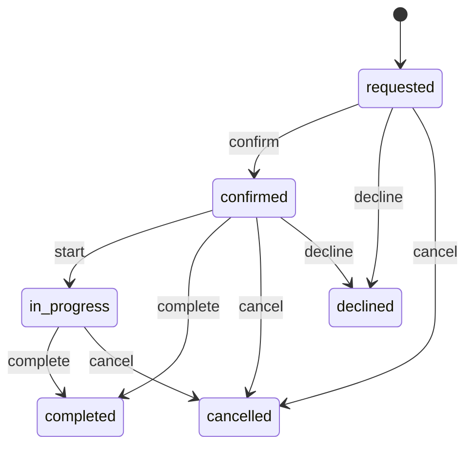
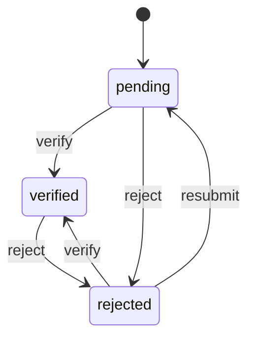

# Services (`services`)

Services customers request or book in the app's department pages: OS installs and post-sale repairs (Phones), welfare services and time-slot bookings. Staff keep the providers, their services and opening hours, and handle every request in Admin › Departments. No online payment at this phase: customers pay the provider.

- **Group:** Growth · **Launch phase:** 2 · **Plan chapters:** -
- **Depends on:** [media](media.md) · **Optional:** [customers](customers.md), [audit](audit.md), [notifications](notifications.md)

## Owns
- Providers: name, photos, contacts, address, opening hours, staff (stylists, technicians) and the verified mark
- Service categories per area (os_install, post_sale, welfare, booking)
- Services: what is included, requirements, supported models, OS versions, hand-over options, price tables, duration, slot length
- Availability: free time slots from the provider's hours, the service's slot length and the bookings already made
- Requests and bookings with a status customers and staff follow (requested, confirmed, in progress, completed, cancelled, declined)
- Reviews customers leave after a completed request, and the ratings shown on services and providers
- Saved providers (Booking's save button and the app's Saved page)
- Provider points for the map and distances: the staff pin, else the staff-entered address geocoded (customers.geocodeAddress)
- Registered devices for Post-sale: the phones customers register, staff verification and the warranty cover period, and the $0 price of covered-by-warranty services for a covered device

**Not here:**
- Payment: customers pay the provider (2026-10-22 decision: no online payment for requests and bookings in v1)
- Product sales (phones, farm machines): catalog, cart and checkout
- Pictures: media (content_image uploads)
- The customer's location: customers.customerLocation (their geocoded default delivery address; no device location)

## Store API

| Method | Path | Purpose | Auth | Body → Response |
|---|---|---|---|---|
| GET | `/api/store/services/categories` | Visible categories of an area in order | visitor | `ServiceCategory[]` |
| GET | `/api/store/services/area` | Where the lists measure distances from | visitor | `CustomerArea` |
| GET | `/api/store/services/services` | Published services of an area | visitor | Page<ServiceCard> |
| GET | `/api/store/services/services/{slug}` | A service with its provider, price table, terms, full terms, steps and newest reviews | visitor | `Service` |
| GET | `/api/store/services/services/{id}/reviews` | A service's reviews, newest first | visitor | Page<ServiceReview> |
| GET | `/api/store/services/providers` | Published providers of an area (Booking: Available near you, and the map) | visitor | Page<ProviderCard> |
| GET | `/api/store/services/providers/{slug}` | A provider's page with its services, hours and staff | visitor | `Provider` |
| GET | `/api/store/services/saved-providers` | Providers I saved, newest first | customer | Page<ProviderCard> |
| PUT | `/api/store/services/saved-providers/{providerId}` | Save a provider | customer | `ProviderSaved` |
| DELETE | `/api/store/services/saved-providers/{providerId}` | Remove a provider from my saved ones | customer | `ProviderSaved` |
| GET | `/api/store/services/services/{id}/availability` | Free time slots of a bookable service, day by day | visitor | `AvailabilityDay[]` |
| POST | `/api/store/services/requests` | Request or book a service _(idempotent)_ | customer | `RequestInput` → `ServiceRequest` |
| GET | `/api/store/services/requests` | My requests and bookings, newest first | customer | Page<ServiceRequest> |
| GET | `/api/store/services/requests/{id}` | One of my requests | customer | `ServiceRequest` |
| POST | `/api/store/services/requests/{id}/cancel` | Cancel my request or booking | customer | `{ reason: string? }` → `ServiceRequest` |
| POST | `/api/store/services/requests/{id}/review` | Rate a completed request | customer | `ReviewInput` → `ServiceRequest` |
| GET | `/api/store/services/devices` | My registered devices, newest first | customer | `Device[]` |
| POST | `/api/store/services/devices` | Register a device for post-sale cover _(idempotent)_ | customer | `DeviceInput` → `Device` |
| GET | `/api/store/services/devices/{id}` | One of my devices | customer | `Device` |
| PATCH | `/api/store/services/devices/{id}` | Change a pending or rejected device | customer | `DeviceInput` → `Device` |
| DELETE | `/api/store/services/devices/{id}` | Remove one of my devices | customer | 204 No content |
| GET | `/api/store/services/statistics` | The customer's service requests in a period: totals, trend and breakdowns | customer | `ServiceStatistics` |

## Admin API

| Method | Path | Purpose | Auth | Body → Response |
|---|---|---|---|---|
| GET | `/api/admin/services/categories` | Categories of an area | staff `services.view` | `ServiceCategory[]` |
| POST | `/api/admin/services/categories` | Add a category _(audited)_ | staff `services.manage` | `ServiceCategoryInput` → `ServiceCategory` |
| PATCH | `/api/admin/services/categories/{id}` | Rename, reorder, hide or show a category _(audited)_ | staff `services.manage` | `ServiceCategoryInput` → `ServiceCategory` |
| DELETE | `/api/admin/services/categories/{id}` | Delete a category no service uses _(audited)_ | staff `services.manage` | 204 No content |
| GET | `/api/admin/services/providers` | Providers | staff `services.view` | Page<ProviderAdmin> |
| POST | `/api/admin/services/providers` | Add a provider _(audited)_ | staff `services.manage` | `ProviderInput` → `ProviderAdmin` |
| GET | `/api/admin/services/providers/{id}` | A provider for editing | staff `services.view` | `ProviderAdmin` |
| PATCH | `/api/admin/services/providers/{id}` | Edit, hide or show a provider _(audited)_ | staff `services.manage` | `ProviderInput` → `ProviderAdmin` |
| DELETE | `/api/admin/services/providers/{id}` | Delete a provider without services _(audited)_ | staff `services.manage` | 204 No content |
| GET | `/api/admin/services/services` | Services in staff order | staff `services.view` | Page<ServiceAdmin> |
| POST | `/api/admin/services/services` | Add a service _(audited)_ | staff `services.manage` | `ServiceInput` → `ServiceAdmin` |
| GET | `/api/admin/services/services/{id}` | A service for editing | staff `services.view` | `ServiceAdmin` |
| PATCH | `/api/admin/services/services/{id}` | Edit, hide or show a service _(audited)_ | staff `services.manage` | `ServiceInput` → `ServiceAdmin` |
| DELETE | `/api/admin/services/services/{id}` | Delete a service without open requests _(audited)_ | staff `services.manage` | 204 No content |
| GET | `/api/admin/services/requests` | Requests and bookings, newest first | staff `services.view` | Page<RequestAdmin> |
| GET | `/api/admin/services/requests/{id}` | A request | staff `services.view` | `RequestAdmin` |
| PATCH | `/api/admin/services/requests/{id}` | Confirm, start, complete, decline or cancel a request; move a booking; add notes _(audited)_ | staff `services.requests.manage` | `RequestUpdate` → `RequestAdmin` |
| GET | `/api/admin/services/reviews` | Reviews, newest first | staff `services.view` | Page<ReviewAdmin> |
| PATCH | `/api/admin/services/reviews/{id}` | Hide or show a review _(audited)_ | staff `services.manage` | `{ status: enum(visible|hidden) }` → `ReviewAdmin` |
| GET | `/api/admin/services/devices` | Registered devices, newest first | staff `services.view` | Page<DeviceAdmin> |
| GET | `/api/admin/services/devices/{id}` | A registered device | staff `services.view` | `DeviceAdmin` |
| POST | `/api/admin/services/devices/{id}/verify` | Verify a device and set its cover end _(audited)_ | staff `services.devices.manage` | `DeviceVerifyInput` → `DeviceAdmin` |
| POST | `/api/admin/services/devices/{id}/reject` | Reject a device, or withdraw its verification _(audited)_ | staff `services.devices.manage` | `{ reason: string, staffNote: string? }` → `DeviceAdmin` |
| PATCH | `/api/admin/services/devices/{id}` | Correct a device's details, its cover end or the staff note _(audited)_ | staff `services.devices.manage` | `DeviceAdminUpdate` → `DeviceAdmin` |

## Types

### Contacts

| Field | Type |
|---|---|
| phone | `string?` |
| email | `email?` |
| website | `url?` |
| address | `string?` |

### GeoPoint

| Field | Type |
|---|---|
| lat | `number` |
| lng | `number` |

### RequestContact

| Field | Type |
|---|---|
| name | `string` |
| phone | `string` |
| email | `email?` |

### StatusChange

| Field | Type |
|---|---|
| status | `string` |
| at | `datetime` |
| by | `string?` Admin only: who changed it |

### ServiceArea

| Field | Type |
|---|---|
| area | `enum(os_install|post_sale|welfare|booking)` Which department page the record belongs to |

### ServiceCategory

| Field | Type |
|---|---|
| id | `uuid` |
| area | `enum(os_install|post_sale|welfare|booking)` |
| slug | `string` |
| name | `string` |
| icon | `string?` Lucide icon name |
| position | `int` |
| visible | `bool` |
| serviceCount | `int` Published services (providers for booking) |

### ServiceCategoryInput

| Field | Type |
|---|---|
| area | `enum(os_install|post_sale|welfare|booking)` |
| name | `string` |
| slug | `string?` |
| icon | `string?` |
| position | `int?` |
| visible | `bool?` |

### ServiceCategoryRef

| Field | Type |
|---|---|
| id | `uuid` |
| slug | `string` |
| name | `string` |

### OpeningHours

| Field | Type |
|---|---|
| days | `OpeningDay[]` Seven entries, Monday first |
| timeZone | `string` IANA zone, default the market time zone |
| todayLabel | `string?` Read only, e.g. Open today 9:00 AM – 7:00 PM, or Closed today |

### OpeningDay

| Field | Type |
|---|---|
| weekday | `enum(mon|tue|wed|thu|fri|sat|sun)` |
| open | `bool` |
| from | `string?` HH:MM local |
| to | `string?` HH:MM local |

### ProviderStaff

| Field | Type |
|---|---|
| id | `string` |
| name | `string` |
| role | `string?` e.g. Stylist, Technician |

### RatingSummary

| Field | Type |
|---|---|
| average | `number?` Null without reviews |
| count | `int` |
| stars | `int[]` Counts for 5, 4, 3, 2 and 1 stars |

### ProviderCard

| Field | Type |
|---|---|
| id | `uuid` |
| slug | `string` |
| name | `string` |
| logo | `MediaRef?` |
| cover | `MediaRef?` |
| kind | `string?` e.g. Hair salon, Dental clinic, Licensed home care agency |
| category | `ServiceCategoryRef?` |
| city | `string?` |
| verified | `bool` |
| rating | `RatingSummary` |
| fromPrice | `Money?` Lowest price of its published services |
| nextFree | `string?` Booking providers: e.g. Next free: Today 3:30 PM |
| address | `string?` Street address, e.g. 412 SE Morrison St, Portland, OR 97214 |
| location | `GeoPoint?` Map pin: the staff pin, else the address geocoded; null when unknown |
| distance | `string?` From the customer's default delivery address, e.g. 1.2 mi; null for visitors, customers without a geocoded default address, or a provider without a point |
| openLabel | `string?` From its hours now (provider time zone): Open until 8 pm, Opens at 9 am, Closed now or Closed today |
| saved | `bool` The signed-in customer saved this provider; false for visitors |

### Provider

| Field | Type |
|---|---|
| id | `uuid` |
| slug | `string` |
| name | `string` |
| logo | `MediaRef?` |
| cover | `MediaRef?` |
| kind | `string?` |
| category | `ServiceCategoryRef?` |
| city | `string?` |
| verified | `bool` |
| rating | `RatingSummary` |
| fromPrice | `Money?` |
| nextFree | `string?` |
| address | `string?` |
| distance | `string?` |
| openLabel | `string?` |
| saved | `bool` |
| photos | `MediaRef[]` |
| description | `text?` About the provider |
| since | `int?` Year founded |
| contacts | `Contacts` |
| location | `GeoPoint?` Map pin: the staff pin, else the address geocoded |
| hours | `OpeningHours` |
| staff | `ProviderStaff[]` |
| replyTime | `string?` e.g. Replies within 1 hour |
| services | `ServiceCard[]` Its published services in order |

### ProviderAdmin

| Field | Type |
|---|---|
| id | `uuid` |
| slug | `string` |
| name | `string` |
| logo | `MediaRef?` |
| cover | `MediaRef?` |
| kind | `string?` |
| categoryId | `uuid?` |
| areas | `enum(os_install|post_sale|welfare|booking)[]` |
| city | `string?` |
| verified | `bool` |
| photos | `MediaRef[]` |
| description | `text?` |
| since | `int?` |
| contacts | `Contacts` |
| location | `GeoPoint?` The pin staff set |
| point | `GeoPoint?` Where the map and distances place it: the pin, else the address geocoded when saved |
| pointSource | `enum(pin|address)?` Where point comes from; null when the address could not be geocoded |
| hours | `OpeningHours` |
| staff | `ProviderStaff[]` |
| replyTime | `string?` |
| status | `enum(published|hidden)` |
| serviceCount | `int` |
| openRequestCount | `int` |
| createdAt | `datetime` |
| updatedAt | `datetime` |

### ProviderInput

| Field | Type |
|---|---|
| name | `string` |
| slug | `string?` |
| logo | `MediaRef?` |
| cover | `MediaRef?` |
| kind | `string?` |
| categoryId | `uuid?` Booking providers: the booking category (Beauty, Health…) |
| city | `string?` |
| verified | `bool?` |
| photos | `MediaRef[]?` |
| description | `text?` |
| since | `int?` |
| contacts | `Contacts?` |
| location | `GeoPoint?` A pin; without one the address (contacts.address and city) is geocoded |
| hours | `OpeningHours?` |
| staff | `ProviderStaff[]?` |
| replyTime | `string?` |
| status | `enum(published|hidden)?` |

### PriceRow

| Field | Type |
|---|---|
| label | `string` e.g. Galaxy S26 Ultra, or Weekly |
| detail | `string?` e.g. 3+ visits a week |
| price | `string` Display text, e.g. $229, $24/hr, Free |

### HandoverOption

| Field | Type |
|---|---|
| mode | `enum(dropoff|pickup|at_home|online)` |
| fee | `Money?` |
| note | `string?` e.g. Ready in about 2 hours |

### ServiceStep

| Field | Type |
|---|---|
| title | `string` |
| detail | `string?` |

### ServiceCard

| Field | Type |
|---|---|
| id | `uuid` |
| slug | `string` |
| area | `enum(os_install|post_sale|welfare|booking)` |
| title | `string` |
| summary | `string?` |
| image | `MediaRef?` |
| category | `ServiceCategoryRef?` |
| provider | `{"id":"uuid","slug":"string","name":"string","verified":"bool"}` |
| badge | `string?` e.g. Popular, Genuine parts |
| fromPrice | `Money?` |
| priceUnit | `enum(fixed|hour|visit|night|free)` How fromPrice reads: $29, $24/hr, Free |
| durationLabel | `string?` e.g. About 1–2 hours, Same day, 30 min |
| supportedLabel | `string?` e.g. Samsung, Pixel, Xiaomi |
| coverage | `string?` Where it is offered, e.g. Millbrook and 15 km around |
| tags | `string[]` Short facts on the card, e.g. Free pickup |
| rating | `RatingSummary` |
| distance | `string?` The provider's distance from the customer's default delivery address, e.g. 1.2 mi; null when unknown |
| coveredByWarranty | `bool` Post-sale: free for a registered device under Marketly post-sale cover |

### Service

| Field | Type |
|---|---|
| id | `uuid` |
| slug | `string` |
| area | `enum(os_install|post_sale|welfare|booking)` |
| title | `string` |
| summary | `string?` |
| image | `MediaRef?` |
| photos | `MediaRef[]` |
| category | `ServiceCategoryRef?` |
| provider | `ProviderCard` |
| badge | `string?` |
| fromPrice | `Money?` |
| priceUnit | `enum(fixed|hour|visit|night|free)` |
| durationLabel | `string?` |
| supportedLabel | `string?` |
| coverage | `string?` |
| tags | `string[]` |
| rating | `RatingSummary` |
| distance | `string?` |
| coveredByWarranty | `bool` |
| description | `text?` |
| included | `string[]` |
| requirements | `string[]` Eligibility and requirements |
| supported | `string[]` Supported models |
| osVersions | `string[]` OS install: versions to pick from |
| handover | `HandoverOption[]` |
| priceTable | `PriceRow[]` Price by model, or schedule and prices |
| priceTableTitle | `string?` e.g. Price by model, Schedule and prices |
| terms | `string[]` e.g. warranty terms |
| fullTerms | `text?` The full terms behind Read full terms (plain text, paragraphs split by blank lines); null when there are none |
| yourDevice | `CoveredDevicePrice?` Covered-by-warranty post-sale services, for a signed-in customer with a verified device whose cover runs today: its $0 price and the sticky bar |
| steps | `ServiceStep[]` How it works, in order |
| slotMinutes | `int?` Bookable services: the length of one slot; null when the service is requested without a time |
| durationMinutes | `int?` |
| firstAvailable | `string?` e.g. First visit available Fri, Oct 23 |
| reviews | `ServiceReview[]` The newest three |

### ServiceAdmin

| Field | Type |
|---|---|
| id | `uuid` |
| slug | `string` |
| area | `enum(os_install|post_sale|welfare|booking)` |
| title | `string` |
| summary | `string?` |
| image | `MediaRef?` |
| photos | `MediaRef[]` |
| categoryId | `uuid?` |
| providerId | `uuid` |
| providerName | `string` |
| badge | `string?` |
| fromPrice | `Money?` |
| priceUnit | `enum(fixed|hour|visit|night|free)` |
| durationLabel | `string?` |
| supportedLabel | `string?` |
| coverage | `string?` |
| tags | `string[]` |
| description | `text?` |
| included | `string[]` |
| requirements | `string[]` |
| supported | `string[]` |
| osVersions | `string[]` |
| handover | `HandoverOption[]` |
| priceTable | `PriceRow[]` |
| priceTableTitle | `string?` |
| terms | `string[]` |
| steps | `ServiceStep[]` |
| fullTerms | `text?` |
| coveredByWarranty | `bool` |
| slotMinutes | `int?` |
| durationMinutes | `int?` |
| status | `enum(published|hidden)` |
| position | `int` |
| rating | `RatingSummary` |
| openRequestCount | `int` |
| createdAt | `datetime` |
| updatedAt | `datetime` |

### ServiceInput

| Field | Type |
|---|---|
| area | `enum(os_install|post_sale|welfare|booking)` |
| title | `string` |
| slug | `string?` |
| summary | `string?` |
| image | `MediaRef?` |
| photos | `MediaRef[]?` |
| categoryId | `uuid?` |
| providerId | `uuid` |
| badge | `string?` |
| fromPrice | `Money?` |
| priceUnit | `enum(fixed|hour|visit|night|free)?` |
| durationLabel | `string?` |
| supportedLabel | `string?` |
| coverage | `string?` |
| tags | `string[]?` |
| description | `text?` |
| included | `string[]?` |
| requirements | `string[]?` |
| supported | `string[]?` |
| osVersions | `string[]?` |
| handover | `HandoverOption[]?` |
| priceTable | `PriceRow[]?` |
| priceTableTitle | `string?` |
| terms | `string[]?` |
| steps | `ServiceStep[]?` |
| fullTerms | `text?` At most 20,000 characters |
| coveredByWarranty | `bool?` Post-sale services only: free for a covered registered device |
| slotMinutes | `int?` 15–480; set for services booked at a time |
| durationMinutes | `int?` |
| status | `enum(published|hidden)?` |
| position | `int?` |

### AvailabilitySlot

| Field | Type |
|---|---|
| start | `datetime` |
| end | `datetime` |
| label | `string` e.g. 3:30 PM |
| available | `bool` |

### AvailabilityDay

| Field | Type |
|---|---|
| date | `date` |
| weekdayLabel | `string` e.g. Thu |
| open | `bool` |
| slots | `AvailabilitySlot[]` |

### RequestDetails

| Field | Type |
|---|---|
| deviceModel | `string?` OS install and post-sale |
| osVersion | `string?` OS install |
| handover | `enum(dropoff|pickup|at_home|online)?` How the item or person is reached |
| address | `string?` Pickup or home visit address |
| careFor | `string?` Welfare: who the service is for, e.g. My mother, 78 |
| preferredDate | `date?` Requests without a slot: the day the customer would like |
| plan | `string?` The price row the customer chose, e.g. Weekly |
| notes | `string?` |

### RequestInput

| Field | Type |
|---|---|
| serviceId | `uuid` |
| slotStart | `datetime?` Bookable services: the chosen slot (must still be free) |
| staffId | `string?` A chosen staff member; any free one when omitted |
| deviceId | `uuid?` OS install and post-sale: one of my registered devices. A verified device under cover makes a covered-by-warranty service $0 |
| contact | `RequestContact` |
| details | `RequestDetails?` |

### RequestDevice

| Field | Type |
|---|---|
| id | `uuid` |
| label | `string` e.g. Galaxy S26 Ultra · 256 GB |
| imeiLast4 | `string` |
| covered | `bool` The request is free under the device's warranty cover |

### ServiceRequest

| Field | Type |
|---|---|
| id | `uuid` |
| ref | `string` Short code shown to the customer, e.g. SR-4K7Q2 |
| area | `enum(os_install|post_sale|welfare|booking)` |
| status | `enum(requested|confirmed|in_progress|completed|cancelled|declined)` |
| statusLabel | `string` e.g. Waiting for the provider to confirm |
| service | `ServiceCard` |
| provider | `ProviderCard` |
| slotStart | `datetime?` |
| slotEnd | `datetime?` |
| whenLabel | `string?` e.g. Sat, Oct 24 · 10:15 AM |
| staff | `ProviderStaff?` |
| contact | `RequestContact` |
| details | `RequestDetails` |
| priceLabel | `string?` e.g. from $29 · pay at the provider, or $0 · covered by your warranty |
| device | `RequestDevice?` The registered device the request is for |
| providerNote | `string?` What the provider or staff said, e.g. a decline reason |
| canCancel | `bool` |
| canReview | `bool` |
| history | `StatusChange[]` Status changes, oldest first |
| createdAt | `datetime` |

### RequestAdmin

| Field | Type |
|---|---|
| id | `uuid` |
| ref | `string` |
| area | `enum(os_install|post_sale|welfare|booking)` |
| status | `enum(requested|confirmed|in_progress|completed|cancelled|declined)` |
| serviceId | `uuid` |
| serviceTitle | `string` |
| providerId | `uuid` |
| providerName | `string` |
| customerId | `uuid` |
| slotStart | `datetime?` |
| slotEnd | `datetime?` |
| staff | `ProviderStaff?` |
| device | `RequestDevice?` |
| contact | `RequestContact` |
| details | `RequestDetails` |
| providerNote | `string?` |
| staffNote | `string?` |
| history | `StatusChange[]` |
| createdAt | `datetime` |
| updatedAt | `datetime` |

### RequestUpdate

| Field | Type |
|---|---|
| status | `enum(confirmed|in_progress|completed|declined|cancelled)?` |
| providerNote | `string?` Shown to the customer |
| staffNote | `string?` Staff only |
| slotStart | `datetime?` Move a booking to another free slot |

### ServiceReview

| Field | Type |
|---|---|
| id | `uuid` |
| rating | `int` |
| text | `string?` |
| authorName | `string` |
| createdAt | `datetime` |

### ReviewInput

| Field | Type |
|---|---|
| rating | `int` 1–5 |
| text | `string?` At most 1,000 characters |

### ReviewAdmin

| Field | Type |
|---|---|
| id | `uuid` |
| serviceId | `uuid` |
| serviceTitle | `string` |
| requestId | `uuid` |
| rating | `int` |
| text | `string?` |
| authorName | `string` |
| status | `enum(visible|hidden)` |
| createdAt | `datetime` |

### CustomerArea

| Field | Type |
|---|---|
| located | `bool` The customer has a geocoded default delivery address, so lists show distances and sort by Nearest |
| city | `string?` The default address's city (the Welfare location button, N services near Portland); null when not located |
| region | `string?` State code, e.g. OR |
| addressLabel | `string?` The address's first line, e.g. 1120 SW 5th Ave |

### ProviderSaved

| Field | Type |
|---|---|
| providerId | `uuid` |
| saved | `bool` |

### CoveredDevicePrice

| Field | Type |
|---|---|
| deviceId | `uuid` |
| label | `string` The device, e.g. Galaxy S26 Ultra |
| priceRowLabel | `string?` The price table row matched to the device's model (the app marks it · your phone); null when no row matches |
| normalPrice | `string?` What it costs without cover, struck through: the matched row's price, else the service's from price, e.g. $229 |
| price | `Money` What the customer pays: 0 |
| priceText | `string` $0 |
| barLabel | `string` Sticky bar line, e.g. Galaxy S26 Ultra · warranty |
| coveredUntil | `date` |
| coverageLabel | `string` e.g. Covered to Oct 2027 |

### Device

| Field | Type |
|---|---|
| id | `uuid` |
| brand | `string` e.g. Samsung |
| model | `string` e.g. Galaxy S26 Ultra |
| storage | `string?` e.g. 256 GB |
| label | `string` Model and storage, e.g. Galaxy S26 Ultra · 256 GB |
| imeiLast4 | `string` The full IMEI is never returned to the customer |
| imeiLabel | `string` IMEI ending 4417 |
| purchaseDate | `date` |
| purchaseLabel | `string` Bought Oct 2, 2026 |
| orderRef | `string?` The Marketly order it was bought in, if given |
| status | `enum(pending|verified|rejected)` |
| statusLabel | `string` Waiting for verification, Covered to Oct 2027, Cover ended Oct 2027 or Not verified |
| covered | `bool` Verified and its cover runs today |
| coveredUntil | `date?` Set by staff when verifying |
| coverageLabel | `string?` Covered to Oct 2027 while covered; null otherwise |
| rejectReason | `string?` Why staff could not verify it |
| canEdit | `bool` Pending or rejected devices can be changed (a rejected one goes back to pending) |
| createdAt | `datetime` |

### DeviceInput

| Field | Type |
|---|---|
| brand | `string` |
| model | `string` |
| storage | `string?` |
| imei | `string` 15 digits (spaces and dashes are ignored), Luhn-checked |
| purchaseDate | `date` Not in the future |
| orderRef | `string?` Optional Marketly order reference |

### DeviceAdmin

| Field | Type |
|---|---|
| id | `uuid` |
| customerId | `uuid` |
| customerName | `string?` From customers, when known |
| brand | `string` |
| model | `string` |
| storage | `string?` |
| label | `string` |
| imei | `string?` The full IMEI |
| imeiLast4 | `string` |
| purchaseDate | `date` |
| orderRef | `string?` |
| status | `enum(pending|verified|rejected)` |
| coveredUntil | `date?` |
| suggestedCoveredUntil | `date` The purchase date plus 12 months: the default when verifying |
| covered | `bool` |
| rejectReason | `string?` |
| staffNote | `string?` |
| verifiedAt | `datetime?` |
| verifiedBy | `string?` Who verified it, e.g. staff:<id> |
| requestCount | `int` Requests made for this device |
| history | `StatusChange[]` Status changes, oldest first |
| createdAt | `datetime` |
| updatedAt | `datetime` |

### DeviceAdminUpdate

| Field | Type |
|---|---|
| brand | `string?` |
| model | `string?` |
| storage | `string?` |
| imei | `string?` 15 digits, Luhn-checked |
| purchaseDate | `date?` |
| orderRef | `string?` |
| coveredUntil | `date?` Verified devices: change the end of the cover |
| staffNote | `string?` Staff only |

### DeviceVerifyInput

| Field | Type |
|---|---|
| coveredUntil | `date?` End of the warranty cover; default the purchase date plus 12 months |
| staffNote | `string?` |

### ServiceStatProviderRef

| Field | Type |
|---|---|
| providerId | `uuid` |
| slug | `string?` |
| name | `string` |
| requests | `int` |

### ServiceStatService

| Field | Type |
|---|---|
| serviceId | `uuid` |
| slug | `string?` |
| title | `string` |
| image | `MediaRef?` |
| provider | `string` |
| requests | `int` |
| lastRequestedAt | `datetime?` |

### ServiceStatTotals

| Field | Type |
|---|---|
| requests | `int` |
| completed | `int` |
| underWay | `int` Confirmed or in progress |
| cancelled | `int` Cancelled by the customer |
| declined | `int` Declined by the provider |
| services | `int` |
| providers | `int` |
| estimated | `Money` What the providers' price lists come to for the requests that have a fixed price. Never what the customer actually paid: these services are paid at the provider |
| estimatedFrom | `int` Requests behind estimated (the ones with a fixed price); the rest are charged by the hour, whose hours are not recorded here |
| averageDays | `number?` Requested to completed, one decimal; null until a request has been completed |
| reviews | `int` |
| averageRating | `number?` Stars the customer gave, one decimal; null when they left none |
| topProvider | `ServiceStatProviderRef?` |

### ServiceStatistics

| Field | Type |
|---|---|
| area | `enum(os_install|post_sale|welfare|booking)?` The area asked for; absent when every area is counted |
| from | `date` First market day covered (range all: the day of the first counted request, else today) |
| to | `date` |
| grain | `enum(day|week|month)` Size of each series point: the grain asked for, else day up to 31 days, week up to 92, month beyond |
| currency | `string` |
| totals | `ServiceStatTotals` |
| previous | `StatPrevious?` The same number of days just before from; null for range all. count compares requests, amount the estimate |
| series | `StatSeriesPoint[]` Requests per point in count, with the estimate in amount; zeros included |
| byService | `StatShare[]` Services by requests, at most 5 plus Other |
| byProvider | `StatShare[]` Providers by requests, at most 5 plus Other |
| byPlan | `StatShare[]` The price row the customer chose (Weekly, Per visit, Assessment…) by requests, at most 5 plus Other; requests with no plan count as Other. amount is the estimate for rows with a fixed price, zero for hourly ones |
| byStatus | `StatShare[]` requested, confirmed, in_progress, completed, cancelled and declined, counted in requests |
| byWeekday | `StatWeekday[]` Monday to Sunday by the day the request was made (market time zone) |
| topServices | `ServiceStatService[]` At most 5, by requests |

## Status flows

### Service request (`ServiceRequest.status`)

Customers cancel while requested or confirmed (a booking up to 2 hours before its slot). Staff confirm, start, complete, decline or cancel on the provider's behalf. A cancelled or declined booking frees its slot.

### Registered device (`Device.status`)

Customers register a device (pending) and may change it while pending or rejected; changing a rejected one resubmits it. Staff verify it with a cover end date (default the purchase date plus 12 months) or reject it with a reason, and may withdraw a verification.

## Data (schema `services`)

**categories**

| Column | Type |
|---|---|
| id | uuid pk |
| area | text |
| slug | text |
| name | text |
| icon | text? |
| position | int |
| visible | bool |

Indexes: `unique (area, slug)`, `(area, position)`

**providers**

| Column | Type |
|---|---|
| id | uuid pk |
| slug | text unique |
| name | text |
| logo | jsonb? |
| cover | jsonb? |
| kind | text? |
| category_id | uuid? → categories |
| city | text? |
| verified | bool |
| photos | jsonb |
| description | text? |
| since | int? |
| contacts | jsonb |
| location | jsonb? |
| point | jsonb? (the address geocoded when there is no pin) |
| hours | jsonb |
| staff | jsonb |
| reply_time | text? |
| status | text |
| rating_sum | int |
| rating_count | int |
| rating_stars | jsonb |
| created_at | timestamptz |
| updated_at | timestamptz |

Indexes: `(status, name)`, `(category_id, status)`

**services**

| Column | Type |
|---|---|
| id | uuid pk |
| slug | text unique |
| area | text |
| provider_id | uuid → providers |
| category_id | uuid? → categories |
| title | text |
| summary | text? |
| image | jsonb? |
| photos | jsonb |
| badge | text? |
| from_price | bigint? |
| currency | text |
| price_unit | text |
| duration_label | text? |
| supported_label | text? |
| coverage | text? |
| tags | jsonb |
| description | text? |
| included | jsonb |
| requirements | jsonb |
| supported | jsonb |
| os_versions | jsonb |
| handover | jsonb |
| price_table | jsonb |
| price_table_title | text? |
| terms | jsonb |
| full_terms | text? |
| covered_by_warranty | bool |
| steps | jsonb |
| slot_minutes | int? |
| duration_minutes | int? |
| status | text |
| position | int |
| rating_sum | int |
| rating_count | int |
| rating_stars | jsonb |
| created_at | timestamptz |
| updated_at | timestamptz |

Indexes: `(area, status, position)`, `(provider_id, status, position)`, `(category_id, status, position)`

**requests**

| Column | Type |
|---|---|
| id | uuid pk |
| ref | text unique |
| area | text |
| service_id | uuid → services |
| provider_id | uuid → providers |
| customer_id | uuid |
| slot_start | timestamptz? |
| slot_end | timestamptz? |
| staff_id | text? |
| device_id | uuid? → devices |
| device | jsonb? (RequestDevice at the time of the request) |
| contact | jsonb |
| details | jsonb |
| status | text |
| provider_note | text? |
| staff_note | text? |
| history | jsonb |
| reviewed | bool |
| estimated_amount | bigint? (what the provider's price list came to when the request was made, when it is a fixed price: the chosen price row, else the service's from price. Null when the price is by the hour or unknown — these services are paid at the provider, so nothing here is what the customer paid) |
| estimated_currency | text? |
| created_at | timestamptz |
| updated_at | timestamptz |

Indexes: `(customer_id, created_at)`, `(area, status, created_at)`, `(provider_id, slot_start)`, `(service_id, slot_start)`, `(device_id)`

**reviews**

| Column | Type |
|---|---|
| id | uuid pk |
| service_id | uuid → services |
| provider_id | uuid → providers |
| request_id | uuid unique → requests |
| customer_id | uuid |
| author_name | text |
| rating | int |
| text | text? |
| status | text |
| created_at | timestamptz |

Indexes: `(service_id, status, created_at)`

**saved_providers**: Providers customers saved (customers-module id)

| Column | Type |
|---|---|
| id | uuid pk |
| customer_id | uuid |
| provider_id | uuid → providers |
| created_at | timestamptz |

Indexes: `unique (customer_id, provider_id)`, `(customer_id, created_at)`, `(provider_id)`

**devices**: Phones customers registered for post-sale cover (customers-module id)

| Column | Type |
|---|---|
| id | uuid pk |
| customer_id | uuid |
| brand | text |
| model | text |
| storage | text? |
| imei | text (15 digits) |
| imei_last4 | text |
| purchase_date | date |
| order_ref | text? |
| status | text (pending|verified|rejected) |
| covered_until | date? |
| reject_reason | text? |
| staff_note | text? |
| verified_at | timestamptz? |
| verified_by | text? |
| history | jsonb |
| created_at | timestamptz |
| updated_at | timestamptz |

Indexes: `(customer_id, created_at)`, `(status, created_at)`, `(imei)`

## Events

| Publishes | When | Payload | Consumed by |
|---|---|---|---|
| `services.request.status_changed` | Staff or the customer change a request's status | `{ requestId: uuid, customerId: uuid, status: string, ref: string }` | notifications |
| `services.device.verified` | Staff verify a registered device | `{ deviceId: uuid, customerId: uuid, label: string, coveredUntil: date }` | notifications |
| `services.device.rejected` | Staff reject a registered device or withdraw its verification | `{ deviceId: uuid, customerId: uuid, label: string, reason: string }` | notifications |

## In-process API (for other modules)

| Function | Signature | Used by |
|---|---|---|
| searchServices | `(input: DeptSearchRequest) => DeptSearchResult` Integrated search: published services, providers and categories that match the typed text, as ranked hits with their store paths. Each group carries its area (os_install and post_sale belong to the Phones section, welfare and booking to their own). | search |
| exportCustomerData | `(input: { customerId: uuid, accountId: uuid }) => CustomerDataSection[]` The customer's service requests and bookings (reference, service, provider, time, contact, details, device, status history), reviews, saved providers and registered devices (with the full IMEI) for the personal data export. Requests and reviews are found by the account id, saved providers and devices by the customers-module id (and the account id they fall back to). Staff notes are left out. | customers |

## Permissions

| Key | Who | Allows |
|---|---|---|
| `services.view` | staff | See providers, services, requests and reviews in Admin › Departments |
| `services.manage` | staff | Providers, categories, services; hide reviews |
| `services.requests.manage` | staff | Confirm, complete, decline and move requests and bookings |
| `services.devices.manage` | staff | Verify or reject registered devices, set their warranty cover and see full IMEIs |

## Error codes

| Code | Status | Meaning |
|---|---|---|
| `SLUG_TAKEN` | 409 | Another record already uses this slug. |
| `IN_USE` | 409 | Services or requests still use it. |
| `SLOT_TAKEN` | 409 | That time was just booked; pick another. |
| `SLOT_REQUIRED` | 400 | Pick a time for this service. |
| `TOO_LATE_TO_CANCEL` | 409 | It is too close to the booking to cancel in the app; call the provider. |
| `ALREADY_REVIEWED` | 409 | You already rated this. |
| `SAVED_LIMIT` | 409 | You saved the most providers you can; remove one first. |
| `IMEI_TAKEN` | 409 | This phone is already registered. |
| `DEVICE_LIMIT` | 409 | You registered the most devices you can; remove one first. |
| `DEVICE_LOCKED` | 409 | A verified device can't be changed; remove it and register it again, or contact support. |

## Settings

| Key | Default | Rules | Meaning |
|---|---|---|---|
| cancelCutoffMinutes | `120` | int, 0–… | Customers cancel a booking up to this long before its slot |

## Notes
- Areas: os_install and post_sale are the Phones department's OS install and Post-sale services tabs; welfare is Welfare services; booking is Booking. A provider can serve several areas.
- No online payment at this phase (2026-10-22): prices are shown, and customers pay the provider. priceLabel says so.
- Slots: the provider's opening hours of the day, cut into slotMinutes from opening time; a slot is taken when a requested, confirmed or in-progress booking of the same service (and the same staff member when one is chosen; any free staff member otherwise) overlaps it; past slots are not available.
- Ratings come only from reviews of completed requests (one per request). RatingSummary.average is null without reviews.
- Request refs are SR- plus five characters from 23456789ABCDEFGHJKLMNPQRSTUVWXYZ.
- The customer's name on a review is their first name and last initial (customers.getProfile), else Customer.
- Distances (2026-10-22): from customers.customerLocation (the customer's geocoded default delivery address) to the provider's point, as 1.2 mi / 14 mi (kernel/lib/geo.ts). A provider's point is the staff pin, else its address (contacts.address and city) geocoded with customers.geocodeAddress when staff save it. Visitors and customers without a located address see no distance; Nearest then falls back to the normal order.
- Saved providers and registered devices are keyed by the customers-module id (the account id when the account has no customer record); requests and reviews keep the account id.
- Registered devices: the IMEI is 15 digits with a valid Luhn check digit; customers only ever get its last 4 digits back, staff with services.devices.manage see it whole. One pending or verified registration per IMEI; at most 10 devices per customer.
- Covered by warranty: a post-sale service flagged coveredByWarranty is $0 for a verified device whose coveredUntil is today or later. The normal price shown struck through is the price table row that matches the device's model (row labels like Galaxy S25 / S25+ match Galaxy S25 and Galaxy S25+), else the service's from price.
