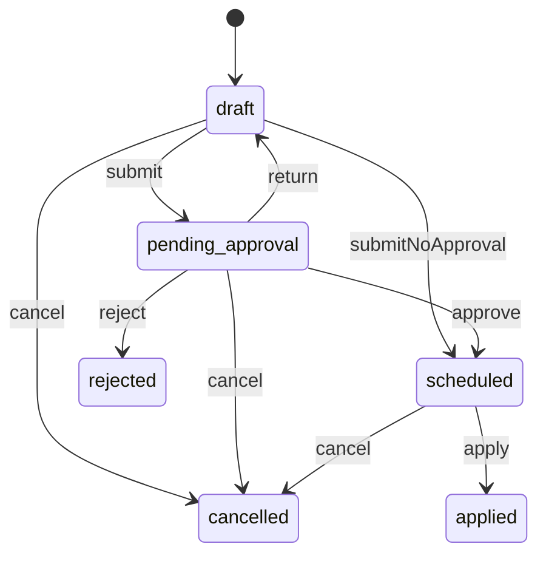

# Settings (`settings`)

Market-level platform settings: country and service region, currency, time zone, business hours, support contacts, guest checkout, Android app versions and feature flags, plus the effective-dated change process (impact preview, approval, schedule, apply) for every runtime setting a module declares. It also assembles the Admin Center settings page from sections owned by other modules.

- **Group:** Platform · **Launch phase:** 1 · **Plan chapters:** 18, 21
- **Depends on:** [access](access.md) · **Optional:** [audit](audit.md), [notifications](notifications.md)

## Owns
- Market: country, service region, currency, time zone, locale
- Business hours, support closures and support contact details (used for business-hour deadlines and the Help pages)
- Checkout toggles: guest checkout, offer an account after a guest purchase
- App configuration for the website and the Android app: support hours, feature flags, minimum and latest Android version, maintenance notice
- Setting definition registry: runtime settings declared by any module (key, type, default, approval rule, minimum notice)
- Effective-dated values with history: every change has an effective date, an apply scope (new orders only or open commitments), a reason and an impact preview before saving
- Setting change requests: draft → approval when required → scheduled → applied, and cancellation
- Feature flags for runtime switches inside enabled modules
- The settings overview page: settings-owned sections plus summaries of sections owned by other modules, and all scheduled changes in one list

**Not here:**
- Returns baseline, category exceptions and who pays return shipping: returns (versioned policy with its own approval and impact preview). settings only shows its summary and scheduled change on the page
- Commission rules, fee basis, payout schedule, availability delay, minimum payout and hold rules: finance (fee rule versions, payout settings). settings shows them as a linked section
- Shipping defaults (seller dispatch target, Official Store cutoff, free-delivery threshold, missing-tracking flag), carrier services and no-dispatch holidays: shipping
- Advertising rules (opening-ad frequency, overlays per page, no-ad pages, labels, paid seller ads): advertising global rules
- Seller performance targets: sellers; support SLA targets per case category: support
- Which modules are installed at all: modules.config.ts (code). Feature flags only switch behaviour inside enabled modules
- Staff roles and approval limits: access; the Business Owner approval itself is an access approval request
- Policy texts shown to customers (returns policy page, purchase terms): content

## Seller API

| Method | Path | Purpose | Auth | Body → Response |
|---|---|---|---|---|
| GET | `/api/seller/settings/upcoming-changes` | Scheduled platform changes that affect sellers | seller | Page<UpcomingChange> |

## Admin API

| Method | Path | Purpose | Auth | Body → Response |
|---|---|---|---|---|
| GET | `/api/admin/settings/overview` | Settings page: market, every section and all scheduled changes | staff<br>`settings.view` | `SettingsOverview` |
| GET | `/api/admin/settings/definitions` | Runtime setting definitions | staff<br>`settings.view` | `SettingDefinition[]` |
| GET | `/api/admin/settings/values/{key}` | One setting: value in force, scheduled versions, recent history | staff<br>`settings.view` | `SettingDetail` |
| GET | `/api/admin/settings/values/{key}/history` | All versions of a setting | staff<br>`settings.view` | Page<SettingVersion> |
| GET | `/api/admin/settings/business-calendar` | Open hours per day for a date range (business hours minus closures) | staff<br>`settings.view` | `BusinessDay[]` |
| POST | `/api/admin/settings/changes` | Draft a change and see its impact before saving | staff<br>`settings.changes.propose` | `ChangeInput` → `SettingChange` |
| PATCH | `/api/admin/settings/changes/{id}` | Edit a draft (values, effective date, scope, reason) | staff<br>`settings.changes.propose` | `ChangeInput` → `SettingChange` |
| POST | `/api/admin/settings/changes/{id}/preview` | Recalculate the impact preview | staff<br>`settings.view` | `ImpactPreview` |
| POST | `/api/admin/settings/changes/{id}/submit` | Save: schedule, or send for approval _(audited)_ | staff<br>`settings.changes.propose` | `SettingChange` |
| POST | `/api/admin/settings/changes/{id}/cancel` | Cancel a draft, pending or scheduled change _(audited)_ | staff<br>`settings.changes.propose` | `{ reason: text }` → `SettingChange` |
| GET | `/api/admin/settings/changes` | Setting changes (scheduled by default) | staff<br>`settings.view` | Page<SettingChange> |
| GET | `/api/admin/settings/changes/{id}` | One change with impact, approval and timeline | staff<br>`settings.view` | `SettingChange` |
| GET | `/api/admin/settings/feature-flags` | Feature flags | staff<br>`settings.view` | `FeatureFlag[]` |
| PUT | `/api/admin/settings/feature-flags/{key}` | Turn a feature flag on or off _(audited)_ | staff<br>`settings.flags.manage` | `{ enabled: bool, rollout: enum(everyone|staff_only|percentage)?, percentage: int?, reason: text }` → `FeatureFlag` |

## Public API

| Method | Path | Purpose | Auth | Body → Response |
|---|---|---|---|---|
| GET | `/api/public/settings/app-config` | Configuration for the website and Android app | visitor | `AppConfig` |

## Types

### DayHours

| Field | Type |
|---|---|
| weekday | `enum(mon|tue|wed|thu|fri|sat|sun)` |
| opens | `string` Local time HH:MM |
| closes | `string` |

### Closure

| Field | Type |
|---|---|
| date | `date` |
| label | `string` |
| kind | `enum(closed|reduced_hours)` |
| opens | `string?` |
| closes | `string?` |

### SupportContacts

| Field | Type |
|---|---|
| phone | `string` |
| email | `email?` |
| phoneHoursLabel | `string` Mon–Sat, 8 AM–8 PM PT |
| chatHoursLabel | `string` |
| closedLabel | `string?` Closed Sundays and US holidays |

### MarketSettings

| Field | Type |
|---|---|
| country | `string` ISO 3166-1 alpha-2, e.g. US |
| serviceRegion | `ServiceRegion` |
| currency | `string` ISO 4217, fixed for launch (USD) |
| timeZone | `string` IANA, e.g. America/Los_Angeles; used for deadlines, reports and campaign schedules |
| locale | `string` |
| businessHours | `DayHours[]` |
| businessHoursLabel | `string` Mon–Sat, 8:00 AM – 8:00 PM PT |
| closures | `Closure[]` |
| support | `SupportContacts` |
| legalName | `string` market.legalName |
| companyLine | `string` market.companyLine |

### ServiceRegion

| Field | Type |
|---|---|
| code | `string` |
| label | `string` United States, 48 contiguous states |
| includedRegions | `string[]` State codes |
| note | `string?` |

### AndroidConfig

| Field | Type |
|---|---|
| minVersionCode | `int` Older apps must update before continuing |
| latestVersionCode | `int` |
| latestVersionName | `string` |
| updateUrl | `url` |
| updateMessage | `string?` |
| updateRequired | `bool` Computed for the calling app when it sends appVersionCode |
| updateSuggested | `bool` |

### AppConfig

| Field | Type |
|---|---|
| configVersion | `string` Changes whenever any value changes; the app caches by it (ETag) |
| generatedAt | `datetime` |
| market | `PublicMarket` |
| support | `PublicSupport` |
| checkout | `CheckoutSettings` |
| features | `map<bool>` Public feature flags, e.g. { "wishlist": false, "paidSellerAds": false, "externalSignIn": false } |
| android | `AndroidConfig` |
| maintenance | `MaintenanceNotice` |

### PublicMarket

| Field | Type |
|---|---|
| country | `string` |
| currency | `string` |
| timeZone | `string` |
| locale | `string` |
| serviceRegionLabel | `string` |
| legalName | `string` Legal name of the operating company, e.g. Marketly, Inc. (footer, policies, receipts) |
| companyLine | `string` One-line company details for the footer and emails, e.g. Marketly, Inc. · 500 Market St, San Francisco, CA |

### PublicSupport

| Field | Type |
|---|---|
| hoursLabel | `string` |
| openNow | `bool` |
| nextOpenAt | `datetime?` |
| phone | `string` |
| chatHoursLabel | `string` |
| closedLabel | `string?` |

### CheckoutSettings

| Field | Type |
|---|---|
| guestCheckoutEnabled | `bool` |
| offerAccountAfterGuestPurchase | `bool` |

### MaintenanceNotice

| Field | Type |
|---|---|
| active | `bool` |
| kind | `enum(maintenance|incident)?` maintenance = planned work; incident = live service problem (the error page shows it as a status note) |
| message | `string?` |
| until | `datetime?` |
| updatedAt | `datetime?` When the notice was last changed, shown as Updated 9:42 AM PT |

### SettingDefinition

| Field | Type |
|---|---|
| key | `string` <module>.<name>, e.g. market.timeZone, checkout.guestCheckoutEnabled, catalog.maxImagesPerProduct |
| module | `string` |
| section | `string` Settings page section key |
| label | `string` |
| description | `text` |
| valueType | `enum(bool|int|number|string|text|money|duration|enum|time|weekly_hours|closures|json)` |
| enumValues | `string[]` |
| unit | `string?` days after delivery, hours, % |
| default | `json` |
| min | `number?` |
| max | `number?` |
| editable | `bool` False = shown read-only (e.g. currency fixed for launch) |
| approval | `enum(none|second_reviewer|business_owner)` Rule applied on submit through access |
| minLeadDays | `int` Earliest effective date after saving (e.g. 14 so sellers and Help content can update) |
| applyScopes | `enum(new_only|open_commitments)[]` |
| sellerVisible | `bool` Scheduled changes are announced to sellers |
| public | `bool` Included in GET /api/public/settings/app-config |
| exampleValue | `bool` The default is a business example still to confirm |
| editPermission | `string` Permission needed to propose a change (default settings.changes.propose) |

### SettingVersion

| Field | Type |
|---|---|
| key | `string` |
| version | `int` |
| value | `json` |
| valueText | `string` |
| effectiveFrom | `datetime` |
| effectiveTo | `datetime?` |
| applyScope | `enum(new_only|open_commitments)` |
| changeId | `uuid?` |
| changedBy | `Actor` |
| approvedBy | `Actor?` |
| reason | `text?` |

### SettingDetail

| Field | Type |
|---|---|
| definition | `SettingDefinition` |
| current | `SettingVersion` |
| scheduled | `SettingVersion[]` |
| recent | `SettingVersion[]` Last 10 versions |

### ChangeItemInput

| Field | Type |
|---|---|
| key | `string` |
| value | `json` |

### ChangeInput

| Field | Type |
|---|---|
| items | `ChangeItemInput[]` |
| effectiveAt | `datetime` Must respect each item's minLeadDays |
| applyScope | `enum(new_only|open_commitments)` new_only: orders placed on or after the effective date; open_commitments: also orders not yet delivered (only where the definition allows) |
| reason | `text` |

### ChangeItem

| Field | Type |
|---|---|
| key | `string` |
| label | `string` |
| section | `string` |
| from | `json` |
| to | `json` |
| fromText | `string` |
| toText | `string` |

### ImpactItem

| Field | Type |
|---|---|
| module | `string` |
| kind | `enum(orders|sellers|offers|customers|content|campaigns|payouts|staff|other)` |
| count | `int?` |
| message | `string` 1,284 open orders keep their current terms · 23 sellers are notified today · 3 Help articles need an update before Nov 1 |
| severity | `enum(info|warning|blocking)` |
| owner | `string?` Who must act, e.g. Content Manager |
| screen | `string?` |

### ImpactPreview

| Field | Type |
|---|---|
| computedAt | `datetime` |
| items | `ImpactItem[]` |
| blocking | `string[]` Reasons the change cannot be submitted, e.g. effective date earlier than the 14-day notice |
| needsApproval | `bool` |
| approvalRule | `enum(none|second_reviewer|business_owner)` |
| approvers | `string[]` |

### SettingChange

| Field | Type |
|---|---|
| id | `uuid` |
| ref | `string` SC-YYMMDD-NNN |
| status | `enum(draft|pending_approval|scheduled|applied|rejected|cancelled)` |
| items | `ChangeItem[]` |
| effectiveAt | `datetime` |
| applyScope | `enum(new_only|open_commitments)` |
| reason | `text` |
| impact | `ImpactPreview` |
| createdBy | `Actor` |
| createdAt | `datetime` |
| submittedAt | `datetime?` |
| approval | `ApprovalInfo?` |
| appliedAt | `datetime?` |
| cancelReason | `text?` |
| timeline | `TimelineEvent[]` |

### SectionValue

| Field | Type |
|---|---|
| key | `string?` |
| label | `string` |
| valueText | `string` |
| hint | `string?` |
| exampleValue | `bool` |

### SectionLink

| Field | Type |
|---|---|
| module | `string` |
| area | `enum(admin)` |
| path | `string` Owning module endpoint that edits this section, e.g. /api/admin/returns/policies |
| screen | `string?` |

### ScheduledChange

| Field | Type |
|---|---|
| source | `enum(settings|module)` |
| module | `string` |
| ref | `string` |
| title | `string` Electronics return window changes from 30 to 15 days |
| effectiveAt | `datetime` |
| appliesTo | `string` Orders placed before then keep 30 days |
| status | `enum(pending_approval|scheduled)` |
| approvedBy | `Actor?` |
| sellerVisible | `bool` |

### SettingsSection

| Field | Type |
|---|---|
| key | `string` market, checkout, apps, shipping_defaults, returns_baseline, fees, payouts_holds, advertising_rules… |
| title | `string` |
| subtitle | `string?` |
| ownerModule | `string` |
| ownedHere | `bool` True: edit through POST /changes. False: edit with link (owning module) |
| values | `SectionValue[]` |
| lastChange | `LastChange?` |
| scheduled | `ScheduledChange[]` |
| link | `SectionLink?` |
| available | `bool` False when the owning module is disabled |

### LastChange

| Field | Type |
|---|---|
| by | `Actor` |
| approvedBy | `Actor?` |
| at | `datetime` |
| effectiveFrom | `datetime` |

### SettingsOverview

| Field | Type |
|---|---|
| market | `MarketSettings` |
| sections | `SettingsSection[]` |
| scheduled | `ScheduledChange[]` |

### FeatureFlag

| Field | Type |
|---|---|
| key | `string` |
| module | `string` |
| label | `string` |
| description | `text` |
| enabled | `bool` |
| rollout | `enum(everyone|staff_only|percentage)` |
| percentage | `int?` |
| public | `bool` Exposed in app-config.features |
| plannedPhase | `int?` Launch phase the feature belongs to (shows a 'Later' badge) |
| updatedBy | `Actor?` |
| updatedAt | `datetime?` |

### UpcomingChange

| Field | Type |
|---|---|
| ref | `string` |
| module | `string` |
| title | `string` |
| description | `text?` |
| effectiveAt | `datetime` |
| appliesTo | `string` |
| helpLink | `string?` |
| postedAt | `datetime` When the change was announced to sellers |

### BusinessDay

| Field | Type |
|---|---|
| date | `date` |
| open | `bool` |
| opensAt | `datetime?` |
| closesAt | `datetime?` |
| label | `string?` |

## Status flows

### Setting change (`SettingChange.status`)



submit is refused while the impact preview has blocking items (effective date inside minLeadDays, invalid value) or another open change touches the same key (CHANGE_CONFLICT). The strictest approval rule among the items applies (business_owner > second_reviewer > none); approval goes through access and finishes on access.approval.decided: action settings.changes.apply-owner (Business Owner only) when any item's rule is business_owner, otherwise settings.changes.apply (a second reviewer). A Platform Administrator can therefore never approve a Business Owner rule change. apply runs at effectiveAt (job) and writes a new version per key; a change whose effectiveAt is now applies immediately after approval. Applied changes are never edited: a correction is a new change.

## Data (schema `settings`)

**definitions**: Registry synced at boot from module manifests (runtime settings)

| Column | Type |
|---|---|
| key | text pk |
| module | text |
| section | text |
| label | text |
| description | text |
| value_type | text |
| schema | jsonb (enum values, min, max, unit) |
| default_value | jsonb |
| editable | bool |
| approval | text |
| min_lead_days | int |
| apply_scopes | jsonb |
| seller_visible | bool |
| public | bool |
| example_value | bool |
| edit_permission | text |
| registered_at | timestamptz |
| unavailable_since | timestamptz? |

Indexes: `(module)`, `(section)`

**values**: Effective-dated versions; the row in force has effective_from <= now and (effective_to is null or > now)

| Column | Type |
|---|---|
| id | uuid pk |
| key | text → definitions |
| version | int |
| value | jsonb |
| effective_from | timestamptz |
| effective_to | timestamptz? |
| apply_scope | text |
| change_id | uuid? → changes |
| changed_by_kind | text |
| changed_by_id | text |
| approved_by_id | text? |
| reason | text? |
| created_at | timestamptz |

Indexes: `unique (key, version)`, `(key, effective_from desc)`

**changes**

| Column | Type |
|---|---|
| id | uuid pk |
| ref | text unique |
| status | text |
| items | jsonb |
| effective_at | timestamptz |
| apply_scope | text |
| reason | text |
| impact | jsonb |
| created_by_kind | text |
| created_by_id | text |
| created_at | timestamptz |
| submitted_at | timestamptz? |
| approval_request_id | uuid? |
| applied_at | timestamptz? |
| cancel_reason | text? |
| version | int |
| announced_at | timestamptz? (seller-visible changes: when sellers were told) |

Indexes: `(status, effective_at)`, `(created_at desc)`

**change_keys**: Keys touched by open changes, to block overlapping scheduled changes

| Column | Type |
|---|---|
| change_id | uuid → changes |
| key | text |
| open | bool |

Indexes: `unique (key) where open`

**feature_flags**

| Column | Type |
|---|---|
| key | text pk |
| module | text |
| label | text |
| description | text |
| enabled | bool |
| rollout | text |
| percentage | int? |
| public | bool |
| planned_phase | int? |
| updated_by | text? |
| updated_at | timestamptz? |

## Events

| Publishes | When | Payload | Consumed by |
|---|---|---|---|
| `settings.change.submitted` | A change is sent for approval | `{ changeId: uuid, ref: string, keys: string[], effectiveAt: datetime, approvalRequestId: uuid }` | - |
| `settings.change.scheduled` | A change is scheduled (directly or after approval) | `{ changeId: uuid, ref: string, keys: string[], effectiveAt: datetime, applyScope: enum(new_only|open_commitments), sellerVisible: bool, summary: string }` | notifications |
| `settings.change.cancelled` | A change is cancelled or its approval is rejected | `{ changeId: uuid, ref: string, keys: string[], outcome: enum(cancelled|rejected), reason: text? }` | - |
| `settings.setting.changed` | A new value takes effect | `{ key: string, module: string, version: int, from: json, to: json, effectiveFrom: datetime, applyScope: enum(new_only|open_commitments), changeId: uuid? }` | - |
| `settings.feature_flag.changed` | A feature flag is switched | `{ key: string, enabled: bool, rollout: string, by: Actor }` | - |

| Consumes | From | Does |
|---|---|---|
| `access.approval.decided` | access | For settings.changes.apply and settings.changes.apply-owner requests: approved → scheduled (applied at once if effectiveAt has passed); rejected/expired → rejected; cancelled → cancelled |
| `access.approval.returned` | access | Move the change back to draft with the reviewer's comment on its timeline |

## In-process API (for other modules)

| Function | Signature | Used by |
|---|---|---|
| get | `<T>(key: string, at?: datetime) => T`<br>Value in force at a time (default now), falling back to the declared default. Cached; invalidated by settings.setting.changed. key is the full '<module>.<name>': any module may read another enabled module's declared setting (read-only), e.g. audit reads reports.maxExportRows; the kernel exposes it as ctx.settings.read(fullKey) next to ctx.settings.get(ownName). An unknown key or a disabled module's key throws UNKNOWN_SETTING. | * |
| market | `() => MarketSettings`<br>Country, region, currency, time zone, locale, business hours | checkout, orders, shipping, finance, reports, promotions, advertising, support, workqueues |
| businessCalendar | `() => { isOpen(at: datetime): bool, isBusinessDay(day: date): bool, addBusinessMinutes(from: datetime, minutes: int): datetime, addBusinessDays(from: datetime, days: int): datetime, nextOpen(after: datetime): datetime }`<br>Business-hour arithmetic in the market time zone for SLA deadlines. addBusinessDays counts whole days that have opening hours (closures and closed weekdays skipped) and keeps the local time of day, moved to closing time when that day closes earlier; from inside a closed day it counts from the next business day. | support, workqueues, returns, sellers, catalog, shipping |
| isEnabled | `(flagKey: string, subject?: { accountId?: uuid, realm?: string }) => bool`<br>Feature flag check | * |
| registerSection | `(provider: { key: string, order: int, load: () => SettingsSection }) => void`<br>Called at boot by modules that own a section of the settings page (returns, finance, shipping, advertising) so the overview shows their current values, last change and scheduled changes with a link to their own edit endpoints | returns, finance, shipping, advertising, sellers, support |
| registerImpactEstimator | `(keyPrefix: string, estimate: (change: { key: string, from: json, to: json, effectiveAt: datetime, applyScope: string }) => ImpactItem[]) => void`<br>Owning modules explain what a change of their declared settings does to existing commitments (open orders, sellers, content) | checkout, orders, shipping, support, content, notifications |
| storeInfo | `() => { market: PublicMarket, support: PublicSupport & { email?: email }, closures: Closure[], maintenance: MaintenanceNotice | null, guestCheckoutEnabled: bool, features: { key: string, enabled: bool }[], configVersion: string }`<br>Public market facts for any screen: support hours and open now, closures in the next 60 days, active maintenance notice, guest checkout and public feature flags (the web-facing subset of AppConfig) | graphql |
| upcomingChangesForSellers | `(principal: identity.Principal) => UpcomingChange[]`<br>Scheduled changes that affect sellers, soonest first (same as GET /api/seller/settings/upcoming-changes) | graphql |

## Permissions

| Key | Who | Allows |
|---|---|---|
| `settings.view` | staff | View the settings page, definitions, history and changes |
| `settings.changes.propose` | staff | Draft, submit and cancel setting changes (Platform Administrator). Approval rules still apply. |
| `settings.flags.manage` | staff | Switch feature flags |

## Approval actions

Checked through the access module (limits per role, second reviewer).

| Action | Limit | Second reviewer | Approvers | Meaning |
|---|---|---|---|---|
| `settings.changes.apply` | none | always | Another Platform Administrator or the Business Owner (never the proposer) | Apply a change request whose strictest item rule is second_reviewer |
| `settings.changes.apply-owner` | none | always | Business Owner only (never the proposer) | Apply a change request with at least one item whose rule is business_owner |

## Error codes

| Code | Status | Meaning |
|---|---|---|
| `UNKNOWN_SETTING` | 400 | No enabled module declares details.key. |
| `SETTING_NOT_EDITABLE` | 409 | The setting is read-only (e.g. currency fixed for launch) or owned by a module section that is edited there (details.link). |
| `IMPACT_BLOCKING` | 409 | The impact preview has blocking items; details.blocking lists them. |
| `CHANGE_CONFLICT` | 409 | Another open change touches the same setting (details.changeRef). Cancel it or combine them. |
| `LEAD_TIME_TOO_SHORT` | 409 | The effective date is earlier than the setting's minimum notice (details.earliest). |

## Background jobs

| Job | Schedule | Does |
|---|---|---|
| `settings.sync-definitions` | on boot | Upsert definitions and feature flags declared by enabled modules; mark those of disabled modules unavailable; seed market defaults on first boot |
| `settings.apply-due-changes` | every minute | Apply scheduled changes whose effectiveAt has passed: close the previous versions, write new ones, publish settings.setting.changed per key, bump configVersion |
| `settings.refresh-impact` | daily | Recompute the impact preview of scheduled changes so counts on the page stay current |

## Settings

| Key | Default | Rules | Meaning |
|---|---|---|---|
| appConfigCacheSeconds | `300` | duration, seconds, 0–… | Cache lifetime of GET /app-config |
| defaultMinLeadDays | `0` | duration, days, 0–…, approval: business owner | Minimum notice for definitions that do not set one |
| sellerVisibleMinLeadDays | `14` | duration, days, 0–…, approval: business owner | Minimum notice for changes announced to sellers |

## Notes
- Boundary: settings owns market-level values (market.*, support.*, checkout.*, apps.*) and the generic store for runtime settings that modules declare in their manifest (the same `settings` entries as in their specs, opted in with editable: true). Versioned business rule sets with their own lifecycle stay in their modules: returns baseline and category exceptions (returns), fee rules and payout/hold settings (finance), shipping defaults and holidays (shipping), advertising global rules (advertising), seller performance targets (sellers), SLA targets (support). Those modules register a section provider so GET /overview shows their values, last change and scheduled changes, and the page edits them through the owning module's endpoint (SectionLink).
- Every change states its effective date and its impact on existing commitments before saving (plan ch. 18). applyScope new_only means orders placed before the effective date keep what they accepted; purchase snapshots in orders already guarantee this for terms copied at purchase.
- Settings-owned keys and their defaults (examples to confirm): market.country = US; market.serviceRegion = 48 contiguous states (Alaska, Hawaii and territories later); market.currency = USD (not editable at launch); market.timeZone = America/Los_Angeles; market.locale = en-US; support.businessHours = Mon–Sat 08:00–20:00; support.closures = Thanksgiving, Christmas, New Year; support.phone = 1-800-555-0136; checkout.guestCheckoutEnabled = true (approval: business_owner); checkout.offerAccountAfterGuestPurchase = true; market.legalName = Marketly, Inc. and market.companyLine (approval: business_owner; shown in footers, policies and emails); apps.android.minVersionCode, apps.android.latestVersionCode, apps.android.updateUrl; apps.maintenance.
- Launch has one market (plan ch. 1: one service region and one main currency; no other languages are planned). AppConfig.market (United States · English (US) · USD) is still returned for formatting, but the apps show no market row and no market or language picker and no supportedMarkets list until an expansion project adds a second market.
- apps.maintenance holds { active, kind, message, until }; every change sets updatedAt. kind incident is used by the Platform Administrator for live service problems so error pages can show the current status note.
- Changing market.timeZone or market.currency after launch needs a migration plan: both are business_owner approval, minLeadDays 30, and currency stays read-only in phase 1 (one currency, plan ch. 1).
- Feature flags never replace module enablement: a disabled module's endpoints do not exist, whatever a flag says. Public flags appear in app-config so the Android app can hide features (e.g. wishlist in phase 3).
- Seller support hours share the general support business hours and closures; there is no separate seller schedule, and GET /api/seller/support/categories (hoursLabel, openNow) reads the same values.

## GraphQL (read layer)

This module's fragment of the GraphQL schemas (see [../graphql/README.md](../graphql/README.md)). Writes stay on the REST endpoints above.

```graphql
# settings: market-level facts every screen may show (support hours and whether support is open now, closures,
# maintenance notice, public feature flags) and, for Seller Center, upcoming platform changes.
# Admin settings pages, change requests and feature flags stay on REST /api/admin/settings/*.
# The Android app keeps using REST GET /api/public/settings/app-config (cached by configVersion).

"Public facts about the marketplace for headers, footers, help and contact screens"
type StoreInfo {
  market: StoreInfoMarket!
  support: StoreInfoSupport!
  "Upcoming closures and reduced-hours days (next 60 days)"
  closures: [StoreInfoClosure!]!
  "Present while a maintenance notice is active"
  maintenance: StoreInfoMaintenance
  guestCheckoutEnabled: Boolean!
  "Public feature flags, e.g. wishlist, paidSellerAds, externalSignIn"
  features: [StoreInfoFeature!]!
  "Changes whenever any value changes; clients may cache by it"
  configVersion: String!
}

type StoreInfoMarket {
  "ISO 3166-1 alpha-2, e.g. US"
  country: String!
  "ISO 4217, USD at launch"
  currency: String!
  "IANA, e.g. America/Los_Angeles"
  timeZone: String!
  locale: String!
  serviceRegionLabel: String!
}

type StoreInfoSupport {
  "Mon–Sat, 8 AM–8 PM PT"
  hoursLabel: String!
  openNow: Boolean!
  "When support opens next, while closed"
  nextOpenAt: DateTime
  phone: String!
  email: Email
  chatHoursLabel: String!
  "Closed Sundays and US holidays"
  closedLabel: String
}

type StoreInfoClosure {
  date: Date!
  label: String!
  kind: StoreInfoClosureKind!
  "Local time HH:MM on reduced-hours days"
  opens: String
  closes: String
}

enum StoreInfoClosureKind {
  CLOSED
  REDUCED_HOURS
}

type StoreInfoMaintenance {
  "Planned maintenance or a live incident (error pages show incidents as a status note)"
  kind: StoreInfoMaintenanceKind
  message: String
  until: DateTime
  "When the notice was last changed (Updated 9:42 AM PT)"
  updatedAt: DateTime
}

enum StoreInfoMaintenanceKind {
  MAINTENANCE
  INCIDENT
}

type StoreInfoFeature {
  key: String!
  enabled: Boolean!
}

"A platform change sellers should know about before it takes effect (Seller dashboard 'Announcements')"
type SettingsUpcomingChange @areas(in: [SELLER]) {
  ref: String!
  "Owning module, e.g. returns, finance"
  module: String!
  title: String!
  description: String
  effectiveAt: DateTime!
  "Who or what it applies to, e.g. Orders placed on or after Nov 1"
  appliesTo: String!
  helpLink: String
  "When the change was announced to sellers"
  postedAt: DateTime!
}

extend type Query {
  "Support hours, open now, closures, maintenance notice and public flags"
  storeInfo: StoreInfo! @auth(requires: ANYONE) @source(module: "settings", fn: "storeInfo")

  "Scheduled platform changes that affect sellers, soonest first"
  upcomingChanges: [SettingsUpcomingChange!]! @areas(in: [SELLER]) @auth(requires: SELLER) @source(module: "settings", fn: "upcomingChangesForSellers")
}
```
