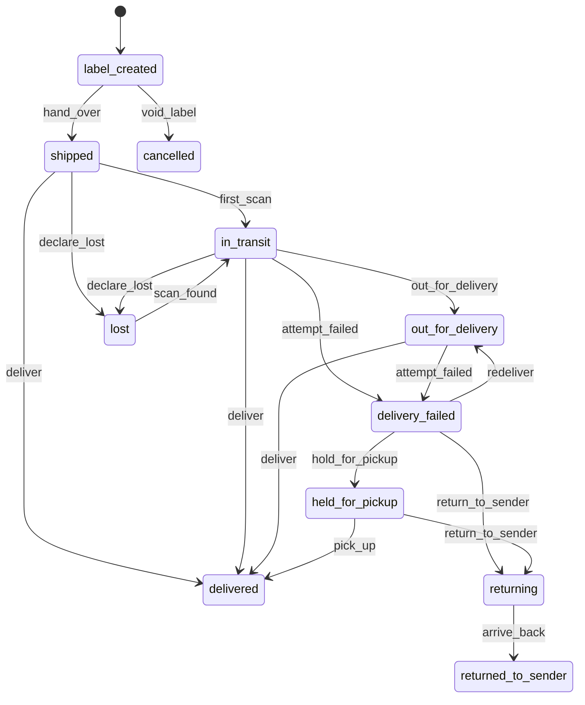
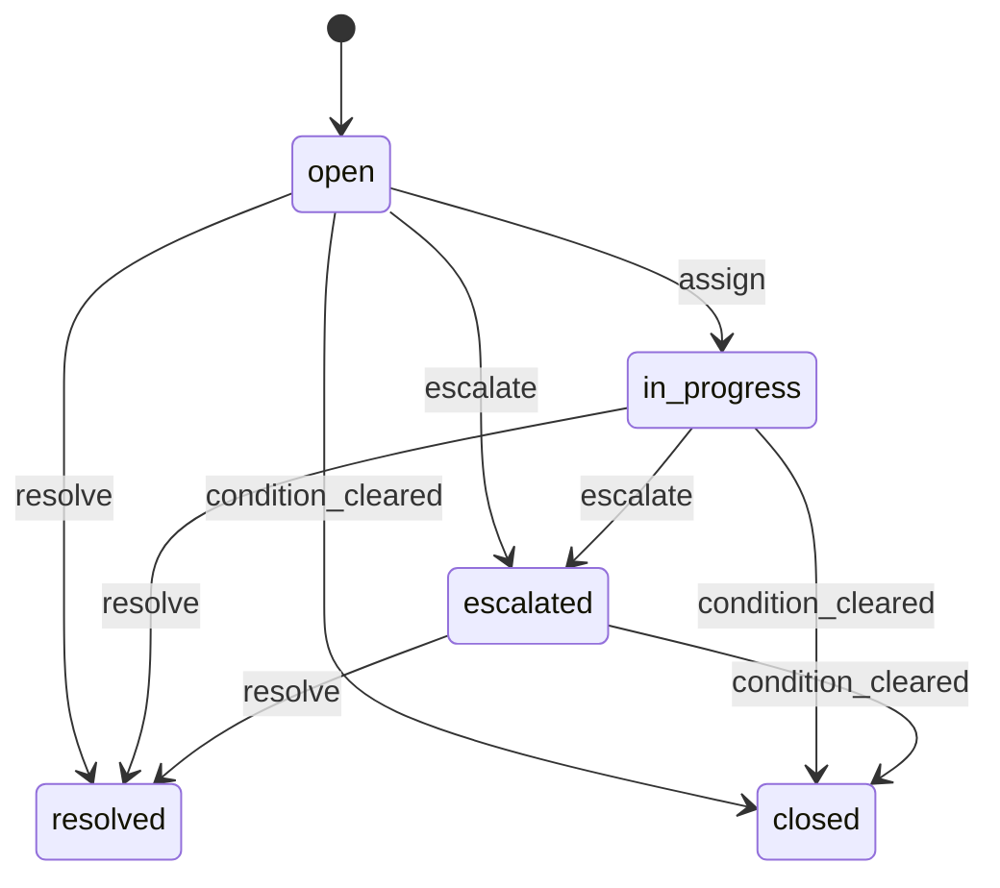
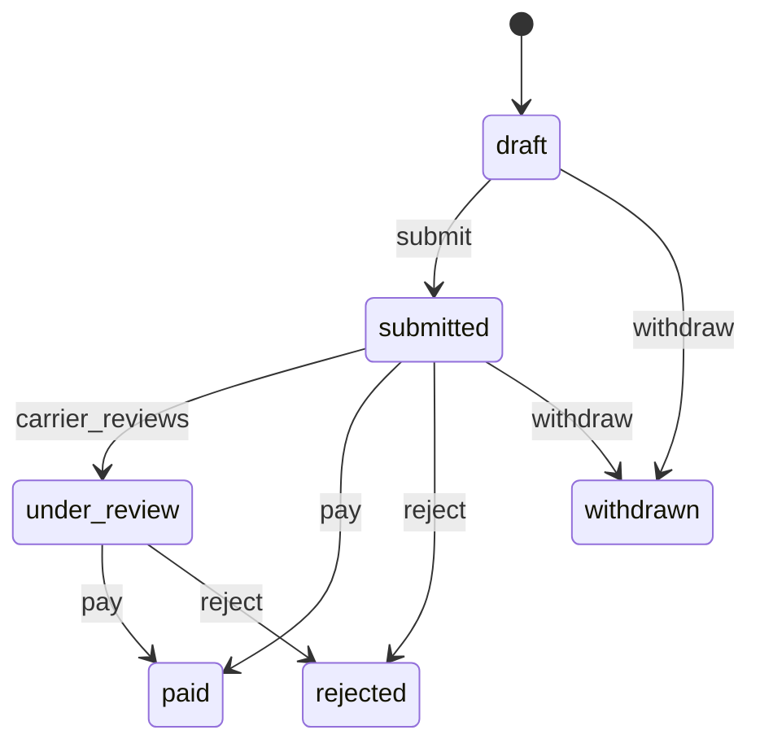
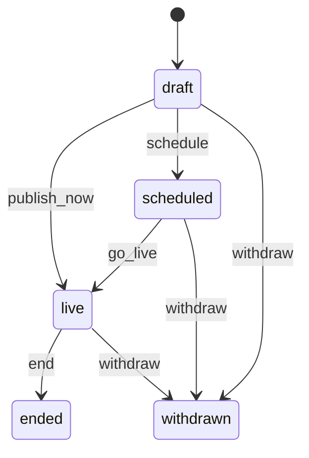
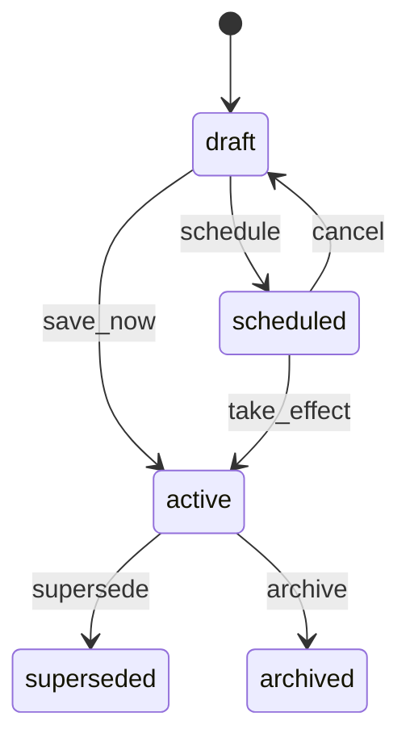
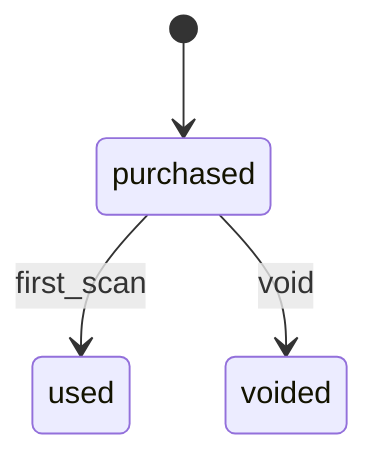

# Shipping (`shipping`)

How things get delivered: carriers and services, destinations and excluded areas, shipping profiles with rates (Official Store and sellers), free-shipping rules, dispatch targets and cutoffs, the holiday and service-interruption calendar, delivery estimates for a location, shipments with contents and tracking, labels where supported, partial shipments, and delivery exceptions with their required responses and carrier claims.

- **Group:** Buying · **Launch phase:** 1 · **Plan chapters:** 5, 6, 11, 12, 18
- **Depends on:** [orders](orders.md) · **Optional:** [offers](offers.md), [sellers](sellers.md), [media](media.md), [support](support.md), [access](access.md), [settings](settings.md), [audit](audit.md), [finance](finance.md), [fulfillment-service](fulfillment-service.md), [identity](identity.md), [notifications](notifications.md), [returns](returns.md), [reports](reports.md)
- **Required by:** [checkout](checkout.md), [returns](returns.md)

## Owns
- Carriers, carrier services, tracking connections and on-time rates
- Platform shipping methods (Standard, Expedited, Express, Large items) and the carrier services behind them
- Destinations: served zones with transit times and excluded areas (PO boxes, military, Alaska, Hawaii, territories)
- Shipping profiles with rates per method (flat, by weight, by order value), free-shipping thresholds and effective dates, for the Official Store and each seller
- Standing free-shipping thresholds of the Official Store and sellers (company- or seller-funded); platform-funded free shipping in campaigns and coupons belongs to promotions
- Dispatch targets and cutoffs: Official Store cutoff, default seller targets, seller handling time, business days and closures
- Holiday and service-interruption calendar shown on product pages, checkout and tracking
- Delivery estimates and shipping quotes for a location (used by offers, cart and checkout) and dispatch deadlines
- Shipments: package contents, carrier, service, tracking number with format checks, ship date, corrections with history, partial shipments, replacement and return parcels
- Label purchase where the carrier is supported (sellers in Seller Center, warehouse for the Official Store, returns for return labels)
- Tracking events from carrier webhooks and polling, normalized to one status model
- Delivery exceptions with required responses: seller cannot fulfill, late dispatch, missing tracking, lost or damaged, failed delivery (with the customer's next-step choice)
- Carrier claims

**Not here:**
- Fulfillment tasks, item states and cancellations: orders (shipping reports shipments; orders moves the items)
- Picking and packing Official Store packages: warehouse (buys labels and hands packages over through shipping)
- Seller return address and return terms: returns
- Shipping discounts in campaigns and coupons, including platform-funded free shipping: promotions (evaluateCart applies them per package; shipping only keeps standing Official Store and seller thresholds)
- Generic work queue items, owners and escalation timers: workqueues (fed by shipping events)
- Seller performance scoring: sellers (reads shipping events and dispatchMetrics)

## Store API

| Method | Path | Purpose | Auth | Body → Response |
|---|---|---|---|---|
| GET | `/api/store/shipping/estimates` | Delivery estimate per offer for a location (product page, offers list) | visitor | `OfferEstimate[]` |
| GET | `/api/store/shipping/notices` | Live holiday and service notices for a location | visitor | `CustomerNotice[]` |
| GET | `/api/store/shipping/orders/{orderId}/shipments` | Packages of an order with carrier, tracking and status | shopper | `ShipmentSummary[]` |
| GET | `/api/store/shipping/shipments/{id}/tracking` | Track one package: carrier, tracking number, contents, estimate and events | shopper | `TrackingView` |
| POST | `/api/store/shipping/shipments/{id}/delivery-choice` | Choose redelivery, pickup or return to seller after a failed delivery | shopper | `{ choice: enum(redeliver|pickup|return_to_seller), redeliveryDate: date? }` → `TrackingView` |

## Seller API

| Method | Path | Purpose | Auth | Body → Response |
|---|---|---|---|---|
| GET | `/api/seller/shipping/settings` | Coverage, profiles with methods and rates, dispatch schedule, closures, labels and customer preview | seller<br>`shipping.seller-settings.view` | `SellerShippingSettings` |
| PUT | `/api/seller/shipping/settings` | Change coverage, dispatch schedule or label preference (now or from a date) _(audited)_ | seller<br>`shipping.seller-settings.manage` | `SellerShippingSettingsInput` → `SellerShippingSettings` |
| POST | `/api/seller/shipping/closures` | Add a holiday closure (estimates skip closed days) | seller<br>`shipping.seller-settings.manage` | `{ name: string, from: date, to: date }` → `Closure` |
| DELETE | `/api/seller/shipping/closures/{id}` | Remove a closure | seller<br>`shipping.seller-settings.manage` | 204 No content |
| GET | `/api/seller/shipping/profiles` | The seller's shipping profiles (chosen on each offer) | seller<br>`shipping.seller-settings.view` | `ShippingProfile[]` |
| POST | `/api/seller/shipping/profiles` | Create a shipping profile (e.g. Large items) _(audited)_ | seller<br>`shipping.seller-settings.manage` | `ProfileInput` → `ShippingProfile` |
| PUT | `/api/seller/shipping/profiles/{id}` | Change methods, rates or the free-shipping threshold (new version, now or from a date) _(audited)_ | seller<br>`shipping.seller-settings.manage` | `ProfileInput` → `ShippingProfile` |
| POST | `/api/seller/shipping/profiles/{id}/archive` | Archive a profile no offer uses _(audited)_ | seller<br>`shipping.seller-settings.manage` | `ShippingProfile` |
| GET | `/api/seller/shipping/preview` | What customers see for an offer or profile at a location | seller<br>`shipping.seller-settings.view` | `CustomerPreview` |
| GET | `/api/seller/shipping/methods` | Platform shipping methods a seller can add to a profile, with their carrier services and transit | seller<br>`shipping.seller-settings.view` | `ShippingMethod[]` |
| GET | `/api/seller/shipping/carrier-services` | Carriers and services sellers can use, with label support and tracking formats | seller | `Carrier[]` |
| POST | `/api/seller/shipping/shipments` | Record a shipment for some or all items of one of the seller's orders | seller<br>`shipping.seller-shipments.manage` | `RecordShipmentInput` → `Shipment` |
| GET | `/api/seller/shipping/shipments` | The seller's shipment records | seller<br>`shipping.seller-shipments.view` | Page<ShipmentSummary> |
| GET | `/api/seller/shipping/shipments/{id}` | One shipment with tracking events and correction history | seller<br>`shipping.seller-shipments.view` | `Shipment` |
| POST | `/api/seller/shipping/shipments/{id}/correct-tracking` | Correct the carrier or tracking number with a reason | seller<br>`shipping.seller-shipments.manage` | `{ carrierCode: string?, trackingNumber: string, reason: text }` → `Shipment` |
| POST | `/api/seller/shipping/labels/quotes` | Label prices for a package, marked when they keep the promised arrival | seller<br>`shipping.seller-shipments.manage` | `{ groupId: uuid, items: ShipmentLineInput[], parcel: Parcel }` → `LabelQuote[]` |
| POST | `/api/seller/shipping/labels` | Buy a carrier label (cost is deducted from earnings) _(idempotent)_ | seller<br>`shipping.seller-shipments.manage` | `{ quoteId: uuid, items: ShipmentLineInput[] }` → `LabelResult` |
| POST | `/api/seller/shipping/shipments/{id}/hand-over` | Mark a labelled package as handed to the carrier | seller<br>`shipping.seller-shipments.manage` | `{ at: datetime? }` → `Shipment` |
| POST | `/api/seller/shipping/labels/{id}/void` | Void an unused label (refunded to earnings) _(idempotent)_ | seller<br>`shipping.seller-shipments.manage` | `{ reason: text }` → `Label` |
| GET | `/api/seller/shipping/exceptions` | Delivery exceptions on the seller's orders that need the seller's response | seller<br>`shipping.seller-shipments.view` | Page<DeliveryException> |
| POST | `/api/seller/shipping/exceptions/{id}/respond` | Respond: provide tracking, promise a ship-by date, report you cannot fulfill, or confirm a replacement | seller<br>`shipping.seller-shipments.manage` | `{ action: enum(tracking_provided|will_ship_by|cannot_fulfill|replacement_sent|other), trackingNumber: string?, shipBy: datetime?, note: text? }` → `DeliveryException` |
| GET | `/api/seller/shipping/claims` | Carrier claims on the seller's shipments | seller<br>`shipping.seller-shipments.view` | Page<CarrierClaim> |
| POST | `/api/seller/shipping/claims` | Record a claim the seller filed with its own carrier account | seller<br>`shipping.seller-shipments.manage` | `ClaimInput` → `CarrierClaim` |
| GET | `/api/seller/shipping/shipping-setup` | Carriers, services, label purchase and the default package for recording a shipment | seller<br>`shipping.seller-shipments.view` | `SellerShippingSetup` |

## Admin API

| Method | Path | Purpose | Auth | Body → Response |
|---|---|---|---|---|
| GET | `/api/admin/shipping/summary` | Live notices, exception counts, overdue dispatch and Official Store on-time rate | staff<br>`shipping.settings.view` | `ShippingSummary` |
| GET | `/api/admin/shipping/carriers` | Carriers with services, tracking connection and on-time rate | staff<br>`shipping.settings.view` | `Carrier[]` |
| POST | `/api/admin/shipping/carriers` | Add a carrier account _(audited)_ | staff<br>`shipping.settings.manage` | `CarrierInput` → `Carrier` |
| PATCH | `/api/admin/shipping/carriers/{id}` | Activate, deactivate or rename a carrier, or update its contacts _(audited)_ | staff<br>`shipping.settings.manage` | `{ name: string?, accountLabel: string?, status: enum(active|inactive)?, trackingMode: enum(webhook|polling|manual)?, contacts: CarrierContact[]?, reason: text }` → `Carrier` |
| PATCH | `/api/admin/shipping/carriers/{id}/services/{serviceId}` | Enable or disable a carrier service, set transit days _(audited)_ | staff<br>`shipping.settings.manage` | `CarrierServiceUpdate` → `CarrierService` |
| GET | `/api/admin/shipping/methods` | Platform shipping methods and their carrier services | staff<br>`shipping.settings.view` | `ShippingMethod[]` |
| PUT | `/api/admin/shipping/methods/{id}` | Change a method's name, customer label, transit or services _(audited)_ | staff<br>`shipping.settings.manage` | `MethodInput` → `ShippingMethod` |
| GET | `/api/admin/shipping/zones` | Served zones and excluded areas | staff<br>`shipping.settings.view` | `Zone[]` |
| POST | `/api/admin/shipping/zones` | Add a zone or excluded area _(audited)_ | staff<br>`shipping.settings.manage` | `ZoneInput` → `Zone` |
| PUT | `/api/admin/shipping/zones/{id}` | Change a zone, enable or disable it _(audited)_ | staff<br>`shipping.settings.manage` | `ZoneInput` → `Zone` |
| GET | `/api/admin/shipping/profiles` | Official Store and seller shipping profiles | staff<br>`shipping.settings.view` | Page<ShippingProfile> |
| POST | `/api/admin/shipping/profiles` | Create an Official Store shipping profile _(audited)_ | staff<br>`shipping.settings.manage` | `ProfileInput` → `ShippingProfile` |
| PUT | `/api/admin/shipping/profiles/{id}` | Change Official Store rates (new version with an effective date) _(audited)_ | staff<br>`shipping.settings.manage` | `{ profile: ProfileInput, reason: text }` → `ShippingProfile` |
| GET | `/api/admin/shipping/dispatch-targets` | Official Store cutoff and default seller targets | staff<br>`shipping.settings.view` | `DispatchTargets` |
| PUT | `/api/admin/shipping/dispatch-targets` | Change dispatch targets from an effective date _(audited)_ | staff<br>`shipping.settings.manage` | `DispatchTargetsInput` → `DispatchTargets` |
| GET | `/api/admin/shipping/notices` | Holiday calendar and service notices | staff<br>`shipping.settings.view` | Page<ServiceNotice> |
| POST | `/api/admin/shipping/notices` | Draft a holiday or service-interruption notice _(audited)_ | staff<br>`shipping.notices.manage` | `NoticeInput` → `ServiceNotice` |
| POST | `/api/admin/shipping/notices/preview` | Preview a draft notice at checkout for a postal code: customer message and adjusted arrival estimates | staff<br>`shipping.notices.manage` | `{ notice: NoticeInput, postalCode: string, surface: enum(product|cart|checkout|tracking)?, profileId: uuid?, at: datetime? }` → `NoticePreview` |
| PATCH | `/api/admin/shipping/notices/{id}` | Edit a draft, scheduled or live notice _(audited)_ | staff<br>`shipping.notices.manage` | `NoticeInput` → `ServiceNotice` |
| POST | `/api/admin/shipping/notices/{id}/publish` | Publish now or schedule a notice _(audited)_ | staff<br>`shipping.notices.manage` | `{ mode: enum(now|scheduled) }` → `ServiceNotice` |
| POST | `/api/admin/shipping/notices/{id}/withdraw` | Withdraw a notice _(audited)_ | staff<br>`shipping.notices.manage` | `{ reason: text }` → `ServiceNotice` |
| GET | `/api/admin/shipping/free-shipping-rules` | Free-shipping rules with who funds them | staff<br>`shipping.settings.view` | `FreeShippingRule[]` |
| POST | `/api/admin/shipping/free-shipping-rules` | Add a free-shipping rule _(audited)_ | staff<br>`shipping.settings.manage` | `FreeShippingRuleInput` → `FreeShippingRule` |
| PUT | `/api/admin/shipping/free-shipping-rules/{id}` | Change or end a free-shipping rule _(audited)_ | staff<br>`shipping.settings.manage` | `FreeShippingRuleInput` → `FreeShippingRule` |
| GET | `/api/admin/shipping/shipments` | All shipments | staff<br>`shipping.shipments.view` | Page<ShipmentSummary> |
| GET | `/api/admin/shipping/shipments/{id}` | Shipment history: events, corrections, label and exceptions | staff<br>`shipping.shipments.view` | `Shipment` |
| POST | `/api/admin/shipping/shipments/{id}/correct-tracking` | Correct carrier or tracking as staff _(audited)_ | staff<br>`shipping.shipments.correct` | `{ carrierCode: string?, trackingNumber: string, reason: text, notifyCustomer: bool }` → `Shipment` |
| POST | `/api/admin/shipping/shipments/{id}/events` | Record a carrier status the integration missed (with evidence) _(audited)_ | staff<br>`shipping.shipments.correct` | `{ code: enum(in_transit|out_for_delivery|delivered|attempt_failed|held_for_pickup|returning|returned), at: datetime, detail: text, evidenceIds: uuid[]?, reason: text }` → `Shipment` |
| GET | `/api/admin/shipping/exceptions` | Dispatch and delivery exceptions by kind, with owner, deadline and whether the customer was notified | staff<br>`shipping.exceptions.view` | Page<DeliveryException> |
| GET | `/api/admin/shipping/exceptions/counts` | Open exceptions per kind (queue tiles) | staff<br>`shipping.exceptions.view` | `ExceptionCounts` |
| GET | `/api/admin/shipping/exceptions/{id}` | One exception with history | staff<br>`shipping.exceptions.view` | `DeliveryException` |
| POST | `/api/admin/shipping/exceptions` | Open an exception manually (e.g. lost or damaged reported by phone) _(audited)_ | staff<br>`shipping.exceptions.manage` | `OpenExceptionInput` → `DeliveryException` |
| POST | `/api/admin/shipping/exceptions/{id}/assign` | Set the owner _(audited)_ | staff<br>`shipping.exceptions.manage` | `{ ownerStaffId: uuid }` → `DeliveryException` |
| POST | `/api/admin/shipping/exceptions/{id}/notify-seller` | Remind the seller (late dispatch, missing tracking, failed delivery) | staff<br>`shipping.exceptions.manage` | `{ message: text? }` → `DeliveryException` |
| POST | `/api/admin/shipping/exceptions/{id}/notify-customer` | Send the customer an update with the new estimate, options and escalation route | staff<br>`shipping.exceptions.manage` | `{ message: text? }` → `DeliveryException` |
| POST | `/api/admin/shipping/exceptions/{id}/request-tracking` | Ask the seller for valid tracking details by a deadline | staff<br>`shipping.exceptions.manage` | `{ dueAt: datetime }` → `DeliveryException` |
| POST | `/api/admin/shipping/exceptions/{id}/escalate` | Escalate to the Seller Manager, Support, Finance or Returns _(audited)_ | staff<br>`shipping.exceptions.manage` | `{ to: enum(seller_manager|support|finance|returns), reason: text }` → `DeliveryException` |
| POST | `/api/admin/shipping/exceptions/{id}/resolve` | Record the resolution _(audited)_ | staff<br>`shipping.exceptions.manage` | `{ kind: enum(shipped|tracking_provided|cancelled_refunded|replacement_sent|redelivered|picked_up|returned_to_seller|claim_filed|no_action), note: text }` → `DeliveryException` |
| POST | `/api/admin/shipping/exceptions/bulk` | Remind sellers, assign an owner or escalate several exceptions _(audited)_ | staff<br>`shipping.exceptions.manage` | `{ ids: uuid[], action: enum(notify_seller|assign|escalate), ownerStaffId: uuid?, to: enum(seller_manager|support|finance|returns)?, reason: text? }` → `{ updated: int, failed: uuid[] }` |
| GET | `/api/admin/shipping/claims` | Carrier claims | staff<br>`shipping.claims.manage` | Page<CarrierClaim> |
| POST | `/api/admin/shipping/claims` | Open a carrier claim for a lost or damaged package _(audited)_ | staff<br>`shipping.claims.manage` | `ClaimInput` → `CarrierClaim` |
| POST | `/api/admin/shipping/claims/{id}/status` | Submit, record the carrier's decision or withdraw a claim _(audited)_ | staff<br>`shipping.claims.manage` | `{ event: enum(submit|carrier_reviews|pay|reject|withdraw), claimNumber: string?, paidAmount: Money?, note: text }` → `CarrierClaim` |

## Webhooks

| Method | Path | Purpose | Auth | Body → Response |
|---|---|---|---|---|
| POST | `/webhooks/shipping/carriers/{carrier}/events` | Tracking events from a carrier or carrier aggregator | provider | `json` → `{ received: bool }` |

## Types

### Parcel

| Field | Type |
|---|---|
| weightGrams | `int` |
| lengthCm | `int?` |
| widthCm | `int?` |
| heightCm | `int?` |

### TransitRange

| Field | Type |
|---|---|
| min | `int` Business days |
| max | `int` |

### DispatchInput

| Field | Type |
|---|---|
| businessDays | `int` Offer dispatch time; 0 = same business day |
| sameDayCutoff | `string?` HH:mm market time |
| shipsFrom | `string` |

### Carrier

| Field | Type |
|---|---|
| id | `uuid` |
| code | `string` ups, usps, fedex, ontrac, other |
| name | `string` |
| accountLabel | `string?` |
| status | `enum(active|inactive)` |
| trackingMode | `enum(webhook|polling|manual)` |
| trackingConnected | `bool` |
| lastEventAt | `datetime?` |
| onTimeRate30d | `number?` |
| services | `CarrierService[]` |
| contacts | `CarrierContact[]` Staff only (shipping.settings.view); always empty in seller-area responses |

### CarrierContact

| Field | Type |
|---|---|
| role | `enum(account_manager|operations|claims|billing|escalation)` |
| name | `string` |
| email | `email?` |
| phone | `string?` |
| hours | `string?` e.g. 'Mon–Fri 8 AM–6 PM PT' |
| note | `text?` |

### CarrierService

| Field | Type |
|---|---|
| id | `uuid` |
| carrierId | `uuid` |
| code | `string` |
| name | `string` e.g. UPS Ground |
| transit | `TransitRange` |
| enabled | `bool` |
| labelSupported | `bool` |
| trackingPattern | `string?` Regex used to check tracking numbers |

### CarrierInput

| Field | Type |
|---|---|
| code | `string` |
| name | `string` |
| accountLabel | `string?` |
| trackingMode | `enum(webhook|polling|manual)` |
| status | `enum(active|inactive)?` |
| contacts | `CarrierContact[]?` |

### CarrierServiceUpdate

| Field | Type |
|---|---|
| enabled | `bool?` |
| transit | `TransitRange?` |
| labelSupported | `bool?` |

### ShippingMethod

| Field | Type |
|---|---|
| id | `uuid` |
| code | `enum(standard|expedited|express|large_items)` |
| name | `string` |
| customerLabel | `string` '3–6 business days' |
| transit | `TransitRange` |
| carrierServiceIds | `uuid[]` |
| active | `bool` |
| position | `int` |

### MethodInput

| Field | Type |
|---|---|
| code | `enum(standard|expedited|express|large_items)` |
| name | `string` |
| customerLabel | `string` |
| transit | `TransitRange` |
| carrierServiceIds | `uuid[]` |
| active | `bool?` |

### Zone

| Field | Type |
|---|---|
| id | `uuid` |
| name | `string` |
| kind | `enum(served|excluded)` |
| regions | `string[]` State codes |
| postalPrefixes | `string[]` |
| addressKinds | `enum(po_box|military|territory)[]` Excluded address kinds (kind=excluded) |
| transitByMethod | `map<TransitRange>` |
| status | `enum(active|disabled)` |
| customerMessage | `string?` Shown before checkout for excluded areas |

### ZoneInput

| Field | Type |
|---|---|
| name | `string` |
| kind | `enum(served|excluded)` |
| regions | `string[]` |
| postalPrefixes | `string[]?` |
| addressKinds | `enum(po_box|military|territory)[]?` |
| transitByMethod | `map<TransitRange>?` |
| status | `enum(active|disabled)` |
| customerMessage | `string?` |
| reason | `text` |

### RateTier

| Field | Type |
|---|---|
| upToGrams | `int?` |
| upToOrderValue | `Money?` |
| price | `Money` |

### ProfileMethod

| Field | Type |
|---|---|
| methodId | `uuid` |
| methodCode | `string` |
| name | `string` |
| enabled | `bool` |
| rateType | `enum(flat_per_package|by_weight|by_order_value|free)` |
| tiers | `RateTier[]` |
| minWeightGrams | `int?` |
| maxWeightGrams | `int?` |
| carrierServiceIds | `uuid[]` |
| freeOver | `Money?` Free for this method above the package subtotal |

### ShippingProfile

| Field | Type |
|---|---|
| id | `uuid` |
| ownerType | `enum(official|seller)` |
| sellerId | `uuid?` |
| name | `string` e.g. 'Default' or 'Large items' |
| isDefault | `bool` |
| methods | `ProfileMethod[]` |
| freeShippingThreshold | `Money?` 'Free Standard shipping on orders over $49' (package subtotal from this seller) |
| freeShippingMethodCode | `string?` |
| version | `int` |
| status | `enum(draft|scheduled|active|superseded|archived)` |
| effectiveFrom | `datetime` |
| offersUsing | `int` |
| updatedAt | `datetime` |
| updatedBy | `Actor` |

### ProfileInput

| Field | Type |
|---|---|
| name | `string` |
| isDefault | `bool?` |
| methods | `ProfileMethodInput[]` |
| freeShippingThreshold | `Money?` |
| freeShippingMethodCode | `string?` |
| effectiveFrom | `datetime?` Null = orders placed after saving |

### ProfileMethodInput

| Field | Type |
|---|---|
| methodId | `uuid` |
| enabled | `bool` |
| rateType | `enum(flat_per_package|by_weight|by_order_value|free)` |
| tiers | `RateTier[]` |
| minWeightGrams | `int?` |
| maxWeightGrams | `int?` |
| carrierServiceIds | `uuid[]?` |
| freeOver | `Money?` |

### Coverage

| Field | Type |
|---|---|
| area | `enum(contiguous_48_dc|all_50|custom)` |
| zoneIds | `uuid[]` |
| excluded | `enum(po_box|military|alaska|hawaii|territories)[]` |

### Closure

| Field | Type |
|---|---|
| id | `uuid` |
| name | `string` |
| from | `date` |
| to | `date` |

### DispatchSchedule

| Field | Type |
|---|---|
| handlingDays | `int` Default for offers without their own dispatch time |
| sameDayCutoff | `string` HH:mm market time; orders before it are due by 17:00 the same business day |
| businessDays | `enum(mon|tue|wed|thu|fri|sat|sun)[]` |
| closures | `Closure[]` |

### LabelSettings

| Field | Type |
|---|---|
| buyLabelsInSellerCenter | `bool` |
| services | `LabelSupportLine[]` |
| defaultParcel | `Parcel?` Default package that pre-fills the record-shipment and buy-label forms |

### LabelSupportLine

| Field | Type |
|---|---|
| carrierName | `string` |
| services | `string[]` |
| supported | `bool` False = enter tracking manually |

### CustomerPreview

| Field | Type |
|---|---|
| example | `string` 'Halden Pocket Speaker to Portland, OR' |
| price | `Money?` |
| shippingLabel | `string` |
| arrivesLabel | `string` |
| dispatchLabel | `string` |
| cutoffNote | `string?` |

### SellerShippingSettings

| Field | Type |
|---|---|
| coverage | `Coverage` |
| dispatch | `DispatchSchedule` |
| labels | `LabelSettings` |
| profiles | `ShippingProfile[]` |
| pendingChange | `PendingChange?` Saved change waiting for its effective date |
| customerPreview | `CustomerPreview` |
| history | `TimelineEvent[]` |
| applyNote | `string` 'New settings apply to orders placed after the effective time. Existing orders keep the delivery terms and prices the customer accepted.' |

### PendingChange

| Field | Type |
|---|---|
| effectiveFrom | `datetime` |
| summary | `string` |

### SellerShippingSettingsInput

| Field | Type |
|---|---|
| coverage | `Coverage` |
| dispatch | `DispatchScheduleInput` |
| buyLabelsInSellerCenter | `bool` |
| effectiveFrom | `datetime?` |

### DispatchScheduleInput

| Field | Type |
|---|---|
| handlingDays | `int` |
| sameDayCutoff | `string` |
| businessDays | `enum(mon|tue|wed|thu|fri|sat|sun)[]` |

### DispatchTargets

| Field | Type |
|---|---|
| official | `OfficialDispatchTarget` |
| sellerDefault | `SellerDispatchTarget` |
| effectiveFrom | `datetime` |
| note | `string` 'Example targets. Final service standards are in the seller agreement.' |

### OfficialDispatchTarget

| Field | Type |
|---|---|
| cutoff | `string` |
| businessDays | `enum(mon|tue|wed|thu|fri|sat|sun)[]` |
| beforeCutoff | `string` |
| afterCutoff | `string` |
| onTimeRate30d | `number?` |

### SellerDispatchTarget

| Field | Type |
|---|---|
| dispatchWithinBusinessDays | `int` |
| allowedMinDays | `int` |
| allowedMaxDays | `int` |
| validTrackingWithinHours | `int` |
| onTimeTargetPct | `number` |

### DispatchTargetsInput

| Field | Type |
|---|---|
| official | `OfficialDispatchTarget` |
| sellerDefault | `SellerDispatchTarget` |
| effectiveFrom | `datetime` |
| reason | `text` |

### NoticeEffect

| Field | Type |
|---|---|
| extraTransitDays | `TransitRange?` |
| noPickup | `bool` |
| noDelivery | `bool` |
| noDispatch | `bool` |

### ServiceNotice

| Field | Type |
|---|---|
| id | `uuid` |
| title | `string` |
| kind | `enum(holiday|carrier_closure|weather|disruption|holiday_cutoffs)` |
| from | `date` |
| to | `date` |
| carrierCodes | `string[]` |
| carrierServiceIds | `uuid[]` Limits the notice to these services (e.g. UPS Ground only); empty = every service of carrierCodes |
| regions | `string[]` States |
| postalPrefixes | `string[]` ZIP prefixes, e.g. 956, 957, 958 |
| zoneIds | `uuid[]` Shipping zones |
| sellerScope | `enum(all|official|marketplace)` Official Store and all sellers / Official Store only / Marketplace sellers only |
| effect | `NoticeEffect` |
| customerMessage | `text` |
| showFrom | `datetime?` Show before the period starts (e.g. holiday cutoffs from Dec 1) |
| surfaces | `enum(product|cart|checkout|tracking)[]` |
| status | `enum(draft|scheduled|live|ended|withdrawn)` |
| createdBy | `Actor` |
| updatedAt | `datetime` |

### NoticeInput

| Field | Type |
|---|---|
| title | `string` |
| kind | `enum(holiday|carrier_closure|weather|disruption|holiday_cutoffs)` |
| from | `date` |
| to | `date` |
| carrierCodes | `string[]?` |
| carrierServiceIds | `uuid[]?` |
| regions | `string[]?` |
| postalPrefixes | `string[]?` |
| zoneIds | `uuid[]?` |
| sellerScope | `enum(all|official|marketplace)?` Default all |
| effect | `NoticeEffect` |
| customerMessage | `text` |
| showFrom | `datetime?` |
| surfaces | `enum(product|cart|checkout|tracking)[]` |

### NoticePreview

| Field | Type |
|---|---|
| postalCode | `string` |
| applies | `bool` False when the postal code, carrier services or dates are outside the notice |
| surface | `enum(product|cart|checkout|tracking)` |
| message | `text?` Customer message as it would show at checkout |
| estimates | `json[]` { carrierServiceId, carrierService ('UPS Ground'), methodName, arrivalBefore: DateRange, arrival: DateRange, arrivalLabel ('Arrives Thu, Oct 15 – Fri, Oct 16'), changed: bool } |
| dispatchChanges | `bool` True only when the effect stops dispatch; otherwise only arrival estimates move |
| affectedSellers | `int` Sellers with a profile shipping to this area who get a Seller Center notice (within sellerScope) |

### CustomerNotice

| Field | Type |
|---|---|
| id | `uuid` |
| kind | `string` |
| title | `string` |
| message | `text` |
| from | `date` |
| to | `date` |

### FreeShippingRule

| Field | Type |
|---|---|
| id | `uuid` |
| name | `string` |
| scope | `enum(official_store|seller_offers)` |
| minOrderValue | `Money?` |
| methodCode | `string` |
| fundedBy | `enum(company|seller)` |
| window | `DateRange?` |
| status | `enum(scheduled|active|ended|inactive)` |

### FreeShippingRuleInput

| Field | Type |
|---|---|
| name | `string` |
| scope | `enum(official_store|seller_offers)` |
| minOrderValue | `Money?` |
| methodCode | `string` |
| fundedBy | `enum(company|seller)` |
| window | `DateRange?` |
| reason | `text` |

### DeliveryOption

| Field | Type |
|---|---|
| id | `string` Opaque option id (profile version + method + service); pass back to checkout |
| methodCode | `string` |
| methodName | `string` Standard |
| carrierService | `string?` 'UPS Ground' or 'UPS Ground or USPS Ground Advantage' |
| price | `Money` |
| free | `bool` |
| fundedBy | `enum(customer|seller|company|platform)` |
| freeReason | `string?` 'Free over $35' |
| arrival | `DateRange` |
| arrivalLabel | `string` 'Arrives Wed, Oct 14' |
| dispatchBy | `datetime` |
| dispatchLabel | `string` 'Ships today from Reno, NV' |
| cutoffAt | `datetime?` Order before this time to keep the date ('Order within 2 h 18 min') |
| notices | `string[]` |
| isDefault | `bool` |

### DeliveryQuote

| Field | Type |
|---|---|
| shipsToLocation | `bool` |
| reason | `string?` Customer-facing reason when not shippable |
| options | `DeliveryOption[]` |
| default | `DeliveryOption?` |

### PackageQuoteItem

| Field | Type |
|---|---|
| lineId | `string` |
| profileId | `uuid` |
| parcel | `Parcel` |
| quantity | `int` |
| value | `Money` |
| dispatch | `DispatchInput` |

### PackageQuoteInput

| Field | Type |
|---|---|
| ownerType | `enum(official|seller)` |
| sellerId | `uuid?` |
| shipsFrom | `string` |
| items | `PackageQuoteItem[]` |
| destination | `QuoteDestination` |
| at | `datetime?` |

### QuoteDestination

| Field | Type |
|---|---|
| postalCode | `string` |
| country | `string` |
| region | `string?` |
| address | `Address?` |

### PackageQuote

| Field | Type |
|---|---|
| shipsToLocation | `bool` |
| notShippableLineIds | `string[]` |
| reason | `string?` |
| options | `DeliveryOption[]` |
| default | `DeliveryOption?` |

### CoverageCheck

| Field | Type |
|---|---|
| profileId | `uuid` |
| shippable | `bool` |
| reason | `enum(excluded_area|po_box|military|outside_seller_coverage|item_too_large)?` |
| message | `string?` |

### OfferEstimate

| Field | Type |
|---|---|
| offerId | `uuid` |
| shipsToLocation | `bool` |
| reason | `string?` |
| option | `DeliveryOption?` |
| otherOptions | `int` |

### ShipmentLine

| Field | Type |
|---|---|
| orderItemId | `uuid` |
| title | `string` |
| variantLabel | `string` |
| quantity | `int` |

### ShipmentLineInput

| Field | Type |
|---|---|
| orderItemId | `uuid` |
| quantity | `int` |

### TrackingEvent

| Field | Type |
|---|---|
| at | `datetime` |
| code | `enum(label_created|accepted|in_transit|out_for_delivery|delivered|attempt_failed|held_for_pickup|returning|returned|exception|info)` |
| label | `string` |
| detail | `string?` |
| location | `string?` |
| source | `enum(carrier_webhook|carrier_poll|seller|staff|warehouse)` |

### TrackingCorrection

| Field | Type |
|---|---|
| at | `datetime` |
| from | `string` |
| to | `string` |
| reason | `text` |
| by | `Actor` |
| customerNotified | `bool` |

### DeliveryChoiceOption

| Field | Type |
|---|---|
| choice | `enum(redeliver|pickup|return_to_seller)` |
| title | `string` |
| description | `text` |
| cost | `Money` |
| costIfNoChoice | `Money?` e.g. return shipping the seller may deduct if the package is auto-returned |
| dates | `date[]` |
| pickupLocation | `string?` |

### DeliveryChoice

| Field | Type |
|---|---|
| choice | `enum(redeliver|pickup|return_to_seller)` |
| redeliveryDate | `date?` |
| chosenAt | `datetime` |
| chosenBy | `Actor` |

### FailedDeliveryInfo

| Field | Type |
|---|---|
| reason | `string` |
| heldAt | `string?` |
| chooseBy | `datetime` |
| options | `DeliveryChoiceOption[]` |
| chosen | `DeliveryChoice?` |
| defaultIfNoChoice | `enum(return_to_seller)` |

### Label

| Field | Type |
|---|---|
| id | `uuid` |
| shipmentId | `uuid?` |
| groupId | `uuid` |
| carrierName | `string` |
| serviceName | `string` |
| cost | `Money` |
| trackingNumber | `string` |
| labelUrl | `url` |
| qrCodeUrl | `url?` Return labels with labelMethod prepaid_qr: code scanned at drop-off |
| dropOffBy | `datetime?` |
| format | `enum(pdf|zpl)` |
| status | `enum(purchased|used|voided)` |
| purchasedBy | `Actor` |
| purchasedAt | `datetime` |
| voidedAt | `datetime?` |

### LabelQuote

| Field | Type |
|---|---|
| id | `uuid` |
| carrierServiceId | `uuid` |
| carrierName | `string` |
| serviceName | `string` |
| cost | `Money` |
| estimatedArrival | `DateRange` |
| keepsPromise | `bool` Arrives within the arrival range promised to the customer |
| expiresAt | `datetime` |

### LabelRequest

| Field | Type |
|---|---|
| groupId | `uuid` |
| kind | `enum(outbound|replacement|return)` |
| items | `ShipmentLineInput[]` |
| parcel | `Parcel` |
| carrierServiceId | `uuid?` |
| serviceCode | `string?` |
| keepPromise | `bool` |
| from | `Address?` |
| to | `Address?` |
| returnId | `uuid?` |
| labelMethod | `enum(printed|prepaid_qr|prepaid_label)?` Return labels: QR drop-off code or printable label |
| billedTo | `enum(seller|company|platform|customer)?` Who pays; return labels take it from returns' shipping responsibility |

### LabelResult

| Field | Type |
|---|---|
| label | `Label` |
| shipment | `Shipment` |

### Shipment

| Field | Type |
|---|---|
| id | `uuid` |
| kind | `enum(outbound|replacement|return)` |
| orderId | `uuid` |
| orderRef | `string` |
| groupId | `uuid` |
| returnId | `uuid?` |
| ownerType | `enum(official|seller)` |
| sellerId | `uuid?` |
| sellerName | `string` |
| packageLabel | `string` 'Package 2 of 3' |
| carrierCode | `string?` |
| carrierName | `string?` |
| serviceName | `string?` |
| trackingNumber | `string?` |
| trackingUrl | `url?` |
| trackingState | `enum(pending|valid|invalid|missing)` Format check and first carrier scan; invalid or missing opens a missing_tracking exception |
| status | `enum(label_created|shipped|in_transit|out_for_delivery|delivered|delivery_failed|held_for_pickup|returning|returned_to_sender|lost|cancelled)` |
| statusLabel | `string` 'Shipped, tracking pending' until a carrier scan; never says delivered without carrier confirmation |
| contents | `ShipmentLine[]` |
| shipFrom | `string` |
| label | `Label?` |
| shippedAt | `datetime?` |
| dispatchedOnTime | `bool?` |
| estimatedArrival | `DateRange?` |
| deliveredAt | `datetime?` |
| failedDelivery | `FailedDeliveryInfo?` |
| events | `TrackingEvent[]` |
| corrections | `TrackingCorrection[]` |
| openExceptionIds | `uuid[]` |
| recordedBy | `Actor` |
| createdAt | `datetime` |

### ShipmentSummary

| Field | Type |
|---|---|
| id | `uuid` |
| kind | `enum(outbound|replacement|return)` |
| orderId | `uuid` |
| orderRef | `string` |
| groupId | `uuid` |
| packageLabel | `string` |
| sellerName | `string` |
| carrierName | `string?` |
| trackingNumber | `string?` |
| status | `string` |
| statusLabel | `string` |
| estimatedArrival | `DateRange?` |
| shippedAt | `datetime?` |
| deliveredAt | `datetime?` |
| itemCount | `int` |

### RecordShipmentInput

| Field | Type |
|---|---|
| groupId | `uuid` The seller's order (seller group) id |
| carrierCode | `string` |
| carrierServiceId | `uuid?` |
| serviceName | `string?` |
| trackingNumber | `string?` Required unless the carrier is 'other' without tracking; missing tracking opens a missing_tracking exception |
| shippedAt | `datetime` |
| items | `ShipmentLineInput[]` Fewer than ordered creates a partial shipment; the rest keeps its dispatch deadline |
| labelId | `uuid?` |
| acknowledgeFormatWarning | `bool?` Send true to save a tracking number that does not match the carrier's format |

### TrackingView

| Field | Type |
|---|---|
| shipment | `ShipmentSummary` |
| orderRef | `string` |
| carrier | `TrackingCarrier` |
| headline | `string` 'Estimated delivery' or 'Delivery attempt failed' |
| estimate | `DateRange?` |
| estimateNote | `string` 'By 8:00 PM · to Jordan Lee, Portland, OR 97205' |
| steps | `string[]` |
| currentStep | `int` |
| failedDelivery | `FailedDeliveryInfo?` |
| events | `TrackingEvent[]` |
| contents | `ShipmentLine[]` |
| seller | `string` |
| shipsFrom | `string` |
| otherPackages | `OtherPackage[]` |
| notices | `CustomerNotice[]` |
| helpNote | `string` 'If tracking shows delivered but you don't have it, wait until the end of the next day, then report it.' |

### TrackingCarrier

| Field | Type |
|---|---|
| name | `string` |
| trackingNumber | `string?` |
| externalUrl | `url?` |

### OtherPackage

| Field | Type |
|---|---|
| shipmentId | `uuid?` |
| label | `string` |
| sellerName | `string` |
| status | `string` |

### SellerResponse

| Field | Type |
|---|---|
| action | `enum(tracking_provided|will_ship_by|cannot_fulfill|replacement_sent|other)` |
| note | `text?` |
| shipBy | `datetime?` |
| at | `datetime` |
| by | `Actor` |

### ExceptionResolution

| Field | Type |
|---|---|
| kind | `enum(shipped|tracking_provided|cancelled_refunded|replacement_sent|redelivered|picked_up|returned_to_seller|claim_filed|no_action)` |
| note | `text` |
| by | `Actor` |
| at | `datetime` |

### DeliveryException

| Field | Type |
|---|---|
| id | `uuid` |
| kind | `enum(seller_cannot_fulfill|late_dispatch|missing_tracking|lost_or_damaged|failed_delivery)` |
| orderId | `uuid` |
| orderRef | `string` |
| groupId | `uuid` |
| shipmentId | `uuid?` |
| ownerType | `enum(official|seller)` |
| sellerId | `uuid?` |
| sellerName | `string` |
| itemsSummary | `string` |
| situation | `string` e.g. 'USPS number not recognized' or 'Label created, no scan 36 h' |
| requiredResponse | `string` The plan's required response for the kind |
| nextStep | `string` e.g. 'Cancel item, refund $112.00' |
| customerNotifiedAt | `datetime?` |
| sellerNotifiedAt | `datetime?` |
| owner | `ExceptionOwner?` |
| deadline | `Deadline` |
| deadlineLabel | `string` |
| status | `enum(open|in_progress|escalated|resolved|closed)` |
| escalatedTo | `enum(seller_manager|support|finance|returns)?` |
| sellerResponse | `SellerResponse?` |
| resolution | `ExceptionResolution?` |
| claimId | `uuid?` |
| caseRef | `string?` |
| history | `TimelineEvent[]` |
| openedBy | `Actor` |
| openedAt | `datetime` |

### ExceptionOwner

| Field | Type |
|---|---|
| staffId | `uuid?` |
| name | `string` |
| role | `string?` |

### ExceptionCounts

| Field | Type |
|---|---|
| sellerCannotFulfill | `int` |
| lateDispatch | `int` |
| missingTracking | `int` |
| lostOrDamaged | `int` |
| failedDelivery | `int` |
| customerNotNotified | `int` |

### OpenExceptionInput

| Field | Type |
|---|---|
| kind | `enum(seller_cannot_fulfill|late_dispatch|missing_tracking|lost_or_damaged|failed_delivery)` |
| groupId | `uuid` |
| shipmentId | `uuid?` |
| orderItemIds | `uuid[]?` |
| situation | `text` |
| dueAt | `datetime?` |
| ownerStaffId | `uuid?` |

### CarrierClaim

| Field | Type |
|---|---|
| id | `uuid` |
| claimNumber | `string?` Carrier's reference, e.g. UPS-CLM-88412 |
| carrierCode | `string` |
| carrierName | `string` |
| orderId | `uuid` |
| orderRef | `string` |
| shipmentId | `uuid` |
| exceptionId | `uuid?` |
| amount | `Money` |
| filedBy | `enum(platform|seller)` |
| sellerId | `uuid?` |
| filedAt | `date?` |
| status | `enum(draft|submitted|under_review|paid|rejected|withdrawn)` |
| owner | `string` |
| evidence | `MediaRef[]` |
| approval | `ApprovalInfo?` |
| paidAmount | `Money?` |
| decidedAt | `datetime?` |
| note | `text?` |

### ClaimInput

| Field | Type |
|---|---|
| shipmentId | `uuid` |
| exceptionId | `uuid?` |
| carrierCode | `string` |
| claimNumber | `string?` |
| amount | `Money` |
| evidenceIds | `uuid[]?` |
| note | `text` |

### ShippingSummary

| Field | Type |
|---|---|
| liveNotices | `CustomerNotice[]` |
| exceptionCounts | `ExceptionCounts` |
| overdueDispatch | `int` |
| officialOnTimeRate30d | `number?` |
| carriersActive | `int` |
| owner | `string` Queue owner, e.g. 'Theo Grant, Shipping Manager' |

### DispatchMetrics

| Field | Type |
|---|---|
| dispatched | `int` |
| onTimePct | `number` |
| validTrackingPct | `number` |
| late | `int` |
| overdueOpen | `int` |

### SellerShippingSetup

| Field | Type |
|---|---|
| carriers | `Carrier[]` Active carriers with the services enabled for sellers, label support and tracking formats |
| labelPurchaseAvailable | `bool` The seller turned on Buy labels and at least one enabled service supports labels |
| labelUnavailableReason | `string?` |
| defaultParcel | `Parcel?` Saved default package that pre-fills the form |
| defaultParcelLabel | `string?` e.g. Medium box · 30 × 20 × 15 cm · 1.2 kg |
| dispatchLabel | `string` |

## Status flows

### Shipment (`Shipment.status`)



A shipment recorded by a seller with tracking is created as label_created and handed over in the same transaction (publishes shipping.shipment.dispatched). Until the first carrier scan the customer sees 'Shipped, tracking pending'. deliver only from a carrier event (or a staff record with evidence for carriers without tracking); never from the seller. Corrections to tracking keep the status and add a correction record. Return parcels (kind=return) use the same model.

### Delivery exception (`DeliveryException.status`)



Required responses (plan ch. 12): seller_cannot_fulfill: flag items, notify the customer, apply cancellation and refund policy (closes when the refund is sent). late_dispatch: overdue task, notify the seller, offer the customer support escalation (closes on dispatch or cancellation). missing_tracking: request valid details, never imply delivery (closes on a valid scan). lost_or_damaged: case with item, carrier details and agreed remedy (may file a carrier claim). failed_delivery: show redelivery, pickup or return steps and costs (closes on delivery or return to sender). condition_cleared is automatic; resolve records the resolution and who did it. Escalate to the Seller Manager when a seller misses a second deadline.

### Carrier claim (`CarrierClaim.status`)



Claims above claimFinanceApprovalAbove need Finance approval (access approval request) before submit. paid records paidAmount; finance books it (shipping.claim.status_changed). The customer remedy does not wait for the claim.

### Service notice (`ServiceNotice.status`)



go_live at showFrom (or the from date), end after the to date (job). Live notices adjust estimates (extra transit days, no pickup or dispatch days) and are shown on the chosen surfaces.

### Shipping profile version (`ShippingProfile.status`)



Saving creates a new version; the previous active version is superseded when the new one takes effect. Quotes use the version active at quote time and checkout freezes the result on the order. Archive is refused while active offers use the profile (PROFILE_IN_USE).

### Label (`Label.status`)



Voiding is possible only before the first carrier scan; the carrier refunds the cost and finance reverses the charge (shipping.label.voided).

## Data (schema `shipping`)

**carriers**

| Column | Type |
|---|---|
| id | uuid pk |
| code | text unique |
| name | text |
| account_label | text? |
| status | text |
| tracking_mode | text |
| credentials_ref | text? (secret store key) |
| contacts | jsonb (CarrierContact[]) |
| last_event_at | timestamptz? |
| on_time_rate_30d | numeric? |

**carrier_services**

| Column | Type |
|---|---|
| id | uuid pk |
| carrier_id | uuid → carriers |
| code | text |
| name | text |
| transit_min | int |
| transit_max | int |
| enabled | bool |
| label_supported | bool |
| tracking_pattern | text? |

Indexes: `unique (carrier_id, code)`

**methods**

| Column | Type |
|---|---|
| id | uuid pk |
| code | text unique |
| name | text |
| customer_label | text |
| transit_min | int |
| transit_max | int |
| carrier_service_ids | jsonb |
| active | bool |
| position | int |

**zones**

| Column | Type |
|---|---|
| id | uuid pk |
| name | text |
| kind | text |
| regions | jsonb |
| postal_prefixes | jsonb |
| address_kinds | jsonb |
| transit_by_method | jsonb |
| status | text |
| customer_message | text? |

**profiles**: Rate sets, versioned; a version becomes active at effective_from; orders keep the promise accepted at checkout

| Column | Type |
|---|---|
| id | uuid pk |
| lineage_id | uuid (stable id offers reference) |
| owner_type | text |
| seller_id | uuid? |
| name | text |
| is_default | bool |
| methods | jsonb |
| free_threshold | int? |
| free_method_code | text? |
| currency | text |
| version | int |
| status | text |
| effective_from | timestamptz |
| updated_by | jsonb |
| updated_at | timestamptz |

Indexes: `(lineage_id, status)`, `(seller_id, status)`

**seller_settings**: Coverage, dispatch schedule and label preference per seller (and the Official Store), versioned by effective date

| Column | Type |
|---|---|
| id | uuid pk |
| owner_type | text |
| seller_id | uuid? |
| coverage | jsonb |
| handling_days | int |
| same_day_cutoff | text |
| business_days | jsonb |
| buy_labels | bool |
| status | text (scheduled|active|superseded) |
| effective_from | timestamptz |
| updated_by | jsonb |
| updated_at | timestamptz |
| default_parcel | jsonb? |

Indexes: `(seller_id, status)`

**closures**

| Column | Type |
|---|---|
| id | uuid pk |
| owner_type | text |
| seller_id | uuid? |
| name | text |
| from_date | date |
| to_date | date |

Indexes: `(seller_id, from_date)`

**dispatch_targets**

| Column | Type |
|---|---|
| id | uuid pk |
| official | jsonb |
| seller_default | jsonb |
| effective_from | timestamptz |
| set_by | jsonb |
| reason | text |

**notices**

| Column | Type |
|---|---|
| id | uuid pk |
| title | text |
| kind | text |
| from_date | date |
| to_date | date |
| carrier_codes | jsonb |
| carrier_service_ids | uuid[] |
| regions | jsonb |
| postal_prefixes | text[] |
| zone_ids | uuid[] |
| seller_scope | text |
| effect | jsonb |
| customer_message | text |
| show_from | timestamptz? |
| surfaces | jsonb |
| status | text |
| created_by | jsonb |
| updated_at | timestamptz |

Indexes: `(status, from_date)`

**free_shipping_rules**

| Column | Type |
|---|---|
| id | uuid pk |
| name | text |
| scope | text |
| min_order_value | int? |
| method_code | text |
| funded_by | text |
| starts_on | date? |
| ends_on | date? |
| status | text |

**shipments**

| Column | Type |
|---|---|
| id | uuid pk |
| kind | text |
| order_id | uuid |
| order_ref | text |
| group_id | uuid |
| return_id | uuid? |
| owner_type | text |
| seller_id | uuid? |
| package_no | int |
| carrier_code | text? |
| service_name | text? |
| tracking_number | text? |
| tracking_state | text |
| status | text |
| ship_from | text |
| to_address | jsonb |
| shipped_at | timestamptz? |
| dispatch_due_at | timestamptz? |
| dispatched_on_time | bool? |
| estimated_arrival | jsonb? |
| delivered_at | timestamptz? |
| failed_delivery | jsonb? |
| recorded_by | jsonb |
| created_at | timestamptz |

Indexes: `(order_id)`, `(group_id)`, `(carrier_code, tracking_number)`, `(seller_id, status)`, `(status, shipped_at)`

**shipment_lines**

| Column | Type |
|---|---|
| shipment_id | uuid → shipments |
| order_item_id | uuid |
| title | text |
| variant_label | text |
| quantity | int |

Indexes: `(order_item_id)`

**tracking_events**

| Column | Type |
|---|---|
| id | uuid pk |
| shipment_id | uuid → shipments |
| code | text |
| label | text |
| detail | text? |
| location | text? |
| source | text |
| carrier_event_id | text? |
| at | timestamptz |

Indexes: `(shipment_id, at)`, `unique (shipment_id, carrier_event_id)`

**tracking_corrections**

| Column | Type |
|---|---|
| id | uuid pk |
| shipment_id | uuid → shipments |
| from_value | text |
| to_value | text |
| reason | text |
| by | jsonb |
| customer_notified | bool |
| at | timestamptz |

**labels**

| Column | Type |
|---|---|
| id | uuid pk |
| shipment_id | uuid? → shipments |
| group_id | uuid |
| carrier_service_id | uuid → carrier_services |
| cost | int |
| currency | text |
| billed_to | text (seller|company|platform) |
| tracking_number | text |
| storage_key | text |
| format | text |
| status | text |
| idempotency_key | text unique |
| purchased_by | jsonb |
| purchased_at | timestamptz |
| voided_at | timestamptz? |

**label_quotes**

| Column | Type |
|---|---|
| id | uuid pk |
| group_id | uuid |
| carrier_service_id | uuid |
| cost | int |
| parcel | jsonb |
| estimated_arrival | jsonb |
| keeps_promise | bool |
| expires_at | timestamptz |

**dispatch_watch**: Open seller groups and their deadline, for overdue detection

| Column | Type |
|---|---|
| group_id | uuid pk |
| order_id | uuid |
| owner_type | text |
| seller_id | uuid? |
| due_at | timestamptz |
| open_item_ids | jsonb |
| overdue_since | timestamptz? |

Indexes: `(due_at) where overdue_since is null`

**exceptions**

| Column | Type |
|---|---|
| id | uuid pk |
| kind | text |
| order_id | uuid |
| order_ref | text |
| group_id | uuid |
| shipment_id | uuid? |
| owner_type | text |
| seller_id | uuid? |
| items_summary | text |
| situation | text |
| next_step | text |
| status | text |
| owner_staff_id | uuid? |
| owner_name | text? |
| due_at | timestamptz |
| customer_notified_at | timestamptz? |
| seller_notified_at | timestamptz? |
| escalated_to | text? |
| seller_response | jsonb? |
| resolution | jsonb? |
| claim_id | uuid? |
| case_ref | text? |
| opened_by | jsonb |
| opened_at | timestamptz |

Indexes: `(kind, status, due_at)`, `(seller_id, status)`, `(group_id)`, `unique (group_id, kind) where status in ('open','in_progress','escalated')`

**exception_log**

| Column | Type |
|---|---|
| id | uuid pk |
| exception_id | uuid → exceptions |
| action | text |
| detail | text? |
| actor | jsonb |
| at | timestamptz |

**claims**

| Column | Type |
|---|---|
| id | uuid pk |
| claim_number | text? |
| carrier_code | text |
| order_id | uuid |
| shipment_id | uuid → shipments |
| exception_id | uuid? → exceptions |
| amount | int |
| currency | text |
| filed_by | text |
| seller_id | uuid? |
| filed_at | date? |
| status | text |
| owner | text |
| evidence_ids | jsonb |
| approval_request_id | uuid? |
| paid_amount | int? |
| decided_at | timestamptz? |
| note | text? |

Indexes: `(status)`, `(order_id)`

**webhook_events**: Raw carrier webhook payloads, deduplicated

| Column | Type |
|---|---|
| id | uuid pk |
| carrier_code | text |
| external_id | text |
| payload | jsonb |
| received_at | timestamptz |
| processed_at | timestamptz? |
| error | text? |

Indexes: `unique (carrier_code, external_id)`

## Events

| Publishes | When | Payload | Consumed by |
|---|---|---|---|
| `shipping.shipment.created` | A shipment is recorded or a label is bought | `{ shipmentId: uuid, kind: enum(outbound|replacement|return), orderId: uuid, groupId: uuid, returnId: uuid?, sellerId: uuid?, packageLabel: string, carrierCode: string?, carrierName: string?, serviceName: string?, trackingNumber: string?, trackingUrl: url?, lines: ShipmentLine[], status: string }` | orders |
| `shipping.shipment.dispatched` | A package is handed to the carrier (seller record, warehouse hand-over or first scan) | `{ shipmentId: uuid, kind: enum(outbound|replacement|return), orderId: uuid, groupId: uuid, returnId: uuid?, ownerType: enum(official|seller), sellerId: uuid?, lines: ShipmentLine[], shippedAt: datetime, dispatchDueAt: datetime?, onTime: bool?, trackingValid: bool, estimatedArrival: DateRange? }` | fulfillment-service, inventory, notifications, orders, payments, reports, returns, sellers, warehouse, workqueues |
| `shipping.shipment.status_changed` | Any shipment status change | `{ shipmentId: uuid, kind: enum(outbound|replacement|return), orderId: uuid, groupId: uuid, returnId: uuid?, from: string, to: string, statusLabel: string, estimatedArrival: DateRange?, at: datetime }` | orders, returns |
| `shipping.shipment.delivered` | The carrier confirms delivery (or pickup) | `{ shipmentId: uuid, kind: enum(outbound|replacement|return), orderId: uuid, groupId: uuid, returnId: uuid?, sellerId: uuid?, lines: ShipmentLine[], deliveredAt: datetime }` | notifications, orders, returns, sellers, support, workqueues |
| `shipping.shipment.exception` | A delivery exception is opened | `{ exceptionId: uuid, kind: enum(seller_cannot_fulfill|late_dispatch|missing_tracking|lost_or_damaged|failed_delivery), orderId: uuid, groupId: uuid, shipmentId: uuid?, sellerId: uuid?, orderItemIds: uuid[], dueAt: datetime, customerAction: string? }` | notifications, orders, reports, returns, support, workqueues |
| `shipping.exception.updated` | An exception is assigned, escalated, notified or answered by the seller | `{ exceptionId: uuid, action: string, by: Actor }` | - |
| `shipping.exception.resolved` | An exception is resolved or its condition clears | `{ exceptionId: uuid, kind: string, orderId: uuid, groupId: uuid, resolution: string }` | - |
| `shipping.dispatch.overdue` | A seller group passes its dispatch deadline with unshipped items | `{ orderId: uuid, orderRef: string, groupId: uuid, ownerType: enum(official|seller), sellerId: uuid?, orderItemIds: uuid[], dueAt: datetime, exceptionId: uuid }` | notifications, orders, reports, sellers, support, warehouse, workqueues |
| `shipping.tracking.corrected` | Carrier or tracking number is corrected | `{ shipmentId: uuid, orderId: uuid, from: string, to: string, reason: text, by: Actor }` | orders |
| `shipping.label.purchased` | A label is bought (cost charged to the seller, company or platform) | `{ labelId: uuid, shipmentId: uuid?, orderId: uuid, groupId: uuid, sellerId: uuid?, billedTo: enum(seller|company|platform|customer), cost: Money, kind: enum(outbound|replacement|return), returnId: uuid? }` | finance |
| `shipping.label.voided` | An unused label is voided | `{ labelId: uuid, shipmentId: uuid?, orderId: uuid, kind: enum(outbound|replacement|return), returnId: uuid?, sellerId: uuid?, billedTo: string, cost: Money }` | finance |
| `shipping.delivery_choice.made` | The customer chooses redelivery, pickup or return after a failed delivery | `{ shipmentId: uuid, orderId: uuid, choice: string, redeliveryDate: date? }` | - |
| `shipping.claim.status_changed` | A carrier claim is opened or changes status | `{ claimId: uuid, orderId: uuid, sellerId: uuid?, filedBy: string, status: string, amount: Money, paidAmount: Money? }` | finance |
| `shipping.notice.published` | A service notice goes live or is scheduled | `{ noticeId: uuid, status: string, from: date, to: date }` | - |
| `shipping.profile.changed` | A shipping profile or seller settings version is saved | `{ profileId: uuid?, sellerId: uuid?, effectiveFrom: datetime }` | - |
| `shipping.coverage.changed` | Served zones or excluded areas change | `{ zoneId: uuid, status: string }` | - |

| Consumes | From | Does |
|---|---|---|
| `orders.order.accepted` | orders | Add each group to the dispatch watch; if acceptance came later than placement, recalculate the deadline and call orders.setDispatchDeadline |
| `orders.dispatch_deadline.changed` | orders | Move the watched deadline (the original stays on record for performance) |
| `orders.item.cancelled` | orders | Remove items from the watch; open (or update) a seller_cannot_fulfill exception when the seller cancelled; close dispatch exceptions when nothing is left to ship; void unused labels |
| `warehouse.package.packed` | warehouse | Official Store package handed to the carrier pickup (handOver) |
| `sellers.seller.restricted` | sellers | Mark open exceptions of the seller for escalation to the Seller Manager |
| `support.case.opened` | support | Open a lost_or_damaged exception for missing or damaged package reports when none is open |
| `returns.replacement.created` | returns | Watch the replacement's dispatch like an original shipment |
| `payments.refund.sent` | payments | Close seller_cannot_fulfill exceptions whose refund was sent |

## In-process API (for other modules)

| Function | Signature | Used by |
|---|---|---|
| quote | `(profileId: uuid, postalCode: string, parcel: Parcel, dispatch: DispatchInput) => DeliveryQuote`<br>Delivery options for one offer at a location: ships-to check, price per method, arrival range, dispatch label, cutoff countdown and service notices | offers |
| quoteOptions | `(input: PackageQuoteInput) => PackageQuote`<br>Options for a package of several items from one seller and ship-from location: methods common to every item's profile, combined weight, free-shipping threshold on the package subtotal, arrival per option | cart, checkout |
| checkCoverage | `(profileIds: uuid[], destination: Address) => CoverageCheck[]`<br>Per profile: ships to this address or why not (excluded area, PO box, outside seller coverage) | checkout, cart |
| hasCoverage | `(sellerId: uuid) => bool`<br>Seller has an active profile with coverage and a dispatch schedule (setup checklist) | sellers |
| dispatchDeadline | `(ownerType: 'official'|'seller', sellerId: uuid | null, from: datetime, dispatch: DispatchInput) => datetime`<br>Dispatch deadline from acceptance time, handling days, same-day cutoff, business days and closures | checkout |
| activeNotices | `(postalCode?: string, carrierCodes?: string[], surface?: string) => CustomerNotice[]`<br>Live service notices for a location | offers, checkout, content |
| quoteLabelOptions | `(input: LabelRequest) => LabelQuote[]`<br>Carrier services that can carry this parcel to the destination, with cost, estimated arrival and keepsPromise against the customer's promised range (same rule createLabel enforces with keepPromise) | warehouse |
| createLabel | `(input: LabelRequest, idempotencyKey: string) => LabelResult`<br>Buy a carrier label and create the shipment (label_created). kind = return creates the return parcel for returns (labelMethod prepaid_qr adds a QR drop-off code; dropOffBy from the return); its tracking events carry kind = return and returnId. Same key returns the same label. | warehouse, returns, fulfillment-service |
| voidLabel | `(labelId: uuid, reason: string) => Label`<br>Void an unused label (before the first carrier scan) | warehouse, returns |
| handOver | `(shipmentId: uuid, at: datetime, actor: Actor) => Shipment`<br>Package handed to the carrier (label_created → shipped). Publishes shipping.shipment.dispatched. | warehouse, fulfillment-service |
| getShipmentsForOrder | `(orderId: uuid) => ShipmentSummary[]`<br>Shipments of an order with status and contents | support, returns, messaging |
| dispatchMetrics | `(sellerId: uuid | null, range: DateRange) => DispatchMetrics`<br>On-time dispatch, valid tracking and late counts | sellers, reports |
| registerReturnTracking | `(input: { returnId: uuid, orderId: uuid, groupId: uuid, carrierCode: string, trackingNumber: string, to: Address }) => Shipment`<br>Customer-arranged return: create a kind = return shipment for a tracking number the customer entered (format-checked) so carrier events for it are tracked and published like a prepaid return label. | returns |
| findDropOffPoints | `(carrierServiceId: uuid, postalCode: string, limit?: int) => { name: string, address: Address, hours: string, distanceMiles: number, acceptsQr: bool }[]`<br>Carrier drop-off locations near a ZIP code for return labels. | returns |
| listShipmentsForGroups | `(groupIds: uuid[], kinds?: ('outbound'|'replacement'|'return')[]) => Map<uuid, Shipment[]>`<br>Shipments per seller group with contents, tracking events and failed-delivery options (batched per request). Default kinds: outbound and replacement. | graphql |
| getShipment | `(viewer: { customerId?: uuid, guestSessionId?: uuid, sellerId?: uuid, staff?: bool }, shipmentId: uuid) => Shipment | null`<br>One package with tracking view fields (headline, steps, estimate note, notices). Store: the customer's or guest's own order; seller: own shipments; staff: any (shipping.shipments.view). Otherwise null. | graphql |
| estimateOffers | `(offerIds: uuid[], postalCode?: string, viewer?: { customerId?: uuid, guestSessionId?: uuid }) => OfferEstimate[]`<br>Default delivery option per offer at a location (resolves offer → profile and dispatch through offers). Without a postal code uses the shopper's saved or cart location, else the market default; batched per request. | graphql |
| listExceptionsForOrder | `(orderId: uuid, sellerId?: uuid) => DeliveryException[]`<br>Delivery exceptions on an order; with sellerId only that seller's groups | graphql |
| listExceptions | `(filter: { kind?: string, status?: string, sellerType?: string, ownerStaffId?: uuid, customerNotNotified?: bool, q?: string }, page: PageInput) => Page<DeliveryException>`<br>Dispatch and delivery exceptions for staff (same filters as admin GET /exceptions) | graphql |
| countOpenExceptions | `() => ExceptionCounts`<br>Open exceptions per kind and not-yet-notified customers (queue tiles) | graphql |
| getSellerShippingSummaries | `(sellerIds: uuid[]) => map<{ shipsFrom: string | null, coverage: Coverage, coverageLabel: string, excluded: string[], handlingDays: int, sameDayCutoff: string | null, dispatchLabel: string, businessDays: string[], closures: Closure[], carriers: string[], methods: { name: string, transit: TransitRange, priceLabel: string }[], freeShippingThreshold: Money | null, freeShippingLabel: string | null, notices: CustomerNotice[] } | null>`<br>Storefront shipping section from the seller's active shipping settings and default profile (the REST storefront's shipping block): ships from, coverage and exclusions, dispatch time and same-day cutoff, carriers, methods with transit, free-shipping threshold, upcoming closures and live notices. Null when the seller has no active profile. | sellers, graphql |
| shipmentsForReplacements | `(replacements: { replacementId: uuid, returnId: uuid }[]) => map<Shipment | null>`<br>The REPLACEMENT shipment sent for a return's replacement or exchange (shipments.kind = replacement, matched by return id) | returns, graphql |
| getSellerShippingSetup | `(sellerId: uuid) => SellerShippingSetup`<br>Carriers and services the seller can use, whether labels can be bought and the default package, for the record-shipment form | graphql |
| exportRows | `(dataset: string, filters: json, principal: identity.Principal, cursor?: string) => { rows: json[], nextCursor?: string }`<br>Export rows for reports dataset shipping.admin.exceptions (delivery exceptions) | reports |

## Permissions

| Key | Who | Allows |
|---|---|---|
| `shipping.settings.view` | staff | See carriers, methods, zones, profiles, targets, notices and free-shipping rules |
| `shipping.settings.manage` | staff | Change carriers, methods, zones, Official Store rates, dispatch targets and free-shipping rules |
| `shipping.notices.manage` | staff | Create, publish and withdraw holiday and service notices |
| `shipping.shipments.view` | staff | See all shipments and tracking |
| `shipping.shipments.correct` | staff | Correct tracking and record missed carrier events (reason required) |
| `shipping.exceptions.view` | staff | See dispatch and delivery exceptions |
| `shipping.exceptions.manage` | staff | Open, assign, notify, escalate and resolve exceptions |
| `shipping.claims.manage` | staff | Open and update carrier claims (Finance approval above the limit) |
| `shipping.seller-settings.view` | seller | See the seller's shipping settings and profiles |
| `shipping.seller-settings.manage` | seller | Change coverage, rates, dispatch schedule and closures |
| `shipping.seller-shipments.view` | seller | See shipments, exceptions and claims on the seller's orders |
| `shipping.seller-shipments.manage` | seller | Record shipments, buy and void labels, correct tracking, respond to exceptions |

## Approval actions

Checked through the access module (limits per role, second reviewer).

| Action | Limit | Second reviewer | Approvers | Meaning |
|---|---|---|---|---|
| `shipping.claims.open` | money | above-limit | Shipping Manager up to claimFinanceApprovalAbove (e.g. $1,000); Finance Manager above it | Submit a carrier claim |

## Error codes

| Code | Status | Meaning |
|---|---|---|
| `ITEMS_NOT_SHIPPABLE` | 409 | Items are not in this group, cancelled, already shipped, or the quantity is more than remains. details.items. |
| `TRACKING_FORMAT_INVALID` | 422 | The tracking number does not match the carrier's format. Resend with acknowledgeFormatWarning=true to save it anyway (a missing_tracking check stays open until a carrier scan). |
| `TRACKING_ALREADY_USED` | 409 | This tracking number is on another active shipment. |
| `LABELS_NOT_SUPPORTED` | 422 | No label-capable service for this package; enter tracking manually. |
| `LABEL_FAILED` | 502 | The carrier refused or did not answer the label request; nothing was charged. details.carrierMessage. |
| `QUOTE_EXPIRED` | 409 | The label quote expired; get a new quote. |
| `HANDLING_OUT_OF_RANGE` | 422 | Handling days are outside the platform's allowed range. details.min, details.max. |
| `PROFILE_IN_USE` | 409 | Active offers use this profile. details.offerCount. |
| `CHOICE_WINDOW_CLOSED` | 409 | The time to choose a next step has passed; the default was applied. |
| `EXCEPTION_ALREADY_OPEN` | 409 | An open exception of this kind exists for the group. details.exceptionId. |
| `WEBHOOK_SIGNATURE_INVALID` | 401 | The carrier signature did not verify. |

## Background jobs

| Job | Schedule | Does |
|---|---|---|
| `shipping.detect-late-dispatch` | every 5 min | Groups past their dispatch deadline with unshipped items: open a late_dispatch exception, notify the seller and publish shipping.dispatch.overdue (once per group per deadline) |
| `shipping.detect-missing-tracking` | every 15 min | Shipments without tracking, with an invalid number, or a label without a carrier scan after labelScanGraceHours: open missing_tracking |
| `shipping.detect-stalled` | daily 07:00 PT | Shipments with no carrier scan for stalledNoScanDays: open lost_or_damaged for review |
| `shipping.poll-tracking` | every 30 min | Poll carriers in polling mode and unknown webhook numbers |
| `shipping.failed-delivery-default` | hourly | Failed deliveries past chooseBy without a choice follow the default (return to seller) and notify customer and seller |
| `shipping.activate-versions` | every 5 min | Activate scheduled profile and settings versions; supersede the previous ones |
| `shipping.notice-schedule` | every 5 min | Move notices scheduled → live at showFrom and live → ended after the to date |
| `shipping.carrier-on-time` | daily 04:00 PT | Compute 30-day on-time rates per carrier and the Official Store dispatch rate |

## Settings

| Key | Default | Meaning |
|---|---|---|
| defaultSellerHandlingDays | `2` | Dispatch within business days when a seller sets nothing |
| sellerHandlingRange | `[1,3]` | Allowed seller handling days (HANDLING_OUT_OF_RANGE outside) |
| officialCutoff | `"14:00"` | Official Store same-day cutoff, market time |
| dispatchDueTime | `"17:00"` | Local time a dispatch deadline falls on |
| validTrackingWithinHours | `24` | Tracking must be valid this long after dispatch |
| labelScanGraceHours | `36` | Label created without a carrier scan before missing_tracking opens |
| stalledNoScanDays | `7` | No scan for this long opens a lost_or_damaged review |
| failedDeliveryChoiceDays | `14` | Days the customer has to choose a next step after a failed delivery |
| claimFinanceApprovalAbove | `{"amount":100000,"currency":"USD"}` | Carrier claims above this need Finance approval (example value) |
| marketDefaultPostalCode | `"97205"` | Location for estimates when nothing is known (example) |

## Integrations
- **Carrier APIs (UPS, USPS, FedEx) or a multi-carrier aggregator**: Rates for labels, label purchase and void, tracking webhooks and polling, address type checks (PO box, military)
- **Secret store**: Carrier account credentials (credentials_ref)

## Notes
- Estimates: arrival = dispatch date (acceptance + handling business days, same-day cutoff, business days, seller closures, notices with noDispatch) + carrier transit for the destination zone (zone transit by method, extra days from live notices, carrier no-pickup/no-delivery days). Shown as a DateRange; cutoffAt drives 'Order within …'.
- Package quotes (cart and checkout): methods available on every item's profile; price per method = rate for the combined weight (by_weight), the highest per-package flat rate among items (flat_per_package) or the order-value tier of the package subtotal (by_order_value); free when the package subtotal reaches the profile threshold or a free-shipping rule applies (fundedBy recorded on the option and frozen on the order).
- Dispatch deadlines: checkout gets dispatchBy per option and orders freezes it. The dispatch watch is fed by orders.order.accepted; overdue detection opens one late_dispatch exception per group and deadline, notifies the seller, and orders turns the items Delayed (customer told, with support route). workqueues mirrors these as queue items with lead, backup and escalation.
- Missing tracking never implies delivery: until a carrier scan, customers see 'Shipped, tracking pending', and deliver only comes from a carrier event (or a staff-recorded event with proof).
- Partial shipments: a shipment covers chosen items and quantities; orders splits lines; remaining items keep their deadline. Corrections keep history and notify the buyer.
- Labels: sellers (Seller Center, cost deducted from earnings via shipping.label.purchased → finance), warehouse (Official Store, company cost) and returns (return labels, billed per return responsibility) all buy through createLabel with an idempotency key; nobody calls carriers directly.
- Seller endpoints act on the caller's seller only: shipments and exceptions of other sellers return NOT_FOUND. Return address and return terms live in returns; the seller/shipping screen shows them from there.
- Service notices are scoped by carrier or single carrier services, by states, ZIP prefixes or zones, and by seller scope (all, Official Store only, marketplace sellers only). activeNotices matches a location by postal prefix and state; POST /notices/preview shows the checkout message and the moved arrival estimates before publishing. Notices change arrival estimates, never dispatch deadlines, unless noDispatch is set.
- Carrier contacts (plan ch. 2: the Shipping Manager maintains carrier contacts) are stored on the carrier (account manager, operations, claims, billing, escalation) and edited with POST/PATCH /carriers; they are never returned to sellers.
- Official Store: ownerType official with sellerId null (as in offers). Its profile and dispatch schedule are edited in the admin area.
- Dependencies: architecture lists orders. Optional: offers (resolve offer → profile and dispatch for GET /estimates), sellers (names, restriction state), media (claim evidence, label files), support (link lost/damaged cases), access (claim approvals), settings (market time zone and default location).

## GraphQL (read layer)

This module's fragment of the GraphQL schemas (see [../graphql/README.md](../graphql/README.md)). Writes stay on the REST endpoints above.

```graphql
# shipping: delivery estimates, shipments with tracking, failed-delivery choices and delivery exceptions.
# Adds OrderGroup.shipments, Offer.deliveryEstimate(postalCode), OrderGroup.deliveryExceptions (seller),
# Order.deliveryExceptions (admin), Seller.shippingSummary (storefront shipping section), ReturnReplacement.shipment,
# Offer.deliveryEstimate in Seller Center (own offers) and Query.myShippingSetup (seller record-shipment form).
# Shipping owns dispatch time: sellers' Seller.dispatchLabel is a card shortcut copied from the dispatch schedule.
# Missing tracking never implies delivery: until a carrier scan, statusLabel reads 'Shipped, tracking pending'.

"""
One package: carrier, tracking, contents and events. Outbound, replacement and return parcels share this type.
Store: the customer's own orders. Seller area: the caller's own shipments.
"""
type Shipment {
  id: UUID!
  kind: ShipmentKind!
  orderId: UUID!
  orderRef: String!
  groupId: UUID!
  "Set for return parcels"
  returnId: UUID
  "'Package 2 of 3'"
  packageLabel: String!
  sellerName: String!
  shipFrom: String!
  carrierCode: String
  carrierName: String
  "e.g. 'UPS Ground'"
  serviceName: String
  trackingNumber: String
  "Carrier tracking page"
  trackingUrl: URL
  status: ShipmentStatus!
  "'Shipped, tracking pending' until a carrier scan; never says delivered without carrier confirmation"
  statusLabel: String!
  "Progress steps, e.g. ['Shipped', 'In transit', 'Out for delivery', 'Delivered']"
  steps: [String!]!
  "Index into steps"
  currentStep: Int!
  "Items and quantities in this package"
  contents: [ShipmentLine!]!
  shippedAt: DateTime
  estimatedFrom: Date
  estimatedTo: Date
  "'Fri, Oct 9 – Sat, Oct 10'"
  estimateLabel: String
  deliveredAt: DateTime
  "Set after a failed delivery attempt: options with costs and the choose-by date"
  failedDelivery: ShipmentFailedDelivery
  "Carrier and recorded events, newest first"
  events: [TrackingEvent!]!

  # ---- Store only
  "'Estimated delivery' or 'Delivery attempt failed'"
  headline: String! @areas(in: [STORE])
  "'By 8:00 PM · to Jordan Lee, Portland, OR 97205'"
  estimateNote: String @areas(in: [STORE])
  "'If tracking shows delivered but you don't have it, wait until the end of the next day, then report it.'"
  helpNote: String! @areas(in: [STORE])
  "Live service notices for the tracking surface"
  notices: [ShippingNotice!]! @areas(in: [STORE])

  # ---- Seller Center and Admin Center
  "Format check and first carrier scan; invalid or missing opens a missing_tracking exception"
  trackingState: ShipmentTrackingState! @areas(in: [SELLER, ADMIN])
  dispatchedOnTime: Boolean @areas(in: [SELLER, ADMIN])
  "Label bought through Marketly, if any"
  label: ShipmentLabel @areas(in: [SELLER, ADMIN])
  "Tracking corrections with reason and whether the buyer was told"
  corrections: [ShipmentTrackingCorrection!]! @areas(in: [SELLER, ADMIN])
  "Open delivery exceptions on this package"
  openExceptions: [DeliveryException!]! @areas(in: [SELLER, ADMIN])
  recordedBy: Actor! @areas(in: [SELLER, ADMIN])
  createdAt: DateTime! @areas(in: [SELLER, ADMIN])
}

type ShipmentLine {
  orderItemId: UUID!
  title: String!
  variantLabel: String!
  quantity: Int!
}

type TrackingEvent {
  at: DateTime!
  code: TrackingEventCode!
  "e.g. 'Arrived at USPS regional facility'"
  label: String!
  detail: String
  "e.g. 'Portland, OR'"
  location: String
  source: TrackingEventSource! @areas(in: [SELLER, ADMIN])
}

type ShipmentFailedDelivery {
  reason: String!
  "e.g. 'Portland Main Post Office'"
  heldAt: String
  chooseBy: DateTime!
  options: [ShipmentDeliveryChoiceOption!]!
  chosen: ShipmentDeliveryChoice
  "What happens when the customer does not choose (return to seller)"
  defaultIfNoChoice: ShipmentDeliveryChoiceKind!
}

type ShipmentDeliveryChoiceOption {
  choice: ShipmentDeliveryChoiceKind!
  title: String!
  description: String!
  cost: Money!
  "e.g. return shipping the seller may deduct if the package is auto-returned"
  costIfNoChoice: Money
  dates: [Date!]!
  pickupLocation: String
}

type ShipmentDeliveryChoice {
  choice: ShipmentDeliveryChoiceKind!
  redeliveryDate: Date
  chosenAt: DateTime!
  chosenBy: Actor!
}

type ShipmentLabel @areas(in: [SELLER, ADMIN]) {
  id: UUID!
  carrierName: String!
  serviceName: String!
  cost: Money!
  trackingNumber: String!
  status: ShipmentLabelStatus!
  purchasedBy: Actor!
  purchasedAt: DateTime!
  voidedAt: DateTime
}

type ShipmentTrackingCorrection @areas(in: [SELLER, ADMIN]) {
  at: DateTime!
  from: String!
  to: String!
  reason: String!
  by: Actor!
  customerNotified: Boolean!
}

"Holiday or service-interruption notice shown to customers"
type ShippingNotice {
  id: UUID!
  kind: String!
  title: String!
  message: String!
  from: Date!
  to: Date!
}

"""
Delivery estimate for one offer at a location: the default (cheapest eligible) option, flattened for the
product page and the offers list. Seller Center shows the same estimate on the seller's own offer form
("what customers see").
"""
type DeliveryEstimate @areas(in: [STORE, SELLER]) {
  shipsToLocation: Boolean!
  "Customer-facing reason when the offer does not ship there"
  reason: String
  "Where the estimate is for: a saved address, the postal code given, or the market default"
  basis: DeliveryEstimateBasis!
  "'Portland, OR 97205'"
  locationLabel: String!
  methodName: String
  "'UPS Ground' or 'UPS Ground or USPS Ground Advantage'"
  carrierService: String
  price: Money
  free: Boolean!
  "'Free over $35'"
  freeReason: String
  "Offer price plus this option's shipping, for comparing offers"
  totalWithShipping: Money
  arrivalFrom: Date
  arrivalTo: Date
  "'Arrives Wed, Oct 14'"
  arrivalLabel: String
  dispatchBy: DateTime
  "'Ships today from Reno, NV'"
  dispatchLabel: String
  "Order before this time to keep the date ('Order within 2 h 18 min')"
  cutoffAt: DateTime
  notices: [String!]!
  "Other methods available at checkout"
  otherOptions: Int!
}

"A dispatch or delivery problem with its required response, owner and deadline"
type DeliveryException @areas(in: [SELLER, ADMIN]) {
  id: UUID!
  kind: DeliveryExceptionKind!
  orderId: UUID!
  orderRef: String!
  groupId: UUID!
  shipmentId: UUID
  sellerName: String!
  itemsSummary: String!
  "e.g. 'USPS number not recognized' or 'Label created, no scan 36 h'"
  situation: String!
  "The plan's required response for the kind"
  requiredResponse: String!
  "e.g. 'Cancel item, refund $112.00'"
  nextStep: String!
  customerNotifiedAt: DateTime
  sellerNotifiedAt: DateTime
  deadline: Deadline!
  deadlineLabel: String!
  status: DeliveryExceptionStatus!
  escalatedTo: DeliveryExceptionEscalation
  sellerResponse: DeliverySellerResponse
  resolution: DeliveryExceptionResolution
  caseRef: String
  history: [TimelineEvent!]!
  openedAt: DateTime!

  # ---- Admin Center only
  owner: DeliveryExceptionOwner @areas(in: [ADMIN])
  "Carrier claim filed for a lost or damaged package"
  claimId: UUID @areas(in: [ADMIN])
  openedBy: Actor! @areas(in: [ADMIN])
}

type DeliverySellerResponse @areas(in: [SELLER, ADMIN]) {
  action: DeliverySellerResponseAction!
  note: String
  shipBy: DateTime
  at: DateTime!
  by: Actor!
}

type DeliveryExceptionResolution @areas(in: [SELLER, ADMIN]) {
  kind: DeliveryExceptionResolutionKind!
  note: String!
  by: Actor!
  at: DateTime!
}

type DeliveryExceptionOwner @areas(in: [ADMIN]) {
  staffId: UUID
  name: String!
  role: String
}

type DeliveryExceptionPage implements Paged @areas(in: [ADMIN]) {
  items: [DeliveryException!]!
  nextCursor: String
  page: Int
  totalPages: Int
  total: Int
}

"Open exceptions per kind (queue tiles)"
type DeliveryExceptionCounts @areas(in: [ADMIN]) {
  sellerCannotFulfill: Int!
  lateDispatch: Int!
  missingTracking: Int!
  lostOrDamaged: Int!
  failedDelivery: Int!
  customerNotNotified: Int!
}

input DeliveryExceptionFilter @areas(in: [ADMIN]) {
  kind: DeliveryExceptionKind
  status: DeliveryExceptionStatus
  sellerType: ShippingSellerType
  ownerStaffId: UUID
  customerNotNotified: Boolean
  "Order reference, tracking number or seller"
  q: String
}

# ------------------------------------------------------------------ enums

enum ShipmentKind {
  OUTBOUND
  REPLACEMENT
  RETURN
}

enum ShipmentStatus {
  LABEL_CREATED
  SHIPPED
  IN_TRANSIT
  OUT_FOR_DELIVERY
  DELIVERED
  DELIVERY_FAILED
  HELD_FOR_PICKUP
  RETURNING
  RETURNED_TO_SENDER
  LOST
  CANCELLED
}

enum ShipmentTrackingState @areas(in: [SELLER, ADMIN]) {
  PENDING
  VALID
  INVALID
  MISSING
}

enum TrackingEventCode {
  LABEL_CREATED
  ACCEPTED
  IN_TRANSIT
  OUT_FOR_DELIVERY
  DELIVERED
  ATTEMPT_FAILED
  HELD_FOR_PICKUP
  RETURNING
  RETURNED
  EXCEPTION
  INFO
}

enum TrackingEventSource @areas(in: [SELLER, ADMIN]) {
  CARRIER_WEBHOOK
  CARRIER_POLL
  SELLER
  STAFF
  WAREHOUSE
}

enum ShipmentDeliveryChoiceKind {
  REDELIVER
  PICKUP
  RETURN_TO_SELLER
}

enum ShipmentLabelStatus @areas(in: [SELLER, ADMIN]) {
  PURCHASED
  USED
  VOIDED
}

enum DeliveryEstimateBasis @areas(in: [STORE, SELLER]) {
  ADDRESS
  POSTAL_CODE
  DEFAULT_REGION
}

enum DeliveryExceptionKind @areas(in: [SELLER, ADMIN]) {
  SELLER_CANNOT_FULFILL
  LATE_DISPATCH
  MISSING_TRACKING
  LOST_OR_DAMAGED
  FAILED_DELIVERY
}

enum DeliveryExceptionStatus @areas(in: [SELLER, ADMIN]) {
  OPEN
  IN_PROGRESS
  ESCALATED
  RESOLVED
  CLOSED
}

enum DeliveryExceptionEscalation @areas(in: [SELLER, ADMIN]) {
  SELLER_MANAGER
  SUPPORT
  FINANCE
  RETURNS
}

enum DeliverySellerResponseAction @areas(in: [SELLER, ADMIN]) {
  TRACKING_PROVIDED
  WILL_SHIP_BY
  CANNOT_FULFILL
  REPLACEMENT_SENT
  OTHER
}

enum DeliveryExceptionResolutionKind @areas(in: [SELLER, ADMIN]) {
  SHIPPED
  TRACKING_PROVIDED
  CANCELLED_REFUNDED
  REPLACEMENT_SENT
  REDELIVERED
  PICKED_UP
  RETURNED_TO_SELLER
  CLAIM_FILED
  NO_ACTION
}

enum ShippingSellerType @areas(in: [ADMIN]) {
  ALL
  OFFICIAL
  MARKETPLACE
}

# ------------------------------------------------------------------ storefront shipping section

enum ShippingCoverageArea @areas(in: [STORE]) {
  CONTIGUOUS_48_DC
  ALL_50
  CUSTOM
}

"""
Storefront shipping section, from the seller's active shipping settings and default profile. Per-offer delivery
dates and prices come from Offer.deliveryEstimate.
"""
type ShippingSellerSummary @areas(in: [STORE]) {
  "e.g. Portland, OR"
  shipsFrom: String
  coverage: ShippingCoverageArea!
  "e.g. Ships to the contiguous US and DC"
  coverageLabel: String!
  "e.g. PO boxes, military addresses, Alaska, Hawaii"
  excluded: [String!]!
  "Default business days to dispatch"
  handlingDays: Int!
  "Orders before this time (market time, HH:mm) count from the same business day"
  sameDayCutoff: String
  "e.g. Ships in 1 business day · order by 2:00 PM PT to ship today"
  dispatchLabel: String!
  "e.g. Mon–Fri"
  businessDaysLabel: String!
  "Upcoming closures customers should know about (holidays, inventory days)"
  closures: [ShippingSellerClosure!]!
  "Carrier names, e.g. UPS, USPS"
  carriers: [String!]!
  methods: [ShippingSellerMethod!]!
  freeShippingThreshold: Money
  "e.g. Free Standard shipping on orders over $49 from this seller"
  freeShippingLabel: String
  "Live holiday or service notices that affect this seller's carriers"
  notices: [ShippingNotice!]!
}

type ShippingSellerClosure @areas(in: [STORE]) {
  name: String!
  from: Date!
  to: Date!
}

"A shipping method the seller offers, e.g. Standard · 3–5 business days · $5.99 or free over $49"
type ShippingSellerMethod @areas(in: [STORE]) {
  name: String!
  transitMinDays: Int!
  transitMaxDays: Int!
  "e.g. $5.99, Free, From $4.99"
  priceLabel: String!
}

# ------------------------------------------------------------------ seller shipment setup

"""
What the seller can use to record a shipment or buy a label (SellerOrderDetail): enabled carriers and services with
tracking formats, whether labels can be bought in Seller Center, and the default package that pre-fills the form.
Only the caller's own shipping settings.
"""
type ShippingSellerSetup @areas(in: [SELLER]) {
  carriers: [ShippingSetupCarrier!]!
  "Labels can be bought in Seller Center: the seller turned on Buy labels and at least one enabled service supports labels"
  labelPurchaseAvailable: Boolean!
  "Why label purchase is off, e.g. Turn on Buy labels in Shipping settings"
  labelUnavailableReason: String
  "Package that pre-fills the form; null when the seller has not saved one"
  defaultPackage: ShippingPackage
  "e.g. Ships in 1 business day · order by 2:00 PM PT to ship today"
  dispatchLabel: String!
}

"A carrier the seller can choose when recording tracking"
type ShippingSetupCarrier @areas(in: [SELLER]) {
  "ups, usps, fedex, ontrac, other"
  code: String!
  name: String!
  "Carrier events arrive automatically (webhook or polling); otherwise tracking is checked by format only"
  trackingConnected: Boolean!
  services: [ShippingSetupService!]!
}

type ShippingSetupService @areas(in: [SELLER]) {
  id: UUID!
  code: String!
  "e.g. UPS Ground"
  name: String!
  transitMinDays: Int!
  transitMaxDays: Int!
  "A label can be bought through Marketly for this service"
  labelSupported: Boolean!
  "Regex the tracking number must match (checked before saving)"
  trackingPattern: String
}

"Parcel size and weight saved by the seller"
type ShippingPackage @areas(in: [SELLER]) {
  weightGrams: Int!
  lengthCm: Int
  widthCm: Int
  heightCm: Int
  "e.g. Medium box · 30 × 20 × 15 cm · 1.2 kg"
  label: String!
}

# ------------------------------------------------------------------ queries and extensions

extend type Query {
  "Carriers, services, label purchase and the default package for the record-shipment and buy-label forms (caller's own settings)"
  myShippingSetup: ShippingSellerSetup! @areas(in: [SELLER]) @auth(requires: SELLER, permission: "shipping.seller-shipments.view") @source(module: "shipping", fn: "getSellerShippingSetup")

  "Track one package (store: the customer's or guest's own order; seller: own shipments)"
  shipment(id: UUID!): Shipment @areas(in: [STORE, SELLER]) @source(module: "shipping", fn: "getShipment")

  "Shipment history with events, corrections, label and exceptions (staff)"
  shipmentAdmin(id: UUID!): Shipment @areas(in: [ADMIN]) @auth(requires: STAFF, permission: "shipping.shipments.view") @source(module: "shipping", fn: "getShipment")

  "Dispatch and delivery exceptions with owner, deadline and whether the customer was notified"
  deliveryExceptions(filter: DeliveryExceptionFilter, paging: PageInput): DeliveryExceptionPage! @areas(in: [ADMIN]) @auth(requires: STAFF, permission: "shipping.exceptions.view") @source(module: "shipping", fn: "listExceptions")

  "Open exceptions per kind (ops queue tiles, admin dashboard)"
  deliveryExceptionCounts: DeliveryExceptionCounts! @areas(in: [ADMIN]) @auth(requires: STAFF, permission: "shipping.exceptions.view") @source(module: "shipping", fn: "countOpenExceptions") @cost(weight: 3)
}

extend type OrderGroup {
  "Packages of this seller group (partial shipments give several). Default kinds: OUTBOUND and REPLACEMENT."
  shipments(kinds: [ShipmentKind!]): [Shipment!]! @source(module: "shipping", fn: "listShipmentsForGroups")

  "Open and recent delivery exceptions on the seller's own group that need its response"
  deliveryExceptions: [DeliveryException!]! @areas(in: [SELLER]) @auth(requires: SELLER, permission: "shipping.seller-shipments.view") @source(module: "shipping", fn: "listExceptionsForOrder")
}

extend type Order {
  "Every delivery exception on the order, across sellers (order 360)"
  deliveryExceptions: [DeliveryException!]! @areas(in: [ADMIN]) @auth(requires: STAFF, permission: "shipping.exceptions.view") @source(module: "shipping", fn: "listExceptionsForOrder")
}

extend type Offer {
  """
  Default delivery option for this offer at a postal code (or the shopper's saved or default location when omitted).
  Seller area: only the caller's own offers are reachable (myOffers, myOffer); the postal code defaults to the market default.
  """
  deliveryEstimate(postalCode: String): DeliveryEstimate @areas(in: [STORE, SELLER]) @source(module: "shipping", fn: "estimateOffers") @cost(weight: 2)
}

extend type Seller {
  "Storefront shipping section: ships from, coverage, dispatch time, carriers, methods and free-shipping threshold. Null without an active profile."
  shippingSummary: ShippingSellerSummary @areas(in: [STORE]) @source(module: "shipping", fn: "getSellerShippingSummaries")
}

extend type ReturnReplacement {
  "The replacement or exchange parcel (a REPLACEMENT shipment) with tracking steps and events. Null until it is recorded."
  shipment: Shipment @source(module: "shipping", fn: "shipmentsForReplacements")
}
```
