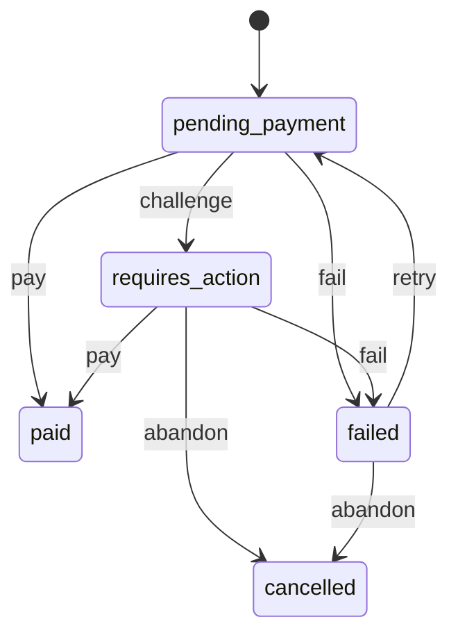

# Softwares (`software`)

The app's Softwares department: apps for phones and PCs that customers download. Staff keep the categories, apps, files, packs and the home rails in Admin › Departments › Softwares. Free apps are owned on Get; paid apps and packs are bought with a card in their own payment flow (payments purchase intents, not cart and checkout) and come with a licence key. Any signed-in customer downloads the files through signed links.

- **Group:** Growth · **Launch phase:** 2 · **Plan chapters:** -
- **Depends on:** [media](media.md), [payments](payments.md) · **Optional:** [customers](customers.md), [audit](audit.md), [notifications](notifications.md)

## Owns
- Software categories (Applications, AI, Games, Education, Business, …) with icons and order
- Apps: title, company, brief, icon, screenshots, descriptions, what you get, price and sale price, files (package and optional databases), version, what's new, version history, runtime platforms, minimum requirements, notice, permissions, status
- Packs: several apps sold together for one price
- Home rails of the Recommended tab (staff pick, newest, a category, a platform or top rated)
- Purchases (SW- references) and their payment status; entitlements (who owns which app) with a licence key for paid apps; downloads and views counted per app
- Ratings and reviews from owners

**Not here:**
- Card payments: payments purchase intents (authorizePurchase, completeAction, capturePurchase)
- Files: media (software_package uploads, private; content_image for icons and screenshots); signed links come from media.signedDownload
- Companies: the departments module's Companies directory; an app keeps the company's name and, when linked, its id and slug
- Ads above the Recommended tab: advertising placement software_top

## Store API

| Method | Path | Purpose | Auth | Body → Response |
|---|---|---|---|---|
| GET | `/api/store/software/home` | The Recommended tab: rails and the pack deal | visitor | `SoftwareHome` |
| GET | `/api/store/software/categories` | Visible categories with their app counts | visitor | `SoftwareCategory[]` |
| GET | `/api/store/software/apps` | Published apps shown in the department | visitor | Page<AppCard> |
| GET | `/api/store/software/apps/{slug}` | An app with its files, versions, permissions and newest reviews | visitor | `SoftwareApp` |
| GET | `/api/store/software/deals` | Packs and apps on sale | visitor | `SoftwareDeals` |
| GET | `/api/store/software/apps/{slug}/reviews` | An app's reviews, newest first | visitor | Page<AppReview> |
| POST | `/api/store/software/apps/{slug}/reviews` | Rate an app you own, or change your rating | customer | `ReviewInput` → `AppReview` |
| POST | `/api/store/software/apps/{slug}/entitlements` | Own a free app | customer | `Entitlement` |
| POST | `/api/store/software/apps/{slug}/downloads` | A signed link to download an app's package or a database | customer | `DownloadInput` → `media.DownloadLink` |
| GET | `/api/store/software/payment-options` | Saved cards and a new-card session for buying an app or a pack | customer | `payments.PaymentOptions` |
| POST | `/api/store/software/purchases` | Buy an app or a pack _(idempotent)_ | customer | `PurchaseInput` → `SoftwarePurchase` |
| GET | `/api/store/software/purchases/{id}` | A purchase and its payment status | customer | `SoftwarePurchase` |
| POST | `/api/store/software/purchases/{id}/complete-action` | Finish the bank challenge of a purchase _(idempotent)_ | customer | `CompleteActionInput` → `SoftwarePurchase` |
| POST | `/api/store/software/purchases/{id}/retry` | Pay a failed purchase again _(idempotent)_ | customer | `RetryPaymentInput` → `SoftwarePurchase` |
| GET | `/api/store/software/purchases` | My software purchases, newest first | customer | Page<SoftwarePurchase> |
| GET | `/api/store/software/library` | Apps I own, newest first | customer | Page<LibraryApp> |
| GET | `/api/store/software/statistics` | What the customer paid for software in a period: totals, trend and breakdowns | customer | `SoftwareStatistics` |

## Admin API

| Method | Path | Purpose | Auth | Body → Response |
|---|---|---|---|---|
| GET | `/api/admin/software/categories` | All categories in order | staff `software.view` | `SoftwareCategory[]` |
| POST | `/api/admin/software/categories` | Add a category _(audited)_ | staff `software.manage` | `SoftwareCategoryInput` → `SoftwareCategory` |
| PATCH | `/api/admin/software/categories/{id}` | Rename, reorder, hide or show a category _(audited)_ | staff `software.manage` | `SoftwareCategoryInput` → `SoftwareCategory` |
| DELETE | `/api/admin/software/categories/{id}` | Delete an empty category _(audited)_ | staff `software.manage` | 204 No content |
| GET | `/api/admin/software/apps` | Apps with filters | staff `software.view` | Page<AppAdminRow> |
| POST | `/api/admin/software/apps` | Add an app _(audited)_ | staff `software.manage` | `AppInput` → `AppAdmin` |
| GET | `/api/admin/software/apps/{id}` | An app for editing | staff `software.view` | `AppAdmin` |
| PATCH | `/api/admin/software/apps/{id}` | Change an app, its files, price or status _(audited)_ | staff `software.manage` | `AppInput` → `AppAdmin` |
| DELETE | `/api/admin/software/apps/{id}` | Delete an app nobody owns _(audited)_ | staff `software.manage` | 204 No content |
| GET | `/api/admin/software/packs` | Packs in order | staff `software.view` | `PackAdmin[]` |
| POST | `/api/admin/software/packs` | Add a pack _(audited)_ | staff `software.manage` | `PackInput` → `PackAdmin` |
| PATCH | `/api/admin/software/packs/{id}` | Change a pack _(audited)_ | staff `software.manage` | `PackInput` → `PackAdmin` |
| DELETE | `/api/admin/software/packs/{id}` | Delete a pack that was never sold _(audited)_ | staff `software.manage` | 204 No content |
| GET | `/api/admin/software/rails` | The Recommended tab's rails in order | staff `software.view` | `RailAdmin[]` |
| PUT | `/api/admin/software/rails` | Replace the Recommended tab's rails _(audited)_ | staff `software.manage` | `RailsInput` → `RailAdmin[]` |
| GET | `/api/admin/software/purchases` | Purchases, newest first | staff `software.view` | Page<PurchaseAdmin> |
| POST | `/api/admin/software/entitlements` | Give a customer an app (support goodwill or a payment settled elsewhere) _(audited)_ | staff `software.manage` | `GrantInput` → `Entitlement` |
| GET | `/api/admin/software/entitlements` | Who owns which app, with licence keys, newest first | staff `software.view` | Page<EntitlementAdmin> |
| POST | `/api/admin/software/entitlements/{id}/reissue-licence` | Replace an owner's licence key _(audited)_ | staff `software.manage` | `ReissueLicenceInput` → `EntitlementAdmin` |
| GET | `/api/admin/software/reviews` | Reviews, newest first | staff `software.view` | Page<ReviewAdmin> |
| POST | `/api/admin/software/reviews/{id}/moderate` | Hide or show a review _(audited)_ | staff `software.manage` | `ReviewModeration` → `ReviewAdmin` |

## Types

### SoftwareCategory

| Field | Type |
|---|---|
| id | `uuid` |
| slug | `string` |
| name | `string` |
| icon | `string?` Lucide icon name |
| position | `int` |
| visible | `bool` |
| appCount | `int` Published apps in the department |

### SoftwareCategoryInput

| Field | Type |
|---|---|
| name | `string` |
| slug | `string?` |
| icon | `string?` |
| position | `int?` |
| visible | `bool?` |

### CategoryRef

| Field | Type |
|---|---|
| slug | `string` |
| name | `string` |

### CompanyRef

| Field | Type |
|---|---|
| name | `string` |
| companyId | `uuid?` A Companies directory record (departments module) |
| companySlug | `string?` Opens /companies/{slug} in the app |

### AppPrice

| Field | Type |
|---|---|
| free | `bool` |
| amount | `Money?` Regular price; null when free |
| saleAmount | `Money?` Sale price while a sale runs |
| saleEndsAt | `datetime?` |
| current | `Money?` What the customer pays now (sale price during a sale); null when free |
| label | `string` Free, or the current price, e.g. $12.49 |
| wasLabel | `string?` Regular price during a sale, e.g. $24.99 |
| offPercent | `int?` Whole percent off during a sale, e.g. 50 |

### AppCard

| Field | Type |
|---|---|
| id | `uuid` |
| slug | `string` |
| title | `string` |
| company | `CompanyRef` |
| brief | `string` Up to 60 characters, shown in lists |
| icon | `MediaRef?` |
| category | `CategoryRef` |
| rating | `number?` Null without ratings |
| ratingCount | `int` |
| sizeBytes | `int` Package plus databases |
| sizeLabel | `string` e.g. 1.2 GB |
| price | `AppPrice` |
| platforms | `enum(android|ios|windows|macos|linux|web)[]` |
| owned | `bool` The signed-in customer owns it; false for visitors |

### AppFile

| Field | Type |
|---|---|
| id | `uuid` media asset id |
| kind | `enum(package|database)` |
| name | `string` File name |
| sizeBytes | `int` |
| sizeLabel | `string` |
| uploadedAt | `datetime?` |

### AppFiles

| Field | Type |
|---|---|
| package | `AppFile?` |
| databases | `AppFile[]` |
| databasesNote | `string?` e.g. Preset library and LUT packs, needed for offline use |
| databasesSizeBytes | `int` All databases together; 0 without databases |
| databasesSizeLabel | `string?` e.g. 340 MB (Download databases · 340 MB); null without databases |

### OwnedLicence

| Field | Type |
|---|---|
| key | `string` XXXXX-XXXXX-XXXXX-XXXXX, the key that unlocks the app |
| devices | `int?` Devices one key unlocks; null when the app sets no limit |
| devicesLabel | `string` e.g. Use on up to 2 devices, Use on any number of devices |
| issuedAt | `datetime` When this key was issued (a reissue replaces the key) |

### AppPermission

| Field | Type |
|---|---|
| name | `string` e.g. Storage |
| desc | `string` e.g. Open and save photos on this device |

### VersionEntry

| Field | Type |
|---|---|
| version | `string` |
| date | `date` |
| notes | `string?` |

### RatingSummary

| Field | Type |
|---|---|
| average | `number?` Null without reviews |
| count | `int` |
| stars | `int[]` Counts for 5, 4, 3, 2 and 1 stars |

### AppReview

| Field | Type |
|---|---|
| id | `uuid` |
| name | `string` First name and last initial, e.g. Dana R. |
| stars | `int` |
| text | `string?` |
| date | `datetime` |
| mine | `bool` |

### ReviewInput

| Field | Type |
|---|---|
| stars | `int` 1 to 5 |
| text | `string?` Up to 1,000 characters |

### SoftwareApp

| Field | Type |
|---|---|
| id | `uuid` |
| slug | `string` |
| title | `string` |
| company | `CompanyRef` |
| brief | `string` |
| icon | `MediaRef?` |
| category | `CategoryRef` |
| subcategory | `string?` e.g. Photo editing |
| screenshots | `MediaRef[]` |
| description | `string` |
| moreDescription | `string?` |
| whatYouGet | `string[]` |
| price | `AppPrice` |
| licenceLabel | `string?` e.g. One-time purchase · 2 devices |
| licenceDevices | `int?` Devices one licence key unlocks; null when not limited (and for free apps) |
| version | `string?` |
| releasedAt | `date?` When the current version came out (Updated) |
| whatsNew | `string?` |
| versionHistory | `VersionEntry[]` Earlier versions, newest first |
| files | `AppFiles` Names and sizes only (shown to everyone: Download app · 1.2 GB, Download databases · 340 MB); downloads go through POST /apps/{slug}/downloads |
| sizeBytes | `int` |
| sizeLabel | `string` |
| canDownload | `bool` The caller may download the files: any signed-in customer (no purchase needed); false for visitors, who sign in first |
| platforms | `enum(android|ios|windows|macos|linux|web)[]` |
| platformLabels | `string[]` Runtime platforms with minimum versions, e.g. Windows 10+ |
| minRequirements | `string?` |
| notice | `string?` Shown in a highlighted box |
| permissions | `AppPermission[]` |
| views | `int` |
| downloads | `int` |
| ratings | `RatingSummary` |
| reviews | `AppReview[]` Newest three |
| allowReviews | `bool` |
| owned | `bool` |
| canReview | `bool` Owner who has not reviewed yet |
| myReview | `AppReview?` |
| licence | `OwnedLicence?` The owner's licence key for a paid app; null for visitors, customers who don't own it and free apps |

### PackApp

| Field | Type |
|---|---|
| id | `uuid` |
| slug | `string` |
| title | `string` |
| icon | `MediaRef?` |

### PackCard

| Field | Type |
|---|---|
| id | `uuid` |
| slug | `string` |
| name | `string` |
| apps | `PackApp[]` |
| count | `int` |
| price | `Money` |
| priceLabel | `string` |
| totalLabel | `string` The apps' regular prices added up, e.g. $99.97 |
| savePercent | `int` |
| licenceLabel | `string?` e.g. Lifetime licence |
| summary | `string?` e.g. Writer, Sheets and Slides Pro — 3 apps for $59.99 |
| owned | `bool` The customer owns every app in it |

### SoftwareRail

| Field | Type |
|---|---|
| key | `string` |
| title | `string` |
| source | `enum(manual|newest|category|platform|top_rated)` |
| style | `enum(carousel|list)` carousel: tiles side by side; list: rows |
| apps | `AppCard[]` |
| seeAll | `string?` Query string for GET /apps, e.g. category=games or rail=recommended; null hides See all |

### SoftwareHome

| Field | Type |
|---|---|
| rails | `SoftwareRail[]` |
| featuredPack | `PackCard?` The first visible pack, shown as the pack deal card |

### SoftwareDeals

| Field | Type |
|---|---|
| packs | `PackCard[]` |
| discounts | `AppCard[]` Apps on sale now, biggest discount first |
| discountsUntilLabel | `string?` e.g. Prices valid until Oct 31 (the latest sale end) |

### PurchaseItem

| Field | Type |
|---|---|
| appId | `uuid` |
| slug | `string` |
| title | `string` |
| icon | `MediaRef?` |

### SoftwarePurchase

| Field | Type |
|---|---|
| id | `uuid` |
| ref | `string` e.g. SW-4K7Q2 |
| status | `enum(pending_payment|requires_action|paid|failed|cancelled)` pending_payment also covers a payment the bank is still checking |
| statusLabel | `string` |
| title | `string` The app or pack name |
| packId | `uuid?` |
| items | `PurchaseItem[]` |
| amount | `Money` |
| payment | `payments.PurchasePaymentStatus?` |
| createdAt | `datetime` |
| paidAt | `datetime?` |

### PurchaseInput

| Field | Type |
|---|---|
| appId | `uuid?` Exactly one of appId and packId |
| packId | `uuid?` |
| expectedAmount | `Money` The price the customer saw; PRICE_CHANGED when it differs |
| method | `payments.MethodSelection` |
| returnUrl | `url` |

### RetryPaymentInput

| Field | Type |
|---|---|
| method | `payments.MethodSelection` |
| returnUrl | `url` |

### CompleteActionInput

| Field | Type |
|---|---|
| resultToken | `string` |

### DownloadInput

| Field | Type |
|---|---|
| fileId | `uuid?` A database file; the package when absent |

### Entitlement

| Field | Type |
|---|---|
| appId | `uuid` |
| slug | `string` |
| title | `string` |
| source | `enum(free|purchase|pack|staff)` |
| ownedAt | `datetime` |
| licenceKey | `string?` Paid apps only |

### LibraryApp

| Field | Type |
|---|---|
| app | `AppCard` |
| source | `enum(free|purchase|pack|staff)` |
| ownedAt | `datetime` |
| licence | `OwnedLicence?` Paid apps only (My apps shows the key) |

### AppAdminRow

| Field | Type |
|---|---|
| id | `uuid` |
| slug | `string` |
| title | `string` |
| company | `CompanyRef` |
| icon | `MediaRef?` |
| category | `CategoryRef` |
| price | `AppPrice` |
| sizeLabel | `string` |
| platforms | `enum(android|ios|windows|macos|linux|web)[]` |
| rating | `number?` |
| ratingCount | `int` |
| downloads | `int` |
| views | `int` |
| version | `string?` |
| status | `enum(draft|in_review|published|hidden)` |
| updatedAt | `datetime` |

### AppAdmin

| Field | Type |
|---|---|
| id | `uuid` |
| slug | `string` |
| title | `string` |
| company | `CompanyRef` |
| categoryId | `uuid` |
| subcategory | `string?` |
| brief | `string` |
| icon | `MediaRef?` |
| screenshots | `MediaRef[]` |
| description | `string` |
| moreDescription | `string?` |
| whatYouGet | `string[]` |
| price | `AppPrice` |
| licenceLabel | `string?` |
| licenceDevices | `int?` |
| files | `AppFiles` |
| sizeBytes | `int` |
| sizeLabel | `string` |
| version | `string?` |
| releasedAt | `date?` |
| whatsNew | `string?` |
| versionHistory | `VersionEntry[]` |
| platforms | `enum(android|ios|windows|macos|linux|web)[]` |
| platformLabels | `string[]` |
| minRequirements | `string?` |
| notice | `string?` |
| permissions | `AppPermission[]` |
| status | `enum(draft|in_review|published|hidden)` |
| showInDepartment | `bool` Listed in rails, categories and search; a hidden-from-department app still opens by link |
| allowReviews | `bool` |
| position | `int` |
| views | `int` |
| downloads | `int` |
| owners | `int` |
| ratings | `RatingSummary` |
| updatedAt | `datetime` |
| updatedBy | `string?` Staff name |

### AppInput

| Field | Type |
|---|---|
| title | `string` |
| slug | `string?` |
| company | `CompanyRef` |
| categoryId | `uuid` |
| subcategory | `string?` |
| brief | `string` Up to 60 characters |
| iconId | `uuid?` content_image upload, square, at least 512 × 512 |
| screenshotIds | `uuid[]?` Up to 10 content_image uploads, in order |
| description | `string` |
| moreDescription | `string?` |
| whatYouGet | `string[]?` |
| free | `bool` |
| price | `Money?` Required when not free |
| salePrice | `Money?` Below price |
| saleEndsAt | `datetime?` Required with salePrice |
| licenceLabel | `string?` |
| licenceDevices | `int?` Devices one licence key unlocks, 1 to 100; empty when not limited. Paid apps only (ignored for free apps) |
| packageId | `uuid?` software_package upload; needed to publish |
| databaseIds | `uuid[]?` software_package uploads |
| databasesNote | `string?` |
| version | `string?` |
| releasedAt | `date?` |
| whatsNew | `string?` |
| versionHistory | `VersionEntry[]?` |
| platforms | `enum(android|ios|windows|macos|linux|web)[]` |
| platformLabels | `string[]?` |
| minRequirements | `string?` |
| notice | `string?` |
| permissions | `AppPermission[]?` |
| status | `enum(draft|in_review|published|hidden)?` |
| showInDepartment | `bool?` |
| allowReviews | `bool?` |
| position | `int?` |

### PackAdmin

| Field | Type |
|---|---|
| id | `uuid` |
| slug | `string` |
| name | `string` |
| summary | `string?` |
| apps | `PackApp[]` |
| price | `Money` |
| totalLabel | `string` |
| savePercent | `int` |
| licenceLabel | `string?` |
| visible | `bool` |
| position | `int` |
| sold | `int` |
| updatedAt | `datetime` |

### PackInput

| Field | Type |
|---|---|
| name | `string` |
| slug | `string?` |
| summary | `string?` |
| appIds | `uuid[]` Two or more paid apps |
| price | `Money` |
| licenceLabel | `string?` |
| visible | `bool?` |
| position | `int?` |

### RailAdmin

| Field | Type |
|---|---|
| key | `string` |
| title | `string` |
| source | `enum(manual|newest|category|platform|top_rated)` |
| style | `enum(carousel|list)` |
| categoryId | `uuid?` |
| platform | `enum(android|ios|windows|macos|linux|web)?` |
| appIds | `uuid[]` manual rails: the apps in order |
| limit | `int` Apps shown, 3 to 20 |
| visible | `bool` |

### RailsInput

| Field | Type |
|---|---|
| rails | `RailAdmin[]` |

### PurchaseAdmin

| Field | Type |
|---|---|
| id | `uuid` |
| ref | `string` |
| status | `enum(pending_payment|requires_action|paid|failed|cancelled)` |
| title | `string` |
| packId | `uuid?` |
| items | `PurchaseItem[]` |
| amount | `Money` |
| customer | `{"id":"uuid","name":"string?","email":"email?"}` |
| methodLabel | `string?` |
| intentId | `uuid?` |
| declineMessage | `string?` |
| createdAt | `datetime` |
| paidAt | `datetime?` |

### ReviewAdmin

| Field | Type |
|---|---|
| id | `uuid` |
| app | `PackApp` |
| name | `string` |
| customerId | `uuid` |
| stars | `int` |
| text | `string?` |
| hidden | `bool` |
| date | `datetime` |

### ReviewModeration

| Field | Type |
|---|---|
| hidden | `bool` |
| reason | `string?` |

### GrantInput

| Field | Type |
|---|---|
| customerId | `uuid` |
| appId | `uuid` |
| reason | `string` |

### EntitlementAdmin

| Field | Type |
|---|---|
| id | `uuid` |
| app | `PackApp` |
| free | `bool` The app is free now (no licence key) |
| customer | `{"id":"uuid","name":"string?","email":"email?"}` |
| source | `enum(free|purchase|pack|staff)` |
| ownedAt | `datetime` |
| purchaseId | `uuid?` |
| purchaseRef | `string?` SW- reference of the purchase that granted it |
| grantedBy | `string?` Staff who gave it (source staff) |
| licenceKey | `string?` Paid apps only |
| licenceIssuedAt | `datetime?` |
| licenceReissues | `int` Times staff replaced the key |

### ReissueLicenceInput

| Field | Type |
|---|---|
| reason | `string` Why the key is replaced, e.g. the customer's key leaked; kept in the action history |

### SoftwareStatPurchaseRef

| Field | Type |
|---|---|
| purchaseId | `uuid` |
| ref | `string` |
| title | `string` The app or pack name |
| paidAt | `datetime?` |
| amount | `Money` |

### SoftwareStatApp

| Field | Type |
|---|---|
| appId | `uuid?` Null for a pack row, which has no single app |
| slug | `string?` |
| title | `string` |
| icon | `MediaRef?` |
| company | `string?` |
| apps | `int` Apps the purchase added: 1 for an app, the pack's size for a pack |
| amount | `Money` |
| boughtAt | `datetime?` |

### SoftwareStatTotals

| Field | Type |
|---|---|
| paid | `Money` What the card was charged for apps and packs that went through |
| notPaid | `Money` Purchases that failed or were cancelled (never charged, not in paid) |
| purchases | `int` |
| appsAdded | `int` Apps added to the library in the period, however they were added |
| paidApps | `int` |
| freeApps | `int` |
| packs | `int` |
| licenceKeys | `int` Keys issued for the paid apps added in the period |
| reviews | `int` Reviews the customer left in the period |
| averageRating | `number?` Stars the customer gave, one decimal; null when they left none |
| averagePurchase | `Money` |
| largestPurchase | `SoftwareStatPurchaseRef?` |

### SoftwareStatistics

| Field | Type |
|---|---|
| from | `date` First market day covered (range all: the day of the first counted purchase or library addition, else today) |
| to | `date` |
| grain | `enum(day|week|month)` Size of each series point: the grain asked for, else day up to 31 days, week up to 92, month beyond |
| currency | `string` |
| totals | `SoftwareStatTotals` |
| previous | `StatPrevious?` The same number of days just before from; null for range all |
| series | `StatSeriesPoint[]` Paid per point, count = purchases; zeros included |
| byCategory | `StatShare[]` App categories by amount, at most 5 plus Other; a pack counts under the categories of its apps, split by their share of the pack price |
| byCompany | `StatShare[]` Companies by amount, at most 5 plus Other; a pack is split like byCategory |
| bySource | `StatShare[]` How apps reached the library — free, purchase, pack, staff — counted in apps, not money |
| byWeekday | `StatWeekday[]` Monday to Sunday by the day the payment went through (market time zone) |
| topApps | `SoftwareStatApp[]` At most 5, by amount; a pack is one row |

## Status flows

### Software purchase (`SoftwarePurchase.status`)

pay: the card is authorized and the purchase captures it at once (payments.capturePurchase), then grants the entitlements. A pending check stays pending_payment until payments.purchase.authorized or payments.purchase.failed. requires_action purchases older than 30 minutes are abandoned (the intent is voided).

## Data (schema `software`)

**categories**

| Column | Type |
|---|---|
| id | uuid pk |
| slug | text unique |
| name | text |
| icon | text? |
| position | int |
| visible | bool |
| created_at | timestamptz |
| updated_at | timestamptz |

Indexes: `(position)`

**apps**

| Column | Type |
|---|---|
| id | uuid pk |
| slug | text unique |
| title | text |
| company | jsonb (CompanyRef) |
| category_id | uuid → categories |
| subcategory | text? |
| brief | text |
| icon_id | uuid? |
| screenshot_ids | jsonb |
| description | text |
| more_description | text? |
| what_you_get | jsonb |
| free | bool |
| price | bigint? |
| sale_price | bigint? |
| sale_ends_at | timestamptz? |
| currency | text |
| licence_label | text? |
| licence_devices | int? (devices one licence key unlocks; null = not limited) |
| package | jsonb? (AppFile) |
| databases | jsonb (AppFile[]) |
| databases_note | text? |
| size_bytes | bigint |
| version | text? |
| released_at | date? |
| whats_new | text? |
| version_history | jsonb |
| platforms | text[] |
| platform_labels | jsonb |
| min_requirements | text? |
| notice | text? |
| permissions | jsonb |
| status | text (draft|in_review|published|hidden) |
| show_in_department | bool |
| allow_reviews | bool |
| position | int |
| views | bigint |
| downloads | bigint |
| owners | int |
| rating_sum | int |
| rating_count | int |
| rating_stars | jsonb |
| search_text | text |
| created_at | timestamptz |
| updated_at | timestamptz |
| updated_by | text? |

Indexes: `(status, show_in_department, category_id, position)`, `(status, released_at)`, `(status, sale_ends_at)`, `(status, rating_count)`

**packs**

| Column | Type |
|---|---|
| id | uuid pk |
| slug | text unique |
| name | text |
| summary | text? |
| app_ids | jsonb |
| price | bigint |
| currency | text |
| licence_label | text? |
| visible | bool |
| position | int |
| sold | int |
| created_at | timestamptz |
| updated_at | timestamptz |

Indexes: `(visible, position)`

**rails**: The Recommended tab's rails, one row per rail

| Column | Type |
|---|---|
| key | text pk |
| title | text |
| source | text |
| style | text |
| category_id | uuid? |
| platform | text? |
| app_ids | jsonb |
| limit | int |
| visible | bool |
| position | int |
| updated_at | timestamptz |

Indexes: `(position)`

**purchases**

| Column | Type |
|---|---|
| id | uuid pk |
| ref | text unique |
| customer_id | uuid |
| app_id | uuid? |
| pack_id | uuid? |
| title | text |
| items | jsonb (PurchaseItem[]) |
| amount | bigint |
| currency | text |
| status | text (pending_payment|requires_action|paid|failed|cancelled) |
| intent_id | uuid? |
| attempts | int |
| method_label | text? |
| decline_message | text? |
| idempotency_key | text unique |
| created_at | timestamptz |
| updated_at | timestamptz |
| paid_at | timestamptz? |

Indexes: `(customer_id, created_at)`, `(status, created_at)`, `(intent_id)`

**entitlements**

| Column | Type |
|---|---|
| id | uuid pk |
| customer_id | uuid |
| app_id | uuid → apps |
| source | text (free|purchase|pack|staff) |
| purchase_id | uuid? |
| granted_by | text? |
| licence_key | text? unique (XXXXX-XXXXX-XXXXX-XXXXX; paid apps only) |
| licence_issued_at | timestamptz? |
| licence_reissues | int? (times staff replaced the key; null = never) |
| created_at | timestamptz |

Indexes: `unique (customer_id, app_id)`, `(app_id)`, `(created_at)`

**reviews**

| Column | Type |
|---|---|
| id | uuid pk |
| app_id | uuid → apps |
| customer_id | uuid |
| name | text |
| stars | int |
| text | text? |
| hidden | bool |
| hidden_reason | text? |
| created_at | timestamptz |
| updated_at | timestamptz |

Indexes: `unique (app_id, customer_id)`, `(app_id, hidden, created_at)`

## Events

| Publishes | When | Payload | Consumed by |
|---|---|---|---|
| `software.purchase.paid` | A purchase is paid and its apps are owned | `{ purchaseId: uuid, ref: string, customerId: uuid, title: string, amount: Money, appIds: uuid[] }` | notifications |
| `software.purchase.failed` | A purchase's payment fails | `{ purchaseId: uuid, ref: string, customerId: uuid, title: string }` | - |
| `software.licence.reissued` | Staff replace an owner's licence key (the old key stops working) | `{ entitlementId: uuid, customerId: uuid, appId: uuid, slug: string, title: string }` | notifications |

| Consumes | From | Does |
|---|---|---|
| `payments.purchase.authorized` | payments | module software: capture and mark the purchase paid (a payment that was pending or finished its bank challenge outside the app) |
| `payments.purchase.failed` | payments | module software: mark the purchase failed |

## In-process API (for other modules)

| Function | Signature | Used by |
|---|---|---|
| exportCustomerData | `(input: { customerId: uuid, accountId: uuid }) => CustomerDataSection[]` The customer's software purchases (reference, apps, amount, status, dates), owned apps and reviews for the personal data export | customers |

## Permissions

| Key | Who | Allows |
|---|---|---|
| `software.view` | staff | See apps, packs, purchases and reviews in Admin › Departments › Softwares |
| `software.manage` | staff | Categories, apps and their files, packs, rails, hide reviews, give an app to a customer, reissue a licence key |

## Error codes

| Code | Status | Meaning |
|---|---|---|
| `SLUG_TAKEN` | 409 | Another record already uses this slug. |
| `IN_USE` | 409 | Apps, packs or purchases still use it. |
| `NOT_OWNED` | 403 | Get or buy the app first. |
| `NOT_FREE` | 409 | This app is paid; buy it instead. |
| `NOT_FOR_SALE` | 409 | This app or pack can't be bought right now. |
| `ALREADY_OWNED` | 409 | You already own this app (or every app in the pack). |
| `PRICE_CHANGED` | 409 | The price changed; details.amount is the new price. |
| `REVIEWS_OFF` | 409 | Reviews are turned off for this app. |
| `FILE_MISSING` | 404 | That file isn't available yet. |
| `FILE_NOT_READY` | 409 | An uploaded file isn't ready or has the wrong purpose. |
| `NO_LICENCE` | 409 | The app is free, so this entitlement has no licence key. |

## Background jobs

| Job | Schedule | Does |
|---|---|---|
| `software.abandon-stale` | every 10 min | Cancel purchases left in requires_action for 30 minutes and void their intents |

## Notes
- 2026-10-22 (user): software gets its own payment flow, not cart and checkout. The card is charged at once (authorize, then capture) and the apps are owned immediately; refunds are handled outside the app for now.
- Prices: an app is free or has a price; a sale price applies until saleEndsAt and shows in Deals. A pack's price is fixed by staff; totalLabel adds up its apps' regular prices and savePercent compares the two. A pack buyer who already owns some of its apps still pays the pack price (ALREADY_OWNED only when they own all).
- Purchase refs are SW- plus five characters from 23456789ABCDEFGHJKLMNPQRSTUVWXYZ.
- Size: package plus databases, from the media assets' sizes. Labels use 1,000-based units (MB, GB) with one decimal above 1 GB.
- Rails: manual (the staff's apps in order), newest (releasedAt), category, platform (e.g. windows and macos for PC apps) and top_rated (ratings with at least 3 reviews). Default rails: Recommended for you (manual, carousel), New apps (newest, list), Games (category games, carousel), Browsers (category browsers, list), PC apps (platform windows, carousel).
- The reviewer's name is their first name and last initial (customers.getCustomer), else Customer. Ratings count only visible reviews.
- Customers are customers-module ids (the store principal's customerId), as payments and promotions use.
- 2026-10-22 (user): anyone signed in can download an app's files (package and databases) without owning it; the Download buttons always show. Buying a paid app issues a licence key that unlocks it on as many devices as the app's licence says (licenceDevices). Free apps need no key.
- Licence keys: XXXXX-XXXXX-XXXXX-XXXXX from 23456789ABCDEFGHJKLMNPQRSTUVWXYZ (no 0/O, 1/I/L), unique. Issued with every entitlement of a paid app (purchase, pack, staff grant) when it is created; entitlements of paid apps made before keys existed get theirs from the 2026-10-22 migration, and an entitlement still without one (an app that became paid later) gets it the next time the owner opens the app or My apps. The key is shown to its owner (GET /apps/{slug} licence, GET /library) and to staff (GET /admin/software/entitlements); staff replace it with reissue-licence (audited). Activation and device counting happen in the app's own licence check, not here.
