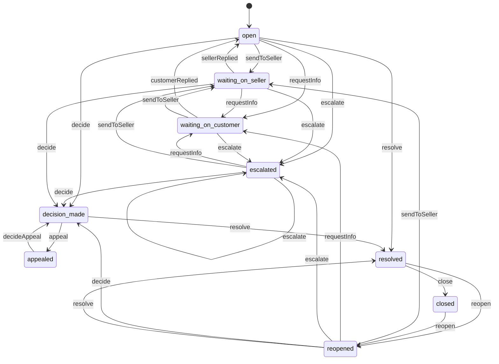
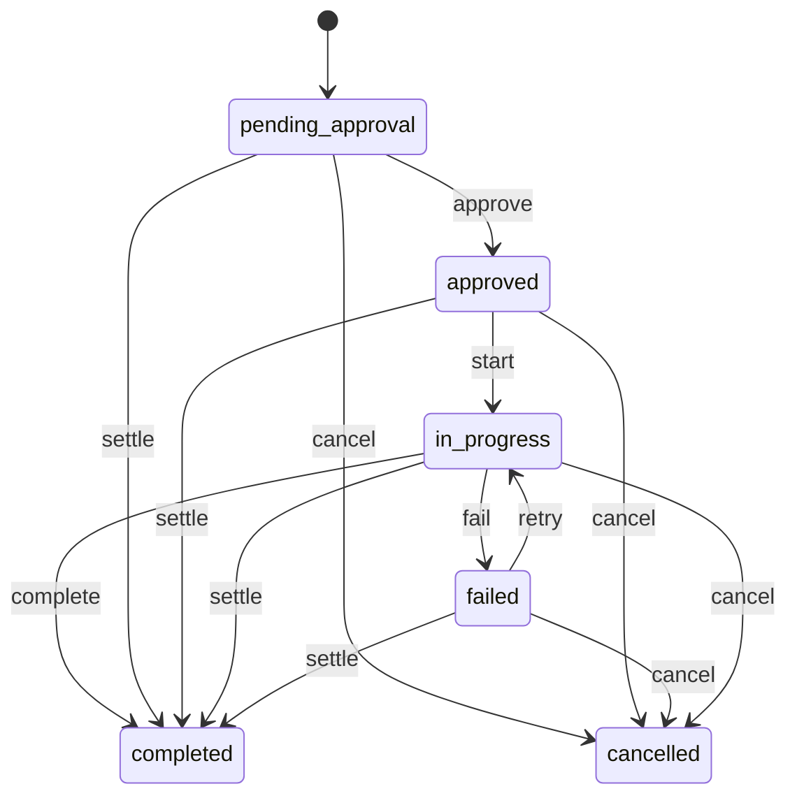
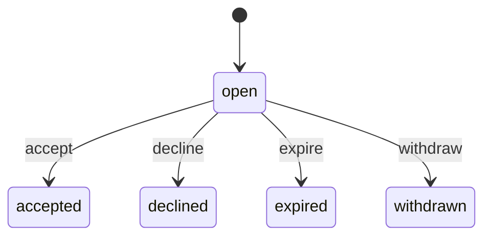
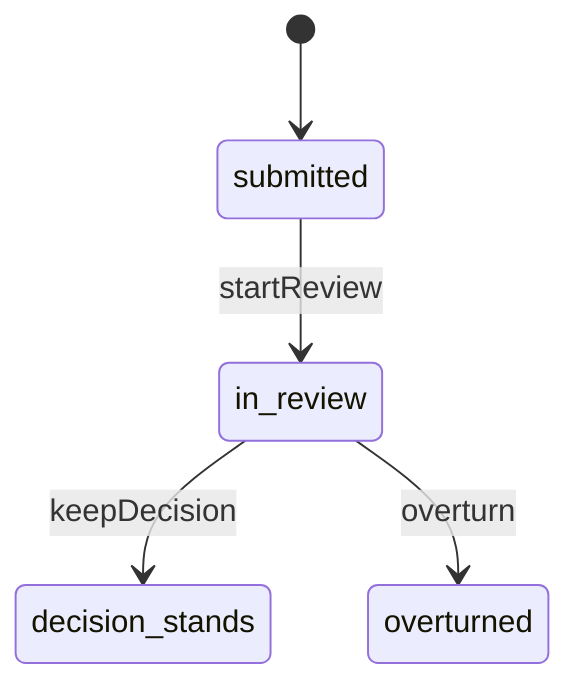

# Support (`support`)

Help cases and disputes: customer help and order-problem cases opened from the order with items pre-identified, seller support requests to Marketly, disputes between customer and seller with evidence, decision, remedy and appeal, plus categories, priority, owner, SLA deadlines, assignment, escalation and resolve/reopen rules.

- **Group:** After-sales and money · **Launch phase:** 1 · **Plan chapters:** 7, 13, 17
- **Depends on:** [orders](orders.md), [access](access.md) · **Optional:** [returns](returns.md), [payments](payments.md), [shipping](shipping.md), [sellers](sellers.md), [messaging](messaging.md), [media](media.md), [finance](finance.md), [trust](trust.md), [wallet](wallet.md), [workqueues](workqueues.md), [notifications](notifications.md), [settings](settings.md), [audit](audit.md), [content](content.md), [customers](customers.md), [identity](identity.md), [promotions](promotions.md), [reports](reports.md), [warehouse](warehouse.md)

## Owns
- Cases (CS-YYMMDD-NNNN references) of four kinds: customer help, order problem, dispute, seller support request
- Case categories with default priority, owning team and response/resolution targets (SLA)
- Owner, team, assignment and bulk assignment; escalation to Returns, Finance, Trust and Risk or the Seller Manager
- Who handles a case first (seller, Official Store, Marketly support), the next action, who must act and the expected response, shown to the customer
- The formal case thread (customer, seller and staff messages with audience) and staff-only internal notes
- Evidence from both parties, and the purchase terms and shipment evidence gathered for a dispute
- Seller offers to the customer (ship by a date, refund, replacement) and the customer's answer
- Decisions with outcome, remedies (refund, partial refund, replacement, return label, goodwill credit, ship-by deadline), reason shared with both parties and an appeal deadline
- Appeals reviewed by a different staff member
- Resolve and reopen rules: a case cannot be resolved while a promised refund or replacement is unresolved; reopen within a published window

**Not here:**
- Help Center articles and policy pages: content
- Informal private order conversations between customer and seller: messaging (support can join them)
- Return requests, inspections and refund approvals: returns (a dispute remedy creates a refund request there)
- Sending money: payments
- Seller restriction appeals: sellers; review moderation appeals: reviews
- Risk reports and enforcement: trust (support escalates to it)

## Store API

| Method | Path | Purpose | Auth | Body → Response |
|---|---|---|---|---|
| GET | `/api/store/support/contact-options` | Topics, channels, hours and expected reply times | visitor | `ContactOptions` |
| GET | `/api/store/support/orders/{orderId}/problem-context` | Order problem form context: packages and items, who handles first, when Marketly steps in, open cases | shopper | `ProblemContext` |
| POST | `/api/store/support/cases` | Contact support or report an order problem (missing, damaged, wrong item, not arrived) _(idempotent)_ | shopper | `CaseCreateInput` → `CaseView` |
| GET | `/api/store/support/cases` | My cases with who handles them, the next action and the expected reply | shopper | Page<CaseSummary> |
| GET | `/api/store/support/cases/{id}` | Case detail: handler, next action and expected response, linked items, conversation, decision, remedy progress, appeal and reopen rules | shopper | `CaseView` |
| POST | `/api/store/support/cases/{id}/messages` | Reply on a case (with photos) | shopper | `{ body: text, mediaIds: uuid[]? }` → `CaseView` |
| POST | `/api/store/support/cases/{id}/escalate` | Ask Marketly to step in | shopper | `{ reason: enum(seller_no_reply|disagree_with_seller|refund_late|other), note: text? }` → `CaseView` |
| POST | `/api/store/support/cases/{id}/offers/{offerId}/respond` | Accept or decline the seller's offer | shopper | `{ accept: bool, note: text? }` → `CaseView` |
| POST | `/api/store/support/cases/{id}/appeal` | Appeal a decision before the appeal deadline | shopper | `{ reason: text, mediaIds: uuid[]? }` → `CaseView` |
| POST | `/api/store/support/cases/{id}/reopen` | Reopen a resolved case within the reopen window | shopper | `{ reason: text }` → `CaseView` |

## Seller API

| Method | Path | Purpose | Auth | Body → Response |
|---|---|---|---|---|
| GET | `/api/seller/support/cases` | Customer cases and disputes about the seller's orders, and the seller's own support requests | seller | Page<SellerCaseRow> |
| GET | `/api/seller/support/cases/{id}` | Case as the seller sees it (no internal notes) | seller | `CaseView` |
| POST | `/api/seller/support/cases/{id}/messages` | Reply to the customer and Marketly support, optionally with an offer | seller<br>`support.cases.respond` | `{ body: text, mediaIds: uuid[]?, offer: CaseOfferInput? }` → `CaseView` |
| POST | `/api/seller/support/cases/{id}/evidence` | Add dispute evidence (photos, test videos, invoices, carrier records) | seller<br>`support.cases.respond` | `EvidenceInput` → `Evidence` |
| POST | `/api/seller/support/cases/{id}/appeal` | Appeal a dispute decision before the deadline | seller<br>`support.cases.respond` | `{ reason: text, mediaIds: uuid[]? }` → `CaseView` |
| POST | `/api/seller/support/requests` | Contact seller support (Seller Manager team) _(idempotent)_ | seller<br>`support.requests.create` | `SellerRequestInput` → `CaseView` |
| GET | `/api/seller/support/categories` | Seller support topics with expected reply time | seller | `SellerSupportOptions` |

## Admin API

| Method | Path | Purpose | Auth | Body → Response |
|---|---|---|---|---|
| GET | `/api/admin/support/cases/stats` | Queue KPIs: open, past target, unassigned, disputes, median first reply | staff<br>`support.cases.view` | `CaseStats` |
| GET | `/api/admin/support/cases` | Cases and disputes queue, overdue first | staff<br>`support.cases.view` | Page<AdminCaseRow> |
| GET | `/api/admin/support/cases/{id}` | Dispute review: parties, purchase terms at order time, shipment evidence, photos, conversation with internal notes, deadlines, holds | staff<br>`support.cases.view` | `AdminCaseDetail` |
| POST | `/api/admin/support/cases` | Open a case on behalf of a customer or seller _(audited)_ | staff<br>`support.cases.handle` | `StaffCaseInput` → `AdminCaseDetail` |
| POST | `/api/admin/support/cases/assign` | Assign several cases to one owner _(audited)_ | staff<br>`support.cases.assign` | `{ caseIds: uuid[], ownerId: uuid, priority: enum(low|medium|high|urgent)? }` → `{ assigned: int, failed: uuid[] }` |
| POST | `/api/admin/support/cases/priority` | Change the priority of several cases with one reason _(audited)_ | staff<br>`support.cases.handle` | `{ caseIds: uuid[], priority: enum(low|medium|high|urgent), reason: text }` → `{ updated: int, failed: uuid[] }` |
| GET | `/api/admin/support/assignees` | Staff who can own cases, with team and current open case count | staff<br>`support.cases.assign` | `CaseAssignee[]` |
| POST | `/api/admin/support/cases/{id}/assign` | Assign or reassign the owner _(audited)_ | staff<br>`support.cases.assign` | `{ ownerId: uuid, reason: text? }` → `AdminCaseDetail` |
| PATCH | `/api/admin/support/cases/{id}` | Change category or priority with a reason _(audited)_ | staff<br>`support.cases.handle` | `{ category: string?, priority: enum(low|medium|high|urgent)?, reason: text }` → `AdminCaseDetail` |
| POST | `/api/admin/support/cases/{id}/messages` | Reply to both parties, one party, or add an internal note | staff<br>`support.cases.handle` | `{ body: text, audience: enum(all|customer|seller|internal), mediaIds: uuid[]?, nextResponseDueAt: datetime? }` → `AdminCaseDetail` |
| POST | `/api/admin/support/cases/{id}/request-info` | Ask the customer or the seller for information or evidence by a deadline _(audited)_ | staff<br>`support.cases.handle` | `{ from: enum(customer|seller), question: text, dueAt: datetime }` → `AdminCaseDetail` |
| POST | `/api/admin/support/cases/{id}/escalate` | Escalate to another team (Returns, Finance, Trust and Risk, Seller Manager, support lead) _(audited)_ | staff<br>`support.cases.handle` | `{ to: enum(returns|finance|trust|seller_management|support_lead), reason: text, convertToDispute: bool? }` → `AdminCaseDetail` |
| POST | `/api/admin/support/cases/{id}/evidence` | Attach evidence gathered by staff (carrier records, screenshots) _(audited)_ | staff<br>`support.cases.handle` | `EvidenceInput` → `Evidence` |
| POST | `/api/admin/support/cases/{id}/decide` | Record the decision and remedy, publish the appeal deadline to both parties _(idempotent, audited)_ | staff<br>`support.disputes.decide` | `DecisionInput` → `AdminCaseDetail` |
| PUT | `/api/admin/support/cases/{id}/decision-draft` | Save an unpublished decision draft (staff only) | staff<br>`support.disputes.decide` | `DecisionInput` → `DecisionDraft` |
| DELETE | `/api/admin/support/cases/{id}/decision-draft` | Discard the decision draft | staff<br>`support.disputes.decide` | 204 No content |
| POST | `/api/admin/support/cases/{id}/resolve` | Resolve a case _(audited)_ | staff<br>`support.cases.handle` | `{ summary: text }` → `AdminCaseDetail` |
| POST | `/api/admin/support/cases/{id}/reopen` | Reopen a resolved or closed case _(audited)_ | staff<br>`support.cases.handle` | `{ reason: text }` → `AdminCaseDetail` |
| POST | `/api/admin/support/cases/{id}/appeal/decide` | Decide an appeal (reviewer must differ from the original decider) _(idempotent, audited)_ | staff<br>`support.appeals.decide` | `{ overturn: bool, reason: text, remedies: RemedyInput[]? }` → `AdminCaseDetail` |
| POST | `/api/admin/support/cases/{id}/remedies/{remedyId}/settle` | Record that a remedy was completed or cancelled outside the system _(audited)_ | staff<br>`support.disputes.decide` | `{ outcome: enum(completed|cancelled), note: text, externalRef: string? }` → `AdminCaseDetail` |
| GET | `/api/admin/support/categories` | Case categories with priority, team and SLA targets | staff<br>`support.cases.view` | `CaseCategory[]` |
| PUT | `/api/admin/support/categories/{key}` | Create or change a category and its targets _(audited)_ | staff<br>`support.sla.manage` | `CaseCategoryInput` → `CaseCategory` |

## Types

### CaseCategory

| Field | Type |
|---|---|
| key | `string` e.g. delivery_late, return_dispute, fees_payouts |
| label | `string` e.g. Delivery, late item |
| audience | `enum(customer|seller)` |
| group | `enum(delivery|damaged_or_wrong|returns_refunds|payment|order_change|account|seller_report|account_health|fees_payouts|listing_rules|shipping_dispatch|advertising|other)` |
| defaultPriority | `enum(low|medium|high|urgent)` |
| team | `enum(customer_support|returns|finance|trust|seller_management|official_store)` |
| sellerHandlesFirst | `bool` Order problems about seller items go to the seller first |
| firstResponseBusinessHours | `int` |
| nextResponseBusinessHours | `int` |
| resolutionBusinessDays | `int` |
| active | `bool` |

### CaseCategoryInput

| Field | Type |
|---|---|
| label | `string` |
| audience | `enum(customer|seller)?` Required when creating a category; unchanged when left out on an existing one |
| group | `enum(delivery|damaged_or_wrong|returns_refunds|payment|order_change|account|seller_report|account_health|fees_payouts|listing_rules|shipping_dispatch|advertising|other)?` Required when creating a category; unchanged when left out on an existing one |
| defaultPriority | `enum(low|medium|high|urgent)` |
| team | `enum(customer_support|returns|finance|trust|seller_management|official_store)` |
| sellerHandlesFirst | `bool` |
| firstResponseBusinessHours | `int` |
| nextResponseBusinessHours | `int` |
| resolutionBusinessDays | `int` |
| active | `bool` |
| reason | `text` |

### Handler

| Field | Type |
|---|---|
| kind | `enum(seller|official_store|marketplace_support)` |
| name | `string` e.g. Casa Verde Home (seller) / Isabel Cruz, Marketly support |
| staff | `Actor?` |
| team | `string?` |
| supportFollowing | `bool` Marketly support is following a seller-handled case |

### NextAction

| Field | Type |
|---|---|
| label | `string` e.g. Casa Verde Home confirms tracking or offers a refund |
| whoMustAct | `enum(customer|seller|marketplace|none)` |
| due | `Deadline?` |
| youNeedToAct | `bool` |
| note | `string?` e.g. If they miss it, Marketly steps in |

### CaseItem

| Field | Type |
|---|---|
| orderItemId | `uuid` |
| title | `string` |
| options | `map<string>` |
| quantity | `int` |
| price | `Money` |
| imageUrl | `url?` |
| ownerType | `enum(official|seller)` |
| sellerId | `uuid?` Null for the Official Store |
| sellerName | `string` |
| packageLabel | `string?` |
| itemStatus | `string` |
| estimate | `string?` e.g. Was Sep 22 · now Oct 12 |

### CaseMessage

| Field | Type |
|---|---|
| id | `uuid` |
| author | `Actor` |
| authorLabel | `string` |
| role | `enum(customer|seller|marketly_staff|internal_note|system)` |
| audience | `enum(all|customer|seller|internal)` |
| body | `text` |
| attachments | `MediaRef[]` |
| at | `datetime` |

### Remedy

| Field | Type |
|---|---|
| id | `uuid` |
| kind | `enum(refund|partial_refund|replacement|return_label|goodwill_credit|ship_by_deadline|none)` |
| amount | `Money?` |
| chargedTo | `enum(seller|platform|shared)?` |
| orderItemIds | `uuid[]` |
| status | `enum(pending_approval|approved|in_progress|completed|failed|cancelled)` |
| statusLabel | `string` |
| track | `string[]` Refund: Requested, Approved, Processing, Sent |
| currentStep | `int?` |
| refundRequestId | `uuid?` |
| replacementId | `uuid?` |
| dueAt | `datetime?` |
| destination | `string?` e.g. Visa •••• 4417 |
| note | `string?` e.g. Approved means we agreed to refund you; it isn't money in your account yet |

### RemedyInput

| Field | Type |
|---|---|
| kind | `enum(refund|partial_refund|replacement|return_label|goodwill_credit|ship_by_deadline|none)` |
| amount | `Money?` |
| chargedTo | `enum(seller|platform|shared)?` |
| orderItemIds | `uuid[]?` |
| dueAt | `datetime?` |
| note | `text?` |

### CaseOffer

| Field | Type |
|---|---|
| id | `uuid` |
| from | `enum(seller|marketplace)` |
| kind | `enum(ship_by_date|refund|partial_refund|replacement)` |
| amount | `Money?` |
| shipBy | `date?` |
| note | `text?` |
| status | `enum(open|accepted|declined|expired|withdrawn)` |
| respondBy | `datetime?` |
| createdAt | `datetime` |

### CaseOfferInput

| Field | Type |
|---|---|
| kind | `enum(ship_by_date|refund|partial_refund|replacement)` |
| amount | `Money?` |
| shipBy | `date?` |
| note | `text?` |

### CaseDecision

| Field | Type |
|---|---|
| outcome | `enum(customer_favored|seller_favored|shared|no_fault|information_only)` |
| reason | `text` Shared with both parties, citing the purchase terms |
| remedies | `Remedy[]` |
| decidedBy | `Actor` |
| decidedAt | `datetime` |
| publishedAt | `datetime?` |
| appealDeadline | `datetime?` |
| appealRoute | `string` e.g. A different Marketly team member reviews, replies within 3 business days |
| final | `bool` True after an appeal decision |

### Appeal

| Field | Type |
|---|---|
| id | `uuid` |
| by | `Actor` |
| reason | `text` |
| attachments | `MediaRef[]` |
| submittedAt | `datetime` |
| status | `enum(submitted|in_review|decision_stands|overturned)` |
| reviewer | `Actor?` |
| decidedAt | `datetime?` |
| outcome | `text?` |

### CaseView

| Field | Type |
|---|---|
| id | `uuid` |
| ref | `string` CS-YYMMDD-NNNN (running number per market day) |
| kind | `enum(customer_help|order_problem|dispute|seller_request)` |
| subject | `string` |
| category | `CaseCategory` |
| priority | `enum(low|medium|high|urgent)` |
| status | `enum(open|waiting_on_seller|waiting_on_customer|escalated|decision_made|appealed|resolved|closed|reopened)` |
| statusLabel | `string` |
| openedAt | `datetime` |
| handledBy | `Handler` |
| nextAction | `NextAction` |
| expectedResponse | `Deadline?` |
| order | `CaseOrderRef?` Linked order |
| items | `CaseItem[]` |
| returnId | `uuid?` |
| returnRef | `string?` |
| messages | `CaseMessage[]` Visible to the caller (internal notes only for staff) |
| attachments | `MediaRef[]` |
| offers | `CaseOffer[]` |
| decision | `CaseDecision?` |
| remedies | `Remedy[]` |
| appeal | `Appeal?` |
| reopenUntil | `datetime?` |
| reopenRules | `text` e.g. Stays open until the refund is sent; reopen within 30 days if it doesn't arrive |
| timeline | `TimelineEvent[]` |
| can | `CaseActions` What the caller may do now |

### CaseOrderRef

| Field | Type |
|---|---|
| id | `uuid` |
| ref | `string` |
| placedAt | `datetime` |

### CaseActions

| Field | Type |
|---|---|
| reply | `bool` |
| escalate | `bool` |
| appeal | `bool` |
| reopen | `bool` |
| respondToOffer | `bool` |
| addEvidence | `bool` |

### CaseSummary

| Field | Type |
|---|---|
| id | `uuid` |
| ref | `string` |
| kind | `string` |
| subject | `string` |
| orderId | `uuid?` |
| orderRef | `string?` |
| imageUrl | `url?` |
| status | `string` |
| statusLabel | `string` |
| handledBy | `Handler` |
| nextAction | `NextAction` |
| expectedReply | `string` e.g. By Fri, Oct 9, 5:00 PM PT / Closed Aug 28 |
| open | `bool` |
| updatedAt | `datetime` |

### CaseCreateInput

| Field | Type |
|---|---|
| kind | `enum(customer_help|order_problem)` |
| category | `string?` Help topic key. May be left out when problemType is given: the topic is derived from it |
| orderId | `uuid?` |
| orderItemIds | `uuid[]?` |
| problemType | `enum(missing_item|damaged|wrong_item|not_arrived|other)?` |
| subject | `string?` |
| message | `text` |
| mediaIds | `uuid[]?` |
| desiredRemedy | `enum(refund|keep_waiting|replacement|other)?` |
| replyChannel | `enum(email|chat|phone)?` |
| callbackPhone | `string?` |

### ContactChannel

| Field | Type |
|---|---|
| kind | `enum(email|chat|phone|messages)` |
| label | `string` |
| expectedResponse | `string` e.g. Within 1 business day / About 2 minutes |
| available | `bool` |
| hours | `string` |

### ContactOptions

| Field | Type |
|---|---|
| topics | `CaseCategory[]` |
| channels | `ContactChannel[]` |
| hours | `string` |
| phone | `string` |
| sellerFirstNote | `string` Marketplace items: the seller answers first, Marketly steps in after 2 business days |

### ProblemPackage

| Field | Type |
|---|---|
| label | `string` |
| ownerType | `enum(official|seller)` |
| sellerId | `uuid?` Null for the Official Store |
| sellerName | `string` |
| verified | `bool` |
| status | `string` |
| items | `CaseItem[]` |
| warning | `string?` e.g. Due Sep 22, now estimated Oct 12, no tracking yet |

### OpenCaseRef

| Field | Type |
|---|---|
| caseId | `uuid` |
| ref | `string` |
| orderItemIds | `uuid[]` |

### RemedyChoice

| Field | Type |
|---|---|
| kind | `enum(refund|keep_waiting|replacement|other)` |
| label | `string` |
| description | `string` |
| amount | `Money?` |

### ProblemContext

| Field | Type |
|---|---|
| order | `CaseOrderRef` |
| packages | `ProblemPackage[]` |
| preselectedItemIds | `uuid[]` |
| problemTypes | `enum(missing_item|damaged|wrong_item|not_arrived|other)[]` |
| handledFirstBy | `Handler` |
| sellerReplyDueAt | `datetime?` |
| marketlyStepsIn | `string[]` e.g. If the seller hasn't replied within 2 business days |
| openCases | `OpenCaseRef[]` |
| remedyChoices | `RemedyChoice[]` |
| otherItemsNote | `string?` |

### PurchaseTerms

| Field | Type |
|---|---|
| snapshotAt | `datetime` |
| termsVersion | `string` |
| item | `string` |
| pricePaid | `Money` |
| listPrice | `Money?` |
| discountNote | `string?` |
| promisedDelivery | `string?` |
| dispatchBy | `datetime?` |
| shipping | `string` |
| returns | `string` |
| payment | `string` |

### Evidence

| Field | Type |
|---|---|
| id | `uuid` |
| party | `enum(customer|seller|staff)` |
| kind | `enum(photo|video|document|tracking|invoice|other)` |
| media | `MediaRef[]` |
| note | `text?` |
| addedBy | `Actor` |
| at | `datetime` |

### EvidenceInput

| Field | Type |
|---|---|
| kind | `enum(photo|video|document|tracking|invoice|other)` |
| mediaIds | `uuid[]` |
| note | `text?` |

### NamedDeadline

| Field | Type |
|---|---|
| label | `string` |
| deadline | `Deadline` |
| party | `enum(customer|seller|marketplace)` |

### AdminCaseDetail

| Field | Type |
|---|---|
| case | `CaseView` |
| customer | `CaseCustomer?` |
| seller | `CaseSeller?` |
| owner | `Actor?` |
| team | `string` |
| financeReviewer | `Actor?` |
| purchaseTerms | `PurchaseTerms?` |
| shipmentEvidence | `TimelineEvent[]` |
| evidence | `Evidence[]` |
| deadlines | `NamedDeadline[]` |
| holds | `string[]` Finance holds linked to this case, e.g. Seller hold $1,240.00 · review Oct 15 |
| decisionDraft | `DecisionDraft?` Saved unpublished decision, staff only |
| pendingApproval | `ApprovalInfo?` A decision or appeal decision above the decider's limit, saved and waiting for support.remedies.approve (cases.approval_request_id). decideCase and decideAppeal answer 200 with it set; access.approval.decided publishes the decision (approved) or hands it back to the owner as a draft (rejected or returned) |
| history | `TimelineEvent[]` |

### CaseCustomer

| Field | Type |
|---|---|
| id | `uuid?` |
| name | `string` |
| location | `string?` |
| orders | `int` |
| openCases | `int` |
| email | `email?` |
| asksFor | `string?` |

### CaseSeller

| Field | Type |
|---|---|
| ownerType | `enum(official|seller)` |
| id | `uuid?` Null for the Official Store |
| name | `string` |
| verified | `bool` |
| location | `string?` |
| onTimeDispatchPct | `number?` |
| offers | `string?` |

### AdminCaseRow

| Field | Type |
|---|---|
| id | `uuid` |
| ref | `string` |
| kind | `string` |
| category | `string` |
| priority | `enum(low|medium|high|urgent)` |
| customerName | `string?` |
| sellerName | `string?` |
| owner | `Actor?` |
| status | `string` |
| statusLabel | `string` |
| nextResponse | `Deadline?` |
| deadlineLabel | `string` |
| orderId | `uuid?` |
| orderRef | `string?` |
| reopened | `bool` |
| updatedAt | `datetime` |

### CaseStats

| Field | Type |
|---|---|
| open | `int` |
| openedToday | `int` |
| pastTarget | `int` |
| oldestOverdueMinutes | `int?` |
| unassigned | `int` |
| openDisputes | `int` |
| medianFirstReplyMinutes | `int` |
| medianFirstReplyChangeMinutes | `int?` |
| targets | `string` e.g. First reply within 4 business hours, dispute decision within 5 business days |
| queueOwner | `{"lead":"string?","backup":"string?","escalation":"string?"}` |

### SellerCaseRow

| Field | Type |
|---|---|
| id | `uuid` |
| ref | `string` |
| kind | `string` |
| category | `string` |
| subject | `string` |
| orderRef | `string?` |
| returnRef | `string?` |
| status | `string` |
| statusLabel | `string` |
| marketplaceInvolved | `bool` |
| nextAction | `NextAction` |
| updatedAt | `datetime` |

### SellerRequestInput

| Field | Type |
|---|---|
| category | `string` |
| reference | `string?` Order MK-…, return RT-…, payout PO-…, restriction RS-… or a SKU |
| subject | `string` |
| message | `text` |
| mediaIds | `uuid[]?` |
| replyChannel | `enum(seller_center_and_email|seller_center_only)` |

### DecisionInput

| Field | Type |
|---|---|
| outcome | `enum(customer_favored|seller_favored|shared|no_fault|information_only)` |
| remedies | `RemedyInput[]` |
| reason | `text` |
| appealDeadline | `datetime?` |
| notifyParties | `bool` False records the decision without emailing the parties (support.case.decided carries notified=false and notifications skips it); the parties still see it on the case |

### DecisionDraft

| Field | Type |
|---|---|
| draft | `DecisionInput` Unpublished decision fields; parties never see it |
| savedAt | `datetime` |
| savedBy | `Actor` |

### CaseAssignee

| Field | Type |
|---|---|
| staffId | `uuid` |
| name | `string` |
| team | `enum(customer_support|returns|finance|trust|seller_management|official_store)` |
| role | `string` Role label from access.getStaffRef, e.g. Support Specialist |
| openCases | `int` |
| overdueCases | `int` |
| away | `bool` |
| awayUntil | `datetime?` |

### SellerSupportOptions

| Field | Type |
|---|---|
| categories | `CaseCategory[]` |
| hoursLabel | `string` Seller support hours from settings, e.g. Mon–Sat, 8 AM–8 PM PT |
| openNow | `bool` |
| nextOpenAt | `datetime?` |

### StaffCaseInput

| Field | Type |
|---|---|
| kind | `enum(customer_help|order_problem|dispute|seller_request)` |
| category | `string` |
| customerId | `uuid?` |
| sellerId | `uuid?` |
| orderId | `uuid?` |
| orderItemIds | `uuid[]?` |
| returnId | `uuid?` |
| subject | `string` |
| message | `text` |
| priority | `enum(low|medium|high|urgent)?` |
| ownerId | `uuid?` |
| trustReportId | `uuid?` Trust and Risk report this case acts on (inform_customers outreach); carried on support.case.opened so trust confirms the enforcement |

## Status flows

### Case (`CaseView.status`)



Order problems about seller items start with sendToSeller (seller handles first, support follows). The job escalates automatically when the seller misses its reply deadline; a customer can escalate when they disagree, a promised refund is late, or the seller misses its deadline. escalate turns an order problem into a dispute (kind = dispute); an escalated case can be escalated again to another team (escalated → escalated: team, owner and deadlines change, the customer cannot ask twice). resolve is refused with REMEDY_PENDING while any remedy is pending_approval, approved or in_progress (plan ch. 17: do not close while a promised refund or replacement is unresolved). close runs automatically autoCloseAfterDays after resolve. reopen is allowed within reopenWindowDays of resolution. appeal is allowed until appealDeadline; decideAppeal must be done by a different staff member than the original decider and makes the decision final.

### Remedy (`Remedy.status`)



Refund remedies mirror the returns refund request and payments: approve on returns.refund.approved, start on handover, complete on payments.refund.sent, fail on payments.refund.failed, cancel on returns.refund.declined (the case goes back to the owner's queue). Goodwill credit remedies follow the wallet grant (case_remedies.goodwill_grant_id; wallet.goodwill.decided is matched on its grantId). Replacement remedies complete on delivery of the replacement shipment; a replacement cancelled before it ships (returns.replacement.cancelled) cancels its remedy and puts the case back in the owner's queue to choose another remedy. Ship-by-deadline remedies complete on shipping.shipment.dispatched when the items ship by the date and otherwise fall back to a refund. settle (and cancel from in_progress) is a staff action (POST …/remedies/{remedyId}/settle) for remedies nothing in the system can finish: refunds recorded for Finance while returns is off, goodwill or refunds of guests without a refund path; it is refused (REMEDY_NOT_SETTLEABLE) while a returns refund request, a wallet grant or a replacement still drives the remedy.

### Case offer (`CaseOffer.status`)



An accepted refund or replacement offer becomes a remedy on the case.

### Appeal (`Appeal.status`)



Reviewer must differ from the original decider (SAME_DECIDER).

## Data (schema `support`)

**case_categories**: Categories with default priority, team and SLA targets

| Column | Type |
|---|---|
| key | text pk |
| label | text |
| audience | text |
| group_key | text |
| default_priority | text |
| team | text |
| seller_handles_first | bool |
| first_response_business_hours | int |
| next_response_business_hours | int |
| resolution_business_days | int |
| active | bool |
| updated_by | text |
| updated_at | timestamptz |

**cases**

| Column | Type |
|---|---|
| id | uuid pk |
| ref | text unique |
| kind | text |
| category_key | text → case_categories |
| priority | text |
| status | text |
| subject | text |
| customer_id | uuid? |
| guest_session_id | text? |
| seller_id | uuid? |
| order_id | uuid? |
| return_id | uuid? |
| handler_kind | text |
| owner_staff_id | uuid? |
| team | text |
| support_following | bool |
| next_action | jsonb |
| first_response_due_at | timestamptz? |
| next_response_due_at | timestamptz? |
| resolution_due_at | timestamptz? |
| waiting_on | text? |
| reply_channel | text? |
| decision | jsonb? |
| decision_draft | jsonb? |
| appeal_deadline | timestamptz? |
| reopen_until | timestamptz? |
| reopen_count | int |
| opened_by | text |
| opened_at | timestamptz |
| first_replied_at | timestamptz? |
| resolved_at | timestamptz? |
| closed_at | timestamptz? |
| updated_at | timestamptz |
| order_ref | text? (order reference kept for search and lists) |
| placed_at | timestamptz? |
| return_ref | text? |
| customer_name | text? (order contact or customer display name when opened) |
| contact_email | text? (order contact email, for guests) |
| city | text? |
| seller_name | text? |
| owner_type | text? (official|seller) |
| reference | text? (seller request reference: MK-, RT-, PO-, RS- or a SKU) |
| trust_report_id | uuid? (Trust and Risk report the case acts on) |
| problem_type | text? (missing_item|damaged|wrong_item|not_arrived|other) |
| desired_remedy | text? (refund|keep_waiting|replacement|other) |
| callback_phone | text? |
| info_request_from | text? (customer|seller) |
| info_request_question | text? |
| info_request_due_at | timestamptz? |
| info_requested_at | timestamptz? |
| info_requested_by | text? (actor) |
| escalated_at | timestamptz? (last escalation) |
| escalated_by | text? (actor) |
| escalation_reason | text? |
| escalated_to | text? |
| escalation_note | text? |
| seller_replied_at | timestamptz? (first seller reply on a customer case) |
| dispatch_overdue_due_at | timestamptz? (shipping.dispatch.overdue noted on the case) |
| dispatch_overdue_noted_at | timestamptz? |
| overdue_notified_for | timestamptz? (the response deadline support.case.overdue was published for) |
| appeal_window_closed | bool (the auto-close job recorded the end of the appeal window) |
| approval_request_id | uuid? (access approval request of a decision waiting for support.remedies.approve) |
| pending_decision | jsonb? ({ kind: decision|appeal, ref, decision | appeal, requestedBy, principal, requestedAt }: the decision published when the request is approved) |

Indexes: `(status, next_response_due_at)`, `(owner_staff_id, status)`, `(customer_id, opened_at desc)`, `(seller_id, status)`, `(order_id)`, `(kind, status)`, `(approval_request_id) where approval_request_id is not null`, `(trust_report_id) where trust_report_id is not null`

**case_items**

| Column | Type |
|---|---|
| case_id | uuid → cases |
| order_item_id | uuid |
| snapshot | jsonb |

Indexes: `(case_id, order_item_id) unique`, `(order_item_id)`

**case_messages**: The formal case thread; audience controls who sees each message

| Column | Type |
|---|---|
| id | uuid pk |
| case_id | uuid → cases |
| author_kind | text |
| author_id | text? |
| author_label | text |
| role | text |
| audience | text |
| body | text |
| media_ids | jsonb |
| at | timestamptz |

Indexes: `(case_id, at)`

**case_evidence**

| Column | Type |
|---|---|
| id | uuid pk |
| case_id | uuid → cases |
| party | text |
| kind | text |
| media_ids | jsonb |
| note | text? |
| added_by | text |
| at | timestamptz |

Indexes: `(case_id)`

**case_offers**

| Column | Type |
|---|---|
| id | uuid pk |
| case_id | uuid → cases |
| from_party | text |
| kind | text |
| amount | bigint? |
| currency | text? |
| ship_by | date? |
| note | text? |
| status | text |
| respond_by | timestamptz? |
| created_at | timestamptz |
| responded_at | timestamptz? |

Indexes: `(case_id)`, `(status, respond_by)`

**case_remedies**: Promised remedies; the case cannot be resolved until all are completed, failed-and-handled or cancelled

| Column | Type |
|---|---|
| id | uuid pk |
| case_id | uuid → cases |
| kind | text |
| amount | bigint? |
| currency | text? |
| charged_to | text? |
| order_item_ids | jsonb |
| status | text |
| refund_request_id | uuid? |
| replacement_id | uuid? |
| goodwill_grant_id | uuid? (wallet goodwill grant behind a goodwill credit remedy; wallet.goodwill.decided is matched on it) |
| due_at | timestamptz? |
| note | text? |
| created_by | text |
| created_at | timestamptz |
| updated_at | timestamptz |

Indexes: `(case_id)`, `(refund_request_id)`, `(status)`, `(replacement_id)`, `(goodwill_grant_id)`

**case_appeals**

| Column | Type |
|---|---|
| id | uuid pk |
| case_id | uuid → cases |
| by_kind | text |
| by_id | text |
| reason | text |
| media_ids | jsonb |
| status | text |
| reviewer_staff_id | uuid? |
| submitted_at | timestamptz |
| decided_at | timestamptz? |
| outcome | text? |

Indexes: `(case_id)`, `(status)`

**case_events**: Timeline and action history (assignments, escalations, status changes, deadlines)

| Column | Type |
|---|---|
| id | uuid pk |
| case_id | uuid → cases |
| kind | text |
| label | text |
| detail | text? |
| visibility | text (customer|seller|all|staff) |
| actor_kind | text |
| actor_id | text? |
| reason | text? |
| at | timestamptz |

Indexes: `(case_id, at)`

## Events

| Publishes | When | Payload | Consumed by |
|---|---|---|---|
| `support.case.opened` | A case is opened by a customer, seller, staff or another module | `{ caseId: uuid, ref: string, kind: string, category: string, priority: string, customerId: uuid?, contactEmail: email?, sellerId: uuid?, orderId: uuid?, orderItemIds: uuid[], handler: enum(seller|official_store|marketplace_support), ownerStaffId: uuid?, trustReportId: uuid?, nextResponseDueAt: datetime? }` | messaging, notifications, orders, reports, sellers, shipping, trust |
| `support.case.escalated` | Marketly steps in, a case becomes a dispute, or it moves to another team | `{ caseId: uuid, ref: string, to: string, reason: string, sellerId: uuid?, orderId: uuid? }` | notifications, workqueues |
| `support.case.decided` | A decision (or appeal decision) is recorded | `{ caseId: uuid, ref: string, outcome: string, orderId: uuid?, customerId: uuid?, contactEmail: email?, returnId: uuid?, sellerId: uuid?, remedies: Remedy[], appealDeadline: datetime?, final: bool, notified: bool }` | finance, notifications, returns |
| `support.case.resolved` | A case is resolved (orders clears its open-case alert on the items) | `{ caseId: uuid, ref: string, orderId: uuid?, orderItemIds: uuid[], customerId: uuid?, contactEmail: email?, sellerId: uuid?, resolvedAt: datetime }` | notifications, orders, reports, sellers, workqueues |
| `support.case.reopened` | A case is reopened (orders shows the open-case alert again) | `{ caseId: uuid, ref: string, orderId: uuid?, orderItemIds: uuid[], customerId: uuid?, contactEmail: email?, sellerId: uuid?, by: Actor, reason: text }` | orders |
| `support.case.appealed` | A party appeals a decision | `{ caseId: uuid, by: Actor }` | - |
| `support.case.appeal_decided` | An appeal is decided | `{ caseId: uuid, overturned: bool }` | - |
| `support.case.assigned` | Owner changes | `{ caseId: uuid, ownerId: uuid, team: string }` | - |
| `support.case.message_added` | A visible message is added (drives notifications) | `{ caseId: uuid, messageId: uuid, customerId: uuid?, contactEmail: email?, sellerId: uuid?, audience: string, authorRole: string }` | notifications |
| `support.case.overdue` | A response deadline passes (party or staff) | `{ caseId: uuid, whoMustAct: string, dueAt: datetime }` | notifications, workqueues |

| Consumes | From | Does |
|---|---|---|
| `returns.return.escalated` | returns | Open or link a dispute case for the return and assign it to the Returns team |
| `returns.refund.approved` | returns | Move the matching refund remedy to approved/in progress |
| `returns.refund.declined` | returns | Cancel the refund remedy behind the declined refund request (Finance's reason in the case history) and put the case back in the owner's queue so they decide again |
| `payments.refund.sent` | payments | Complete the refund remedy; the case can now be resolved |
| `wallet.goodwill.decided` | wallet | For a case's goodwill credit remedy waiting for approval (matched on case_remedies.goodwill_grant_id = grantId): mark it granted (done) or rejected and put the case back in the owner's queue |
| `payments.refund.failed` | payments | Mark the refund remedy failed and put the case back in the owner's queue |
| `returns.replacement.created` | returns | Link the replacement to its remedy |
| `returns.replacement.cancelled` | returns | A replacement cancelled before it shipped (no stock, seller or staff), with or without a return: cancel the remedy it drives (reason in the case history) and put the case back in the owner's queue to choose another remedy |
| `shipping.shipment.delivered` | shipping | Complete replacement remedies when their shipment is delivered |
| `shipping.shipment.dispatched` | shipping | Complete ship-by-deadline remedies whose items shipped by the promised date (lines, shippedAt); a later dispatch leaves the remedy to fall back to a refund |
| `shipping.dispatch.overdue` | shipping | Add the overdue dispatch to open cases for the item and expose the customer escalation route |
| `shipping.shipment.exception` | shipping | Open a case for lost or damaged packages reported by the carrier or the system. Exceptions with source customer_report, or with a caseRef (opened from a case), are only noted on the existing case, never a new one |
| `notifications.email_reply.received` | notifications | module support: add the reply to the case thread (refId = case id) as a customer message when fromEmail is the case's customer or order contact; other senders are dropped with a log line. Attachments come as media assets |
| `orders.item.cancelled` | orders | Note cancellations on linked cases (e.g. ship-by remedy fell back to cancellation) |
| `sellers.seller.restricted` | sellers | Keep cases open; route seller-handled cases of a suspended seller to Marketly support |
| `access.approval.decided` | access | support.remedies.approve: publish the decision saved pending on the case (approval_request_id), or hand it back to the owner as a draft when rejected or returned |

## In-process API (for other modules)

| Function | Signature | Used by |
|---|---|---|
| openCase | `(input: { kind: string, category: string, orderId?: uuid, orderItemIds?: uuid[], customerId?: uuid, sellerId?: uuid, returnId?: uuid, trustReportId?: uuid, subject: string, message: string, openedBy: Actor }) => CaseView`<br>Open a case from another module (return escalation, delivery exception, failed refund). With returnId the return's evidence is copied in through returns.listEvidence. trustReportId links customer outreach to a Trust and Risk report (support.case.opened carries it). | returns, shipping, payments |
| customerIdsWithOpenCases | `(filter: { ids?: uuid[] }) => uuid[]`<br>Customers-module ids with at least one case that is not resolved or closed. With ids only those ids are checked; without, every matching id is returned. The customer list filters hasOpenCases with it before paging, so pages are full and totals right. | customers |
| casesForOrder | `(orderId: uuid) => { caseId: uuid, ref: string, status: string, orderItemIds: uuid[] }[]`<br>Open and recent cases per order item for the order page | orders, returns |
| sellerCaseStats | `(sellerId: uuid, range: DateRange) => { open: int, unresolved: int, decidedAgainstSeller: int, medianReplyMinutes: int }`<br>Unresolved cases for seller performance | sellers, reports |
| hasUnresolvedRemedy | `(caseId: uuid) => bool`<br>Whether a promised refund or replacement is still open | workqueues |
| listOpenCasesForCustomer | `(customerId: uuid, limit: int) => { items: CaseSummary[], total: int }`<br>Open cases of a customer, most recently updated first, for the account overview. | customers, graphql |
| getCaseForCustomer | `(customerId: uuid | null, guestSessionId: uuid | null, ref: string) => CaseView | null`<br>Case detail for the customer or guest order session (no internal notes) | graphql |
| listCasesForCustomer | `(customerId: uuid, filter: { open?: bool }, page: PageInput) => Page<CaseSummary>`<br>A customer's cases, most recently updated first (store list, admin customer 360) | graphql |
| getCaseForSeller | `(sellerId: uuid, ref: string) => CaseView | null`<br>A case about this seller's orders or the seller's own support request (no internal notes) | graphql |
| getCaseAdmin | `(ref: string) => AdminCaseDetail | null`<br>Dispute review with parties, purchase terms, shipment evidence, files, internal notes, deadlines and history | graphql |
| listCasesForOrder | `(orderId: uuid, viewer: { area: 'store' | 'seller' | 'admin', customerId?: uuid, guestSessionId?: uuid, sellerId?: uuid }) => CaseView[]`<br>Open and recent cases on one order with linked items, filtered to what the viewer may see: a customer their own cases, a guest session the cases it opened or of guest orders identity granted it, a seller the cases about its items. A store viewer with neither id sees none. Batched per order (Order.cases). | graphql |
| listCasesForSeller | `(sellerId: uuid, filter: { open?: bool }, page: PageInput) => Page<SellerCaseRow>`<br>Cases and disputes about a seller's orders (admin seller 360) | graphql |
| getCasesForReturns | `(returnIds: uuid[], viewer: { area: 'store' | 'seller' | 'admin', customerId?: uuid, guestSessionId?: uuid, sellerId?: uuid }) => map<CaseView | AdminCaseDetail | null>`<br>The case opened about each return (escalation or report), as the viewer may see it | returns, graphql |
| exportRows | `(dataset: string, filters: json, principal: identity.Principal, cursor?: string) => { rows: json[], nextCursor?: string }`<br>Export rows for reports dataset support.admin.cases (support cases) | reports |
| countOpenCasesForProducts | `(productIds: uuid[]) => map<int>`<br>Open customer cases per product (cases linked to an order item of the product, not resolved or closed). Catalog publication-impact preview. | catalog |
| exportCustomerData | `(input: { customerId: uuid, accountId: uuid }) => CustomerDataSection[]`<br>Customer data export hook: one section (key support-cases) with the customer's cases (reference, topic, order, status, what they asked for, decision and remedies) and the messages they can see on each (no internal notes, no seller-only or staff-only messages, staff shown as Marketly support). attachmentIds are the files the customer attached. | customers |

## Permissions

| Key | Who | Allows |
|---|---|---|
| `support.cases.view` | staff | View cases, disputes and categories |
| `support.cases.handle` | staff | Reply, add notes and evidence, request information, escalate, resolve and reopen |
| `support.cases.assign` | staff | Assign and bulk-assign cases (Customer Support Manager) |
| `support.disputes.decide` | staff | Record dispute decisions and remedies within limits |
| `support.appeals.decide` | staff | Decide appeals (never on one's own decision) |
| `support.sla.manage` | staff | Manage categories and response targets |
| `support.cases.respond` | seller | Reply to customer cases, make offers, add evidence and appeal |
| `support.requests.create` | seller | Contact seller support |

## Approval actions

Checked through the access module (limits per role, second reviewer).

| Action | Limit | Second reviewer | Approvers | Meaning |
|---|---|---|---|---|
| `support.remedies.approve` | money | above-limit | Support decider up to their limit (e.g. $50); a Finance member whose limit covers it above that | Decide a case with a platform-funded remedy (refund or replacement funded by Marketly). Goodwill credit is checked by wallet.goodwill.grant |

## Error codes

| Code | Status | Meaning |
|---|---|---|
| `DUPLICATE_CASE` | 409 | The item already has an open case. details.caseId, details.ref. |
| `REMEDY_PENDING` | 409 | A promised refund or replacement is not finished. details.remedies. |
| `APPEAL_WINDOW_CLOSED` | 409 | The appeal deadline has passed. details.appealDeadline. |
| `REOPEN_WINDOW_CLOSED` | 409 | The reopen window has ended. details.reopenUntil. |
| `SAME_DECIDER` | 409 | An appeal must be decided by someone other than the original decider. |
| `OFFER_EXPIRED` | 409 | The offer expired or was withdrawn. |
| `ESCALATION_NOT_AVAILABLE` | 409 | The seller is still within its reply deadline. details.availableFrom. |
| `GOODWILL_UNAVAILABLE` | 422 | Goodwill credit needs the wallet module, which is off; choose a refund or partial refund instead. |
| `REPLACEMENT_NEEDS_RETURN` | 422 | A replacement needs the returns module, which creates and ships it (with the case's return or without one); it is off, so choose a refund instead. |
| `REMEDY_NOT_SETTLEABLE` | 409 | The remedy is still driven by a refund request, wallet grant or replacement, or is already finished. details.status. |

## Background jobs

| Job | Schedule | Does |
|---|---|---|
| `support.sla-timers` | every 5 min | Recalculate deadlines in business hours (settings), flag due soon and overdue, publish support.case.overdue (workqueues raises it to the lead and backup) |
| `support.seller-deadline` | every 15 min | Escalate seller-handled cases whose seller missed the reply deadline (Marketly steps in) |
| `support.offer-expiry` | hourly | Expire unanswered offers |
| `support.auto-close` | daily 03:00 PT | Close resolved cases after autoCloseAfterDays; end reopen and appeal windows |

## Settings

| Key | Default | Rules | Meaning |
|---|---|---|---|
| firstResponseBusinessHours | `4` | duration, business hours, 1–… | Default first reply target (example) |
| sellerReplyBusinessDays | `2` | duration, business days, 1–…, approval: second reviewer, seller-visible | Seller reply target before Marketly steps in (example) |
| disputeDecisionBusinessDays | `5` | duration, business days, 1–… | Decision target from escalation (example) |
| appealWindowDays | `14` | duration, days, 1–…, approval: business owner | Appeal deadline after a decision (purchase terms say 14 days) |
| appealReplyBusinessDays | `3` | duration, business days, 1–… | Appeal review target |
| reopenWindowDays | `30` | duration, days, 1–… | Reopen a resolved case if the promised remedy did not happen |
| autoCloseAfterDays | `7` | duration, days, 1–… | Resolved → closed |
| lateItemRefundAfterDays | `14` | duration, days, 1–…, approval: business owner, seller-visible | Items not shipped this long after the estimate qualify for a full refund (purchase terms) |
| maxAttachments | `5` | int, 0–20 | Files per message |
| maxAttachmentMb | `10` | int, MB, 1–… | Size per file |
| priorityTargetFactors | `{"low":1.5,"medium":1,"high":0.75,"urgent":0.5}` | json, approval: second reviewer | Multiplier on the category's response and resolution targets per case priority (urgent halves them); deadlines are recalculated when the priority changes (decision D-S1) |

## Integrations
- **Email reply-by-email (through notifications)**: Customers can answer case emails; replies are added to the case thread

## Notes
- Every customer-facing case answers three questions: who handles it (handledBy), what happens next and who must act (nextAction), and when a response is expected (expectedResponse). The app renders help/case from one call.
- Order problems open from the order page with the item already identified (problem-context + createCase with orderItemIds).
- Disputes reuse the order-problem case: escalate sets kind = dispute and assigns a support owner. The decision cites the purchase terms snapshot from orders and the shipment evidence from shipping; both are composed at read time, not copied.
- Remedies are tracked on the case and mirror returns and payments progress; Approved is never shown as money arrived. A case stays open until each promised remedy completes (REMEDY_PENDING).
- Internal notes (audience internal) are never returned on store or seller endpoints.
- Goodwill-credit remedies call wallet.grantGoodwill when the wallet module (phase 3) is on; while it is off they are refused with GOODWILL_UNAVAILABLE (decision D-RT3), so no remedy waits for a credit that cannot exist. Guests have no wallet: their goodwill becomes a platform-funded partial refund through returns of the case's items. Goodwill and refund remedies without items default to the case's items.
- No remedy may stay pending for ever: without returns a refund remedy is recorded for Finance and closed with POST …/remedies/{remedyId}/settle once paid outside the system; declined refund requests cancel their remedy (returns.refund.declined); ship-by remedies complete on dispatch (shipping.shipment.dispatched).
- Case actions are recorded in audit under category support (audit adds the category).
- Email replies (notifications.email_reply.received, module support) join the thread like a reply from the customer.
- Seller support requests (seller/help) are cases of kind seller_request handled by the Seller Manager team with their own categories (Account health, Fees and payouts, Listing rules, Shipping, Returns and disputes, Advertising).
- Business-hour deadlines use the market time zone and business hours from settings (optional dependency; defaults Mon–Sat 8 AM–8 PM PT).
- Dependency note: returns, payments, shipping, sellers, messaging and media are optional; without returns a refund remedy is recorded as a request to Finance outside the system and settled by staff (settleRemedy).
- Case replacements: returns.requestReplacement attaches the replacement to the case's open return when that return covers the item (the return completes when it ships); otherwise it is a replacement without a return (caseId set, returnId null). Either way the remedy links on returns.replacement.created, completes on delivery and is cancelled on returns.replacement.cancelled.
- Case facts live in columns of cases (order and return references, names, what the customer asked for, the open information request, the last escalation, the first seller reply, the dispatch warning, job markers); next_action keeps only the stored next action.
- openCase with a returnId (return escalation) copies the return's evidence into the case at opening through returns.listEvidence, each item marked as from the return with its original author and time. Later additions on the return are not synced; the case is the record from then on. Without returns enabled no evidence is copied.

## GraphQL (read layer)

This module's fragment of the GraphQL schemas (see [../graphql/README.md](../graphql/README.md)). Writes stay on the REST endpoints above.

```graphql
# support: help cases and disputes (customer help, order problems, seller requests, disputes with evidence and decisions).
# Adds Order.cases, Return.case, Customer.openCases (store) / cases (admin) and Seller.cases (admin).
# The order behind a case is linked by orderId/orderRef; orders adds Case.order where a screen needs the full order.

"""
A help case or dispute: who handles it, the next action and who must take it, linked items, the labelled conversation,
offers, decision, remedies, appeal and reopen rules.
Store and seller see their side (no internal notes). Admin adds parties, purchase terms at order time, shipment evidence,
evidence files, deadlines and history (dispute review).
"""
type Case {
  id: UUID!
  "CS-YYMMDD-NNNN"
  ref: String!
  kind: CaseKind!
  subject: String!
  category: CaseCategory!
  priority: CasePriority!
  status: CaseStatus!
  "e.g. Waiting on seller"
  statusLabel: String!
  openedAt: DateTime!
  updatedAt: DateTime!
  "Not resolved or closed"
  open: Boolean!
  handledBy: CaseHandler!
  nextAction: CaseNextAction!
  expectedResponse: Deadline
  "e.g. By Fri, Oct 9, 5:00 PM PT / Closed Aug 28"
  expectedReply: String!
  orderId: UUID
  orderRef: String
  "Order items the case is about, with their current state"
  items: [CaseItem!]!
  returnId: UUID
  returnRef: String
  "Messages visible to the caller, oldest first. Internal notes (role INTERNAL_NOTE, audience INTERNAL) only in Admin Center."
  messages: [CaseMessage!]!
  attachments: [MediaRef!]!
  offers: [CaseOffer!]!
  decision: CaseDecision
  "Refund, replacement or other remedies with their progress"
  remedies: [CaseRemedy!]!
  appeal: CaseAppeal
  reopenUntil: DateTime
  "e.g. Stays open until the refund is sent; reopen within 30 days if it doesn't arrive"
  reopenRules: String!
  timeline: [TimelineEvent!]!
  "What the caller may do now"
  can: CaseActions! @areas(in: [STORE, SELLER])

  # ---- Seller Center and Admin Center only
  "Marketly support is following or deciding the case"
  marketplaceInvolved: Boolean! @areas(in: [SELLER, ADMIN])
  "Dispute evidence from both parties and staff"
  evidence: [CaseEvidence!]! @areas(in: [SELLER, ADMIN])

  # ---- Admin Center only
  customer: CaseCustomer @areas(in: [ADMIN])
  seller: CaseSeller @areas(in: [ADMIN])
  owner: Actor @areas(in: [ADMIN])
  team: String @areas(in: [ADMIN])
  financeReviewer: Actor @areas(in: [ADMIN])
  "Purchase terms snapshot taken when the order was accepted"
  purchaseTerms: CasePurchaseTerms @areas(in: [ADMIN])
  "Dispatch, label and carrier events that bear on the dispute"
  shipmentEvidence: [TimelineEvent!]! @areas(in: [ADMIN])
  "Deadlines per party, e.g. Seller evidence due 12:00 PM"
  deadlines: [CaseNamedDeadline!]! @areas(in: [ADMIN])
  "Assignment, escalation, holds and decisions with who and when"
  history: [TimelineEvent!]! @areas(in: [ADMIN])
  reopened: Boolean! @areas(in: [ADMIN])
  "Saved, unpublished decision (Save decision draft); never shown to the parties"
  decisionDraft: CaseDecisionDraft @areas(in: [ADMIN])
  "A decision above the decider's limit waiting for approval (support.remedies.approve); published once approved"
  pendingApproval: ApprovalInfo @areas(in: [ADMIN])
}

"An unpublished decision draft saved by staff"
type CaseDecisionDraft @areas(in: [ADMIN]) {
  outcome: CaseOutcome
  reason: String
  remedies: [CaseDraftRemedy!]!
  appealDeadline: DateTime
  notifyParties: Boolean!
  savedAt: DateTime!
  savedBy: Actor!
}

type CaseDraftRemedy @areas(in: [ADMIN]) {
  kind: CaseRemedyKind!
  amount: Money
  chargedTo: CaseRemedyChargedTo
  orderItemIds: [UUID!]!
  dueAt: DateTime
  note: String
}

enum CaseKind {
  CUSTOMER_HELP
  ORDER_PROBLEM
  DISPUTE
  SELLER_REQUEST
}

enum CasePriority {
  LOW
  MEDIUM
  HIGH
  URGENT
}

enum CaseStatus {
  OPEN
  WAITING_ON_SELLER
  WAITING_ON_CUSTOMER
  ESCALATED
  DECISION_MADE
  APPEALED
  RESOLVED
  CLOSED
  REOPENED
}

"Case topic with its response targets"
type CaseCategory {
  "e.g. delivery_late, return_dispute, fees_payouts"
  key: String!
  "e.g. Delivery, late item"
  label: String!
  firstResponseBusinessHours: Int!
  resolutionBusinessDays: Int!
  "Team that owns the category, e.g. customer_support, returns, finance"
  team: String @areas(in: [ADMIN])
}

type CaseHandler {
  kind: CaseHandlerKind!
  "e.g. Casa Verde Home (seller) / Isabel Cruz, Marketly support"
  name: String!
  staff: Actor
  team: String
  "Marketly support is following a seller-handled case"
  supportFollowing: Boolean!
}

enum CaseHandlerKind {
  SELLER
  OFFICIAL_STORE
  MARKETPLACE_SUPPORT
}

type CaseNextAction {
  "e.g. Casa Verde Home confirms tracking or offers a refund"
  label: String!
  whoMustAct: CaseParty!
  due: Deadline
  youNeedToAct: Boolean!
  "e.g. If they miss it, Marketly steps in"
  note: String
}

enum CaseParty {
  CUSTOMER
  SELLER
  MARKETPLACE
  NONE
}

"An order item linked to the case"
type CaseItem {
  orderItemId: UUID!
  title: String!
  options: [VariantOption!]!
  quantity: Int!
  price: Money!
  imageUrl: URL
  ownerType: CaseOwnerType!
  "Null for the Official Store"
  sellerId: UUID
  sellerName: String!
  "e.g. Package 3 of 3"
  packageLabel: String
  "e.g. Delayed"
  itemStatus: String!
  "e.g. Was Sep 22 · now Oct 12"
  estimate: String
}

enum CaseOwnerType {
  OFFICIAL
  SELLER
}

"A message on a case, labelled by who wrote it and who can see it"
type CaseMessage {
  id: UUID!
  author: Actor!
  "e.g. Isabel Cruz, Marketly support"
  authorLabel: String!
  role: CaseMessageRole!
  audience: CaseMessageAudience!
  body: String!
  attachments: [MediaRef!]!
  at: DateTime!
}

"INTERNAL_NOTE is only ever returned in Admin Center"
enum CaseMessageRole {
  CUSTOMER
  SELLER
  MARKETLY_STAFF
  INTERNAL_NOTE
  SYSTEM
}

"INTERNAL is only ever returned in Admin Center"
enum CaseMessageAudience {
  ALL
  CUSTOMER
  SELLER
  INTERNAL
}

"An offer from the seller or Marketly (ship by a date, refund, replacement)"
type CaseOffer {
  id: UUID!
  from: CaseOfferFrom!
  kind: CaseOfferKind!
  amount: Money
  shipBy: Date
  note: String
  status: CaseOfferStatus!
  respondBy: DateTime
  createdAt: DateTime!
}

enum CaseOfferFrom {
  SELLER
  MARKETPLACE
}

enum CaseOfferKind {
  SHIP_BY_DATE
  REFUND
  PARTIAL_REFUND
  REPLACEMENT
}

enum CaseOfferStatus {
  OPEN
  ACCEPTED
  DECLINED
  EXPIRED
  WITHDRAWN
}

type CaseDecision {
  outcome: CaseOutcome!
  "Shared with both parties, citing the purchase terms"
  reason: String!
  decidedBy: Actor!
  decidedAt: DateTime!
  publishedAt: DateTime
  appealDeadline: DateTime
  "e.g. A different Marketly team member reviews, replies within 3 business days"
  appealRoute: String!
  "True after an appeal decision"
  final: Boolean!
}

enum CaseOutcome {
  CUSTOMER_FAVORED
  SELLER_FAVORED
  SHARED
  NO_FAULT
  INFORMATION_ONLY
}

"A remedy promised on the case. Refund remedies follow the refund request: approved is not money sent."
type CaseRemedy {
  id: UUID!
  kind: CaseRemedyKind!
  amount: Money
  chargedTo: CaseRemedyChargedTo
  orderItemIds: [UUID!]!
  status: CaseRemedyStatus!
  statusLabel: String!
  "Refund: Requested, Approved, Processing, Sent"
  track: [String!]!
  currentStep: Int
  dueAt: DateTime
  "e.g. Visa •••• 4417"
  destination: String
  "e.g. Approved means we agreed to refund you; it isn't money in your account yet"
  note: String
  refundRequestId: UUID @areas(in: [SELLER, ADMIN])
  replacementId: UUID @areas(in: [SELLER, ADMIN])
}

"GOODWILL_CREDIT needs the wallet module (phase 3); until then it is a platform-funded partial refund"
enum CaseRemedyKind {
  REFUND
  PARTIAL_REFUND
  REPLACEMENT
  RETURN_LABEL
  GOODWILL_CREDIT
  SHIP_BY_DEADLINE
  NONE
}

enum CaseRemedyChargedTo {
  SELLER
  PLATFORM
  SHARED
}

enum CaseRemedyStatus {
  PENDING_APPROVAL
  APPROVED
  IN_PROGRESS
  COMPLETED
  FAILED
  CANCELLED
}

type CaseAppeal {
  id: UUID!
  by: Actor!
  reason: String!
  attachments: [MediaRef!]!
  submittedAt: DateTime!
  status: CaseAppealStatus!
  "Always a different person from the original decider"
  reviewer: Actor
  decidedAt: DateTime
  outcome: String
}

enum CaseAppealStatus {
  SUBMITTED
  IN_REVIEW
  DECISION_STANDS
  OVERTURNED
}

type CaseActions @areas(in: [STORE, SELLER]) {
  reply: Boolean!
  escalate: Boolean!
  appeal: Boolean!
  reopen: Boolean!
  respondToOffer: Boolean!
  addEvidence: Boolean!
}

"Dispute evidence: photos, videos, documents, carrier records"
type CaseEvidence @areas(in: [SELLER, ADMIN]) {
  id: UUID!
  party: CaseEvidenceParty!
  kind: CaseEvidenceKind!
  media: [MediaRef!]!
  note: String
  addedBy: Actor!
  at: DateTime!
}

enum CaseEvidenceParty @areas(in: [SELLER, ADMIN]) {
  CUSTOMER
  SELLER
  STAFF
}

enum CaseEvidenceKind @areas(in: [SELLER, ADMIN]) {
  PHOTO
  VIDEO
  DOCUMENT
  TRACKING
  INVOICE
  OTHER
}

"The customer as the dispute reviewer sees them"
type CaseCustomer @areas(in: [ADMIN]) {
  id: UUID
  name: String!
  location: String
  orders: Int!
  openCases: Int!
  email: Email
  "e.g. Full refund"
  asksFor: String
}

"The seller as the dispute reviewer sees them"
type CaseSeller @areas(in: [ADMIN]) {
  ownerType: CaseOwnerType!
  "Null for the Official Store"
  id: UUID
  name: String!
  verified: Boolean!
  location: String
  onTimeDispatchPct: Float
  "What the seller offers, e.g. Ship the order"
  offers: String
}

"What the customer accepted at order time"
type CasePurchaseTerms @areas(in: [ADMIN]) {
  snapshotAt: DateTime!
  termsVersion: String!
  item: String!
  pricePaid: Money!
  listPrice: Money
  discountNote: String
  promisedDelivery: String
  dispatchBy: DateTime
  shipping: String!
  returns: String!
  payment: String!
}

type CaseNamedDeadline @areas(in: [ADMIN]) {
  label: String!
  deadline: Deadline!
  party: CaseParty!
}

type CasePage implements Paged {
  items: [Case!]!
  nextCursor: String
  page: Int
  totalPages: Int
  total: Int
}

# ---------------------------------------------------------------- fields on other modules' types

extend type Order {
  "Open and recent cases about this order, each with its linked items. Seller area: cases about the caller's items."
  cases: [Case!]! @source(module: "support", fn: "listCasesForOrder") @cost(weight: 5)
}

extend type Return {
  """
  The help case or dispute opened about this return (escalation or report), as the caller may see it: the customer's
  side in the store, the seller's own side in Seller Center (no internal notes), the full case in Admin Center.
  Null when no case was opened.
  """
  case: Case @source(module: "support", fn: "getCasesForReturns")
}

extend type Customer {
  "Open cases, most recently updated first, for the account overview"
  openCases(limit: Int = 3): CasePage! @areas(in: [STORE]) @source(module: "support", fn: "listOpenCasesForCustomer")
  "Customer 360: the customer's cases and disputes"
  cases(open: Boolean, paging: PageInput): CasePage @areas(in: [ADMIN]) @auth(requires: STAFF, permission: "support.cases.view") @source(module: "support", fn: "listCasesForCustomer")
}

extend type Seller {
  "Seller 360: cases and disputes about the seller's orders"
  cases(open: Boolean, paging: PageInput): CasePage @areas(in: [ADMIN]) @auth(requires: STAFF, permission: "support.cases.view") @source(module: "support", fn: "listCasesForSeller")
}

extend type Query {
  "Case detail for the signed-in customer (or a guest order session)"
  case(ref: String!): Case @areas(in: [STORE]) @auth(requires: SHOPPER) @source(module: "support", fn: "getCaseForCustomer")

  "My cases with who handles them, the next action and the expected reply"
  cases(open: Boolean, paging: PageInput): CasePage @areas(in: [STORE]) @auth(requires: CUSTOMER) @source(module: "support", fn: "listCasesForCustomer")

  "A case about the caller's orders, or the caller's own support request (no internal notes)"
  sellerCase(ref: String!): Case @areas(in: [SELLER]) @auth(requires: SELLER) @source(module: "support", fn: "getCaseForSeller")

  "Dispute review: parties, purchase terms, shipment evidence, files, conversation with internal notes, deadlines"
  caseAdmin(ref: String!): Case @areas(in: [ADMIN]) @auth(requires: STAFF, permission: "support.cases.view") @source(module: "support", fn: "getCaseAdmin")
}
```
