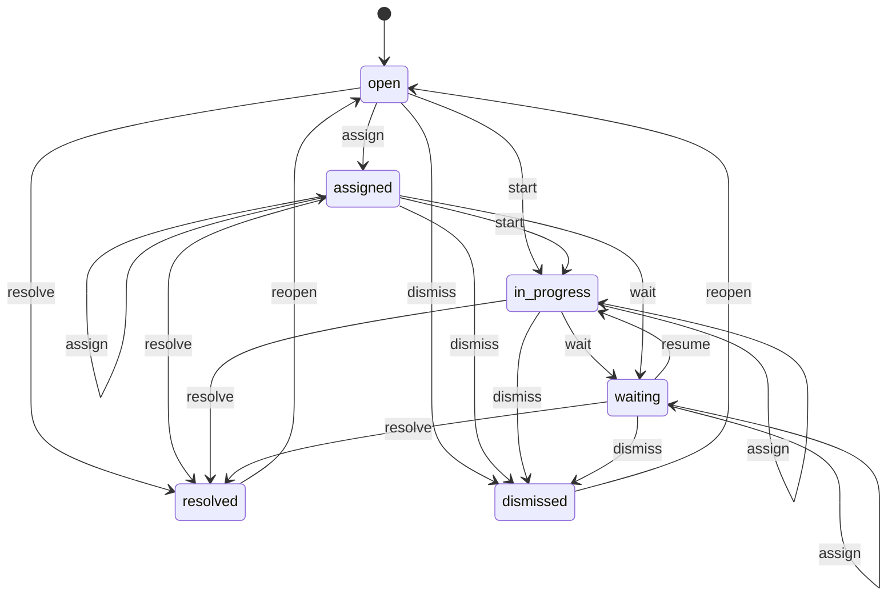
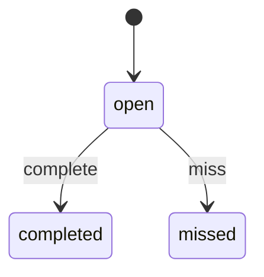
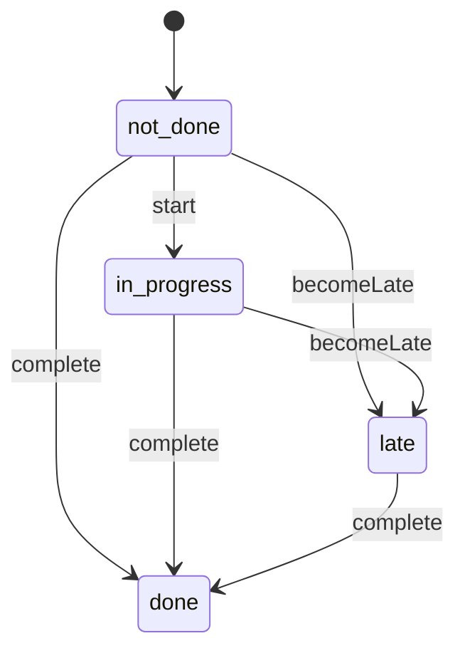

# Work queues (`workqueues`)

The Operations Center's shared to-do system: queue definitions with an owner role, a named lead, a backup and an escalation route, and work items raised from other modules' events (overdue dispatch, low stock, waiting approvals, cases past target, failed payouts, mismatches) with deadlines, assignment and automatic escalation. Also the My work queues view, the dashboard's needs-attention tiles, the day-end review, the daily routine and saved filters.

- **Group:** Platform · **Launch phase:** 1 · **Plan chapters:** 2, 12, 17, 18, 21
- **Depends on:** [access](access.md) · **Optional:** [settings](settings.md), [reports](reports.md), [notifications](notifications.md), [advertising](advertising.md), [promotions](promotions.md), [warehouse](warehouse.md), [shipping](shipping.md), [finance](finance.md), [audit](audit.md), [support](support.md), [sellers](sellers.md)

## Owns
- Queue definitions: area, owner role, lead, backup, escalation route, default deadline, which events open and close items, the screen where the work is done
- Intake rules mapping source events to work items, with de-duplication and automatic resolution when the source is fixed
- Work items: subject, deadline, priority, state, assignee, escalation level, notes and history
- Deadline and escalation engine (due soon, overdue, escalate to the next step, backup cover when the lead is away)
- My work queues view and the admin dashboard needs-attention summary with the team on shift
- Daily operating routine checks and the day-end review (unresolved commitments, failed payouts, upcoming campaigns, next-day shipping)
- Saved filters, personal or shared
- Seller-visible tasks for items that concern a seller (e.g. overdue dispatch, scenario 5)

**Not here:**
- The work itself: items link to the owning module's screen and endpoints (orders, shipping, finance, catalog, sellers, support, trust...)
- Staff roles, backups as a staffing fact and approval requests: access (workqueues reads role members and backups)
- Notification delivery: notifications (consumes workqueues events)
- Export files: reports (workqueues registers a dataset)

## Seller API

| Method | Path | Purpose | Auth | Body → Response |
|---|---|---|---|---|
| GET | `/api/seller/workqueues/tasks` | Tasks Marketly is tracking for this seller (e.g. overdue dispatch, missing tracking, reply overdue) | seller | Page<SellerTask> |

## Admin API

| Method | Path | Purpose | Auth | Body → Response |
|---|---|---|---|---|
| GET | `/api/admin/workqueues/me` | My work queues: stats, queues with lead, backup and escalation, routine, day-end review, saved filters | staff<br>`workqueues.items.view` | `MyQueues` |
| GET | `/api/admin/workqueues/queues` | Queue definitions with live counts | staff<br>`workqueues.items.view` | `QueueSummary[]` |
| GET | `/api/admin/workqueues/queues/{key}` | One queue definition with its intake rules | staff<br>`workqueues.items.view` | `{ queue: QueueDefinition, intakeRules: IntakeRule[], counts: QueueSummary }` |
| POST | `/api/admin/workqueues/queues` | Create a queue (lead, backup and escalation route required) _(audited)_ | staff<br>`workqueues.queues.manage` | `QueueInput` → `QueueDefinition` |
| PATCH | `/api/admin/workqueues/queues/{key}` | Change lead, backup, escalation route or deadline _(audited)_ | staff<br>`workqueues.queues.manage` | `QueueInput` → `QueueDefinition` |
| GET | `/api/admin/workqueues/intake-rules` | Which events open and close items in which queue | staff<br>`workqueues.queues.manage` | `IntakeRule[]` |
| GET | `/api/admin/workqueues/coverage-gaps` | Queues without a lead or backup, leads who are away without cover, one backup covering many queues | staff<br>`workqueues.queues.manage` | `CoverageGap[]` |
| GET | `/api/admin/workqueues/items` | Work items with filters (also used by saved filters) | staff<br>`workqueues.items.view` | Page<WorkItem> |
| GET | `/api/admin/workqueues/items/{id}` | One work item with notes and history | staff<br>`workqueues.items.view` | `WorkItem` |
| POST | `/api/admin/workqueues/items` | Create a task by hand (managers assigning daily tasks) | staff<br>`workqueues.items.work` | `ManualTaskInput` → `WorkItem` |
| POST | `/api/admin/workqueues/items/{id}/assign` | Assign to a person (owner and next action) _(audited)_ | staff<br>`workqueues.items.work` | `{ assigneeId: uuid, nextAction: text? }` → `WorkItem` |
| POST | `/api/admin/workqueues/items/{id}/claim` | Assign to myself and start | staff<br>`workqueues.items.work` | `WorkItem` |
| POST | `/api/admin/workqueues/items/{id}/start` | Mark in progress | staff<br>`workqueues.items.work` | `WorkItem` |
| POST | `/api/admin/workqueues/items/{id}/wait` | Waiting on someone else | staff<br>`workqueues.items.work` | `{ waitingOn: enum(seller|customer|carrier|supplier|finance|other), note: text, followUpAt: datetime? }` → `WorkItem` |
| POST | `/api/admin/workqueues/items/{id}/resume` | Back in progress | staff<br>`workqueues.items.work` | `WorkItem` |
| POST | `/api/admin/workqueues/items/{id}/resolve` | Resolve by hand with a note _(audited)_ | staff<br>`workqueues.items.work` | `{ note: text }` → `WorkItem` |
| POST | `/api/admin/workqueues/items/{id}/dismiss` | Dismiss with a reason (false alarm, duplicate) _(audited)_ | staff<br>`workqueues.items.work` | `{ reason: text }` → `WorkItem` |
| POST | `/api/admin/workqueues/items/{id}/reopen` | Reopen a resolved or dismissed item _(audited)_ | staff<br>`workqueues.items.work` | `{ reason: text }` → `WorkItem` |
| POST | `/api/admin/workqueues/items/{id}/escalate` | Escalate now to the next step of the route _(audited)_ | staff<br>`workqueues.items.work` | `{ reason: text }` → `WorkItem` |
| POST | `/api/admin/workqueues/items/{id}/notes` | Add a note | staff<br>`workqueues.items.work` | `{ body: text }` → `WorkItemNote` |
| POST | `/api/admin/workqueues/items/bulk-assign` | Assign many items at once _(audited, phase 2)_ | staff<br>`workqueues.items.assign-others` | `{ itemIds: uuid[], assigneeId: uuid, nextAction: text? }` → `{ assigned: int, skipped: json[] }` |
| POST | `/api/admin/workqueues/items/exports` | Export the filtered items (authorized export) _(audited)_ | staff<br>`workqueues.items.export` | `{ filters: json, format: enum(csv|xlsx)? }` → `reports.ExportJob` |
| GET | `/api/admin/workqueues/summary` | Dashboard: queues past or near target, overdue dispatch, team on shift | staff<br>`workqueues.items.view` | `WorkSummary` |
| GET | `/api/admin/workqueues/day-end-reviews/current` | Today's day-end review | staff<br>`workqueues.items.view` | `DayEndReview` |
| POST | `/api/admin/workqueues/day-end-reviews/{id}/items/{itemKey}/check` | Mark one day-end item reviewed | staff<br>`workqueues.day-end.run` | `{ note: text? }` → `DayEndReview` |
| POST | `/api/admin/workqueues/day-end-reviews/{id}/complete` | Complete the review and send the summary to managers _(audited)_ | staff<br>`workqueues.day-end.run` | `{ note: text? }` → `DayEndReview` |
| GET | `/api/admin/workqueues/day-end-reviews` | Past day-end reviews | staff<br>`workqueues.items.view` | Page<DayEndReview> |
| GET | `/api/admin/workqueues/routines/today` | Today's routine checks across areas | staff<br>`workqueues.items.view` | `RoutineDay` |
| POST | `/api/admin/workqueues/routine-checks/{id}/complete` | Mark a routine check done (or check in for a shared one) | staff<br>`workqueues.items.work` | `{ note: text? }` → `RoutineCheck` |
| GET | `/api/admin/workqueues/routine-templates` | Daily routine definitions | staff<br>`workqueues.routines.manage` | `RoutineTemplate[]` |
| PUT | `/api/admin/workqueues/routine-templates` | Replace the daily routine _(audited)_ | staff<br>`workqueues.routines.manage` | `{ templates: RoutineTemplate[], reason: text }` → `RoutineTemplate[]` |
| GET | `/api/admin/workqueues/saved-filters` | My saved filters plus filters shared with me | staff<br>`workqueues.items.view` | `SavedFilter[]` |
| POST | `/api/admin/workqueues/saved-filters` | Save the current filter | staff<br>`workqueues.items.view` | `SavedFilterInput` → `SavedFilter` |
| PATCH | `/api/admin/workqueues/saved-filters/{id}` | Rename, share or change a saved filter (owner only) | staff<br>`workqueues.items.view` | `SavedFilterInput` → `SavedFilter` |
| DELETE | `/api/admin/workqueues/saved-filters/{id}` | Delete a saved filter (owner only) | staff<br>`workqueues.items.view` | 204 No content |

## Types

### StaffRef

| Field | Type |
|---|---|
| staffId | `uuid` |
| name | `string` |
| role | `string?` Role label from access.getStaffRef |

### EscalationStep

| Field | Type |
|---|---|
| afterMinutes | `int` Minutes after the deadline (0 = at the deadline) |
| to | `json` { kind: role|staff, key or staffId, name } |
| condition | `string?` Optional rule, e.g. 'seller items only', 'amount over $1,000' |
| notify | `bool` |

### QueueDefinition

| Field | Type |
|---|---|
| key | `string` Stable key, e.g. shipping.overdue_dispatch |
| name | `string` |
| area | `enum(orders_shipping|inventory_warehouse|purchasing|returns|support|finance|catalog|sellers|trust|marketing_ads|content|platform)` |
| ownerRole | `string` access role key, e.g. order_manager |
| lead | `StaffRef` |
| backup | `StaffRef` |
| escalationRoute | `EscalationStep[]` |
| escalationLabel | `string` Readable route, e.g. 'Seller Manager (sellers), Business Owner after 48 h' |
| defaultDeadlineMinutes | `int` |
| businessHoursOnly | `bool` Deadlines count market business hours from settings |
| pauseWhileWaiting | `bool` While an item waits on someone outside the team (seller, customer, carrier, supplier) its deadline clock stops; on resume dueAt moves later by the time spent waiting. False: waiting keeps the deadline |
| screen | `string` Prototype screen where the work is done, e.g. ops/dispatch |
| screenFilter | `string?` |
| visibleToSeller | `bool` |
| active | `bool` |

### QueueInput

| Field | Type |
|---|---|
| key | `string?` Create only (ignored on update: a queue's key never changes). Lowercase letters, numbers and underscores in two dot-separated parts, e.g. inventory.cycle_counts; 409 CONFLICT when taken. Omitted: derived as <area>.<name slug> (name lowercased, every run of other characters becomes _, at most 48 characters), with _2, _3… appended while that key is taken |
| name | `string` |
| area | `string` |
| ownerRole | `string` |
| leadId | `uuid` |
| backupId | `uuid` |
| escalationRoute | `EscalationStep[]` |
| defaultDeadlineMinutes | `int` |
| businessHoursOnly | `bool?` |
| pauseWhileWaiting | `bool?` |
| screen | `string` |
| screenFilter | `string?` |
| visibleToSeller | `bool?` |
| active | `bool?` |
| reason | `text` |

### QueueSummary

| Field | Type |
|---|---|
| key | `string` |
| name | `string` |
| area | `string` |
| lead | `StaffRef` |
| backup | `StaffRef` |
| escalationLabel | `string` |
| open | `int` |
| overdue | `int` |
| dueSoon | `int` |
| oldest | `json?` { itemId, subjectRef, openedAt, ageLabel } e.g. MK-260914-48213 · 16 d |
| mine | `bool` I lead it, back it up or have items assigned in it |
| screen | `string` |
| screenFilter | `string?` |

### WorkSubject

| Field | Type |
|---|---|
| type | `enum(order|order_item|shipment|delivery_exception|product|offer|stock_item|purchase_order|approval_request|case|return|return_parcel|refund|payout|payment|dispute|reconciliation_check|seller|application|appeal|restriction|change_request|trust_report|recommendation|enforcement|moderation_item|conversation|campaign|customer|data_request|other)` |
| id | `string` |
| ref | `string?` Human reference, e.g. MK-261007-10433, PO-261002-0311 |
| label | `string?` |

### WorkItemNote

| Field | Type |
|---|---|
| id | `uuid` |
| body | `text` |
| author | `Actor` |
| at | `datetime` |

### WorkItem

| Field | Type |
|---|---|
| id | `uuid` |
| ref | `string` e.g. WQ-261008-0042 |
| queueKey | `string` |
| queueName | `string` |
| area | `string` |
| kind | `enum(overdue_dispatch|missing_tracking|delivery_exception|seller_cannot_fulfill|low_stock|receiving|pick_pack|return_inspection|return_decision|approval_waiting|case_past_target|case_escalated|payout_failed|payment_check|payment_mismatch|chargeback|hold_review|product_review|application_waiting|launch_review|appeal_due|restriction_review|restriction_evidence|seller_performance|seller_owner_missing|storefront_review|trust_report|trust_recommendation|enforcement_reversal|review_moderation_overdue|official_store_reply|data_request|seller_reply_overdue|unexpected_return_parcel|return_parcel_overdue|manual_task)` What kind of work; how each kind closes is in the notes |
| title | `string` |
| summary | `text?` |
| subject | `WorkSubject` |
| relatedSubjects | `WorkSubject[]` Other records the item's actions use, e.g. the delivery_exception of an overdue_dispatch item (Remind seller calls POST /api/admin/shipping/exceptions/{id}/notify-seller with its id) |
| sellerId | `uuid?` |
| sellerName | `string?` |
| customerId | `uuid?` |
| amount | `Money?` |
| ownerRole | `string` |
| lead | `StaffRef` |
| backup | `StaffRef` |
| assignee | `StaffRef?` |
| deadline | `Deadline` |
| priority | `enum(low|normal|high|urgent)` |
| state | `enum(open|assigned|in_progress|waiting|resolved|dismissed)` |
| waitingOn | `enum(seller|customer|carrier|supplier|finance|other)?` |
| escalationLevel | `int` 0 = not escalated; n = step n of the route reached |
| escalatedTo | `StaffRef?` |
| source | `json` { module, event?, raisedBy: Actor, dedupeKey } |
| links | `json[]` { label, screen, state? } e.g. Open order → admin/order |
| visibleToSeller | `bool` |
| notes | `WorkItemNote[]` |
| history | `TimelineEvent[]` |
| openedAt | `datetime` |
| updatedAt | `datetime` |
| resolvedAt | `datetime?` |
| archived | `bool` Resolved more than itemRetentionDays ago; left out of lists unless archived=true |
| resolution | `json?` { outcome: fixed_at_source|resolved|dismissed, note, by } |

### RaiseInput

| Field | Type |
|---|---|
| queueKey | `string` |
| kind | `enum(overdue_dispatch|missing_tracking|delivery_exception|seller_cannot_fulfill|low_stock|receiving|pick_pack|return_inspection|return_decision|approval_waiting|case_past_target|case_escalated|payout_failed|payment_check|payment_mismatch|chargeback|hold_review|product_review|application_waiting|launch_review|appeal_due|restriction_review|restriction_evidence|seller_performance|seller_owner_missing|storefront_review|trust_report|trust_recommendation|enforcement_reversal|review_moderation_overdue|official_store_reply|data_request|seller_reply_overdue|unexpected_return_parcel|return_parcel_overdue|manual_task)` One of the work item kinds |
| title | `string` |
| summary | `text?` |
| sourceModule | `string` The calling module (stored as items.source_module and shown on the item); required |
| subject | `WorkSubject` |
| relatedSubjects | `WorkSubject[]?` |
| sellerId | `uuid?` |
| sellerName | `string?` |
| customerId | `uuid?` |
| dueAt | `datetime?` Default: now + the queue's defaultDeadlineMinutes |
| priority | `enum(low|normal|high|urgent)?` |
| amount | `Money?` |
| dedupeKey | `string` e.g. overdue_dispatch:<orderItemId> |
| links | `json[]?` |
| visibleToSeller | `bool?` |

### ManualTaskInput

| Field | Type |
|---|---|
| queueKey | `string` |
| title | `string` |
| summary | `text?` |
| subject | `WorkSubject?` |
| assigneeId | `uuid?` |
| dueAt | `datetime` |
| priority | `enum(low|normal|high|urgent)?` |

### IntakeRule

| Field | Type |
|---|---|
| event | `string` Source event name |
| queueKey | `string` |
| kind | `string` |
| titleTemplate | `string` |
| dedupeKeyTemplate | `string` |
| deadline | `string` e.g. 'event.dueAt', 'now + 4h', 'queue default' |
| priority | `string` |
| resolvesOn | `string[]` Events that close the item, e.g. shipping.shipment.dispatched |
| active | `bool` |

### SavedFilter

| Field | Type |
|---|---|
| id | `uuid` |
| name | `string` |
| owner | `StaffRef` |
| shared | `bool` |
| target | `enum(work_items|screen)` work_items filters this module's list; screen stores a filter for another module's list screen |
| screen | `string?` e.g. ops/dispatch |
| screenState | `string?` |
| filters | `json` Query parameters as saved, e.g. { queueKey, overdueOver: '24h', sellerKind: 'marketplace' } |
| count | `int?` Current matching open items (work_items filters only) |
| createdAt | `datetime` |

### SavedFilterInput

| Field | Type |
|---|---|
| name | `string` |
| shared | `bool?` |
| target | `enum(work_items|screen)` |
| screen | `string?` |
| screenState | `string?` |
| filters | `json` |

### DayEndItem

| Field | Type |
|---|---|
| key | `enum(unresolved_commitments|failed_payouts|upcoming_campaigns|next_day_shipping|custom)` |
| title | `string` |
| summary | `text` |
| owner | `StaffRef?` |
| link | `json` { screen, state? } |
| source | `string` workqueues, finance, advertising/promotions, warehouse/shipping; 'unavailable' when the module is off |
| checked | `bool` |
| checkedBy | `StaffRef?` |
| checkedAt | `datetime?` |
| note | `text?` |

### DayEndReview

| Field | Type |
|---|---|
| id | `uuid` |
| date | `date` |
| dueAt | `datetime` |
| state | `enum(open|completed|missed)` |
| sharedWithRoles | `string[]` |
| items | `DayEndItem[]` |
| completedBy | `StaffRef?` |
| completedAt | `datetime?` |
| summarySentTo | `string[]` |

### RoutineCheck

| Field | Type |
|---|---|
| id | `uuid` |
| title | `string` e.g. Review dispatch and delivery |
| areaLabel | `string` |
| owner | `StaffRef` |
| dueAt | `datetime` |
| state | `enum(not_done|in_progress|done|late)` |
| doneAt | `datetime?` |
| doneBy | `StaffRef?` |
| note | `text?` |
| checkedIn | `json?` For shared checks: { done: int, total: int } e.g. 3 of 4 managers checked in |

### RoutineDay

| Field | Type |
|---|---|
| date | `date` |
| checks | `RoutineCheck[]` |
| done | `int` |
| total | `int` |

### RoutineTemplate

| Field | Type |
|---|---|
| id | `uuid` |
| title | `string` |
| areaLabel | `string` |
| ownerRoles | `string[]` |
| dueTime | `string` HH:MM market time |
| weekdays | `int[]` |
| active | `bool` |

### MyQueues

| Field | Type |
|---|---|
| me | `json` { staffId, name, roles: string[] } |
| date | `date` |
| stats | `json` { assignedToMe, queuesILead, overdue, overdueChangeVsYesterday, oldestOpen: { ref, ageLabel } } |
| queues | `QueueSummary[]` |
| routine | `RoutineDay` |
| dayEnd | `DayEndReview?` |
| savedFilters | `SavedFilter[]` |
| reminders | `string[]` e.g. escalation reminder and export scope |
| exportScope | `string[]` Areas the caller may export |

### TeamOnShift

| Field | Type |
|---|---|
| staff | `StaffRef` |
| area | `string` |
| role | `enum(lead|backup)` |
| coveringFor | `StaffRef?` |
| status | `enum(on_shift|away|off)` |

### WorkSummary

| Field | Type |
|---|---|
| needsAttention | `json[]` { queueKey, name, areaLabel, count, overdue, tone: danger|warning|neutral, oldestLabel, screen, screenFilter } |
| overdueDispatch | `WorkItem[]` Top overdue and at-risk dispatch items for the dashboard table |
| team | `TeamOnShift[]` |
| generatedAt | `datetime` |

### CoverageGap

| Field | Type |
|---|---|
| queueKey | `string` |
| queueName | `string` |
| problem | `enum(no_lead|no_backup|lead_is_backup|lead_away_no_cover|same_backup_for_many)` |
| detail | `string` |

### SellerTask

| Field | Type |
|---|---|
| id | `uuid` |
| kind | `string` |
| title | `string` |
| summary | `text?` |
| subject | `WorkSubject` |
| deadline | `Deadline` |
| screen | `string` Seller Center screen, e.g. seller/order |
| state | `enum(open|in_progress|waiting|resolved)` |

## Status flows

### Work item (`WorkItem.state`)



Deadline state (on_time, due_soon, overdue) and escalation level are separate from the state: the sweep job moves them, publishes workqueues.item.overdue once per item and escalates along the queue's route. Reassigning keeps the state (an item in progress or waiting stays so with the new assignee). Waiting keeps the deadline unless the queue has pauseWhileWaiting: then the sweep ignores waiting items and resume moves dueAt later by the time since waiting_since. Most items resolve automatically from their source's resolvesOn events (resolution outcome fixed_at_source); manual resolve needs a note; dismiss needs a reason. A raise with the same dedupeKey reopens a dismissed item only if the source fires again after dismissal.

### Day-end review (`DayEndReview.state`)



Built daily before dayEndReviewTime. Complete requires every item checked (a note is required for items with open overdue work) and sends the summary to the shared roles. Missed at midnight market time if not completed; the next day's review lists it.

### Routine check (`RoutineCheck.state`)



Generated each morning from routine templates for the owner roles on shift.

## Data (schema `workqueues`)

**queues**

| Column | Type |
|---|---|
| key | text pk |
| name | text |
| area | text |
| owner_role | text |
| lead_staff_id | uuid |
| backup_staff_id | uuid |
| escalation_route | jsonb |
| escalation_label | text |
| default_deadline_minutes | int |
| business_hours_only | bool |
| pause_while_waiting | bool |
| screen | text |
| screen_filter | text? |
| visible_to_seller | bool |
| active | bool |
| updated_by | text |
| updated_at | timestamptz |

**intake_rules**: Event → queue mapping, seeded per module and editable only by migration or admin with reason

| Column | Type |
|---|---|
| id | uuid pk |
| event | text |
| queue_key | text → queues |
| kind | text |
| title_template | text |
| dedupe_key_template | text |
| deadline_rule | text |
| priority | text |
| resolves_on | jsonb |
| active | bool |

Indexes: `(event) where active`

**items**

| Column | Type |
|---|---|
| id | uuid pk |
| ref | text unique |
| queue_key | text → queues |
| kind | text |
| title | text |
| summary | text? |
| subject_type | text |
| subject_id | text |
| subject_ref | text? |
| subject_label | text? |
| related_subjects | jsonb (WorkSubject[]) |
| seller_id | uuid? |
| seller_name | text? |
| customer_id | uuid? |
| amount_minor | bigint? |
| currency | text? |
| owner_role | text |
| assignee_staff_id | uuid? |
| due_at | timestamptz |
| deadline_state | text (on_time|due_soon|overdue) |
| priority | text |
| state | text (open|assigned|in_progress|waiting|resolved|dismissed) |
| waiting_on | text? |
| waiting_since | timestamptz? (set on wait, cleared on resume; used to push due_at when the queue pauses while waiting) |
| escalation_level | int |
| escalated_to | text? |
| dedupe_key | text |
| source_module | text |
| source_event | text? |
| links | jsonb |
| visible_to_seller | bool |
| opened_at | timestamptz |
| updated_at | timestamptz |
| resolved_at | timestamptz? |
| resolution | jsonb? |
| archived_at | timestamptz? (resolved items past itemRetentionDays; rows stay) |

Indexes: `unique(dedupe_key) where state in ('open','assigned','in_progress','waiting')`, `(queue_key, state, due_at)`, `(assignee_staff_id, state)`, `(deadline_state, due_at) where state in ('open','assigned','in_progress','waiting')`, `(seller_id, state) where visible_to_seller`, `(subject_type, subject_id)`

**item_events**: History: raised, refreshed, assigned, state changes, escalations, notes

| Column | Type |
|---|---|
| id | uuid pk |
| item_id | uuid → items |
| kind | text |
| detail | jsonb |
| actor_kind | text |
| actor_id | text? |
| at | timestamptz |

Indexes: `(item_id, at)`

**item_notes**

| Column | Type |
|---|---|
| id | uuid pk |
| item_id | uuid → items |
| body | text |
| author_id | text |
| author_name | text |
| at | timestamptz |

**saved_filters**

| Column | Type |
|---|---|
| id | uuid pk |
| owner_staff_id | uuid |
| name | text |
| shared | bool |
| target | text |
| screen | text? |
| screen_state | text? |
| filters | jsonb |
| created_at | timestamptz |

Indexes: `(owner_staff_id)`, `(shared) where shared`

**day_end_reviews**

| Column | Type |
|---|---|
| id | uuid pk |
| date | date unique |
| due_at | timestamptz |
| state | text |
| shared_with_roles | jsonb |
| items | jsonb |
| completed_by | text? |
| completed_at | timestamptz? |
| summary_sent_to | jsonb |

**routine_templates**

| Column | Type |
|---|---|
| id | uuid pk |
| title | text |
| area_label | text |
| owner_roles | jsonb |
| due_time | text |
| weekdays | jsonb |
| active | bool |

**routine_checks**

| Column | Type |
|---|---|
| id | uuid pk |
| template_id | uuid → routine_templates |
| date | date |
| owner_staff_id | uuid |
| due_at | timestamptz |
| state | text |
| done_at | timestamptz? |
| done_by | text? |
| note | text? |
| check_ins | jsonb |

Indexes: `unique(template_id, date)`, `(date, state)`

**daily_counts**: End-of-day snapshot per queue for 'more than yesterday' deltas and trend reports

| Column | Type |
|---|---|
| queue_key | text |
| date | date |
| open | int |
| overdue | int |
| opened | int |
| resolved | int |
| median_resolve_minutes | int? |

Indexes: `unique(queue_key, date)`

## Events

| Publishes | When | Payload | Consumed by |
|---|---|---|---|
| `workqueues.item.created` | A new work item opens | `{ itemId: uuid, queueKey: string, kind: string, subjectType: string, subjectId: string, dueAt: datetime, leadId: uuid, sellerId: uuid? }` | - |
| `workqueues.item.assigned` | An item is assigned or claimed | `{ itemId: uuid, assigneeId: uuid, queueKey: string }` | - |
| `workqueues.item.overdue` | An item passes its deadline (once per item) | `{ itemId: uuid, queueKey: string, kind: string, subjectRef: string?, dueAt: datetime, leadId: uuid, backupId: uuid, assigneeId: uuid?, sellerId: uuid? }` | notifications |
| `workqueues.item.escalated` | An item reaches the next escalation step | `{ itemId: uuid, queueKey: string, level: int, toKind: enum(role|staff), to: string, reason: string }` | notifications |
| `workqueues.item.resolved` | An item is resolved or dismissed | `{ itemId: uuid, queueKey: string, outcome: string }` | notifications |
| `workqueues.queue.changed` | Lead, backup or escalation route changes | `{ queueKey: string, leadId: uuid, backupId: uuid }` | - |
| `workqueues.day_end.completed` | The day-end review is completed (the day-end summary notifications sends to the shared roles) | `{ reviewId: uuid, date: date, completedBy: Actor, completedAt: datetime, openItems: int, overdueItems: int, note: text?, items: json[], roleKeys: string[] }` | notifications |
| `workqueues.day_end.prepared` | Today's day-end review is built and still open (the reminder for dayEndSharedRoles); not published when the review was already completed | `{ reviewId: uuid, date: date, dueAt: datetime, openItems: int, overdueItems: int, roleKeys: string[] }` | notifications |

| Consumes | From | Does |
|---|---|---|
| `shipping.dispatch.overdue` | shipping | Open an overdue_dispatch item about the order (seller-visible for marketplace sellers) with the payload exceptionId as a related delivery_exception subject, so Remind seller can call shipping; resolves on shipping.shipment.dispatched or orders.item.cancelled. fulfilledBy marketly_service: summary 'Fulfilled by Marketly (warehouse)', queue warehouse.pick_pack, not seller-visible |
| `shipping.shipment.dispatched` | shipping | Resolve overdue dispatch and missing tracking items for that order item |
| `shipping.shipment.exception` | shipping | Open a delivery_exception item (lost, damaged, failed delivery, missing tracking). fulfilledBy marketly_service: summary 'Fulfilled by Marketly (warehouse)', not seller-visible |
| `shipping.shipment.delivered` | shipping | Resolve delivery exception items for the shipment |
| `orders.item.cancelled` | orders | Resolve dispatch items for the cancelled item |
| `inventory.stock.low` | inventory | Open a low_stock item for Official Store stock |
| `inventory.stock.changed` | inventory | Resolve low_stock when available is back above the reorder point |
| `access.approval.requested` | access | Open an approval_waiting item for the approvers' role |
| `access.approval.decided` | access | Resolve the approval item |
| `access.away.started` | access | Route new and escalating items of queues led by the absent person to the backup (access.resolveRecipients) |
| `access.away.ended` | access | Return routing to the lead; items stay with whoever holds them |
| `access.coverage.changed` | access | Refresh lead and backup on queues whose owner role coverage changed; re-run coverage gaps |
| `support.case.overdue` | support | Open a case_past_target item |
| `support.case.escalated` | support | Open or raise priority of a case_escalated item |
| `support.case.resolved` | support | Resolve case items |
| `returns.return.escalated` | returns | Open a return_decision item when a seller missed the response deadline |
| `returns.refund.approved` | returns | Resolve return decision items for that return |
| `finance.payout.failed` | finance | Open a payout_failed item (also listed in the day-end review) |
| `finance.payout.paid` | finance | Resolve payout_failed items for that payout |
| `finance.reconciliation.mismatch_found` | finance | Open a payment_mismatch item in finance.payment_checks |
| `finance.reconciliation.item_closed` | finance | Resolve the payment_mismatch item for that reconciliation item (matched, explained or corrected) |
| `payments.payment.pending_check` | payments | Open a payment_check item in finance.payment_checks |
| `payments.payment.captured` | payments | Resolve payment_check items |
| `payments.payment.failed` | payments | Resolve payment_check items (the customer is told by payments) |
| `payments.payment.authorized` | payments | Resolve the payment_check item when the pending check ends authorized (capture may come later) |
| `payments.chargeback.opened` | payments | Open a chargeback item in finance.chargebacks |
| `payments.chargeback.decided` | payments | Resolve the chargeback item (won, lost or conceded; inquiries that close without a chargeback end as won) |
| `catalog.product.submitted` | catalog | Open a product_review item due at the payload's reviewDueAt (the catalog review target in business hours; queue default when absent) |
| `catalog.product.approved` | catalog | Resolve product review items |
| `catalog.product.changes_requested` | catalog | Resolve product review items |
| `catalog.product.rejected` | catalog | Resolve product review items |
| `sellers.application.submitted` | sellers | Open an application_waiting item due at the payload's decisionTargetAt (queue default when absent) |
| `sellers.application.information_provided` | sellers | Reopen the application item for review |
| `sellers.application.decided` | sellers | Resolve application items |
| `sellers.launch_review.requested` | sellers | Open a launch_review item in sellers.launch_reviews |
| `sellers.launch_review.decided` | sellers | Resolve the launch review item |
| `sellers.appeal.submitted` | sellers | Open an appeal_due item with decideBy as deadline |
| `sellers.appeal.decided` | sellers | Resolve appeal items |
| `sellers.restriction.evidence_submitted` | sellers | Open a restriction_evidence item in sellers.restrictions for the Seller Manager |
| `sellers.restriction.lifted` | sellers | Resolve restriction_evidence and restriction_review items for that restriction (lifted, expired or overturned) |
| `sellers.restriction.updated` | sellers | Resolve the restriction_evidence item: staff reviewed the evidence and changed the restriction instead of lifting it |
| `sellers.performance.below_target` | sellers | Open or refresh a seller_performance item in sellers.performance (closed by hand once the follow-up is done; sellers publishes no back-on-target event) |
| `sellers.change_request.submitted` | sellers | Open a storefront_review item in sellers.launch_reviews |
| `sellers.change_request.decided` | sellers | Resolve storefront review items |
| `trust.report.created` | trust | Open a trust_report item (priority from risk score) |
| `trust.report.resolved` | trust | Resolve trust report items |
| `trust.recommendation.routed` | trust | Open a trust_recommendation item in the owning team's queue (Catalog, Seller Manager, Support, Finance) |
| `trust.recommendation.decided` | trust | Resolve the recommendation item |
| `messaging.reply.overdue` | messaging | Open a seller-visible seller_reply_overdue task. Skipped when officialStore is true: messaging keeps its own official_store_reply item for the Official Store (staff owe the reply) |
| `messaging.message.sent` | messaging | Resolve seller_reply_overdue when the seller replies |
| `customers.data_export.requested` | customers | Open a data_request item with the promised delivery time |
| `customers.data_export.ready` | customers | Resolve the data request item |
| `warehouse.return_parcel.received` | warehouse | Resolve the return_parcel_overdue item for that parcel |
| `reviews.moderation.decided` | reviews | Resolve the review_moderation_overdue item for that moderation item (dedupeKey review_moderation_overdue:<moderationItemId>) |

## In-process API (for other modules)

| Function | Signature | Used by |
|---|---|---|
| raise | `(input: RaiseInput) => WorkItem`<br>Create or refresh a work item. Idempotent on dedupeKey: a second call updates title, deadline and amount instead of creating a duplicate. For checks that are not events (e.g. finance's daily reconciliation, returns' deadline job). input.sourceModule names the caller. | finance, returns, support, sellers, trust, inventory, warehouse, customers, reviews, purchasing, messaging, payments, fulfillment-service |
| resolveBySource | `(dedupeKey: string, outcome: { note: string, by: Actor }) => int`<br>Close open items for a fixed source; returns how many closed | finance, returns, support, sellers, trust, inventory, warehouse, reviews, purchasing, messaging, payments, fulfillment-service |
| listForSubject | `(subjectType: string, subjectId: uuid) => WorkItem[]`<br>Open items about one order, seller, case or payout, for detail pages | orders, sellers, support, finance, graphql |
| openCounts | `(queueKeys: string[]) => map<{ open: int, overdue: int }>`<br>Counts for other dashboards | reports |
| sellerTaskCounts | `(sellerId: uuid) => map<int>`<br>Open seller-visible tasks by kind for the seller dashboard | reports |
| getMyQueues | `(principal: identity.Principal) => MyQueues`<br>The My work queues screen for the calling staff member (same as GET /api/admin/workqueues/me) | graphql |
| getWorkSummary | `(principal: identity.Principal) => WorkSummary`<br>Needs-attention tiles, overdue dispatch items and team on shift for the admin dashboard (same as GET /summary), limited to the queues the caller may see | graphql |
| listItems | `(filter: { queueKeys?: string[], areas?: string[], kinds?: string[], states?: string[], assignedToMe?: bool, overdueOnly?: bool, overdueOver?: string, sellerId?: uuid, sellerKind?: string, search?: string }, page: PageInput, principal: identity.Principal) => Page<WorkItem>`<br>Work items in the queues the caller may see (same as GET /items) | graphql |
| getItem | `(itemId: uuid, principal: identity.Principal) => WorkItem | null`<br>One work item with notes and history, if the caller may see its queue | graphql |
| exportRows | `(dataset: string, filters: json, principal: identity.Principal, cursor?: string) => { rows: json[], nextCursor?: string }`<br>Export rows for reports dataset workqueues.admin.items (limited to the principal's queue areas) | reports |

## Permissions

| Key | Who | Allows |
|---|---|---|
| `workqueues.items.view` | staff | See queues and items for your roles |
| `workqueues.items.view-all` | staff | See every queue (managers, Business Owner) |
| `workqueues.items.work` | staff | Claim, start, wait, resolve, dismiss, escalate and note items in your queues |
| `workqueues.items.assign-others` | staff | Assign items to other staff (leads and managers) |
| `workqueues.items.export` | staff | Export items for your areas |
| `workqueues.queues.manage` | staff | Create queues and change lead, backup, escalation route and deadlines |
| `workqueues.day-end.run` | staff | Check and complete the day-end review |
| `workqueues.routines.manage` | staff | Define the daily routine |

## Error codes

| Code | Status | Meaning |
|---|---|---|
| `LEAD_EQUALS_BACKUP` | 422 | A queue's backup must be a different person from its lead |
| `ASSIGNEE_NOT_ELIGIBLE` | 422 | The assignee does not hold the queue's owner role and is not its lead or backup |
| `ESCALATION_ROUTE_END` | 409 | The item is already at the last step of the escalation route |
| `NOTE_REQUIRED` | 422 | This day-end item has overdue work; add a note explaining the plan |
| `DAY_END_INCOMPLETE` | 409 | Some day-end items are not checked yet; details.items |

## Background jobs

| Job | Schedule | Does |
|---|---|---|
| `workqueues.deadline-sweep` | every 1 min | Move items to due_soon and overdue; publish workqueues.item.overdue once; escalate along each queue's route; route to the backup when the lead is away (access absences) |
| `workqueues.routine-generate` | daily 00:05 market time | Create today's routine checks from templates; mark yesterday's unfinished checks late |
| `workqueues.routine-late` | every 15 min | Mark routine checks past their due time as late |
| `workqueues.day-end-prepare` | daily 15:00 market time | Build today's day-end review from open items and other modules' forecasts (refresh it if staff opened it earlier); publish workqueues.day_end.prepared as the reminder only while it is still open. The summary goes out on completion (workqueues.day_end.completed) |
| `workqueues.day-end-close` | daily 23:59 market time | Mark an uncompleted review missed; snapshot daily_counts |
| `workqueues.archive` | monthly | Mark resolved items older than itemRetentionDays archived (archived_at). Rows, notes and history stay in Postgres; archived items leave the default lists and counts and remain reachable by id and with archived=true. Nothing is deleted |

## Settings

| Key | Default | Rules | Meaning |
|---|---|---|---|
| dueSoonMinutes | `60` | duration, minutes, 0–… | When an item turns due soon |
| dayEndReviewTime | `"17:30"` | time | Day-end review due time, market time |
| dayEndSharedRoles | `["order_manager","shipping_manager","inventory_manager","warehouse_manager","finance_manager","customer_support_manager","seller_manager","advertising_manager"]` | json | Who sees and receives the day-end review |
| itemRetentionDays | `400` | duration, days, 30–… | Resolved items stay in the default lists this long, then are archived (kept in Postgres) |
| seedQueues | `["shipping.overdue_dispatch","shipping.missing_tracking","shipping.delivery_exceptions","orders.seller_cannot_fulfill","warehouse.pick_pack","warehouse.return_parcels","purchasing.receiving","inventory.low_stock","inventory.reservations","inventory.merge_candidates","official_store.messages","returns.inspection","returns.decisions","finance.daily_checks","finance.payment_checks","finance.chargebacks","finance.payout_failures","support.cases_waiting","catalog.product_review","sellers.applications","sellers.launch_reviews","sellers.restrictions","sellers.appeals","sellers.performance","sellers.accounts","trust.reports","reviews.moderation","access.approvals","customers.data_requests","fulfillment.receiving","fulfillment.reconciliation","fulfillment.requests","fulfillment.enrollments"]` | json, read-only | Queues created at install with placeholder leads that must be set before launch (a migration adds the fulfillment.* queues to existing installs) |

## Notes
- Queues per kind (seedQueues): payment_check and payment_mismatch → finance.payment_checks; chargeback → finance.chargebacks; payout_failed → finance.payout_failures; hold_review → finance.daily_checks; launch_review and storefront_review → sellers.launch_reviews; restriction_evidence and restriction_review → sellers.restrictions; appeal_due → sellers.appeals; seller_performance → sellers.performance; low_stock → inventory.low_stock; inventory's merge candidates (manual_task with dedupeKey inventory.merge_candidate:<stockItemId>:<twinId>, raised after a catalog merge leaves two company SKUs on the same variant and condition) → inventory.merge_candidates (owner role inventory_manager, screen ops/inventory filter merge_candidates; raise() routes them there by that dedupe prefix whatever queue the caller names, while the queue is installed and active; closed by hand once merged, or by inventory with resolveBySource); unexpected_return_parcel and return_parcel_overdue (raised by warehouse) → warehouse.return_parcels; seller_owner_missing (raised by sellers) → sellers.accounts (owner role seller_manager); review_moderation_overdue (raised by reviews' moderation-sla job) → reviews.moderation (owner role trust_and_risk_manager, which holds reviews.moderation.*); official_store_reply (raised and resolved by messaging while staff owe an Official Store reply) → official_store.messages (owner role official_store_manager, not seller-visible); enforcement_reversal (raised by trust when an enforcement is reversed) → the owning team's queue, like trust_recommendation. Fulfilled by Marketly (raised and resolved by fulfillment-service with raise() and resolveBySource): fulfillment.receiving (owner role warehouse_manager, screen ops/receiving; kind receiving, dedupe fs_inbound_overdue:<inboundId> and fs_discrepancy:<inboundId>), fulfillment.reconciliation (inventory_manager, ops/inventory; manual_task, fs_stock_difference:<skuEnrollmentId>), fulfillment.requests (warehouse_manager, ops/pick-pack; pick_pack, fs_request_short:<requestId>), fulfillment.enrollments (seller_manager, admin/sellers; application_waiting, fs_enrollment:<id> and fs_sku:<id>); none is seller-visible.
- How kinds close: event-raised kinds close on the events listed under consumes (chargeback on payments.chargeback.decided, payment_mismatch on finance.reconciliation.item_closed, restriction_evidence on sellers.restriction.lifted or updated, return_parcel_overdue on warehouse.return_parcel.received). seller_performance and unexpected_return_parcel are closed by hand (resolve with a note). Kinds raised through raise() (receiving, pick_pack, return_inspection, hold_review, restriction_review, seller_owner_missing, enforcement_reversal) are closed by the raising module with resolveBySource (seller_owner_missing when the seller has an active owner again; enforcement_reversal when the owning team confirmed the undo), or by hand. review_moderation_overdue closes on reviews.moderation.decided.
- Deadlines from the source: product_review uses catalog.product.submitted reviewDueAt and application_waiting uses sellers.application.submitted decisionTargetAt; raise() callers pass dueAt; otherwise the queue default applies (business hours when businessHoursOnly, through settings.businessCalendar).
- Archive stays in Postgres: there is no cold-storage store; archived_at only hides old resolved items from working lists. Partitioning or moving them out is a later infrastructure step.
- Work queues never do the work: each item links to the owning module's screen and API. Most items close themselves when the source event arrives (resolvesOn), so a queue reflects reality without double entry.
- Every queue has a named lead, a different backup and an escalation route (plan ch. 2). Install creates seedQueues with placeholders; launch readiness requires real people. Who receives an item right now comes from access.resolveRecipients(ownerRole) (lead, or the first available backup while the lead is away); queue lead and backup default to the role's lead and backup and can be set per queue.
- Events consumed here use the canonical names; finance's daily reconciliation also calls raise() directly for checks that have no event. Modules without a matching event (e.g. warehouse pick-pack, purchasing receiving) call raise() and resolveBySource().
- Seller-visible items (overdue dispatch, missing tracking, reply overdue) satisfy scenario 5: the Shipping Manager sees the item in ops/queues and the seller sees the same task in Seller Center (GET /api/seller/workqueues/tasks); staff notes and escalation details never reach the seller.
- Saved filters can target another module's list screen (target=screen) so one place stores every manager's filters, as the ops/queues screen shows ('Overdue over 24 h, marketplace sellers' opens ops/dispatch with its filter).
- Exports go through reports so that the same permission and audit rules apply to every export.

## GraphQL (read layer)

This module's fragment of the GraphQL schemas (see [../graphql/README.md](../graphql/README.md)). Writes stay on the REST endpoints above.

```graphql
# workqueues: the Operations Center's shared to-do system. Queues with a named lead, backup and escalation route,
# work items raised from other modules' events, the daily routine, the day-end review and saved filters.
# Admin Center only. Work items never do the work: each links to the owning module's screen.
# Seller-visible tasks stay on REST (GET /api/seller/workqueues/tasks); the seller dashboard counts come from reports.

"A staff member as shown on queues and items"
type WorkQueueStaff @areas(in: [ADMIN]) {
  staffId: UUID!
  name: String!
  "Role label, e.g. Order Manager"
  role: String
}

enum WorkQueueArea @areas(in: [ADMIN]) {
  ORDERS_SHIPPING
  INVENTORY_WAREHOUSE
  PURCHASING
  RETURNS
  SUPPORT
  FINANCE
  CATALOG
  SELLERS
  TRUST
  MARKETING_ADS
  CONTENT
  PLATFORM
}

"One step of a queue's escalation route"
type WorkQueueEscalationStep @areas(in: [ADMIN]) {
  "Minutes after the deadline (0 = at the deadline)"
  afterMinutes: Int!
  "Role or person, e.g. Business Owner"
  toName: String!
  "Optional rule, e.g. seller items only, amount over $1,000"
  condition: String
  notify: Boolean!
}

"The oldest open item in a queue, e.g. MK-260914-48213 · 16 d"
type WorkQueueOldestItem @areas(in: [ADMIN]) {
  itemId: UUID!
  subjectRef: String
  openedAt: DateTime!
  ageLabel: String!
}

"A work queue with its owner, lead, backup, escalation route and live counts"
type WorkQueue @areas(in: [ADMIN]) {
  "Stable key, e.g. shipping.overdue_dispatch"
  key: String!
  name: String!
  area: WorkQueueArea!
  "access role key, e.g. order_manager"
  ownerRole: String!
  lead: WorkQueueStaff!
  backup: WorkQueueStaff!
  "Readable route, e.g. Seller Manager (sellers), Business Owner after 48 h"
  escalationLabel: String!
  escalationRoute: [WorkQueueEscalationStep!]!
  defaultDeadlineMinutes: Int!
  businessHoursOnly: Boolean!
  open: Int!
  overdue: Int!
  dueSoon: Int!
  oldest: WorkQueueOldestItem
  "I lead it, back it up or have items assigned in it"
  mine: Boolean!
  "Screen where the work is done, e.g. ops/dispatch"
  screen: String!
  screenFilter: String
  visibleToSeller: Boolean!
  active: Boolean!
  "Items in this queue, most urgent first"
  items(filter: WorkItemFilterInput, paging: PageInput): WorkItemPage! @cost(weight: 10)
}

enum WorkItemKind @areas(in: [ADMIN]) {
  OVERDUE_DISPATCH
  MISSING_TRACKING
  DELIVERY_EXCEPTION
  SELLER_CANNOT_FULFILL
  LOW_STOCK
  RECEIVING
  PICK_PACK
  RETURN_INSPECTION
  RETURN_DECISION
  APPROVAL_WAITING
  CASE_PAST_TARGET
  CASE_ESCALATED
  PAYOUT_FAILED
  PAYMENT_CHECK
  PAYMENT_MISMATCH
  CHARGEBACK
  HOLD_REVIEW
  PRODUCT_REVIEW
  APPLICATION_WAITING
  LAUNCH_REVIEW
  APPEAL_DUE
  RESTRICTION_REVIEW
  RESTRICTION_EVIDENCE
  SELLER_PERFORMANCE
  STOREFRONT_REVIEW
  TRUST_REPORT
  TRUST_RECOMMENDATION
  DATA_REQUEST
  SELLER_REPLY_OVERDUE
  MANUAL_TASK
}

enum WorkItemPriority @areas(in: [ADMIN]) {
  LOW
  NORMAL
  HIGH
  URGENT
}

enum WorkItemState @areas(in: [ADMIN]) {
  OPEN
  ASSIGNED
  IN_PROGRESS
  WAITING
  RESOLVED
  DISMISSED
}

enum WorkItemWaitingOn @areas(in: [ADMIN]) {
  SELLER
  CUSTOMER
  CARRIER
  SUPPLIER
  FINANCE
  OTHER
}

enum WorkItemSubjectType @areas(in: [ADMIN]) {
  ORDER
  ORDER_ITEM
  SHIPMENT
  "Shipping delivery exception (late dispatch, missing tracking, failed delivery)"
  DELIVERY_EXCEPTION
  OFFER
  STOCK_ITEM
  PURCHASE_ORDER
  APPROVAL_REQUEST
  CASE
  RETURN
  REFUND
  PAYOUT
  PAYMENT
  RECONCILIATION_CHECK
  SELLER
  APPLICATION
  APPEAL
  RESTRICTION
  CHANGE_REQUEST
  TRUST_REPORT
  RECOMMENDATION
  CAMPAIGN
  CUSTOMER
  DATA_REQUEST
  OTHER
}

"What the item is about, with its human reference"
type WorkItemSubject @areas(in: [ADMIN]) {
  type: WorkItemSubjectType!
  id: String!
  "e.g. MK-261007-10433, PO-261002-0311"
  ref: String
  label: String
}

"A link to the owning module's screen, e.g. Open order → admin/order"
type WorkItemLink @areas(in: [ADMIN]) {
  label: String!
  screen: String!
  state: String
}

"Where the item came from"
type WorkItemSource @areas(in: [ADMIN]) {
  module: String!
  event: String
  raisedBy: Actor!
  dedupeKey: String!
}

type WorkItemResolution @areas(in: [ADMIN]) {
  "fixed_at_source, resolved or dismissed"
  outcome: String!
  note: String
  by: Actor!
}

type WorkItemNote @areas(in: [ADMIN]) {
  id: UUID!
  body: String!
  author: Actor!
  at: DateTime!
}

"A piece of work with a deadline, an owner and automatic escalation. Most items close themselves when the source event arrives."
type WorkItem @areas(in: [ADMIN]) {
  id: UUID!
  "e.g. WQ-261008-0042"
  ref: String!
  queueKey: String!
  queueName: String!
  area: WorkQueueArea!
  kind: WorkItemKind!
  title: String!
  summary: String
  subject: WorkItemSubject!
  "Other records the item's actions use, e.g. the delivery exception of an overdue dispatch item (Remind seller → REST POST /api/admin/shipping/exceptions/{id}/notify-seller)"
  relatedSubjects: [WorkItemSubject!]!
  sellerId: UUID
  sellerName: String
  customerId: UUID
  amount: Money
  ownerRole: String!
  lead: WorkQueueStaff!
  backup: WorkQueueStaff!
  assignee: WorkQueueStaff
  deadline: Deadline!
  priority: WorkItemPriority!
  state: WorkItemState!
  waitingOn: WorkItemWaitingOn
  "0 = not escalated; n = step n of the route reached"
  escalationLevel: Int!
  escalatedTo: WorkQueueStaff
  source: WorkItemSource!
  links: [WorkItemLink!]!
  "Also shown to the seller as a Seller Center task (staff notes never are)"
  visibleToSeller: Boolean!
  notes: [WorkItemNote!]!
  history: [TimelineEvent!]!
  openedAt: DateTime!
  updatedAt: DateTime!
  resolvedAt: DateTime
  resolution: WorkItemResolution
}

type WorkItemPage implements Paged @areas(in: [ADMIN]) {
  items: [WorkItem!]!
  nextCursor: String
  page: Int
  totalPages: Int
  total: Int
}

"Filters for work item lists (same as GET /api/admin/workqueues/items)"
input WorkItemFilterInput @areas(in: [ADMIN]) {
  queueKeys: [String!]
  areas: [WorkQueueArea!]
  kinds: [WorkItemKind!]
  states: [WorkItemState!]
  "Only items assigned to the caller"
  assignedToMe: Boolean
  overdueOnly: Boolean
  "e.g. 24h: overdue by more than this"
  overdueOver: String
  sellerId: UUID
  "official or marketplace"
  sellerKind: String
  search: String
}

# ------------------------------------------------------------------ My work queues

enum WorkQueueScope @areas(in: [ADMIN]) {
  "Queues I lead, back up or have items in"
  MINE
  "Every queue I may see (workqueues.items.view-all)"
  ALL
}

"Headline numbers on My work queues"
type WorkQueueStats @areas(in: [ADMIN]) {
  assignedToMe: Int!
  queuesILead: Int!
  overdue: Int!
  "Positive = more overdue than yesterday"
  overdueChangeVsYesterday: Int!
  oldestOpen: WorkQueueOldestItem
}

enum WorkQueueRoutineState @areas(in: [ADMIN]) {
  NOT_DONE
  IN_PROGRESS
  DONE
  LATE
}

"Shared check progress, e.g. 3 of 4 managers checked in"
type WorkQueueCheckIn @areas(in: [ADMIN]) {
  done: Int!
  total: Int!
}

"One check in the daily operating routine"
type WorkQueueRoutineCheck @areas(in: [ADMIN]) {
  id: UUID!
  "e.g. Review dispatch and delivery"
  title: String!
  areaLabel: String!
  owner: WorkQueueStaff!
  dueAt: DateTime!
  state: WorkQueueRoutineState!
  doneAt: DateTime
  doneBy: WorkQueueStaff
  note: String
  checkedIn: WorkQueueCheckIn
}

type WorkQueueRoutineDay @areas(in: [ADMIN]) {
  date: Date!
  checks: [WorkQueueRoutineCheck!]!
  done: Int!
  total: Int!
}

enum WorkQueueDayEndKey @areas(in: [ADMIN]) {
  UNRESOLVED_COMMITMENTS
  FAILED_PAYOUTS
  UPCOMING_CAMPAIGNS
  NEXT_DAY_SHIPPING
  CUSTOM
}

type WorkQueueDayEndItem @areas(in: [ADMIN]) {
  key: WorkQueueDayEndKey!
  title: String!
  summary: String!
  owner: WorkQueueStaff
  link: WorkItemLink!
  "Module that answered it; 'unavailable' when that module is off"
  source: String!
  checked: Boolean!
  checkedBy: WorkQueueStaff
  checkedAt: DateTime
  note: String
}

enum WorkQueueDayEndState @areas(in: [ADMIN]) {
  OPEN
  COMPLETED
  MISSED
}

"The day-end review shared with queue leads"
type WorkQueueDayEndReview @areas(in: [ADMIN]) {
  id: UUID!
  date: Date!
  dueAt: DateTime!
  state: WorkQueueDayEndState!
  sharedWithRoles: [String!]!
  items: [WorkQueueDayEndItem!]!
  completedBy: WorkQueueStaff
  completedAt: DateTime
  summarySentTo: [String!]!
}

enum WorkQueueFilterTarget @areas(in: [ADMIN]) {
  "Filters this module's item list"
  WORK_ITEMS
  "Stores a filter for another module's list screen, e.g. ops/dispatch"
  SCREEN
}

"A saved filter, own or shared"
type WorkQueueSavedFilter @areas(in: [ADMIN]) {
  id: UUID!
  name: String!
  owner: WorkQueueStaff!
  shared: Boolean!
  target: WorkQueueFilterTarget!
  screen: String
  screenState: String
  "Query parameters as saved, e.g. { queueKey, overdueOver: '24h', sellerKind: 'marketplace' }"
  filters: JSON!
  "Current matching open items (WORK_ITEMS filters only)"
  count: Int
  createdAt: DateTime!
}

"Everything on the My work queues screen (OpsQueues)"
type MyWorkQueues @areas(in: [ADMIN]) {
  me: WorkQueueStaff!
  roles: [String!]!
  date: Date!
  stats: WorkQueueStats!
  queues(scope: WorkQueueScope = MINE): [WorkQueue!]! @cost(weight: 5)
  routine: WorkQueueRoutineDay!
  "Today's review; null before it is created"
  dayEnd: WorkQueueDayEndReview
  savedFilters: [WorkQueueSavedFilter!]!
  "e.g. escalation reminder"
  reminders: [String!]!
  "Areas the caller may export"
  exportScope: [String!]!
}

# ------------------------------------------------------------------ Admin dashboard

enum WorkQueueTone @areas(in: [ADMIN]) {
  DANGER
  WARNING
  NEUTRAL
}

"A needs-attention tile on the admin dashboard; links to its queue"
type WorkQueueAttentionTile @areas(in: [ADMIN]) {
  queueKey: String!
  name: String!
  "e.g. Order & Shipping"
  areaLabel: String!
  count: Int!
  overdue: Int!
  tone: WorkQueueTone!
  "e.g. oldest 2 days"
  oldestLabel: String
  screen: String!
  screenFilter: String
}

enum WorkQueueShiftRole @areas(in: [ADMIN]) {
  LEAD
  BACKUP
}

enum WorkQueueShiftStatus @areas(in: [ADMIN]) {
  ON_SHIFT
  AWAY
  OFF
}

"Leads and backups on shift, for the admin dashboard"
type WorkQueueTeamMember @areas(in: [ADMIN]) {
  staff: WorkQueueStaff!
  area: String!
  role: WorkQueueShiftRole!
  coveringFor: WorkQueueStaff
  status: WorkQueueShiftStatus!
}

"The work side of the admin dashboard: needs-attention tiles, overdue dispatch and team on shift"
type WorkQueueSummary @areas(in: [ADMIN]) {
  needsAttention: [WorkQueueAttentionTile!]!
  "Top overdue and at-risk dispatch items for the dashboard table"
  overdueDispatch(limit: Int = 5): [WorkItem!]!
  team: [WorkQueueTeamMember!]!
  generatedAt: DateTime!
}

# ------------------------------------------------------------------ extensions and queries

extend type Seller {
  "Open work items about this seller (applications, appeals, restriction reviews, overdue dispatch…) for the seller 360"
  openWorkItems: [WorkItem!] @areas(in: [ADMIN]) @auth(requires: STAFF, permission: "workqueues.items.view") @source(module: "workqueues", fn: "listForSubject")
}

extend type Query {
  "My work queues (OpsQueues screen query)"
  myQueues: MyWorkQueues @areas(in: [ADMIN]) @auth(requires: STAFF, permission: "workqueues.items.view") @source(module: "workqueues", fn: "getMyQueues")

  "Needs-attention tiles, overdue dispatch and team on shift (AdminDashboard)"
  workSummary: WorkQueueSummary @areas(in: [ADMIN]) @auth(requires: STAFF, permission: "workqueues.items.view") @source(module: "workqueues", fn: "getWorkSummary") @cost(weight: 5)

  "Work items across the queues the caller may see"
  workItems(filter: WorkItemFilterInput, paging: PageInput): WorkItemPage! @areas(in: [ADMIN]) @auth(requires: STAFF, permission: "workqueues.items.view") @source(module: "workqueues", fn: "listItems")

  workItem(id: UUID!): WorkItem @areas(in: [ADMIN]) @auth(requires: STAFF, permission: "workqueues.items.view") @source(module: "workqueues", fn: "getItem")
}
```
